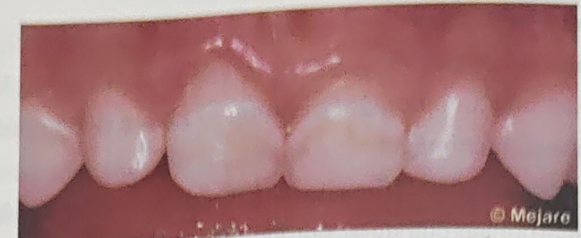
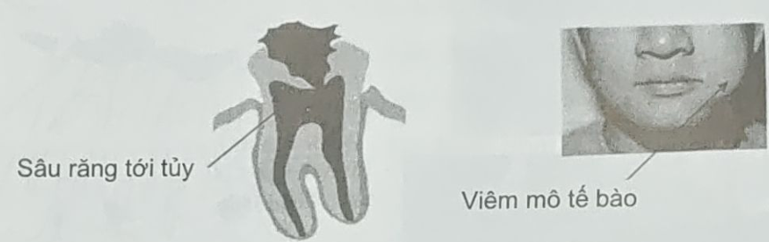
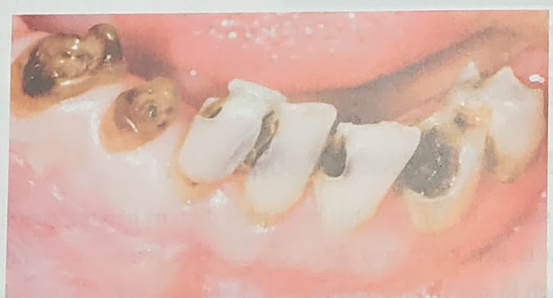
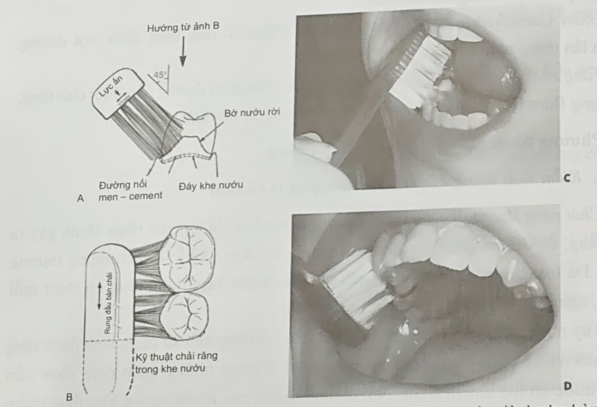

> [!IMPORTANT] Cách học bài này (4 bước, ~90 phút)
> 1. **Đọc "Bức tranh 1 phút"** để nắm câu chuyện của cả bài – chưa cần thuộc.
> 2. **Đọc từng mục 0 → 6** (đúng số mục trong sách). Mỗi mục: đọc hộp 💡 *Hiểu nhanh* trước, rồi tới phần **📖 SGK ghi**, rồi các hộp 🔍 *Vì sao…?* (cơ chế đằng sau ý của sách: đọc để hiểu, không cần thuộc; ý nào ngoài SGK đều có ghi rõ, thi vẫn chọn theo SGK). Chữ ==tô vàng== là từ khoá/con số mà đề hay lấy rồi đổi đi một chữ.
> 3. **Bấm "Che từ khoá"** (thanh trên cùng) → đọc lại; gặp ô bị che thì tự nói ra trước, rồi bấm vào ô để kiểm tra.
> 4. **Làm trắc nghiệm** cuối bài. Câu sai → bấm nhãn "mục …" của câu đó để quay về đúng đoạn cần đọc. Làm xong bấm **"Chỉ xem câu sai"** để ôn lại chỗ yếu.

**Mục tiêu SGK** – đề thường bám sát 4 mục tiêu này:
1. Kể được các **yếu tố gây sâu răng** và các **yếu tố cân bằng** bệnh sâu răng.
2. Mô tả được sang thương **sâu men** và **sâu ngà**.
3. Mô tả được các **biến chứng** của sâu răng.
4. Kể được **phác đồ điều trị** sâu răng và các biện pháp **phòng ngừa** sâu răng.

## Bức tranh 1 phút

> [!NOTE] Cả bài gói trong 6 câu
> 1. Trên răng luôn có **mảng bám** = "thành phố vi khuẩn", đứng đầu là *S. mutans*.
> 2. Mỗi lần mình ăn **đường**, vi khuẩn lên men thành **acid** → mặt răng bị "ngâm acid" khoảng **30 phút**.
> 3. Khi **pH < 5,5**, men bị acid rút bớt khoáng (**mất khoáng**). Khi pH trở lại, **nước bọt** mang calcium, phosphate, fluor tới đắp khoáng lại (**tái khoáng**).
> 4. Ăn vặt liên tục, ít chải răng → mất khoáng thắng tái khoáng → **đốm trắng** → **lỗ sâu** → vào **ngà** → vào **tủy** → **biến chứng**.
> 5. Vì vậy sâu răng là **một bệnh** (nhiễm khuẩn, mạn tính); **lỗ sâu chỉ là dấu hiệu muộn** của bệnh.
> 6. **Quan niệm mới** = chữa *bệnh* chứ không chỉ chữa *lỗ*: đánh giá nguy cơ, kiểm soát vi khuẩn – đường trước; tổn thương mới chớm thì **không khoan**; chỉ trám khi **đã có lỗ**.

```flow
Ăn đường (sucrose) -> Vi khuẩn mảng bám lên men -> Acid: pH < 5,5, kéo dài ~30 phút -> !Men mất khoáng
Nước bọt đệm acid -> Ca, P, F đắp lại -> +Tái khoáng (fluorapatite bền hơn)
!Mất khoáng thắng tái khoáng -> Đốm trắng -> Lỗ sâu ở men -> Sâu ngà -> Tủy -> !Biến chứng
```

| | Quan niệm cũ | Quan niệm mới (tên bài này) |
|---|---|---|
| Sâu răng là | một cái lỗ cần lấp | một ==bệnh nhiễm khuẩn==, một ==quá trình mạn tính== |
| Chẩn đoán | tìm và ghi nhận lỗ sâu | thêm đánh giá ==nguy cơ== và sâu răng ==hoạt động hay không== |
| Điều trị | "==cắt bỏ mô răng==" kiểu ngoại khoa (cuối thế kỷ XIX) | điều trị nguyên nhân, mô hình ==nội khoa phòng bệnh== |
| Tổn thương mới chớm | khoan, trám | ==không xâm lấn== (fluor, vệ sinh, giảm đường) |
| Trám (phục hồi) | là bước đầu và bước cuối | chỉ cần cho ==sang thương có lỗ==; ==không phải bước khởi đầu hay kết thúc== |

## 0. Đại cương · tr. 2

> [!NOTE]
> Hãy nghĩ sâu răng như **một đám cháy âm ỉ**: lửa (vi khuẩn + acid) đã cháy từ lâu ở mức vi thể – mắt thường không thấy. Tới lúc thấy "khói" (đốm trắng) rồi thấy "lỗ thủng" (lỗ sâu) thì bệnh đã đi một chặng dài. Không dập lửa thì cháy tới hết răng.

**📖 SGK ghi:**
- Sâu răng là ==bệnh nhiễm khuẩn==: do ==*Streptococcus mutans*== ở ==giai đoạn đầu== và do ==*Lactobacillus*== ở ==các giai đoạn sau==.
- Gây phá huỷ ==mô cứng== của răng: ==men, ngà, cement==.
- Các dấu hiệu bệnh xếp từ ==mất khoáng ban đầu ở mức vi cấu trúc== đến ==phá huỷ toàn bộ răng==.
- Là một quá trình bệnh, bắt đầu ==đã lâu trước khi== thành sang thương phát hiện được trên lâm sàng.
- Bệnh ==hiếm khi giới hạn==; không điều trị thì tiến triển ==tới khi răng bị phá huỷ==.
- Sâu răng ==không phát triển nếu không có vi khuẩn tích tụ== tại chỗ. Nhưng vi khuẩn có thể phủ răng mà không sâu ⇒ lắng đọng vi khuẩn là ==cần, nhưng không đủ==.
- Tốc độ phát triển và mức nguy hiểm ==tuỳ từng cá thể== (môi trường miệng phức tạp).

> [!WHY] Vì sao có vi khuẩn mà chưa chắc đã sâu răng?
> Vi khuẩn chỉ là **1 trong 3 vòng** của sơ đồ Keyes (mục 1.2). Muốn thành sâu còn phải có **đường** để vi khuẩn làm ra acid, **răng** dễ bị tấn công và **đủ thời gian**. Đồng thời phe bảo vệ (chải răng, nước bọt, sealant, ý thức ăn uống – mục 1.3) phải **thua**.
>
> Ví dụ hai người cùng nhiều mảng bám: người ít ăn vặt, nước bọt tốt có thể không sâu; người ăn vặt cả ngày thì sâu. ⇒ Vi khuẩn là điều kiện **cần**. Phải có thêm đường, răng nhạy cảm và thời gian thì mới **đủ**.

> [!WHY] Vì sao sâu răng hiếm khi tự dừng?
> *(ngoài SGK)* Khi đã thành lỗ, cái lỗ trở thành **chỗ trú** cho mảng bám: lông bàn chải không với vào, nước bọt khó rửa tới. Acid đọng lâu hơn, lỗ càng to lại càng giữ nhiều mảng bám. Men cũng **không có tế bào** nên không tự xây lại phần đã mất. Bệnh chỉ dừng khi **làm sạch lỗ sâu và kiểm soát được các yếu tố gây sâu** (mục 4).

**Dịch tễ:**

| Điều tra | Kết quả |
|---|---|
| Toàn quốc năm ==2001== (Viện RHM + ==ĐH Adelaide, Úc==), sâu răng sữa trẻ ==6–8 tuổi== | ==84,9%== · miền Nam ==93,7%== · miền Trung ==91,6%== · miền Bắc ==83,7%== |
| TP.HCM năm 2000, sâu răng sữa trẻ ==3–6 tuổi== | ==78,2%== |
| Trẻ ==12 tuổi== | TP.HCM (1995) ==78%== · Cần Thơ ==83,4%== |
| Giới – nơi ở | ==không== khác biệt nam – nữ · ==có== khác biệt nông thôn – thành thị (do khác ==kiến thức chăm sóc răng miệng==) |

> [!TIP]
> - **"Mutans Mở màn – Lacto Lấn sâu"**: S. **m**utans **m**ở đầu, **L**actobacillus **l**àm sâu thêm.
> - Sâu răng sữa: **Nam > Trung > Bắc** (93,7 > 91,6 > 83,7) – "càng vào Nam càng cao"; cả nước 84,9%.
> - Trẻ 12 tuổi: **Cần Thơ 83,4% > TP.HCM 78%**.

> [!WARNING]
> - "Vi khuẩn tích tụ là điều kiện **đủ**" → sai, chỉ là điều kiện **cần**.
> - "Sâu răng thường tự giới hạn" → sai, **hiếm khi** giới hạn.
> - "Có khác biệt nam – nữ" → sai; "khác biệt nông thôn – thành thị" → đúng.

> [!CAUTION] Hai cách hiểu – sâu răng có phải "bệnh nhiễm khuẩn"?
> | SGK | Quan niệm hiện đại |
> |---|---|
> | ==Bệnh nhiễm khuẩn==: *S. mutans* (giai đoạn đầu) → *Lactobacillus* (giai đoạn sau) | Bệnh do **mảng bám (màng sinh học) + đường**, là sự **mất cân bằng sinh thái** của hệ vi khuẩn vốn có trong miệng, không phải "nhiễm" một loài từ ngoài vào |
>
> **Thi chọn SGK.** Đề dùng chữ "nhiễm khuẩn", "S. mutans giai đoạn đầu" → theo SGK. Đề dùng chữ "màng sinh học", "mất cân bằng sinh thái", "bệnh không lây" → người ra đề theo hướng hiện đại.

## 1. Bệnh học sâu răng · tr. 2–5

### 1.1. Bản chất của sâu răng

> [!NOTE]
> Mỗi lần ăn đồ ngọt = mặt răng bị "ngâm acid" khoảng 30 phút. Ăn 2–3 bữa → 2–3 lần ngâm, giữa các lần răng kịp hồi phục. Ăn vặt liên tục → lần ngâm này chưa hết đã tới lần sau → răng gần như **ngâm acid cả ngày**. Vì vậy **số lần ăn** nguy hiểm hơn **lượng đường mỗi lần**.

**📖 SGK ghi:**
- Sâu răng là ==quá trình mạn tính== nên cần ==thời gian==.
- pH mảng bám ==acid kéo dài đến 30 phút== sau khi ăn carbohydrate.
- Ăn đường ==lặp đi lặp lại== (==ăn vặt giữa các bữa ăn chính==) → acid tấn công ==gần như thường xuyên== trên mặt răng.

> [!WHY] Vì sao pH acid kéo dài khoảng 30 phút?
> *(ngoài SGK)* Vi khuẩn lên men đường **rất nhanh**: chỉ vài phút sau khi ăn, pH mảng bám đã tụt. Muốn hết acid thì phải xong 2 việc: đường bị **nước bọt rửa trôi** hoặc bị vi khuẩn dùng hết, và nước bọt **trung hoà** xong lượng acid đã sinh ra (nhờ bicarbonate, mục 1.3). Hai việc này cần thời gian, nên phải chừng **nửa giờ** pH mới về lại mức an toàn.

```ph
6-14
Chỉ ăn 2 bữa chính | 7:00 12:00
2 bữa chính + 5 lần ăn vặt | 7:00 8:00 8:45 9:30 10:15 11:00 12:00
caption: Biểu đồ minh hoạ (dạng **đường cong Stephan**, Bài 2 học kỹ). Mỗi ▲ là 1 lần ăn đường: pH tụt ngay rồi mất khoảng 30 phút mới về lại. **Vùng đỏ** = lúc pH < 5,5, men đang mất khoáng. Cùng một ngày, ăn vặt làm thời gian "ngâm acid" tăng gấp mấy lần.
```

### 1.2. Yếu tố gây sâu răng (sơ đồ Keyes)

<figure>
<div class="sc"><svg class="dg" style="max-width:520px" viewBox="0 0 440 315" role="img" aria-label="Sơ đồ Keyes: vi khuẩn, thức ăn, răng giao nhau theo thời gian">
<defs><marker id="ah1" viewBox="0 0 10 10" refX="9" refY="5" markerWidth="8" markerHeight="8" orient="auto"><path d="M0,0L10,5L0,10z" class="mk"/></marker></defs>
<circle class="c1" cx="160" cy="100" r="80"/>
<circle class="c2" cx="280" cy="100" r="80"/>
<circle class="c3" cx="220" cy="182" r="80"/>
<text x="118" y="88" text-anchor="middle" class="b">Vi khuẩn</text>
<text x="118" y="108" text-anchor="middle" class="m">mảng bám</text>
<text x="322" y="88" text-anchor="middle" class="b">Thức ăn</text>
<text x="322" y="108" text-anchor="middle" class="m">đường</text>
<text x="220" y="228" text-anchor="middle" class="b">Răng</text>
<text x="220" y="248" text-anchor="middle" class="m">ký chủ</text>
<text x="220" y="124" text-anchor="middle" class="b r">SÂU</text>
<text x="220" y="143" text-anchor="middle" class="b r">RĂNG</text>
<line class="k" x1="40" y1="285" x2="400" y2="285" marker-end="url(#ah1)"/>
<text x="220" y="307" text-anchor="middle" class="b">Thời gian</text>
</svg></div>
<figcaption>Sơ đồ Keyes (vẽ lại theo SGK Hình 1.1): chỉ khi <b>đủ 3 vòng giao nhau</b> và <b>đủ thời gian</b> mới thành sâu răng. Trong sơ đồ <b>không có</b> acid, fluor.</figcaption>
</figure>

> [!NOTE]
> Sâu răng cần **đủ 3 "nguyên liệu" cùng lúc + đủ lâu**: vi khuẩn (thợ làm acid) + đường (nguyên liệu làm acid) + răng (nơi bị acid tấn công). Thiếu 1 vòng là không sâu. Vì vậy mọi cách phòng ngừa ở mục 6 đều nhắm vào 1 trong 3 vòng này (xem [bảng nối ở mục 6.2](#m6-2)).

#### 1.2.1. Mảng bám, vi khuẩn gây sâu răng

**📖 SGK ghi:**
- Đây là ==tác nhân chính== gây sâu răng. Vi khuẩn tập trung thành quần thể gọi là ==mảng bám==; thành phần vi khuẩn ==rất phức tạp, đa dạng==.
- Tác nhân chủ yếu gây nên mảng bám: ==*Streptococcus mutans*==.
- *S. mutans* sinh ==polysaccharide ngoại bào có tính dính==, tên là ==dextran== → vi khuẩn nhân lên và ==bám trực tiếp== vào bề mặt răng.
- Cộng thêm 2 yếu tố ==thời gian== và ==chất đường== → sâu răng phát triển thuận lợi.
- Khi sang thương tiến sâu ==vào ngà== → thường cấy được ==*Lactobacillus acidophilus*==.
- Tóm lại: ==*S. mutans* gây khởi phát== sang thương; ==*L. acidophilus* làm sang thương tiến triển sâu xuống dưới bề mặt==.

> [!NOTE]
> **Dextran giống "keo dán"**: *S. mutans* biến sucrose thành keo dextran nằm **bên ngoài** tế bào (ngoại bào) → cả đám vi khuẩn **dính chặt** vào răng, nước bọt không rửa trôi.
> Một vi khuẩn gây sâu "giỏi" cần đủ **3 tài**: **sinh acid** – **sống được trong acid** – **tổng hợp được polysaccharide**. Đây chính là câu lượng giá số 1 cuối bài SGK.

> [!WHY] Vì sao *S. mutans* mở màn, còn *Lactobacillus* đi sau?
> *(ngoài SGK)* *S. mutans* tự làm keo dextran nên **bám được lên mặt men còn nhẵn, còn nguyên**. Vì vậy nó là "đội tiên phong" mở đầu tổn thương.
>
> *Lactobacillus* **bám kém** trên mặt nhẵn nhưng **chịu acid rất giỏi**. Nó cần **chỗ trú** (hố rãnh sâu, lỗ sâu) và môi trường đã acid sẵn, nên chỉ sinh sôi mạnh khi đã có lỗ, đã vào ngà. Lúc đó nó là "đội đào hầm" đưa sang thương xuống sâu.

#### 1.2.2. Thức ăn – nguồn dinh dưỡng của vi khuẩn

**📖 SGK ghi:**
- Vi khuẩn sau khi vào miệng ==tự nó không thể gây sâu răng==; cần ==có sẵn nguồn đường== để chuyển hoá.
- ==Carbohydrate tinh chế==, đặc biệt dạng ==sucrose==, là loại vi khuẩn ==ưa thích== nhất.
- Vi khuẩn chuyển hoá sucrose → ==dextran + acid==. Khi pH xuống thấp tới mức nào đó → ==mất khoáng men răng==.

> [!WHY] Vì sao vi khuẩn "ưa" sucrose nhất?
> *(ngoài SGK)* Sucrose là **glucose + fructose** nối với nhau bằng một liên kết chứa nhiều năng lượng. *S. mutans* có enzym cắt liên kết này rồi dùng chính năng lượng đó **nối các glucose lại thành keo dextran**; phần còn lại được lên men thành **acid**.
>
> Ăn glucose hay fructose riêng lẻ thì vi khuẩn vẫn lên men ra acid, nhưng **không làm được keo**. Vì vậy sucrose gây sâu mạnh nhất: vừa cho acid, vừa cho keo bám.

> [!TIP]
> **Sucrose = "đường 2 trong 1"**: vừa cho acid, vừa cho keo dextran. Đề hỏi "đường gây sâu mạnh nhất" → **sucrose** (không phải glucose, fructose, lactose). *Xylitol* thì ngược lại: vi khuẩn không lên men được, nên dùng làm kẹo cao su chống sâu (mục 5, 6).

#### 1.2.3. Răng

**📖 SGK ghi:**
- Là ==yếu tố tiên quyết== để có sâu răng (không có răng thì không có sâu răng).
- 3 yếu tố làm răng ==tăng tính nhạy cảm== với sâu:
  1. ==Hình thái, giải phẫu khác thường==: ==hố rãnh sâu==, ==vùng tiếp xúc mặt bên rộng== → tăng ==bám dính cơ học== của mảng bám; ==khiếm khuyết trên bề mặt răng== (do quá trình hình thành chất căn bản hay hình dạng răng) → giảm đề kháng.
  2. ==Vị trí của răng==: sắp xếp ==chen chúc, lộn xộn== → dễ tích tụ mảng bám, ==khó vệ sinh==.
  3. ==Sự trưởng thành của răng sau khi mọc==: men ==mới mọc== có apatite chứa nhiều ==carbonate== → tinh thể ==dễ bị acid hoà tan==. Sau nhiều chu kỳ tái khoáng/mất khoáng, carbonate được thay phần lớn bằng ==hydroxyl hoặc fluor== = ==quá trình chín muồi của men== → răng ==đề kháng acid hơn==.

> [!NOTE]
> Răng mới mọc giống **bức tường mới xây, vữa chưa khô**: còn nhiều carbonate (thành phần "yếu", dễ tan). Mỗi lần nước bọt và fluor "vá" lại, carbonate bị thay bằng OH⁻ hoặc F⁻ → tường cứng dần. Vì vậy răng vĩnh viễn **vừa mọc** (nhất là hố rãnh răng hàm ở trẻ 6–12 tuổi) rất dễ sâu.

> [!WHY] Vì sao hố rãnh sâu, vùng tiếp xúc rộng lại dễ sâu?
> *(ngoài SGK)* Nhiều khe rãnh **hẹp hơn cả một sợi lông bàn chải**, nên lông bàn chải không lọt vào được và mảng bám nằm yên trong khe. Vùng **bên dưới chỗ tiếp xúc** giữa hai răng cũng khuất, bàn chải không tới, phải dùng chỉ nha khoa (mục 6.3.1).
>
> Răng **đang mọc** còn thêm một bất lợi: mặt nhai còn thấp hơn các răng bên cạnh, **chưa nhai tới**, nên thức ăn và mảng bám đọng lại lâu.

> [!TIP]
> 3 yếu tố của răng: **"Hình – Vị – Tuổi"** = **Hình** thái (hố rãnh sâu, tiếp xúc rộng) – **Vị** trí (chen chúc) – **Tuổi** men (mới mọc, nhiều carbonate).

> [!WARNING]
> - **"Tác nhân chính"** = mảng bám/vi khuẩn; **"yếu tố tiên quyết"** = **răng**. Đề rất hay tráo 2 chữ này.
> - Carbonate làm apatite **dễ tan hơn**; hydroxyl/fluor thay vào làm **khó tan hơn**.
> - Dextran là polysaccharide **ngoại bào** (đề có thể ghi "nội bào" để gài).
> - Sơ đồ Keyes chỉ có 4 thứ: vi khuẩn, đường, răng, thời gian. Đáp án "không gồm" hay là **acid** hoặc **fluor**.

### 1.3. Yếu tố cân bằng sâu răng

> [!NOTE]
> Bệnh sâu răng giống **cái cân**: một bên là yếu tố **gây sâu** (vi khuẩn, đường, răng yếu), một bên là yếu tố **bảo vệ**. Bên nào nặng hơn thì răng đi theo bên đó. SGK kể **4** yếu tố bảo vệ (cân bằng):

| Yếu tố cân bằng | Tác dụng (SGK) |
|---|---|
| ==Chải răng== (vệ sinh răng miệng) | lấy đi mảng bám và thức ăn đọng → giảm ==vi khuẩn== và ==nguồn dinh dưỡng== của chúng |
| ==Nước bọt== | ==đệm== nhờ ==bicarbonate== và khả năng tiết → pH ổn định; khoáng ==fluoride, calcium, phosphate== → ==tái khoáng== mặt răng |
| ==Sealant== (trám bít hố rãnh) | lớp vật liệu mỏng phủ hố rãnh mặt nhai → ==dễ vệ sinh== + ==cô lập hố rãnh== khỏi vi khuẩn |
| ==Ý thức ăn uống== | tránh ==ăn quà vặt==, ăn tập trung ==bữa chính==, ==chải răng ngay sau khi ăn==; giảm ==lượng đường== và ==thời gian tiếp xúc với đường== |

> [!WHY] Vì sao nước bọt bảo vệ được răng, mà vẫn phải chải răng?
> Nước bọt làm 3 việc:
> 1. **Rửa trôi** đường và vi khuẩn rồi nuốt đi *(ngoài SGK)*.
> 2. **Đệm**: bicarbonate trung hoà acid, kéo pH lên lại.
> 3. **Vá**: nước bọt mang sẵn calcium, phosphate, fluoride; khi pH lên lại, các khoáng này đắp ngược vào men (tái khoáng).
>
> *(ngoài SGK)* **Nhai** (kẹo cao su, thức ăn nhiều xơ) làm nước bọt tiết nhiều hơn, và nước bọt tiết nhiều thì **đệm mạnh hơn**. Nhưng nước bọt **khó thấm qua lớp mảng bám dày**, nên acid sinh ra bên dưới bị giữ sát mặt răng. Vì vậy cần cả hai: **chải răng** dọn mảng bám trước, nước bọt mới vào đệm và vá được.

> [!TIP]
> 4 yếu tố cân bằng: **"Cô Nàng Sợ Ăn vặt"** = **C**hải răng – **N**ước bọt – **S**ealant – ý thức **Ă**n uống.

## 2. Biểu hiện lâm sàng · tr. 5–7

### 2.1. Sâu men

> [!NOTE]
> Men răng xây bằng "gạch" **apatite**. Gạch thường (**hydroxyapatite**) tan khi pH < **5,5**. Khi được fluor "vá", gạch thành **fluorapatite**, chịu acid giỏi hơn – phải xuống pH < **4,5** mới tan. Lớp **bề mặt** men là nơi gặp nước bọt và fluor nhiều nhất, nên **dễ hồi phục** nhất.

<figure>
<div class="sc"><svg class="dg" style="max-width:560px" viewBox="0 0 440 110" role="img" aria-label="Thang pH: 5,5 hydroxyapatite tan, 4,5 fluorapatite tan">
<defs><linearGradient id="gph" x1="0" x2="1"><stop offset="0" stop-color="#22c55e"/><stop offset=".5" stop-color="#facc15"/><stop offset="1" stop-color="#ef4444"/></linearGradient></defs>
<rect x="30" y="40" width="380" height="20" rx="10" fill="url(#gph)"/>
<text x="30" y="28" class="s m">pH 7</text>
<g class="s m" text-anchor="middle"><text x="30" y="77">7</text><text x="157" y="77">6</text><text x="283" y="77">5</text><text x="410" y="77">4</text></g>
<line class="rl" x1="220" y1="32" x2="220" y2="68"/><line class="rl" x1="347" y1="32" x2="347" y2="68"/>
<text x="220" y="26" text-anchor="middle" class="b r">5,5</text>
<text x="347" y="26" text-anchor="middle" class="b r">4,5</text>
<text x="220" y="100" text-anchor="middle" class="s">men thường tan</text>
<text x="347" y="100" text-anchor="middle" class="s">men có F tan</text>
</svg></div>
<figcaption>pH &lt; 5,5: hydroxyapatite (men thường) bắt đầu tan. pH &lt; 4,5: fluorapatite (men đã có fluor) mới tan → fluor giúp men chịu thêm khoảng 1 đơn vị pH. (Con số pH &lt; 4 ở mục 5 là chuyện khác: ngưỡng "thiếu nước bọt".)</figcaption>
</figure>

**📖 SGK ghi:**
- Men là ==mô cứng chắc nhất cơ thể== nhờ các tinh thể ==apatite==.
- pH ==< 5,5== → tinh thể ==hydroxyapatite hoà tan== → bề mặt men ==mất khoáng==.
- Nhờ khoáng trong nước bọt, môi trường miệng (==fluoride, calcium, phosphate==) → ==tái khoáng== bề mặt men, tạo tinh thể ==fluorapatite== kháng acid; tinh thể này chỉ bắt đầu tan khi pH ==< 4,5==.
- ⇒ Sang thương ở ==bề mặt men dễ hồi phục hơn==, tạo nên bề mặt men cứng chắc.
- **Đặc điểm sang thương sâu men**: lan rộng ==theo hướng trụ men==, tạo xoang sâu ==hình nón==, ==đáy ở đường nối men–ngà (ĐNMN)==, ==đỉnh ở mặt men== → xoang sâu men ==thường bị bỏ sót== do ==đường vào nhỏ==, khó phát hiện.
- Sâu men ==mới chớm== ==không cần điều trị==, chỉ cần ==tăng cường các yếu tố đề kháng== + ==giảm các yếu tố nguy cơ==.

> [!WHY] Vì sao men có fluor chịu acid giỏi hơn?
> *(ngoài SGK)* Trong mỗi "viên gạch" hydroxyapatite có nhóm **OH⁻**. Acid (H⁺) dễ kéo OH⁻ ra thành nước, nên viên gạch rã ra. Khi fluor vào **thay chỗ OH⁻**, viên gạch thành **fluorapatite**: F⁻ nằm khít và cân đối hơn trong tinh thể, lại không bị acid kéo ra dễ như OH⁻. Tinh thể bền hơn nên acid phải mạnh hơn (pH < 4,5 thay vì < 5,5) mới làm nó tan.

> [!WHY] Vì sao sâu men đi theo trụ men và có hình nón?
> Men được xếp bằng hàng triệu **trụ men** (như một bó đũa) chạy từ ĐNMN ra mặt răng. Acid thấm vào **dọc theo các trụ**, nên sang thương đi theo hướng trụ men.
> - Ở **hố rãnh**, các trụ men **toả ra hình nan quạt** khi đi vào trong. Sang thương toả rộng dần theo, nên **đáy nón ở ĐNMN**, đỉnh ở mặt men (SGK Bài 5 tr. 95).
> - Ở **mặt nhẵn**, các trụ men **song song hay chụm về phía tủy**. Nón vì thế ngược lại: đáy ở mặt răng, đỉnh hướng về ĐNMN (SGK Bài 5 tr. 96).
>
> Ở hố rãnh, đường vào nhỏ mà bên trong toả rộng (rồi còn lan tiếp theo ĐNMN), nên phần nhìn thấy **luôn nhỏ hơn** tổn thương thật (SGK Bài 5 tr. 95). Vì vậy sâu men hố rãnh hay bị bỏ sót.

> [!WHY] Vì sao sâu men mới chớm thì không khoan, không trám?
> *(ngoài SGK)* Ở tổn thương mới chớm, **lớp mặt men gần như còn nguyên**, phần mất khoáng nằm bên dưới. Nước bọt và fluor vẫn thấm vào **vá lại** được, đúng như SGK nói lớp bề mặt dễ hồi phục.
>
> Còn khoan là cắt bỏ luôn cả men lành, mà men thì **không mọc lại**. Miếng trám nào cũng có tuổi thọ, hỏng thì phải làm lại, và mỗi lần làm lại lỗ thường to thêm. Vì vậy SGK chỉ cần **tăng đề kháng + giảm nguy cơ**, để dành việc trám cho sang thương **đã có lỗ** (mục 5).



> [!WHY] Vì sao đốm sâu men trắng đục, và "trắng – trơn – bóng" là đã ngừng?
> *(ngoài SGK)* Men lành trong như kính vì các tinh thể xếp khít. Khi mất khoáng, bên dưới mặt men có **rất nhiều lỗ li ti** chứa nước, không khí thay cho khoáng. Ánh sáng đi vào bị **tán xạ** nên ta thấy **trắng đục**, giống kính mờ.
> - **Đang hoạt động**: mặt men đang bị acid gặm nên **xỉn, nhám như phấn**, thường có mảng bám phủ lên.
> - **Đã ngừng** (vệ sinh tốt, như Hình 1.2): mặt ngoài được tái khoáng và chải láng nên **trơn, bóng**. Các lỗ li ti bên dưới chưa đầy hết nên vẫn còn **màu trắng**.

> [!TIP]
> - **"5,5 – men thường; 4,5 – men có fluor"**.
> - Sâu men = **"cửa nhỏ, nhà to"**: lỗ vào bé xíu ở mặt men, bên trong toả rộng tới ĐNMN.
> - Sang thương bất hoạt = **"trắng – trơn – bóng"** (Hình 1.2).

> [!WARNING]
> - Đáy nón sâu men nằm ở **ĐNMN**, không phải ở mặt men.
> - Nón sâu men lan theo **trụ men**; nón sâu ngà lan theo **ĐNMN** – đừng tráo.
> - "Sâu men mới chớm phải trám ngay" → sai.
> - Mô tả "đáy ở ĐNMN, đỉnh ở mặt men" của Bài 1 đúng với **hố rãnh**. Ở **mặt nhẵn**, nón men **ngược lại**: đáy quay ra mặt răng, đỉnh về ĐNMN (SGK Bài 3 tr. 37–38, Bài 5 tr. 95–96). Đề hỏi theo Bài 1 thì chọn mô tả của Bài 1.

### 2.2. Sâu ngà

<figure>
<div class="sc"><svg class="dg" style="max-width:520px" viewBox="0 0 450 340" role="img" aria-label="Hình nón sâu men và sâu ngà, hai lớp ngà">
<path class="de" d="M40,330 L40,90 Q40,50 80,50 L195,50 L225,82 L255,50 L370,50 Q410,50 410,90 L410,330 Z"/>
<path class="en" d="M40,128 L40,90 Q40,50 80,50 L195,50 L225,82 L255,50 L370,50 Q410,50 410,90 L410,128 Q225,116 40,128 Z"/>
<path class="pu" d="M140,330 L140,272 Q140,240 175,240 L275,240 Q310,240 310,272 L310,330 Z"/>
<path class="le" d="M225,82 L199,122 L251,122 Z"/>
<path class="inf" d="M165,123 L285,123 L262,168 L188,168 Z"/>
<path class="aff" d="M188,168 L262,168 L226,214 Z"/>
<path class="d" d="M40,128 Q225,116 410,128"/>
<text x="58" y="104" class="b m">MEN</text>
<text x="58" y="200" class="b m">NGÀ</text>
<text x="225" y="300" text-anchor="middle" class="b m">TỦY</text>
<text x="402" y="116" text-anchor="end" class="s m">ĐNMN</text>
<g class="ld"><path d="M296,86 L238,100"/><path d="M322,150 L268,148"/><path d="M304,196 L240,190"/><path d="M166,226 L222,213"/></g>
<text x="300" y="92" class="b big">①</text><text x="326" y="156" class="b big">②</text><text x="308" y="202" class="b big">③</text><text x="144" y="233" class="b big">④</text>
</svg></div>
<figcaption>Hình tự vẽ theo SGK mục 2.1–2.2 (sâu ở hố rãnh răng hàm). Đường chấm = đường nối men–ngà (ĐNMN).<br>
① <b>Nón sâu men</b>: đỉnh ở mặt men (lỗ vào nhỏ), đáy ở ĐNMN, lan theo trụ men.<br>
② <b>Ngà nhiễm trùng</b> (lớp ngoài): nhiều vi khuẩn, mô chết → <b>lấy bỏ</b>.<br>
③ <b>Ngà bị ảnh hưởng</b> (lớp trong): mô sống, nhạy cảm, tái khoáng được → <b>giữ lại</b>.<br>
④ <b>Nón sâu ngà</b>: đáy ở ĐNMN, đỉnh hướng về tủy, lan theo ĐNMN.<br>
Hai nón <b>chung đáy ở ĐNMN</b>, chĩa đỉnh ngược nhau.</figcaption>
</figure>

> [!WHY] Vì sao vào tới ngà thì sâu lan ngang và đi nhanh hơn?
> - *(ngoài SGK)* Ngà **ít khoáng hơn men** rất nhiều, lại có hàng triệu **ống ngà** như những đường hầm nhỏ chạy thẳng về tủy. Acid và vi khuẩn vì thế đi trong ngà nhanh hơn trong men.
> - Tới ĐNMN, tổn thương **toả ngang dọc theo đường nối** (SGK Bài 5 tr. 95), rồi theo ống ngà đi về phía tủy. Vì vậy nón sâu ngà có **đáy rộng ở ĐNMN, đỉnh về tủy**.
> - Khi ngà bên dưới bị ăn rỗng, phần men phía trên **mất chỗ dựa** rồi vỡ sập thành lỗ (SGK Bài 5 tr. 95). Giống **mái nhà bị mối ăn hết xà**: nhìn ngoài còn nguyên, tới lúc sập mới biết.

#### 2.2.1. Quá trình sâu ngà

**📖 SGK ghi:** cũng theo tiến trình chung – vi khuẩn đóng khúm, cần đường từ thức ăn, tạo acid. Sau đó:

```flow
Acid phá huỷ, "mở đường" -> Một ít vi khuẩn xâm nhập ống ngà -> Khuôn ngà yếu đi, collagen tổn thương, bị phân huỷ -> !Tinh thể quanh ống ngà, ngà gian ống, chất hữu cơ bị hoà tan
```

#### 2.2.2. Phản ứng bảo vệ của ngà

**📖 SGK ghi:**
- Phản ứng bảo vệ ==chỉ xảy ra ở trong ngà==.
- Bắt đầu bằng ==sự đông cứng bên trong các tinh thể hydroxyapatite== → bảo vệ những thành phần ==mật độ calcium thấp hơn, mềm yếu hơn== không bị hoà tan tiếp.
- Sự phân huỷ ống ngà bị chặn lại nhờ ==kết tủa bên ngoài ống ngà== của các thành phần quanh ống và gian ống = ==sự xơ cứng ống ngà==.
- Biểu hiện lâm sàng: lớp ngà ==đổi màu vàng – nâu==.

> [!NOTE]
> Ngà là **mô sống** (tế bào tạo ngà nằm ở rìa tủy, có đuôi thò vào ống ngà) nên biết **tự vệ**: nó "trát xi măng" bịt các ống ngà lại (xơ cứng) để vi khuẩn khó đi tiếp. Men **không có tế bào** nên không tự vệ kiểu này được.

#### 2.2.3. Thành phần sang thương sâu ngà

**📖 SGK ghi:** gồm **2 lớp** – Bảng 1.1:

| | Lớp ngoài = ==ngà nhiễm trùng== | Lớp trong = ==ngà bị ảnh hưởng== |
|---|---|---|
| Vi khuẩn | ==có sự thâm nhiễm== vi khuẩn | ==ít== bị vi khuẩn xâm nhập |
| Tái khoáng | ==không== có khả năng tái khoáng | ==được== tái khoáng hoá |
| Sống / chết | ==mô chết== | ==mô sống== |
| Cảm giác | ==không== có cảm giác | ==có cảm giác – nhạy cảm== |
| Khi tạo xoang (đoạn dưới bảng) | ==lấy sạch== (hoại tử, mô chết) | ==giữ lại== = hàng rào bảo vệ, tiết kiệm mô răng |

- Lớp trong ==tái khoáng được== cần 3 yếu tố sinh lý:
  1. Còn ==sợi collagen==.
  2. ==Tế bào tạo ngà== còn sống.
  3. Tái khoáng từ bên ngoài: ==nước bọt== (calcium, phosphate, fluoride…) và các hoạt động sinh học khác.
- **Đặc điểm sang thương sâu ngà**: lan rộng ==theo đường nối men–ngà==, tạo ==hình nón==, ==đáy ở ĐNMN==, ==đỉnh quay về phía tủy==.

> [!NOTE]
> Giống **quả táo bị dập**: phần **thối nhũn bên ngoài** (ngà nhiễm trùng – chết, đầy vi khuẩn, chạm không đau) thì khoét bỏ; phần **ngả màu nhưng còn chắc bên trong** (ngà bị ảnh hưởng – còn sống, chạm thấy ê) thì **giữ lại**, nó còn tự hồi phục được.

> [!WHY] Vì sao lớp ngoài phải bỏ, còn lớp trong giữ lại được?
> *(ngoài SGK)* Muốn đắp khoáng trở lại thì cần **giàn giáo** là các sợi **collagen**, giống cốt thép trong bê tông.
> - **Lớp ngoài** (ngà nhiễm trùng): collagen đã bị **phân huỷ**, mô đã chết, lại đầy vi khuẩn. Không còn giàn để đắp khoáng nên **không tái khoáng được** → bỏ.
> - **Lớp trong** (ngà bị ảnh hưởng): collagen **còn**, tế bào tạo ngà **còn sống**. Có giàn, có "thợ", chỉ cần thêm nguồn khoáng là **cứng lại được** → giữ, vừa làm hàng rào bảo vệ tủy vừa tiết kiệm mô răng.
>
> Đây cũng chính là 3 điều kiện tái khoáng SGK nêu: **collagen – tế bào tạo ngà – nước bọt**.


> [!WHY] Vì sao lớp trong ê buốt, và vì sao giữ sạch vài tuần là hết ê?
> *(ngoài SGK)* Trong ống ngà có **dịch** và có **đuôi tế bào tạo ngà** nối về tủy. Nóng, lạnh, ngọt làm dịch trong ống **chuyển động**, kích thích dây thần kinh ở rìa tủy nên thấy **ê buốt** (thuyết thủy động). Lớp ngoài đã chết, ống ngà bị phá nên không truyền được cảm giác.
>
> Ở Hình 1.3: hết mảng bám thì hết acid. Khoáng từ nước bọt và kem fluor dần **bít miệng các ống ngà**, dịch không còn bị khuấy nên **hết ê sau 2–3 tuần**. Khoáng tiếp tục đắp vào, tới **4 tháng** thì ngà **cứng** khi thăm dò, tức sang thương đã bất hoạt.

> [!TIP]
> - Lớp ngoài = **"4 KHÔNG"**: không sống, không cảm giác, không tái khoáng, không giữ lại. Lớp trong thì ngược lại hết.
> - Điều kiện tái khoáng lớp trong: **"Collagen – Tế bào – Nước bọt"**.

> [!WARNING]
> - Phản ứng bảo vệ xảy ra ở **ngà**, không ở men.
> - Xơ cứng ống ngà → ngà màu **vàng – nâu** (không phải trắng đục).
> - Khi tạo xoang: **lấy ngà nhiễm trùng, giữ ngà bị ảnh hưởng** (đề hay tráo).
> - Hai nón **chung đáy ở ĐNMN**: sâu men đỉnh ở **mặt men**, sâu ngà đỉnh hướng **tủy**.
> - Hình 1.3: **2–3 tuần** hết nhạy cảm → **4 tháng** cứng khi thăm dò.

## 3. Chẩn đoán bệnh sâu răng · tr. 8–9

> [!NOTE]
> Bác sĩ thời nay không chỉ hỏi "**có lỗ không?**" mà còn hỏi "**người này có dễ bị sâu không?**" và "**sâu này đang hoạt động hay đã ngừng?**". Biết được nguy cơ và mức hoạt động thì mới chọn đúng cách chữa: không khoan thừa, không bỏ sót.

**📖 SGK ghi:**
- Chẩn đoán là bước ==quan trọng== cho ==phòng ngừa và điều trị==; phương pháp phải ==thích nghi== với cách điều trị mới và với sự thay đổi tỷ lệ, tiến triển bệnh.
- Phương pháp ==cổ điển== chỉ ==nhận định sang thương==, ==không đánh giá được hoạt động== của sâu răng.
- Ngày nay chẩn đoán ==không đồng nghĩa== với việc chỉ ==phát hiện và ghi nhận lỗ sâu thực sự==.
- Nếu thông tin từ ==bệnh sử và khám lâm sàng== chưa đủ → thu thập thêm từ những phương pháp chẩn đoán khác.

**Việc chẩn đoán gồm:**

```flow
① Xác định NGUY CƠ: "cá nhân có khuynh hướng phát triển bệnh không?" -> ② Xác định sâu răng ở mặt răng nghi ngờ + MỨC ĐỘ sang thương -> ③ XẾP LOẠI: nguy cơ thấp / trung bình / cao; sâu răng hoạt động hay không -> ④ Xác định sâu răng ĐANG HOẠT ĐỘNG qua dấu hiệu rõ
```

- Đánh giá nguy cơ (vì sâu răng là ==bệnh đa yếu tố==, phải đánh giá tất cả yếu tố phối hợp):
  - Yếu tố ==ký chủ==: đánh giá ==nước bọt== (==lưu lượng==, ==khả năng đệm==), việc ==sử dụng fluor==…
  - ==Vi khuẩn==: ==xét nghiệm *Streptococcus mutans*==.
  - ==Chế độ ăn==: thói quen ==ăn vặt, ăn đường==…
- Dấu hiệu rõ của sâu răng đang hoạt động: ==thấu quang ở men trên phim X-quang==, ==sang thương trắng đục==, hay ==lỗ sâu==.
- **3 nhóm chẩn đoán**: ==sâu răng nghi ngờ== · ==sâu răng khởi phát (đốm trắng đục)== · ==lỗ sâu thực sự==.

> [!WHY] Vì sao không thể chỉ đi tìm lỗ sâu?
> - **Lỗ sâu chỉ là hậu quả muộn**; nguyên nhân (vi khuẩn + đường) vẫn đang chạy. Hai người cùng có 1 lỗ: người nguy cơ thấp trám xong là ổn; người nguy cơ cao trám xong vẫn **sâu tiếp** ở răng khác hoặc ngay **quanh bờ miếng trám**, nếu không chữa nguyên nhân (mục 5).
> - *(ngoài SGK)* Cách khám cổ điển giống chụp **một tấm ảnh**: thấy tổn thương lúc đó nhưng không biết nó **đang tiến hay đã dừng**. Muốn biết hoạt động thì phải nhìn các dấu hiệu đang hoạt động và theo dõi qua thời gian, giống xem **một đoạn phim**.

> [!TIP]
> - 3 nhóm chẩn đoán: **"Ngờ – Chớm – Lỗ"**.
> - Đánh giá nguy cơ: **"Chủ – Khuẩn – Ăn"** (ký chủ: nước bọt + fluor · vi khuẩn: xét nghiệm S. mutans · chế độ ăn).

> [!WARNING]
> - Câu hỏi "bệnh nhân có khuynh hướng phát triển sâu răng không?" thuộc bước **xác định nguy cơ**.
> - "Phương pháp cổ điển đánh giá được hoạt động sâu răng" → sai.
> - "Thấp – trung bình – cao" là **xếp loại nguy cơ**, không phải 3 nhóm chẩn đoán.

## 4. Biến chứng của bệnh sâu răng · tr. 9–10

> [!WHY] Vì sao tủy viêm lại dễ chết?
> Tủy nằm trong **"căn phòng kín" bằng ngà cứng**, máu chỉ ra vào qua **một cửa rất nhỏ là lỗ chóp**. Khi viêm, tủy sưng lên nhưng **không có chỗ phình ra** → tự chèn ép mạch máu → **hoại tử**. Vi khuẩn sau đó đi qua lỗ chóp ra **vùng quanh chóp** → áp xe…

```flow
Sâu men -> Sâu ngà -> !Tủy viêm -> !Tủy hoại tử -> Vùng quanh chóp: nhiễm trùng mô quanh răng, áp xe -> Mất răng
!Không điều trị đúng, kịp thời -> Viêm mô tế bào · viêm xương · nhiễm khuẩn huyết -> Lan xa: khớp, tim, màng não -> !Có thể tử vong
```

**📖 SGK ghi:**
- Khi ==sâu ngà== → ==bắt buộc điều trị bảo tồn (chữa răng)==.
- Nhưng nếu ==kiểm soát đầy đủ các yếu tố== gây sâu, ==làm sạch lỗ sâu==, nhanh chóng ==giữ không có mảng bám== và mảnh vụn thức ăn → ngay cả ==vùng sâu ngà rộng== cũng có thể ==tái khoáng bên dưới== → ngà ==màu đậm và cứng==.
- Không chẩn đoán, điều trị đúng → sâu tới ==tủy== → ==bệnh lý tủy== → cần ==điều trị tủy càng sớm càng tốt==: loại bỏ ==một phần hay toàn bộ== mô tủy nhiễm trùng, làm sạch khoang tủy và trám lại.
- Tủy dễ hoại tử vì bị giới hạn trong ==bức tường khoáng hoá chắc chắn là ngà== và mạch máu từ ==vi mạch== vào răng qua ==lỗ chóp gốc nhỏ hẹp==.
- Nhiễm khuẩn lan ra ==vùng quanh chóp== → nhiễm trùng mô quanh răng, ==áp xe== → có thể ==mất răng==.
- Nặng hơn: ==viêm mô tế bào==, ==viêm xương==, ==nhiễm khuẩn huyết==; lan xa tới ==khớp, tim, màng não== → có thể ==tử vong==.

> [!WHY] Sâu ngà "bắt buộc" chữa, sao SGK vẫn nói tái khoáng được?
> Hai câu không mâu thuẫn. Ngà chỉ tái khoáng khi lỗ được **làm sạch và giữ sạch mảng bám** (SGK). *(ngoài SGK)* Nhưng lỗ sâu ngà thường là **hốc miệng hẹp, lòng rộng**: bàn chải không vào được, mảng bám cứ đọng lại, bệnh nhân hiếm khi tự giữ sạch được. Vì thế phải **lấy mô ngà sâu và trám** để đóng cái hốc lại, tức là điều trị bảo tồn.





> [!WARNING]
> - "Sâu ngà chỉ cần theo dõi" → sai: SGK ghi **bắt buộc** điều trị bảo tồn. Còn câu "sâu ngà rộng vẫn tái khoáng được" là **đúng**, nhưng chỉ khi kiểm soát đủ yếu tố + làm sạch lỗ sâu.
> - Lý do tủy dễ hoại tử: **thành ngà cứng + lỗ chóp nhỏ hẹp** (không phải "vì tủy không có mạch máu").

## 5. Phác đồ điều trị bệnh sâu răng · tr. 11–12

> [!NOTE]
> Nguyên tắc vàng: **"dập lửa trước, xây lại nhà sau"**. Đang nhiều vi khuẩn mà trám ngay thì miếng trám sẽ bị sâu lại quanh bờ. Nên làm theo thứ tự: **hạ vi khuẩn → xét nghiệm lại → vi khuẩn về mức bình thường mới trám**.

**📖 SGK ghi – quan niệm điều trị mới:**
- Điều trị sâu răng là điều trị ==một bệnh nhiễm trùng==, không chỉ quan tâm tới hậu quả của bệnh là ==lỗ sâu==.
- Can thiệp xâm lấn kinh điển ==không còn phù hợp==; phải từ bỏ khái niệm ==“cắt bỏ mô răng” mang tính ngoại khoa== (==cuối thế kỷ XIX==).
- ==Ưu tiên điều trị không xâm lấn== sang thương ==mới chớm==; ==phục hồi chỉ cần thiết với sang thương có lỗ==, ==không phải bước khởi đầu hay kết thúc== của quá trình điều trị.
- **Mô hình điều trị nội khoa phòng bệnh** gồm 3 mục tiêu:
  1. ==Ngăn chặn sự xuất hiện== bệnh sâu răng.
  2. ==Ức chế hoạt động== của sâu răng ==trước khi có tổn thương==.
  3. ==Ổn định hoạt động== của sâu răng, ==phục hồi để hạn chế di chứng==.
- ⇒ Cần ==đánh giá nguy cơ sâu răng== để quyết định điều trị thích hợp.

### Ai là người nguy cơ sâu răng cao?

**Yếu tố tổng quát (10):**
- ==Hố rãnh ngoằn ngoèo chưa trám bít==.
- ==Vệ sinh răng miệng chưa thích hợp==.
- ==Không có sử dụng fluor==.
- ==Tái khám không đều==.
- ==Dinh dưỡng dễ sinh sâu răng==.
- Tạp khuẩn sinh sâu răng: ==*S. mutans* > 200.000 CFU/mL==, ==*Lactobacillus* > 1.000.000 CFU/mL==.
- Thiếu nước bọt: ==pH < 4== và ==lưu lượng < 0,5 mL/phút==.
- ==Đang điều trị chỉnh nha==.
- ==Nghiện ma tuý==.
- ==Khô miệng== do sức khoẻ toàn thân và ==do thuốc==.

**Yếu tố cá nhân – người trẻ (4):**
- ==Sâu răng phát hiện được trên lâm sàng==.
- Tổn thương ==tiến triển trong 6 tháng đến 1/3 ngoài của ngà==.
- ==Hai (hay nhiều hơn) tổn thương== xuất hiện ==trước khi đến khám==.
- ==Vết mất khoáng trên mặt nhẵn== và ==hình ảnh thấu quang ở mặt kế bên==.

**Yếu tố cá nhân – người lớn (6):**
- ==Hai (hay nhiều hơn) tổn thương trong nhiều năm qua==.
- ==Nhiều miếng trám hở==.
- ==Mất khoáng ở cổ răng==.
- ==Hình ảnh thấu quang ở mặt kế cận==.
- ==Tụt nướu==.
- ==Có tiền căn sâu chân răng==.

> [!NOTE]
> **CFU/mL** = số khuẩn lạc vi khuẩn đếm được trong 1 mL nước bọt (xét nghiệm nước bọt). Người lớn bị **tụt nướu** thì lộ chân răng – phần không có men che, nên dễ sâu cổ và chân răng.

> [!WHY] Vì sao 10 yếu tố tổng quát lại làm tăng nguy cơ?
> Xếp chúng theo các vòng Keyes là thấy ngay. *(Cách xếp nhóm và các ý trong ngoặc là giải thích thêm, ngoài SGK; SGK chỉ liệt kê.)*
>
> | Đánh vào đâu | Yếu tố trong SGK |
> |---|---|
> | Nhiều **vi khuẩn** | tạp khuẩn sinh sâu răng (SM, LB cao) · vệ sinh răng miệng chưa thích hợp · đang điều trị chỉnh nha (mắc cài giữ mảng bám, khó chải) |
> | Nhiều **đường** | dinh dưỡng dễ sinh sâu răng |
> | **Răng** kém đề kháng | hố rãnh ngoằn ngoèo chưa trám bít · không có sử dụng fluor |
> | Thiếu **nước bọt** bảo vệ | thiếu nước bọt · khô miệng do sức khoẻ toàn thân và do thuốc · nghiện ma tuý (gây khô miệng, thèm ngọt, bỏ bê vệ sinh) |
> | Không ai **theo dõi** | tái khám không đều (tổn thương sớm không được phát hiện, chặn kịp) |

> [!TIP]
> - Vi khuẩn: **"SM 2 trăm nghìn – LB 1 triệu"** là nguy cơ cao; **dưới 100 nghìn (cả hai)** mới được trám.
> - Nước bọt thiếu: **"pH dưới 4 – dưới nửa mL mỗi phút"**.
> - Người trẻ: **"6 tháng – 1/3 ngoài ngà"**.
> - Người lớn: **"Hở – Cổ – Tụt – Chân"** (trám hở · mất khoáng cổ răng · tụt nướu · sâu chân răng) + 2 tổn thương nhiều năm + thấu quang mặt kế cận.

### Phác đồ khi có sang thương mới chớm hoặc lỗ sâu

```flow
Có sang thương mới chớm hoặc lỗ sâu -> !ĐẦU TIÊN: hạ S. mutans xuống < 100.000 CFU/mL
Chlorhexidine 15 mL × 30 giây, trước khi ngủ, trong 2–4 tuần -> Ngưng chlorhexidine → súc fluor 0,5% trước khi ngủ trong 6 tháng
Song song: kẹo xylitol 2 thỏi × 5 lần/ngày (nhất là sau ăn) · giới hạn đường · chú trọng vệ sinh răng miệng
Xét nghiệm lại S. mutans trong 1–2 tháng -> +SM < 100.000 và LB < 100.000 CFU/mL -> +Mới phục hồi (trám)
```

**📖 SGK ghi:**
- Nước súc miệng ==chlorhexidine== trong thời gian ngắn: ==15 mL==, ==30 giây==, ==trước khi ngủ==, trong ==2–4 tuần==.
- Kẹo cao su ==xylitol==: ==2 thỏi/5 lần/mỗi ngày== (mỗi lần 2 thỏi, 5 lần mỗi ngày), nhất là ==sau bữa ăn==.
- ==Giới hạn lượng đường== ăn vào; ==chú trọng vệ sinh răng miệng==.
- Khi ==ngưng chlorhexidine== → nước súc miệng có ==fluor 0,5%== ==trước khi ngủ== trong ==6 tháng==.
- ==Kiểm tra xét nghiệm SM trong 1–2 tháng==.
- ==Chỉ phục hồi khi mức vi khuẩn bình thường==: ==SM < 100.000 CFU/mL==, ==LB < 100.000 CFU/mL==.
- Bệnh nhân ==nguy cơ trung bình hoặc cao== + ==sâu răng đang hoạt động==: ==loại bỏ nhiễm khuẩn== và ==phục hồi sang thương có lỗ==.
- Sâu ngà: ==bắt buộc điều trị bảo tồn==; ==lấy sạch mô ngà sâu và trám lại== để bảo tồn răng, phòng biến chứng.

> [!WHY] Vì sao chlorhexidine chỉ dùng 2–4 tuần, và dùng trước khi ngủ?
> *(ngoài SGK)*
> - Chlorhexidine là thuốc **sát khuẩn mạnh**, hạ *S. mutans* nhanh, nên hợp để "dập lửa" lúc đầu. Nhưng dùng lâu thì **nhuộm răng vàng nâu**, **đổi vị giác**, tăng vôi răng. Vì vậy chỉ dùng **một đợt ngắn**, rồi chuyển sang **fluor** là thứ dùng lâu dài an toàn, giúp men tái khoáng.
> - Lúc ngủ, nước bọt tiết **rất ít** nên thuốc **ở lại trên răng lâu**, không bị rửa trôi. Ban đêm cũng là lúc răng ít được nước bọt bảo vệ nhất. Vì vậy cả chlorhexidine lẫn nước súc fluor đều dặn dùng trước khi ngủ.

> [!WHY] Vì sao kẹo xylitol giúp hạ *S. mutans*?
> - *(ngoài SGK)* Vi khuẩn **không lên men được** xylitol nên không làm ra acid. *S. mutans* còn "ăn nhầm" xylitol: hút vào tế bào nhưng không dùng được, phải tốn năng lượng đẩy ra, lâu dần yếu đi và giảm số lượng.
> - **Nhai** kẹo còn kích thích tiết **nước bọt**, tăng khả năng đệm và giúp tái khoáng (SGK nêu cơ chế này cho kẹo cao su không đường, mục 6.3.1).
> - *(ngoài SGK)* Dặn **2 thỏi × 5 lần/ngày, nhất là sau bữa ăn** là để xylitol và nước bọt có mặt **đều đặn suốt ngày**, đúng lúc acid lên cao nhất.

**Vật liệu** – chọn theo ==vị trí==, ==tình trạng răng== và ==điều kiện kinh tế==:

| Mục đích | Vật liệu SGK nêu |
|---|---|
| Che tủy | ==hydroxycalcium== (calcium hydroxide) |
| Trám lót, làm nền | ==glass ionomer cement==, ==polycarboxylate cement== |
| Trám kết thúc | ==amalgam==, ==composite==, ==compomer== |

> [!TIP]
> - Chlorhexidine: **"15 – 30 – 2/4"** = 15 mL · 30 giây · 2–4 tuần (trước khi ngủ).
> - Xylitol **"2 × 5"**. Fluor súc miệng **"0,5% – 6 tháng"**. Xét nghiệm lại **"1–2 tháng"**.
> - Vật liệu: che tủy = **Ca(OH)₂**; lót/nền = **2 loại xi măng** (GIC, polycarboxylate); kết thúc = **"A – C – C"** (Amalgam, Composite, Compomer).

> [!WARNING]
> - 3 con số hay bị tráo: nguy cơ cao SM **> 200.000**, LB **> 1.000.000**; được phép trám khi **cả hai < 100.000**.
> - Thứ tự: **hạ vi khuẩn trước – trám sau**. "Trám ngay khi phát hiện lỗ" là sai với phác đồ này.
> - Chlorhexidine ở phác đồ: **trước khi ngủ**; ở phần phòng ngừa: **sau chải răng 2 giờ** (mục 6.3.1). Hai ý không mâu thuẫn, đề có thể hỏi riêng từng ý.
> - Xylitol **2 thỏi × 5 lần**, đề hay đảo thành "5 thỏi × 2 lần".

> [!CAUTION] Hai cách hiểu – nồng độ nước súc miệng fluor
> | SGK | Thực hành hiện nay |
> |---|---|
> | Sau khi ngưng chlorhexidine: súc ==fluor 0,5%== trước khi ngủ, 6 tháng | Loại súc **hằng ngày** thường là **NaF 0,05%**; loại **0,2%** dùng **hằng tuần** |
>
> **Thi chọn 0,5% (SGK).** Đi làm thì nhớ thêm con số 0,05%.

## 6. Phòng ngừa sâu răng · tr. 13–15

### 6.1. Mục đích

**📖 SGK ghi:** sử dụng ==tất cả các biện pháp cần thiết== làm ==xáo trộn các yếu tố gây bệnh==, nhằm ==đạt và duy trì== tình trạng sức khoẻ của răng.

### 6.2. Nguyên tắc – nối với sơ đồ Keyes

> [!NOTE]
> 3 nguyên tắc phòng ngừa chính là **"đánh vào 3 vòng Keyes"**. Nắm bảng này là nối được cả bài: yếu tố gây sâu (1.2) ↔ yếu tố cân bằng (1.3) ↔ nguyên tắc (6.2) ↔ cách làm (6.3).

| Vòng Keyes (1.2) | Nguyên tắc phòng ngừa (6.2 – SGK) | Cách làm (6.3) | Yếu tố cân bằng (1.3) |
|---|---|---|---|
| Vi khuẩn – mảng bám | ==Giảm số lượng vi khuẩn==: vệ sinh răng miệng; ăn thức ăn ==nhiều chất xơ (mía, thơm, củ sắn)== giúp chải rửa răng khi nhai | 6.3.1 ==Kiểm soát mảng bám==: chải răng kem fluor, chỉ nha khoa, kẹo xylitol, chlorhexidine | Chải răng |
| Thức ăn – đường | ==Giảm carbohydrate==: giảm thực phẩm ==bám dính, bột đường nhiều lần trong ngày== | 6.3.2 ==Kiểm soát chế độ ăn== | Ý thức ăn uống |
| Răng – ký chủ | ==Tăng sức đề kháng của răng==: ==đủ chất dinh dưỡng==, ==fluor (toàn thân, tại chỗ)==, ==trám bít hố rãnh== | 6.3.3 ==Fluor + trám bít hố rãnh== (+ khám định kỳ) | Sealant, nước bọt |
| Thời gian *(suy ra, SGK không tách riêng)* | giảm số lần và thời gian tiếp xúc đường | ăn tập trung bữa chính, chải/súc ngay sau ăn | Ý thức ăn uống |

### 6.3. Phương pháp phòng ngừa

#### 6.3.1. Kiểm soát mảng bám (giảm số lượng vi khuẩn)

**📖 SGK ghi:**
- **Chải răng thường xuyên, kỹ lưỡng** – cách ==thông thường nhất==: kem đánh răng ==có fluor==, ==mỗi ngày==, ==ngay sau khi ăn== và ==tối trước khi đi ngủ==.
  - Trẻ ==sơ sinh đến 2 tuổi==: ==không nên dùng kem có fluor== vì trẻ có thể ==nuốt phần lớn kem== → ==mầm răng vĩnh viễn phía trước== có thể ==nhiễm fluor==; trẻ đã nhận đủ fluor qua ==thực phẩm và nước uống==.
  - ==Tụt nướu do bệnh nha chu== → kẽ giữa chân răng rộng → dùng ==bàn chải kẽ răng thay cho chỉ nha khoa==.
- **Chỉ tơ nha khoa**: chải răng chỉ làm sạch ==3 trong 5 mặt== răng; ==2 mặt còn lại ở vùng kẽ== cần chỉ tơ; dùng ==ít nhất mỗi ngày một lần==.
- **Kẹo cao su xylitol** khi ==không thể chải răng sau khi ăn==. Cơ chế chống sâu của kẹo cao su không đường: (1) là ==phương tiện chuyên chở tác nhân chống sâu như F==; (2) ==kích thích tiết nước bọt== và ==gia tăng khả năng đệm== → giúp ==tái khoáng== men răng.
- **Chlorhexidine**: khi ==sâu răng trầm trọng==, ==điều trị bằng fluor chưa đủ hiệu quả== → kết hợp thêm chlorhexidine; nên dùng ==sau chải răng 2 giờ== để phát huy tối đa hiệu quả.
- **Kỹ thuật chải răng (Hình 1.8 – kỹ thuật Bass)**: đầu lông nghiêng ==45° về phía nướu== (mặt ngoài và mặt lưỡi như nhau) → ==rung ngắn== để đầu lông đi vào ==khe nướu== và ôm ==vùng kẽ== → giữ vài giây → dời sang ==1 răng== kế (giữ nguyên hướng lông) → lặp lại tới hết mặt ngoài và mặt trong.



> [!NOTE]
> **5 mặt răng** = ngoài, trong, nhai (bàn chải tới được) + **gần, xa** (2 mặt kẽ, phải dùng chỉ).

> [!WHY] Vì sao chải kiểu Bass, lông nghiêng 45° về phía nướu?
> *(ngoài SGK)* Mảng bám đọng nhiều nhất ở **cổ răng, sát viền nướu và trong khe nướu**: đây là chỗ sinh sâu cổ răng và viêm nướu. Nghiêng lông 45° về phía nướu thì đầu lông **chui vào được khe nướu và kẽ răng**. **Rung ngắn tại chỗ** làm bung mảng bám mà không chà xước nướu, không làm mòn cổ răng như kiểu chải ngang mạnh tay.

> [!WHY] Vì sao chlorhexidine phải cách chải răng 2 giờ?
> *(ngoài SGK)* Chất tạo bọt trong kem đánh răng mang **điện âm**, còn chlorhexidine mang **điện dương**. Gặp nhau là chúng "trung hoà" lẫn nhau, chlorhexidine mất tác dụng. Chờ cho kem trôi hết thì chlorhexidine mới bám lên răng và phát huy được.

> [!WHY] Vì sao SGK lo "mầm răng vĩnh viễn phía trước" bị nhiễm fluor?
> *(ngoài SGK)* Trong mấy năm đầu đời, **men răng cửa vĩnh viễn đang được tạo** bên trong xương hàm. Trẻ nhỏ chưa biết nhổ nên **nuốt phần lớn kem**. Nuốt quá nhiều fluor đúng lúc này thì men tạo ra có **đốm trắng hoặc nâu** (nhiễm fluor răng), và vết này nằm luôn trên răng cửa khi mọc, ngay chỗ dễ thấy nhất. Khuyến cáo hiện nay xử lý bằng cách **giảm lượng kem** (bằng hạt gạo) chứ không bỏ hẳn fluor (xem hộp ⚖️ ngay dưới).

> [!CAUTION] Hai cách hiểu – trẻ dưới 2 tuổi có dùng kem fluor không?
> | SGK | Khuyến cáo hiện nay (AAPD, ADA, WHO) |
> |---|---|
> | Sơ sinh – 2 tuổi ==không nên== dùng kem có fluor (nuốt kem → mầm răng vĩnh viễn phía trước nhiễm fluor) | Dùng kem fluor **ngay từ chiếc răng đầu tiên**, lượng **bằng hạt gạo**; từ 3 tuổi lượng **bằng hạt đậu** |
>
> **Thi theo SGK.** Đề hỏi "vì sao trẻ 0–2 tuổi **không nên**…" → đáp án SGK. Đề nói "theo khuyến cáo hiện hành", "lượng bằng hạt gạo" → đáp án hiện đại.

#### 6.3.2. Kiểm soát chế độ ăn (giảm carbohydrate)

**📖 SGK ghi:**
- Ăn uống ==cân bằng, hợp lý, đủ chất==: nên ăn ==thịt, trứng, gan, tôm, cua, cá, rau cải, các loại củ và hoa quả tươi==.
- ==Giảm dùng nhiều lần trong ngày== các thức ăn ==bám dính==: bột, đường, bánh ngọt, nước ngọt (==giảm ăn vặt==).
- Nếu có dùng → ==ăn sau các bữa ăn chính== và ==chải răng hoặc súc miệng sạch ngay sau khi ăn==.
- Nên ăn thức ăn ==có chất xơ== như ==mía, thơm, củ sắn== → giúp ==chải sạch răng khi ăn, nhai==.

#### 6.3.3. Tăng sức đề kháng cho răng

**📖 SGK ghi:**
- **Fluor**: năm ==1901== được chứng minh có hiệu quả phòng ngừa sâu răng. Dùng dưới nhiều hình thức:
  - ==Toàn thân==: ==fluor trong nước==, ==muối fluor==.
  - ==Tại chỗ==: ==kem đánh răng có fluor, gel fluor, viên fluor, vecni fluor==…
  - Đã biết rõ hiệu quả của fluor ==nồng độ thấp== → cần phát huy hiệu quả ==liên tục== của fluor nồng độ thấp trong môi trường miệng.
  - ==Dùng kem đánh răng mỗi ngày ngay khi răng mọc== hiệu quả hơn ==uống thuốc có fluor mỗi ngày từ lúc mới sinh==.
- **Trám bít hố rãnh**: hố rãnh mặt nhai ==các răng sau== là nơi ==yếu nhất, dễ sâu nhất== → phủ ==sealant== đã giúp ==giảm tỷ lệ sâu răng==.
  - Trám bít cho răng có ==hố rãnh sâu== và người có nguy cơ sâu răng ==trung bình hoặc cao==.
- ==Khám răng định kỳ 6 tháng/lần==: kiểm soát việc giữ vệ sinh, phát hiện sâu sớm, can thiệp kịp thời.

> [!NOTE]
> **Fluor nồng độ thấp, liên tục** giống **tưới cây nhỏ giọt**: mỗi ngày một ít (kem đánh răng) giữ cho mặt men luôn có sẵn F để "vá" ngay mỗi khi acid tấn công → tốt hơn uống một liều rồi thôi.

> [!WHY] Vì sao fluor nồng độ thấp, dùng hằng ngày lại hiệu quả?
> *(ngoài SGK)* Fluor làm việc chủ yếu **ngay trên mặt răng, đúng lúc acid tấn công**. Khi trong nước bọt và mảng bám có sẵn F⁻ thì:
> 1. men **mất khoáng ít hơn**;
> 2. khi pH lên lại, khoáng **đắp vào nhanh hơn** và thành **fluorapatite** bền (mục 2.1);
> 3. vi khuẩn **sinh acid yếu đi**.
>
> Nhưng F⁻ trong miệng **giảm dần sau vài giờ**, nên phải bổ sung **mỗi ngày, liều nhỏ** (kem đánh răng) mới giữ được "lính gác" thường trực. Vì vậy SGK nói chải kem fluor mỗi ngày từ khi răng mọc hiệu quả hơn uống thuốc fluor mỗi ngày từ lúc mới sinh.

> [!WHY] Vì sao trám bít hố rãnh ngừa được sâu?
> Sealant **lấp phẳng** khe rãnh: vi khuẩn không còn chỗ trú, mặt nhai phẳng nên bàn chải quét sạch được (SGK: dễ vệ sinh + cô lập hố rãnh, mục 1.3). *(ngoài SGK)* Vi khuẩn lỡ bị nhốt bên dưới sealant cũng **mất nguồn đường** từ thức ăn, không làm ra acid được nên dần yếu đi.

> [!TIP]
> - Fluor: **"1901"**; toàn thân = **Nước + Muối**; tại chỗ = **"Kem – Gel – Viên – Vecni"**.
> - Các mốc "6 tháng" trong bài: **khám định kỳ 6 tháng/lần** · **súc fluor 6 tháng** sau khi ngưng chlorhexidine · người trẻ có tổn thương tiến triển **trong 6 tháng** tới 1/3 ngoài ngà.

> [!CAUTION] Hai cách hiểu – "viên fluor" là tại chỗ hay toàn thân?
> SGK xếp **viên fluor** vào nhóm **tại chỗ**. Nhiều tài liệu khác xếp viên fluor **uống** vào nhóm **toàn thân** (viên ngậm, nhai thì có cả tác dụng tại chỗ). **Thi theo SGK**: đề hỏi "fluor tại chỗ gồm…" mà có viên fluor → theo SGK là có.

## Bảng con số phải thuộc

| Con số | Nghĩa | Mục |
|---|---|---|
| ==30 phút== | pH mảng bám còn acid sau khi ăn carbohydrate | 1.1 |
| ==5,5== | pH bắt đầu tan hydroxyapatite (men thường) | 2.1 |
| ==4,5== | pH bắt đầu tan fluorapatite | 2.1 |
| ==2–3 tuần== / ==4 tháng== | Hình 1.3: kiểm soát mảng bám → hết nhạy cảm / cứng khi thăm dò | 2.2 |
| ==> 200.000 CFU/mL== | *S. mutans* – nguy cơ cao | 5 |
| ==> 1.000.000 CFU/mL== | *Lactobacillus* – nguy cơ cao | 5 |
| pH ==< 4== và ==< 0,5 mL/phút== | thiếu nước bọt – nguy cơ cao | 5 |
| ==6 tháng== → ==1/3 ngoài ngà== | người trẻ nguy cơ cao | 5 |
| ==≥ 2== tổn thương | người trẻ: trước khi đến khám · người lớn: trong nhiều năm qua | 5 |
| ==< 100.000 CFU/mL== | đích hạ SM; SM và LB đều dưới mức này mới phục hồi | 5 |
| ==15 mL · 30 giây · 2–4 tuần== | chlorhexidine trước khi ngủ | 5 |
| ==2 thỏi × 5 lần/ngày== | kẹo xylitol | 5 |
| ==0,5% · 6 tháng== | súc fluor trước khi ngủ sau khi ngưng chlorhexidine | 5 |
| ==1–2 tháng== | xét nghiệm lại *S. mutans* | 5 |
| ==0–2 tuổi== | không nên dùng kem có fluor | 6.3.1 |
| ==3/5 mặt== | chải răng làm sạch được; 2 mặt kẽ cần chỉ nha khoa | 6.3.1 |
| ==≥ 1 lần/ngày== | dùng chỉ nha khoa | 6.3.1 |
| ==2 giờ== | dùng chlorhexidine sau khi chải răng | 6.3.1 |
| ==45°== | lông bàn chải hướng về nướu (Bass) | 6.3.1 |
| ==1901== | fluor được chứng minh phòng sâu răng | 6.3.3 |
| ==6 tháng/lần== | khám răng định kỳ | 6.3.3 |
| ==2001 · 84,9%== | sâu răng sữa trẻ 6–8 tuổi toàn quốc (Nam 93,7 · Trung 91,6 · Bắc 83,7) | 0 |
| ==78,2%== | sâu răng sữa trẻ 3–6 tuổi TP.HCM (2000) | 0 |
| ==78%== · ==83,4%== | trẻ 12 tuổi: TP.HCM (1995) · Cần Thơ | 0 |

## Cặp dễ nhầm

| Dễ nhầm | Nhớ thế này |
|---|---|
| *S. mutans* ↔ *Lactobacillus* | khởi phát (giai đoạn đầu) ↔ tiến triển sâu xuống dưới bề mặt, gặp khi vào ngà (giai đoạn sau) |
| Tác nhân chính ↔ yếu tố tiên quyết | mảng bám/vi khuẩn ↔ răng |
| pH 5,5 ↔ 4,5 ↔ 4 | hydroxyapatite tan ↔ fluorapatite tan ↔ ngưỡng "thiếu nước bọt" |
| Nón sâu men ↔ nón sâu ngà | lan theo trụ men, đỉnh ở mặt men ↔ lan theo ĐNMN, đỉnh về tủy; **chung đáy ở ĐNMN** |
| Ngà nhiễm trùng ↔ ngà bị ảnh hưởng | ngoài, chết, không cảm giác, không tái khoáng → bỏ ↔ trong, sống, nhạy cảm, tái khoáng → giữ |
| Yếu tố gây sâu ↔ yếu tố cân bằng ↔ nguyên tắc phòng ngừa | vi khuẩn, đường, răng (+ thời gian) ↔ chải răng, nước bọt, sealant, ý thức ăn uống ↔ giảm vi khuẩn, giảm carbohydrate, tăng đề kháng |
| 3 nhóm chẩn đoán ↔ 3 mức nguy cơ | nghi ngờ – khởi phát – lỗ sâu ↔ thấp – trung bình – cao |
| Chlorhexidine "trước khi ngủ" ↔ "sau chải răng 2 giờ" | phác đồ nguy cơ cao (mục 5) ↔ phòng ngừa khi sâu trầm trọng (mục 6.3.1) |
| Yếu tố người trẻ ↔ người lớn | "6 tháng – 1/3 ngoài ngà", mất khoáng mặt nhẵn ↔ "Hở – Cổ – Tụt – Chân" |
| Fluor toàn thân ↔ tại chỗ | nước, muối ↔ kem, gel, viên, vecni |

## Trắc nghiệm tự kiểm tra

Bấm vào đáp án để biết đúng/sai ngay. Nhãn "Nhớ / Hiểu / Vận dụng" là mức độ câu hỏi; bấm vào nhãn để về đúng mục SGK. Câu ghi "Lượng giá SGK" là câu hỏi cuối bài trong sách (đáp án SGK tr. 198).

### Phần A – Đại cương và bản chất (mục 0, 1.1)

#### Nhớ · 0
Theo SGK, *Streptococcus mutans* gây bệnh sâu răng ở giai đoạn nào?
- [x] Giai đoạn đầu
- [ ] Giai đoạn giữa
- [ ] Các giai đoạn sau
- [ ] Chỉ khi sâu tới tủy
> *S. mutans*: **giai đoạn đầu** (khởi phát); *Lactobacillus*: **các giai đoạn sau** (tiến triển vào ngà).

#### Hiểu · 0
Phát biểu đúng về vai trò của sự tích tụ vi khuẩn trên mặt răng:
- [ ] Là điều kiện đủ: có mảng bám là chắc chắn sâu răng
- [ ] Không cần thiết nếu ăn nhiều đường
- [x] Là điều kiện cần nhưng không đủ để gây sâu răng
- [ ] Chỉ cần thiết khi sang thương đã vào ngà
> Không có vi khuẩn tích tụ thì không sâu, nhưng vi khuẩn có thể phủ răng mà không sâu ⇒ **cần nhưng không đủ** (còn cần đường, răng nhạy cảm, thời gian).

#### Nhớ · 0
Điều tra toàn quốc năm 2001: tỷ lệ sâu răng sữa ở trẻ 6–8 tuổi cao nhất ở:
- [ ] Miền Bắc
- [ ] Miền Trung
- [ ] Ba miền tương đương nhau
- [x] Miền Nam
> Nam 93,7% > Trung 91,6% > Bắc 83,7%; cả nước 84,9%.

#### Nhớ · 0
Kết quả điều tra về tỷ lệ sâu răng theo SGK:
- [ ] Khác biệt giữa nam và nữ; không khác giữa nông thôn và thành thị
- [x] Không khác biệt giữa nam và nữ; có khác biệt giữa nông thôn và thành thị
- [ ] Khác biệt ở cả giới tính lẫn nơi ở
- [ ] Không khác biệt theo giới tính lẫn nơi ở
> Khác biệt nông thôn – thành thị có lẽ do khác nhau về **kiến thức, hiểu biết chăm sóc răng miệng**.

#### Nhớ · 1.1
Sau khi ăn carbohydrate, pH mảng bám ở mức acid kéo dài đến khoảng:
- [ ] 5 phút
- [ ] 15 phút
- [x] 30 phút
- [ ] 2 giờ
> Mục 1.1: pH mảng bám acid kéo dài **đến 30 phút** sau khi ăn carbohydrate.

#### Vận dụng · 1.1
X và Y cùng ăn 50 g đường mỗi ngày. X ăn hết trong 2 bữa chính, Y chia thành 8 lần ăn vặt. Nhận định đúng:
- [ ] Nguy cơ như nhau vì tổng lượng đường bằng nhau
- [ ] X nguy cơ cao hơn vì mỗi lần ăn nhiều đường hơn
- [ ] Y nguy cơ thấp hơn vì ăn ít một nên nước bọt kịp trung hoà
- [x] Y nguy cơ cao hơn vì acid tấn công mặt răng gần như liên tục
> Mỗi lần ăn đường = một đợt pH acid khoảng 30 phút; 8 lần ăn = 8 đợt nối nhau ⇒ acid tấn công **gần như thường xuyên**. **Số lần** ăn quan trọng hơn **lượng** mỗi lần.

### Phần B – Yếu tố gây sâu răng (mục 1.2)

#### Lượng giá SGK câu 4 · 1.2
Sơ đồ Keyes không gồm:
- [ ] Vi khuẩn
- [ ] Đường
- [ ] Thời gian
- [x] Acid
> Sơ đồ Keyes (Hình 1.1) = **vi khuẩn + đường + răng + thời gian**. Acid là *sản phẩm* của quá trình, không phải một vòng trong sơ đồ.

#### Lượng giá SGK câu 1 · 1.2.1
Đặc điểm của vi khuẩn gây sâu răng:
- [ ] Có khả năng sản xuất acid và tồn tại trong môi trường acid
- [ ] Có khả năng tồn tại trong cả môi trường acid và base
- [x] Có khả năng sản xuất acid và tồn tại trong môi trường acid, tổng hợp được các polysaccharide
- [ ] Sản xuất được acid và polysaccharide nội bào, không thể tổng hợp được polysaccharide ngoại bào
> Vi khuẩn gây sâu cần đủ **3 tài**: sinh acid, sống được trong acid, tổng hợp polysaccharide. *S. mutans* tổng hợp được polysaccharide **ngoại bào** (dextran), nên ý "không thể tổng hợp ngoại bào" sai.

#### Nhớ · 1.2.1
Polysaccharide ngoại bào có tính dính do *S. mutans* tạo ra, giúp vi khuẩn bám vào mặt răng, có tên là:
- [x] Dextran
- [ ] Glycogen
- [ ] Acid hyaluronic
- [ ] Chitin
> *S. mutans* sinh polysaccharide ngoại bào có tính dính tên là **dextran** → bám trực tiếp lên mặt răng.

#### Nhớ · 1.2.1
Khi sang thương tiến sâu vào ngà, người ta thường cấy được chủng vi khuẩn:
- [ ] *Streptococcus mutans*
- [x] *Lactobacillus acidophilus*
- [ ] *Actinomyces viscosus*
- [ ] *Streptococcus sanguis*
> *S. mutans* **khởi phát**; *L. acidophilus* làm sang thương **tiến triển sâu xuống dưới bề mặt** (vào ngà).

#### Lượng giá SGK câu 2 · 1.2.2
Loại đường có khả năng gây sâu răng cao nhất:
- [ ] Fructose
- [x] Sucrose
- [ ] Glucose
- [ ] Lactose
> Carbohydrate tinh chế, đặc biệt **sucrose**, là chất vi khuẩn ưa thích: tạo ra cả **dextran** (keo dính) lẫn **acid**.

#### Hiểu · 1.2.3
Theo SGK, yếu tố được gọi là "tiên quyết" để có sâu răng là:
- [ ] Mảng bám vi khuẩn
- [ ] Đường sucrose
- [ ] Thời gian
- [x] Răng
> **Răng** là yếu tố tiên quyết (không có răng thì không có sâu răng). **Mảng bám/vi khuẩn** là "tác nhân chính" – đề hay tráo hai chữ này.

#### Hiểu · 1.2.3
Men răng mới mọc dễ bị sâu hơn chủ yếu vì:
- [x] Apatite chứa nhiều carbonate, dễ bị acid hoà tan
- [ ] Men mới mọc chứa nhiều fluorapatite
- [ ] Men mới mọc chưa có trụ men
- [ ] Nước bọt không tiếp xúc được với răng mới mọc
> Men mới mọc có apatite nhiều **carbonate** → dễ tan trong acid. Qua nhiều chu kỳ mất/tái khoáng, carbonate được thay bằng hydroxyl hoặc fluor → men "chín muồi", bền hơn.

#### Nhớ · 1.2.3
"Quá trình chín muồi của men răng" sau khi mọc là:
- [ ] Hydroxyl và fluor trong men bị thay bằng carbonate
- [ ] Tế bào tạo men tiếp tục đắp thêm men mới
- [x] Nhóm carbonate được thay thế phần lớn bởi nhóm hydroxyl hoặc fluor
- [ ] Collagen trong men được khoáng hoá thêm
> **Carbonate → hydroxyl hoặc fluor** ⇒ men đề kháng acid hơn. Chiều ngược lại là sai.

#### Nhớ · 1.2.3
Yếu tố nào KHÔNG được SGK nêu là làm răng tăng nhạy cảm với sâu răng?
- [ ] Hố rãnh sâu, vùng tiếp xúc mặt bên rộng
- [ ] Răng mọc chen chúc, lộn xộn trên cung hàm
- [ ] Răng mới mọc, men còn nhiều carbonate
- [x] Răng đã được trám bít hố rãnh
> Răng dễ sâu do **hình thái** (hố rãnh sâu, tiếp xúc rộng, khiếm khuyết bề mặt) – **vị trí** (chen chúc) – **sự trưởng thành** (men mới mọc). Trám bít hố rãnh là yếu tố **bảo vệ**.

### Phần C – Yếu tố cân bằng (mục 1.3)

#### Nhớ · 1.3
Thành phần giúp nước bọt có khả năng đệm, giữ pH miệng ổn định (theo SGK):
- [x] Bicarbonate
- [ ] Fluoride
- [ ] Dextran
- [ ] Amylase
> Nước bọt đệm nhờ **bicarbonate** và khả năng tiết; còn fluoride, calcium, phosphate trong nước bọt thì giúp **tái khoáng**.

#### Nhớ · 1.3
4 yếu tố cân bằng sâu răng theo SGK gồm: chải răng, nước bọt, trám bít hố rãnh (sealant) và:
- [ ] Khám răng định kỳ 6 tháng/lần
- [x] Ý thức của mỗi người trong thói quen ăn uống
- [ ] Uống viên fluor mỗi ngày
- [ ] Súc miệng chlorhexidine
> "Cô Nàng Sợ Ăn vặt": **C**hải răng – **N**ước bọt – **S**ealant – ý thức **Ă**n uống (tránh quà vặt, ăn tập trung bữa chính, chải răng ngay sau ăn, giảm lượng và thời gian tiếp xúc đường).

#### Hiểu · 1.3
Trám bít hố rãnh (sealant) giúp cân bằng sâu răng nhờ:
- [ ] Giải phóng chlorhexidine diệt khuẩn
- [ ] Kích thích tiết nước bọt
- [x] Giúp vệ sinh dễ dàng và cô lập hố rãnh khỏi vi khuẩn
- [ ] Trung hoà acid bằng bicarbonate
> Lớp vật liệu mỏng trám hố rãnh mặt nhai → **dễ vệ sinh** + **cô lập hố rãnh** khỏi sự tấn công của vi khuẩn.

### Phần D – Sâu men (mục 2.1)

#### Nhớ · 2.1
Tinh thể hydroxyapatite của men bắt đầu bị hoà tan khi pH xuống dưới:
- [ ] 6,5
- [x] 5,5
- [ ] 4,5
- [ ] 4,0
> pH < **5,5**: hydroxyapatite tan. pH < **4,5**: fluorapatite mới tan. pH < **4**: ngưỡng "thiếu nước bọt" trong yếu tố nguy cơ (mục 5) – đừng lẫn.

#### Hiểu · 2.1
Vì sao sang thương ở bề mặt men dễ hồi phục hơn?
- [ ] Vì bề mặt men có tế bào tạo men còn hoạt động
- [ ] Vì bề mặt men chứa nhiều carbonate
- [ ] Vì bề mặt men không tiếp xúc với mảng bám
- [x] Vì tái khoáng tạo fluorapatite, chỉ bắt đầu tan khi pH < 4,5
> Khoáng trong nước bọt (F, Ca, P) tái khoáng bề mặt men thành **fluorapatite** kháng acid (tan khi pH < 4,5) → bề mặt men cứng chắc trở lại.

#### Nhớ · 2.1
Đặc điểm sang thương sâu men theo SGK Bài 1:
- [x] Lan theo hướng trụ men; xoang hình nón, đáy ở đường nối men–ngà, đỉnh ở mặt men
- [ ] Lan theo đường nối men–ngà; xoang hình nón, đáy ở mặt men, đỉnh hướng tủy
- [ ] Lan theo hướng trụ men; xoang hình nón, đáy ở mặt men, đỉnh ở đường nối men–ngà
- [ ] Lan theo ống ngà; xoang hình trụ, đáy hướng về tủy
> Bài 1: sâu men lan **theo trụ men**, nón **đáy ở ĐNMN, đỉnh ở mặt men** (đúng với hố rãnh). Kiểu "đáy ở mặt men" là sâu **mặt nhẵn** – học ở Bài 3.

#### Hiểu · 2.1
Theo SGK, vì sao xoang sâu men thường bị bỏ sót khi khám?
- [ ] Vì sâu men không làm đổi màu răng
- [ ] Vì sâu men chỉ thấy được trên phim X-quang
- [x] Vì đỉnh nón nằm ở mặt men nên đường vào nhỏ, khó phát hiện
- [ ] Vì sâu men luôn nằm ở mặt bên của răng
> "Cửa nhỏ – nhà to": đỉnh nón ở mặt men (lỗ vào bé), đáy toả rộng ở ĐNMN → **đường vào nhỏ, khó phát hiện**.

#### Vận dụng · 2.1
Trẻ 7 tuổi có vài đốm trắng đục mới chớm ở mặt ngoài răng cửa, chưa có lỗ. Xử trí phù hợp theo SGK:
- [ ] Mài bỏ phần men đục rồi trám composite
- [x] Không can thiệp; tăng cường yếu tố đề kháng và giảm yếu tố nguy cơ
- [ ] Không cần làm gì vì sâu men luôn tự khỏi
- [ ] Trám bít hố rãnh toàn bộ các răng cửa
> Sâu men mới chớm **không cần điều trị can thiệp**, chỉ cần **tăng yếu tố đề kháng** (fluor, vệ sinh…) và **giảm yếu tố nguy cơ** (đường, mảng bám). "Không làm gì" là sai vì vẫn phải kiểm soát các yếu tố.

#### Lượng giá SGK câu 3 · 2.1
Tổn thương sâu men có dạng đốm trắng do:
- [x] Phần xốp trong thân tổn thương
- [ ] Do sự đóng khúm của vi khuẩn
- [ ] Sắc tố do vi khuẩn
- [ ] Không rõ lý do
> Men mất khoáng bên dưới bề mặt → **thân tổn thương xốp**, nhiều lỗ nhỏ → ánh sáng bị tán xạ nên nhìn **trắng đục** (học kỹ ở Bài 2–3).

### Phần E – Sâu ngà (mục 2.2)

#### Nhớ · 2.2.2
Biểu hiện lâm sàng của phản ứng bảo vệ (xơ cứng ống ngà) là lớp ngà:
- [ ] Trắng đục, mềm
- [ ] Hồng, ướt
- [ ] Đen, bở vụn
- [x] Đổi màu vàng – nâu
> Ngà xơ cứng = ngà tự "trát kín" ống ngà → lâm sàng là lớp ngà **đổi màu vàng – nâu**.

#### Hiểu · 2.2.2
Phát biểu đúng về phản ứng bảo vệ trong sâu răng:
- [ ] Xảy ra ở cả men và ngà
- [x] Chỉ xảy ra trong ngà: đông cứng tinh thể hydroxyapatite và kết tủa bên ngoài ống ngà
- [ ] Chỉ xảy ra trong men nhờ tạo fluorapatite
- [ ] Là sự hoà tan collagen để chặn vi khuẩn
> Phản ứng bảo vệ **chỉ xảy ra trong ngà** (ngà là mô sống): (1) đông cứng bên trong tinh thể HA → (2) kết tủa bên ngoài ống ngà = **xơ cứng ống ngà**.

#### Nhớ · 2.2.1
Trình tự đúng của quá trình sâu ngà:
- [ ] Tinh thể quanh ống ngà tan → vi khuẩn vào ống ngà → acid được tạo ra
- [ ] Collagen phân huỷ → acid mở đường → vi khuẩn vào ống ngà
- [x] Acid mở đường → ít vi khuẩn vào ống ngà → khuôn ngà yếu, collagen phân huỷ → tinh thể quanh ống, gian ống tan
- [ ] Xơ cứng ống ngà → vi khuẩn vào ống ngà → collagen phân huỷ
> Chuỗi **acid → vi khuẩn vào ống ngà → collagen hỏng → khoáng quanh ống và gian ống tan** (mục 2.2.1).

#### Nhớ · 2.2.3
Đặc điểm của lớp ngà bị ảnh hưởng (lớp trong) – chọn câu SAI:
- [ ] Ít bị vi khuẩn xâm nhập
- [ ] Được tái khoáng hoá
- [ ] Là mô sống
- [x] Không có cảm giác
> Lớp trong **có cảm giác – nhạy cảm**. "Không có cảm giác" là đặc điểm của lớp **ngoài** (ngà nhiễm trùng – mô chết).

#### Vận dụng · 2.2.3
Khi nạo xoang sâu ngà: lớp ngoài mềm, ướt, nhiều vi khuẩn, nạo không đau; bên dưới là lớp chắc hơn, đổi màu, chạm thấy ê. Xử trí đúng theo SGK:
- [x] Lấy lớp ngoài, giữ lại lớp bên dưới
- [ ] Lấy cả hai lớp tới khi gặp ngà trắng bình thường
- [ ] Giữ cả hai lớp rồi trám kín để tái khoáng
- [ ] Lấy lớp bên dưới vì đó là lớp gây ê
> Lớp ngoài = **ngà nhiễm trùng** (chết, không cảm giác) → lấy sạch. Lớp trong = **ngà bị ảnh hưởng** (sống, nhạy cảm, tái khoáng được) → giữ lại làm **hàng rào bảo vệ**, tiết kiệm mô răng.

#### Nhớ · 2.2.3
Yếu tố cần cho sự tái khoáng của lớp ngà bị sâu bên trong – NGOẠI TRỪ:
- [ ] Còn sự hiện diện của sợi collagen
- [ ] Tế bào tạo ngà còn sống
- [x] Lớp men phủ bên trên còn nguyên vẹn
- [ ] Khoáng từ bên ngoài: nước bọt có calcium, phosphate, fluoride
> 3 yếu tố: **collagen – tế bào tạo ngà sống – khoáng từ nước bọt** (và hoạt động sinh học khác). SGK không đòi men phải còn nguyên.

#### Nhớ · 2.2.3
Đặc điểm hình dạng sang thương sâu ngà:
- [ ] Lan theo trụ men; nón đáy ở đường nối men–ngà, đỉnh ở mặt men
- [x] Lan theo đường nối men–ngà; nón đáy ở đường nối men–ngà, đỉnh quay về tủy
- [ ] Lan theo ống ngà; nón đáy quay về tủy, đỉnh ở đường nối men–ngà
- [ ] Lan theo trục răng; hình trụ đều từ men tới tủy
> Sâu ngà lan **theo ĐNMN** → nón **đáy ở ĐNMN, đỉnh về tủy**. Hai nón men và ngà **chung đáy** ở ĐNMN.

#### Hiểu · 2.2.3
Theo SGK (Hình 1.3), một sang thương sâu ngà hoạt động được kiểm soát mảng bám và chải kem có fluor sẽ:
- [x] Hết nhạy cảm nóng, lạnh, ngọt sau 2–3 tuần; cứng khi thăm dò sau 4 tháng
- [ ] Hết nhạy cảm sau 2–3 ngày; cứng sau 4 tuần
- [ ] Vẫn tiến triển, bắt buộc phải điều trị tủy
- [ ] Chuyển sang màu trắng đục và mềm hơn
> Hình 1.3: sau **2–3 tuần** hết nhạy cảm, sau **4 tháng** cứng khi thăm dò → thành sang thương **bất hoạt** (ngà cứng hơn do tích tụ khoáng).

### Phần F – Chẩn đoán và biến chứng (mục 3, 4)

#### Nhớ · 3
Trả lời câu hỏi "cá nhân có khuynh hướng phát triển bệnh sâu răng không?" là nội dung của bước:
- [x] Xác định nguy cơ sâu răng
- [ ] Xác định mức độ sang thương
- [ ] Xếp loại sâu răng hoạt động hay không
- [ ] Chẩn đoán lỗ sâu thực sự
> **Xác định nguy cơ** = trả lời "cá nhân có khuynh hướng phát triển bệnh không"; vì sâu răng đa yếu tố nên đánh giá ký chủ (nước bọt, fluor), vi khuẩn (*S. mutans*), chế độ ăn.

#### Hiểu · 3
Hạn chế của các phương pháp chẩn đoán cổ điển theo SGK:
- [ ] Không phát hiện được lỗ sâu
- [ ] Bắt buộc phải chụp phim
- [ ] Chỉ dùng được cho răng vĩnh viễn
- [x] Chỉ nhận định được sang thương, không đánh giá được hoạt động sâu răng
> Ngày nay chẩn đoán **không đồng nghĩa** với chỉ phát hiện, ghi nhận lỗ sâu; phải đánh giá thêm **nguy cơ** và **hoạt động**.

#### Nhớ · 3
Ba nhóm chẩn đoán sâu răng theo SGK:
- [ ] Sâu men – sâu ngà – sâu tủy
- [ ] Nguy cơ thấp – trung bình – cao
- [x] Sâu răng nghi ngờ – sâu răng khởi phát (đốm trắng đục) – lỗ sâu thực sự
- [ ] Hoạt động – ngưng hoạt động – tái phát
> **"Ngờ – Chớm – Lỗ"**. "Thấp – trung bình – cao" là xếp loại **nguy cơ**, không phải 3 nhóm chẩn đoán.

#### Nhớ · 3
Khi đánh giá nguy cơ, xét nghiệm vi khuẩn mà mục Chẩn đoán của SGK nêu là xét nghiệm:
- [ ] *Lactobacillus*
- [x] *Streptococcus mutans*
- [ ] *Actinomyces*
- [ ] *Candida albicans*
> Mục 3: "đánh giá vi khuẩn: xét nghiệm **Streptococcus mutans**". (Ngưỡng nguy cơ cao thì dùng cả SM và LB – mục 5.)

#### Hiểu · 4
Theo SGK, tủy răng khi viêm dễ bị hoại tử chủ yếu vì:
- [ ] Tủy không có mạch máu nuôi
- [x] Tủy bị giới hạn trong thành ngà cứng, mạch máu vào răng qua lỗ chóp nhỏ hẹp
- [ ] Tủy không có tế bào miễn dịch
- [ ] Ngà quá mỏng nên không che chở được tủy
> "Phòng kín, cửa nhỏ": tủy nằm trong **bức tường khoáng hoá chắc chắn (ngà)**, máu từ **vi mạch qua lỗ chóp nhỏ hẹp** → viêm phù không có chỗ giãn → dễ hoại tử.

#### Nhớ · 4
Biến chứng nào KHÔNG được SGK nêu khi sâu răng không được điều trị đúng và kịp thời?
- [ ] Viêm mô tế bào, viêm xương
- [ ] Nhiễm khuẩn huyết
- [ ] Nhiễm khuẩn lan tới khớp, tim, màng não
- [x] Ung thư niêm mạc miệng
> Tủy → quanh chóp (áp xe) → mất răng; nặng hơn: **viêm mô tế bào, viêm xương, nhiễm khuẩn huyết**; lan xa **khớp, tim, màng não** → có thể tử vong.

#### Hiểu · 4
Phát biểu đúng theo SGK về sâu ngà:
- [ ] Sâu ngà chỉ cần theo dõi vì sẽ tự tái khoáng
- [ ] Sâu ngà phải điều trị tủy ngay để tránh biến chứng
- [x] Sâu ngà bắt buộc điều trị bảo tồn; nếu kiểm soát đủ các yếu tố, vùng sâu ngà rộng vẫn có thể tái khoáng bên dưới
- [ ] Sâu ngà rộng không bao giờ tái khoáng được
> Hai ý SGK đi cùng nhau: **bắt buộc điều trị bảo tồn (chữa răng)**, và nếu kiểm soát yếu tố + làm sạch lỗ sâu + giữ không mảng bám thì ngà bên dưới **tái khoáng** (màu đậm, cứng).

### Phần G – Phác đồ điều trị (mục 5)

#### Hiểu · 5
Theo quan niệm mới, phục hồi (trám) trong điều trị sâu răng là:
- [x] Chỉ cần cho sang thương có lỗ, không phải bước khởi đầu hay kết thúc của điều trị
- [ ] Bước đầu tiên khi phát hiện bất kỳ tổn thương nào
- [ ] Bước kết thúc, sau đó không cần theo dõi
- [ ] Không còn cần thiết vì đã có fluor
> Ưu tiên **không xâm lấn** sang thương mới chớm; phục hồi **chỉ cần cho sang thương có lỗ**, **không phải bước khởi đầu hay kết thúc**.

#### Nhớ · 5
Ngưỡng vi khuẩn xếp bệnh nhân vào nhóm nguy cơ sâu răng cao:
- [ ] *S. mutans* > 100.000 và *Lactobacillus* > 100.000 CFU/mL
- [ ] *S. mutans* > 1.000.000 và *Lactobacillus* > 200.000 CFU/mL
- [ ] *S. mutans* > 500.000 và *Lactobacillus* > 500.000 CFU/mL
- [x] *S. mutans* > 200.000 và *Lactobacillus* > 1.000.000 CFU/mL
> **SM 2 trăm nghìn – LB 1 triệu**. Còn **< 100.000** (cả hai) là mức được phép phục hồi.

#### Nhớ · 5
Tiêu chí "thiếu nước bọt" trong các yếu tố nguy cơ sâu răng cao:
- [ ] pH < 5,5 và lưu lượng < 1 mL/phút
- [x] pH < 4 và lưu lượng < 0,5 mL/phút
- [ ] pH < 4,5 và lưu lượng < 0,1 mL/phút
- [ ] pH < 6 và lưu lượng < 0,5 mL/phút
> "pH dưới 4 – dưới nửa mL mỗi phút".

#### Nhớ · 5
Yếu tố cá nhân xác định nguy cơ sâu răng cao ở NGƯỜI TRẺ:
- [ ] Nhiều miếng trám hở
- [ ] Tụt nướu, tiền căn sâu chân răng
- [x] Tổn thương tiến triển trong 6 tháng đến 1/3 ngoài của ngà
- [ ] Mất khoáng ở cổ răng
> Người trẻ: sâu răng thấy trên lâm sàng · tiến triển **trong 6 tháng tới 1/3 ngoài ngà** · ≥ 2 tổn thương trước khi khám · mất khoáng mặt nhẵn + thấu quang mặt kế bên. Các lựa chọn còn lại là của **người lớn**.

#### Nhớ · 5
Yếu tố nguy cơ sâu răng cao ở NGƯỜI LỚN theo SGK – NGOẠI TRỪ:
- [ ] Nhiều miếng trám hở
- [ ] Tụt nướu
- [ ] Có tiền căn sâu chân răng
- [x] Tổn thương tiến triển trong 6 tháng đến 1/3 ngoài của ngà
> Người lớn: ≥ 2 tổn thương trong nhiều năm · **trám hở** · **mất khoáng cổ răng** · thấu quang mặt kế cận · **tụt nướu** · **tiền căn sâu chân răng**. "6 tháng – 1/3 ngoài ngà" là của **người trẻ**.

#### Vận dụng · 5
Bệnh nhân 24 tuổi đang chỉnh nha, có 3 đốm trắng mới; xét nghiệm *S. mutans* 450.000 CFU/mL. Việc làm ĐẦU TIÊN theo phác đồ SGK:
- [x] Súc chlorhexidine 15 mL trong 30 giây trước khi ngủ, 2–4 tuần
- [ ] Trám composite ngay các đốm trắng
- [ ] Súc fluor 0,5% trước khi ngủ 6 tháng, sau đó mới dùng chlorhexidine
- [ ] Súc chlorhexidine 30 mL trong 15 giây sau mỗi bữa ăn, 6 tháng
> Có sang thương mới chớm/lỗ sâu → **đầu tiên hạ SM < 100.000**: chlorhexidine **15 mL – 30 giây – trước khi ngủ – 2–4 tuần** (+ xylitol, giảm đường, vệ sinh). Fluor 0,5% dùng **sau khi ngưng** chlorhexidine. Đang chỉnh nha cũng là yếu tố nguy cơ cao.

#### Nhớ · 5
Sau khi ngưng súc chlorhexidine, phác đồ SGK hướng dẫn tiếp:
- [ ] Súc nước muối sinh lý trong 6 tháng
- [ ] Ngưng mọi loại nước súc miệng
- [ ] Súc fluor 0,5% sau mỗi bữa ăn trong 2 tuần
- [x] Súc nước súc miệng có fluor 0,5% trước khi ngủ trong 6 tháng
> "Fluor **0,5%** – **trước khi ngủ** – **6 tháng**".

#### Nhớ · 5
Theo phác đồ, chỉ thực hiện phục hồi khi:
- [ ] *S. mutans* < 200.000 và *Lactobacillus* < 1.000.000 CFU/mL
- [x] *S. mutans* < 100.000 và *Lactobacillus* < 100.000 CFU/mL
- [ ] Hết hoàn toàn đốm trắng trên lâm sàng
- [ ] Đã súc chlorhexidine đủ 6 tháng
> Chỉ phục hồi khi mức vi khuẩn **bình thường**: SM **và** LB đều **< 100.000 CFU/mL**.

#### Nhớ · 5
Cách dùng kẹo cao su xylitol trong phác đồ hạ *S. mutans*:
- [ ] 1 thỏi mỗi lần, 3 lần/ngày, trước bữa ăn
- [ ] 5 thỏi mỗi lần, 2 lần/ngày, trước khi ngủ
- [x] 2 thỏi mỗi lần, 5 lần/ngày, nhất là sau bữa ăn
- [ ] 2 thỏi mỗi lần, 2 lần/ngày, sau khi chải răng
> SGK: "2 thỏi/5 lần/mỗi ngày, nhất là sau bữa ăn" → **"2 × 5"**. Đề hay đảo thành "5 × 2".

#### Nhớ · 5
Vật liệu SGK nêu để che tủy:
- [ ] Glass ionomer cement
- [ ] Polycarboxylate cement
- [ ] Compomer
- [x] Hydroxycalcium (calcium hydroxide)
> Che tủy: **hydroxycalcium**. Trám lót, làm nền: GIC, polycarboxylate. Trám kết thúc: amalgam, composite, compomer.

#### Hiểu · 5
Mô hình điều trị nội khoa phòng bệnh sâu răng gồm các mục tiêu sau, NGOẠI TRỪ:
- [x] Cắt bỏ rộng mô răng để phòng sâu tái phát
- [ ] Ngăn chặn sự xuất hiện bệnh sâu răng
- [ ] Ức chế hoạt động của sâu răng trước khi có tổn thương
- [ ] Ổn định hoạt động của sâu răng, phục hồi để hạn chế di chứng
> "Cắt bỏ mô răng" mang tính ngoại khoa là khái niệm **phải từ bỏ** (có từ cuối thế kỷ XIX).

#### Nhớ · 5
Trong phác đồ hạ *S. mutans*, cần kiểm tra lại xét nghiệm SM trong:
- [ ] 1–2 tuần
- [x] 1–2 tháng
- [ ] 6 tháng
- [ ] 1 năm
> "Kiểm tra xét nghiệm SM trong **1–2 tháng**".

### Phần H – Phòng ngừa (mục 6)

#### Nhớ · 6.1
Mục đích của phòng ngừa sâu răng theo SGK:
- [x] Dùng mọi biện pháp cần thiết làm xáo trộn các yếu tố gây bệnh, nhằm đạt và duy trì sức khoẻ của răng
- [ ] Trám bít toàn bộ hố rãnh cho mọi người
- [ ] Tiêu diệt hoàn toàn vi khuẩn trong miệng
- [ ] Thay toàn bộ đường trong khẩu phần bằng xylitol
> Làm **xáo trộn các yếu tố gây bệnh** để **đạt và duy trì** tình trạng sức khoẻ của răng.

#### Hiểu · 6.2
Ba nguyên tắc phòng ngừa sâu răng theo SGK:
- [x] Giảm số lượng vi khuẩn – giảm carbohydrate – tăng sức đề kháng của răng
- [ ] Chải răng – dùng chỉ nha khoa – súc miệng
- [ ] Phát hiện sớm – điều trị sớm – phục hồi chức năng
- [ ] Fluor – trám bít hố rãnh – khám định kỳ
> 3 nguyên tắc = đánh vào **3 vòng Keyes**: vi khuẩn (giảm vi khuẩn) – thức ăn (giảm carbohydrate) – răng (tăng đề kháng).

#### Hiểu · 6.3.1
Theo SGK, vì sao trẻ từ sơ sinh đến 2 tuổi không nên dùng kem đánh răng có fluor?
- [ ] Vì răng sữa không cần fluor
- [ ] Vì fluor làm chậm mọc răng
- [x] Vì trẻ có thể nuốt phần lớn kem, mầm răng vĩnh viễn phía trước có thể nhiễm fluor
- [ ] Vì fluor làm men răng sữa giòn, dễ vỡ
> Trẻ nuốt kem → **mầm răng vĩnh viễn phía trước** có thể nhiễm fluor; trẻ đã nhận đủ fluor qua thực phẩm, nước uống. (Khuyến cáo hiện nay khác – xem hộp ⚖️ ở mục 6.3.1.)

#### Nhớ · 6.3.1
Theo SGK, chải răng làm sạch được … mặt răng; phần còn lại cần chỉ tơ nha khoa, dùng ít nhất …
- [x] 3 trong 5 mặt – 1 lần/ngày
- [ ] 4 trong 5 mặt – 1 lần/ngày
- [ ] 3 trong 5 mặt – 1 lần/tuần
- [ ] 2 trong 5 mặt – 2 lần/ngày
> Bàn chải sạch **3/5 mặt** (ngoài, trong, nhai); **2 mặt kẽ** cần chỉ nha khoa, **ít nhất 1 lần/ngày**.

#### Hiểu · 6.3.1
Cơ chế chống sâu răng của việc nhai kẹo cao su không đường (SGK):
- [ ] Làm sạch cơ học, có thể thay hoàn toàn bàn chải
- [ ] Diệt khuẩn trực tiếp như chlorhexidine
- [ ] Tạo lớp phủ bít kín hố rãnh
- [x] Chuyên chở tác nhân chống sâu (như F), kích thích tiết nước bọt và tăng khả năng đệm
> 2 cơ chế: **chở tác nhân chống sâu (F)** + **kích thích tiết nước bọt, tăng đệm** → giúp tái khoáng men.

#### Nhớ · 6.3.1
Bệnh nhân sâu răng trầm trọng, fluor chưa đủ hiệu quả, được kết hợp thêm chlorhexidine. Theo SGK phần phòng ngừa, nên dùng chlorhexidine:
- [ ] Ngay trước khi chải răng
- [x] Sau khi chải răng 2 giờ
- [ ] Ngay sau khi chải răng
- [ ] Trộn chung với kem đánh răng
> Dùng chlorhexidine **sau chải răng 2 giờ** để phát huy tối đa hiệu quả (chất tạo bọt trong kem làm giảm tác dụng chlorhexidine – giải thích thêm ngoài SGK).

#### Nhớ · 6.3.1
Bệnh nhân tụt nướu do bệnh nha chu, kẽ giữa chân răng rộng hơn bình thường. SGK khuyên làm sạch kẽ bằng:
- [ ] Chỉ nha khoa loại dày
- [ ] Tăm tre
- [x] Bàn chải kẽ răng thay cho chỉ nha khoa
- [ ] Súc miệng chlorhexidine thay cho làm sạch kẽ
> Tụt nướu → kẽ rộng → **bàn chải kẽ** thay cho chỉ nha khoa.

#### Nhớ · 6.3.1
Trong kỹ thuật chải răng ở Hình 1.8 (kỹ thuật Bass), đầu lông bàn chải được đặt:
- [x] Nghiêng 45° về phía nướu, rung ngắn để đầu lông vào khe nướu và vùng kẽ
- [ ] Vuông góc với mặt răng, chải ngang mạnh
- [ ] Nghiêng 45° về phía mặt nhai, chải xoay tròn
- [ ] Song song mặt răng, kéo từ nướu xuống
> Lông **45° hướng về nướu**, **rung ngắn**, vài giây mỗi vị trí rồi dời sang răng kế (giữ nguyên hướng lông).

#### Nhớ · 6.3.2
Thức ăn SGK khuyên dùng vì giúp chải sạch răng khi ăn, nhai:
- [ ] Bánh mì, bánh quy
- [ ] Sữa, sữa chua
- [ ] Kẹo dẻo không đường
- [x] Mía, thơm, củ sắn
> Thức ăn **nhiều chất xơ**: **mía, thơm, củ sắn** (có cả ở mục 6.2 và 6.3.2).

#### Vận dụng · 6.3.2
Một người rất thích bánh ngọt. Lời khuyên đúng theo SGK:
- [ ] Ăn bánh vào buổi tối trước khi ngủ cho đỡ đói
- [x] Ăn sau bữa chính, rồi chải răng hoặc súc miệng sạch ngay sau khi ăn
- [ ] Chia nhỏ bánh, ăn rải rác trong ngày
- [ ] Ăn kèm nước ngọt để bánh trôi nhanh
> Thức ăn bám dính nếu có dùng thì **ăn sau bữa chính** + **chải răng/súc miệng ngay**. Chia nhỏ rải rác là tăng **số lần** acid tấn công.

#### Nhớ · 6.3.3
Fluor được chứng minh có hiệu quả phòng ngừa sâu răng vào năm:
- [ ] 1890
- [ ] 1945
- [x] 1901
- [ ] 1960
> SGK: năm **1901**.

#### Nhớ · 6.3.3
Hình thức sử dụng fluor TOÀN THÂN theo SGK:
- [x] Fluor trong nước, muối fluor
- [ ] Vecni fluor
- [ ] Gel fluor
- [ ] Kem đánh răng có fluor
> Toàn thân: **nước, muối**. Tại chỗ: kem đánh răng, gel, viên, vecni fluor.

#### Hiểu · 6.3.3
Theo SGK, cách dùng fluor hiệu quả hơn là:
- [ ] Uống thuốc fluor mỗi ngày từ lúc mới sinh
- [ ] Bôi gel fluor nồng độ cao 1 lần mỗi năm
- [ ] Chỉ dùng fluor khi đã có lỗ sâu
- [x] Dùng kem đánh răng có fluor mỗi ngày ngay khi răng mọc
> Fluor **nồng độ thấp, liên tục**: kem đánh răng mỗi ngày từ khi răng mọc **hiệu quả hơn** uống fluor mỗi ngày từ lúc mới sinh.

#### Nhớ · 6.3.3
Theo SGK, trám bít hố rãnh được khuyên cho:
- [ ] Mọi răng sữa của trẻ dưới 6 tuổi
- [x] Răng có hố rãnh sâu và người có nguy cơ sâu răng trung bình hoặc cao
- [ ] Chỉ răng đã có lỗ sâu ngà
- [ ] Chỉ người có nguy cơ sâu răng thấp
> Hố rãnh mặt nhai răng sau là nơi **yếu nhất, dễ sâu nhất**; trám bít cho răng có **hố rãnh sâu** và người nguy cơ **trung bình hoặc cao**.

#### Nhớ · 6.3.3
Khám răng định kỳ theo SGK Bài 1:
- [ ] 3 tháng/lần
- [ ] 1 năm/lần
- [x] 6 tháng/lần
- [ ] Chỉ khi có triệu chứng
> Bài 1: khám định kỳ **6 tháng/lần** để kiểm soát vệ sinh, phát hiện sâu sớm. (Bài 4 sẽ chia lịch tái khám theo mức nguy cơ.)

## Ôn 5 phút trước khi thi

Bật **"Che từ khoá"** rồi đọc lướt – nói được hết chữ bị che là ổn.

1. Sâu răng = bệnh ==nhiễm khuẩn==, quá trình ==mạn tính==; *S. mutans* ==khởi phát==, *Lactobacillus* ==tiến triển== (vào ngà).
2. Vi khuẩn tích tụ là điều kiện ==cần nhưng không đủ==; bệnh ==hiếm khi== tự giới hạn.
3. pH mảng bám acid ==30 phút== sau ăn; ăn vặt → acid tấn công ==gần như thường xuyên==.
4. Keyes: ==vi khuẩn – đường – răng + thời gian== (không có acid, fluor).
5. Tác nhân chính: ==mảng bám/vi khuẩn==; tiên quyết: ==răng==; đường ưa thích: ==sucrose== → ==dextran + acid==.
6. Răng dễ sâu: ==hình thái – vị trí – men mới mọc (nhiều carbonate)==.
7. Cân bằng: ==chải răng – nước bọt (bicarbonate; Ca, P, F) – sealant – ý thức ăn uống==.
8. Hydroxyapatite tan ở pH ==< 5,5==; fluorapatite ở pH ==< 4,5==.
9. Sâu men: theo ==trụ men==, nón đáy ở ==ĐNMN==, đỉnh ở ==mặt men==; mới chớm ==không can thiệp==.
10. Sâu ngà: theo ==ĐNMN==, đỉnh ==về tủy==; phản ứng bảo vệ = ==xơ cứng ống ngà==, màu ==vàng – nâu==.
11. Ngà nhiễm trùng ==lấy bỏ==; ngà bị ảnh hưởng ==giữ lại== (sống, nhạy cảm, tái khoáng nhờ ==collagen – tế bào tạo ngà – nước bọt==).
12. Chẩn đoán: ==nguy cơ== → ==phát hiện + mức độ== → ==xếp loại== → 3 nhóm ==nghi ngờ – khởi phát – lỗ sâu thực sự==.
13. Biến chứng: tủy → ==quanh chóp, áp xe== → mất răng; ==viêm mô tế bào, viêm xương, nhiễm khuẩn huyết== → khớp, tim, màng não → tử vong.
14. Nguy cơ cao: SM ==> 200.000==, LB ==> 1.000.000== CFU/mL; nước bọt pH ==< 4==, ==< 0,5 mL/phút==.
15. Phác đồ: chlorhexidine ==15 mL – 30 giây – 2–4 tuần== → fluor ==0,5% – 6 tháng==; xylitol ==2 thỏi × 5 lần==; xét nghiệm lại ==1–2 tháng==; trám khi SM, LB ==< 100.000==.
16. Phòng ngừa: 3 nguyên tắc ==giảm vi khuẩn – giảm carbohydrate – tăng đề kháng==; 0–2 tuổi ==không kem fluor==; chải sạch ==3/5 mặt==, chỉ nha khoa ==≥ 1 lần/ngày==; chlorhexidine ==sau chải 2 giờ==; fluor ==1901==; khám ==6 tháng/lần==.
