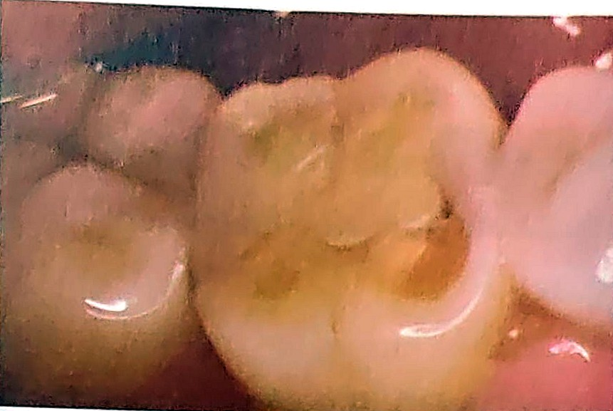
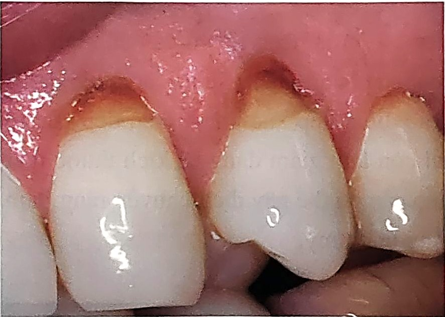
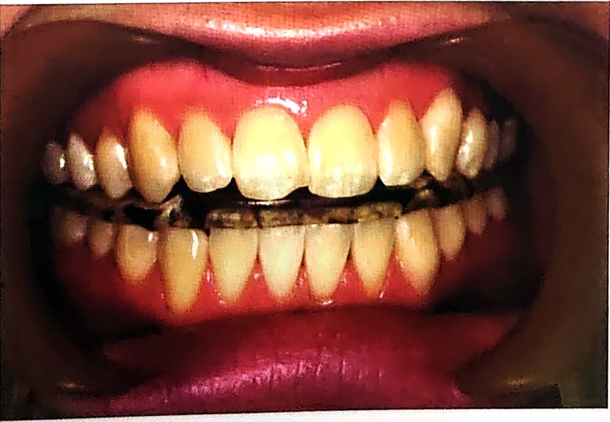

> [!IMPORTANT] Cách học bài này (4 bước, ~75 phút)
>
> 1. **Đọc "Bức tranh 1 phút"** để thấy cả bài chỉ hỏi ba câu: **cái gì làm mòn** (răng, vật lạ hay acid), **mòn ở đâu, trông ra sao**, và **chặn nguyên nhân thế nào**. Chưa cần thuộc.
> 2. **Đọc từng mục 1 → 5** (đúng số mục trong sách). Mỗi mục: hộp 💡 *Hiểu nhanh* → **📖 SGK ghi** (ý của sách viết gọn, giữ đúng thuật ngữ) → các hộp 🔍 *Vì sao…?* (cơ chế: đọc để hiểu, không cần thuộc; ý ngoài SGK đều ghi rõ, thi vẫn chọn theo SGK). Chữ ==tô vàng== là từ khoá đề hay lấy rồi đổi đi một chữ.
> 3. **Bấm "Che từ khoá"** (thanh trên cùng) → đọc lại; gặp ô bị che thì tự nói ra trước rồi bấm vào ô để kiểm tra.
> 4. **Làm trắc nghiệm** cuối bài. Câu sai → bấm nhãn "mục …" của câu đó để về đúng đoạn cần đọc. Làm xong bấm **"Chỉ xem câu sai"**.
>
> Bài ngắn nhưng **nối với nhiều bài trước**: sâu răng ↔ xoi mòn và các mốc pH (**Bài 2**), lõm hình chêm (**Bài 3**), chải ngang làm mòn răng (**Bài 4**), xoang V, VI (**Bài 5**), thuyết thủy động học (**Bài 6**), trám cổ răng bằng GIC (**Bài 7**) hay composite đàn hồi thấp (**Bài 8**). Chữ "**xoi mòn**" ở Bài 8 là **bước etching**, còn ở bài này là **bệnh** (erosion): xem hộp ở [mục 2.3](#m2-3). SGK có **ba chỗ in nhầm** ("pH > 4", "acid chlorhydrique" trong trái cây, chữ "nội tại" ở mục 5.2.1): mỗi chỗ có hộp 📌. Đáp án sách (tr. 198) của 4 câu lượng giá là **D, B, D, C**; câu 1 dùng chữ "mài mòn" theo nghĩa rộng: xem hộp 📌 ở [mục 5.1](#m5-1).
>
> **Mục tiêu SGK** – đề thường bám sát 5 mục tiêu này:

1. Liệt kê được **các kiểu mòn răng và nguyên nhân sinh ra chúng** → [mục 2](#m2).
2. Trình bày **đặc điểm lâm sàng của mòn răng** → [mục 3](#m3).
3. Nêu **những yếu tố nguy cơ của xoi mòn** → [mục 2.3](#m2-3), [mục 3.3](#m3-3).
4. Nêu lên **hướng ngăn chặn xoi mòn và phương pháp điều trị** → [mục 4](#m4), [mục 5](#m5).
5. Kiểm tra kiến thức qua **các câu hỏi tự lượng giá** → phần trắc nghiệm cuối bài.

Từ khóa SGK: mòn răng, cọ mòn, mài mòn, xoi mòn, khớp cắn ít dùng, khớp cắn sai lệch.

## Bức tranh 1 phút

> [!NOTE] Cả bài gói trong 7 câu
>
> 1. **Mòn răng** = mất mô cứng (men, ngà, cement) do **lực cơ học** hoặc **hóa chất**, **không liên quan đến vi khuẩn**. Đó là chỗ khác sâu răng.
> 2. Ba loại: **cọ mòn** (răng chạm răng khi ăn nhai, phát âm: mòn sinh lý), **mài mòn** (vật lạ: bàn chải, kem có chất mài mòn, tăm, chỉ, kim, đinh), **xoi mòn** (acid không do vi khuẩn: thức ăn, thuốc, nôn mửa, dịch dạ dày). Ba loại hay **đi chung** và làm nặng lẫn nhau.
> 3. Mỗi loại có "địa chỉ" riêng: cọ mòn ở **mặt nhai, bờ cắn**; mài mòn ở **1/3 cổ răng mặt ngoài**, hình **chữ V**; xoi mòn ở **mặt môi má, mặt tiếp cận**, **nông rộng** gần đường men – cement.
> 4. Bề mặt mòn đều **bóng láng** (sâu răng thì mềm, nhám). Mòn làm **lộ ngà** thì **ê buốt** (nhạy cảm ngà).
> 5. Cọ mòn **chậm**, rõ dần **theo tuổi**; thành **bệnh lý** khi ảnh hưởng rõ chức năng nhai, sự thoải mái. Mài mòn, xoi mòn tiến triển **nhanh** → lộ ngà → nặng thì **lộ tủy, gãy thân răng**.
> 6. **Xoi mòn là nguyên nhân chính** gây mòn răng và hay bị **chẩn đoán nhầm là sâu răng**.
> 7. Điều trị = **loại bỏ nguyên nhân** (máng nhai ban đêm · đổi cách chải răng, bỏ thói quen xấu · bác sĩ nội khoa cho acid dạ dày) **+ phục hồi vùng mất chất**. Đã kiểm soát mà cổ răng **vẫn ê** = nguyên nhân **chưa hết**.

```flow
Răng chạm răng khi ăn nhai, phát âm -> Cọ mòn (sinh lý) -> mặt nhai, bờ cắn · chậm · rõ dần theo tuổi
Vật lạ cọ xát: bàn chải, kem mài mòn, tăm, chỉ, kim, đinh -> !Mài mòn (cơ học bất thường) -> 1/3 cổ răng mặt ngoài · chữ V · nhanh
Acid không do vi khuẩn: thức ăn, thuốc, nôn, dạ dày -> !Xoi mòn (hóa học) -> mặt môi má, tiếp cận · nông rộng · nhanh
Cả ba: lộ ngà, ê buốt -> +Loại bỏ nguyên nhân -> +Phục hồi vùng mất chất
```

**Bảng lớn của bài – ba kiểu mòn đặt cạnh nhau** (chữ tô vàng là chữ SGK):

| | Cọ mòn | Mài mòn | Xoi mòn | Mục |
|---|---|---|---|---|
| Tên khác | ==mòn răng sinh lý== (nhai mòn) | mòn răng do ==lực cơ học bất thường== | ==mòn răng hóa học== | [2](#m2) |
| Thủ phạm | ==tiếp xúc răng – răng== khi ==ăn nhai và phát âm== | ==vật thể lạ==: ==chải răng sai cách, lực quá mạnh, kem chứa chất mài mòn==; ==tăm, cắn chỉ, ngậm kim hoặc đinh==; ==tật nghiến răng== | ==tác nhân hóa học không liên quan đến vi khuẩn==: acid ==ngoại sinh== (==chanh, cam, táo, Coca, champagne, vitamin C==) hoặc ==từ dịch vị== (==trào ngược dạ dày thực quản==) | [2](#m2), [3.3](#m3-3) |
| Vị trí | ==mặt nhai, bờ cắn==, rõ ở ==răng cửa, răng nanh trên==; ==mặt tiếp xúc, mặt trong răng trước trên== | ==1/3 cổ răng mặt ngoài== (==răng trước, răng cối nhỏ==); ==bờ cắn răng trước==; ==mặt nhai răng sau== | ==mặt môi má== hay ==mặt tiếp cận== | [3](#m3) |
| Hình ảnh | ==diện mòn bóng láng== ở ==đỉnh, triền múi, gờ bên== → ==mòn rộng cả mặt nhai==; ==lõm chén== | ==vùng lõm cạn, rãnh sâu, hình lõm dạng "V"==, ==bề mặt bóng láng==; mặt nhai: ==hình chén== | ==nông rộng bóng láng==, ==gần đường tiếp giáp men – cement== | [3](#m3) |
| Tiến triển | ==chậm==, ==liên quan tuổi tác== | ==nhanh== | ==nhanh== | [5.1](#m5-1) |
| Loại bỏ nguyên nhân | ==máng nhai ban đêm== (nếu ==nghiến răng==), ==theo dõi thường xuyên== | ==thay đổi phương pháp chải răng==, kiểm soát ==cắn chỉ, ngậm đinh== | bỏ nguồn acid; nguyên nhân nội tại cần ==bác sĩ nội khoa== | [5.2.1](#m5-2-1) |

## 1. Đại cương · tr. 188

> [!NOTE]
> Nghĩ tới **đế giày**: đi nhiều thì mòn, giẫm vào hóa chất thì mòn nhanh hơn, mà chẳng có con vi trùng nào "ăn" đế giày cả. Răng cũng vậy. Sâu răng là **vi khuẩn** làm ra acid ngay trên răng; còn mòn răng là **lực** (răng chạm răng, vật lạ cọ xát) hoặc **acid từ bên ngoài**, không cần vi khuẩn.

**📖 SGK ghi:**

- Mòn răng là sự ==mất mô cứng của răng (men, ngà, cement)== do ==tác động cơ học (sinh lý hoặc bất thường)== hoặc do ==các yếu tố hóa học==, ==không liên quan đến vi khuẩn==.
- Tình trạng này có thể ==tiến triển nặng ở một tỷ lệ đáng kể người cao tuổi==, gây ảnh hưởng nghiêm trọng đến ==khả năng nhai, sự thoải mái và thẩm mỹ==.
- Cũng như ==sâu răng và bệnh nha chu==, mòn răng nặng ==có thể phòng ngừa ở hầu hết mọi người nếu được phát hiện sớm==. Ngay cả khi ==đã ở giai đoạn khởi phát==, tổn thương ==vẫn có thể được kiểm soát nếu can thiệp kịp thời==.
- Để đạt hiệu quả, cần ==hiểu biết đầy đủ về tính phức tạp và các nguyên nhân== gây mòn răng. Các nghiên cứu trong lĩnh vực này ==còn hạn chế==, nhưng nhiều phát hiện mới đã và đang được áp dụng để nâng cao hiệu quả chẩn đoán và điều trị.

> [!WHY] Vì sao "không liên quan đến vi khuẩn" là chữ quan trọng nhất của định nghĩa?
> - Đó là **ranh giới với sâu răng**. Sâu răng cũng là mất khoáng do acid, nhưng acid do **vi khuẩn trong mảng bám** làm ra từ đường (Bài 1, Bài 2). Mòn răng thì do lực, hoặc acid đến từ thức ăn, thuốc, dạ dày.
> - Nguyên nhân khác thì **cách chữa khác**: sâu răng thì kiểm soát mảng bám, đường, dùng fluor (Bài 4); mòn răng thì phải tìm đúng **thói quen hay nguồn acid** mà bỏ đi ([mục 5.2](#m5-2)).
> - Không có vi khuẩn làm mềm mô, nên đáy tổn thương mòn **cứng, bóng**. Bài 3 (mục 5.2) tả lõm hình chêm ở cổ răng: **rất cứng, nhẵn và bóng**, khác hẳn ngà sâu mềm.

> [!WHY] Vì sao người cao tuổi hay mòn nặng?
> - Mòn **cộng dồn theo năm tháng**: răng dùng càng lâu càng mòn ([mục 5.1](#m5-1): càng lớn tuổi mòn càng rõ).
> - *(ngoài SGK)* Người già hay có thêm: **mất răng không làm răng giả** (lực dồn lên răng còn lại, [mục 3.1](#m3-1)), **tụt nướu lộ chân răng** (cement, ngà mềm hơn men nên mòn nhanh), **khô miệng do thuốc** (thiếu nước bọt bảo vệ, [mục 2.3](#m2-3)).

> [!WARNING]
> - Mòn răng mất cả ==men, ngà, cement== (bẫy: "chỉ mất men").
> - "Do acid của vi khuẩn" → đó là **sâu răng**, không phải mòn răng.
> - Bẫy "không phòng ngừa được, chỉ phục hình": SGK nói **phòng ngừa được** ở hầu hết mọi người nếu **phát hiện sớm**, và **vẫn kiểm soát được** khi đã khởi phát.

## 2. Bản chất và nguyên nhân của sự mòn răng · tr. 188–190

> [!NOTE]
> Hãy nghĩ tới **bậc thềm đá trước nhà**. Người qua lại mỗi ngày làm mặt đá mòn nhẵn từ từ: đó là **cọ mòn** (răng chạm răng). Ai đó cứ cọ một chỗ bằng bàn chải sắt thì chỗ đó lõm thành rãnh: **mài mòn** (vật lạ). Mưa acid làm cả mặt đá tan mỏng đều, nhẵn bóng: **xoi mòn** (hóa chất). Mưa acid làm đá mềm ra thì bước chân và bàn chải sắt càng làm mòn nhanh: vì vậy ba kiểu hay **đi chung và làm nặng lẫn nhau**.

**📖 SGK ghi:**

- Có ==3 loại== mòn răng: ==cọ mòn, mài mòn, xoi mòn==.
- Cả ==2 hay 3 loại== đều ==có thể xảy ra đồng thời== và ==ảnh hưởng rõ ràng lên nhau==, vì ==loại này có thể là nguyên nhân hình thành loại kia==.

![Hình 10.1 (SGK) – Năm kiểu mất mô răng không do vi khuẩn. **A**: hai răng cửa trên có những **khuyết lõm hình lưỡi liềm** trên men, do **acid từ bên ngoài** (người bệnh có thói quen uống nước chanh nhiều năm). **B**: nhìn từ dưới lên vòm hàm trên: **mặt trong** các răng trước bị xoi mòn trơn láng, chỉ còn **viền sáng** quanh rìa răng, do **acid nội sinh** (từ dạ dày). **C**: tổn thương **vô căn** (chưa rõ nguyên nhân) ở cổ răng (SGK ghi "tại DEJ"), được cho là do **lực nhai bất thường**; *(ngoài SGK)* tài liệu ngày nay gọi là *abfraction*. **D**: khuyết **hình chêm** ở cổ các răng cửa dưới do **bàn chải** (mài mòn). **E**: răng trước hàm dưới mòn phẳng bờ cắn do **cử động hàm dưới quá mức** (nhai mòn, tức cọ mòn).](hinh/b10-h10-1.jpg)

> [!WHY] Vì sao loại mòn này lại sinh ra được loại kia?
> - **Acid mở đường cho lực**: acid làm lớp men ngoài **mềm đi**; lúc đó bàn chải hay răng đối diện cọ qua là lấy đi lớp mềm, nhanh hơn nhiều so với men lành. SGK nói ý này ở nhiều chỗ: xoi mòn, chải răng, nghiến răng cùng gây **vi nứt cổ răng** ([mục 3.2](#m3-2)); xoi mòn ở chân răng chỉ lộ rõ khi có **mài mòn diễn ra nhanh** ([mục 3.3](#m3-3)); kết hợp **từ 2 yếu tố** thì xoi mòn **nghiêm trọng, rất khó kiểm soát** ([mục 4](#m4)).
> - **Lực mở đường cho acid**: mòn làm **thủng men, lộ ngà**. Ngà chỉ có **70% vô cơ** so với **95–97%** của men (Bài 6 mục 1.1–1.2) nên *(ngoài SGK)* acid hòa tan ngà nhanh hơn, và chỗ khuyết còn giữ acid lâu hơn.
> - SGK có sẵn một ca như vậy ở Bài 4 (mục 5.6, Hình 4.16): phụ nữ trẻ **mòn răng sau nghiêm trọng** do **trào ngược acid dạ dày**; **đánh răng quá mạnh cộng khử khoáng do acid** làm mất cấu trúc răng nhanh; vùng mòn **quá mẫn cảm ngà**; lời khuyên là **giảm đánh răng mạnh**.
> - Vì vậy hiếm khi chỉ có một nguyên nhân, và bước đầu của điều trị là xác định **loại nào chiếm ưu thế** ([mục 4](#m4)).

> [!CAUTION] Hai cách hiểu – ba loại hay bốn loại?
> | SGK (tr. 188–190) | Hiện nay *(ngoài SGK)* |
> |---|---|
> | ==3 loại==: ==cọ mòn== (mòn sinh lý, răng – răng), ==mài mòn== (lực cơ học bất thường, vật lạ), ==xoi mòn== (hóa học) | thường chia theo **4 cơ chế**: *attrition* (răng – răng, gồm cả **nghiến răng**), *abrasion* (vật lạ), *erosion* (acid không do vi khuẩn) và *abfraction* (**lực uốn** làm vỡ mô ở cổ răng; đến nay **còn tranh cãi**) |
> | ==tật nghiến răng== được kể trong các yếu tố gây **mài mòn** ([mục 2.2](#m2-2)); vi nứt cổ răng do nghiến cũng nằm ở mục mài mòn ([mục 3.2](#m3-2)) | nghiến răng là nguyên nhân chính của **cọ mòn bệnh lý**; vi nứt cổ răng do lực uốn là **abfraction** |
>
> **Thi chọn SGK**: hỏi có mấy loại mòn → **3**. "Nghiến răng" có mặt ở **hai chỗ** của SGK: yếu tố góp phần gây mài mòn ([mục 2.2](#m2-2)) và lý do mang **máng nhai** khi cọ mòn ([mục 5.2.1](#m5-2-1)). Đề dùng chữ **abfraction / mòn do lực uốn** là theo tài liệu mới: ý đúng là **lực nhai lệch, bất thường dồn ứng suất vào cổ răng** (Hình 10.1 C, [mục 3.2](#m3-2)).

### 2.1. Mòn răng sinh lý (cọ mòn) · tr. 189

> [!NOTE]
> Như **đế giày mòn theo số bước đi**: không ai cố ý, chỉ là dùng hằng ngày. Răng trên và răng dưới chạm nhau rất nhiều lần mỗi ngày khi nhai, khi nói, mỗi lần mất đi một chút cực nhỏ. Chậm tới mức phải nhiều năm mới thấy rõ.

**📖 SGK ghi:**

- Mòn răng sinh lý là sự mất mô cứng răng (==men, đôi khi cả ngà==) do ==sự tiếp xúc răng – răng== trong các hoạt động sinh lý như ==ăn nhai và phát âm==.
- Quá trình này diễn ra ==chậm, liên tục== trong ==suốt thời gian răng tồn tại trên cung hàm==.


> [!WHY] Vì sao gọi là "sinh lý" mà mục 3.1 lại nói có lúc là bệnh lý?
> "Sinh lý" nói về **nguyên nhân**: răng chạm răng khi ăn nhai, phát âm, việc ai cũng làm. Nó **không** có nghĩa là luôn vô hại. Mòn chậm, tương xứng với tuổi thì bình thường; khi đã **ảnh hưởng rõ rệt đến chức năng nhai hoặc sự thoải mái** thì xem là **bệnh lý** ([mục 3.1](#m3-1)). Giống tóc bạc: 70 tuổi bạc là chuyện thường, 20 tuổi bạc trắng là có vấn đề. Vì thế SGK dặn đánh giá mức độ mòn **đặc biệt ở bệnh nhân trẻ** ([mục 4.2](#m4-2)).

> [!WHY] Vì sao mòn sinh lý chỉ mất "men, đôi khi cả ngà"?
> Men là **mô cứng nhất cơ thể**, **95–97% vô cơ** (Bài 6 mục 1.1), nên răng cọ răng chỉ làm mòn **rất chậm** và phần lớn thời gian mòn vẫn nằm trong men. Chỉ khi mòn lâu năm làm **thủng men** ở đỉnh múi, bờ cắn thì ngà mới lộ; ngà mềm hơn nên từ đó mòn nhanh hơn (Hình 10.3, [mục 3.1](#m3-1)). Cement ở chân răng không chạm răng đối diện, nên chỉ khi tính **mọi kiểu mòn** mới đủ ba mô **men, ngà, cement** ([mục 1](#m1)).

> [!WARNING]
> - Cọ mòn = ==mòn răng sinh lý== = **răng – răng** (bẫy: "do bàn chải" là mài mòn; "do acid" là xoi mòn).
> - Nguyên nhân sinh lý là ==ăn nhai và phát âm== (bẫy: "do nghiến răng": nghiến là thói quen bất thường, SGK kể ở yếu tố gây mài mòn và là lý do mang máng nhai).
> - Diễn ra ==suốt thời gian răng tồn tại trên cung hàm== (bẫy: "chỉ khi răng chưa ổn định trên cung hàm") và ==chậm== (bẫy: "rất nhanh").

### 2.2. Mòn răng do lực cơ học bất thường (mài mòn) · tr. 190

> [!NOTE]
> Như **giấy nhám**: một vật lạ cọ đi cọ lại trên một chỗ cố định của răng. Thủ phạm hay gặp nhất là **bàn chải** (chải ngang, mạnh tay, kem có hạt mài), nên tổn thương nằm đúng chỗ bàn chải tì mạnh nhất: **cổ răng mặt ngoài**. Ngoài ra là cây tăm, sợi chỉ, cây kim, cây đinh mà người bệnh hay ngậm, hay cắn.

**📖 SGK ghi:**

- Mài mòn răng là hiện tượng ==mất mô cứng bệnh lý== của răng do tác động của ==lực cơ học bất thường==. Đây là hậu quả của ==sự bất hài hòa cơ học giữa các mặt răng với những vật thể lạ==.
- Tổn thương ==mòn ngót cổ răng== thường hình thành do ==thói quen chải răng sai cách==, ==dùng lực quá mạnh== hoặc do ==kem đánh răng chứa chất mài mòn==.
- Một số yếu tố bệnh căn khác cũng có thể góp phần: ==thói quen xấu gây lực bất thường== (==dùng tăm xỉa răng sai cách, cắn chỉ, ngậm kim hoặc đinh==) và ==tật nghiến răng==.

> [!WHY] Vì sao chải răng lại khoét đúng cổ răng?
> - **Chỗ yếu nhất**: men **mỏng dần về phía cổ răng** (Bài 8 mục 5: vùng cổ răng là nơi men mỏng). Nướu tụt thì lộ **cement, ngà**, mềm hơn men nhiều nên mòn rất nhanh.
> - **Chỗ bị tì mạnh nhất**: *(ngoài SGK)* đầu bàn chải đè mạnh nhất lên các răng **lồi ra ngoài** ở "góc cua" của cung răng (răng nanh, răng cối nhỏ) và vùng sát nướu. SGK cũng ghi mài mòn hay ở **răng trước và răng cối nhỏ** ([mục 3.2](#m3-2)).
> - **Cách chải sai**: Bài 4 (mục 5.6) ghi chải **theo chiều ngang trước – sau** làm **mòn nghiêm trọng** bề mặt răng; nên dùng **bàn chải mềm, lông nylon đầu cùn (tròn)**, chải **kỹ thuật rung**. Chải ngang qua lại giống **kéo cưa** nên khoét thành rãnh; kem có hạt mài thô như rắc thêm cát vào lưỡi cưa.

> [!WHY] Vì sao người thuận tay phải hay mòn cổ răng bên trái nhiều hơn?
> *(ngoài SGK)* Tay phải với sang **bên trái** cung răng dễ hơn, cổ tay thẳng nên đè **mạnh hơn** và hay kéo **ngang**; bên phải cổ tay phải gập nên chải nhẹ hơn. Vì thế mài mòn do bàn chải thường **không đều hai bên**: thấy mòn cổ răng nặng lệch một bên là nghĩ ngay tới **bàn chải**. Xoi mòn do acid thì acid chảy khắp miệng nên ít khi lệch hẳn một bên như vậy.

> [!WHY] Vì sao cắn chỉ, ngậm kim, ngậm đinh làm mòn răng?
> Mỗi lần cắn chỉ hay ngậm đinh, vật cứng **tì đúng một chỗ**, lặp lại nhiều năm (*ngoài SGK*: thợ may, thợ mộc, người hay cắn hạt). Lâu dần chỗ đó có một **khấc nhỏ** ở bờ cắn răng cửa. Đây đúng là "bất hài hòa cơ học giữa mặt răng với **vật thể lạ**". Tăm xỉa sai cách (đâm mạnh, xoay vặn) thì *(ngoài SGK)* mài vào **cổ răng ở kẽ**.

> [!WARNING]
> - **Mài mòn** = vật lạ ↔ **cọ mòn** = răng – răng (đề hay tráo hai chữ này).
> - "Mòn ngót cổ răng" là **mài mòn**, không phải xoi mòn hay sâu răng.
> - Chải răng có **ba lỗi**: ==sai cách, lực quá mạnh, kem chứa chất mài mòn==. Thói quen xấu: ==tăm sai cách, cắn chỉ, ngậm kim hoặc đinh==; thêm ==tật nghiến răng==.
> - Mài mòn là mất mô cứng ==bệnh lý== (cọ mòn là ==sinh lý==).

### 2.3. Mòn răng hóa học (xoi mòn) · tr. 190

> [!NOTE]
> Thả vỏ trứng (calcium) vào giấm: không cần vi khuẩn nào, vỏ trứng vẫn mỏng dần rồi tan. Răng cũng vậy khi acid từ **đồ ăn uống, thuốc, dịch dạ dày** chạm vào nhiều lần, nhiều năm. Khác sâu răng ở chỗ acid **không do vi khuẩn** làm ra, nên **không cần mảng bám**.

**📖 SGK ghi:**

- Xoi mòn là kiểu mòn răng do ==các tác nhân hóa học không liên quan đến vi khuẩn==.
- Yếu tố bệnh căn là ==acid mạnh== hay ==các tác nhân phá hủy mô== do tiếp xúc men răng (==lâu dài, từng giai đoạn hay liên tục==), đưa đến sự phá hủy, làm mất mô cứng của răng.
- Các acid này có thể bắt nguồn từ ==thực phẩm chứa acid== (SGK in "acid chlorhydrique", xem hộp 📌 bên dưới) như ==cam, chanh, soda, bưởi==…, hoặc ==từ thuốc== hay ==do nôn mửa==.
- ==Thiếu sự bảo vệ của nước bọt==, ==tình trạng mất nước== là ==yếu tố nguy cơ== gây xoi mòn răng.

> [!IMPORTANT] Chữ "acid chlorhydrique" ở tr. 190
> SGK in: thực phẩm "chứa **acid chlorhydrique** (như cam, chanh, soda, bưởi...)". *(ngoài SGK)* Acid chlorhydrique (HCl) là acid **của dạ dày**. Trái cây chua chứa chủ yếu **acid citric** (chanh, cam, bưởi) và **acid malic** (táo); nước có gas có **acid carbonic**, riêng Coca có thêm **acid phosphoric**. Nhiều khả năng sách định viết "acid citrique". HCl chỉ đúng với acid **từ dịch vị**: nôn mửa, trào ngược ([mục 3.3](#m3-3)).
> **Thi chọn SGK** nếu đề chép nguyên câu này ("thực phẩm chứa acid …" → **chlorhydrique**). Đề hỏi acid **dạ dày** là gì thì cũng là HCl.

> [!WHY] Vì sao thiếu nước bọt, mất nước lại dễ xoi mòn?
> Nước bọt là **lớp bảo vệ tự nhiên chủ yếu** (SGK, [mục 3.3](#m3-3) d):
> - **Rửa trôi, pha loãng** acid khỏi mặt răng.
> - **Trung hòa** acid: nước bọt tiết nhanh chứa nhiều bicarbonate nên pH cao hơn (Bài 2, Hình 2.3).
> - **Quá bão hòa** với calcium, phosphate nên men khó tan và còn được đắp khoáng lại (Bài 2 mục 5).
> - *(ngoài SGK)* Một **màng mỏng protein** của nước bọt phủ lên men, như lớp áo mưa đỡ cho acid khỏi chạm thẳng vào men.
>
> Mất nước (sốt, ra nhiều mồ hôi khi vận động, uống ít nước, thuốc gây khô miệng) thì nước bọt ít đi: bốn lớp bảo vệ cùng yếu. *(ngoài SGK)* Người chơi thể thao uống nước ngọt có gas, nước tăng lực **lúc đang khát** là gặp cả hai yếu tố cùng lúc.

> [!WHY] Vì sao SGK nhấn "lâu dài, từng giai đoạn hay liên tục"?
> Mức độ xoi mòn tùy **độ mạnh của acid và thời gian tiếp xúc** ([mục 3.3](#m3-3) d). Một ly nước chanh uống nhanh rồi thôi thì nước bọt kịp trung hòa. **Ngậm nhấm nháp cả buổi** (liên tục), **uống theo từng đợt** (từng giai đoạn), **nhiều năm liền** (lâu dài) thì men không có lúc nào được nghỉ. Hình 10.1 A là ví dụ: thói quen uống nước chanh **nhiều năm**.

> [!WARNING] Một chữ, hai nghĩa: "xoi mòn" ở bài này và ở Bài 8
> | | Bài 10: xoi mòn (*erosion*) | Bài 8: xoi mòn (*acid etching*) |
> |---|---|---|
> | Là gì | **bệnh**: mòn răng hóa học | **bước trám**: xử lý men – ngà trước khi dán composite |
> | Acid | từ thức ăn, thuốc, dịch vị; **không kiểm soát** | ==acid phosphoric 35–37%==, đúng thời gian (men ==5–50 giây==), rửa sạch |
> | Ở đâu | cả vùng rộng, nhiều răng | chỉ vùng sẽ dán |
> | Kết quả | **mất mô vĩnh viễn**, lộ ngà, ê buốt | tạo **vi lưu** cho nhựa bám (Bài 8 mục 6.3.1) |
>
> Giống nhau: đều là **acid hòa tan men, không cần vi khuẩn**. Bài 2 (Hình 2.6) in "**xói** mòn", cùng nghĩa với xoi mòn của bài này. Đề nói về **mòn răng** thì "xoi mòn" là bệnh; đề nói về **trám composite, keo dán** thì là bước etching.

## 3. Các đặc điểm lâm sàng của mòn răng · tr. 190–194

> [!NOTE]
> Mỗi kiểu mòn có một **"chữ ký"**: nằm ở đâu và trông ra sao. Cọ mòn ở **chỗ hai hàm chạm nhau** (mặt nhai, bờ cắn). Mài mòn ở **chỗ vật lạ tì vào** (cổ răng mặt ngoài). Xoi mòn ở **chỗ acid chảy qua**, nông và rộng. Cả ba đều **bóng láng** vì không có vi khuẩn làm mềm như sâu răng, và đều có thể làm **lộ ngà → ê buốt**.

<figure>
<div class="sc"><svg class="dg" style="max-width:520px" viewBox="0 0 450 342" role="img" aria-label="Ba răng cửa trên nhìn nghiêng: cọ mòn ở bờ cắn và mặt trong, mài mòn hình chữ V ở cổ răng mặt ngoài, xoi mòn nông rộng ở mặt ngoài gần đường men – cement">
<text x="45" y="14" text-anchor="middle" class="s m">ngoài</text>
<text x="105" y="14" text-anchor="middle" class="s m">trong</text>
<text x="195" y="14" text-anchor="middle" class="s m">ngoài</text>
<text x="255" y="14" text-anchor="middle" class="s m">trong</text>
<text x="345" y="14" text-anchor="middle" class="s m">ngoài</text>
<text x="405" y="14" text-anchor="middle" class="s m">trong</text>
<g transform="translate(75,112) scale(1.45,1.05)">
<path class="de" d="M0,-100 C-12,-90 -19,-40 -20,0 C-26,22 -24,58 -10,92 L7,92 C11,74 12,52 23,24 C26,14 22,5 20,0 C19,-40 12,-90 0,-100 Z"/>
<path class="en" d="M-20,0 C-26,22 -24,58 -10,92 L7,92 C11,74 12,52 23,24 C26,14 22,5 20,0 Z"/>
<path class="de" style="stroke:none" d="M-15,0 C-20,22 -19,56 -7,88 L-6,92 L4,92 L5,88 C8,70 8,50 17,24 C19,14 17,5 15,0 Z"/>
<path class="pu" d="M0,-88 C-4,-60 -6,-25 -6,5 C-6,35 -3,58 0,68 C3,58 6,35 6,5 C6,-25 4,-60 0,-88 Z"/>
<path class="k" style="stroke:var(--mut);stroke-width:1.2" d="M0,-100 C-12,-90 -19,-40 -20,0 C-26,22 -24,58 -10,92 L7,92 C11,74 12,52 23,24 C26,14 22,5 20,0 C19,-40 12,-90 0,-100 Z"/>
<path class="en" d="M11.5,68 C13,64 18,64 21,68 L36,124 L22,128 Z"/>
<path style="fill:none;stroke:var(--note);stroke-width:4;stroke-linecap:round" d="M-10,92 L7,92 M10,75 L12.4,62"/>
</g>
<text x="131" y="238" class="s m">răng dưới</text>
<g transform="translate(225,112) scale(1.45,1.05)">
<path class="de" d="M0,-100 C-12,-90 -18,-40 -19,-14 L-11,2 L-23,16 C-25,34 -23,64 -7,100 Q-1,108 5,100 C11,78 12,52 23,24 C26,14 22,5 20,0 C19,-40 12,-90 0,-100 Z"/>
<path class="en" d="M-17.9,10 L-23,16 C-25,34 -23,64 -7,100 Q-1,108 5,100 C11,78 12,52 23,24 C26,14 22,5 20,0 L-12,0 L-11,2 Z"/>
<path class="de" style="stroke:none" d="M-12,0 L-11,2 L-17,9 C-19,26 -19,58 -5,90 Q-1,96 3,90 C7,72 8,50 17,24 C19,14 17,5 15,0 Z"/>
<path class="pu" d="M0,-88 C-4,-60 -6,-25 -6,5 C-6,35 -3,58 0,68 C3,58 6,35 6,5 C6,-25 4,-60 0,-88 Z"/>
<path class="k" style="stroke:var(--mut);stroke-width:1.2" d="M0,-100 C-12,-90 -18,-40 -19,-14 L-11,2 L-23,16 C-25,34 -23,64 -7,100 Q-1,108 5,100 C11,78 12,52 23,24 C26,14 22,5 20,0 C19,-40 12,-90 0,-100 Z"/>
<path style="fill:none;stroke:var(--warn);stroke-width:3.5;stroke-linejoin:round" d="M-19,-14 L-11,2 L-23,16"/>
</g>
<g transform="translate(375,112) scale(1.45,1.05)">
<path class="de" d="M0,-100 C-12,-90 -19,-40 -20,0 L-21,4 C-17,14 -16,42 -19.6,60 C-16,78 -12,92 -7,100 Q-1,108 5,100 C11,78 12,52 23,24 C26,14 22,5 20,0 C19,-40 12,-90 0,-100 Z"/>
<path class="en" d="M-20,0 L-21,4 C-17,14 -16,42 -19.6,60 C-16,78 -12,92 -7,100 Q-1,108 5,100 C11,78 12,52 23,24 C26,14 22,5 20,0 Z"/>
<path class="de" style="stroke:none" d="M-15,0 C-19,22 -18.5,56 -5,90 Q-1,96 3,90 C7,72 8,50 17,24 C19,14 17,5 15,0 Z"/>
<path class="pu" d="M0,-88 C-4,-60 -6,-25 -6,5 C-6,35 -3,58 0,68 C3,58 6,35 6,5 C6,-25 4,-60 0,-88 Z"/>
<path class="k" style="stroke:var(--mut);stroke-width:1.2" d="M0,-100 C-12,-90 -19,-40 -20,0 L-21,4 C-17,14 -16,42 -19.6,60 C-16,78 -12,92 -7,100 Q-1,108 5,100 C11,78 12,52 23,24 C26,14 22,5 20,0 C19,-40 12,-90 0,-100 Z"/>
<path class="d" d="M-21,4 C-24,16 -23.5,44 -19.6,60"/>
<path style="fill:none;stroke:var(--ok);stroke-width:3.5;stroke-linecap:round" d="M-21,4 C-17,14 -16,42 -19.6,60"/>
<path class="d" d="M-38,0 L-21,0"/>
</g>
<text x="75" y="264" text-anchor="middle" class="b" style="fill:var(--note)">Cọ mòn</text>
<text x="75" y="282" text-anchor="middle" class="s">bờ cắn, mặt nhai</text>
<text x="75" y="299" text-anchor="middle" class="s">mặt trong răng trước</text>
<text x="75" y="316" text-anchor="middle" class="s">trên (khi khép hàm)</text>
<text x="75" y="333" text-anchor="middle" class="s">mặt tiếp xúc</text>
<text x="225" y="264" text-anchor="middle" class="b" style="fill:var(--warn)">Mài mòn</text>
<text x="225" y="282" text-anchor="middle" class="s">1/3 cổ răng mặt ngoài</text>
<text x="225" y="299" text-anchor="middle" class="s">răng trước, cối nhỏ</text>
<text x="225" y="316" text-anchor="middle" class="s">lõm cạn, rãnh, chữ V</text>
<text x="225" y="333" text-anchor="middle" class="s">bờ cắn, mặt nhai</text>
<text x="375" y="264" text-anchor="middle" class="b" style="fill:var(--ok)">Xoi mòn</text>
<text x="375" y="282" text-anchor="middle" class="s">mặt môi má,</text>
<text x="375" y="299" text-anchor="middle" class="s">mặt tiếp cận</text>
<text x="375" y="316" text-anchor="middle" class="s">nông rộng, bóng láng</text>
<text x="375" y="333" text-anchor="middle" class="s">gần đường men – cement</text>
</svg></div>
<figcaption>Sơ đồ tự vẽ theo mục 3 (tr. 190–193): ba răng cửa trên nhìn nghiêng, <b>mặt ngoài bên trái</b>, mặt trong bên phải, bờ cắn ở dưới. Kem = <b>men</b>, vàng = <b>ngà</b>, hồng = <b>tủy</b>. Nét màu là chỗ bị mòn. <b>Xanh dương</b> = cọ mòn: bờ cắn mòn phẳng, lộ một vệt ngà; mặt trong mòn đúng chỗ bờ răng dưới cọ vào khi khép hàm. <b>Cam</b> = mài mòn: khuyết chữ V ở cổ răng, ăn qua men vào ngà. <b>Xanh lá</b> = xoi mòn: mặt ngoài lõm nông và rộng sát đường men – cement (vạch đứt ngang); nét đứt cong là mặt răng cũ. Mài mòn còn gặp ở bờ cắn răng trước và mặt nhai răng sau; cọ mòn ở mặt tiếp xúc, xoi mòn ở mặt tiếp cận: lát nhìn nghiêng này không vẽ được.</figcaption>
</figure>

### 3.1. Cọ mòn · tr. 190–191

**a. Vị trí**

**📖 SGK ghi:**

- Cọ mòn thường xuất hiện ==chủ yếu ở mặt nhai và bờ cắn==, đặc biệt rõ ở ==các răng cửa và răng nanh vùng trước hàm trên==.
- Ngoài ra, có thể gặp ở ==mặt tiếp xúc== và ==mặt trong của răng trước trên== do ==sự cọ sát khi khép hàm==.
- ==Các mặt răng khác thường ít bị ảnh hưởng==, trừ khi có sự tham gia của ==các yếu tố bất thường== như:
  - ==Thói quen nhai một bên==, dẫn đến tình trạng ==mặt nhai bên còn lại ít được sử dụng== (từ khóa SGK: ==khớp cắn ít dùng==).
  - ==Sai lệch khớp cắn== (==răng trồi, răng nghiêng, răng không được phục hình==) làm cho ==lực cọ xát tập trung bất thường== trên bề mặt răng (từ khóa: ==khớp cắn sai lệch==).

> [!WHY] Vì sao mặt trong răng trước trên và mặt tiếp xúc cũng mòn?
> - **Mặt trong răng trước trên**: *(ngoài SGK)* khi cắn khớp, răng cửa trên **phủ ra ngoài** răng cửa dưới, nên bờ cắn răng dưới tì vào **mặt trong** răng trên. Mỗi lần khép hàm, đưa hàm ra trước để cắn thức ăn, bờ răng dưới **trượt** trên mặt trong răng trên: đúng chữ SGK "cọ sát khi khép hàm" (răng thứ nhất trong sơ đồ đầu mục 3).
> - **Mặt tiếp xúc**: *(ngoài SGK)* răng không đứng im tuyệt đối mà **nhún, xê dịch rất nhẹ** mỗi lần nhai; hai răng kề nhau cọ vào nhau ngay ở điểm tiếp xúc, lâu năm thì điểm thành **diện** (mục b).
> - **Răng cửa, răng nanh trên** mòn rõ nhất vì *(ngoài SGK)* khi hàm dưới trượt ra trước hay sang bên, các răng này đỡ và **dẫn đường** cho hàm, nên chịu cọ trượt nhiều nhất.

> [!WHY] Vì sao nhai một bên, răng trồi, răng nghiêng, mất răng không làm răng giả lại làm mòn bất thường?
> Bình thường lực nhai **chia đều** cho nhiều răng, nhiều múi. Ba tình huống SGK nêu đều làm lực **dồn vào ít chỗ**:
> - **Nhai một bên**: bên nhai gánh hết việc nên mòn nhiều; bên kia **ít được dùng** (khớp cắn ít dùng).
> - **Răng trồi, răng nghiêng**: múi nhô lên hay nghiêng ra chạm răng đối diện **trước và mạnh hơn** các múi khác.
> - **Răng không được phục hình**: *(ngoài SGK)* mất răng mà không làm răng giả thì răng đối diện **trồi** vào khoảng trống, răng kế bên **nghiêng** vào (đúng hai dấu hiệu SGK vừa kể), các răng còn lại phải gánh thêm lực. Mất nhiều **răng sau** thì người bệnh phải nhai bằng răng trước, nên **bờ cắn răng trước mòn nhanh**.

**b. Đặc điểm lâm sàng**

**📖 SGK ghi:**

- Mòn răng sinh lý thường ==khởi đầu== bằng sự hình thành ==các diện mòn bóng láng== tại ==đỉnh, triền múi hoặc các gờ bên==. Khi tiến triển, quá trình này có thể dẫn đến ==mòn rộng cả mặt nhai==.
- Kiểu mòn này được xem là ==bệnh lý== khi gây ảnh hưởng ==rõ rệt đến chức năng nhai hoặc sự thoải mái== của bệnh nhân.
- Sự cọ mòn ==kéo dài== có thể:
  - ==làm giảm chiều cao thân răng==;
  - ==biến các điểm tiếp xúc thành diện tiếp xúc rộng==;
  - mất mô cứng tại ==bờ cắn hoặc mặt nhai== còn ==làm giảm đáng kể kích thước thân răng==;
  - ==sự tiêu hao mô ở mặt tiếp cận== có thể ==gây dịch chuyển răng==, làm ==thay đổi tương quan khớp cắn== và ==ảnh hưởng thẩm mỹ==.
- Chú thích Hình 10.3: ==ngà răng mềm hơn== nên ==mòn nhanh hơn men răng==, tạo hình ảnh ==lõm chén==.



<figure>
<div class="sc"><svg class="dg" style="max-width:520px" viewBox="0 0 450 236" role="img" aria-label="Ba giai đoạn mòn một múi răng: múi còn nguyên, diện mòn phẳng bóng trong men, men thủng và ngà mòn nhanh thành lõm chén">
<defs><marker id="b10a" viewBox="0 0 10 10" refX="9" refY="5" markerWidth="7" markerHeight="7" orient="auto"><path d="M0,0L10,5L0,10z" class="mk"/></marker></defs>
<text x="75" y="16" text-anchor="middle" class="b">1. Múi còn nguyên</text>
<text x="225" y="16" text-anchor="middle" class="b">2. Diện mòn</text>
<text x="375" y="16" text-anchor="middle" class="b">3. Lõm chén</text>
<text x="75" y="35" text-anchor="middle" class="s m">men phủ kín</text>
<text x="225" y="35" text-anchor="middle" class="s m">đỉnh, triền múi, gờ bên</text>
<text x="375" y="35" text-anchor="middle" class="s m">men thủng, ngà lộ</text>
<g transform="translate(75,40)">
<path class="en" d="M-60,150 L-58,72 C-56,40 -24,10 0,8 C24,10 56,40 58,72 L60,150 Z"/>
<path class="de" d="M-50,150 L-48,80 C-44,58 -18,34 0,32 C18,34 44,58 48,80 L50,150 Z"/>
<path class="pu" d="M-26,150 C-26,120 -10,92 0,90 C10,92 26,120 26,150 Z"/>
<text x="0" y="26" text-anchor="middle" class="s">men</text>
<text x="0" y="70" text-anchor="middle" class="s">ngà</text>
<text x="0" y="135" text-anchor="middle" class="s">tủy</text>
</g>
<g transform="translate(225,40)">
<path class="en" d="M-60,150 L-58,72 C-57,52 -44,30 -30,22 L30,22 C44,30 57,52 58,72 L60,150 Z"/>
<path class="de" d="M-50,150 L-48,80 C-44,58 -18,34 0,32 C18,34 44,58 48,80 L50,150 Z"/>
<path class="pu" d="M-26,150 C-26,120 -10,92 0,90 C10,92 26,120 26,150 Z"/>
<path class="d" d="M-30,22 C-20,12 -8,8 0,8 C8,8 20,12 30,22"/>
<path style="fill:none;stroke:var(--note);stroke-width:4;stroke-linecap:round" d="M-30,22 L30,22"/>
</g>
<g transform="translate(375,40)">
<path class="en" d="M-60,150 L-58,72 C-57,60 -52,47 -46,40 L-19.5,40 Q0,62 19.5,40 L46,40 C52,47 57,60 58,72 L60,150 Z"/>
<path class="de" d="M-50,150 L-48,80 C-46,66 -34,50 -19.5,40 Q0,62 19.5,40 C34,50 46,66 48,80 L50,150 Z"/>
<path class="pu" d="M-26,150 C-26,120 -10,92 0,90 C10,92 26,120 26,150 Z"/>
<path class="d" d="M-46,40 C-30,18 -14,8 0,8 C14,8 30,18 46,40"/>
<text x="0" y="33" text-anchor="middle" class="s b">lõm chén</text>
</g>
<path class="k" d="M140,110 L160,110" marker-end="url(#b10a)"/>
<path class="k" d="M290,110 L310,110" marker-end="url(#b10a)"/>
<text x="75" y="210" text-anchor="middle" class="s">men 95–97% vô cơ</text>
<text x="75" y="227" text-anchor="middle" class="s">ngà 70% vô cơ</text>
<text x="225" y="210" text-anchor="middle" class="s">mòn còn nằm trong men</text>
<text x="225" y="227" text-anchor="middle" class="s">mặt mòn phẳng, bóng</text>
<text x="375" y="210" text-anchor="middle" class="s">ngà mòn nhanh hơn</text>
<text x="375" y="227" text-anchor="middle" class="s">viền men nhô quanh lõm</text>
</svg></div>
<figcaption>Sơ đồ tự vẽ theo mục 3.1 b và Hình 10.3: lát cắt dọc qua một múi răng (không theo tỉ lệ). Kem = <b>men</b>, vàng = <b>ngà</b>, hồng = <b>sừng tủy</b>; nét đứt = mặt múi lúc chưa mòn. (1) Múi còn nguyên. (2) Răng đối diện cọ qua lại mài <b>đỉnh, triền múi</b> thành <b>diện mòn phẳng, bóng láng</b> (nét xanh), mòn vẫn nằm trong men. (3) Men thủng: <b>ngà mềm hơn</b> (70% vô cơ so với 95–97% của men, Bài 6 mục 1.1–1.2) bị khoét nhanh hơn thành <b>lõm chén</b>, viền men cứng còn nhô quanh miệng chén. Mài mòn mặt nhai do nhai vật cứng, xơ cũng tạo hình chén theo cùng cách (mục 3.2).</figcaption>
</figure>

> [!WHY] Vì sao diện mòn bóng láng, và bắt đầu ở đỉnh múi, gờ bên?
> - **Bắt đầu ở chỗ cao nhất**: đỉnh múi, triền múi, gờ bên là những chỗ **nhô lên**, chạm răng đối diện **đầu tiên** khi cắn và trượt; hố, rãnh nằm thấp nên chưa chạm. Lâu dần chỗ cao bị mài xuống ngang chỗ thấp → **mòn rộng cả mặt nhai**.
> - **Bóng láng**: hai mặt cứng cọ nhau giống **đánh bóng**: chỗ nhô bị mài phẳng, vết xước ngày càng mịn nên mặt mòn **phản chiếu ánh sáng** như gương (giống các bước hoàn tất – đánh bóng ở Bài 8, Hình 8.6). Sâu răng thì ngược lại: mặt **mờ, nhám** (Bài 2).


<figure>
<div class="sc"><svg class="dg" style="max-width:520px" viewBox="0 0 450 262" role="img" aria-label="Hai răng cối kề nhau trước và sau nhiều năm cọ mòn: điểm tiếp xúc thành diện tiếp xúc rộng, thân răng thấp đi, răng trôi lại gần nhau">
<defs><marker id="b10b" viewBox="0 0 10 10" refX="9" refY="5" markerWidth="7" markerHeight="7" orient="auto"><path d="M0,0L10,5L0,10z" class="mk"/></marker></defs>
<text x="112" y="16" text-anchor="middle" class="b">Trước</text>
<text x="337" y="16" text-anchor="middle" class="b">Sau nhiều năm cọ mòn</text>
<text x="112" y="36" text-anchor="middle" class="s">điểm tiếp xúc</text>
<text x="337" y="36" text-anchor="middle" class="s">diện tiếp xúc rộng</text>
<path class="ld" d="M112,41 L112,93"/>
<path class="ld" d="M337,41 L337,82"/>
<g transform="translate(112,60)">
<g transform="translate(-35.3,0)">
<path class="de" d="M-26,70 C-27,100 -24,128 -20,146 C-18,152 -12,152 -11,146 L-6,92 C-4,86 4,86 6,92 L11,146 C12,152 18,152 20,146 C24,128 27,100 26,70 Z"/>
<path class="en" d="M-30,70 C-36,55 -37,35 -33,20 C-31,10 -24,2 -17,2 C-11,2 -7,9 0,9 C7,9 11,2 17,2 C24,2 31,10 33,20 C37,35 36,55 30,70 Z"/>
</g>
<g transform="translate(35.3,0)">
<path class="de" d="M-26,70 C-27,100 -24,128 -20,146 C-18,152 -12,152 -11,146 L-6,92 C-4,86 4,86 6,92 L11,146 C12,152 18,152 20,146 C24,128 27,100 26,70 Z"/>
<path class="en" d="M-30,70 C-36,55 -37,35 -33,20 C-31,10 -24,2 -17,2 C-11,2 -7,9 0,9 C7,9 11,2 17,2 C24,2 31,10 33,20 C37,35 36,55 30,70 Z"/>
</g>
<circle cx="0" cy="37" r="3" style="fill:var(--bad)"/>
<path class="k" d="M-84,2 L-76,2 M-80,2 L-80,70 M-84,70 L-76,70"/>
<text x="-88" y="42" text-anchor="end" class="b">H</text>
</g>
<g transform="translate(337,60)">
<path class="d" d="M-75,2 L75,2"/>
<text x="75" y="-3" text-anchor="end" class="s m">mặt nhai cũ</text>
<g transform="translate(-31,0)">
<path class="de" d="M-26,70 C-27,100 -24,128 -20,146 C-18,152 -12,152 -11,146 L-6,92 C-4,86 4,86 6,92 L11,146 C12,152 18,152 20,146 C24,128 27,100 26,70 Z"/>
<path class="en" d="M-30,70 C-36,55 -37,35 -33,22 L-30,16 L28,16 C30,18 31,21 31,24 L31,50 C31,58 31,64 30,70 Z"/>
</g>
<g transform="translate(31,0)">
<path class="de" d="M-26,70 C-27,100 -24,128 -20,146 C-18,152 -12,152 -11,146 L-6,92 C-4,86 4,86 6,92 L11,146 C12,152 18,152 20,146 C24,128 27,100 26,70 Z"/>
<path class="en" d="M30,70 C36,55 37,35 33,22 L30,16 L-28,16 C-30,18 -31,21 -31,24 L-31,50 C-31,58 -31,64 -30,70 Z"/>
</g>
<path class="rl" d="M0,24 L0,50"/>
<path class="k" d="M-76,16 L-68,16 M-72,16 L-72,70 M-76,70 L-68,70"/>
<text x="-80" y="48" text-anchor="end" class="b">h</text>
<path class="k" d="M54,163 L30,163" marker-end="url(#b10b)"/>
</g>
<text x="112" y="240" text-anchor="middle" class="s">H: chiều cao thân răng</text>
<text x="112" y="257" text-anchor="middle" class="s">hai mặt bên lồi, chạm một điểm</text>
<text x="337" y="240" text-anchor="middle" class="s">h &lt; H: thân răng thấp đi</text>
<text x="337" y="257" text-anchor="middle" class="s">mặt bên mòn → răng trôi lại gần</text>
</svg></div>
<figcaption>Sơ đồ tự vẽ theo mục 3.1 b: hai răng cối kề nhau nhìn từ phía má, không theo tỉ lệ. <b>Trước</b>: mặt bên hai răng lồi tròn, chỉ chạm nhau ở <b>một điểm</b> (chấm đỏ). <b>Sau</b>: mặt nhai mòn phẳng nên thân răng <b>thấp đi</b> (nét đứt là mức mặt nhai cũ); chỗ hai răng cọ nhau mòn phẳng thành <b>diện tiếp xúc rộng</b> (vạch đỏ); mặt bên mỏng đi nên răng <b>dịch chuyển</b> lại gần (mũi tên), cung răng ngắn lại, <b>tương quan khớp cắn thay đổi</b>. <i>(ngoài SGK)</i> Răng thường trôi về phía gần, tức ra phía trước.</figcaption>
</figure>

> [!WHY] Vì sao điểm tiếp xúc thành diện, và răng lại dịch chuyển?
> - Mặt bên hai răng kề nhau **lồi tròn**, nên lúc đầu chỉ chạm nhau ở **một điểm**. Răng nhún nhẹ mỗi lần nhai, hai mặt cọ nhau đúng chỗ đó → mài phẳng thành **diện** (sơ đồ trên).
> - Mặt bên bị mài thì răng **hẹp lại** theo chiều gần – xa. *(ngoài SGK)* Răng có xu hướng **trôi lại** để giữ tiếp xúc, nên cả cung răng ngắn dần: răng **dịch chuyển**, **tương quan khớp cắn thay đổi**, kẽ răng và đường cười đổi theo (**thẩm mỹ**).
> - Mặt nhai, bờ cắn mất mô thì thân răng **thấp và nhỏ** đi: răng cửa ngắn, khi cười lộ ít răng (Hình 10.4).

> [!WHY] Vì sao SGK lấy "ảnh hưởng chức năng nhai, sự thoải mái" làm ranh giới bệnh lý?
> SGK lấy **hậu quả** làm ranh giới, không lấy tuổi hay độ sâu. Múi bị mài phẳng thì mất chỗ "chày giã vào cối" nên nhai **kém nghiền**; ngà lộ thì **ê buốt** khi ăn uống nóng lạnh (thuyết thủy động học, Bài 6 mục 1.2). Đó là lúc mòn đã **làm phiền** người bệnh. *(ngoài SGK)* Cùng một mức mòn, ở người trẻ đáng lo hơn người già vì tốc độ nhanh hơn ([mục 4.2](#m4-2)).

> [!TIP]
> - **"Cọ = Cùng răng cọ nhau"**: cọ mòn là răng – răng.
> - Bốn hậu quả của cọ mòn kéo dài: **"Thấp – Rộng – Nhỏ – Trôi"**: thân răng **thấp** đi, điểm tiếp xúc thành diện **rộng**, kích thước thân răng **nhỏ** lại, răng **trôi** (dịch chuyển) làm đổi khớp cắn.

> [!WARNING]
> - Cọ mòn **sinh lý** thành **bệnh lý** khi ảnh hưởng ==rõ rệt đến chức năng nhai hoặc sự thoải mái== (bẫy: "khi bệnh nhân trên 60 tuổi", "khi vừa lộ ngà").
> - Diện mòn khởi đầu ở ==đỉnh, triền múi, gờ bên== (bẫy: "đáy hố rãnh").
> - Lõm chén vì ==ngà mềm hơn men== (bẫy: "men mềm hơn ngà", "do acid").
> - Dịch chuyển răng do ==tiêu hao mô ở mặt tiếp cận== (bẫy: "do giảm chiều cao thân răng").
> - Mặt trong răng trước trên mòn ở **cọ mòn** do ==cọ sát khi khép hàm==; nhưng acid dạ dày cũng hay làm mòn đúng mặt này: phân biệt ở hộp ⚖️ [mục 3.3](#m3-3).

### 3.2. Mài mòn · tr. 192

> [!NOTE]
> Mài mòn hiện ra **đúng chỗ vật lạ tì vào**: bàn chải tì ở cổ răng mặt ngoài nên khoét thành rãnh, thành khuyết chữ V; sợi chỉ, cây đinh tì ở bờ cắn; thức ăn cứng, xơ nghiền ở mặt nhai. Mặt khuyết bị cọ liên tục nên lúc nào cũng **bóng láng**.

**a. Vị trí**

**📖 SGK ghi:** thường thấy ở ==1/3 cổ răng ở mặt ngoài== của các răng (==đặc biệt là răng trước và răng cối nhỏ==), ==bờ cắn răng trước trên và dưới==, ==mặt nhai các răng sau==.

**b. Đặc điểm lâm sàng**

**📖 SGK ghi:**

- Mài mòn có thể xuất hiện dưới dạng ==một vùng lõm cạn==, ==một rãnh sâu== hay ==một sang thương hình lõm (dạng "V")== ở ==vùng cổ răng==. Sang thương thường có ==bề mặt bóng láng==.
- Có khi sang thương dạng chữ "V" là ==hậu quả kết hợp== của sự mài mòn ==với các nguyên nhân khác==. Ví dụ: khi các răng chịu tình trạng ==nghiến răng nặng==, ==bị xoi mòn== hoặc ==chải răng==, sẽ gây ra ==các vi nứt ở mô khoáng hóa vùng cổ răng==.
- ==Mài mòn mặt nhai nhiều== cộng với việc ==nhai các vật cứng và xơ== sẽ gây ra ==các sang thương hình chén==.
- Trong ==cả 2 trường hợp== đều có thể gây ra ==nhạy cảm ngà thường xuyên==.



<figure>
<div class="sc"><svg class="dg" style="max-width:520px" viewBox="0 0 450 310" role="img" aria-label="A: lực lệch đè lên múi làm răng uốn, cổ răng nứt li ti; B: mô đã nứt bị chải răng và acid lấy đi thành khuyết chữ V ở cổ răng">
<defs><marker id="b10c" viewBox="0 0 10 10" refX="9" refY="5" markerWidth="7" markerHeight="7" orient="auto"><path d="M0,0L10,5L0,10z" class="mk"/></marker></defs>
<text x="110" y="16" text-anchor="middle" class="b">A. Lực lệch làm răng uốn</text>
<text x="330" y="16" text-anchor="middle" class="b">B. Khuyết chữ V ở cổ răng</text>
<text x="40" y="36" class="s m">ngoài</text>
<text x="200" y="36" text-anchor="end" class="s m">trong</text>
<text x="260" y="36" class="s m">ngoài</text>
<text x="400" y="36" text-anchor="end" class="s m">trong</text>
<g transform="translate(110,66)">
<path class="de" d="M-22,86 C-30,70 -32,50 -30,40 C-28,28 -20,12 -14,10 C-8,12 -4,26 0,30 C4,26 8,20 14,18 C20,20 28,32 30,42 C32,54 30,72 22,86 C20,120 10,170 2,200 C0,204 -2,204 -4,200 C-12,170 -20,120 -22,86 Z"/>
<path class="en" d="M-22,86 C-30,70 -32,50 -30,40 C-28,28 -20,12 -14,10 C-8,12 -4,26 0,30 C4,26 8,20 14,18 C20,20 28,32 30,42 C32,54 30,72 22,86 L17,82 C24,70 25,54 23,46 C21,38 17,30 14,30 C10,32 6,38 0,42 C-6,38 -10,26 -14,24 C-18,26 -23,36 -24,44 C-26,54 -24,70 -17,82 Z"/>
<path class="pu" d="M-8,62 C-10,90 -7,140 0,185 C7,140 10,90 8,62 C6,55 3,55 0,60 C-3,55 -6,55 -8,62 Z"/>
<path class="d" transform="rotate(-6 0 170)" d="M-22,86 C-30,70 -32,50 -30,40 C-28,28 -20,12 -14,10 C-8,12 -4,26 0,30 C4,26 8,20 14,18 C20,20 28,32 30,42 C32,54 30,72 22,86 C20,120 10,170 2,200 C0,204 -2,204 -4,200 C-12,170 -20,120 -22,86 Z"/>
<path class="k" d="M36,-30 L-3,16" marker-end="url(#b10c)"/>
<path class="rl" style="stroke-width:1.6;fill:none" d="M-29,70 l4,3 -4,3 4,3 M-27,82 l4,3 -4,3 4,3"/>
<path class="ld" d="M-38,79 L-29,77"/>
<text x="-40" y="83" text-anchor="end" class="s r">vi nứt</text>
</g>
<text x="152" y="54" class="s">lực lệch</text>
<g transform="translate(330,66)">
<path class="de" d="M-21,100 L-15,86 L-28,72 C-31,60 -32,50 -30,40 C-28,28 -20,12 -14,10 C-8,12 -4,26 0,30 C4,26 8,20 14,18 C20,20 28,32 30,42 C32,54 30,72 22,86 C20,120 10,170 2,200 C0,204 -2,204 -4,200 C-12,170 -19,125 -21,100 Z"/>
<path class="en" d="M-28,72 C-31,60 -32,50 -30,40 C-28,28 -20,12 -14,10 C-8,12 -4,26 0,30 C4,26 8,20 14,18 C20,20 28,32 30,42 C32,54 30,72 22,86 L17,82 C24,70 25,54 23,46 C21,38 17,30 14,30 C10,32 6,38 0,42 C-6,38 -10,26 -14,24 C-18,26 -23,36 -24,44 C-26,54 -24,70 -17,82 L-18.7,82 Z"/>
<path class="pu" d="M-8,62 C-10,90 -7,140 0,185 C7,140 10,90 8,62 C6,55 3,55 0,60 C-3,55 -6,55 -8,62 Z"/>
<path style="fill:none;stroke:var(--warn);stroke-width:3.5;stroke-linejoin:round" d="M-28,72 L-15,86 L-21,100"/>
<path class="ld" d="M-36,92 L-22,87"/>
<text x="-38" y="96" text-anchor="end" class="s b" style="fill:var(--warn)">chữ V</text>
</g>
<text x="110" y="286" text-anchor="middle" class="s">răng uốn (nét đứt), lực dồn vào</text>
<text x="110" y="303" text-anchor="middle" class="s">cổ răng → vi nứt (vạch đỏ)</text>
<text x="330" y="286" text-anchor="middle" class="s">chải răng, acid lấy đi mô đã nứt</text>
<text x="330" y="303" text-anchor="middle" class="s">→ khuyết chữ V, bóng, lộ ngà</text>
</svg></div>
<figcaption>Sơ đồ tự vẽ theo mục 3.2 b và Hình 10.1 C: răng cối nhỏ cắt dọc theo chiều ngoài – trong, mặt ngoài bên trái, không theo tỉ lệ. <b>A</b>: lực nghiến hay lực cắn lệch đè lên sườn múi làm răng <b>uốn nhẹ</b> (nét đứt, vẽ phóng đại); chỗ thắt ở <b>cổ răng</b> chịu ứng suất lớn nhất nên men – ngà ở đó <b>nứt li ti</b>. <b>B</b>: mô đã nứt yếu đi, bàn chải và acid lấy đi rất nhanh → <b>khuyết hình chữ V</b> nằm ngang ở cổ răng, đáy bóng láng, ăn vào ngà. <i>(ngoài SGK)</i> Phần do lực uốn ngày nay gọi là <i>abfraction</i>; Bài 8 (Hình 8.12) vẽ cùng hiện tượng răng uốn dưới lực nhai.</figcaption>
</figure>

> [!WHY] Vì sao khuyết ở cổ răng lại có hình chữ V, đáy bóng?
> - Hai thứ cùng làm việc: **lực uốn** khi nghiến, cắn lệch làm cổ răng (chỗ thắt) **nứt li ti** (SGK: vi nứt ở mô khoáng hóa vùng cổ răng), rồi **bàn chải** và **acid** lấy dần phần mô đã yếu. Đáy khuyết là chỗ nứt sâu nhất nên nhọn thành **chữ V**; Bài 3 (mục 5.2) gọi đó là đáy **hình nhị diện** (hai mặt phẳng cắt nhau).
> - Mặt khuyết bị chải, cọ liên tục nên được **đánh bóng**: **bóng láng, cứng**, không mềm như sâu răng.

> [!WHY] Vì sao "hình chén" có ở cả cọ mòn lẫn mài mòn?
> Hình chén là **dấu vết chung** của mọi kiểu mòn mặt nhai khi **men đã thủng**: ngà mềm hơn bị khoét nhanh hơn viền men (sơ đồ lõm chén ở [mục 3.1](#m3-1)). Khác nhau ở **thủ phạm**: răng đối diện (cọ mòn, Hình 10.3) hay **vật cứng, xơ** khi nhai (mài mòn). *(ngoài SGK)* Ví dụ: nhai trầu, nhai hạt cứng, nhai mía lâu năm. Đề hỏi "hình chén chỉ gặp ở…" là bẫy.

> [!WHY] Vì sao mài mòn gây "nhạy cảm ngà thường xuyên"?
> Mài mòn lấy mô đi **nhanh** và lặp lại mỗi ngày (mỗi lần chải răng), nên ngà vừa lộ ra đã bị **mở lại**, ống ngà không kịp được bít. Theo **thuyết thủy động học** (Bài 6 mục 1.2), nóng, lạnh, chải răng, thổi hơi làm **dịch trong ống ngà di chuyển**, kéo đuôi tế bào tạo ngà, kích thích thần kinh trong tủy → **ê buốt**. Tốc độ mòn quyết định ê nhiều hay ít: xem [mục 5.1](#m5-1).

> [!TIP]
> - **"Mài = Mài bằng vật lạ"**.
> - Vị trí **"Cổ – Cắn – Nhai"**: 1/3 **cổ** răng mặt ngoài, bờ **cắn** răng trước, mặt **nhai** răng sau.
> - Hình dạng **"Lõm cạn – Rãnh sâu – Chữ V"**, bề mặt bóng láng.

> [!WARNING]
> - Vị trí điển hình của mài mòn: ==1/3 cổ răng mặt ngoài== (bẫy: "mặt trong răng cửa trên", "hố rãnh").
> - Răng hay bị: ==răng trước và răng cối nhỏ== (bẫy: "răng cối lớn").
> - Vi nứt cổ răng do ==nghiến răng nặng, xoi mòn hoặc chải răng== (bẫy: "do vi khuẩn").
> - Hình chén ở mặt nhai: ==mài mòn mặt nhai nhiều + nhai các vật cứng và xơ==.

### 3.3. Xoi mòn · tr. 192–194

> [!NOTE]
> Acid không "đục lỗ" mà **rửa mỏng** cả mặt răng, như nước chảy lâu năm làm mặt đá mòn đều và nhẵn. Vì vậy xoi mòn **nông, rộng, bóng**, nằm ở chỗ acid chảy qua nhiều nhất. Nó hay bị lẫn với sâu răng vì cùng là **mất khoáng do acid**, chỉ khác acid từ đâu ra.

**📖 SGK ghi:** xoi mòn là ==nguyên nhân chính gây ra mòn răng==.

> [!WHY] Vì sao xoi mòn là "nguyên nhân chính"?
> - Acid gặp **hằng ngày** (nước ngọt có gas, trái cây, nước chanh, vitamin C) và chạm **mọi mặt răng** nó chảy qua.
> - Acid còn **làm nặng hai loại kia**: men đã mềm vì acid thì bị răng đối diện hay bàn chải lấy đi nhanh hơn nhiều ([mục 2](#m2)). Câu lượng giá 3 có ý này: xoi mòn làm **cọ mòn và mài mòn trở nên trầm trọng**.

**a. Vị trí**

**📖 SGK ghi:** có thể thấy sang thương xoi mòn ở ==mặt môi má== hay ==mặt tiếp cận== của răng.

> [!CAUTION] Hai cách hiểu – xoi mòn hay ở mặt nào?
> | SGK (tr. 192) | Hiện nay *(ngoài SGK)* |
> |---|---|
> | ==mặt môi má== hay ==mặt tiếp cận== | tùy **nguồn acid**: acid **ngoại sinh** (đồ uống, trái cây) chạm trước tiên **mặt ngoài răng trước trên** và **mặt nhai răng sau**; acid **nội sinh** (dạ dày, trào ngược, nôn) trào lên rồi bị lưỡi đẩy vào **mặt trong răng trên**, nên xoi mòn **mặt trong răng cửa trên** gợi ý trào ngược hay nôn ói |
>
> SGK cũng có ảnh của ý thứ hai: Hình 10.1 B (xoi mòn nội sinh, nhìn mặt trong răng trên). Mặt trong răng trước trên còn là chỗ **cọ mòn** do khép hàm ([mục 3.1](#m3-1)). **Thi**: đề chép chữ sách hỏi vị trí xoi mòn → **mặt môi má, mặt tiếp cận**. Câu tình huống thì đọc dữ kiện: **ợ chua, nôn, trào ngược**, mặt mòn **nông rộng, trơn láng**, nhiều răng → **xoi mòn nội sinh**; mặt mòn **phẳng, khớp đúng với bờ răng dưới** khi khép hàm, kèm mòn bờ cắn → **cọ mòn**.

**b. Đặc điểm lâm sàng**

**📖 SGK ghi:**

- Sang thương thường ==nông rộng bóng láng== trên mặt răng ==gần đường tiếp giáp men – cement==.
- Ở ==chân răng== thường ==khó phát hiện== hiện tượng xoi mòn ==trừ khi có sự mài mòn diễn ra nhanh==.
- Xoi mòn ==làm lộ ngà== cũng gây ==nhạy cảm ngà==.


> [!WHY] Vì sao xoi mòn nông rộng, bóng láng mà không thành lỗ?
> Acid là **chất lỏng**: nó tràn đều trên cả mặt răng chứ không đọng một chỗ như mảng bám. Acid mạnh làm men tan **sạch từng lớp từ ngoài vào**; lớp bị tan là mất hẳn, lớp còn lại **chưa bị đụng tới** nên vẫn **cứng, bóng**, thành phần khoáng không đổi (Bài 2 mục 7). Kết quả là mặt răng **mỏng đi trên một vùng rộng**, không "rỗng ruột" thành lỗ như sâu răng. Men gần cổ răng vốn mỏng nên ngà sớm lộ ra ở đó, **vàng** ánh qua (Hình 10.6).

> [!WHY] Vì sao xoi mòn ở chân răng lại khó phát hiện?
> *(ngoài SGK)* Chân răng không có men; mặt cement, ngà vốn **không trong và bóng** như men, nên mất đi một lớp mỏng thì màu và độ bóng gần như **không đổi**, mắt thường khó nhận ra. Chỉ khi acid làm mềm bề mặt rồi **bàn chải lấy đi nhanh** (SGK: "trừ khi có sự mài mòn diễn ra nhanh") thì mới thành **khuyết** thấy được. Lại thêm một ví dụ hai loại mòn đi chung ([mục 2](#m2)).

**c. Nguyên nhân và các yếu tố nguy cơ làm tăng xoi mòn**

**📖 SGK ghi:**

- **Yếu tố nguy cơ**:
  - Nguy cơ thường xuyên nhất vẫn là ==pH > 4== (đúng chữ in trong SGK, xem hộp 📌 ngay dưới). Tuy nhiên, còn ==phụ thuộc vào tình trạng khoáng hóa được tạo ra do các ion Ca và phosphate==.
  - ==Tình trạng mất nước==, ==thiếu sự bảo vệ của nước bọt==.
- **Nguyên nhân**: các acid làm xoi mòn răng có nguồn gốc ==ngoại sinh== hoặc ==từ dịch vị==.
  - **Ngoại sinh**: dùng nhiều ==thực phẩm có nhiều acid== như ==chanh, cam, táo==, hoặc nhiều ==thức uống có gas== như ==Coca, champagne==, hoặc một số ==thuốc được dùng thường xuyên== như ==vitamin C==.
  - **Nội sinh**: ==chủ yếu là các nguyên nhân từ dạ dày==, thường trong ==hội chứng trào ngược dạ dày thực quản==. ==Rất khó kiểm soát== xoi mòn do acid trào ngược vì các acid này ==trào ngược ngoài ý muốn==, trừ khi được ==kiểm soát bởi bác sĩ Y khoa==.

> [!IMPORTANT] "pH > 4" ở tr. 193: nhiều khả năng in ngược dấu
> SGK in: "Nguy cơ thường xuyên nhất vẫn là **pH > 4**". Câu này ngược với chính SGK:
> - Bài 2 (mục 8, Hình 2.6): **xoi mòn** là vùng pH **thấp nhất**, dưới khoảng **4,5** (cả HA lẫn FA đều tan); 4,5–5,5 là vùng sâu răng; trên 5,5 là tái khoáng.
> - Mục 2.3 bài này: nguyên nhân là **acid mạnh**, mà acid càng mạnh thì pH càng **thấp**.
> - *(ngoài SGK)* Tài liệu về xoi mòn thường nói thức uống có **pH dưới khoảng 4** là có khả năng gây xoi mòn (thang pH ngay dưới).
>
> Hiểu đúng: nguy cơ xoi mòn cao khi acid có **pH thấp (dưới khoảng 4)**, và còn tùy lượng **Ca, phosphate** sẵn có. **Thi chọn SGK** khi đề chép nguyên câu này: "**pH > 4**", kể cả khi có lựa chọn "pH < 4". Câu hỏi về cơ chế (acid càng mạnh, pH càng thấp thì càng xoi mòn) thì trả lời theo hóa học như trên.

<figure>
<div class="sc"><svg class="dg" style="max-width:560px" viewBox="0 0 450 206" role="img" aria-label="Thang pH: dịch vị, chanh, Coca, champagne, cam, táo đều dưới 4, trong vùng xoi mòn dưới 4,5; vùng sâu răng 4,5 đến 5,5; tái khoáng trên 5,5">
<text x="30" y="16" class="s m">← acid mạnh hơn</text>
<text x="420" y="16" text-anchor="end" class="s m">trung tính →</text>
<rect class="phf" x="30" y="118" width="227.5" height="30"/>
<rect class="c2" x="257.5" y="118" width="65" height="30"/>
<rect class="c3" x="322.5" y="118" width="97.5" height="30"/>
<text x="144" y="138" text-anchor="middle" class="s b">vùng xoi mòn</text>
<text x="290" y="138" text-anchor="middle" class="s">sâu răng</text>
<text x="371" y="138" text-anchor="middle" class="s">tái khoáng</text>
<path style="stroke:var(--bad);stroke-width:5;stroke-linecap:round" d="M32,100 L95,100"/>
<text x="62" y="92" text-anchor="middle" class="s">dịch vị 1–2</text>
<text x="101.5" y="74" text-anchor="middle" class="s">chanh</text>
<text x="128" y="38" text-anchor="middle" class="s">Coca</text>
<text x="173" y="56" text-anchor="middle" class="s">champagne</text>
<text x="203" y="74" class="s">cam, táo</text>
<text x="398" y="74" text-anchor="middle" class="s">nước bọt</text>
<path class="ld" d="M101.5,78 L101.5,118 M128,42 L128,118 M173,60 L173,118 M199,70 L199,118 M398,78 L398,118"/>
<path class="ax" d="M30,148 L420,148"/>
<path class="ax" d="M30,148 L30,153 M95,148 L95,153 M160,148 L160,153 M225,148 L225,153 M290,148 L290,153 M355,148 L355,153 M420,148 L420,153"/>
<text x="30" y="166" text-anchor="middle" class="s">1</text>
<text x="95" y="166" text-anchor="middle" class="s">2</text>
<text x="160" y="166" text-anchor="middle" class="s">3</text>
<text x="225" y="166" text-anchor="middle" class="s b">4</text>
<text x="290" y="166" text-anchor="middle" class="s">5</text>
<text x="355" y="166" text-anchor="middle" class="s">6</text>
<text x="420" y="166" text-anchor="middle" class="s">7</text>
<path class="rl" style="stroke-width:2;stroke-dasharray:5 3" d="M257.5,108 L257.5,152 M322.5,108 L322.5,152"/>
<text x="257.5" y="104" text-anchor="middle" class="s b r">4,5</text>
<text x="322.5" y="104" text-anchor="middle" class="s b r">5,5</text>
<path class="k" style="stroke-width:1.2" d="M32,172 L32,178 L223,178 L223,172 M227,172 L227,178 L418,178 L418,172"/>
<text x="127.5" y="196" text-anchor="middle" class="s">pH &lt; 4: mọi nguồn acid kể trên</text>
<text x="322.5" y="196" text-anchor="middle" class="s">pH &gt; 4: chữ in ở tr. 193</text>
</svg></div>
<figcaption>Thang pH vẽ để so sánh. Mốc <b>4,5</b> và <b>5,5</b> lấy từ Bài 2 (mục 8, Hình 2.6): dưới 4,5 cả HA lẫn FA đều tan = vùng <b>xoi mòn</b>; 4,5–5,5 = vùng sâu răng; trên 5,5 = tái khoáng. Vị trí của dịch vị, nước bọt và các thức uống là <b>khoảng pH thường gặp</b> <i>(ngoài SGK)</i>: chanh, Coca, champagne, cam, táo đều nằm <b>dưới 4</b>, sâu trong vùng xoi mòn. Vì vậy chữ "pH &gt; 4" ở tr. 193 nhiều khả năng in ngược dấu (hộp 📌 ngay trên).</figcaption>
</figure>

> [!WHY] Vì sao nguy cơ còn tùy lượng Ca, phosphate?
> Men tan hay không là tùy **dịch quanh răng đã bão hòa với khoáng chưa**, chứ không chỉ tùy pH (Bài 2 mục 2–3: so tích số ion IAP với KSP). Thức uống có sẵn **nhiều Ca, phosphate** thì dù chua, dịch vẫn **gần bão hòa** nên men tan ít. *(ngoài SGK)* Ví dụ: sữa chua chua nhưng giàu calcium nên hầu như không gây xoi mòn; nước cam có bổ sung calcium ít xoi mòn hơn nước cam thường.

> [!WHY] Vì sao nước có gas, vitamin C lại gây xoi mòn?
> *(ngoài SGK)* Khí CO₂ hòa vào nước thành **acid carbonic**; Coca còn có **acid phosphoric**, nên pH rất thấp (thang pH trên). **Vitamin C** chính là **acid ascorbic**: viên nhai, viên ngậm, viên sủi dùng mỗi ngày là acid tiếp xúc men **lâu dài, thường xuyên** (đúng chữ SGK "thuốc được dùng thường xuyên"). Champagne vừa có gas vừa có acid của nho.

> [!WHY] Vì sao xoi mòn do trào ngược "rất khó kiểm soát"?
> - Acid dạ dày (HCl) **rất mạnh** *(ngoài SGK: pH khoảng 1–2)*, mạnh hơn mọi thức uống.
> - Acid trào lên **ngoài ý muốn** (SGK), nhiều khi **lúc ngủ**, đúng lúc nước bọt tiết rất ít (Bài 4 mục 5.6). *(ngoài SGK)* Có người trào ngược mà **không thấy ợ chua**, chỉ phát hiện nhờ nha sĩ thấy răng mòn.
> - Nha sĩ **không chữa được dạ dày**: phải nhờ **bác sĩ Y khoa, bác sĩ nội khoa** ([mục 5.2.1](#m5-2-1)). *(ngoài SGK)* Nôn ói thường xuyên (tự gây nôn sau ăn, nghiện rượu, ốm nghén kéo dài) cũng đưa acid dạ dày lên miệng.

**d. Mức độ xoi mòn** – tùy thuộc nhiều yếu tố:

**📖 SGK ghi** (3 yếu tố):

1. ==Độ mạnh của acid== và ==thời gian tiếp xúc với acid==.
2. ==Hiệu quả của các yếu tố bảo vệ tự nhiên== của môi trường miệng, ==chủ yếu là nước bọt==.
3. ==Bề mặt răng có nhạy cảm và thuận lợi== cho sự xoi mòn của acid hay không.

> [!WHY] "Bề mặt răng nhạy cảm và thuận lợi" là mặt răng thế nào?
> *(ngoài SGK)* Là mặt răng **dễ tan** hoặc **ít được che chở**: men ít fluor (FA khó tan hơn HA, Bài 2 mục 6), men răng sữa mỏng, chỗ đã lộ ngà hay cement (ít khoáng hơn men, Bài 6), mặt răng ít được nước bọt rửa tới. Cùng một ly nước chanh, mặt răng như vậy mòn nhanh hơn.

> [!TIP]
> Ba yếu tố giống chuyện **gỉ sét**: hóa chất **mạnh** và ngâm **lâu** (acid) – có lớp **sơn bảo vệ** không (nước bọt) – bản thân **vật liệu** có dễ gỉ không (mặt răng). Nhớ: **"Acid – Nước bọt – Mặt răng"**.

**e. Phân biệt xoi mòn và sâu răng**

**📖 SGK ghi:**

- Xoi mòn ==thường chẩn đoán nhầm là sâu răng==. Tổn thương xoi mòn liên quan đến ==vùng bị mất khoáng==. Còn sâu răng thường là hậu quả của ==một vùng giới hạn bị mất khoáng==.
- Việc chẩn đoán xoi mòn cần dựa trên ==yếu tố nguy cơ==, ==bệnh căn== và đặc biệt chú ý về ==lâm sàng của một tổn thương sâu răng cổ điển==.
- Ở ==giai đoạn sớm==, việc phân biệt giữa sâu răng và mòn răng ==gần như không thể thực hiện chính xác==. Tuy nhiên, ==mức độ tiến triển và độ sâu của vùng mất khoáng== thường là dấu hiệu gợi ý ==mòn răng kéo dài==, mà nguyên nhân hay gặp là tình trạng ==trào ngược acid từ dạ dày==.

<figure>
<div class="sc"><svg class="dg" style="max-width:520px" viewBox="0 0 450 220" role="img" aria-label="Hai răng cửa trên nhìn từ phía môi: sâu răng là dải trắng phấn hẹp dọc viền nướu; xoi mòn là vùng nông rộng, bóng ở nửa cổ răng của cả hai răng">
<g transform="translate(112,40)">
<g transform="translate(-23,0)"><path class="en" d="M-22,-6 C-24,40 -24,80 -21,104 C-19,110 -12,112 0,112 C12,112 19,110 21,104 C24,80 24,40 22,-6 Z"/><path class="le" style="stroke-width:1.2" d="M-18,-2 C-12,19 12,19 18,-2 C11,9 -11,9 -18,-2 Z"/></g>
<g transform="translate(23,0)"><path class="en" d="M-22,-6 C-24,40 -24,80 -21,104 C-19,110 -12,112 0,112 C12,112 19,110 21,104 C24,80 24,40 22,-6 Z"/><path class="le" style="stroke-width:1.2" d="M-18,-2 C-12,19 12,19 18,-2 C11,9 -11,9 -18,-2 Z"/></g>
<path class="pu" d="M-56,-26 L56,-26 L56,8 C50,2 44,-4 23,-4 C10,-4 4,4 0,16 C-4,4 -10,-4 -23,-4 C-44,-4 -50,2 -56,8 Z"/>
</g>
<g transform="translate(337,40)">
<g transform="translate(-23,0)"><path class="en" d="M-22,-6 C-24,40 -24,80 -21,104 C-19,110 -12,112 0,112 C12,112 19,110 21,104 C24,80 24,40 22,-6 Z"/><path style="fill:var(--de);opacity:.85;stroke:var(--mut);stroke-width:1" d="M-18,2 C-21,30 -15,54 0,58 C15,54 21,30 18,2 Z"/><path style="fill:none;stroke:#fff;stroke-width:2.5;stroke-linecap:round;opacity:.9" d="M-9,18 C-5,13 5,13 9,18"/></g>
<g transform="translate(23,0)"><path class="en" d="M-22,-6 C-24,40 -24,80 -21,104 C-19,110 -12,112 0,112 C12,112 19,110 21,104 C24,80 24,40 22,-6 Z"/><path style="fill:var(--de);opacity:.85;stroke:var(--mut);stroke-width:1" d="M-18,2 C-21,30 -15,54 0,58 C15,54 21,30 18,2 Z"/><path style="fill:none;stroke:#fff;stroke-width:2.5;stroke-linecap:round;opacity:.9" d="M-9,18 C-5,13 5,13 9,18"/></g>
<path class="pu" d="M-56,-26 L56,-26 L56,8 C50,2 44,-4 23,-4 C10,-4 4,4 0,16 C-4,4 -10,-4 -23,-4 C-44,-4 -50,2 -56,8 Z"/>
</g>
<text x="112" y="176" text-anchor="middle" class="b">Sâu răng: vùng giới hạn</text>
<text x="112" y="194" text-anchor="middle" class="s">chỗ mảng bám nằm yên</text>
<text x="112" y="211" text-anchor="middle" class="s">trắng phấn, mờ, mềm</text>
<text x="337" y="176" text-anchor="middle" class="b">Xoi mòn: vùng rộng</text>
<text x="337" y="194" text-anchor="middle" class="s">chỗ acid chảy qua</text>
<text x="337" y="211" text-anchor="middle" class="s">nông, bóng láng, cứng</text>
</svg></div>
<figcaption>Sơ đồ tự vẽ theo mục 3.3 e: hai răng cửa giữa hàm trên nhìn từ phía môi, nướu ở trên. <b>Trái</b>: sâu răng sớm là những dải hẹp dọc viền nướu (màu xám nhạt = sang thương men, nhìn trong miệng thấy <b>trắng phấn</b>), đúng chỗ <b>mảng bám nằm yên</b> (vùng giới hạn). <b>Phải</b>: xoi mòn là một vùng <b>nông, rộng</b> ở nửa cổ răng của <b>cả hai răng</b>; men mỏng nên <b>ngà vàng ánh qua</b>, mặt vẫn <b>bóng</b> (nét trắng). Lát cắt ngang của hai kiểu tổn thương (lớp bề mặt còn hay mất) xem Bài 2 mục 7.</figcaption>
</figure>

> [!WHY] Vì sao xoi mòn hay bị nhầm là sâu răng, và phân biệt dựa vào đâu?
> - **Giống**: cả hai đều là **mất khoáng do acid**; giai đoạn sớm đều là một vùng men đổi màu, mất vẻ trong, nên SGK nói gần như **không phân biệt được**.
> - **Khác ở "vùng"**: acid của sâu răng sinh ra **dưới mảng bám**, nên tổn thương nằm gọn ở chỗ mảng bám **nằm yên** (hố rãnh, dọc viền nướu, dưới điểm tiếp xúc: Bài 5) = **vùng giới hạn**. Acid của xoi mòn **chảy khắp** mặt răng = **vùng rộng**, thường nhiều răng.
> - **Khác ở lâm sàng**: sâu răng **trắng phấn, mềm**, lớp bề mặt còn; xoi mòn **cứng, bóng**, mất từng lớp (Bài 2 mục 7). Vì vậy SGK dặn đối chiếu với **lâm sàng của một tổn thương sâu răng cổ điển**, cộng với hỏi **yếu tố nguy cơ, bệnh căn** (ăn uống chua, trào ngược).
> - **Tốc độ và độ sâu**: sâu răng thường **diễn tiến chậm** (Bài 5 mục 0); vùng mất khoáng **lan nhanh và sâu** mà không có mảng bám thì nghĩ tới acid **dạ dày** (mạnh, lặp lại).


> [!WARNING]
> - Xoi mòn là ==nguyên nhân chính== gây mòn răng (bẫy: "cọ mòn là nguyên nhân chính vì ai cũng có").
> - Vị trí: ==mặt môi má, mặt tiếp cận==; sang thương ==nông rộng bóng láng, gần đường tiếp giáp men – cement== (bẫy: "hố rãnh", "đỉnh múi").
> - Ở chân răng ==khó phát hiện trừ khi có sự mài mòn diễn ra nhanh== (bẫy: "dễ phát hiện vì không có men").
> - Ngoại sinh: ==chanh, cam, táo · Coca, champagne · vitamin C== ↔ nội sinh: ==dạ dày, trào ngược dạ dày thực quản== (đề hay tráo).
> - Ba yếu tố quyết định mức độ: ==độ mạnh và thời gian tiếp xúc acid · nước bọt · bề mặt răng==; **vi khuẩn không** có trong danh sách.
> - Xoi mòn liên quan ==vùng bị mất khoáng==; sâu răng là ==vùng giới hạn== (đề hay đảo).

## 4. Ngăn chặn mòn răng · tr. 194–195

> [!NOTE]
> Chữa đúng phải **bắt đúng thủ phạm**. Mòn răng hay có **hai, ba thủ phạm cùng lúc** ([mục 2](#m2)), nên trước khi làm gì phải trả lời ba câu: mòn kiểu gì, **chủ yếu do cái gì**, nặng tới đâu.

**📖 SGK ghi:**

- ==Giai đoạn đầu== của việc điều trị là ==phát hiện mọi dấu hiệu sớm== của mòn răng và ==xác định loại mòn răng nào chiếm ưu thế==.
- Điều này ==thật sự khó khăn== vì khi có ==sự kết hợp của 2 yếu tố trở lên== thì sự xoi mòn trở nên ==nghiêm trọng và rất khó kiểm soát==.

```flow
Acid: chanh, Coca, vitamin C, dịch vị -> Lớp men ngoài mềm đi -> Chải răng, nghiến răng, nhai vật cứng -> !Lớp mềm bị lấy đi rất nhanh -> !Mòn nặng, rất khó kiểm soát
```

> [!WHY] Vì sao kết hợp từ 2 yếu tố thì xoi mòn "nghiêm trọng và rất khó kiểm soát"?
> - **Cộng dồn**: acid làm mềm, lực cơ học lấy đi lớp mềm, lớp mới lộ ra lại bị acid làm mềm… Mỗi yếu tố riêng thì chậm, đi chung thì nhanh gấp bội (sơ đồ trên).
> - **Khó tìm**: ảnh của tổn thương là **ảnh trộn**: khuyết cổ răng có thể do bàn chải, do acid, do lực uốn hay cả ba ([mục 3.2](#m3-2)). Bỏ được một nguyên nhân mà còn nguyên nhân kia thì mòn vẫn tiếp tục, nên mới "rất khó kiểm soát". Ví dụ cách cắt đứt chuỗi này: hộp "người bệnh xoi mòn nên làm gì hằng ngày" ở [mục 5.2.1](#m5-2-1).

### 4.1. Phát hiện sớm và xác định loại mòn cùng nguyên nhân mòn · tr. 194

**📖 SGK ghi:**

- Cần chú ý ==các dạng bất thường== và ==sự thô nhám của bề mặt răng== để ==phát hiện== mòn răng.
- Sau đó chú ý đến ==vùng mòn răng== và ==dạng mòn răng== để ==phân loại== mòn răng.
- ==Bệnh sử y khoa và xã hội== cũng như ==thói quen sống==, ==tật nghiến răng==, ==thói quen ăn uống==, ==tình trạng tiết nước bọt== và ==loại thuốc đang sử dụng== đều rất hữu ích cho việc ==đưa ra chẩn đoán chính xác==.

```flow
Nhìn: dạng bất thường, thô nhám -> Phân loại: vùng mòn, dạng mòn -> Hỏi: bệnh sử, thói quen, nghiến răng, ăn uống, nước bọt, thuốc -> Đánh giá mức độ (mục 4.2) -> +Kế hoạch điều trị
```

**Sáu điều cần hỏi và mỗi điều gợi ý gì** (cột giữa là ý ghép từ các mục trước):

| Hỏi (chữ SGK) | Gợi ý nguyên nhân | Mục |
|---|---|---|
| ==Bệnh sử y khoa== | ợ chua, trào ngược, nôn ói → xoi mòn **nội sinh** | [3.3](#m3-3) |
| ==Bệnh sử xã hội==, ==thói quen sống== | nghề nghiệp, chơi thể thao bị mất nước; cách chải răng, cắn chỉ, ngậm đinh | [2.2](#m2-2), [2.3](#m2-3), [5.2.1](#m5-2-1) |
| ==Tật nghiến răng== | cọ mòn (máng nhai); vi nứt cổ răng | [3.2](#m3-2), [5.2.1](#m5-2-1) |
| ==Thói quen ăn uống== | chanh, cam, táo, Coca, champagne → xoi mòn **ngoại sinh**; nhai vật cứng, xơ → mài mòn mặt nhai | [3.3](#m3-3), [3.2](#m3-2) |
| ==Tình trạng tiết nước bọt== | thiếu bảo vệ của nước bọt → dễ xoi mòn | [2.3](#m2-3) |
| ==Loại thuốc đang sử dụng== | vitamin C dùng thường xuyên → xoi mòn; *(ngoài SGK)* thuốc gây khô miệng | [3.3](#m3-3) |

> [!TIP]
> **"Nhìn – Chia – Hỏi"**: **nhìn** dạng bất thường, thô nhám để phát hiện → **chia** loại theo vùng mòn, dạng mòn → **hỏi** sáu điều: bệnh sử (y khoa, xã hội) · thói quen sống · nghiến răng · ăn uống · nước bọt · thuốc.

> [!WARNING]
> - **Phát hiện** dựa vào ==dạng bất thường, sự thô nhám bề mặt răng==; **phân loại** dựa vào ==vùng mòn và dạng mòn== (đề hay tráo hai vế).
> - Danh sách hỏi bệnh **không có** mảng bám, số lần ăn đường: đó là yếu tố của **sâu răng**.

### 4.2. Đánh giá mức độ mòn răng · tr. 194–195

**📖 SGK ghi:**

- Khi đã phát hiện mòn răng thì điều quan trọng là ==cố gắng đánh giá mức độ mòn==, ==đặc biệt là ở bệnh nhân trẻ==.
- ==Trước tiên== cần xác định ==mức độ tổn thương cấu trúc răng==.
- ==Tiếp theo== là đưa ra ==kế hoạch cho việc điều trị==, nhưng phải ==đánh giá được hiệu quả của phương pháp đó==.

> [!WHY] Vì sao "đặc biệt là ở bệnh nhân trẻ"?
> - Mòn sinh lý **tăng theo tuổi** ([mục 5.1](#m5-1)). Cùng một mức mòn, ở người 70 tuổi có thể là bình thường, ở người 20 tuổi là **mòn nhanh bất thường**: phải có nguyên nhân đang hoạt động.
> - Người trẻ còn **dùng răng rất nhiều năm nữa**; không chặn sớm thì tới tuổi trung niên đã mất nhiều mô, phải phục hình lớn. SGK kết bài cũng dặn **cần chú ý đến tuổi tác**.

> [!WHY] Vì sao phải "đánh giá được hiệu quả" của phương pháp điều trị?
> Mòn tiến triển **âm thầm**, mỗi năm một ít, nên chỉ **so sánh qua các lần khám** mới biết nguyên nhân đã bị chặn chưa. SGK nhắc ý này nhiều lần: cọ mòn phải **theo dõi thường xuyên** ([mục 5.2.1](#m5-2-1)); còn nhạy cảm ngà ở cổ răng sau khi kiểm soát nghĩa là **nguyên nhân chưa hết** ([mục 5.2.2](#m5-2-2)). *(ngoài SGK)* Thực hành thường chụp ảnh, lấy mẫu hàm để so sánh.

> [!WARNING]
> Thứ tự: ==trước tiên mức độ tổn thương cấu trúc răng== → ==tiếp theo kế hoạch điều trị== (phải ==đánh giá được hiệu quả==). Bẫy: "lập kế hoạch rồi mới đánh giá mức độ", "trám ngay rồi tìm nguyên nhân".

## 5. Tiến triển và điều trị mòn răng · tr. 195–197

### 5.1. Tiến triển · tr. 195

> [!NOTE]
> Mòn chậm như **nước nhỏ giọt**: tủy kịp lùi lại và đắp thêm ngà để tự vệ, nên ít ê. Mòn nhanh như **cưa máy**: tủy không theo kịp, ngà bị mở ra nên ê buốt; nặng thì tới tủy, thân răng yếu đi rồi gãy.

**📖 SGK ghi:**

- Mòn răng sinh lý thường ==tiến triển chậm== và ==liên quan tuổi tác==, ==càng lớn tuổi sự mòn răng càng rõ==.
- Các tổn thương do ==mài mòn và xoi mòn== thường ==tiến triển nhanh== làm ==lộ ngà gây ê buốt khó chịu==.
- Bệnh tiến triển nặng có thể đưa đến ==lộ tủy==, ==gãy một phần hay toàn bộ thân răng==.

<figure>
<div class="sc"><svg class="dg" style="max-width:520px" viewBox="0 0 450 252" role="img" aria-label="Mòn chậm: tủy đắp ngà phản ứng, sừng tủy lùi, ít ê buốt; mòn nhanh: ống ngà mở thông tới tủy, ê buốt, nặng thì lộ tủy">
<defs><marker id="b10d" viewBox="0 0 10 10" refX="9" refY="5" markerWidth="6" markerHeight="6" orient="auto-start-reverse"><path d="M0,0L10,5L0,10z" class="mk"/></marker></defs>
<text x="112" y="16" text-anchor="middle" class="b">Mòn chậm</text>
<text x="337" y="16" text-anchor="middle" class="b">Mòn nhanh</text>
<text x="112" y="35" text-anchor="middle" class="s m">cọ mòn sinh lý</text>
<text x="337" y="35" text-anchor="middle" class="s m">mài mòn, xoi mòn</text>
<g transform="translate(112,44)">
<path class="en" d="M-60,150 L-58,72 C-57,60 -52,47 -46,40 L-19.5,40 Q0,62 19.5,40 L46,40 C52,47 57,60 58,72 L60,150 Z"/>
<path class="de" d="M-50,150 L-48,80 C-46,66 -34,50 -19.5,40 Q0,62 19.5,40 C34,50 46,66 48,80 L50,150 Z"/>
<path class="c2" d="M-22,76 C-12,67 12,67 22,76 C14,88 -14,88 -22,76 Z"/>
<path class="ld" d="M-8,53 L-9,68 M0,55 L0,67 M8,53 L9,68"/>
<path class="d" d="M-26,150 C-26,120 -10,92 0,90 C10,92 26,120 26,150"/>
<path class="pu" d="M-26,150 C-26,128 -12,108 0,106 C12,108 26,128 26,150 Z"/>
<path class="d" d="M-46,40 C-30,18 -14,8 0,8 C14,8 30,18 46,40"/>
<text x="0" y="140" text-anchor="middle" class="s">ít ê</text>
</g>
<g transform="translate(337,44)">
<path class="en" d="M-60,150 L-58,72 C-57.5,64 -55,56 -51.8,50 L-31,50 Q0,94 31,50 L51.8,50 C55,56 57.5,64 58,72 L60,150 Z"/>
<path class="de" d="M-50,150 L-48,80 C-47,68 -41,57 -31,50 Q0,94 31,50 C41,57 47,68 48,80 L50,150 Z"/>
<path class="pu" d="M-26,150 C-26,120 -10,92 0,90 C10,92 26,120 26,150 Z"/>
<path class="ld" style="stroke-width:1.3" d="M-10,70 L-6,92 M0,72 L0,90 M10,70 L6,92"/>
<path class="k" style="stroke-width:1.2" d="M22,76 L22,98" marker-start="url(#b10d)" marker-end="url(#b10d)"/>
<path class="d" d="M-51.8,50 C-40,20 -16,8 0,8 C16,8 40,20 51.8,50"/>
<text x="0" y="130" text-anchor="middle" class="s b r">ê buốt</text>
</g>
<text x="112" y="212" text-anchor="middle" class="s">tủy kịp đắp ngà phản ứng,</text>
<text x="112" y="229" text-anchor="middle" class="s">sừng tủy lùi, ống ngà bít</text>
<text x="112" y="246" text-anchor="middle" class="s">→ ít ê buốt, khó lộ tủy</text>
<text x="337" y="212" text-anchor="middle" class="s">ống ngà mở thông tới tủy,</text>
<text x="337" y="229" text-anchor="middle" class="s">dịch ngà di chuyển (mũi tên)</text>
<text x="337" y="246" text-anchor="middle" class="s">→ ê buốt; nặng thì lộ tủy</text>
</svg></div>
<figcaption>Sơ đồ ghép ý từ mục 5.1 và Bài 6 mục 1.2 (phần nối hai ý là <i>ngoài SGK</i>); cùng một múi răng đã thủng men, không theo tỉ lệ. <b>Trái – mòn chậm</b>: tủy có thời gian đắp <b>ngà phản ứng</b> (dải cam) ngay dưới chỗ bị kích thích, sừng tủy lùi xuống (nét đứt là sừng tủy cũ), ống ngà phía trên được bít nên ít truyền kích thích. <b>Phải – mòn nhanh</b>: mô mất nhanh hơn tốc độ tủy đắp ngà; ống ngà mở thông từ mặt mòn tới tủy (nét mảnh), nóng lạnh làm dịch ngà di chuyển → ê buốt (thuyết thủy động học); mòn tiếp thì <b>lộ tủy</b>.</figcaption>
</figure>

> [!WHY] Vì sao mòn chậm ít ê, còn mài mòn, xoi mòn thì ê buốt?
> - Ngà là mô **sống**: sau khi răng mọc vẫn đắp **ngà thứ cấp sinh lý** ở mọi phía (tủy hẹp dần theo tuổi) và đắp **ngà phản ứng** ngay chỗ bị kích thích; người trẻ đắp **nhanh và nhiều hơn** (Bài 6 mục 1.2).
> - *(ngoài SGK)* Mòn **chậm** thì tủy theo kịp: sừng tủy lùi, ống ngà dưới mặt mòn được bít dần (giống vùng ngà **xơ hóa** dưới sâu răng tiến triển chậm, Bài 9 mục 2.1) → dịch ngà khó di chuyển → **ít ê**, rất khó lộ tủy.
> - Mòn **nhanh** (mài mòn, xoi mòn) thì mô mất nhanh hơn tốc độ đắp: ống ngà **mở thông** tới tủy, nóng lạnh làm dịch ngà di chuyển → **ê buốt** (thuyết thủy động học, Bài 6). Mòn tiếp thì tới **tủy**; thân răng mất nhiều mô thì yếu, **gãy** một phần hay toàn bộ.

> [!IMPORTANT] Câu lượng giá 1 ("Mài mòn") – đáp án sách D
> Đáp án SGK tr. 198: **D. Tất cả các câu trên đều đúng**. Nếu hiểu "mài mòn" theo **nghĩa hẹp** (vật lạ, [mục 2.2](#m2-2)) thì chỉ B đúng: mài mòn **tiến triển nhanh** (ngược với A "chậm từ từ"), còn "mặt tiếp cận làm răng di chuyển" (C) là chuyện của **cọ mòn** ([mục 3.1](#m3-1)).
> Đáp án D chỉ khớp khi "mài mòn" dùng theo **nghĩa rộng = mòn răng nói chung**. SGK cũng dùng chữ như vậy ở câu Tóm lại: "dù cho nó là **hình thức mài mòn nào**" ([mục 5.2.2](#m5-2-2)). Theo nghĩa đó, A (mòn sinh lý chậm), B (lộ tủy), C (mặt tiếp cận, răng dịch chuyển) đều đúng với mòn răng.
> **Thi**: gặp đúng câu lượng giá này thì chọn **D**. Câu khác hỏi riêng **mài mòn** (vật lạ, bàn chải) thì theo chữ SGK: **tiến triển nhanh**, **1/3 cổ răng mặt ngoài**, **chữ V**.

> [!WARNING]
> - ==Mài mòn và xoi mòn== tiến triển **nhanh**; ==mòn răng sinh lý== tiến triển **chậm** (đề hay tráo).
> - Biến chứng nặng: ==lộ tủy==, ==gãy một phần hay toàn bộ thân răng==.
> - Mòn sinh lý ==liên quan tuổi tác==: lượng giá câu 4 chọn **"hay gặp ở người lớn tuổi"**.

### 5.2. Điều trị · tr. 195–196

> [!NOTE]
> Hai việc, theo đúng thứ tự: **khóa vòi nước** (bỏ nguyên nhân) rồi mới **lau sàn** (trám phục hồi). Trám mà không bỏ nguyên nhân thì mòn vẫn tiếp tục, ngay ở bờ miếng trám và ở các răng khác.

**📖 SGK ghi:** việc điều trị cần chú ý đến ==2 yếu tố==: ==loại bỏ nguyên nhân== và ==phục hồi vùng mất chất==.

```flow
Mòn răng -> Xác định loại chiếm ưu thế -> +Loại bỏ nguyên nhân -> +Phục hồi vùng mất chất -> Theo dõi thường xuyên
Tái khám: cổ răng vẫn nhạy cảm ngà -> !Nguyên nhân chưa loại bỏ hoàn toàn -> Hỏi lại thói quen, ăn uống, bệnh sử
```

#### 5.2.1. Loại bỏ nguyên nhân · tr. 195–196

**📖 SGK ghi:**

- **Cọ mòn**: cho bệnh nhân ==mang máng nhai ban đêm== nếu có liên quan đến ==vấn đề nghiến răng==. Cần chú ý ==theo dõi thường xuyên== để chắc rằng tình trạng mòn răng ==đang được kiểm soát==.
- **Mài mòn**: ==hầu hết bệnh nhân đồng ý thay đổi phương pháp chải răng==. Những thói quen xấu như ==cắn chỉ, ngậm đinh== cũng cần được ==kiểm soát==.
- **Xoi mòn**: việc loại bỏ các nguyên nhân (SGK in "nội tại", xem hộp 📌 bên dưới) ==không khó== trừ khi nguyên nhân ==có liên quan nghề nghiệp== của bệnh nhân. Tuy nhiên, để thay đổi ==nguyên nhân nội tại== cần có ==sự giúp đỡ của bác sĩ nội khoa==.



> [!IMPORTANT] Chữ "nội tại" in hai lần ở tr. 196
> SGK in: "Xoi mòn: việc loại bỏ các nguyên nhân **nội tại** không khó trừ khi nguyên nhân có liên quan nghề nghiệp của bệnh nhân. Tuy nhiên, để thay đổi nguyên nhân **nội tại** cần có sự giúp đỡ của bác sĩ nội khoa."
> Hai câu dùng cùng một chữ mà nói hai ý ngược nhau ("không khó" ↔ "cần bác sĩ nội khoa"). Đọc theo [mục 3.3](#m3-3) c (acid **ngoại sinh** ↔ **nội sinh** từ dạ dày, "rất khó kiểm soát … trừ khi được kiểm soát bởi bác sĩ Y khoa") thì:
> - câu đầu nói về nguyên nhân **ngoại sinh** (ăn uống, thuốc, nghề nghiệp): bỏ được, chỉ khó khi dính tới **nghề nghiệp**;
> - câu sau mới là nguyên nhân **nội sinh** (trào ngược, nôn): cần **bác sĩ nội khoa**.
>
> **Thi**: "khó khi **liên quan nghề nghiệp**" và "nguyên nhân nội tại cần **bác sĩ nội khoa**" đều là chữ SGK, đúng theo cả hai cách đọc.

> [!WHY] Vì sao máng nhai đeo ban đêm, mà vẫn phải theo dõi thường xuyên?
> *(ngoài SGK)* Nghiến răng hay xảy ra **lúc ngủ**, người bệnh không tự biết và không tự dừng được. Máng nhựa ôm mặt nhai làm **lớp đệm**: răng nghiến lên **máng** thay vì lên răng đối diện, nên máng mòn thay cho răng. Máng **không chữa hết** thói nghiến, chỉ che chắn cho răng; vì vậy SGK dặn **theo dõi thường xuyên** để chắc tình trạng mòn đang được kiểm soát (máng mòn thủng, đeo không đều thì răng lại mòn tiếp).

> [!WHY] Vì sao với mài mòn, đổi cách chải răng thường là đủ?
> Nguyên nhân nằm ở **thói quen của chính người bệnh**, dễ thấy và dễ sửa, nên SGK ghi **hầu hết bệnh nhân đồng ý**. Cụ thể (Bài 4 mục 5.6): bàn chải **mềm, lông nylon đầu cùn (tròn)**, chải **kỹ thuật rung**, không chải **ngang trước – sau**; *(ngoài SGK)* dùng kem **ít hạt mài**, cầm bàn chải nhẹ tay. Thói quen cắn chỉ, ngậm đinh thì phải bỏ.

> [!WHY] Vì sao xoi mòn liên quan nghề nghiệp lại khó loại bỏ?
> Không thể bảo người bệnh **bỏ nghề**. *(ngoài SGK)* Ví dụ: công nhân làm ắc quy, mạ kim loại hít phải hơi acid (mòn mặt ngoài răng cửa, chỗ không khí chứa acid chạm vào khi há miệng); người nếm rượu vang; vận động viên bơi trong hồ nước khử trùng có pH thấp. Chỉ có thể **giảm phơi nhiễm** (khẩu trang, súc miệng nước sau ca làm) và theo dõi.

> [!WHY] Người bệnh xoi mòn do ăn uống nên làm gì hằng ngày?
> *(ngoài SGK – hay gặp trong đề)* Ngay sau khi ăn uống đồ chua, lớp men ngoài cùng đang **mềm**. **Chải răng ngay** là dùng bàn chải lấy đi đúng lớp men mềm đó: đúng kiểu "**2 yếu tố kết hợp**" mà SGK nói làm xoi mòn nghiêm trọng ([mục 4](#m4)). Nên:
> - **súc miệng bằng nước** cho trôi acid, **chờ ít nhất khoảng 30 phút** (nhiều tài liệu ghi 30–60 phút) để nước bọt trung hòa và làm cứng lại bề mặt rồi mới chải;
> - uống nhanh, **không ngậm nhấm nháp**, dùng **ống hút**, không uống đồ chua ngay trước khi ngủ (lúc ngủ nước bọt tiết rất ít);
> - nhai kẹo cao su không đường để tăng nước bọt, dùng kem có fluor (Bài 4).
>
> Riêng ý "đừng chải mạnh khi răng đang bị acid" thì SGK có: Bài 4 (mục 5.6, Hình 4.16) khuyên người bệnh trào ngược bị mòn răng **giảm đánh răng mạnh**.

> [!WARNING]
> - **Máng nhai ban đêm** là cho ==cọ mòn liên quan nghiến răng== (bẫy: "làm máng nhai cho bệnh nhân trào ngược dạ dày").
> - Mài mòn: ==thay đổi phương pháp chải răng==, kiểm soát ==cắn chỉ, ngậm đinh== (bẫy: "không dùng kem chải răng").
> - Xoi mòn: loại bỏ nguyên nhân ==không khó==, ==trừ khi liên quan nghề nghiệp==; nguyên nhân nội tại cần ==bác sĩ nội khoa==.

#### 5.2.2. Phục hồi vùng mất chất · tr. 196

**📖 SGK ghi:**

- Ngoài ==mục đích thẩm mỹ==, việc trám phục hồi còn giúp ==bảo tồn cấu trúc răng== tại các vùng bị tổn thương.
- Khi tình trạng mài mòn ==tiến triển nặng và khó kiểm soát==, trám phục hồi là ==cần thiết== nhằm ==giảm tối đa nguy cơ gây thêm tổn thương==.
- Trong những trường hợp ==đã áp dụng biện pháp kiểm soát== nhưng tình trạng ==nhạy cảm ngà ở vùng cổ răng vẫn còn tồn tại==, điều đó cho thấy ==nguyên nhân gây mòn răng vẫn chưa được loại bỏ hoàn toàn==.


> [!WHY] Vì sao trám giúp "bảo tồn cấu trúc răng"?
> - Miếng trám **phủ kín ngà lộ**: dịch ngà hết bị kích thích nên **hết ê** (thủy động học, Bài 6 mục 1.2).
> - Nó thành **lớp chịu thay**: bàn chải, acid, răng đối diện tác động lên vật liệu thay cho mô răng.
> - *(ngoài SGK)* Lấp khuyết chữ V thì cổ răng **bớt chỗ dồn lực** khi răng uốn ([mục 3.2](#m3-2)).

> [!WHY] Vì sao đã kiểm soát mà cổ răng vẫn ê thì nghĩa là nguyên nhân chưa hết?
> Nếu mòn **thật sự đã dừng**, ống ngà ở mặt mòn được bít dần (tủy đắp ngà, khoáng lắng đọng: [mục 5.1](#m5-1)) nên ê **giảm theo thời gian**. Còn ê kéo dài là dấu hiệu mặt ngà **vẫn đang bị mở ra**: người bệnh chưa đổi hẳn cách chải, hoặc còn **nguyên nhân thứ hai** chưa được tìm ra (mòn hay có nhiều nguyên nhân cùng lúc, [mục 2](#m2)); ví dụ đã sửa cách chải nhưng vẫn uống nước chua hằng ngày. Việc cần làm là **hỏi lại** thói quen, ăn uống, bệnh sử ([mục 4.1](#m4-1)), không phải vội lấy tủy.

> [!WHY] Trám vùng mòn bằng gì? (nối với các bài trước)
> - Mòn ở **1/3 cổ răng** nằm đúng vị trí **xoang loại V** của G.V. Black; mòn ở **cạnh cắn răng trước, đỉnh múi răng sau** là vị trí **loại VI** của bảng cải tiến (Bài 5 mục 1.2).
> - **GIC**: dính hóa học với ngà, nhả fluor, có loại chuyên trám **cổ răng, răng trước** như Fuji II LC (Bài 7 mục 2.2, 5.3).
> - **Composite hạt độn nhỏ**: hệ số đàn hồi **thấp**, uốn theo răng ở **xoang V, cổ răng** (Bài 8 mục 4, Hình 8.12; mục 5). Composite cứng thì dồn lực vào bờ dán nên dễ bong.
> - *(ngoài SGK)* Mòn nặng nhiều răng làm răng ngắn đi thì cần **phục hình** làm lại chiều dài, hình dạng răng (Hình 10.10), sau khi đã chặn nguyên nhân.

**📖 SGK ghi – Tóm lại (tr. 197):** mòn răng là ==một trong những nguyên nhân gây tổn thương miệng==, để lại những hậu quả và ==rất khó điều trị==. Tuy nhiên, dù cho nó là ==hình thức mài mòn nào== (ở đây "mài mòn" dùng theo nghĩa chung, tức mòn răng) thì ==việc kiểm soát nguyên nhân vẫn là quan trọng== và ==cũng cần chú ý đến tuổi tác==. Từ đó giúp đưa ra hướng giải quyết tốt nhất.

> [!WARNING]
> - Hai yếu tố điều trị: ==loại bỏ nguyên nhân== và ==phục hồi vùng mất chất== (bẫy lượng giá câu 2: "lấy tủy ngay", "bọc mão là tốt nhất").
> - Trám **không thay** được việc bỏ nguyên nhân; trám là ==cần thiết== khi mài mòn ==tiến triển nặng và khó kiểm soát==.
> - Còn nhạy cảm ngà ở cổ răng sau khi kiểm soát → ==nguyên nhân chưa được loại bỏ hoàn toàn== (bẫy: "phải lấy tủy", "tủy đã chết").

## Bảng con số phải thuộc

| Con số | Nghĩa | Mục |
|---|---|---|
| ==3 loại== | cọ mòn, mài mòn, xoi mòn | [2](#m2) |
| ==2 hay 3 loại== | có thể xảy ra đồng thời, ảnh hưởng lên nhau | [2](#m2) |
| ==3 mô== (==men, ngà, cement==) · ==men, đôi khi cả ngà== | mô mất trong mòn răng · trong mòn sinh lý | [1](#m1), [2.1](#m2-1) |
| ==1/3 cổ răng== (mặt ngoài) | vị trí điển hình của mài mòn | [3.2](#m3-2) |
| ==pH > 4== (chữ in SGK) | "nguy cơ thường xuyên nhất" của xoi mòn; nhiều khả năng ý là pH **dưới** khoảng 4 | [3.3](#m3-3) |
| ==4,5== · ==5,5== (Bài 2) | dưới 4,5 = vùng xoi mòn · 5,5 = pH tới hạn của men | [3.3](#m3-3) |
| ==3 yếu tố== | mức độ xoi mòn: acid (độ mạnh, thời gian) · nước bọt · bề mặt răng | [3.3](#m3-3) |
| ==2 yếu tố trở lên== | kết hợp thì xoi mòn nghiêm trọng, rất khó kiểm soát | [4](#m4) |
| ==6 điều== | cần hỏi: bệnh sử y khoa và xã hội · thói quen sống · nghiến răng · ăn uống · nước bọt · thuốc | [4.1](#m4-1) |
| ==2 yếu tố== | điều trị: loại bỏ nguyên nhân + phục hồi vùng mất chất | [5.2](#m5-2) |
| ==95–97%== · ==70%== (Bài 6) | vô cơ trong men · trong ngà → ngà mòn nhanh hơn (lõm chén) | [3.1](#m3-1) |
| ==35–37%== · ==5–50 giây== (Bài 8) | acid phosphoric · thời gian xoi mòn men khi trám composite (nghĩa khác của chữ "xoi mòn") | [2.3](#m2-3) |
| ==1D · 2B · 3D · 4C== | đáp án 4 câu lượng giá (SGK tr. 198) | [5.1](#m5-1) |

## Cặp dễ nhầm

| Cặp | Phân biệt |
|---|---|
| Cọ mòn ↔ mài mòn | **răng – răng** (ăn nhai, phát âm; sinh lý) ↔ **vật lạ** (bàn chải, kem mài mòn, tăm, chỉ, kim, đinh; bệnh lý) |
| Mài mòn ↔ xoi mòn | lực **cơ học** bất thường ↔ **hóa học**, acid không do vi khuẩn |
| Nhai mòn ↔ cọ mòn | **cùng một loại** (Hình 10.1 E, 10.4, 10.7) |
| Xoi mòn ở Bài 10 ↔ ở Bài 8 | bệnh (*erosion*) ↔ bước trám (*acid etching*, acid phosphoric 35–37%) |
| Xoi mòn ↔ sâu răng | không vi khuẩn, **vùng** mất khoáng, cứng, bóng ↔ vi khuẩn, **vùng giới hạn**, trắng phấn, mềm |
| Acid ngoại sinh ↔ nội sinh | chanh, cam, táo, Coca, champagne, vitamin C ↔ dạ dày, trào ngược dạ dày thực quản (cần bác sĩ nội khoa) |
| Vị trí cọ mòn ↔ mài mòn ↔ xoi mòn | mặt nhai, bờ cắn, mặt tiếp xúc, mặt trong răng trước trên ↔ 1/3 cổ răng mặt ngoài, bờ cắn răng trước, mặt nhai răng sau ↔ mặt môi má, mặt tiếp cận, gần đường men – cement |
| Mặt trong răng cửa trên: cọ mòn ↔ xoi mòn nội sinh | mặt mòn phẳng, khớp với bờ răng dưới khi khép hàm ↔ nông rộng, trơn láng, kèm trào ngược, nôn ói |
| Lõm chén ↔ hình chén | cọ mòn mặt nhai (ngà mềm hơn men) ↔ mài mòn mặt nhai + nhai vật cứng, xơ: cùng hình, khác thủ phạm |
| Điểm tiếp xúc ↔ diện tiếp xúc | trước ↔ sau cọ mòn kéo dài |
| Chậm ↔ nhanh | mòn sinh lý (theo tuổi) ↔ mài mòn, xoi mòn (lộ ngà, ê buốt) |
| Phát hiện ↔ phân loại | dạng bất thường, sự thô nhám bề mặt ↔ vùng mòn, dạng mòn |
| Máng nhai ↔ đổi cách chải ↔ bác sĩ nội khoa | cọ mòn có nghiến răng ↔ mài mòn ↔ xoi mòn nguyên nhân nội tại |
| "Mài mòn" nghĩa hẹp ↔ nghĩa rộng | vật lạ (*abrasion*) ↔ mòn răng nói chung (câu Tóm lại; lượng giá câu 1) |
| Ê buốt giảm dần ↔ còn mãi sau khi kiểm soát | nguyên nhân đã dừng ↔ nguyên nhân chưa loại bỏ hoàn toàn |

## Trắc nghiệm tự kiểm tra

Bấm vào đáp án để biết đúng/sai ngay. Nhãn "Nhớ / Hiểu / Vận dụng" là mức độ câu hỏi; bấm vào nhãn để về đúng mục SGK. Câu ghi "Lượng giá SGK" là câu hỏi cuối bài trong sách (giữ nguyên thứ tự lựa chọn; đáp án SGK tr. 198).

### Phần A – Đại cương, bản chất và nguyên nhân (mục 1, 2)

#### Nhớ · 1

Mòn răng là sự mất mô cứng của răng:

- [ ] Do acid của vi khuẩn trong mảng bám
- [ ] Chỉ ở lớp men, do tác động cơ học
- [x] Do tác động cơ học hoặc yếu tố hóa học, không liên quan đến vi khuẩn
- [ ] Do khiếm khuyết trong quá trình hình thành men răng
  > Mòn răng: mất **men, ngà, cement** do **tác động cơ học** (sinh lý hoặc bất thường) hoặc **yếu tố hóa học**, **không liên quan đến vi khuẩn**. Acid của vi khuẩn là sâu răng; khiếm khuyết lúc hình thành là thiểu sản (Bài 3).

#### Hiểu · 1

Nhận định đúng về mòn răng nặng là:

- [ ] Không phòng ngừa được, chỉ có thể phục hình khi đã mòn
- [ ] Đã ở giai đoạn khởi phát thì không còn kiểm soát được
- [ ] Chỉ gặp ở người cao tuổi nên không cần khám ở người trẻ
- [x] Có thể phòng ngừa ở hầu hết mọi người nếu được phát hiện sớm
  > Cũng như sâu răng và bệnh nha chu, mòn răng nặng **có thể phòng ngừa ở hầu hết mọi người nếu được phát hiện sớm**; ngay cả khi **đã khởi phát** vẫn **kiểm soát được** nếu can thiệp kịp thời. Đánh giá mức độ mòn còn **đặc biệt quan trọng ở bệnh nhân trẻ** (mục 4.2).

#### Nhớ · 2

Ba loại mòn răng gồm:

- [x] Cọ mòn, mài mòn, xoi mòn
- [ ] Cọ mòn, nhai mòn, xoi mòn
- [ ] Mài mòn, xoi mòn, sâu răng
- [ ] Cọ mòn, mài mòn, ăn mòn
  > Ba loại: **cọ mòn** (sinh lý, răng – răng), **mài mòn** (lực cơ học bất thường, vật lạ), **xoi mòn** (hóa học). "Nhai mòn" chỉ là tên khác của cọ mòn (Hình 10.1 E, 10.4, 10.7).

#### Hiểu · 2

Về mối liên quan giữa các loại mòn răng, câu đúng là:

- [ ] Mỗi răng chỉ bị một loại mòn tại một thời điểm
- [x] Hai hay ba loại có thể xảy ra đồng thời, loại này có thể là nguyên nhân hình thành loại kia
- [ ] Xoi mòn và mài mòn không bao giờ cùng xuất hiện trên một răng
- [ ] Cọ mòn chỉ xuất hiện khi đã có xoi mòn
  > Cả **2 hay 3 loại** đều **có thể xảy ra đồng thời và ảnh hưởng rõ ràng lên nhau**, vì **loại này có thể là nguyên nhân hình thành loại kia**: ví dụ acid làm mềm men, bàn chải lấy đi lớp mềm.

#### Nhớ · 2.1

Mòn răng sinh lý là sự mất mô cứng răng do:

- [ ] Ma sát với bàn chải và kem đánh răng
- [ ] Acid từ thức ăn tiếp xúc men răng
- [x] Sự tiếp xúc răng – răng trong ăn nhai và phát âm
- [ ] Lực nghiến răng ban đêm
  > Mòn sinh lý (**cọ mòn**): mất men, đôi khi cả ngà do **tiếp xúc răng – răng** trong hoạt động sinh lý như **ăn nhai và phát âm**; diễn ra **chậm, liên tục** suốt thời gian răng tồn tại trên cung hàm. Nghiến răng là thói quen bất thường.

#### Nhớ · 2.2

Mài mòn răng là hậu quả của:

- [x] Sự bất hài hòa cơ học giữa các mặt răng với những vật thể lạ
- [ ] Sự tiếp xúc răng – răng trong ăn nhai
- [ ] Acid mạnh tiếp xúc men răng lâu dài
- [ ] Vi khuẩn sinh acid ở vùng cổ răng
  > Mài mòn: mất mô cứng **bệnh lý** do **lực cơ học bất thường**, hậu quả của **sự bất hài hòa cơ học giữa các mặt răng với những vật thể lạ**.

#### Nhớ · 2.2

Tổn thương mòn ngót cổ răng thường hình thành do:

- [ ] Thói quen nhai một bên lâu ngày
- [ ] Uống nhiều nước có gas
- [ ] Răng mất không được phục hình
- [x] Chải răng sai cách, dùng lực quá mạnh hoặc kem chứa chất mài mòn
  > **Mòn ngót cổ răng** (mài mòn): do **thói quen chải răng sai cách**, **dùng lực quá mạnh** hoặc **kem đánh răng chứa chất mài mòn**. Nhai một bên và răng không được phục hình là yếu tố bất thường của **cọ mòn** (mục 3.1); nước có gas gây **xoi mòn**.

#### Hiểu · 2.2

Các yếu tố góp phần gây mài mòn răng, NGOẠI TRỪ:

- [ ] Dùng tăm xỉa răng sai cách
- [x] Thường xuyên uống champagne
- [ ] Cắn chỉ, ngậm kim hoặc đinh
- [ ] Tật nghiến răng
  > Mài mòn: chải răng sai cách, kem mài mòn, **tăm sai cách, cắn chỉ, ngậm kim hoặc đinh**, **tật nghiến răng**. Champagne là thức uống có gas, nguồn acid **ngoại sinh** gây **xoi mòn** (mục 3.3).

#### Nhớ · 2.3

Xoi mòn là kiểu mòn răng do:

- [ ] Acid do vi khuẩn mảng bám tạo ra từ đường
- [ ] Ma sát của thức ăn cứng và xơ
- [x] Tác nhân hóa học không liên quan đến vi khuẩn
- [ ] Sự tiếp xúc răng – răng khi khép hàm
  > Xoi mòn = **mòn răng hóa học**, do **tác nhân hóa học không liên quan đến vi khuẩn**: acid mạnh hay tác nhân phá hủy mô tiếp xúc men **lâu dài, từng giai đoạn hay liên tục**.

#### Nhớ · 2.3

Acid gây xoi mòn có thể bắt nguồn từ:

- [ ] Chỉ thức ăn và nước uống có acid
- [ ] Chỉ dịch vị trào ngược lên miệng
- [ ] Acid lactic do *Streptococcus mutans* tạo ra
- [x] Thực phẩm có acid, thuốc hoặc nôn mửa
  > Acid bắt nguồn từ **thực phẩm chứa acid** (cam, chanh, soda, bưởi…), **từ thuốc** hay **do nôn mửa**; mục 3.3 thêm acid **từ dịch vị** (trào ngược dạ dày thực quản). Acid lactic của vi khuẩn là sâu răng.

#### Hiểu · 2.3

Yếu tố nguy cơ gây xoi mòn liên quan đến nước bọt là:

- [x] Thiếu sự bảo vệ của nước bọt, tình trạng mất nước
- [ ] Nước bọt tiết nhiều khi nhai
- [ ] Nước bọt quá bão hòa với calcium phosphate
- [ ] Nước bọt chứa nhiều bicarbonate
  > **Thiếu sự bảo vệ của nước bọt** và **tình trạng mất nước** là yếu tố nguy cơ xoi mòn. Ba lựa chọn kia đều là cách nước bọt **bảo vệ** men: tiết nhiều, quá bão hòa với khoáng, đệm acid (Bài 2).

### Phần B – Đặc điểm lâm sàng (mục 3)

#### Nhớ · 3.1

Cọ mòn xuất hiện chủ yếu ở:

- [ ] 1/3 cổ răng mặt ngoài của răng cối nhỏ
- [x] Mặt nhai và bờ cắn, rõ ở răng cửa và răng nanh hàm trên
- [ ] Mặt môi má gần đường tiếp giáp men – cement
- [ ] Mặt trong các răng sau hàm dưới
  > Cọ mòn: **mặt nhai và bờ cắn**, đặc biệt rõ ở **răng cửa và răng nanh vùng trước hàm trên**; ngoài ra ở **mặt tiếp xúc** và **mặt trong răng trước trên** (cọ sát khi khép hàm). 1/3 cổ răng mặt ngoài là mài mòn; mặt môi má gần đường men – cement là xoi mòn.

#### Vận dụng · 3.1

Bệnh nhân 58 tuổi mất nhiều răng sau ở cả hai hàm, không làm răng giả nhiều năm nay. Khám thấy bờ cắn các răng trước mòn phẳng, thân răng ngắn. Cơ chế phù hợp nhất là:

- [ ] Xoi mòn do acid ngoại sinh
- [ ] Mài mòn do bàn chải
- [x] Lực cọ xát tập trung bất thường do sai lệch khớp cắn
- [ ] Mòn sinh lý bình thường theo tuổi
  > **Răng không được phục hình** là một dạng **sai lệch khớp cắn** (cùng với răng trồi, răng nghiêng): lực cọ xát **tập trung bất thường** lên các răng còn lại → bờ cắn răng trước mòn nhanh. Yếu tố bất thường còn lại của cọ mòn là **nhai một bên**. *(ngoài SGK)* Mất răng sau thì người bệnh phải nhai bằng răng trước.

#### Nhớ · 3.1

Mòn răng sinh lý thường khởi đầu bằng:

- [ ] Rãnh hình chữ V ở cổ răng
- [ ] Vùng trắng đục ở hố rãnh
- [ ] Lõm chén ở giữa mặt nhai
- [x] Diện mòn bóng láng tại đỉnh, triền múi hoặc các gờ bên
  > Khởi đầu: **diện mòn bóng láng** ở **đỉnh, triền múi, gờ bên** (chỗ nhô cao, chạm răng đối diện trước); tiến triển thành **mòn rộng cả mặt nhai**. Lõm chén là giai đoạn sau, khi men đã thủng.

#### Nhớ · 3.1

Cọ mòn được xem là bệnh lý khi:

- [x] Gây ảnh hưởng rõ rệt đến chức năng nhai hoặc sự thoải mái của bệnh nhân
- [ ] Bệnh nhân trên 60 tuổi
- [ ] Mòn hết lớp men ở đỉnh múi
- [ ] Có diện mòn bóng láng ở răng nanh
  > Kiểu mòn này là **bệnh lý** khi ảnh hưởng **rõ rệt đến chức năng nhai hoặc sự thoải mái**. Tuổi hay việc có diện mòn chưa đủ để gọi là bệnh.

#### Hiểu · 3.1

Hậu quả của cọ mòn kéo dài, chọn câu SAI:

- [ ] Giảm chiều cao thân răng
- [ ] Điểm tiếp xúc biến thành diện tiếp xúc rộng
- [x] Vùng mất khoáng dưới bề mặt, mềm khi thăm dò
- [ ] Dịch chuyển răng, thay đổi tương quan khớp cắn
  > Cọ mòn kéo dài: **giảm chiều cao, kích thước thân răng**, **điểm tiếp xúc → diện tiếp xúc rộng**, **tiêu hao mô mặt tiếp cận → dịch chuyển răng**, thay đổi khớp cắn, ảnh hưởng thẩm mỹ. Mất khoáng dưới bề mặt, mềm là **sâu răng** (Bài 2); mặt mòn thì **bóng láng, cứng**.

#### Hiểu · 3.1

Trên mặt nhai bị cọ mòn lâu ngày, hình ảnh "lõm chén" hình thành vì:

- [ ] Men mềm hơn ngà nên mòn trước
- [x] Ngà mềm hơn men nên mòn nhanh hơn khi đã lộ ra
- [ ] Acid dạ dày khoét vào giữa mặt nhai
- [ ] Vi khuẩn tích tụ ở giữa mặt nhai
  > Hình 10.3: **ngà răng mềm hơn** nên **mòn nhanh hơn men răng** → giữa lõm xuống như cái chén, viền men cứng còn nhô quanh rìa. Men 95–97% vô cơ, ngà 70% (Bài 6).

#### Vận dụng · 3.1

Bệnh nhân nam 45 tuổi, người nhà nghe tiếng nghiến răng ken két khi ngủ. Răng cửa và răng nanh trên mòn phẳng bờ cắn, diện mòn bóng láng khớp đúng với răng dưới, thân răng ngắn. Chẩn đoán và hướng loại bỏ nguyên nhân phù hợp là:

- [ ] Mài mòn – thay đổi phương pháp chải răng
- [ ] Xoi mòn – phối hợp bác sĩ nội khoa
- [ ] Cọ mòn – trám phục hồi toàn bộ, không cần theo dõi
- [x] Cọ mòn – mang máng nhai ban đêm, theo dõi thường xuyên
  > Mòn **bờ cắn răng cửa, răng nanh trên**, diện mòn **khớp với răng đối diện** = **cọ mòn**. Có **nghiến răng** → **máng nhai ban đêm** và **theo dõi thường xuyên** để chắc mòn được kiểm soát (mục 5.2.1, Hình 10.8).

#### Nhớ · 3.2

Vị trí thường gặp của mài mòn là:

- [x] 1/3 cổ răng mặt ngoài, đặc biệt ở răng trước và răng cối nhỏ
- [ ] Mặt trong răng cửa hàm trên
- [ ] Mặt tiếp cận các răng cối lớn
- [ ] Hố rãnh mặt nhai
  > Mài mòn: **1/3 cổ răng ở mặt ngoài** (đặc biệt **răng trước và răng cối nhỏ**), **bờ cắn răng trước trên và dưới**, **mặt nhai các răng sau**.

#### Nhớ · 3.2

Sang thương mài mòn ở vùng cổ răng có đặc điểm:

- [ ] Đốm trắng phấn, bề mặt nhám
- [ ] Lỗ sâu đáy mềm, nhiều ngà mủn
- [x] Vùng lõm cạn, rãnh sâu hay hình lõm dạng "V", bề mặt bóng láng
- [ ] Vùng nông rộng có mảng bám dày phủ lên
  > Mài mòn ở cổ răng: **vùng lõm cạn**, **rãnh sâu** hay **sang thương hình lõm (dạng "V")**, **bề mặt bóng láng**. Đốm trắng phấn, đáy mềm là sâu răng.

#### Hiểu · 3.2

Sang thương dạng chữ "V" ở cổ răng đôi khi là hậu quả kết hợp của mài mòn với nguyên nhân khác, vì:

- [ ] Cổ răng là nơi mảng bám đọng nhiều nên dễ sâu
- [x] Nghiến răng nặng, xoi mòn hoặc chải răng gây vi nứt ở mô khoáng hóa vùng cổ răng
- [ ] Nướu viêm tiết acid làm mềm cổ răng
- [ ] Cổ răng không có men nên không chịu được lực nhai
  > Nghiến răng nặng, xoi mòn hoặc chải răng gây **các vi nứt ở mô khoáng hóa vùng cổ răng**; mô đã yếu đó bị mài đi nhanh thành khuyết chữ V. *(ngoài SGK)* Phần do lực uốn ngày nay gọi là **abfraction**.

#### Hiểu · 3.2

Sang thương hình chén ở mặt nhai do mài mòn thường liên quan đến:

- [ ] Uống nhiều nước ép trái cây
- [ ] Chải răng ngang mạnh tay
- [ ] Răng nghiêng sau khi mất răng kế bên
- [x] Mài mòn mặt nhai nhiều cộng với nhai các vật cứng và xơ
  > **Mài mòn mặt nhai nhiều cộng với việc nhai các vật cứng và xơ** gây **sang thương hình chén**. Cùng với khuyết chữ V ở cổ răng, cả hai đều có thể gây **nhạy cảm ngà thường xuyên**. Cọ mòn cũng tạo lõm chén (Hình 10.3): cùng hình, khác thủ phạm.

#### Vận dụng · 3.2

Bệnh nhân thuận tay phải, chải răng theo chiều ngang bằng bàn chải lông cứng. Khám thấy khuyết hình chữ V, bóng láng ở cổ răng nanh và răng cối nhỏ, bên trái nặng hơn bên phải. Chẩn đoán phù hợp nhất:

- [x] Mài mòn do chải răng sai cách
- [ ] Xoi mòn do acid ngoại sinh
- [ ] Cọ mòn do sai lệch khớp cắn
- [ ] Sâu răng mặt nhẵn đang hoạt động
  > Khuyết chữ V, **bóng láng** ở **1/3 cổ răng mặt ngoài** của răng nanh, răng cối nhỏ, kèm **chải răng sai cách, lực mạnh** → **mài mòn**. *(ngoài SGK)* Người thuận tay phải thường chải bên trái mạnh tay hơn nên bên trái mòn nặng hơn.

#### Lượng giá SGK câu 3 · 3.3

Xoi mòn:

- [ ] Là nguyên nhân chính gây mòn răng
- [ ] Là nguyên nhân làm cho cọ mòn và mài mòn trở nên trầm trọng
- [ ] Sang thương thường thấy ở gần đường tiếp giáp men cement
- [x] Tất cả các ý trên đều đúng
  > Đáp án SGK tr. 198: **D**. A: tr. 192 ghi xoi mòn **là nguyên nhân chính gây ra mòn răng**. C: sang thương **nông rộng bóng láng gần đường tiếp giáp men – cement**. B: acid làm mềm bề mặt nên lực cơ học lấy đi nhanh hơn; các loại mòn **ảnh hưởng lên nhau**, loại này là nguyên nhân hình thành loại kia (mục 2).

#### Nhớ · 3.3

Sang thương xoi mòn có thể thấy ở:

- [ ] Đỉnh múi và gờ bên
- [x] Mặt môi má hay mặt tiếp cận của răng
- [ ] Hố rãnh mặt nhai
- [ ] Bờ cắn, chỗ răng dưới chạm vào khi khép hàm
  > Xoi mòn: **mặt môi má** hay **mặt tiếp cận**; sang thương **nông rộng bóng láng** gần **đường tiếp giáp men – cement**. Đỉnh múi, gờ bên, bờ cắn là chỗ của cọ mòn.

#### Hiểu · 3.3

Xoi mòn ở chân răng thường khó phát hiện, trừ khi:

- [ ] Bệnh nhân có trào ngược dạ dày thực quản
- [ ] Có mảng bám phủ lên chân răng
- [x] Có sự mài mòn diễn ra nhanh
- [ ] Bệnh nhân trên 60 tuổi
  > Ở **chân răng** thường **khó phát hiện** xoi mòn **trừ khi có sự mài mòn diễn ra nhanh**: acid làm mềm bề mặt, bàn chải lấy đi lớp mềm, khi đó khuyết mới hiện rõ.

#### Nhớ · 3.3

Nguy cơ thường xuyên nhất của xoi mòn được nêu gắn với mốc pH:

- [x] 4
- [ ] 5,5
- [ ] 6,5
- [ ] 7
  > SGK tr. 193 in "nguy cơ thường xuyên nhất vẫn là **pH > 4**", và nguy cơ còn phụ thuộc ion **Ca, phosphate**. Dấu ">" nhiều khả năng in ngược (Bài 2: vùng xoi mòn là pH **dưới 4,5**): xem hộp 📌 mục 3.3. Còn 5,5 là pH tới hạn của men (sâu răng).

#### Hiểu · 3.3

Ngoài độ pH, nguy cơ xoi mòn của một thức uống còn phụ thuộc vào:

- [ ] Màu sắc và nhiệt độ của thức uống
- [ ] Lượng đường trong thức uống
- [ ] Lượng vi khuẩn trong mảng bám
- [x] Tình trạng khoáng hóa được tạo ra do các ion Ca và phosphate
  > Nguy cơ còn **phụ thuộc vào tình trạng khoáng hóa được tạo ra do các ion Ca và phosphate**: dịch quanh răng càng gần bão hòa với Ca, phosphate thì men càng khó tan (Bài 2). Đường và vi khuẩn là chuyện của sâu răng.

#### Nhớ · 3.3

Nguồn acid ngoại sinh gây xoi mòn, NGOẠI TRỪ:

- [ ] Chanh, cam, táo
- [x] Acid trào ngược từ dạ dày
- [ ] Coca, champagne
- [ ] Vitamin C dùng thường xuyên
  > Ngoại sinh: **chanh, cam, táo**; thức uống có gas **Coca, champagne**; thuốc dùng thường xuyên như **vitamin C**. Acid **từ dịch vị** (trào ngược dạ dày thực quản) là nguồn **nội sinh**.

#### Hiểu · 3.3

Xoi mòn do acid trào ngược dạ dày thực quản rất khó kiểm soát vì:

- [ ] Acid dạ dày chứa nhiều vi khuẩn
- [ ] Acid dạ dày chỉ tác động lên ngà
- [x] Acid trào ngược ngoài ý muốn, trừ khi được bác sĩ Y khoa kiểm soát
- [ ] Bệnh nhân không chịu bỏ thói quen ăn chua
  > **Rất khó kiểm soát** vì acid **trào ngược ngoài ý muốn**, trừ khi được **bác sĩ Y khoa** kiểm soát; mục 5.2.1: thay đổi nguyên nhân nội tại cần **bác sĩ nội khoa**.

#### Nhớ · 3.3

Mức độ xoi mòn tùy thuộc các yếu tố sau, NGOẠI TRỪ:

- [x] Số lượng vi khuẩn sinh acid trong mảng bám
- [ ] Độ mạnh của acid và thời gian tiếp xúc với acid
- [ ] Hiệu quả các yếu tố bảo vệ tự nhiên, chủ yếu là nước bọt
- [ ] Bề mặt răng có nhạy cảm và thuận lợi cho sự xoi mòn hay không
  > Ba yếu tố: **độ mạnh, thời gian tiếp xúc acid** · **yếu tố bảo vệ tự nhiên (chủ yếu nước bọt)** · **bề mặt răng nhạy cảm, thuận lợi**. Vi khuẩn không liên quan đến xoi mòn.

#### Hiểu · 3.3

Về phân biệt xoi mòn và sâu răng, câu đúng là:

- [ ] Xoi mòn hiếm khi bị chẩn đoán nhầm là sâu răng
- [ ] Sâu răng liên quan vùng mất khoáng rộng, xoi mòn thì là một vùng giới hạn
- [ ] Ở giai đoạn sớm, hai bệnh dễ phân biệt bằng mắt thường
- [x] Xoi mòn liên quan vùng bị mất khoáng, còn sâu răng là hậu quả của một vùng giới hạn bị mất khoáng
  > Xoi mòn **thường bị chẩn đoán nhầm là sâu răng**; xoi mòn liên quan **vùng bị mất khoáng**, sâu răng là **một vùng giới hạn** bị mất khoáng; ở **giai đoạn sớm** phân biệt **gần như không thể** chính xác.

#### Hiểu · 3.3

Dấu hiệu gợi ý mòn răng kéo dài, mà nguyên nhân hay gặp là trào ngược acid từ dạ dày, là:

- [ ] Vùng mất khoáng giới hạn ở hố rãnh
- [x] Mức độ tiến triển và độ sâu của vùng mất khoáng
- [ ] Lỗ sâu có đáy mềm, nhiều ngà mủn
- [ ] Diện mòn bóng láng ở đỉnh múi răng nanh
  > Giai đoạn sớm gần như không phân biệt được; nhưng **mức độ tiến triển và độ sâu của vùng mất khoáng** thường gợi ý **mòn răng kéo dài**, nguyên nhân hay gặp là **trào ngược acid từ dạ dày**.

#### Vận dụng · 3.3

Nữ 19 tuổi, thường nôn ói sau ăn, hay ợ chua. Mặt trong các răng trước hàm trên mòn trơn láng, nông rộng, gần như không có mảng bám. Nguyên nhân phù hợp nhất là:

- [ ] Cọ mòn do khép hàm
- [ ] Mài mòn do bàn chải
- [x] Xoi mòn do acid từ dịch vị
- [ ] Sâu răng mặt nhẵn
  > Nôn ói, ợ chua → acid **từ dịch vị** (nội sinh); sang thương **nông rộng, bóng láng**, không cần mảng bám → **xoi mòn**. Hình 10.1 B: xoi mòn nội sinh lộ rõ ở **mặt trong** răng trên. Cọ mòn mặt trong răng trên thì tạo **diện phẳng** khớp với bờ răng dưới (hộp ⚖️ mục 3.3).

#### Vận dụng · 3.3

Thanh niên chơi thể thao, mỗi ngày uống 3–4 lon nước ngọt có gas, nhấm nháp suốt buổi tập và thường bị khát. Hai yếu tố làm tăng nguy cơ xoi mòn rõ nhất là:

- [x] Acid ngoại sinh tiếp xúc lâu và mất nước làm thiếu sự bảo vệ của nước bọt
- [ ] Ăn nhiều đường và vi khuẩn sinh acid
- [ ] Lực cắn mạnh khi tập luyện và nghiến răng
- [ ] Chải răng quá kỹ và kem có fluor
  > **Thức uống có gas** (acid ngoại sinh) **tiếp xúc lâu** (nhấm nháp: mức độ xoi mòn tùy **thời gian tiếp xúc**) cộng **mất nước, thiếu sự bảo vệ của nước bọt** (yếu tố nguy cơ, mục 2.3 và 3.3 c).

### Phần C – Ngăn chặn, tiến triển và điều trị (mục 4, 5)

#### Nhớ · 4

Giai đoạn đầu của việc điều trị mòn răng là:

- [ ] Trám phục hồi ngay vùng mất chất để giảm ê buốt
- [x] Phát hiện mọi dấu hiệu sớm và xác định loại mòn răng chiếm ưu thế
- [ ] Cho mọi bệnh nhân mang máng nhai ban đêm
- [ ] Bọc mão toàn bộ các răng mòn
  > **Giai đoạn đầu**: **phát hiện mọi dấu hiệu sớm** và **xác định loại mòn chiếm ưu thế**. Việc này khó vì khi **kết hợp 2 yếu tố trở lên**, xoi mòn trở nên **nghiêm trọng và rất khó kiểm soát**.

#### Nhớ · 4.1

Để phát hiện mòn răng cần chú ý:

- [ ] Vùng đổi màu nâu đen ở hố rãnh
- [ ] Độ lung lay răng và túi nha chu
- [x] Các dạng bất thường và sự thô nhám của bề mặt răng
- [ ] Vùng thấu quang trên phim cánh cắn
  > **Phát hiện**: chú ý **các dạng bất thường** và **sự thô nhám của bề mặt răng**. **Phân loại**: dựa vào **vùng mòn** và **dạng mòn**.

#### Nhớ · 4.1

Các thông tin giúp chẩn đoán chính xác mòn răng, NGOẠI TRỪ:

- [ ] Bệnh sử y khoa và xã hội, thói quen sống
- [ ] Tật nghiến răng, thói quen ăn uống
- [ ] Tình trạng tiết nước bọt, loại thuốc đang sử dụng
- [x] Chỉ số mảng bám và chỉ số sâu mất trám
  > Sáu thông tin: **bệnh sử y khoa và xã hội, thói quen sống, tật nghiến răng, thói quen ăn uống, tình trạng tiết nước bọt, loại thuốc đang sử dụng**. Mảng bám, sâu mất trám là thước đo của **sâu răng**.

#### Hiểu · 4.2

Đánh giá mức độ mòn răng đặc biệt quan trọng ở bệnh nhân trẻ vì:

- [x] Mòn sinh lý tăng theo tuổi, nên mòn rõ ở người trẻ gợi ý tiến triển nhanh, bất thường
- [ ] Người trẻ không có mòn răng sinh lý
- [ ] Răng người trẻ không thể trám phục hồi
- [ ] Người trẻ chỉ bị xoi mòn, không bị cọ mòn
  > SGK dặn đánh giá mức độ mòn **đặc biệt là ở bệnh nhân trẻ**; mòn sinh lý **chậm, càng lớn tuổi càng rõ** (mục 5.1). Cùng một mức mòn, ở người trẻ là dấu hiệu **nhanh bất thường**, và người trẻ còn dùng răng rất lâu. Câu Tóm lại: **cần chú ý đến tuổi tác**.

#### Nhớ · 4.2

Khi đã phát hiện mòn răng, thứ tự đúng là:

- [ ] Lập kế hoạch điều trị → đánh giá mức độ tổn thương → trám
- [x] Xác định mức độ tổn thương cấu trúc răng → lập kế hoạch điều trị, đánh giá được hiệu quả của phương pháp
- [ ] Trám phục hồi → tìm nguyên nhân → theo dõi
- [ ] Mang máng nhai → xác định mức độ tổn thương → hướng dẫn chải răng
  > **Trước tiên** xác định **mức độ tổn thương cấu trúc răng**; **tiếp theo** đưa ra **kế hoạch điều trị**, nhưng phải **đánh giá được hiệu quả** của phương pháp đó.

#### Lượng giá SGK câu 4 · 5.1

Mòn răng sinh lý:

- [ ] Không cần sự quan tâm của nha sĩ vì đó là hiện tượng sinh lý bình thường
- [ ] Thường diễn tiến rất nhanh
- [x] Hay gặp ở người lớn tuổi
- [ ] Diễn ra chỉ trong giai đoạn răng chưa ổn định trên cung hàm
  > Đáp án SGK tr. 198: **C**. Mòn sinh lý **tiến triển chậm**, **liên quan tuổi tác**, **càng lớn tuổi càng rõ**; diễn ra **suốt thời gian răng tồn tại trên cung hàm** (mục 2.1). Vẫn cần quan tâm vì có thể thành **bệnh lý** khi ảnh hưởng chức năng nhai, sự thoải mái (mục 3.1).

#### Nhớ · 5.1

Các tổn thương thường tiến triển nhanh, làm lộ ngà gây ê buốt khó chịu là:

- [ ] Cọ mòn và mài mòn
- [ ] Cọ mòn và xoi mòn
- [ ] Chỉ cọ mòn
- [x] Mài mòn và xoi mòn
  > **Mài mòn và xoi mòn** thường **tiến triển nhanh**, lộ ngà gây **ê buốt khó chịu**; mòn sinh lý (cọ mòn) **chậm**.

#### Nhớ · 5.1

Mòn răng tiến triển nặng có thể đưa đến:

- [x] Lộ tủy, gãy một phần hay toàn bộ thân răng
- [ ] Viêm nướu, chảy máu khi chải răng
- [ ] Sâu răng lan rộng ở hố rãnh
- [ ] Nhiễm fluor trên men răng
  > Bệnh tiến triển nặng có thể đưa đến **lộ tủy**, **gãy một phần hay toàn bộ thân răng**.

#### Lượng giá SGK câu 1 · 5.1

Mài mòn:

- [ ] Quá trình diễn ra chậm từ từ
- [ ] Có thể đưa đến lộ tủy nếu không loại được nguyên nhân và không điều trị
- [ ] Liên quan mặt tiếp cận làm răng di chuyển
- [x] Tất cả các câu trên đều đúng
  > Đáp án SGK tr. 198: **D**. Câu này dùng "mài mòn" theo **nghĩa rộng = mòn răng nói chung** (như câu Tóm lại "dù cho nó là hình thức mài mòn nào"): chậm (mòn sinh lý), lộ tủy (mục 5.1), mặt tiếp cận làm răng di chuyển (cọ mòn, mục 3.1). Câu khác hỏi riêng **mài mòn** do vật lạ thì theo chữ SGK: **tiến triển nhanh**. Xem hộp 📌 mục 5.1.

#### Nhớ · 5.2

Điều trị mòn răng cần chú ý đến 2 yếu tố:

- [ ] Lấy tủy và bọc mão
- [ ] Bôi fluor và trám bít hố rãnh
- [x] Loại bỏ nguyên nhân và phục hồi vùng mất chất
- [ ] Nhổ răng mòn nặng và làm răng giả
  > Hai yếu tố: **loại bỏ nguyên nhân** và **phục hồi vùng mất chất**.

#### Lượng giá SGK câu 2 · 5.2

Khi bị mòn răng:

- [ ] Cần lấy tủy ngay để giải quyết cơn đau khó chịu
- [x] Cần tìm nguyên nhân để khắc phục
- [ ] Phải bọc mão là tốt nhất
- [ ] Tất cả các câu trên đều sai
  > Đáp án SGK tr. 198: **B**. Điều trị trước hết là **loại bỏ nguyên nhân**; câu Tóm lại: dù hình thức mòn nào thì **kiểm soát nguyên nhân vẫn là quan trọng**. Lấy tủy, bọc mão không phải việc đầu tiên.

#### Nhớ · 5.2.1

Với mài mòn, việc loại bỏ nguyên nhân gồm:

- [x] Thay đổi phương pháp chải răng, kiểm soát thói quen cắn chỉ, ngậm đinh
- [ ] Mang máng nhai ban đêm
- [ ] Nhờ bác sĩ nội khoa điều trị dạ dày
- [ ] Ngưng dùng vitamin C
  > Mài mòn: **hầu hết bệnh nhân đồng ý thay đổi phương pháp chải răng**; thói quen xấu như **cắn chỉ, ngậm đinh** cũng cần kiểm soát. Bài 4 mục 5.6: bàn chải mềm, lông đầu tròn, kỹ thuật rung; chải ngang làm mòn nghiêm trọng.

#### Vận dụng · 5.2.1

Công nhân nhà máy sản xuất ắc quy bị xoi mòn mặt ngoài các răng cửa. So với xoi mòn do thói quen uống nước chanh, việc loại bỏ nguyên nhân ở người này:

- [ ] Dễ hơn, vì chỉ cần đổi kem đánh răng
- [ ] Không cần, vì xoi mòn do nghề nghiệp tự dừng
- [x] Khó hơn, vì nguyên nhân liên quan nghề nghiệp của bệnh nhân
- [ ] Chỉ cần mang máng nhai ban đêm
  > SGK: loại bỏ nguyên nhân xoi mòn **không khó**, **trừ khi** nguyên nhân **liên quan nghề nghiệp** của bệnh nhân. *(ngoài SGK)* Công nhân ắc quy hít hơi acid trong môi trường làm việc; không thể bảo họ bỏ nghề, chỉ giảm phơi nhiễm.

#### Nhớ · 5.2.2

Ngoài mục đích thẩm mỹ, trám phục hồi vùng mòn còn giúp:

- [ ] Diệt vi khuẩn trong ống ngà
- [ ] Kích thích tủy tạo cầu ngà
- [ ] Thay thế cho việc loại bỏ nguyên nhân
- [x] Bảo tồn cấu trúc răng tại vùng bị tổn thương
  > Trám phục hồi: **thẩm mỹ** + **bảo tồn cấu trúc răng** tại vùng bị tổn thương; khi mài mòn **tiến triển nặng, khó kiểm soát** thì trám là **cần thiết** để **giảm tối đa nguy cơ gây thêm tổn thương**. Trám không thay được việc bỏ nguyên nhân.

#### Vận dụng · 5.2.2

Bệnh nhân mòn cổ răng đã được hướng dẫn đổi cách chải răng. Tái khám sau vài tháng, vùng cổ răng vẫn còn nhạy cảm ngà. Điều này cho thấy:

- [ ] Cần lấy tủy ngay để hết ê
- [x] Nguyên nhân gây mòn răng vẫn chưa được loại bỏ hoàn toàn
- [ ] Mòn răng đã được kiểm soát tốt
- [ ] Bệnh nhân đã chuyển sang sâu răng
  > SGK: đã áp dụng biện pháp kiểm soát mà **nhạy cảm ngà ở vùng cổ răng vẫn còn** → **nguyên nhân gây mòn răng vẫn chưa được loại bỏ hoàn toàn**. Cần hỏi lại thói quen, ăn uống, bệnh sử (mòn hay có nhiều nguyên nhân cùng lúc), không phải vội lấy tủy.

## Ôn 5 phút trước khi thi

Bật **"Che từ khoá"** rồi đọc lướt – nói được hết chữ bị che là ổn.

1. Mòn răng: mất ==men, ngà, cement== do ==tác động cơ học (sinh lý hoặc bất thường)== hoặc ==yếu tố hóa học==, ==không liên quan đến vi khuẩn==. Phòng ngừa được ==nếu phát hiện sớm==.
2. ==3 loại==: ==cọ mòn, mài mòn, xoi mòn==; ==2 hay 3 loại== có thể ==xảy ra đồng thời==, ==loại này là nguyên nhân hình thành loại kia==.
3. Cọ mòn = ==mòn răng sinh lý==: ==răng – răng==, ==ăn nhai và phát âm==; ==men, đôi khi cả ngà==; ==chậm, liên tục, suốt thời gian răng tồn tại trên cung hàm==.
4. Mài mòn: ==lực cơ học bất thường==, ==bất hài hòa cơ học giữa mặt răng với vật thể lạ==. Mòn ngót cổ răng: ==chải răng sai cách, lực quá mạnh, kem chứa chất mài mòn==; thêm ==tăm sai cách, cắn chỉ, ngậm kim hoặc đinh==, ==tật nghiến răng==.
5. Xoi mòn: ==hóa học, không liên quan vi khuẩn==; acid từ ==thực phẩm, thuốc, nôn mửa==; nguy cơ: ==thiếu bảo vệ của nước bọt, mất nước==.
6. Vị trí cọ mòn: ==mặt nhai, bờ cắn==, rõ ở ==răng cửa, răng nanh trên==; ==mặt tiếp xúc, mặt trong răng trước trên== (==cọ sát khi khép hàm==). Bất thường: ==nhai một bên== (khớp cắn ít dùng), ==răng trồi, nghiêng, không được phục hình== (khớp cắn sai lệch).
7. Cọ mòn khởi đầu: ==diện mòn bóng láng ở đỉnh, triền múi, gờ bên== → ==mòn rộng cả mặt nhai==. ==Bệnh lý== khi ảnh hưởng ==rõ rệt chức năng nhai hoặc sự thoải mái==. ==Ngà mềm hơn men → lõm chén==.
8. Cọ mòn kéo dài: ==giảm chiều cao thân răng==, ==điểm tiếp xúc → diện tiếp xúc rộng==, ==giảm kích thước thân răng==, ==tiêu hao mặt tiếp cận → dịch chuyển răng==, đổi khớp cắn, thẩm mỹ.
9. Mài mòn: ==1/3 cổ răng mặt ngoài (răng trước, cối nhỏ)==, ==bờ cắn răng trước==, ==mặt nhai răng sau==; ==lõm cạn, rãnh sâu, chữ "V"==, ==bóng láng==; ==vi nứt cổ răng== do ==nghiến nặng, xoi mòn, chải răng==; ==nhai vật cứng, xơ → hình chén==; ==nhạy cảm ngà thường xuyên==.
10. Xoi mòn là ==nguyên nhân chính== gây mòn răng; ==mặt môi má, mặt tiếp cận==; ==nông rộng bóng láng, gần đường men – cement==; ở chân răng ==khó phát hiện trừ khi có mài mòn diễn ra nhanh==; lộ ngà → ==nhạy cảm ngà==.
11. Nguy cơ: ==pH > 4== (chữ in SGK, nhiều khả năng ngược dấu) + ==ion Ca, phosphate==; ==mất nước, thiếu nước bọt==. Ngoại sinh: ==chanh, cam, táo · Coca, champagne · vitamin C==. Nội sinh: ==dạ dày, trào ngược dạ dày thực quản==, ==trào ngược ngoài ý muốn==, cần ==bác sĩ Y khoa==.
12. Mức độ xoi mòn: ==độ mạnh, thời gian tiếp xúc acid== · ==yếu tố bảo vệ, chủ yếu nước bọt== · ==bề mặt răng nhạy cảm, thuận lợi==.
13. Xoi mòn ↔ sâu răng: ==vùng mất khoáng== ↔ ==vùng giới hạn==; hay ==chẩn đoán nhầm==; giai đoạn sớm ==gần như không phân biệt được==; ==tiến triển và độ sâu== gợi ý mòn kéo dài do ==trào ngược acid dạ dày==.
14. Ngăn chặn: giai đoạn đầu ==phát hiện sớm, xác định loại chiếm ưu thế==; ==2 yếu tố trở lên → xoi mòn nghiêm trọng, rất khó kiểm soát==.
15. Phát hiện: ==dạng bất thường, thô nhám bề mặt==; phân loại: ==vùng mòn, dạng mòn==; hỏi ==bệnh sử y khoa và xã hội, thói quen sống, nghiến răng, ăn uống, nước bọt, thuốc==.
16. Đánh giá mức độ: ==đặc biệt ở bệnh nhân trẻ==; ==trước tiên mức độ tổn thương cấu trúc răng== → ==kế hoạch điều trị, đánh giá được hiệu quả==.
17. Tiến triển: sinh lý ==chậm, liên quan tuổi tác, càng lớn tuổi càng rõ==; ==mài mòn, xoi mòn nhanh → lộ ngà, ê buốt==; nặng → ==lộ tủy, gãy một phần hay toàn bộ thân răng==.
18. Điều trị: ==loại bỏ nguyên nhân + phục hồi vùng mất chất==. Cọ mòn: ==máng nhai ban đêm (nghiến răng), theo dõi thường xuyên==; mài mòn: ==đổi phương pháp chải răng, kiểm soát cắn chỉ, ngậm đinh==; xoi mòn: ==không khó trừ khi liên quan nghề nghiệp==, nội tại cần ==bác sĩ nội khoa==.
19. Trám: ==thẩm mỹ + bảo tồn cấu trúc răng==; ==cần thiết khi mài mòn nặng, khó kiểm soát==; còn ==nhạy cảm ngà cổ răng sau khi kiểm soát → nguyên nhân chưa loại bỏ hoàn toàn==. Tóm lại: ==kiểm soát nguyên nhân== và ==chú ý tuổi tác==.
20. Lượng giá SGK: ==1D · 2B · 3D · 4C== (câu 1 hiểu "mài mòn" là mòn răng nói chung).
