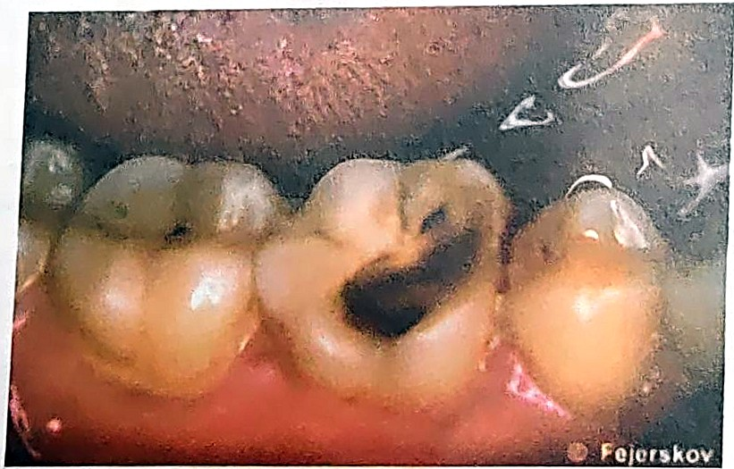

> [!IMPORTANT] Cách học bài này (4 bước, ~90 phút)
>
> 1. **Đọc "Bức tranh 1 phút"** để nắm câu chuyện và **3 luật** của cả bài – chưa cần thuộc.
> 2. **Đọc từng mục 1 → 10** (đúng số mục trong sách). Mỗi mục: hộp 💡 *Hiểu nhanh* → **📖 SGK ghi** (ý của sách viết gọn, giữ đúng thuật ngữ và con số) → các hộp 🔍 *Vì sao…?* (cơ chế: đọc để hiểu, không cần thuộc; ý ngoài SGK đều ghi rõ, thi vẫn chọn theo SGK). Chữ ==tô vàng== là từ khoá/con số đề hay lấy rồi đổi đi một chữ.
> 3. **Bấm "Che từ khoá"** (thanh trên cùng) → đọc lại; gặp ô bị che thì tự nói ra trước rồi bấm vào ô để kiểm tra.
> 4. **Làm trắc nghiệm** cuối bài. Câu sai → bấm nhãn "mục …" của câu đó để về đúng đoạn cần đọc. Làm xong bấm **"Chỉ xem câu sai"**.
>
> Bài này nhiều **hoá học** và được dịch từ sách tiếng Anh (nhiều hình ghi nguồn Fejerskov), nên vài chữ dịch sát nghĩa đen, đọc dễ rối: *sản phẩm* = **tích số**, *năng lượng* (trong công thức) = **lũy thừa**, *10 yếu tố* = **gấp 10 lần**. Gặp chỗ nào bài này giải thích ngay chỗ đó.
>
> **Mục tiêu SGK** – đề thường bám sát 4 mục tiêu này:

1. Kể được các **thành phần khoáng chất** trong men răng → [mục 1](#m1).
2. Giải thích được quá trình **mất khoáng và tái khoáng** trên bề mặt men răng → [mục 2–7](#m2).
3. Mô tả quá trình mất [khoáng] hình thành nên **sang thương sâu răng** → [mục 8–9](#m8).
4. Nêu được quá trình **lành thương** của một sang thương trên bề mặt men răng → [mục 10](#m10).

## Bức tranh 1 phút

> [!NOTE] Cả bài gói trong 7 câu
>
> 1. Men răng gần như toàn **khoáng** (99% trọng lượng khô): những tinh thể **apatite** dài, mảnh, bó lại thành **trụ men**. Giữa các tinh thể có khe chứa nước và chất hữu cơ, là đường cho acid và ion đi lại.
> 2. Khoáng nào cũng tan một ít trong nước, tới khi dịch xung quanh **bão hòa** (đủ ion) thì thôi. Muốn biết tinh thể đang **tan ra hay đắp thêm**, so **tích số ion (IAP)** của dịch với hằng số **KSP** của khoáng đó.
> 3. **Acid** (H⁺) "bắt" PO₄³⁻ và OH⁻ → dịch hụt ion → **chưa bão hòa** → men tan. Hạ **1 đơn vị pH**, apatite tan **gấp 10 lần**. Mốc pH mà dịch vừa đúng bão hòa gọi là **pH tới hạn** (men: **5,5**).
> 4. **Carbonate** làm tinh thể **dễ tan**; **fluor** làm tinh thể **khó tan** (FA chỉ tan khi pH < **4,5**). Men thật là *carbonat fluor hydroxyapatite*.
> 5. Bình thường nước bọt **quá bão hòa** với HA và FA → răng không tan, còn được đắp khoáng (tái khoáng, vôi răng).
> 6. Khi pH mảng bám ở **4,5–5,5**: HA bên dưới tan nhưng FA vẫn đắp ở mặt ngoài → **lớp bề mặt còn, bên dưới rỗng** = sâu răng (đốm trắng). pH < 4,5: tan từng lớp từ ngoài vào = **xoi mòn**.
> 7. Mất khoáng **xen kẽ** tái khoáng theo từng bữa ăn (đường cong Stephan). Bề mặt **sập thành lỗ** thì mất khoáng tăng vọt, phải **can thiệp phục hồi**. Tái khoáng chỉ **nuôi lớn tinh thể còn sót**, không tạo tinh thể mới, và chủ yếu ở **bề mặt** (vết sẹo trắng).

<figure>
<div class="sc"><svg class="dg" style="max-width:520px" viewBox="0 0 440 196" role="img" aria-label="Cân bằng giữa tinh thể apatite và ion trong dịch quanh răng">
<defs><marker id="b2a" viewBox="0 0 10 10" refX="9" refY="5" markerWidth="8" markerHeight="8" orient="auto"><path d="M0,0L10,5L0,10z" class="mk"/></marker></defs>
<rect class="en" x="10" y="62" width="150" height="76" rx="10"/>
<text x="85" y="92" text-anchor="middle" class="b">Tinh thể apatite</text>
<text x="85" y="111" text-anchor="middle" class="m">trong men</text>
<text x="85" y="129" text-anchor="middle" class="s">Ca₁₀(PO₄)₆(OH)₂</text>
<rect class="c1" x="280" y="62" width="150" height="76" rx="10"/>
<text x="355" y="92" text-anchor="middle" class="b">Ion trong dịch</text>
<text x="355" y="111" text-anchor="middle" class="m">quanh răng</text>
<text x="355" y="129" text-anchor="middle" class="s">Ca²⁺ · PO₄³⁻ · OH⁻</text>
<line class="k" x1="166" y1="82" x2="272" y2="82" marker-end="url(#b2a)"/>
<line class="k" x1="274" y1="118" x2="168" y2="118" marker-end="url(#b2a)"/>
<text x="220" y="26" text-anchor="middle" class="b r">MẤT KHOÁNG</text>
<text x="220" y="46" text-anchor="middle" class="s">pH ↓ (acid) · dịch chưa bão hòa</text>
<text x="220" y="164" text-anchor="middle" class="b" style="fill:var(--ok)">TÁI KHOÁNG</text>
<text x="220" y="184" text-anchor="middle" class="s">pH ↑ · nước bọt quá bão hòa (Ca, P, F)</text>
</svg></div>
<figcaption>Hai chiều của cùng một phản ứng: pH thấp đẩy sang phải (men tan ra ion), pH trở lại và dịch quá bão hòa đẩy sang trái (ion đắp lại vào tinh thể). Răng sâu hay không là do <b>chiều nào thắng lâu dài</b>.</figcaption>
</figure>

**3 luật dùng được cho cả bài:**

| Luật                | Nội dung                                                                           | Mục                |
| ------------------- | ---------------------------------------------------------------------------------- | ------------------ |
| ① Bão hòa           | IAP < KSP → **tan** · IAP = KSP → **cân bằng** · IAP > KSP → **đắp thêm, kết tủa** | [2](#m2)           |
| ② Acid              | H⁺ lấy đi PO₄³⁻, OH⁻ → IAP giảm → tan; hạ 1 pH → tan **gấp 10**                    | [3](#m3), [7](#m7) |
| ③ Fluor – carbonate | F⁻ thay OH⁻ → **bền** (FA tan khi pH < 4,5) · CO₃²⁻ thay PO₄³⁻ → **dễ tan**        | [5](#m5), [6](#m6) |

```flow
Ăn đường -> Acid trong mảng bám, pH tụt -> pH 4,5–5,5: HA tan bên dưới, FA đắp ở mặt ngoài -> !Đốm trắng: lớp bề mặt còn, thân rỗng
+pH lên lại, nước bọt quá bão hòa -> +Tinh thể còn sót lớn lại = tái khoáng (chủ yếu ở bề mặt)
!Mất khoáng thắng nhiều lần -> !Bề mặt sập thành lỗ -> !Mất khoáng tăng vọt, không tự hồi phục -> Can thiệp phục hồi (trám)
```

**Ba vùng pH của dịch mảng bám** (ý Hình 2.6, xem [mục 8](#m8)):

| pH dịch mảng bám | > 5,5          | 4,5 – 5,5                                    | < 4,5                     |
| ---------------- | -------------- | -------------------------------------------- | ------------------------- |
| So với HA        | bão hòa        | ==chưa bão hòa==                             | chưa bão hòa              |
| So với FA        | bão hòa        | ==vẫn bão hòa==                              | chưa bão hòa              |
| Điều xảy ra      | ==tái khoáng== | ==sâu răng==: HA tan, FA hình thành ở bề mặt | ==xoi mòn==: tan từng lớp |

## 1. Thành phần khoáng men răng · tr. 17–18

> [!NOTE]
> Men giống **bức tường gạch xây cực khít**: gần như toàn gạch, vữa rất ít. Mỗi "viên gạch" là một **tinh thể apatite** dài và mảnh như sợi bún (ngang chỉ khoảng 50 nm). Rất nhiều sợi bó chặt lại như **bó đũa** thành một **trụ men**. Khe giữa các sợi chứa nước và chất hữu cơ, như những con hẻm nhỏ: acid và ion đi theo các hẻm này vào trong men ([mục 9](#m9)).

**📖 SGK ghi:**

- Men là mô ==khoáng hóa cao==: calcium phosphat (dạng vi thể) chiếm tới ==99% trọng lượng khô==.
- Tinh thể men giống khoáng tự nhiên ==hydroxyapatite Ca₁₀(PO₄)₆(OH)₂==: các ion ==Ca, P, hydroxyl== xếp thành một mạng tinh thể ==lặp đi lặp lại==.
- ==Carbonate, sodium, fluoride== và các ion khác = ==tạp chất== trong khoáng men.
- Apatite là ==cấu trúc chính== của mô cứng sinh học. Calcium phosphate còn có nhiều dạng khác, mỗi dạng một đơn vị cấu trúc riêng: ==brushite CaHPO₄·2H₂O==, ==β-tricalcium phosphate== (SGK in Ca₃(PO₄); công thức đúng là Ca₃(PO₄)₂ – *ngoài SGK*), ==octacalcium phosphate Ca₈(PO₄)₄(HPO₄)₂·5H₂O==.
- Tinh thể apatite men ==dài và mỏng==: thiết diện ngang khoảng ==50 nm==, dài ==trên 100 pm== theo trục dọc (xem hộp ⚖️ bên dưới); xếp thành ==bó chặt chẽ==, lặp lại → tạo nên ==trụ men==.
- Khe giữa các tinh thể: ==nước 11% thể tích==, ==chất hữu cơ 2% thể tích==.
- Khoáng rất cao, khuôn tế bào rất ít → ==màu sắc, độ cứng== và các tính chất vật lý của men ==gần như HA==. Mật độ: HA ==3,16 g/cm³==, men ==2,95 g/cm³==.
- HA ==không màu==, men cũng vậy. Thân răng ==vàng nhẹ== là do ==ngà bên dưới==.
- Tinh thể HA trong suốt. Chỉ số ==RI== (SGK ghi *reflective index*): HA ==1,64==, men ngập trong nước ==1,33== → ==thổi khô== men thì trụ men hiện thành ==đốm trắng như phấn==.
- Độ cứng ==Knoop==: HA ==430 KHN==, men ==370 KHN==. Độ cứng này còn liên quan ==lực dán giữa các tinh thể==.
- **Quan trọng nhất**: men tan được là do ==khả năng hòa tan của apatite==. Khi sâu răng hay ăn mòn men xảy ra, tinh thể có thể ==tan, kết tủa hay lớn lên== trong dung dịch – các mục sau giải thích từng chuyện.

**Bảng 2.1. Thành phần khoáng chất tính theo trọng lượng khô** (SGK tr. 18):

|                 | Men răng (%) | Ngà (%) | Cement (%) |
| --------------- | ------------ | ------- | ---------- |
| Calcium         | ==34–39==    | ==29==  | ==26==     |
| Phospho         | ==16–18==    | ==14==  | ==13==     |
| Carbonate       | ==2,0–3,6==  | ==5,6== | ==5,5==    |
| Na              | ==0,3–0,9==  | ==0,7== | –          |
| Mg              | ==0,3–0,6==  | ==0,9== | –          |
| Cloride         | ==0,2–0,3==  | ==0,4== | –          |
| **Chất khoáng** | ==99==       | ==80==  | ==77==     |
| **Chất hữu cơ** | ==1==        | ==20==  | ==23==     |

> [!WHY] Vì sao men không màu mà răng lại vàng, còn thổi khô thì thấy đốm trắng như phấn?
>
> - Men (gần như toàn HA) **trong** như kính, nên nhìn xuyên qua men ta thấy **màu vàng của ngà** bên dưới (SGK). *(ngoài SGK)* Vì vậy men càng mỏng (răng mòn, răng già) răng trông càng vàng.
> - *(ngoài SGK)* "RI" thật ra là **chiết suất** (*refractive index*): mức ánh sáng bị bẻ cong khi đi vào một chất. Ánh sáng qua ranh giới giữa hai chất có chiết suất **càng chênh** thì càng bị **tán xạ** (bắn tung toé) → ta thấy **trắng đục**.
> - Khe giữa các tinh thể bình thường chứa **nước** (1,33), khá gần HA (1,64), nên men trong. **Thổi khô** → không khí (chiết suất khoảng 1,0) thế chỗ nước → chênh lệch lớn hơn → trụ men hiện **trắng như phấn**. Chỗ men đã mất khoáng có **nhiều khe hơn** nên trắng rõ hơn hẳn. Vì thế khi khám tìm sang thương sớm phải **làm sạch và thổi khô** răng (đốm trắng đục ở Bài 1, mục 2.1).

> [!WHY] Vì sao ngà và cement dễ bị acid phá hơn men? (đọc Bảng 2.1)
>
> - **Ít khoáng hơn**: ngà 80%, cement 77% so với men 99% → ít "gạch", nhiều "vữa" hữu cơ (20–23%).
> - **Nhiều carbonate hơn**: ngà 5,6%, cement 5,5% so với men 2,0–3,6%. Mà carbonate làm apatite **dễ hòa tan hơn** ([mục 6](#m6)).
> - *(ngoài SGK)* Vì thế ngà và cement bắt đầu tan ở pH **cao hơn** men. Sâu chân răng ở người lớn (lộ cement, ngà) tiến triển dễ, và sâu đã vào ngà thì lan nhanh (Bài 1, mục 2.2).

> [!WHY] Vì sao men giống HA tinh khiết, nhưng nhẹ hơn và mềm hơn một chút?
> Giống, vì men **99% là khoáng**, khuôn hữu cơ rất ít (SGK). Kém hơn một chút (mật độ 2,95 so với 3,16 g/cm³; Knoop 370 so với 430 KHN): *(ngoài SGK)* vì xen giữa các tinh thể còn **nước và chất hữu cơ** nhẹ và mềm hơn khoáng, và tinh thể men có **tạp chất** (carbonate, Na…) làm mạng tinh thể kém hoàn hảo hơn HA tinh khiết.

> [!WHY] Vì sao có hai công thức: Ca₁₀(PO₄)₆(OH)₂ và Ca₅(PO₄)₃OH?
> *(ngoài SGK)* Đây là **cùng một chất**, chỉ khác cách đếm: Ca₅(PO₄)₃OH là **một nửa** của Ca₁₀(PO₄)₆(OH)₂ (chia đôi mọi chỉ số). **Ca₁₀(PO₄)₆(OH)₂** ứng với **một ô mạng** tinh thể: đây là công thức SGK ghi ở mục 1 và ở câu lượng giá "theo Kay". Khi viết phương trình hòa tan ([mục 2](#m2)), SGK dùng nửa đơn vị **Ca₅(PO₄)₃OH** cho gọn: 5 Ca²⁺ + 3 PO₄³⁻ + 1 OH⁻.
> Bẫy đề: **Ca₅(PO₄)₃(OH)₂** (2 nhóm OH) và **Ca₁₀(PO₄)₅(OH)₂** đều là công thức **sai**.

> [!IMPORTANT] Trụ men – câu lượng giá SGK số 2
> Phần chữ Bài 2 chỉ nói tinh thể bó chặt lại thành trụ men. Câu lượng giá số 2 (SGK tr. 31) hỏi thêm cấu trúc trụ men; đáp án SGK (tr. 198) là: **mặt cắt ngang của lăng trụ men có dạng ==chìa khóa==** (*ngoài SGK*: hình lỗ khoá, gồm một "đầu" tròn và một "đuôi").

> [!TIP]
>
> - **"99 – 80 – 77"** chất khoáng, **"1 – 20 – 23"** chất hữu cơ (men – ngà – cement). Mỗi cặp cộng lại đúng 100.
> - **"HA hơn men"**: mật độ 3,16 > 2,95 · Knoop 430 > 370 · RI 1,64 (HA) > 1,33 (men ngập nước).
> - Khe giữa tinh thể: **"11 nước – 2 hữu cơ"** (thể tích).
> - Ngà, cement nhiều carbonate **gần gấp đôi** men (5,6 · 5,5 so với 2,0–3,6) → dễ tan hơn.

> [!WARNING]
>
> - **99%** là **trọng lượng khô**; **11%** nước và **2%** chất hữu cơ là **thể tích**. Đề hay tráo "trọng lượng" ↔ "thể tích".
> - Bảng 2.1: chất hữu cơ của men **1%** (trọng lượng khô) – khác con số **2% thể tích** ở trên.
> - Carbonate, sodium, fluoride là **tạp chất**, không phải thành phần chính.
> - HA **lớn hơn** men ở cả mật độ lẫn độ cứng Knoop.
> - Màu vàng của răng là do **ngà**, không do men. Đốm trắng như phấn hiện ra khi **thổi khô**, không phải khi men ngập nước.
> - Theo Kay: **Ca₁₀(PO₄)₆(OH)₂**.

> [!CAUTION] Hai cách hiểu – đơn vị "pm" trong SGK
> | SGK | Hiểu theo các tài liệu khác *(ngoài SGK)* |
> |---|---|
> | tinh thể dài ==trên 100 pm== ([mục 1](#m1)); lớp bề mặt sang thương dày ==20–50 pm== ([mục 7](#m7)) | **µm** (micromet). Lớp bề mặt sang thương sâu men thường được mô tả dày khoảng **20–50 µm** |
>
> 1 pm (picomet) = 10⁻¹² m, còn nhỏ hơn một nguyên tử, nên tinh thể "ngang 50 nm mà dài 100 pm" là không thể: nhiều khả năng chữ **µ bị in thành p**. **Thi chọn SGK**: đề ghi đúng con số và đơn vị như SGK thì chọn theo SGK; đề ghi µm là người ra đề theo tài liệu gốc. Hiểu bản chất: lớp bề mặt dày cỡ **vài chục micromet**.

> [!CAUTION] Hai cách hiểu – câu lượng giá số 2 (trụ men)
> | Đáp án SGK (tr. 198) | Các lựa chọn còn lại |
> |---|---|
> | **B**: mặt cắt ngang lăng trụ men có dạng chìa khóa | Lựa chọn nói khe giữa các tinh thể là đường khuếch tán, thuận lợi cho sâu răng, nghe rất hợp với mục 1 và [mục 9](#m9); lựa chọn "khoảng 10.000 tinh thể" nêu một con số phần chữ Bài 2 không có. Chỉ lựa chọn "trục C vuông góc với trục dài lăng trụ" là sai rõ: *(ngoài SGK)* ở đầu trụ, trục C của tinh thể chạy gần **song song** với trục dài trụ men |
>
> **Thi chọn SGK: B.**

## 2. Sự hòa tan của các tinh thể · tr. 18–19

> [!NOTE]
> Bỏ muối vào cốc nước: lúc đầu tan nhanh, sau chậm dần, tới lúc **không tan thêm** – nước đã **bão hòa**. Lúc này mọi thứ không đứng yên: ion vẫn **bứt ra** và **bám lại** với tốc độ bằng nhau, như cái chợ người ra người vào liên tục mà số người trong chợ không đổi (**cân bằng động**). HA cũng vậy, chỉ là tan **cực ít**.
> Muốn biết dịch quanh răng đang "thiếu" hay "thừa" ion, ta tính **tích số ion (IAP)** rồi so với một hằng số riêng của HA là **KSP**.

**📖 SGK ghi:**

- Mọi chất khoáng đều ==tan được một mức nhất định== trong nước, ở ==bất kỳ nhiệt độ nào==.
- Trong nước cất, khoáng tan ==nhanh lúc đầu== rồi ==chậm dần== khi ion bám lại vào cụm tinh thể; tới khi dung dịch ==bão hòa== thì mạng tinh thể thôi phân hủy, nhưng ==vẫn còn trao đổi nhẹ ion== giữa dung dịch và tinh thể.
- Nước làm tan tinh thể nhờ: phân tử nước chen vào bề mặt tinh thể, ==làm giảm lực hút giữa các ion trái dấu==; nước có ==hằng số điện môi cao==; nước ==bao quanh các ion vừa tách ra== và ==năng lượng hydrate hóa== này lớn hơn năng lượng giữ các ion trong mạng.
- Dung dịch bão hòa với HA hay chưa được xét qua ==tích số các sản phẩm hòa tan==, theo "quy luật hoạt động chung" (đọc hộp 🔍 để hiểu đúng các chữ này).
- Một đơn vị HA tan ra ==5 ion calcium==, ==3 ion phosphate hóa trị 3== và ==1 hydroxyl==: **Ca₅(PO₄)₃OH → 5Ca²⁺ + 3PO₄³⁻ + OH⁻**.
- ⇒ ==Tích số hoạt độ ion của HA (IAP)== = (Ca²⁺)⁵ × (PO₄³⁻)³ × (OH⁻): Ca "mũ 5", phosphate "mũ 3", hydroxyl "mũ 1" (SGK diễn đạt là "tăng 5 lần, 3 lần năng lượng").
- Dung dịch ==rất loãng==: hoạt độ của ion ==gần bằng nồng độ==. Muối càng đậm đặc, các ion càng ==tương tác== với nhau nên hoạt độ ==nhỏ hơn== nồng độ; ion còn bị giữ trong ==phức hợp ion==, ví dụ ==CaH₂PO₄⁺==.
- Khi dung dịch ==bão hòa== HA (khoáng cân bằng với ion trong dịch): ==IAP = KSP== của HA, là hằng số ==7,41 × 10⁻⁶⁰ mol⁹/lít⁹ ở 37°C==: KSP<sub>HA</sub> = (Ca²⁺)⁵ × (PO₄³⁻)³ × (OH⁻) = **7,41 × 10⁻⁶⁰ mol⁹/lít⁹**.
- Muối như ==NaCl== tan nhiều hơn trong nước nóng; còn ==HA và hầu hết calcium phosphate== thì không như vậy → uống ==nước nóng== răng ==không dễ tan hơn== uống nước lạnh.

**So IAP với KSP – luật ① của bài:**

| Dịch quanh tinh thể | Gọi là           | Tinh thể                                                   |
| ------------------- | ---------------- | ---------------------------------------------------------- |
| IAP < KSP           | ==chưa bão hòa== | ==tan ra== (mất khoáng) cho tới khi bão hòa lại            |
| IAP = KSP           | ==bão hòa==      | cân bằng, vẫn ==trao đổi nhẹ ion==                         |
| IAP > KSP           | ==quá bão hòa==  | ==kết tủa, lớn lên== (tái khoáng, vôi răng – [mục 7](#m7)) |

> [!WHY] Vì sao SGK nói "tăng 5 lần năng lượng"? (đọc đúng công thức)
> *(ngoài SGK)* Đoạn này dịch sát từng chữ từ tiếng Anh nên rất khó đọc. Bốn chữ cần "dịch lại":
>
> | SGK viết                          | Nghĩa trong hoá học                      |
> | --------------------------------- | ---------------------------------------- |
> | quy luật hoạt động chung          | **định luật tác dụng khối lượng**        |
> | sản phẩm (ion hoạt động, hòa tan) | **tích số**: nhân các nồng độ với nhau   |
> | hoạt động (của ion)               | **hoạt độ**: nồng độ "hiệu dụng" của ion |
> | "tăng 5 lần năng lượng"           | **lũy thừa 5** (mũ 5)                    |
>
> Vậy IAP = (Ca²⁺)⁵ × (PO₄³⁻)³ × (OH⁻)¹: **số mũ = số ion** sinh ra khi một đơn vị HA tan (5, 3, 1). Cộng số mũ: 5 + 3 + 1 = **9**, nên đơn vị là **mol⁹/lít⁹**.
> Hệ quả: Ca mang **mũ 5**, phosphate **mũ 3**, nên lượng Ca, P trong dịch chỉ **đổi một chút** là IAP đổi **rất mạnh**. Vì vậy thêm Ca, P làm HA ngừng tan, còn lấy bớt Ca (EDTA) làm HA tan mạnh ([mục 3](#m3)).

> [!WHY] Đã bão hòa rồi, sao "vẫn còn trao đổi nhẹ ion"?
> Bão hòa là **cân bằng động**: mỗi giây vẫn có ion rời tinh thể và ion bám lại, hai dòng **bằng nhau** nên nhìn bên ngoài như đứng yên.
> *(ngoài SGK)* Chính dòng trao đổi nhỏ này cho **ion lạ** trong nước bọt (fluor, carbonate…) chen vào mạng tinh thể thay chỗ ion cũ ([mục 5](#m5)). Men vì thế thay đổi dần theo năm tháng: răng mới mọc nhiều carbonate, lâu dần được thay bằng OH⁻, F⁻ – quá trình chín muồi men (Bài 1, mục 1.2.3).

> [!WHY] Vì sao uống nước nóng không làm răng tan nhanh hơn uống nước lạnh?
> Muối thường như NaCl: nóng thì tan nhiều hơn. HA và hầu hết calcium phosphate **không như vậy** (SGK). *(ngoài SGK)* Calcium phosphate thuộc nhóm muối "tan ngược": nhiệt độ cao **không làm tăng**, thậm chí còn làm giảm nhẹ độ tan.
> Thứ quyết định men tan hay không là **pH** và **lượng ion** trong dịch ([mục 3](#m3)), không phải nhiệt độ. (Ê buốt khi uống nóng, lạnh lúc đã lộ ngà là chuyện khác: dịch trong ống ngà chuyển động – Bài 1, mục 2.2.3.)

> [!TIP]
>
> - **"5 – 3 – 1, cộng mũ thành 9"**: 5 Ca²⁺, 3 PO₄³⁻, 1 OH⁻ → mol⁹/lít⁹.
> - KSP của HA: **"7,41 – trừ 60 – 37 độ"**.

> [!WARNING]
>
> - Một đơn vị HA tan: **5** Ca²⁺ – **3** PO₄³⁻ (phosphate **hóa trị 3**, không phải HPO₄²⁻) – **1** OH⁻.
> - KSP của HA = **7,41 × 10⁻⁶⁰** mol⁹/lít⁹ ở **37°C**. Đừng nhầm với FA (3,2 × 10⁻⁶¹) hay men (5,5 × 10⁻⁵⁵) ở [mục 6](#m6).
> - "Khi bão hòa thì ngừng hẳn mọi trao đổi ion" → sai: **vẫn trao đổi nhẹ**.
> - "Trong nước cất, khoáng tan chậm lúc đầu rồi nhanh dần" → sai: **nhanh trước, chậm sau**.
> - "Trong dung dịch đậm đặc, hoạt độ ion bằng nồng độ" → sai: chỉ dung dịch **rất loãng** mới gần bằng.
> - "Uống nước nóng làm răng dễ tan hơn" → sai.

## 3. Khả năng hòa tan của apatite tăng lên bởi acid · tr. 19–20

> [!NOTE]
> Hình dung dịch quanh răng như **một chậu nước đã đầy** (bão hòa): đổ thêm cũng không vào. Acid như **đục một lỗ dưới đáy chậu**: H⁺ "bắt" PO₄³⁻ và OH⁻, biến chúng thành HPO₄²⁻ và nước – những dạng **không còn được tính** vào IAP. Chậu lại vơi, và thứ duy nhất có thể bù vào là **tinh thể men tan ra thêm**. Acid càng mạnh (pH càng thấp), lỗ càng to, men tan càng nhanh.

**📖 SGK ghi:**

- Độ tan của HA và các calcium phosphate khác ==phụ thuộc rất nhiều vào pH==. Khác hẳn ==NaCl==: độ tan của NaCl ==không liên quan pH==.
- Không có acid: PO₄³⁻, OH⁻ cùng Ca²⁺ tích lại trong dung dịch → HA tan chậm dần và ==dừng khi dung dịch bão hòa==.
- ==Thêm acid==: PO₄³⁻ và OH⁻ ==kết hợp với H⁺== thành ==HPO₄²⁻ và H₂O== → lượng PO₄³⁻, OH⁻ trong dung dịch thay đổi.
- ==IAP giảm== → dung dịch ==không bão hòa== → HA tiếp tục tan ==cho tới khi bão hòa trở lại==.
- ==pH tới hạn==: hạ dần pH của một dung dịch đang quá bão hòa, tới điểm mà dung dịch ==chỉ còn vừa đúng mức bão hòa== với khoáng chất.
- Ví dụ ==pH tới hạn = 6==: tinh thể HA tan ==không đồng hướng==, ==nhanh hơn theo trục C== → tinh thể bị phân hủy từng phần với ==lỗ hổng ở trung tâm==; chỉ thấy được ở mức ==siêu vi thể== của sâu men.
- ==Ion chung==: một loại ion có mặt ==quá mức== thì loại ion khác phải ==hao hụt== đi (vì tích số chỉ được bằng KSP). → ==Thêm calcium hay phosphate== vào dung dịch đang hòa tan HA thì ==HA tan chậm lại==.
- Ngược lại, ==lấy calcium ra== khỏi dung dịch đang cân bằng bằng một chất "chuyên chở" calcium → ==HA phân hủy nhiều hơn==. Ví dụ: ==EDTA== (ethylene diamine tetraacetic acid).
- **Tóm lại**: HA tan trong acid vì dung dịch quanh tinh thể trở nên ==chưa bão hòa==; tan ==mạnh hay yếu== tuỳ dung dịch ==dưới ngưỡng bão hòa bao nhiêu==.

<figure>
<div class="sc"><svg class="dg" style="max-width:520px" viewBox="0 0 440 200" role="img" aria-label="Acid kéo phosphate và hydroxyl ra khỏi dung dịch">
<defs><marker id="b2b" viewBox="0 0 10 10" refX="9" refY="5" markerWidth="8" markerHeight="8" orient="auto"><path d="M0,0L10,5L0,10z" class="mk"/></marker></defs>
<text x="62" y="36" text-anchor="middle" class="b">Ca₅(PO₄)₃OH</text>
<line class="k" x1="120" y1="31" x2="160" y2="31" marker-end="url(#b2b)"/>
<text x="198" y="36" text-anchor="middle" class="b">5 Ca²⁺</text>
<text x="240" y="36" text-anchor="middle">+</text>
<text x="290" y="36" text-anchor="middle" class="b">3 PO₄³⁻</text>
<text x="340" y="36" text-anchor="middle">+</text>
<text x="388" y="36" text-anchor="middle" class="b">OH⁻</text>
<line class="k" x1="290" y1="46" x2="290" y2="88" marker-end="url(#b2b)"/>
<text x="300" y="72" class="s b r">+ H⁺</text>
<text x="290" y="108" text-anchor="middle" class="b">HPO₄²⁻</text>
<line class="k" x1="290" y1="118" x2="290" y2="160" marker-end="url(#b2b)"/>
<text x="300" y="144" class="s b r">+ H⁺</text>
<text x="290" y="180" text-anchor="middle" class="b">H₂PO₄⁻</text>
<line class="k" x1="388" y1="46" x2="388" y2="88" marker-end="url(#b2b)"/>
<text x="398" y="72" class="s b r">+ H⁺</text>
<text x="388" y="108" text-anchor="middle" class="b">H₂O</text>
<text x="18" y="104" class="s m">Acid lấy dần PO₄³⁻ và OH⁻</text>
<text x="18" y="122" class="s m">khỏi phần được tính vào IAP</text>
<text x="18" y="140" class="s m">⇒ IAP giảm ⇒ chưa bão hòa</text>
<text x="18" y="158" class="s r">⇒ HA phải tan tiếp</text>
</svg></div>
<figcaption>Vẽ lại sơ đồ SGK tr. 20. Nấc cuối SGK in là H₂PO₄²⁻; viết đúng hoá học là H₂PO₄⁻ <i>(ngoài SGK)</i>.</figcaption>
</figure>

> [!WHY] Vì sao HA "sợ" acid, còn muối ăn NaCl thì không?
> *(ngoài SGK)* Tuỳ phần mang điện âm của muối có thích bắt H⁺ hay không.
>
> - NaCl tan ra Na⁺ và Cl⁻. Cl⁻ **không bắt H⁺** (HCl là acid mạnh, luôn tách hẳn ra ion), nên thêm acid thì lượng Cl⁻ tự do không đổi → độ tan không đổi.
> - HA tan ra PO₄³⁻ và OH⁻: cả hai đều là bazơ, rất **thích bắt H⁺** (thành HPO₄²⁻, H₂PO₄⁻, H₂O). Acid càng nhiều thì càng nhiều PO₄³⁻, OH⁻ bị "giấu đi" → IAP tụt → HA phải tan thêm để bù.

> [!WHY] Vì sao thêm Ca, P thì HA tan chậm lại, còn EDTA lại làm HA tan?
> Nhớ IAP là một **tích**: (Ca)⁵ × (PO₄)³ × (OH).
>
> - **Thêm Ca hoặc P** (ion chung): một thừa số đã lớn sẵn → tích nhanh chạm KSP → dung dịch sớm bão hòa → HA **thôi tan** (SGK). *(ngoài SGK)* Đây là lý do nước bọt giàu Ca, P bảo vệ được răng, và các sản phẩm bổ sung Ca, P giúp tái khoáng.
> - **EDTA** là chất **"tóm" calcium** (SGK gọi là chất "chuyên chở" calcium; *ngoài SGK*: tên chuẩn là **chất tạo phức càng cua – chelate**). Ca bị khoá lại, không còn tính vào IAP → tích tụt dưới KSP → HA **tan thêm**. *(ngoài SGK)* Trong nội nha người ta dùng chính EDTA để làm mềm ngà, lấy lớp mùn ngà.

> [!WHY] Vì sao tinh thể bị "khoét rỗng ruột" (lỗ hổng trung tâm)?
> SGK: tinh thể **không tan đều mọi phía** mà tan **nhanh hơn theo trục C** – trục dọc của tinh thể dài và mảnh.
> *(ngoài SGK)* Hình dung **một cây mía bị ăn ruột**: acid ăn dọc lõi nhanh hơn ăn vào vỏ, nên ruột tinh thể bị khoét thành lỗ trước, vỏ ngoài còn lại. Lỗ rất nhỏ, chỉ thấy dưới **kính hiển vi điện tử** (mức siêu vi thể). Tinh thể "rỗng ruột" vẫn còn khung, nên sau này còn **lớn lại được** khi tái khoáng ([mục 10](#m10)).

> [!WHY] Vì sao pH tới hạn lúc ghi 6 (mục 3), lúc ghi 5,5 (Hình 2.9)?
> Theo định nghĩa SGK, pH tới hạn là pH mà dịch **vừa đúng bão hòa**. *(ngoài SGK)* Mà "vừa đúng bão hòa" lại tuỳ **dịch đó đang có bao nhiêu Ca, P**:
>
> - Dịch **giàu** Ca, P (IAP cao sẵn) → phải acid hơn mới tụt xuống KSP → pH tới hạn **thấp hơn**.
> - Dịch **nghèo** Ca, P → acid nhẹ đã đủ làm chưa bão hòa → pH tới hạn **cao hơn** (như 6).
>
> Nên pH tới hạn **không phải một hằng số**; SGK lấy 6 làm ví dụ. Con số "các nhà khoa học thường đồng ý" cho men là **5,5** (chú thích Hình 2.9), còn FA là **4,5** (Bài 1, mục 2.1; Hình 2.6). **Thi: HA (men) 5,5 – FA 4,5.**

> [!TIP]
>
> - **"Acid bắt cóc PO₄ và OH"** → IAP giảm → men tan.
> - **"Thêm ion chung – chậm tan; tóm Ca (EDTA) – tan mạnh"**.
> - **"Tan dọc trục C – rỗng ruột như cây mía"**.

> [!WARNING]
>
> - "Độ tan của HA không liên quan đến pH" → sai; đó là **NaCl**.
> - Acid: PO₄³⁻ → **HPO₄²⁻**, OH⁻ → **H₂O**. Đề có thể tráo: "PO₄³⁻ thành H₂O".
> - pH tới hạn = dung dịch **vừa đúng mức bão hòa**; không phải lúc "quá bão hòa nhiều nhất", cũng không phải "chưa bão hòa".
> - Tinh thể tan **không đồng hướng**, nhanh hơn theo **trục C** → **lỗ hổng trung tâm**; chỉ thấy ở mức **siêu vi thể**.
> - Thêm Ca/P → HA tan **chậm lại**; EDTA (lấy Ca đi) → HA phân hủy **nhiều hơn**. Đề hay đảo chiều hai ý này.

## 4. Sự ổn định của calcium phosphate · tr. 21

> [!NOTE]
> Calcium phosphate có nhiều "kiểu gạch" (HA, brushite, octacalcium phosphate, tricalcium phosphate, whitlockite, FA…). Ở mỗi mức pH, kiểu nào **ít tan nhất** thì kiểu đó **bền (ổn định)** nhất, và khi dịch dư ion thì kiểu đó dễ **kết tủa** ra nhất. Điểm "đổi ngôi" giữa HA và brushite là **pH 4,3**.

**📖 SGK ghi:**

- Ở pH ==dịch mô (7,4)==, HA ==hầu như ổn định== các thành phần Ca, P – đúng như ta thấy trong suốt quá trình ==hình thành và phát triển mô răng==.
- ==Sau khi mọc==, lớp apatite ngoài cùng của ==men và ngà== tiếp xúc môi trường có ==pH thay đổi liên tục== do ==tiêu hóa== và ==mảng bám răng==.
- ==pH < 4,3==: ==brushite ổn định hơn HA==; brushite có thể ==kết tủa== thành ==tinh thể rời rạc== hoặc ==bọc quanh trục các trụ men==.
- ==pH > 4,3==: ==HA ổn định hơn mọi calcium phosphate khác==.
- Có thêm ion như ==fluoride, magnesium== thì cân bằng thay đổi: tạo ==whitlockite== hoặc ==fluorapatite==, là những dạng ==dễ kết tủa hơn HA==.

<figure>
<div class="sc"><svg class="dg" style="max-width:520px" viewBox="0 0 440 252" role="img" aria-label="Độ tan của HA và brushite theo pH, cắt nhau ở pH 4,3">
<line class="ax" x1="50" y1="16" x2="50" y2="212"/>
<line class="ax" x1="50" y1="212" x2="426" y2="212"/>
<text x="58" y="14" class="s m">càng cao càng dễ tan</text>
<line class="k" x1="50" y1="30" x2="420" y2="190" style="stroke:var(--note);stroke-width:2.5"/>
<line class="k" x1="50" y1="56.2" x2="420" y2="115.4" style="stroke:#ea580c;stroke-width:2.5"/>
<text x="400" y="204" text-anchor="end" class="b" style="fill:var(--note)">HA</text>
<text x="400" y="98" text-anchor="end" class="b" style="fill:#ea580c">brushite</text>
<line class="d" x1="146.2" y1="76" x2="146.2" y2="212"/>
<circle cx="146.2" cy="71.6" r="4.5" style="fill:var(--bad)"/>
<text x="240" y="40" class="s b">pH &gt; 4,3: HA bền hơn</text>
<text x="240" y="56" class="s">mọi calcium phosphate khác</text>
<text x="58" y="160" class="s b">pH &lt; 4,3:</text>
<text x="58" y="176" class="s">brushite</text>
<text x="58" y="192" class="s">bền hơn HA</text>
<g text-anchor="middle"><text x="50" y="228" class="s m">3</text><text x="124" y="228" class="s m">4</text><text x="198" y="228" class="s m">5</text><text x="272" y="228" class="s m">6</text><text x="346" y="228" class="s m">7</text><text x="420" y="228" class="s m">pH</text></g>
<text x="146" y="228" text-anchor="middle" class="s b r">4,3</text>
<line class="ax" x1="375.6" y1="207" x2="375.6" y2="217"/>
<text x="376" y="244" text-anchor="middle" class="s m">7,4 dịch mô</text>
</svg></div>
<figcaption>Sơ đồ tự vẽ để minh hoạ ý SGK mục 4 <i>(ngoài SGK: SGK có nhắc "sơ đồ trên" nhưng không in sơ đồ)</i>. Đường nằm <b>thấp hơn</b> = chất <b>ít tan hơn</b> = bền hơn ở pH đó. Độ tan của HA giảm nhanh hơn khi pH tăng nên hai đường cắt nhau ở <b>pH 4,3</b>: bên trái brushite bền hơn, bên phải HA bền hơn mọi calcium phosphate. Trục tung chỉ để so sánh, không phải số đo.</figcaption>
</figure>

> [!WHY] Vì sao răng "yên ổn" lúc đang hình thành, mà sau khi mọc lại bị đe doạ?
> Lúc hình thành, răng nằm trong **dịch mô pH 7,4** – mức HA bền, Ca, P nằm yên trong tinh thể (SGK). Mọc lên rồi, mặt men và ngà phơi ra miệng, nơi pH **lên xuống liên tục** theo bữa ăn và mảng bám. Mỗi lần pH tụt dưới pH tới hạn là một lần men tan bớt; pH lên lại là một lần đắp lại – vòng **mất khoáng – tái khoáng** bắt đầu từ đây ([mục 7](#m7)). *(ngoài SGK)* Đây cũng là lý do men **mới mọc** dễ sâu nhất (Bài 1, mục 1.2.3).

> [!WHY] Vì sao có fluor thì khoáng "đắp lại" dễ hơn?
> SGK: fluoride, magnesium tạo **whitlockite** hoặc **fluorapatite**, những dạng **dễ kết tủa hơn HA**. *(ngoài SGK)* FA ít tan hơn HA (KSP nhỏ hơn – [mục 6](#m6)). Với cùng một lượng Ca, P trong dịch, dịch đã "đầy" đối với FA sớm hơn đối với HA → FA kết tủa trước, nhanh hơn. Kết quả: khi pH lên lại, có fluor thì khoáng **đắp lại nhanh hơn**, và phần đắp lại là FA/FHA **bền hơn** phần cũ. Đây là cơ chế chính của fluor tại chỗ (Bài 1, mục 6.3.3).

> [!TIP]
> **"B dưới, H trên"**: dưới pH 4,3 – **B**rushite bền; trên 4,3 – **H**A bền. **7,4** = pH dịch mô, nơi răng hình thành.

> [!WARNING]
>
> - pH < **4,3** → **brushite** bền hơn HA; pH > 4,3 → **HA** bền nhất. Đề hay đảo hai vế.
> - **7,4** là pH **dịch mô**, không phải pH tới hạn, không phải pH nước bọt.
> - Whitlockite và FA **dễ** kết tủa hơn HA (không phải khó hơn).
> - Brushite kết tủa thành tinh thể rời rạc hoặc **bọc quanh trục trụ men**.

## 5. Chất khoáng men răng và dịch miệng · tr. 21–22

> [!NOTE]
> Mạng tinh thể apatite là **bức tường cho phép thay gạch** (SGK gọi là "uyển chuyển"): ion nào mất (Ca, P, OH) thì ion khác trong dịch quanh răng có thể chui vào thế chỗ.
>
> - **Carbonate (CO₃²⁻) thay phosphate**: như thay viên gạch chuẩn bằng **gạch xốp, méo** → tường yếu, dễ tan; thay nhiều quá thì **sập**. Thường đi kèm **Na⁺ thay Ca²⁺**.
> - **Fluoride (F⁻) thay hydroxyl (OH⁻)**: như thay bằng **gạch khít, cứng hơn** → tường bền; thay bao nhiêu cũng được.

**📖 SGK ghi:**

- Tinh thể men ==khác HA tinh khiết== vì có các ion ngoại lai (SGK ghi "ion hữu cơ ngoại lai").
- Mạng apatite ==uyển chuyển==: cho ion bên ngoài ==vào thay thế, bù trừ== các ion ==Ca, P, OH đã mất==.
- Điển hình: ==carbonate thay phosphate==, thường đi cùng ==sodium thay calcium==.
- Carbonate ==có giới hạn==: chỉ nhận được tới một mức, quá mức thì ==mạng tinh thể sụp đổ==.
- ==Fluoride thay hydroxyl==: ==không giới hạn==, có thể lan rộng khắp mạng. Nhưng thay ==hoàn toàn 100%== bằng fluoride thì ==hiếm== trong mô sinh học, ==trừ men răng cá mập==.
- Carbonate và fluoride vào được giữa các tinh thể vì chúng ==thay đổi kích thước mạng lưới==. Vì vậy apatite men và hầu hết apatite sinh học đều là ==carbonat fluor hydroxyapatite==.
- Ion khác hay gặp trong apatite sinh học: ==cloride, magnesium== với lượng ==rất nhỏ==; trao đổi ==strontium – calcium== cũng có nhưng ==rất nhỏ, không quan trọng==.

| Ion vào               | Thay cho                             | Giới hạn                                               | Hệ quả ([mục 6](#m6)) |
| --------------------- | ------------------------------------ | ------------------------------------------------------ | --------------------- |
| ==Carbonate== (CO₃²⁻) | ==phosphate==, kèm ==Na⁺ thay Ca²⁺== | ==có giới hạn== (quá nhiều → sập mạng)                 | ==dễ tan hơn==        |
| ==Fluoride== (F⁻)     | ==hydroxyl== (OH⁻)                   | ==không giới hạn== (100% thì hiếm, trừ ==men cá mập==) | ==khó tan hơn==       |
| Cloride, magnesium    | –                                    | lượng rất nhỏ                                          | –                     |
| Strontium             | trao đổi với calcium                 | rất nhỏ                                                | không quan trọng      |

> [!WHY] Vì sao carbonate chỉ thay được có giới hạn, còn fluor thì thay bao nhiêu cũng được?
> *(ngoài SGK)* Hình dung mỗi ion là một viên gạch có **cỡ, hình dạng và điện tích** riêng.
>
> - **F⁻ và OH⁻** gần **bằng cỡ** nhau và **cùng điện tích −1** → F⁻ lắp vào chỗ OH⁻ **vừa khít**, mạng còn chặt hơn. Thay bao nhiêu tường cũng không méo.
> - **CO₃²⁻** là hình **tam giác phẳng** mang điện **−2**, còn PO₄³⁻ là **khối tứ diện** mang **−3** → lắp vào thì **méo** và **thiếu một điện tích âm**. Muốn cân lại điện tích, một **Ca²⁺ phải đổi thành Na⁺** (bớt một điện tích dương). Đó là lý do SGK nói hai sự thay thế này **đi cùng nhau**. Méo quá nhiều thì mạng **sụp**, nên carbonate có giới hạn, và tinh thể nhiều carbonate thì **dễ tan**.

**Hình 2.1 (SGK tr. 22) – nhú Tomes** (ảnh mô học trong SGK, vẽ lại bên dưới; SGK in hình ở cuối mục 5 nhưng không giải thích, xem hộp 🔍 cuối [mục 10](#m10)):

<figure>
<div class="sc"><svg class="dg" style="max-width:520px" viewBox="0 0 440 200" role="img" aria-label="Nhú Tomes đi từ nguyên bào ngà qua tiền ngà vào ngà">
<rect class="de" x="20" y="20" width="290" height="60"/>
<rect class="en" x="20" y="80" width="290" height="32"/>
<g class="k"><line x1="55" y1="136" x2="55" y2="26"/><line x1="110" y1="136" x2="110" y2="26"/><line x1="165" y1="136" x2="165" y2="26"/><line x1="220" y1="136" x2="220" y2="26"/><line x1="275" y1="136" x2="275" y2="26"/></g>
<g class="pu"><ellipse cx="55" cy="160" rx="13" ry="24"/><ellipse cx="110" cy="160" rx="13" ry="24"/><ellipse cx="165" cy="160" rx="13" ry="24"/><ellipse cx="220" cy="160" rx="13" ry="24"/><ellipse cx="275" cy="160" rx="13" ry="24"/></g>
<g class="ld"><path d="M278,124 L314,124"/><path d="M290,162 L314,162"/></g>
<text x="318" y="54" class="s">ngà đã khoáng hóa</text>
<text x="318" y="88" class="s">tiền ngà</text>
<text x="318" y="106" class="s m">(chưa khoáng hóa)</text>
<text x="318" y="128" class="s b">nhú Tomes</text>
<text x="318" y="144" class="s">trong ống ngà</text>
<text x="318" y="166" class="s b">thân nguyên</text>
<text x="318" y="182" class="s b">bào ngà</text>
</svg></div>
<figcaption>Vẽ lại ý Hình 2.1: nhú Tomes nằm <b>trong ống ngà</b>, kéo dài <b>từ nguyên bào ngà</b> (thân tế bào nằm sát tủy) qua lớp <b>tiền ngà</b> chưa khoáng hóa <b>vào ngà</b> đã khoáng hóa.</figcaption>
</figure>

> [!TIP]
>
> - **"CO₃ dắt Na – F thế OH"**.
> - Men = **carbonat fluor hydroxyapatite**; **100% F chỉ có ở men cá mập**.

> [!WARNING]
>
> - Carbonate thay **phosphate** (không phải thay OH); sodium thay **calcium**.
> - Carbonate **có giới hạn**; fluoride **không giới hạn** – đề hay tráo.
> - Thay 100% bằng fluoride: **hiếm**, chỉ ở **men răng cá mập** (không phải men người trưởng thành).
> - Men là **carbonat fluor hydroxyapatite**, không phải HA tinh khiết, cũng không phải FA tinh khiết.
> - Strontium – calcium: lượng **rất nhỏ, không quan trọng**.

## 6. Hiệu quả của carbonate và fluor trong sự hòa tan và lớn lên của apatite · tr. 22

> [!NOTE]
> Coi KSP như **"chỉ số dễ tan"**: KSP **càng nhỏ** thì khoáng **càng khó tan, càng "lì"**. Với các số dạng 10 mũ âm, mũ càng âm thì số càng nhỏ: 10⁻⁶³ nhỏ hơn 10⁻⁶⁰ đúng 1.000 lần. Xếp các con số SGK lại, ta được **một bậc thang**: men thật (nhiều carbonate) đứng trên cùng, dễ tan nhất; có fluor thì tụt xuống dưới, khó tan.

**📖 SGK ghi:**

- Trao đổi ion làm đổi tính chất vật lý, hóa học của khoáng; với men, tính chất ==quan trọng nhất là tính hòa tan==.
- ==Carbonate làm HA dễ hòa tan hơn==; ==fluoride có tác dụng ngược lại== (làm khó tan).
- FA: ==KSP = 3,2 × 10⁻⁶¹== (SGK viết KPS<sub>FA</sub>) → ==ít tan hơn HA==.
- Nhưng ==ít tan nhất== lại là dạng ==chỉ được thay khoảng 50%==: KSP của FHA ==6,6 × 10⁻⁶³ (pH = 5)==. SGK giải thích: vì ==một lượng nhỏ fluoride== có liên quan trong men răng tự nhiên.
- ==Carbonate ảnh hưởng mạnh nhất== tới độ tan của men: KSP của men ==5,5 × 10⁻⁵⁵== (SGK dùng chữ "làm giảm", đọc hộp 🔍), dù có bằng chứng cho thấy chỉ phần trụ ở đường nối chất khoáng mới bị hòa tan hoàn toàn.
- Phần lớn khoáng men có ==KSP gần 10⁻⁵⁸==, ghi nhận ở tình trạng ==dịch miệng bão hòa đối với men== → dùng số này ==sát thực tế hơn KSP của HA==.
- Khoáng men ==thay đổi tự nhiên== nên ==rất khó xác định KSP của men==.

<figure>
<div class="sc"><svg class="dg" style="max-width:520px" viewBox="0 0 440 292" role="img" aria-label="Bậc thang KSP từ dễ tan đến khó tan">
<defs><marker id="b2c" viewBox="0 0 10 10" refX="9" refY="5" markerWidth="8" markerHeight="8" orient="auto"><path d="M0,0L10,5L0,10z" class="mk"/></marker></defs>
<line class="k" x1="30" y1="30" x2="30" y2="262" marker-end="url(#b2c)"/>
<text x="30" y="18" text-anchor="middle" class="s b r">dễ tan</text>
<text x="30" y="284" text-anchor="middle" class="s b" style="fill:var(--ok)">khó tan</text>
<rect class="c2" x="58" y="28" width="372" height="40" rx="8"/>
<rect class="c2" x="58" y="78" width="372" height="40" rx="8"/>
<rect class="en" x="58" y="128" width="372" height="40" rx="8"/>
<rect class="c3" x="58" y="178" width="372" height="40" rx="8"/>
<rect class="c3" x="58" y="228" width="372" height="40" rx="8"/>
<text x="70" y="53" class="s b">Men răng thật (nhiều carbonate)</text><text x="420" y="54" text-anchor="end" class="b">5,5 × 10⁻⁵⁵</text>
<text x="70" y="103" class="s b">Phần lớn khoáng men (dịch miệng)</text><text x="420" y="104" text-anchor="end" class="b">≈ 10⁻⁵⁸</text>
<text x="70" y="153" class="s b">HA tinh khiết (37°C)</text><text x="420" y="154" text-anchor="end" class="b">7,41 × 10⁻⁶⁰</text>
<text x="70" y="203" class="s b">FA</text><text x="420" y="204" text-anchor="end" class="b">3,2 × 10⁻⁶¹</text>
<text x="70" y="253" class="s b">FHA, thay ~50% F (pH = 5)</text><text x="420" y="254" text-anchor="end" class="b">6,6 × 10⁻⁶³</text>
</svg></div>
<figcaption>Bậc thang KSP theo các con số SGK mục 2 và 6. KSP <b>càng nhỏ</b> (mũ càng âm) thì <b>càng khó tan</b>. Carbonate kéo men lên phía trên (dễ tan); fluor kéo xuống phía dưới (khó tan). Ít tan nhất là <b>FHA thay khoảng 50%</b>, không phải FA 100%.</figcaption>
</figure>

> [!WHY] SGK nói carbonate "làm giảm" KSP của men, sao men lại dễ tan hơn HA?
> So hai con số: men **5,5 × 10⁻⁵⁵**, HA **7,41 × 10⁻⁶⁰**. Mũ −55 lớn hơn mũ −60 năm bậc, nên KSP của men **lớn hơn HA hơn 70.000 lần** → men **dễ tan hơn** HA tinh khiết rất nhiều. Điều này khớp với câu "carbonate làm HA dễ hòa tan hơn".
> *(ngoài SGK)* Chữ "làm giảm" trong câu dịch nên hiểu là carbonate làm **giảm độ bền** của men (đẩy KSP lên). Khi thi chỉ cần nhớ: **carbonate → dễ tan; KSP men = 5,5 × 10⁻⁵⁵**.

> [!WHY] Vì sao FHA chỉ thay khoảng 50% fluor lại ít tan nhất, còn hơn cả FA 100%?
> *(ngoài SGK)* Trong tinh thể, các ion OH⁻ (hoặc F⁻) xếp thành **một cột** chạy dọc trục C. Khi trong cột có **cả OH⁻ lẫn F⁻ xen nhau**, nguyên tử H của OH⁻ "níu" lấy F⁻ bên cạnh (liên kết hydro), nên cột **chặt hơn** cả khi toàn F⁻. Đây là cách giải thích hay gặp cho việc FHA thay một phần lại ít tan nhất.
> SGK nhắc con số này vì men tự nhiên chỉ có **một lượng nhỏ fluoride**. *(ngoài SGK)* Nghĩa là lượng fluor nhỏ, chỉ thay một phần OH⁻ như ở men thật, lại cho dạng **bền nhất**; không cần biến cả răng thành FA. Vì vậy fluor có lợi nhất khi **ít mà đều đặn** (kem đánh răng hằng ngày), hơn là thật nhiều trong một lần.

> [!TIP]
>
> - Bậc thang **"55 – 58 – 60 – 61 – 63"** từ dễ tan → khó tan: **Men – khoáng men (dịch miệng) – HA – FA – FHA**.
> - Hệ số đi kèm: **5,5 – (1) – 7,41 – 3,2 – 6,6**. FHA đo ở **pH 5**.

> [!WARNING]
>
> - Carbonate → **dễ** tan; fluoride → **khó** tan.
> - FA ít tan hơn HA, nhưng **ít tan nhất** là **FHA thay khoảng 50%** (6,6 × 10⁻⁶³, đo ở **pH = 5**), không phải FA 100%.
> - Đề hay tráo số giữa các chất: **HA 7,41 × 10⁻⁶⁰ · FA 3,2 × 10⁻⁶¹ · FHA 6,6 × 10⁻⁶³ · men 5,5 × 10⁻⁵⁵ · phần lớn khoáng men ≈ 10⁻⁵⁸**.
> - SGK viết **"KPS"** cho FA và "KSP" cho các chất khác – cùng một khái niệm.
> - KSP của men **rất khó xác định** (khoáng men thay đổi tự nhiên).

## 7. Sự mất và tái khoáng mô cứng men răng · tr. 23–25

> [!NOTE]
> Bình thường nước bọt giống **nước đường đặc**: chứa sẵn rất nhiều Ca, P (quá bão hòa đối với HA và FA). Thả cục đường (men) vào nước đường đặc thì cục đường **không tan**, còn có thể **đóng thêm** tinh thể. Nhờ vậy răng tồn tại được trong miệng cả đời. Ngược lại, nếu dịch miệng **không bão hòa**, men tự tan dần – **không cần vi khuẩn hay lý do nào khác**.

**📖 SGK ghi:**

- Trong nước bọt và dịch miệng có sự ==bão hòa đối với HA và FA==: đây là ==điều kiện tiên quyết== để apatite của răng tồn tại trong miệng.
- Dịch miệng ==không bão hòa== với apatite → mô cứng ==tự hòa tan mà không cần lý do nào khác==. Bình thường dịch miệng còn ở mức ==quá bão hòa==.
- **Hình 2.3** (nước bọt ==tuyến mang tai==, ==McCann 1968==; hình ngay bên dưới) cho thấy:
  - Khuynh hướng hình thành ==FHA và HA== → hầu hết ==vôi răng trên nướu== là ==hỗn hợp FHA và HA==, ==thỉnh thoảng== có ==octacalcium phosphate hay brushite==.
  - Quá bão hòa với apatite có thể làm ==khoáng lắng đọng vào các vùng lỗ rỗ của răng== – đã thấy trong ==quá trình trưởng thành của men== và ==tái khoáng hóa sang thương sâu răng==.
  - Nước bọt ==không bão hòa đối với calcium fluoride== → muối này chỉ ==tồn tại trong miệng một thời gian giới hạn== và ==luôn bị phân hủy==.
- ==pH trung bình== quanh răng ==giảm== → apatite tan ==tăng rõ==: mỗi khi ==giảm 1 đơn vị pH==, độ hòa tan ==tăng 10 yếu tố== (gấp 10 lần) → apatite ==dễ hư hại trong môi trường acid==.
- Tiếp xúc acid có thể gây ==2 loại sang thương==: ==sâu răng== hoặc ==xoi mòn==.


**Sâu răng ↔ xoi mòn** (SGK tr. 24–25):

|                 | ==Sâu răng== (giai đoạn khởi phát)                  | ==Xoi mòn==                                                                        |
| --------------- | --------------------------------------------------- | ---------------------------------------------------------------------------------- |
| Cách mất khoáng | ==hòa tan từng phần== mô răng                       | ==mất khoáng hoàn toàn==, ==hòa tan từng lớp==                                     |
| Bề mặt          | còn ==lớp bề mặt dày 20–50 pm==, ==tái khoáng tốt== | lớp nào bị tan là mất hẳn                                                          |
| Mức mất khoáng  | ==bề mặt sang thương== có độ lan rộng mất khoáng ==30–50%== đến ==men và ngà== | phần men còn lại ==không có dấu hiệu mất khoáng==, ==thành phần khoáng không đổi== |
| Lâm sàng        | ==trắng dạng phấn== và ==mềm==                      | bề mặt ==nguyên vẹn, cứng và bóng==                                                |

<figure>
<div class="sc"><svg class="dg" style="max-width:520px" viewBox="0 0 440 218" role="img" aria-label="Sâu răng hòa tan bên dưới lớp bề mặt; xoi mòn tan từng lớp từ ngoài vào">
<text x="115" y="16" text-anchor="middle" class="b">SÂU RĂNG (khởi phát)</text>
<text x="325" y="16" text-anchor="middle" class="b">XOI MÒN</text>
<text x="115" y="34" text-anchor="middle" class="s">lớp bề mặt còn (20–50 pm)</text>
<text x="325" y="34" text-anchor="middle" class="s">mất từng lớp từ ngoài vào</text>
<rect class="en" x="20" y="42" width="190" height="128"/>
<path class="le" d="M36,51 Q115,190 194,51 Z"/>
<line class="k" x1="20" y1="42" x2="210" y2="42"/>
<text x="115" y="72" text-anchor="middle" class="s b">thân sang thương</text>
<text x="115" y="88" text-anchor="middle" class="s">(rỗng, xốp)</text>
<text x="115" y="152" text-anchor="middle" class="s m">mất khoáng 30–50%</text>
<path class="en" d="M230,170 L230,42 L262,42 Q325,98 388,42 L420,42 L420,170 Z"/>
<path class="d" d="M262,42 L388,42"/>
<text x="325" y="58" text-anchor="middle" class="s m">phần đã mất</text>
<text x="325" y="112" text-anchor="middle" class="s">men còn lại</text>
<text x="325" y="128" text-anchor="middle" class="s">không đổi thành phần</text>
<text x="115" y="192" text-anchor="middle" class="s m">trắng dạng phấn, mềm</text>
<text x="115" y="210" text-anchor="middle" class="s m">tái khoáng được</text>
<text x="325" y="192" text-anchor="middle" class="s m">nguyên vẹn, cứng, bóng</text>
<text x="325" y="210" text-anchor="middle" class="s m">tái khoáng rất hạn chế</text>
</svg></div>
<figcaption>Hình tự vẽ theo SGK mục 7 và 10. <b>Sâu răng</b>: hòa tan từng phần ở bên dưới, lớp bề mặt còn. <b>Xoi mòn</b>: tan sạch từng lớp từ ngoài vào (đường chấm là mặt răng cũ), phần men còn lại không đổi.</figcaption>
</figure>

> [!IMPORTANT] Định nghĩa gọn (dùng cho câu lượng giá SGK số 1)
>
> - **Mất khoáng (khử khoáng)** = Ca và phosphate **tan ra khỏi** tinh thể HA, khi dịch quanh răng **chưa bão hòa** (acid của vi khuẩn trong màng sinh học làm pH tụt).
> - **Tái khoáng** = khi pH tăng lại và dịch **quá bão hòa** trở lại, một phần khoáng đã mất được **hấp thu (lắng đọng) lại** vào men.
> - Bẫy: "khử khoáng là sự **lắng đọng**", "tái khoáng là sự **hòa tan** trở lại", "acid làm màng sinh học **quá bão hòa** nên khử khoáng" → đều sai.

> [!WHY] Nước bọt quá bão hòa với HA, sao răng vẫn sâu?
> Vì thứ quyết định là **dịch sát mặt răng**, mà dưới mảng bám thì đó là **dịch mảng bám**, không phải nước bọt. Ăn đường → vi khuẩn làm ra acid **ngay trong mảng bám** → pH dịch mảng bám tụt dưới pH tới hạn → **chưa bão hòa** với HA → men dưới mảng bám tan ([mục 8](#m8)), dù nước bọt cách đó vài milimet vẫn quá bão hòa. *(ngoài SGK)* Mảng bám dày còn **cản nước bọt** thấm vào để đệm và vá (Bài 1, mục 1.3).

> [!WHY] Vì sao nước bọt tiết càng nhiều thì càng quá bão hòa (Hình 2.3)?
> *(ngoài SGK)* Nước bọt tiết nhanh (lúc nhai, lúc ăn) chứa **nhiều bicarbonate** hơn → **pH cao hơn** → ít H⁺ "bắt" PO₄³⁻, OH⁻ → IAP cao → mức quá bão hòa tăng. Trên Hình 2.3, cột HA và FA **cao dần** khi tốc độ tiết tăng từ 0,01 lên 1 mL/phút. Vì vậy nhai kích thích nước bọt giúp bảo vệ răng (Bài 1, mục 1.3), còn **khô miệng** thì rất dễ sâu (Bài 1, mục 5).

> [!WHY] Vì sao lớp calcium fluoride (CaF₂) trên răng chỉ tồn tại một thời gian?
> SGK: nước bọt **chưa bão hòa** với calcium fluoride → CaF₂ cứ **tan dần**. *(ngoài SGK)* Sau khi bôi fluor nồng độ cao, trên mặt răng có một lớp **giống CaF₂**. Lớp này tan từ từ, nhất là lúc pH tụt, nhả F⁻ ra đúng lúc men cần → như một **"kho fluor"** tạm thời. Kho cạn dần, nên fluor tại chỗ phải dùng **lặp lại** (Bài 4).

> [!WHY] Vì sao hạ 1 đơn vị pH mà apatite tan gấp 10 lần ("10 yếu tố")?
> *(ngoài SGK)* "10 yếu tố" dịch từ *a factor of 10* = **gấp 10 lần**. Thang pH là thang **lũy thừa 10**: pH 5 có lượng H⁺ **gấp 10 lần** pH 6, pH 4 gấp 100 lần pH 6. H⁺ càng nhiều thì càng nhiều PO₄³⁻, OH⁻ bị "bắt" ([mục 3](#m3)) → độ tan tăng theo. Theo đúng tỉ lệ SGK, pH tụt từ 6,5 xuống 4,5 (2 đơn vị) là apatite tan nhiều hơn khoảng **100 lần**.

> [!WHY] Vì sao sâu răng thì trắng phấn, mềm, còn xoi mòn thì cứng, bóng?
>
> - **Sâu răng**: acid trong mảng bám **chưa đủ mạnh** để làm tan lớp ngoài cùng ([mục 8](#m8) giải thích vì sao), nên men tan **ở bên dưới**. Bên trong chi chít lỗ li ti → ánh sáng tán xạ → **trắng phấn** ([mục 1](#m1)); khung tinh thể rỗng nên **mềm** khi thăm dò.
> - **Xoi mòn**: acid **rất mạnh** làm tan **sạch từng lớp từ ngoài vào**. Lớp bị tan là mất hẳn, lớp còn lại **chưa bị đụng tới** → vẫn **cứng, bóng**, thành phần khoáng **không đổi**. Răng mỏng đi chứ không "rỗng ruột".
> - *(ngoài SGK)* Acid gây xoi mòn thường **không do vi khuẩn**: đồ uống chua, nước có ga, dịch vị trào ngược (Bài 10).

**Hình 2.2 (SGK tr. 23)** – lát cắt trũng rãnh:

<figure>
<div class="sc"><svg class="dg" style="max-width:520px" viewBox="0 0 440 200" role="img" aria-label="Trũng rãnh hẹp sâu giữa hai múi, men ở đáy rãnh mỏng">
<path class="de" d="M20,92 Q120,82 198,150 Q220,174 242,150 Q320,82 420,92 L420,196 L20,196 Z"/>
<path class="en" d="M20,34 Q120,22 204,96 L212,150 Q220,160 228,150 L236,96 Q320,22 420,34 L420,92 Q320,82 242,150 Q220,174 198,150 Q120,82 20,92 Z"/>
<path class="inf" d="M206,104 L213,150 Q220,157 227,150 L234,104 Z" style="opacity:.75"/>
<g class="ld"><path d="M252,66 L226,108"/><path d="M226,166 L254,180"/></g>
<text x="60" y="66" class="b m">men (e)</text>
<text x="60" y="150" class="b m">ngà (d)</text>
<text x="256" y="58" class="s">rãnh (f): thức ăn,</text>
<text x="256" y="74" class="s">vi khuẩn kẹt lại</text>
<text x="258" y="186" class="s r">men đáy rãnh rất mỏng</text>
</svg></div>
<figcaption>Vẽ lại ý Hình 2.2: trũng rãnh hẹp, sâu ở chỗ các múi giao nhau hoạt động như <b>một bẫy thức ăn có sẵn cho sâu răng</b> (e: men, d: ngà). Men ở đáy rãnh rất mỏng <i>(ngoài SGK; tên bài báo nguồn của hình nói về độ dày men ở đáy hố rãnh)</i>.</figcaption>
</figure>

> [!WHY] Vì sao trũng rãnh là "bẫy thức ăn có sẵn sâu răng"?
> Rãnh nằm ở chỗ **các múi giao nhau**, **hẹp và sâu** như khe núi: thức ăn, vi khuẩn lọt vào mà lông bàn chải không với tới (Bài 1, mục 1.2.3). *(ngoài SGK)* Ở đáy rãnh men lại **rất mỏng**, nên sâu bắt đầu từ đáy rãnh **chạm tới ngà rất sớm**.

**Hình 2.4 (SGK tr. 24, ảnh lâm sàng):** một sang thương **bất hoạt** ở mặt nhai. Viền men bị phá hủy một phần đã **vỡ và mòn đi do ăn nhai**; mảng bám trong vùng ngà sâu **được loại bỏ** vì mặt đó nằm **trong khớp cắn chức năng**. Mô ngà **đậm màu, cứng, không đau**.



<figure>
<div class="sc"><svg class="dg" style="max-width:520px" viewBox="0 0 440 250" role="img" aria-label="Sang thương mặt nhai bất hoạt: lỗ mở rộng, răng đối diện chà sạch khi nhai, ngà đậm màu cứng">
<defs><marker id="b2f" viewBox="0 0 10 10" refX="9" refY="5" markerWidth="7" markerHeight="7" orient="auto"><path d="M0,0L10,5L0,10z" class="mk"/></marker></defs>
<path class="en" d="M90,8 L250,8 L250,26 Q212,30 188,64 Q176,78 164,64 Q140,30 100,26 L90,26 Z"/>
<line class="k" x1="176" y1="86" x2="144" y2="86" marker-end="url(#b2f)"/>
<line class="k" x1="176" y1="86" x2="208" y2="86" marker-end="url(#b2f)"/>
<path class="en" d="M40,96 L114,96 Q126,98 132,112 L136,124 L40,124 Z"/>
<path class="en" d="M300,96 L226,96 Q214,98 208,112 L204,124 L300,124 Z"/>
<path class="de" d="M40,124 L136,124 Q144,150 170,154 Q196,150 204,124 L300,124 L300,250 L40,250 Z"/>
<path class="inf" d="M136,124 Q144,150 170,154 Q196,150 204,124 L206,134 Q198,162 170,166 Q142,162 134,134 Z"/>
<path class="pu" d="M124,250 L124,215 Q124,198 144,198 L196,198 Q216,198 216,215 L216,250 Z"/>
<g class="ld"><path d="M252,18 L308,18"/><path d="M210,88 L308,82"/><path d="M216,104 L308,104"/><path d="M200,150 L308,146"/></g>
<text x="312" y="22" class="s b">răng đối diện</text>
<text x="312" y="86" class="s">nhai chà sạch</text>
<text x="312" y="106" class="s">bờ men vỡ, mòn:</text>
<text x="312" y="124" class="s">lỗ mở rộng</text>
<text x="312" y="148" class="s b">ngà đậm màu,</text>
<text x="312" y="166" class="s b">cứng, không đau</text>
<text x="170" y="236" text-anchor="middle" class="b m">TỦY</text>
</svg></div>
<figcaption>Sơ đồ giải thích Hình 2.4 (lát cắt qua lỗ sâu): bờ men quanh lỗ sâu đã <b>vỡ và mòn</b> khi ăn nhai, lỗ <b>mở rộng</b> và nằm <b>trong khớp cắn chức năng</b> → mỗi lần nhai, răng đối diện chà sạch mảng bám → sang thương <b>bất hoạt</b>: ngà đậm màu, cứng, không đau.</figcaption>
</figure>

> [!WHY] Vì sao sang thương ở Hình 2.4 ngừng tiến triển?
> SGK: viền men đã **vỡ và mòn** do ăn nhai, lỗ **mở rộng ra** và nằm ngay **trong khớp cắn chức năng** → mỗi lần nhai là một lần **chà sạch** mảng bám. *(ngoài SGK)* Không còn mảng bám thì không còn acid; khoáng từ nước bọt đắp dần vào ngà → ngà **đậm màu, cứng, không đau** = sâu răng **bất hoạt**. Giống Hình 1.3 ở Bài 1 (giữ sạch thì ngà hết ê, cứng lại). Gặp trên lâm sàng đáy sang thương **nâu và cứng** là dấu hiệu đã **tái khoáng**.

> [!TIP]
>
> - **"Sâu: tan dưới da – Xoi mòn: lột từng lớp"**.
> - **"Hạ một nấc pH – tan gấp mười"**.
> - **"Nước bọt đầy HA, FA – đói CaF₂"**.
> - Sâu răng khởi phát: **"20–50 dày, 30–50 mất"** (lớp bề mặt 20–50 pm; mất khoáng 30–50%).

> [!WARNING]
>
> - Điều kiện **tiên quyết** để apatite tồn tại trong miệng: dịch miệng **bão hòa** với HA và FA. (Bài 1: "yếu tố tiên quyết" của sâu răng là **răng** – hai câu khác nhau.)
> - Giảm 1 đơn vị pH → độ hòa tan **tăng 10** yếu tố (không phải giảm, không phải 5).
> - Nước bọt **chưa bão hòa** với **CaF₂**, nhưng **quá bão hòa** với HA, FA.
> - Vôi răng trên nướu chủ yếu là **FHA + HA**; octacalcium phosphate, brushite chỉ **thỉnh thoảng**.
> - Lớp bề mặt **20–50 pm** ≠ mức mất khoáng **30–50%**: đừng tráo hai dãy số. SGK viết "**bề mặt sang thương** có độ lan rộng mất khoáng 30–50%"; *(ngoài SGK)* phần mất 30–50% khoáng là vùng **bên dưới** lớp bề mặt (lớp bề mặt thì còn tương đối nguyên).
> - Xoi mòn: phần men còn lại **không đổi thành phần**; lâm sàng **cứng, bóng**. Sâu răng: **trắng phấn, mềm**.
> - Hình 2.3 là nước bọt **tuyến mang tai** (McCann **1968**).

## 8. Sự mất khoáng hóa sang thương sâu răng · tr. 25–27

> [!NOTE]
> Hai mốc cần nhớ: **5,5** (HA bắt đầu tan) và **4,5** (FA bắt đầu tan). Khi pH mảng bám rơi vào **khoảng giữa**, HA bên dưới tan ra, nhưng ngay mặt ngoài dịch **vẫn đủ ion để đắp FA**. Giống **băng tan ở bên dưới mà mặt băng vẫn đóng lại**: mặt ngoài còn nguyên, bên dưới rỗng dần. Đó chính là **đốm trắng** của sâu men sớm.

**📖 SGK ghi:**

- Bình thường dịch miệng ==quá bão hòa với cả HA và FA== → hai khoáng này có xu hướng ==được hình thành==, ví dụ ==apatite trong vôi răng== và ==tái khoáng hóa== vùng mất khoáng của sang thương sâu răng.
- pH của ==dịch miệng, nước bọt và dịch mảng bám xuống thấp== → mức quá bão hòa với HA ==giảm dần==, tới ==pH tới hạn== thì chỉ còn vừa bão hòa.
- ==Dưới pH tới hạn== (dưới mức bão hòa với HA): vì ==FA ít tan hơn HA==, dịch mảng bám ==vẫn quá bão hòa với FA== trong khi đã ==chưa bão hòa với HA==.
- Lúc đó ==sâu răng hình thành==: ==HA ở bề mặt bị hòa tan==, đồng thời ==FA được hình thành trên bề mặt men==.
- Dịch mảng bám ==càng dưới mức bão hòa với HA== (pH ==càng thấp==) → men ==càng dễ tan==.
- ==Quá bão hòa tạm thời đối với FA== giữ cho ==lớp bề mặt còn toàn vẹn==. Thực nghiệm: dung dịch quá bão hòa với FA tạo ==một lớp mỏng, ít mất khoáng hơn== nằm trên bề mặt.
- FA hình thành =="tiêu phí" HA== ở bề mặt men → trong thời gian này ==FHA tập trung cao ở lớp bề mặt== sang thương.
- Hình 2.7 còn cho thấy: nồng độ fluoride ==không tăng== khi lớp bề mặt ==còn nguyên vẹn== và khoáng còn vừa phải, vì lúc đó fluoride ==không khuếch tán được vào trong== → chỉ tạo ==lớp FHA bên ngoài== ở một số lớp bề mặt, có tác dụng ==ngăn thân sang thương tan thêm==. SGK viết "nồng độ fluoride **trên bề mặt** sang thương men không tăng"; *(ngoài SGK)* đọc cùng Hình 2.7b thì chỗ fluor không tăng là **thân** sang thương: fluor bị giữ ở lớp ngoài, không vào sâu được.

**Hình 2.5 (SGK tr. 25, ảnh lâm sàng và hình vẽ):** một thanh niên có nhiều tổn thương **hoạt động** nghiêm trọng từ răng số 8 đến số 12. Ở hình vẽ B: các vùng **lỗ sâu (a)** được bao quanh bởi vùng **khử khoáng rộng, màu phấn, mờ đục (b)**; vài vùng sâu mới chớm có **vết nhiễm màu ở rìa ngoài**. *(ngoài SGK)* Số 8–12 là cách đánh số răng kiểu Mỹ (Universal), tương ứng răng 11, 21, 22, 23, 24 theo FDI.


**Hình 2.6 (SGK tr. 26)** – sự hòa tan của HA và FA khi pH thay đổi từ 4–6:


Vẽ gọn lại, kèm hai mốc pH cần thuộc:

<figure>
<div class="sc"><svg class="dg" style="max-width:560px" viewBox="0 0 440 130" role="img" aria-label="Ba vùng pH: xoi mòn dưới 4,5, sâu răng 4,5 đến 5,5, tái khoáng trên 5,5">
<rect class="phf" x="20" y="30" width="114.3" height="50"/>
<rect class="c2" x="134.3" y="30" width="114.3" height="50"/>
<rect class="c3" x="248.6" y="30" width="171.4" height="50"/>
<text x="77" y="52" text-anchor="middle" class="b">Xoi mòn</text>
<text x="191.4" y="52" text-anchor="middle" class="b">Sâu răng</text>
<text x="334.3" y="52" text-anchor="middle" class="b">Tái khoáng</text>
<text x="77" y="71" text-anchor="middle" class="s">HA ✗ · FA ✗</text>
<text x="191.4" y="71" text-anchor="middle" class="s">HA ✗ · FA ✓</text>
<text x="334.3" y="71" text-anchor="middle" class="s">HA ✓ · FA ✓</text>
<line class="rl" x1="134.3" y1="24" x2="134.3" y2="86"/>
<line class="rl" x1="248.6" y1="24" x2="248.6" y2="86"/>
<text x="20" y="18" class="s m">pH thấp (acid mạnh)</text>
<text x="420" y="18" text-anchor="end" class="s m">pH cao</text>
<text x="134.3" y="102" text-anchor="middle" class="b r">4,5</text>
<text x="248.6" y="102" text-anchor="middle" class="b r">5,5</text>
<text x="134.3" y="120" text-anchor="middle" class="s">FA bắt đầu tan</text>
<text x="248.6" y="120" text-anchor="middle" class="s">HA bắt đầu tan</text>
</svg></div>
<figcaption>Vẽ lại ý chính Hình 2.6. ✓ = dịch mảng bám còn (quá) bão hòa với khoáng đó: khoáng không tan, còn đắp thêm được. ✗ = chưa bão hòa: khoáng đó tan. Mốc 5,5 theo chú thích Hình 2.9; mốc 4,5 theo Bài 1, mục 2.1. Hình SGK ghi "xói mòn", phần chữ ghi "xoi mòn": cùng một nghĩa.</figcaption>
</figure>

**Hình 2.7 (SGK tr. 26):** (a) X quang hiển vi một tổn thương sâu răng: **lớp bề mặt khoáng hóa tốt**, bên dưới là vùng khử khoáng lan rộng tới và sâu hơn vào ngà. (b) Đo nồng độ fluor theo độ sâu:

<figure>
<div class="sc"><svg class="dg" style="max-width:520px" viewBox="0 0 440 178" role="img" aria-label="Nồng độ fluor cao ở lớp bề mặt, thấp ở thân sang thương, nhích nhẹ ở đường nối men ngà">
<line class="ax" x1="50" y1="14" x2="50" y2="150"/>
<line class="ax" x1="50" y1="150" x2="426" y2="150"/>
<text x="56" y="14" class="s m">nồng độ fluor</text>
<line class="d" x1="330" y1="22" x2="330" y2="150"/>
<polyline class="phl" points="52,26 60,60 70,105 82,128 100,134 160,136 240,137 300,137 318,132 330,122 342,132 360,138 420,140"/>
<text x="68" y="42" class="s b">lớp bề mặt: nhiều F</text>
<text x="150" y="118" class="s">thân sang thương: rất ít F</text>
<text x="338" y="90" class="s">tăng nhẹ</text>
<text x="338" y="106" class="s">ở ĐNMN</text>
<text x="52" y="168" class="s m">bề mặt</text>
<text x="190" y="168" text-anchor="middle" class="s m">thân sang thương (men)</text>
<text x="330" y="168" text-anchor="middle" class="s m">ĐNMN</text>
<text x="392" y="168" text-anchor="middle" class="s m">ngà</text>
</svg></div>
<figcaption>Vẽ lại ý Hình 2.7b (không theo tỉ lệ): fluor <b>dồn ở lớp bề mặt</b>, <b>rất ít trong thân tổn thương</b> dù răng đã tiếp xúc nhiều fluor, và <b>nhích nhẹ ở ranh giới men – ngà</b> (ĐNMN).</figcaption>
</figure>

> [!WHY] Vì sao lớp bề mặt sang thương sâu men còn nguyên, lại giàu fluor?
> Ở pH 4,5–5,5, dịch mảng bám **chưa bão hòa với HA** nhưng **vẫn quá bão hòa với FA** (SGK). Ở **mặt ngoài** – nơi gặp F⁻ từ nước bọt, kem đánh răng – Ca, P vừa tan ra từ HA **bị "bắt" lại ngay** thành FA/FHA (SGK gọi là FA hình thành "tiêu phí" HA). Mặt ngoài vì thế được **vá liên tục**, còn **nguyên** và **giàu FHA**.
> Bên dưới, F⁻ **không vào kịp** (đã bị giữ lại ở mặt ngoài), nên thân sang thương **ít fluor**, HA cứ tan dần → **rỗng**. Đúng như Hình 2.7: fluor **cao ở bề mặt, rất ít ở thân**.

> [!WHY] Vì sao lớp bề mặt nguyên vẹn quan trọng đến vậy?
> Nó là **"tấm khiên"** của sang thương: làm acid và ion khó lọt vào ([mục 9](#m9)), và giữ lại **khung tinh thể** để sau này còn tái khoáng ([mục 10](#m10)). Nhưng chính tấm khiên này cũng **cản ion tái khoáng** đi vào thân ([mục 10](#m10)), nên thân sang thương khó lành. Khiên còn thì còn chữa không xâm lấn được (Bài 1: sâu men mới chớm không khoan); **khiên vỡ** (tạo lỗ) thì mất khoáng tăng vọt và phải phục hồi ([mục 9](#m9), Hình 2.9C).

> [!TIP]
>
> - **"5,5 – HA; 4,5 – FA"**. Đi từ pH cao xuống: **Tái khoáng → Sâu → Xói** (trên 5,5 · từ 4,5 đến 5,5 · dưới 4,5).
> - **"Mặt băng còn, nước dưới chảy"**: lớp bề mặt giàu FHA, thân sang thương rỗng và ít fluor.

> [!WARNING]
>
> - Ở pH giữa 4,5 và 5,5: **chưa bão hòa với HA** nhưng **vẫn quá bão hòa với FA** → HA tan, FA **được hình thành** ở bề mặt. Đề hay ghi "chưa bão hòa với cả hai" để gài.
> - Fluor **cao ở lớp bề mặt**, **rất ít ở thân** sang thương, **tăng nhẹ ở ranh giới men – ngà** (Hình 2.7).
> - Lớp bề mặt giàu **FHA** và **ít mất khoáng hơn** thân sang thương (không phải ngược lại).
> - Khi lớp bề mặt còn nguyên, fluoride **không khuếch tán được vào** thân sang thương.
> - pH càng thấp (càng dưới mức bão hòa với HA) → men tan **càng mạnh**.

## 9. Sự khuếch tán sang thương sâu răng · tr. 27–29

> [!NOTE]
> Lớp bề mặt còn nguyên giống **tấm lưới chắn muỗi**: acid và ion vẫn lọt qua được nhưng **rất chậm**. Vì vậy pH trong mảng bám có lên xuống bao nhiêu, dịch bên trong sang thương cũng chỉ bị ảnh hưởng **ít**. Khi tấm lưới **rách** (bề mặt vỡ, tạo lỗ), acid **tràn thẳng vào** – mất khoáng tăng vọt.

**📖 SGK ghi:**

- Nhiều thực nghiệm cho thấy: các yếu tố gây mất khoáng và ion thông thường ==khuếch tán rất ít== vào bên trong sang thương ==còn bề mặt nguyên vẹn==.
- pH lên xuống ==theo chu kỳ trong mảng bám== ảnh hưởng tới dịch sang thương ==không nhiều==; ảnh hưởng ==lớn hơn nhiều khi lớp bề mặt bị phá vỡ và mất đi==.
- ⇒ ==Không thể lấp kín các lỗ== của sang thương ==bằng cách bôi fluoride tại chỗ==, vì ==tái khoáng ở bề mặt sang thương==, dù điều kiện tốt nhất, cũng ==diễn ra rất chậm==.

**Hình 2.8 (SGK tr. 27)** – sơ đồ các giai đoạn tiến triển hình thành sâu răng, với 5 vùng đánh số:


**Hình 2.9 (SGK tr. 28–29)** – ý chính của phần chú thích dài:

- **A – đường cong Stephan**: mảng bám trưởng thành có ==tiềm năng trao đổi chất rất lớn==, ==chuyển hóa kỵ khí rất nhanh== mọi carbohydrate có sẵn. Stephan cho thấy ==pH tụt mạnh ở ranh giới men răng – mảng bám== sau khi tiếp xúc ==dòng chảy glucose==.
- Các nhà khoa học thường đồng ý ==pH 5,5 là ngưỡng khử khoáng men răng==.
- Mảng bám ==sâu răng hoạt động rất nặng== → ==thời gian khử khoáng kéo dài== (dưới pH 5,5); mảng bám ==sâu răng hoạt động nhẹ== → thời gian khử khoáng ==ngắn hơn nhiều==.
- **B – tần suất**: ==tần suất tiếp xúc sucrose== ảnh hưởng ==lớn== tới tiến trình khử khoáng. ==Ba bữa ăn mỗi ngày== = ==ba lần tiếp xúc acid mảng bám==, mỗi lần ==khoảng 1 giờ==. ==Độ giảm pH== của mảng bám ==tương đối độc lập với lượng sucrose== ăn vào. ==Ăn nhẹ giữa bữa== hay ngậm ==kẹo ngọt mùi bạc hà== → ==nhiều đợt tấn công acid hơn==; ăn ==thường xuyên lượng nhỏ sucrose== → acid tấn công ==gần như liên tục==.
- **C – hàm lượng khoáng**: trong ==sâu răng hoạt động==, khoáng ==mất dần== ở cạnh mảng bám. Mất khoáng ==không liên tục==: ==các giai đoạn mất khoáng xen kẽ các giai đoạn tái khoáng==. Mốc quan trọng là ==bề mặt bị xâm thực== (vạch dọc trên hình): từ đó sâu răng ==phá hủy răng tăng nhanh==, ==không thể phục hồi== → ==cần can thiệp phục hồi==.


> [!WHY] Vì sao không thể "trám" lỗ sâu bằng cách bôi fluor?
> Fluor giúp tái khoáng, nhưng tái khoáng chỉ là **đắp thêm vào tinh thể còn sót** ([mục 10](#m10)), lại diễn ra **rất chậm** ngay cả khi điều kiện tốt nhất (SGK). Ở lỗ sâu, tinh thể đã **mất hẳn** – không còn khung để đắp. *(ngoài SGK)* Giống **mạng lại áo**: lỗ nhỏ mà sợi vải còn thì mạng được; mảng vải đã mất thì phải **đắp miếng vá mới**, tức là trám.

> [!WHY] Vì sao mảng bám của người sâu răng nhiều làm pH tụt sâu hơn, lâu hơn (Hình 2.9A)?
> SGK: mảng bám trưởng thành chuyển hóa carbohydrate **rất nhanh**, và ở người sâu răng hoạt động nặng thì thời gian khử khoáng **kéo dài**. *(ngoài SGK)* Mảng bám đó chứa nhiều vi khuẩn **vừa sinh acid giỏi vừa chịu acid giỏi** (*S. mutans*, *Lactobacillus* – Bài 1, mục 1.2.1), thường **dày** hơn nên nước bọt khó thấm vào để đệm. Acid sinh ra nhiều mà trung hoà chậm → đáy đường cong **thấp hơn**, đường cong **lâu hồi** hơn.

> [!WHY] Vì sao số lần ăn quan trọng hơn lượng đường mỗi lần?
> SGK (Hình 2.9B): độ giảm pH **tương đối độc lập** với lượng đường ăn vào. *(ngoài SGK)* Chỉ một chút đường đã đủ cho vi khuẩn chạy **hết công suất**, nên pH tụt gần như **bằng** lúc ăn nhiều; ăn nhiều chỉ kéo dài thêm một ít. Thứ cộng dồn tác hại là **số lần pH tụt**: 3 bữa = 3 lần, mỗi lần khoảng 1 giờ; ngậm kẹo, ăn vặt cả ngày = acid **gần như liên tục**, nước bọt không kịp tái khoáng (Bài 1, mục 1.1).

> [!WHY] Vì sao bề mặt đã thủng thì mất khoáng tăng vọt và phải can thiệp phục hồi (Hình 2.9C)?
> Trước khi thủng, mỗi ngày là các đợt **mất – tái khoáng xen kẽ**, đường khoáng chỉ đi xuống **thoai thoải** và còn kéo ngược được. Khi bề mặt **bị xâm thực thành lỗ**: (1) mất "tấm khiên", acid tràn thẳng vào (SGK, mục 9); (2) *(ngoài SGK)* lỗ thành **chỗ trú** cho mảng bám, bàn chải không với tới (Bài 1, mục 0); (3) phần mô đã mất **không còn khung để đắp lại** ([mục 10](#m10)). Đường khoáng **cắm dốc xuống**, phá hủy không phục hồi được → phải **trám**, đúng quan niệm Bài 1: chỉ trám khi **đã có lỗ**.

> [!TIP]
>
> - Hình 2.8 đi từ tủy ra: **"Phản – Xơ – Khử – Khuẩn – Lan"** = ① ngà phản ứng · ② xơ cứng/trong mờ · ③ khử khoáng · ④ vi khuẩn xâm nhập, phá hủy · ⑤ hướng lan ở ngoại vi.
> - **"Tần suất thắng lượng"**: đếm số lần ăn ngọt, không phải số gam đường.
> - **"Còn khiên – bôi fluor; vỡ khiên – phải trám"**.

> [!WARNING]
>
> - Khuếch tán vào sang thương **còn bề mặt nguyên vẹn** là **rất thấp**; ảnh hưởng của pH **lớn hơn nhiều** khi lớp bề mặt **bị phá vỡ**.
> - "Có thể lấp kín lỗ bằng bôi fluor tại chỗ" → **sai** (tái khoáng bề mặt **rất chậm**).
> - Ngưỡng khử khoáng men: **pH 5,5** (Hình 2.9).
> - Hình 2.9A nói **glucose**; Hình 2.9B nói **sucrose**.
> - Mỗi bữa ăn = một lần acid **khoảng 1 giờ** (Hình 2.9B) – khác chữ "**đến 30 phút**" ở Bài 1, mục 1.1. Đề trích câu của bài nào thì chọn con số của bài đó.
> - Độ giảm pH **tương đối độc lập** với **lượng** đường; **tần suất** mới ảnh hưởng lớn.
> - Mất khoáng **không liên tục** mà xen kẽ tái khoáng; mốc "không thể phục hồi" là khi **bề mặt bị xâm thực** (tạo lỗ).

## 10. Sự tái khoáng · tr. 29–30

> [!NOTE]
> Tái khoáng là **vá lại viên gạch bị mẻ**, không phải **đúc viên gạch mới**: ion từ nước bọt chỉ đắp được lên những tinh thể **còn sót** (mất khoáng một phần), làm chúng **lớn lại**. Vì vậy:
>
> - Sâu răng sớm (tinh thể còn, chỉ bị khoét) → **vá được**, nhất là ở **bề mặt**.
> - Xoi mòn (tinh thể mất hẳn từng lớp) → **gần như không vá được**.
> - Lớp bề mặt chặn đường vào → vá được mặt ngoài, **bên trong vẫn rỗng** → còn lại **vết sẹo trắng** (hay gặp sau tháo mắc cài).

**📖 SGK ghi:**

- Tái khoáng sang thương sâu răng ==cần có các tinh thể apatite bị mất khoáng một phần==; chúng ==lớn lại từ kích thước ban đầu== khi tiếp xúc ==dung dịch bão hòa với apatite==.
- ==Không thể hình thành tinh thể mới nguyên vẹn== trong sang thương.
- Có những yếu tố ==giới hạn== tái khoáng. Trước hết là ==xoi mòn==: tinh thể bị mất đi ==từng lớp, từng lớp rất nhỏ==. SGK viết tiếp: "nếu được", men bị xoi mòn vẫn có thể tái khoáng dù đã tiếp xúc ==nước bọt quá bão hòa trong thời gian dài== (câu dịch khó hiểu, đọc hộp ⚖️ cuối mục).
- ==Ngược lại==, sang thương sâu răng còn ==một phần tinh thể bị mất khoáng== → tái khoáng ==vẫn xảy ra trên bề mặt men== nếu sang thương ==không có mảng bám==.
- Điển hình: sang thương ==quanh mắc cài== tái khoáng ở bề mặt rất thường gặp, để lại thân sang thương như ==một vết sẹo trắng bên dưới bề mặt bóng, cứng==.
- Khuếch tán chậm vẫn còn nhưng ==không giữ được mức quá bão hòa cần thiết== trong dịch sang thương → ==thân sang thương không thấy tái khoáng==.
- ==Lớp bề mặt== chặn phần bên dưới ==không chỉ khỏi mất khoáng mà cả khỏi tái khoáng==.
- ==Hiếm gặp==: tái khoáng khi ==lớp bề mặt đã mất== và mảng bám bám trên một vùng ==thô nhám, xù xì== – lúc đó ion ==calcium, phospho, fluor== từ nước bọt ==vào tự do==.
- Nhưng ==mất lớp bề mặt== cũng là ==tiếp xúc tự do với acid== gây sâu → ==tốc độ mất khoáng tăng==.
- ⇒ Với sang thương ==sau chỉnh nha== (còn ở mức chấp nhận được): ==không nên lấy đi lớp bề mặt== để tăng tái khoáng.

> [!WHY] Vì sao tái khoáng không "đúc" được tinh thể mới?
> *(ngoài SGK)* Muốn một tinh thể **mọc ra từ con số 0**, các ion phải tự gom lại đủ đông thành một "mầm" – việc này đòi dịch **quá bão hòa rất cao**. Đắp ion lên một tinh thể **có sẵn** thì dễ hơn nhiều: mặt tinh thể cũ là "khuôn" cho ion bám theo. Giống **xây tiếp lên bức tường đang có** dễ hơn **xây tường mới trên nền trống**. Trong dịch sang thương, mức quá bão hòa lại thấp (SGK: khuếch tán chậm, không giữ được quá bão hòa), nên chỉ có tinh thể cũ lớn lại.

> [!WHY] Vì sao men bị xoi mòn khó tái khoáng hơn sâu răng?
> Tái khoáng cần **tinh thể mất khoáng một phần** để đắp vào (SGK). Sâu răng: tinh thể chỉ bị **khoét** (còn khung) → đắp được. Xoi mòn: tinh thể **mất sạch từng lớp** → chỗ đó **không còn gì** để đắp, còn lớp men bên dưới **chưa bị mất khoáng** nên cũng chẳng có gì phải đắp. Vì vậy dù ngâm trong nước bọt quá bão hòa lâu, men bị xoi mòn **rất khó** tái khoáng – phần đã mòn coi như mất hẳn (Bài 10).

> [!WHY] Vì sao vết trắng quanh mắc cài không mất hẳn sau khi tháo?
> *(ngoài SGK)* Mắc cài giữ mảng bám quanh chân nó trong thời gian dài → sinh ra các đốm sâu men. Tháo mắc cài, chải sạch → hết mảng bám → **mặt ngoài** tái khoáng, trở nên **bóng, cứng** (SGK). Nhưng lớp bề mặt vừa được vá **chặn luôn đường ion vào thân** → thân sang thương vẫn **rỗng, nhiều lỗ li ti** → ánh sáng vẫn tán xạ → vẫn thấy **trắng** ([mục 1](#m1)). Vết trắng đó là **sẹo** của một sang thương **đã ngừng hoạt động**, không phải đang sâu (giống Bài 1 Hình 1.2: trắng – trơn – bóng).

> [!WHY] Vì sao không nên mài bỏ lớp bề mặt cho ion vào dễ hơn?
> Nghe có lý: bỏ "khiên" thì Ca, P, F từ nước bọt vào thân sang thương **tự do** (SGK cũng nói vậy). Nhưng khiên chặn **cả hai chiều**: bỏ khiên thì **acid** gây sâu cũng vào tự do → **tốc độ mất khoáng tăng**. Lợi không bù hại, nên SGK kết luận **không nên** lấy đi lớp bề mặt, kể cả với sang thương sau chỉnh nha. Đây cũng là tinh thần "sâu men mới chớm không khoan" ở Bài 1, mục 2.1.

**Hình 2.10 (SGK tr. 30)** – ống ngà ở các vùng khác nhau (chú thích SGK dịch hơi rối, đọc theo hình):


**Hình 2.11 (SGK tr. 30, ảnh hiển vi)** – mặt cắt ngang ống ngà, các ký hiệu: ==PS== = ==khoảng quanh nguyên bào ngà== (*periodontoblastic space*), ==OP== = ==khối (nhú) nguyên bào tạo ngà== (*odontoblast process*), ==ID== = ==ngà gian ống== (*intertubular*), ==DT== = ==ống ngà khoáng hóa hoàn toàn==. Các ảnh đi theo thứ tự khoáng hóa tăng dần:

<figure>
<div class="sc"><svg class="dg" style="max-width:560px" viewBox="0 0 440 178" role="img" aria-label="Ống ngà khoáng hóa dần: khoảng quanh nguyên bào ngà, rồi khối nguyên bào tạo ngà, tới ống ngà khoáng hóa hoàn toàn">
<rect class="de" x="7" y="6" width="96" height="96" rx="6"/>
<rect class="de" x="117" y="6" width="96" height="96" rx="6"/>
<rect class="de" x="227" y="6" width="96" height="96" rx="6"/>
<rect class="de" x="337" y="6" width="96" height="96" rx="6"/>
<g style="fill:var(--card);stroke:var(--mut);stroke-width:1.2"><circle cx="55" cy="54" r="32"/><circle cx="165" cy="54" r="32"/><circle cx="275" cy="54" r="32"/></g>
<circle cx="385" cy="54" r="32" style="fill:var(--mut);opacity:.6"/>
<circle class="pu" cx="55" cy="54" r="12"/>
<circle class="pu" cx="165" cy="54" r="12"/>
<circle class="pu" cx="275" cy="54" r="16"/>
<g style="fill:var(--mut)"><circle cx="146" cy="36" r="3"/><circle cx="141" cy="54" r="3"/><circle cx="149" cy="72" r="3"/><circle cx="165" cy="30" r="3"/><circle cx="184" cy="38" r="3"/><circle cx="165" cy="79" r="3"/>
<circle cx="252" cy="40" r="3"/><circle cx="249" cy="54" r="3"/><circle cx="253" cy="68" r="3"/><circle cx="262" cy="31" r="3"/><circle cx="262" cy="78" r="3"/><circle cx="275" cy="27" r="3"/><circle cx="275" cy="82" r="3"/><circle cx="288" cy="31" r="3"/><circle cx="288" cy="78" r="3"/><circle cx="297" cy="40" r="3"/><circle cx="301" cy="54" r="3"/><circle cx="297" cy="68" r="3"/>
<circle cx="270" cy="48" r="2.5"/><circle cx="280" cy="50" r="2.5"/><circle cx="272" cy="60" r="2.5"/><circle cx="282" cy="61" r="2.5"/></g>
<text x="55" y="59" text-anchor="middle" class="s b">OP</text>
<text x="55" y="34" text-anchor="middle" class="s b">PS</text>
<text x="12" y="21" class="s b">ID</text>
<text x="385" y="59" text-anchor="middle" class="s b">DT</text>
<g text-anchor="middle"><text x="110" y="59" class="m">›</text><text x="220" y="59" class="m">›</text><text x="330" y="59" class="m">›</text>
<text x="55" y="122" class="s b">① OP nằm</text><text x="55" y="138" class="s">trong PS, quanh</text><text x="55" y="154" class="s">là ngà gian ống</text>
<text x="165" y="122" class="s b">② PS khoáng</text><text x="165" y="138" class="s">hóa một phần</text>
<text x="275" y="122" class="s b">③ OP khoáng</text><text x="275" y="138" class="s">hóa; PS phần lớn</text><text x="275" y="154" class="s">đã khoáng hóa</text>
<text x="385" y="122" class="s b">④ ống ngà</text><text x="385" y="138" class="s">khoáng hóa</text><text x="385" y="154" class="s">hoàn toàn</text></g>
</svg></div>
<figcaption>Sơ đồ vẽ theo chú thích Hình 2.11 (ảnh hiển vi trong SGK nhỏ, khó đọc nên không in lại). Chấm xám = khoáng. Khoáng được đắp dần <b>vào trong ống ngà</b>: trước ở <b>khoảng quanh nguyên bào ngà (PS)</b>, rồi cả <b>khối nguyên bào tạo ngà (OP)</b>, cuối cùng <b>ống ngà khoáng hóa hoàn toàn (DT)</b>.</figcaption>
</figure>

> [!WHY] Ngà "tự vệ" bằng cách nào? (Hình 2.1, 2.8, 2.10, 2.11)
> SGK đưa vào bài 4 hình về **ống ngà** nhưng không giải thích. *(ngoài SGK)* Nối chúng lại với nhau:
>
> - Mỗi ống ngà chứa **nhú Tomes** – phần kéo dài của **nguyên bào ngà** có thân nằm sát tủy (Hình 2.1). Nhờ tế bào này, ngà là **mô sống**, biết phản ứng (Bài 1, mục 2.2.2).
> - Khi acid, vi khuẩn tấn công từ xa, khoáng được **đắp vào trong ống ngà**: khoảng quanh nguyên bào ngà (PS) rồi cả nhú (OP) khoáng hóa dần, tới khi **ống ngà khoáng hóa hoàn toàn (DT)** (Hình 2.11). Ống bị bít nên acid, vi khuẩn khó đi tiếp – đó là **vùng xơ cứng / trong mờ** (vùng ②, Hình 2.8), tức **xơ cứng ống ngà** màu vàng nâu ở Bài 1.
> - Ở phía tủy, tế bào còn đắp thêm một lớp ngà mới: **ngà phản ứng** (vùng ①, Hình 2.8).
> - Hình 2.10: ống ngà gần ĐNMN **nhỏ và thưa**, gần tủy **to và dày** → càng vào sâu gần tủy, ngà càng **thấm**, acid và độc tố vi khuẩn càng dễ tới tủy.

> [!TIP]
>
> - **"Vá gạch mẻ, không đúc gạch mới"**: tái khoáng cần tinh thể mất khoáng một phần.
> - **"Khiên chặn hai chiều – đừng mài khiên"**.
> - Mắc cài: **"sẹo trắng dưới mặt bóng cứng"**.

> [!WARNING]
>
> - Tái khoáng **cần tinh thể mất khoáng một phần**; **không thể** tạo tinh thể mới nguyên vẹn.
> - Sâu răng tái khoáng được **trên bề mặt men**, **nếu không có mảng bám**; **thân sang thương không thấy tái khoáng**.
> - Lớp bề mặt chặn **cả** mất khoáng **lẫn** tái khoáng.
> - Mất lớp bề mặt: ion vào **tự do**, nhưng acid cũng vào → mất khoáng **tăng** → **không nên** lấy đi lớp bề mặt (kể cả sau chỉnh nha).
> - Hình 2.10: ống ngà ngoài (gần ĐNMN) **nhỏ hơn, thưa hơn** ngà trong; ngà **chân răng** nhỏ hơn và ít hơn ngà thân ở cùng độ sâu.
> - Hình 2.11: **PS** khoảng quanh nguyên bào ngà · **OP** khối nguyên bào tạo ngà · **ID** ngà gian ống · **DT** ống ngà khoáng hóa hoàn toàn.

> [!CAUTION] Hai cách hiểu – tái khoáng men bị xoi mòn
> | Chữ SGK | Cách hiểu *(ngoài SGK)* |
> |---|---|
> | Xoi mòn là yếu tố **đầu tiên** giới hạn tái khoáng; "nếu được", men bị xoi mòn **có thể** tái khoáng dù đã tiếp xúc lâu với nước bọt quá bão hòa | Cả đoạn đang kể các yếu tố **giới hạn** tái khoáng, nên ý là: men bị xoi mòn **rất khó** tái khoáng, kể cả khi ngâm lâu trong nước bọt quá bão hòa (tinh thể đã mất hẳn, không còn khung để đắp) |
>
> **Thi chọn SGK**: hỏi yếu tố giới hạn tái khoáng → **xoi mòn**; đề trích nguyên câu "nếu được… có thể tái khoáng…" thì đó là chữ SGK. Hiểu bản chất: men xoi mòn **rất khó** tái khoáng.

## Bảng con số phải thuộc

| Con số                                                             | Nghĩa                                                            | Mục          |
| ------------------------------------------------------------------ | ---------------------------------------------------------------- | ------------ |
| ==99%== (trọng lượng khô)                                          | calcium phosphat trong men                                       | 1            |
| ==Ca₁₀(PO₄)₆(OH)₂==                                                | hydroxyapatite (theo Kay)                                        | 1            |
| ==50 nm== · ==trên 100 pm==                                        | thiết diện ngang · chiều dài tinh thể apatite men                | 1            |
| ==11%== · ==2%== (thể tích)                                        | nước · chất hữu cơ ở khe giữa các tinh thể                       | 1            |
| ==3,16== · ==2,95 g/cm³==                                          | mật độ HA · men                                                  | 1            |
| ==1,64== · ==1,33==                                                | chỉ số RI của HA · men ngập nước                                 | 1            |
| ==430== · ==370 KHN==                                              | độ cứng Knoop HA · men                                           | 1            |
| Ca ==34–39 / 29 / 26== · P ==16–18 / 14 / 13==                     | Bảng 2.1 (men / ngà / cement, %)                                 | 1            |
| carbonate ==2,0–3,6 / 5,6 / 5,5==                                  | Bảng 2.1                                                         | 1            |
| Na ==0,3–0,9 / 0,7== · Mg ==0,3–0,6 / 0,9== · Cl ==0,2–0,3 / 0,4== | Bảng 2.1 (men / ngà; cement không ghi)                           | 1            |
| khoáng ==99 / 80 / 77== · hữu cơ ==1 / 20 / 23==                   | Bảng 2.1                                                         | 1            |
| ==5 Ca²⁺ + 3 PO₄³⁻ + 1 OH⁻==                                       | một đơn vị HA tan ra                                             | 2            |
| ==7,41 × 10⁻⁶⁰ mol⁹/lít⁹, 37°C==                                   | KSP của HA                                                       | 2            |
| ==6==                                                              | ví dụ pH tới hạn trong SGK                                       | 3            |
| ==7,4==                                                            | pH dịch mô: HA ổn định                                           | 4            |
| ==4,3==                                                            | dưới: brushite bền hơn HA; trên: HA bền nhất                     | 4            |
| ==100%== fluoride                                                  | hiếm, trừ men răng cá mập                                        | 5            |
| ==3,2 × 10⁻⁶¹==                                                    | KSP của FA                                                       | 6            |
| ==6,6 × 10⁻⁶³ (pH = 5)==                                           | KSP của FHA thay khoảng ==50%== – ít tan nhất                    | 6            |
| ==5,5 × 10⁻⁵⁵==                                                    | KSP của men (do carbonate)                                       | 6            |
| ==≈ 10⁻⁵⁸==                                                        | KSP của phần lớn khoáng men (dịch miệng bão hòa với men)         | 6            |
| ==1968== · tuyến ==mang tai==                                      | Hình 2.3 (McCann)                                                | 7            |
| giảm ==1== đơn vị pH → tăng ==10== yếu tố                          | độ hòa tan apatite                                               | 7            |
| ==20–50 pm== · ==30–50%==                                          | lớp bề mặt sâu răng khởi phát · mức mất khoáng                   | 7            |
| ==5,5==                                                            | ngưỡng khử khoáng men (pH tới hạn HA)                            | 9 (Hình 2.9) |
| ==4,5==                                                            | FA bắt đầu tan (Bài 1; Hình 2.6)                                 | 8            |
| răng số ==8–12==                                                   | Hình 2.5: thanh niên nhiều tổn thương hoạt động                  | 8            |
| ==3 bữa → 3 lần==, mỗi lần ==~1 giờ==                              | tiếp xúc acid mảng bám (Hình 2.9B)                               | 9            |
| vùng ==1–5==                                                       | Hình 2.8: phản ứng – xơ cứng – khử khoáng – vi khuẩn – hướng lan | 9            |

## Cặp dễ nhầm

| Dễ nhầm                                                  | Nhớ thế này                                                                                                                                |
| -------------------------------------------------------- | ------------------------------------------------------------------------------------------------------------------------------------------ |
| Trọng lượng khô ↔ thể tích                               | 99% calcium phosphat (trọng lượng khô) ↔ 11% nước, 2% chất hữu cơ (thể tích)                                                               |
| Ca₁₀(PO₄)₆(OH)₂ ↔ Ca₅(PO₄)₃OH                            | công thức theo Kay (một ô mạng) ↔ nửa đơn vị dùng khi viết phương trình tan; Ca₅(PO₄)₃(OH)₂ là sai                                         |
| HA ↔ men                                                 | HA luôn "hơn": 3,16 ↔ 2,95 g/cm³; 430 ↔ 370 KHN; RI 1,64 ↔ 1,33 (men ngập nước)                                                            |
| IAP ↔ KSP                                                | tích số ion đang có trong dịch ↔ giá trị IAP lúc vừa bão hòa (hằng số)                                                                     |
| Chưa bão hòa ↔ quá bão hòa                               | khoáng tan (mất khoáng) ↔ khoáng đắp thêm, kết tủa (tái khoáng, vôi răng)                                                                  |
| Thêm Ca, P ↔ EDTA                                        | ion chung: HA tan chậm lại ↔ "tóm" Ca: HA phân hủy nhiều hơn                                                                               |
| NaCl ↔ HA                                                | độ tan không theo pH, tan nhiều trong nước nóng ↔ độ tan tăng mạnh khi pH giảm, không tăng trong nước nóng                                 |
| Carbonate ↔ fluoride                                     | thay phosphate (kèm Na thay Ca), có giới hạn, làm dễ tan ↔ thay OH, không giới hạn, làm khó tan                                            |
| FA ↔ FHA (~50%)                                          | ít tan hơn HA (3,2 × 10⁻⁶¹) ↔ ít tan nhất (6,6 × 10⁻⁶³ ở pH 5)                                                                             |
| Brushite ↔ HA                                            | bền hơn khi pH < 4,3 ↔ bền nhất khi pH > 4,3                                                                                               |
| pH 7,4 / 6 / 5,5 / 4,5 / 4,3 / 5                         | dịch mô / ví dụ pH tới hạn / ngưỡng khử khoáng men (HA) / FA bắt đầu tan / brushite ↔ HA / pH đo KSP của FHA                               |
| CaF₂ ↔ HA, FA                                            | nước bọt chưa bão hòa: chỉ tồn tại tạm thời ↔ nước bọt quá bão hòa: thành vôi răng (FHA + HA)                                              |
| Sâu răng ↔ xoi mòn                                       | tan từng phần, còn lớp bề mặt, trắng phấn, mềm, tái khoáng được ↔ tan từng lớp, phần còn lại không đổi, cứng, bóng, tái khoáng rất hạn chế |
| Lớp bề mặt ↔ thân sang thương                            | nhiều fluor (FHA), ít mất khoáng ↔ ít fluor, rỗng, không thấy tái khoáng                                                                   |
| Bài 1 "đến 30 phút" ↔ Bài 2 "khoảng 1 giờ"               | pH mảng bám còn acid sau ăn carbohydrate (Bài 1, mục 1.1) ↔ mỗi bữa ăn một lần tiếp xúc acid (Hình 2.9B)                                   |
| Hình 2.9A ↔ 2.9B                                         | glucose, đường cong Stephan ↔ sucrose, tần suất ăn                                                                                         |
| Yếu tố tiên quyết (Bài 1) ↔ điều kiện tiên quyết (Bài 2) | răng là yếu tố tiên quyết của sâu răng ↔ dịch miệng bão hòa là điều kiện tiên quyết để apatite tồn tại                                     |

## Trắc nghiệm tự kiểm tra

Bấm vào đáp án để biết đúng/sai ngay. Nhãn "Nhớ / Hiểu / Vận dụng" là mức độ câu hỏi; bấm vào nhãn để về đúng mục SGK. Câu ghi "Lượng giá SGK" là câu hỏi cuối bài trong sách (viết lại gọn, giữ nguyên thứ tự lựa chọn; đáp án SGK tr. 198).

### Phần A – Thành phần khoáng men răng (mục 1)

#### Nhớ · 1

Thành phần vi thể calcium phosphat chiếm bao nhiêu trong men răng?

- [ ] 96% thể tích
- [ ] 89% trọng lượng khô
- [x] 99% trọng lượng khô
- [ ] 99% thể tích
  > Calcium phosphat chiếm tới **99% trọng lượng khô** của men (Bảng 2.1: chất khoáng men 99%). Đơn vị **thể tích** chỉ dùng cho nước (11%) và chất hữu cơ (2%) ở khe giữa các tinh thể.

#### Nhớ · 1

Phát biểu đúng về tinh thể apatite của men răng:

- [x] Dài và mỏng, thiết diện ngang khoảng 50 nm, xếp thành bó chặt chẽ tạo nên trụ men
- [ ] Ngắn và dày, thiết diện ngang khoảng 50 µm, xếp rời rạc từng tinh thể
- [ ] Khe giữa các tinh thể chứa nước 2% và chất hữu cơ 11% thể tích
- [ ] Carbonate và sodium là thành phần chính của tinh thể, không phải tạp chất
  > Tinh thể **dài, mỏng**, ngang **khoảng 50 nm**, bó chặt thành **trụ men**. Khe giữa tinh thể: **nước 11%**, **chất hữu cơ 2%** thể tích (đề hay đảo hai số). Carbonate, sodium, fluoride là **tạp chất**.

#### Lượng giá SGK câu 3 · 1

Theo Kay, công thức hoá học của tinh thể khoáng calcium hydroxyapatite là:

- [ ] Ca₁₀(PO₄)₅(OH)₂
- [x] Ca₁₀(PO₄)₆(OH)₂
- [ ] Ca₅(PO₄)₃(OH)₂
- [ ] Ca₅(PO₄)₅(OH)₂
  > Theo Kay: **Ca₁₀(PO₄)₆(OH)₂** (một ô mạng tinh thể). Ca₅(PO₄)₃OH (một nhóm OH) chỉ là nửa đơn vị dùng khi viết phương trình hòa tan; các công thức còn lại sai chỉ số. Đáp án SGK tr. 198: **B**.

#### Hiểu · 1

Về tính chất của men răng, chọn câu **SAI**:

- [ ] Màu sắc, độ cứng của men gần như hydroxyapatite vì khoáng rất cao, khuôn tế bào rất ít
- [ ] Men tan được là do khả năng hòa tan của apatite
- [ ] Hydroxyapatite là chất khoáng không màu, men răng cũng vậy
- [x] Thân răng có màu vàng nhẹ là do carbonate trong men
  > Thân răng **vàng nhẹ** là do **màu ngà bên dưới** nhìn xuyên qua lớp men không màu, không phải do carbonate.

#### Vận dụng · 1

Khám một răng còn ướt nước bọt thấy men trong, bình thường. Thổi khô thì trụ men hiện thành đốm trắng như phấn. Giải thích đúng:

- [x] Tinh thể HA trong suốt, nhưng chỉ số RI của HA (1,64) khác của men ngập nước (1,33); khi thổi khô, trụ men hiện thành đốm trắng
- [ ] Thổi khô làm tinh thể HA chuyển thành brushite màu trắng
- [ ] Hơi thổi làm men mất khoáng ngay lập tức
- [ ] Nước bọt màu trắng đọng lại trên men khi bị thổi
  > SGK: RI của HA **1,64**, của men ngập nước **1,33**; **thổi khô** thì trụ men xuất hiện **đốm trắng như phấn**. *(ngoài SGK)* Không khí thế chỗ nước trong khe làm ánh sáng tán xạ mạnh hơn – vì vậy khám sang thương sớm phải làm sạch và thổi khô răng.

#### Nhớ · 1

Cặp số đúng theo thứ tự HA – men răng:

- [ ] Mật độ 2,95 – 3,16 g/cm³
- [x] Độ cứng Knoop 430 – 370 KHN
- [ ] Độ cứng Knoop 370 – 430 KHN
- [ ] Chỉ số RI 1,33 – 1,64
  > HA "hơn" men ở mọi chỉ số: mật độ **3,16 – 2,95** g/cm³, Knoop **430 – 370** KHN, RI **1,64** (HA) – **1,33** (men ngập nước).

#### Hiểu · 1

Tính theo trọng lượng khô, so với men răng thì ngà răng:

- [ ] Chứa nhiều chất khoáng hơn (99% so với 80%)
- [ ] Chứa ít chất hữu cơ hơn (1% so với 20%)
- [x] Chứa nhiều carbonate hơn (5,6% so với 2,0–3,6%)
- [ ] Chứa nhiều calcium hơn (34–39% so với 29%)
  > Ngà: khoáng **80%**, hữu cơ **20%**, calcium **29%**, carbonate **5,6%**; men: 99%, 1%, 34–39%, 2,0–3,6%. Ngà nhiều carbonate hơn nên dễ tan hơn (mục 6: carbonate làm HA dễ hòa tan).

#### Nhớ · 1

Tỉ lệ chất khoáng – chất hữu cơ (theo trọng lượng khô) của cement là:

- [x] 77% – 23%
- [ ] 80% – 20%
- [ ] 99% – 1%
- [ ] 70% – 30%
  > Men **99 – 1**, ngà **80 – 20**, cement **77 – 23**.

#### Lượng giá SGK câu 2 · 1

Cấu trúc trụ men:

- [ ] Khoảng 10.000 tinh thể hydroxyapatite xếp sát cạnh nhau, chặt chẽ, tạo thành lăng trụ men
- [x] Mặt cắt ngang của lăng trụ men có dạng chìa khóa
- [ ] Các tinh thể xếp sao cho trục dài (trục C) vuông góc với trục dài của lăng trụ
- [ ] Khoảng hở giữa các tinh thể tạo ra con đường khuếch tán trong men, là một yếu tố thuận lợi gây sâu răng
  > Đáp án SGK (tr. 198): **B** – mặt cắt ngang lăng trụ men có dạng **chìa khóa** (lỗ khoá). Câu này hỏi kiến thức mô học mà phần chữ Bài 2 không có. *(ngoài SGK)* Ở đầu trụ, trục C của tinh thể chạy gần **song song** với trục dài trụ men. Xem hộp ⚖️ ở mục 1 về các lựa chọn còn lại.

### Phần B – Hòa tan tinh thể và tác động của acid (mục 2, 3)

#### Nhớ · 2

Khi một đơn vị HA (Ca₅(PO₄)₃OH) hòa tan, các ion phóng thích vào dung dịch là:

- [x] 5 Ca²⁺, 3 PO₄³⁻ và 1 OH⁻
- [ ] 3 Ca²⁺, 5 PO₄³⁻ và 1 OH⁻
- [ ] 5 Ca²⁺, 3 HPO₄²⁻ và 1 OH⁻
- [ ] 5 Ca²⁺, 3 PO₄³⁻ và 2 OH⁻
  > **5 ion calcium, 3 ion phosphate hóa trị 3, 1 hydroxyl**: Ca₅(PO₄)₃OH → 5Ca²⁺ + 3PO₄³⁻ + OH⁻. HPO₄²⁻ chỉ xuất hiện khi có acid (mục 3).

#### Nhớ · 2

Tích số hòa tan (KSP) của hydroxyapatite là:

- [ ] 3,2 × 10⁻⁶¹ mol⁹/lít⁹ ở 37°C
- [ ] 7,41 × 10⁻⁶⁰ mol⁹/lít⁹ ở 25°C
- [x] 7,41 × 10⁻⁶⁰ mol⁹/lít⁹ ở 37°C
- [ ] 5,5 × 10⁻⁵⁵ mol⁹/lít⁹ ở 37°C
  > KSP của HA = **7,41 × 10⁻⁶⁰ mol⁹/lít⁹ ở 37°C**. 3,2 × 10⁻⁶¹ là của FA; 5,5 × 10⁻⁵⁵ là của men (mục 6).

#### Hiểu · 2

Về sự hòa tan của tinh thể khoáng trong nước, chọn câu **SAI**:

- [ ] Trong nước cất, khoáng tan nhanh lúc đầu rồi chậm dần
- [ ] Khi dung dịch đã bão hòa, vẫn còn trao đổi nhẹ ion giữa dung dịch và tinh thể
- [ ] Nước có hằng số điện môi cao và làm giảm lực hút giữa các ion trái dấu
- [x] Trong dung dịch đậm đặc, hoạt độ của ion luôn bằng đúng nồng độ của nó
  > Chỉ trong dung dịch **rất loãng**, hoạt độ ion mới gần bằng nồng độ. Muối càng đậm đặc thì các ion **tương tác** nhau, hoạt độ nhỏ hơn nồng độ; ion còn bị giữ trong phức hợp như CaH₂PO₄⁺.

#### Vận dụng · 2

Đo dịch quanh một tinh thể HA thấy tích số ion hoạt động (IAP) **nhỏ hơn** KSP của HA. Điều gì sẽ xảy ra?

- [ ] HA kết tủa thêm, tinh thể lớn lên
- [x] HA tiếp tục hòa tan cho tới khi dung dịch bão hòa trở lại
- [ ] Không còn trao đổi ion nào vì hệ đã cân bằng
- [ ] HA lập tức chuyển thành fluorapatite
  > IAP giảm dưới KSP ⇒ dung dịch **không bão hòa** ⇒ HA tiếp tục tan **cho tới khi bão hòa trở lại** (mục 3); dung dịch càng dưới ngưỡng bão hòa thì tan càng mạnh. IAP = KSP: cân bằng; IAP > KSP: quá bão hòa, tinh thể có thể lớn lên.

#### Vận dụng · 2

Một bệnh nhân hỏi: "Uống nước nóng có làm men răng tan nhanh hơn uống nước lạnh không?" Trả lời đúng:

- [ ] Có, vì HA giống NaCl: nước càng nóng thì tan càng nhiều
- [ ] Có, vì nhiệt độ cao phá vỡ mạng tinh thể apatite
- [x] Không, vì HA và hầu hết calcium phosphate không tan nhiều hơn trong nước nóng như NaCl
- [ ] Không, vì men chỉ tan khi nước nóng trên 37°C
  > NaCl tan nhiều hơn trong nước nóng, còn **HA và hầu hết calcium phosphate thì không** ⇒ uống nước nóng răng **không dễ tan hơn** uống nước lạnh. Thứ làm men tan là **pH** (mục 3).

#### Hiểu · 3

Vì sao acid làm tăng khả năng hòa tan của HA?

- [ ] H⁺ thay thế Ca²⁺ trong mạng tinh thể
- [ ] Acid làm tăng nồng độ Ca²⁺ tự do trong dung dịch
- [ ] Acid làm tăng nhiệt độ của dung dịch quanh răng
- [x] H⁺ kết hợp PO₄³⁻ và OH⁻ thành HPO₄²⁻ và H₂O, làm dung dịch không còn bão hòa
  > Mục 3: PO₄³⁻, OH⁻ **kết hợp với H⁺** thành HPO₄²⁻ và H₂O ⇒ IAP giảm ⇒ dung dịch **không bão hòa** ⇒ HA tan tiếp. Khác NaCl: độ tan NaCl không liên quan pH.

#### Nhớ · 3

pH tới hạn là:

- [ ] pH mà tại đó dung dịch quá bão hòa nhiều nhất với khoáng chất
- [x] pH mà tại đó dung dịch chỉ vừa đúng mức bão hòa với thành phần khoáng chất
- [ ] pH của dịch mô, luôn bằng 7,4
- [ ] pH mà tại đó brushite và HA bền như nhau
  > Hạ dần pH của dung dịch quá bão hòa tới điểm dung dịch **chỉ vừa đúng mức bão hòa** = **pH tới hạn** (SGK lấy ví dụ 6; ngưỡng khử khoáng men hay dùng là 5,5). 7,4 là pH dịch mô; 4,3 là điểm brushite – HA (mục 4).

#### Nhớ · 3

Về mặt lý học, sự hòa tan của tinh thể HA trong acid có đặc điểm:

- [ ] Đồng hướng: tan đều về mọi phía
- [ ] Nhanh hơn theo chiều ngang, tạo các khe ở vỏ tinh thể
- [x] Không đồng hướng, nhanh hơn theo trục C, tạo lỗ hổng ở trung tâm
- [ ] Thấy được bằng mắt thường dưới dạng đốm nâu
  > Tinh thể tan **không đồng hướng**, **nhanh hơn theo trục C** ⇒ **lỗ hổng trung tâm**; chỉ thấy ở mức **siêu vi thể** của sâu men.

#### Vận dụng · 3

Một dung dịch đang hòa tan HA. Muốn làm **chậm** sự hòa tan này, nên:

- [x] Thêm một lượng calcium hoặc phosphate vào dung dịch
- [ ] Thêm EDTA vào dung dịch
- [ ] Lấy bớt calcium ra khỏi dung dịch
- [ ] Thêm acid cho pH giảm xuống
  > Hiệu ứng **ion chung**: thêm Ca hay phosphate vào dung dịch đang hòa tan HA ⇒ HA **tan chậm lại**. Ngược lại, **lấy calcium đi** (ví dụ bằng **EDTA**) hoặc thêm acid ⇒ HA phân hủy **nhiều hơn**.

### Phần C – Ổn định calcium phosphate, ion thay thế, carbonate – fluor (mục 4, 5, 6)

#### Hiểu · 4

Về độ ổn định của các calcium phosphate, chọn câu **SAI**:

- [ ] Ở pH dịch mô (7,4), HA hầu như ổn định các thành phần khoáng Ca, P
- [ ] Sau khi mọc, apatite ngoài cùng của men và ngà tiếp xúc môi trường có pH thay đổi liên tục
- [ ] Fluoride, magnesium có thể tạo whitlockite hoặc fluorapatite dễ kết tủa hơn HA
- [x] Ở pH > 4,3, brushite (CaHPO₄·2H₂O) ổn định hơn HA
  > Brushite ổn định hơn HA khi **pH < 4,3**; ở **pH > 4,3**, HA ổn định hơn **mọi** calcium phosphate khác.

#### Hiểu · 5

Phát biểu đúng về sự thay thế ion trong mạng tinh thể apatite men:

- [ ] Fluoride thay hydroxyl có giới hạn, không lan rộng được trong mạng tinh thể
- [x] Carbonate thay phosphate thường xảy ra cùng với sodium thay calcium
- [ ] Carbonate thay vào bao nhiêu cũng được mà không làm sụp mạng lưới
- [ ] Carbonate thay hydroxyl, còn fluoride thay phosphate
  > Phosphate → **carbonate** đi cùng calcium → **sodium**. Carbonate **có giới hạn** (quá nhiều thì sụp mạng); fluoride thay **hydroxyl** và **không giới hạn**.

#### Nhớ · 5

Sự thay thế hoàn toàn 100% hydroxyl bằng fluoride trong mô sinh học:

- [x] Hiếm gặp, ngoại trừ men răng cá mập
- [ ] Thường gặp ở men răng người trưởng thành
- [ ] Gặp ở ngà răng người lớn tuổi
- [ ] Gặp ở vôi răng trên nướu
  > Fluoride thay hydroxyl không giới hạn, nhưng thay **100%** thì **hiếm** trong mô sinh học, **ngoại trừ men răng cá mập**.

#### Hiểu · 5

Về khoáng chất của men răng, chọn câu **SAI**:

- [ ] Tinh thể men khác HA tinh khiết vì có các ion ngoại lai
- [ ] Apatite men và hầu hết apatite sinh học đều là carbonat fluor hydroxyapatite
- [ ] Cloride và magnesium có trong apatite sinh học với lượng rất nhỏ
- [x] Trao đổi strontium – calcium xảy ra với lượng lớn và rất quan trọng
  > Trao đổi strontium – calcium có xảy ra nhưng lượng **rất nhỏ và không quan trọng**. Mạng apatite "uyển chuyển" nên nhận ion ngoại lai; men là **carbonat fluor hydroxyapatite**.

#### Nhớ · 5

Nhú Tomes:

- [ ] Nằm giữa các trụ men, kéo dài tới mặt men
- [ ] Là một tinh thể apatite dài nằm dọc ống ngà
- [x] Nằm trong ống ngà, kéo dài từ nguyên bào ngà vào ngà răng
- [ ] Nằm hẳn trong tủy, không đi vào ngà
  > Hình 2.1: nhú Tomes **nằm trong ống ngà**, **kéo dài từ nguyên bào ngà vào ngà răng**, đi qua lớp tiền ngà chưa khoáng hóa.

#### Nhớ · 6

Carbonate tác động lên HA:

- [ ] Làm HA khó hòa tan hơn
- [x] Làm HA dễ hòa tan hơn
- [ ] Không ảnh hưởng tới độ hòa tan
- [ ] Biến HA thành fluorapatite
  > Mục 6: **carbonate làm HA dễ hòa tan hơn**, fluoride có tác dụng ngược lại. Đây là lý do men mới mọc (nhiều carbonate) dễ sâu (Bài 1, mục 1.2.3).

#### Hiểu · 6

Sắp xếp **từ dễ tan nhất đến khó tan nhất** theo tích số hòa tan (KSP):

- [x] Men (5,5 × 10⁻⁵⁵) → HA (7,41 × 10⁻⁶⁰) → FA (3,2 × 10⁻⁶¹) → FHA thay ~50% (6,6 × 10⁻⁶³)
- [ ] HA → men → FA → FHA thay ~50%
- [ ] Men → HA → FHA thay ~50% → FA
- [ ] FHA thay ~50% → FA → HA → men
  > KSP càng nhỏ (mũ càng âm) càng khó tan: 10⁻⁵⁵ > 10⁻⁶⁰ > 10⁻⁶¹ > 10⁻⁶³. Men thật nhiều carbonate nên dễ tan nhất; **ít tan nhất là FHA thay khoảng 50%** (đo ở pH 5), không phải FA 100%.

#### Nhớ · 6

Bộ giá trị KSP đúng là:

- [ ] HA 3,2 × 10⁻⁶¹ · FA 7,41 × 10⁻⁶⁰ · men 5,5 × 10⁻⁵⁵ · phần lớn khoáng men ≈ 10⁻⁵⁸
- [ ] HA 7,41 × 10⁻⁶⁰ · FA 3,2 × 10⁻⁶¹ · men ≈ 10⁻⁵⁸ · phần lớn khoáng men 5,5 × 10⁻⁵⁵
- [x] HA 7,41 × 10⁻⁶⁰ · FA 3,2 × 10⁻⁶¹ · men 5,5 × 10⁻⁵⁵ · phần lớn khoáng men ≈ 10⁻⁵⁸
- [ ] HA 5,5 × 10⁻⁵⁵ · FA 6,6 × 10⁻⁶³ · men 7,41 × 10⁻⁶⁰ · phần lớn khoáng men ≈ 10⁻⁵⁸
  > HA **7,41 × 10⁻⁶⁰** (37°C) · FA **3,2 × 10⁻⁶¹** · men **5,5 × 10⁻⁵⁵** · phần lớn khoáng men ở tình trạng dịch miệng bão hòa **≈ 10⁻⁵⁸** (sát thực tế hơn KSP của HA, nhưng KSP của men rất khó xác định) · FHA thay ~50% **6,6 × 10⁻⁶³** (pH 5).

### Phần D – Mất và tái khoáng men, sâu răng – xoi mòn (mục 7)

#### Hiểu · 7

Điều kiện tiên quyết cho sự tồn tại của apatite răng trong miệng là:

- [ ] Men răng chứa 100% fluorapatite
- [ ] pH miệng luôn thấp hơn 5,5
- [ ] Có lớp mảng bám phủ bề mặt răng
- [x] Nước bọt và dịch miệng bão hòa đối với hydroxyapatite và fluorapatite
  > Mục 7: dịch miệng **bão hòa với HA và FA** là điều kiện tiên quyết. Dịch miệng **không bão hòa** thì mô cứng tự tan **mà không cần lý do nào khác**.

#### Nhớ · 7

Khi giảm 1 đơn vị pH, sự hòa tan của apatite:

- [x] Tăng lên 10 yếu tố (gấp 10 lần)
- [ ] Giảm đi 10 yếu tố
- [ ] Tăng lên 5 yếu tố
- [ ] Không thay đổi
  > Mục 7: giảm 1 đơn vị pH thì apatite tan **tăng 10 yếu tố** ⇒ apatite dễ hư hại trong môi trường acid. *(ngoài SGK)* "Yếu tố" dịch từ *factor* = lần.

#### Hiểu · 7

Về mức bão hòa của nước bọt đối với các khoáng, chọn câu **SAI**:

- [ ] Nước bọt có khuynh hướng hình thành FHA và HA, nên vôi răng trên nướu chủ yếu là hỗn hợp FHA và HA
- [ ] Quá bão hòa với apatite có thể làm khoáng lắng đọng vào vùng lỗ rỗ của răng (trưởng thành men, tái khoáng sang thương)
- [ ] Nước bọt chưa bão hòa với calcium fluoride nên muối này chỉ tồn tại trong miệng một thời gian giới hạn
- [x] Nước bọt chưa bão hòa với hydroxyapatite nên men răng luôn bị hòa tan
  > Nước bọt (tuyến mang tai, McCann 1968) **quá bão hòa** với HA và FA – đó là điều kiện để răng tồn tại. Chỉ **calcium fluoride** là chưa bão hòa nên luôn bị phân hủy.

#### Hiểu · 7

Giai đoạn khởi phát của sang thương sâu răng có đặc tính:

- [ ] Mất khoáng hoàn toàn và hòa tan từng lớp
- [ ] Thành phần khoáng còn lại của men không thay đổi
- [x] Hòa tan từng phần, để lại lớp bề mặt dày 20–50 pm có khả năng tái khoáng tốt
- [ ] Lâm sàng: bề mặt nguyên vẹn, cứng và bóng
  > Sâu răng khởi phát: **hòa tan từng phần**, để lại **lớp bề mặt 20–50 pm**, **tái khoáng tốt**; mất khoáng lan rộng **30–50%** tới men và ngà; lâm sàng **trắng phấn, mềm**. Ba đặc điểm còn lại là của **xoi mòn**.

#### Vận dụng · 7

Bệnh nhân hay uống nước chanh. Khám thấy một vùng men mỏng đi, bề mặt nguyên vẹn, cứng và bóng; phần men còn lại không đổi thành phần khoáng. Tổn thương này là:

- [ ] Sang thương sâu răng giai đoạn khởi phát
- [x] Sang thương xoi mòn
- [ ] Sâu răng đang hoạt động, dưới lớp bề mặt có thân sang thương rỗng
- [ ] Vết sẹo trắng của sang thương đã tái khoáng
  > Xoi mòn: **mất khoáng hoàn toàn, hòa tan từng lớp**; phần men còn lại **không đổi thành phần**; lâm sàng **nguyên vẹn, cứng, bóng**. Sâu răng thì **trắng dạng phấn, mềm**.

#### Hiểu · 7

Một sang thương sâu ở mặt nhai có ngà đậm màu, cứng và không đau khi thăm khám. Sang thương này đã **bất hoạt** chủ yếu vì:

- [ ] Tủy đã hoại tử nên ngà không còn cảm giác
- [ ] Men quanh lỗ sâu còn nguyên, che kín phần ngà bên dưới
- [ ] Vi khuẩn trong ngà tạo sắc tố nâu bảo vệ ngà
- [x] Viền men vỡ, mòn do ăn nhai làm lỗ mở rộng; mảng bám bị chà sạch vì mặt đó nằm trong khớp cắn chức năng
  > Hình 2.4: viền men bị phá hủy một phần đã **vỡ và mòn do ăn nhai**, mảng bám được loại bỏ vì bề mặt nằm **trong khớp cắn chức năng** ⇒ ngà **đậm màu, cứng, không đau**.

#### Nhớ · 7

Phát biểu đúng:

- [x] Trũng rãnh ở chỗ các múi giao nhau hoạt động như một bẫy thức ăn có sẵn sâu răng
- [ ] Nước bọt tuyến mang tai chưa bão hòa đối với fluorapatite
- [ ] Sang thương sâu đã bất hoạt ở mặt nhai có mô ngà mềm và đau
- [ ] Quanh các lỗ sâu đang hoạt động thường là vùng men lành, trong suốt
  > Trũng rãnh là **bẫy thức ăn có sẵn sâu răng** (Hình 2.2). Nước bọt tuyến mang tai **quá bão hòa** với FA và HA (Hình 2.3, McCann 1968); sang thương bất hoạt có ngà **cứng, không đau** (Hình 2.4); quanh lỗ sâu (a) là vùng **khử khoáng rộng, màu phấn, mờ đục** (b) (Hình 2.5).

#### Lượng giá SGK câu 1 · 7

Đặc điểm sự cân bằng khoáng của bệnh sâu răng:

- [ ] Khử khoáng là sự lắng đọng calcium và phosphate từ các tinh thể hydroxyapatite
- [ ] Tái khoáng là sự hòa tan trở lại calcium và phosphate ở vùng đã bị khử khoáng
- [ ] Màng sinh học tích tụ acid do vi khuẩn chuyển hóa nên trở thành quá bão hòa đối với khoáng của men, vì vậy khử khoáng xảy ra
- [x] Khi pH tăng lên và điều kiện quá bão hòa được khôi phục, một phần khoáng đã mất có thể được hấp thu lại vào men: tái khoáng xảy ra
  > Đáp án SGK (tr. 198): **D**. Khử khoáng là Ca, phosphate **tan ra** khỏi tinh thể (không phải lắng đọng); tái khoáng là **lắng đọng lại** (không phải hòa tan); acid làm dịch màng sinh học **chưa bão hòa** (không phải quá bão hòa) nên khử khoáng xảy ra.

### Phần E – Mất khoáng sang thương sâu răng (mục 8)

#### Vận dụng · 8

pH dịch mảng bám của một bệnh nhân tụt xuống 5,0 sau bữa ăn ngọt. Ở bề mặt men lúc này:

- [x] HA bị hòa tan nhưng dịch vẫn bão hòa với FA, nên FA được hình thành ở bề mặt: kiểu sâu răng
- [ ] Cả HA và FA đều bị hòa tan từng lớp: kiểu xoi mòn
- [ ] Cả HA và FA đều bão hòa: chỉ có tái khoáng
- [ ] Dịch quá bão hòa với HA nhưng chưa bão hòa với FA
  > pH 4,5–5,5: **chưa bão hòa với HA, (quá) bão hòa với FA** ⇒ HA ở bề mặt tan, **FA hình thành trên bề mặt men** ⇒ sâu răng. Dưới 4,5: xoi mòn; trên 5,5: tái khoáng.

#### Nhớ · 8

Fluorapatite bắt đầu bị hòa tan (dịch chưa bão hòa với FA) khi pH:

- [ ] < 6,0
- [ ] < 5,5
- [ ] < 4,3
- [x] < 4,5
  > FA chỉ tan khi pH **dưới 4,5** (Bài 1, mục 2.1; vùng xói mòn ở Hình 2.6). HA tan từ **dưới 5,5**. 4,3 là điểm brushite – HA (mục 4).

#### Hiểu · 8

Phân bố nồng độ fluor trong một sang thương sâu men còn lớp bề mặt:

- [ ] Cao nhất ở thân sang thương, thấp ở bề mặt
- [x] Cao ở lớp bề mặt, rất ít trong thân sang thương, tăng nhẹ ở ranh giới men – ngà
- [ ] Đều nhau từ bề mặt tới ngà
- [ ] Bằng 0 ở lớp bề mặt vì lớp này còn nguyên vẹn
  > Hình 2.7b: fluor **cao ở lớp bề mặt**, **rất ít trong thân tổn thương** dù răng tiếp xúc nhiều fluor, **tăng nhẹ ở ranh giới men – ngà**. Lớp bề mặt giàu FHA.

#### Vận dụng · 8

Một bạn hỏi: "Đốm trắng sâu men sớm đã mất khoáng, sao mặt ngoài vẫn còn nguyên?" Giải thích đúng:

- [ ] Vì lớp ngoài không bao giờ tiếp xúc với acid mảng bám
- [ ] Vì lớp ngoài chứa nhiều carbonate nên khó tan
- [x] Vì dịch mảng bám vẫn quá bão hòa với FA, nên FA/FHA hình thành ở bề mặt trong khi HA bên dưới bị hòa tan
- [ ] Vì vi khuẩn chỉ sống trong thân sang thương
  > **Quá bão hòa tạm thời đối với FA** giữ cho **lớp bề mặt còn toàn vẹn**; FA hình thành "tiêu phí" HA ở bề mặt ⇒ **FHA cao ở lớp bề mặt**. Carbonate làm tinh thể **dễ** tan chứ không khó tan.

### Phần F – Khuếch tán, đường cong Stephan (mục 9)

#### Hiểu · 9

Phát biểu đúng về sự khuếch tán trong sang thương sâu răng:

- [ ] Acid và ion khuếch tán rất mạnh vào sang thương còn bề mặt nguyên vẹn
- [ ] Có thể lấp kín các lỗ của sang thương bằng cách bôi fluoride tại chỗ
- [ ] Tái khoáng ở bề mặt sang thương diễn ra rất nhanh nếu có fluor
- [x] Ảnh hưởng của pH lên dịch sang thương lớn hơn nhiều khi lớp bề mặt bị phá vỡ và mất đi
  > Khuếch tán vào sang thương **còn bề mặt nguyên vẹn rất thấp**; ảnh hưởng của pH **lớn hơn nhiều khi lớp bề mặt bị phá vỡ**. Bôi fluoride tại chỗ **không thể** lấp kín lỗ vì tái khoáng ở bề mặt, dù điều kiện tốt nhất, cũng **rất chậm**.

#### Nhớ · 9

Trong sâu ngà, vùng nằm giữa vùng khử khoáng và lớp ngà phản ứng (phía tủy) là:

- [ ] Vùng vi khuẩn xâm nhập và phá hủy
- [x] Vùng xơ cứng hay vùng trong mờ (trong suốt)
- [ ] Vùng hướng lan ở ngoại vi
- [ ] Lớp tiền ngà chưa khoáng hóa
  > Đi từ tủy ra (Hình 2.8): **1** ngà phản ứng · **2** vùng xơ cứng / trong mờ · **3** vùng khử khoáng · **4** vùng vi khuẩn xâm nhập và phá hủy · **5** hướng lan ở ngoại vi.

#### Nhớ · 9

Ngưỡng pH khử khoáng men răng thường được chấp nhận là:

- [ ] 4,5
- [ ] 6,0
- [x] 5,5
- [ ] 7,0
  > Hình 2.9: **pH 5,5 là ngưỡng khử khoáng men răng** (pH tới hạn của HA). 4,5 là của FA.

#### Vận dụng · 9

Đo pH mảng bám sau khi súc glucose ở 3 người. X: pH xuống gần 5,5 rồi về lại sau khoảng 40 phút. Y: pH xuống khoảng 5,1 rồi hồi dần. Z: pH xuống khoảng 4,4 và sau 60 phút vẫn dưới 5,5. Nhận định đúng:

- [ ] X có hoạt tính sâu răng mạnh nhất vì pH hồi phục nhanh
- [ ] Ba người như nhau vì cùng một lượng glucose
- [ ] Y nặng nhất vì pH xuống vừa phải nhưng kéo dài
- [x] Z có sâu răng hoạt động mạnh nhất: pH tụt sâu và thời gian khử khoáng kéo dài
  > Hình 2.9A: mảng bám **sâu răng hoạt động nặng** ⇒ pH tụt sâu, **thời gian khử khoáng kéo dài** (dưới 5,5); sâu răng nhẹ ⇒ thời gian khử khoáng **ngắn hơn nhiều**; không sâu ⇒ pH tụt ít, hồi nhanh. Mảng bám trưởng thành chuyển hóa kỵ khí carbohydrate rất nhanh nên pH tụt ngay sau khi súc.

#### Vận dụng · 9

A ăn 3 bữa chính mỗi ngày. B cũng ăn 3 bữa nhưng ngậm thêm kẹo ngọt bạc hà nhiều lần giữa các bữa; tổng lượng đường của hai người bằng nhau. Nhận định đúng:

- [x] B có nhiều đợt tấn công acid hơn, gần như liên tục, vì độ giảm pH tương đối độc lập với lượng đường mỗi lần
- [ ] A nguy cơ cao hơn vì mỗi bữa ăn nhiều đường hơn nên pH giảm sâu hơn hẳn
- [ ] Hai người như nhau vì tổng lượng đường bằng nhau
- [ ] B ít nguy cơ hơn vì mỗi lần chỉ ngậm một lượng đường nhỏ
  > Hình 2.9B: 3 bữa ⇒ **3 lần** tiếp xúc acid, mỗi lần **khoảng 1 giờ**; độ giảm pH **tương đối độc lập với lượng sucrose**; ăn vặt, kẹo ngọt bạc hà ⇒ **nhiều đợt tấn công acid hơn**; ăn thường xuyên lượng nhỏ ⇒ tấn công **gần như liên tục**.

#### Hiểu · 9

Về diễn tiến hàm lượng khoáng trong sâu răng hoạt động, nhận định đúng:

- [ ] Mất khoáng là một quá trình liên tục, không có giai đoạn tái khoáng
- [x] Mất khoáng xen kẽ tái khoáng; khi bề mặt bị xâm thực (tạo lỗ), phá hủy tăng, không phục hồi được và cần can thiệp phục hồi
- [ ] Tạo lỗ xảy ra trước, đốm trắng xuất hiện sau
- [ ] Sau khi tạo lỗ, hàm lượng khoáng tự phục hồi nếu bôi fluor
  > Hình 2.9C: mất khoáng **không liên tục** – **giai đoạn mất khoáng xen kẽ tái khoáng**; **bề mặt bị xâm thực** đánh dấu phá hủy răng **không thể phục hồi** ⇒ **cần can thiệp phục hồi**. Trình tự: đốm trắng → tạo lỗ → tổn thương sâu đã thủng.

### Phần G – Tái khoáng (mục 10)

#### Nhớ · 10

Sự tái khoáng sang thương sâu răng đòi hỏi:

- [ ] Hình thành các tinh thể mới nguyên vẹn trong sang thương
- [ ] Lấy bỏ lớp bề mặt để ion vào dễ hơn
- [x] Có các tinh thể apatite bị mất khoáng một phần để lớn lại
- [ ] pH mảng bám duy trì dưới 4,5
  > Tái khoáng cần **tinh thể mất khoáng một phần** lớn lại nhờ dung dịch bão hòa với apatite; **không thể hình thành tinh thể mới nguyên vẹn** trong sang thương.

#### Hiểu · 10

Sang thương đốm trắng quanh mắc cài, sau khi tháo mắc cài và giữ sạch mảng bám, thường:

- [x] Tái khoáng ở bề mặt, để lại thân sang thương như vết sẹo trắng bên dưới bề mặt bóng, cứng
- [ ] Tái khoáng hoàn toàn cả thân sang thương, mất hẳn vết trắng
- [ ] Tái khoáng mạnh trong thân, nhưng bề mặt vẫn mềm
- [ ] Luôn tiến triển thành lỗ, bắt buộc phải trám
  > Tái khoáng bề mặt sang thương **quanh mắc cài** rất thường gặp, để lại thân sang thương như **vết sẹo trắng bên dưới bề mặt bóng, cứng**; **thân sang thương không thấy tái khoáng** (khuếch tán chậm, không giữ được quá bão hòa; lớp bề mặt chặn đường ion).

#### Vận dụng · 10

Sau tháo mắc cài, một bạn đề nghị mài nhẹ lớp bề mặt các vết trắng để Ca, P, F vào thân sang thương nhanh hơn. Ý kiến đúng:

- [ ] Nên làm, vì mất lớp bề mặt thì ion được hấp thu tự do và không có bất lợi gì
- [ ] Nên làm, vì lớp bề mặt không ảnh hưởng gì tới tái khoáng
- [ ] Không nên, vì lớp bề mặt chứa nhiều vi khuẩn
- [x] Không nên, vì mất lớp bề mặt thì sang thương tiếp xúc tự do với acid, tốc độ mất khoáng tăng
  > Mất lớp bề mặt: Ca, P, F vào **tự do**, nhưng sang thương cũng **tiếp xúc tự do với acid** ⇒ tốc độ mất khoáng **tăng**. Vì vậy với sang thương sau chỉnh nha, **không nên lấy đi lớp bề mặt** để tăng tái khoáng.

#### Hiểu · 10

Vì sao men bị xoi mòn khó tái khoáng hơn sang thương sâu răng?

- [ ] Vì nước bọt luôn chưa bão hòa với HA
- [x] Vì tinh thể bị mất đi từng lớp, không còn tinh thể mất khoáng một phần để lớn lại
- [ ] Vì bề mặt xoi mòn luôn phủ đầy mảng bám
- [ ] Vì men bị xoi mòn chứa quá nhiều fluor
  > Tái khoáng cần tinh thể **mất khoáng một phần**. Xoi mòn: tinh thể **mất đi từng lớp, từng lớp rất nhỏ**; sâu răng: **một phần tinh thể bị mất khoáng** ⇒ vẫn tái khoáng được trên bề mặt men nếu không có mảng bám.

#### Hiểu · 10

So với ngà lớp trong (gần tủy), ống ngà ở ngà phía ngoài (gần đường nối men – ngà):

- [ ] To hơn và dày đặc hơn
- [ ] Giống hệt nhau về kích thước và mật độ
- [x] Nhỏ hơn và phân bố thưa thớt hơn
- [ ] Không có ống ngà
  > Hình 2.10: ống ngà ngoài gần ĐNMN **nhỏ hơn, thưa hơn** ngà lớp trong; ngà **chân răng** có ống **nhỏ hơn và ít hơn** ngà thân ở cùng độ sâu.

#### Nhớ · 10

Trên ảnh cắt ngang ống ngà, ký hiệu DT chỉ:

- [x] Ống ngà khoáng hóa hoàn toàn
- [ ] Ngà gian ống
- [ ] Khoảng quanh nguyên bào ngà
- [ ] Khối nguyên bào tạo ngà
  > Hình 2.11: **PS** khoảng quanh nguyên bào ngà · **OP** khối (nhú) nguyên bào tạo ngà · **ID** ngà gian ống · **DT** ống ngà khoáng hóa hoàn toàn.

## Ôn 5 phút trước khi thi

Bật **"Che từ khoá"** rồi đọc lướt – nói được hết chữ bị che là ổn.

1. Men: calcium phosphat ==99% trọng lượng khô==; HA ==Ca₁₀(PO₄)₆(OH)₂== (theo Kay); ==carbonate, sodium, fluoride== là tạp chất.
2. Tinh thể ==dài, mỏng, ngang ~50 nm== (dài ==trên 100 pm==), bó thành ==trụ men==; khe giữa tinh thể: ==nước 11%==, ==hữu cơ 2%== thể tích.
3. HA – men: mật độ ==3,16 – 2,95 g/cm³==; Knoop ==430 – 370 KHN==; RI ==1,64 – 1,33== → ==thổi khô== thấy đốm trắng như phấn; răng vàng do ==ngà==.
4. Bảng 2.1: khoáng ==99 – 80 – 77==, hữu cơ ==1 – 20 – 23==; carbonate ngà ==5,6==, cement ==5,5== (men ==2,0–3,6==).
5. HA tan: ==5 Ca²⁺ + 3 PO₄³⁻ + 1 OH⁻==; bão hòa khi ==IAP = KSP==; KSP của HA ==7,41 × 10⁻⁶⁰ mol⁹/lít⁹ ở 37°C==.
6. Bão hòa vẫn ==trao đổi nhẹ ion==; dung dịch ==rất loãng== thì hoạt độ ≈ nồng độ; uống nước nóng ==không== làm răng dễ tan hơn.
7. Acid: H⁺ biến PO₄³⁻ thành ==HPO₄²⁻==, OH⁻ thành ==H₂O== → ==chưa bão hòa== → HA tan; NaCl ==không phụ thuộc pH==.
8. pH tới hạn = ==vừa đúng mức bão hòa== (ví dụ ==6==); tinh thể tan nhanh theo ==trục C== → ==lỗ hổng trung tâm== (siêu vi thể).
9. Ion chung: thêm ==Ca, P== → ==tan chậm lại==; ==EDTA== lấy Ca → HA ==phân hủy nhiều hơn==.
10. Dịch mô ==pH 7,4==: HA ổn định; ==pH < 4,3==: brushite bền hơn HA; > 4,3: HA bền nhất; F, Mg → ==whitlockite, FA== dễ kết tủa hơn HA.
11. CO₃ thay ==phosphate== (kèm ==Na thay Ca==), ==có giới hạn==; F thay ==OH==, ==không giới hạn==; 100% F chỉ ở ==men cá mập==; men = ==carbonat fluor hydroxyapatite==.
12. KSP: men ==5,5 × 10⁻⁵⁵== > khoáng men ==≈ 10⁻⁵⁸== > HA ==7,41 × 10⁻⁶⁰== > FA ==3,2 × 10⁻⁶¹== > FHA thay ~50% ==6,6 × 10⁻⁶³ (pH 5)== – ít tan nhất.
13. Dịch miệng ==bão hòa với HA, FA== = điều kiện tiên quyết; nước bọt ==chưa bão hòa với CaF₂==; vôi răng trên nướu = ==FHA + HA==.
14. Giảm 1 đơn vị pH → hòa tan tăng ==10 yếu tố==; acid gây ==sâu răng== hoặc ==xoi mòn==.
15. Sâu khởi phát: ==tan từng phần==, lớp bề mặt ==20–50 pm==, mất khoáng ==30–50%==, ==trắng phấn, mềm==. Xoi mòn: ==tan từng lớp==, ==nguyên vẹn, cứng, bóng==, phần còn lại ==không đổi==.
16. pH ==4,5–5,5==: chưa bão hòa HA, ==vẫn quá bão hòa FA== → HA tan, ==FA hình thành ở bề mặt==; fluor ==cao ở lớp bề mặt==, ==rất ít ở thân==, ==nhích ở ĐNMN==.
17. Khuếch tán qua bề mặt nguyên vẹn ==rất thấp==; ==không thể== lấp lỗ bằng bôi fluor; Hình 2.8 từ tủy ra: ==ngà phản ứng – xơ cứng/trong mờ – khử khoáng – vi khuẩn – hướng lan==.
18. Stephan: ngưỡng ==pH 5,5==; 3 bữa = ==3 lần acid, ~1 giờ/lần==; độ giảm pH ==tương đối độc lập== với lượng đường; mất khoáng ==xen kẽ== tái khoáng; bề mặt ==xâm thực== → can thiệp phục hồi.
19. Tái khoáng cần ==tinh thể mất khoáng một phần==, ==không tạo tinh thể mới==; mắc cài → ==sẹo trắng dưới bề mặt bóng cứng==; ==không nên== lấy đi lớp bề mặt.
