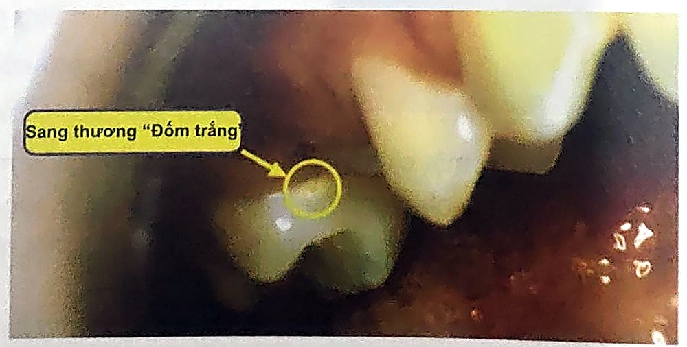

> [!IMPORTANT] Cách học bài này (4 bước, chia 2 ngày)
>
> 1. **Đọc "Bức tranh 1 phút"** và **bản đồ bài** để biết 6 mục trả lời 6 câu hỏi nào. Chưa cần thuộc.
> 2. **Đọc từng mục** (đúng số mục trong sách). Bài dài 45 trang nên chia: **ngày 1** đọc mục **1 → 4** (cơ chế mất – tái khoáng, sang thương sớm, chẩn đoán); **ngày 2** đọc mục **5 → 6** (phòng ngừa, điều trị). Mỗi mục: hộp 💡 *Hiểu nhanh* → **📖 SGK ghi** (ý của sách viết gọn, giữ đúng thuật ngữ và con số) → các hộp 🔍 *Vì sao…?* (cơ chế: đọc để hiểu, không cần thuộc; ý ngoài SGK đều ghi rõ, thi vẫn chọn theo SGK). Chữ ==tô vàng== là từ khoá/con số đề hay lấy rồi đổi đi một chữ.
> 3. **Bấm "Che từ khoá"** (thanh trên cùng) → đọc lại; gặp ô bị che thì tự nói ra trước rồi bấm vào ô để kiểm tra.
> 4. **Làm trắc nghiệm** cuối bài (ngày 1 làm Phần A–C, ngày 2 làm Phần D–H). Câu sai → bấm nhãn "mục …" của câu đó để về đúng đoạn cần đọc. Làm xong bấm **"Chỉ xem câu sai"**.
>
> Bài này dịch từ sách tiếng Anh (Featherstone, Fejerskov và các sách nha khoa phục hồi), nhiều câu dịch sát chữ nên đọc khó; gặp chỗ nào bài này giải thích ngay chỗ đó. Bài 4 cũng nhắc lại nhiều chuyện của **Bài 1–3** (fluor, chlorhexidine, xylitol, 4 vùng sang thương, máy chẩn đoán) nhưng **con số và cách nói đôi khi khác**: mỗi chỗ khác đều có hộp ⚖️ ghi rõ bài nào nói gì.
>
> **Mục tiêu SGK** – đề thường bám sát 4 mục tiêu này:

1. Nêu được **cơ chế bệnh căn, bệnh sinh** của bệnh sâu răng → [mục 1](#m1), [mục 2](#m2).
2. Giải thích được những **diễn tiến xảy ra trên bề mặt men** răng khi có sâu răng → [mục 2](#m2), [mục 3](#m3), [mục 4.1](#m4-1).
3. Mô tả và nhận diện được các **sang thương khởi phát trên bề mặt men** → [mục 4.1](#m4-1), [mục 4.2](#m4-2).
4. Nêu một số **phương tiện hỗ trợ chẩn đoán** sâu răng → [mục 4.3](#m4-3).

Mục tiêu SGK không nhắc tới phòng ngừa và điều trị, nhưng [mục 5](#m5)–[6](#m6) là **phần dài nhất** bài (tr. 62–91) và **3 trong 4 câu lượng giá** hỏi vào đây, nên vẫn phải học kỹ.

## Bức tranh 1 phút

> [!NOTE] Cả bài gói trong 7 câu
>
> 1. Sâu răng là **bệnh nhiễm khuẩn**; **lỗ sâu chỉ là kết quả cuối cùng** của một tiến trình kéo dài **vài tháng đến vài năm**. Bệnh là **một cái cân**: yếu tố bệnh căn (vi khuẩn có hại, ít nước bọt, ăn uống không lành mạnh) đấu với yếu tố bảo vệ (nước bọt và trám bít hố rãnh, kháng khuẩn, fluoride, ăn uống lành mạnh).
> 2. **Mất khoáng**: *S. mutans* và *lactobacillus* lên men carbohydrate thành **acid hữu cơ** (lactic, acetic, formic, propionic). Acid theo **nước giữa các tinh thể** vào men, hòa tan calcium và phosphate. Men dễ tan hơn hydroxyapatite tinh khiết vì **carbonate thay chỗ phosphate**.
> 3. **Fluor** làm hai việc trên tinh thể: lúc acid tấn công, F⁻ **bám lên mặt tinh thể, ức chế mất khoáng**; lúc pH lên lại, F⁻ **kéo Ca²⁺ rồi PO₄³⁻** đắp một lớp mới **giống fluorapatite**, khó tan hơn ở lần acid sau (**tái khoáng**).
> 4. **Sang thương sớm (đốm trắng)** là giai đoạn **sớm nhất, còn đảo ngược được** khi **bề mặt men còn nguyên vẹn**. Nó có **4 vùng**; lớp bề mặt khoảng 50 micromet, bên dưới mất khoảng 50%. **Ướt thì biến mất, thổi khô mới thấy**.
> 5. **Chẩn đoán**: thám trâm (chỉ đúng khoảng **24%**, lại làm hại bề mặt), X quang (sang thương sớm **thường không thấy**) và nhìn thường đều dễ sai. Có thêm 5 phương pháp thay thế: **X quang kỹ thuật số, DIAGNOdent, QLF, FOTI, ECM**. **Không phương tiện nào lý tưởng** → phải kết hợp.
> 6. **Phòng ngừa**: mục tiêu chính là **giảm số lượng vi khuẩn gây sâu răng**. Có 6 nhóm biện pháp A → F (Bảng 4.1) và phác đồ theo kết quả khám (Bảng 4.2); mục 5.1 → 5.9 đi qua từng biện pháp: sức khỏe chung, fluoride, nước bọt, kháng khuẩn, chế độ ăn, vệ sinh răng miệng, xylitol, trám bít hố rãnh, phục hồi.
> 7. **Điều trị**: khi sâu răng đã **phá hủy mặt răng** thì phòng ngừa **không đủ**; phải **lấy mô nhiễm và phục hồi**. Nhiều răng sâu cấp tính → **kiểm soát sâu răng** (lấy mô nhiễm, chữa/che tủy, trám tạm) kèm phòng ngừa. **Giáo dục bệnh nhân** là chìa khóa; sau đó **tái khám nghiêm ngặt**.

```flow
Mảng bám + đường -> Acid hữu cơ thấm vào men qua nước giữa tinh thể -> !Mất khoáng dưới bề mặt: đốm trắng, bề mặt còn -> !Bề mặt vỡ thành lỗ: không tự hồi phục -> Lấy mô nhiễm + phục hồi (nhiều răng cấp: kiểm soát sâu răng)
+Ca²⁺, PO₄³⁻ từ nước bọt + F⁻ -> +Tái khoáng: lớp ngoài giống fluorapatite, khó tan hơn -> +Đốm trắng ngừng lại, cứng lại
```

**Bản đồ bài – mỗi mục trả lời một câu hỏi:**

| Mục                                  | Câu hỏi                            | Ý chính                                                                                         |
| ------------------------------------ | ---------------------------------- | ----------------------------------------------------------------------------------------------- |
| [1](#m1) Bệnh sâu răng               | Bệnh là gì, do đâu?                | nhiễm khuẩn; cái cân bệnh căn – bảo vệ; lỗ sâu là kết quả cuối                                  |
| [2](#m2) Mất khoáng                  | Men tan ra thế nào?                | acid hữu cơ; 2 giai đoạn; carbonate làm dễ tan; F⁻ bám lên tinh thể bảo vệ                      |
| [3](#m3) Tái khoáng                  | Men được vá lại thế nào?           | Ca, P (nước bọt) + F⁻ → lớp ngoài giống fluorapatite; statherin; F tăng tốc tái khoáng          |
| [4](#m4) Sang thương sớm             | Trông thế nào, khám bằng gì?       | 4 vùng; thổi khô mới thấy; 3 cách khám thông thường và 5 phương pháp thay thế                   |
| [5](#m5) Phòng ngừa                  | Làm sao để không sâu, không sâu thêm? | giảm vi khuẩn; Bảng 4.1 (A–F), Bảng 4.2; 9 nhóm biện pháp 5.1 → 5.9                           |
| [6](#m6) Điều trị                    | Đã có lỗ thì làm gì?               | phục hồi trước; kiểm soát sâu răng 3 bước; giáo dục bệnh nhân; tái khám                         |

## 1. Bệnh sâu răng · tr. 48–49

> [!NOTE]
> Lỗ sâu giống **cái cây đổ** sau nhiều năm bị mối ăn: thứ ta thấy là **kết quả cuối cùng**, còn mối đã âm thầm làm việc từ rất lâu. Ngày xưa người ta chỉ nhìn **cái lỗ**; ngày nay nhìn **cả tiến trình**: ai mang "mối" (vi khuẩn), mối được nuôi bằng gì (đường), răng được bảo vệ ra sao (nước bọt, fluor). Hình 4.1 gói tất cả vào **một cái cân**.

**📖 SGK ghi:**

- Thông thường, sâu răng được biết như ==sự mục nát, tan rã mô răng==. Quan niệm trước đây của cộng đồng, ==cả giới nha khoa==: nhìn bệnh qua ==lỗ sâu trên răng== hơn là ==tiến trình tổng thể== của bệnh.
- Nhờ kiến thức ==hơn 100 năm== qua về sự phân hủy mô răng do ==vi khuẩn lên men thức ăn, tạo acid hòa tan khoáng==, những thập niên gần đây tiến trình sâu răng được xác định rõ hơn trên nhiều phương diện: ==vi trùng học, nước bọt, thành phần khoáng của răng, cấu trúc siêu vi thể răng, quá trình hòa tan, nguyên lý hoạt động của sự mất khoáng, sự đảo chiều của quá trình mất khoáng (tái khoáng)== và những yếu tố tạo nên sự đảo chiều đó.
- **Hình 4.1**: ==sự cân bằng sâu răng== giữa ==yếu tố bệnh căn== và ==yếu tố bảo vệ== (Featherstone, 2003).
- Vi khuẩn gây sâu răng là ==yếu tố căn bản==; có ==ít nhất 2 nhóm vi khuẩn chính==: ==*Streptococcus mutans*== và ==dạng *lactobacillus*==. Chúng tạo ra ==acid hữu cơ== trong quá trình trao đổi chất – ==lên men carbohydrate==.
- Các acid này chủ yếu là ==lactic, acetic, formic và propionic==; tất cả đều có thể gây ==hòa tan thật sự== thành phần khoáng của ==men và ngà==.
- Acid hiện diện trong ==mảng bám== trên bề mặt răng, ==tiếp xúc trực tiếp== và ==thâm nhập qua những lỗ rỗ trên bề mặt men, ngà== vào lớp mô bên dưới → hòa tan thành phần khoáng → quá trình phân hủy bắt đầu.
- Tiến trình kéo dài đủ lâu, thường ==vài tháng đến vài năm==, thì ==lỗ sâu thực sự== hình thành: đó là ==kết quả cuối cùng== của quá trình bệnh mà ta gọi là sâu răng.
- Sâu răng là ==bệnh nhiễm khuẩn==, gây ra nguyên thủy do các vi khuẩn trên ==khi ăn các loại đường== đưa vào miệng. Lỗ sâu (xoang sâu) là ==kết quả cuối cùng==.
- Vi khuẩn có thể ==lây cho bé từ mẹ hay người nuôi dưỡng== ở giai đoạn rất sớm của cuộc đời: vi khuẩn ==đóng khúm trên bề mặt mô mềm==, ==thậm chí khi răng chưa mọc==. ==Ngay khi răng mọc==, vi khuẩn đóng khúm lên răng và nhờ ==mảng bám==, chu kỳ phá hủy bắt đầu.

<figure>
<div class="sc"><svg class="dg" style="max-width:520px" viewBox="0 0 440 232" role="img" aria-label="Cái cân sâu răng: yếu tố bệnh căn BAD và yếu tố bảo vệ SAFE">
<text x="220" y="20" text-anchor="middle" class="b">SỰ CÂN BẰNG SÂU RĂNG</text>
<rect class="c2" x="4" y="34" width="204" height="112" rx="12"/>
<text x="106" y="56" text-anchor="middle" class="b">Yếu tố bệnh căn</text>
<text x="16" y="80" class="s"><tspan class="b r">B</tspan>  vi khuẩn có hại</text>
<text x="16" y="102" class="s"><tspan class="b r">A</tspan>  ít nước bọt (khô miệng)</text>
<text x="16" y="124" class="s"><tspan class="b r">D</tspan>  ăn uống không lành mạnh</text>
<rect class="c3" x="232" y="60" width="204" height="134" rx="12"/>
<text x="334" y="82" text-anchor="middle" class="b">Yếu tố bảo vệ</text>
<text x="244" y="106" class="s"><tspan class="b" style="fill:var(--ok)">S</tspan>  nước bọt, trám bít</text>
<text x="244" y="128" class="s"><tspan class="b" style="fill:var(--ok)">A</tspan>  kháng khuẩn</text>
<text x="244" y="150" class="s"><tspan class="b" style="fill:var(--ok)">F</tspan>  fluoride</text>
<text x="244" y="172" class="s"><tspan class="b" style="fill:var(--ok)">E</tspan>  ăn uống lành mạnh</text>
<line class="k" x1="106" y1="148" x2="334" y2="196"/>
<path d="M220,172 L200,206 L240,206 Z" style="fill:var(--mut)"/>
<text x="56" y="170" text-anchor="middle" class="b r">SÂU RĂNG</text>
<text x="334" y="218" text-anchor="middle" class="b" style="fill:var(--ok)">RĂNG KHỎE</text>
</svg></div>
<figcaption>Vẽ lại theo SGK Hình 4.1 (Featherstone, 2003). Chữ cái là tên tiếng Anh trong hình: bên trái <b>BAD</b> = <b>B</b>ad bacteria · <b>A</b>bsence of saliva (xerostomia) · <b>D</b>ietary habits poor; bên phải <b>SAFE</b> = <b>S</b>aliva and Sealants (nước bọt và trám bít hố rãnh) · <b>A</b>ntimicrobials · <b>F</b>luoride · <b>E</b>ffective diet. Bên nào nặng hơn thì cân nghiêng về phía đó; hình SGK vẽ bên <b>bảo vệ nặng hơn</b> nên kết quả là <b>răng khỏe</b>.</figcaption>
</figure>

> [!WHY] Vì sao nói "lỗ sâu chỉ là kết quả cuối cùng", và điều đó đổi cách chữa ra sao?
> Lỗ là chỗ **mất khoáng đã thắng tái khoáng** trong nhiều tháng, nhiều năm. Trám lỗ là sửa **hậu quả**; vi khuẩn, đường, nước bọt kém (bên trái cái cân) **vẫn còn nguyên**. *(ngoài SGK)* Giống băng vết loét mà không chữa tiểu đường: chỗ này lành thì chỗ khác loét. Vì vậy bài này dành gần hết số trang cho **phòng ngừa** ([mục 5](#m5)), và Bài 1 (mục 5) đòi **hạ vi khuẩn, đánh giá nguy cơ** chứ không chỉ trám.

> [!WHY] Vì sao vi khuẩn sâu răng lây được từ mẹ sang con, kể cả khi bé chưa có răng?
> *(ngoài SGK)* Vi khuẩn theo **nước bọt** của người lớn sang bé: thổi, nếm thức ăn rồi đút, dùng chung muỗng, hôn môi. Trước khi mọc răng, chúng sống tạm trên **lưỡi và niêm mạc** (SGK: đóng khúm trên mô mềm). Khi răng mọc, *S. mutans* có ngay **mặt cứng** để bám và làm keo dextran (Bài 1, mục 1.2.1), nên bùng lên. Mẹ càng nhiều *S. mutans* thì bé nhiễm càng sớm và càng nhiều; chữa răng, hạ vi khuẩn cho mẹ (cả lúc mang thai) cũng là phòng sâu răng cho con.

> [!WHY] Cái cân "BAD – SAFE" nối với các biện pháp ở mục 5 thế nào?
> Mọi biện pháp phòng ngừa đều là **bớt một quả cân bên trái** hoặc **thêm một quả cân bên phải**. *(Cách xếp là của bài này, để nối ý; SGK chỉ vẽ cái cân.)*
>
> | Quả cân trong Hình 4.1        | Biện pháp trong bài                                                                                         |
> | ----------------------------- | ----------------------------------------------------------------------------------------------------------- |
> | **B** vi khuẩn có hại         | [5.4](#m5-4) kháng khuẩn · [5.6](#m5-6) vệ sinh răng miệng · [5.7](#m5-7) xylitol · [5.9](#m5-9) sửa phục hồi hở · [6](#m6) lấy mô nhiễm |
> | **A** ít nước bọt             | [5.1](#m5-1) sức khỏe chung, thuốc · [5.3](#m5-3) kích thích tiết nước bọt                                  |
> | **D** ăn uống không lành mạnh | [5.5](#m5-5) chế độ ăn: giảm **tần suất** sucrose                                                           |
> | **S** nước bọt, trám bít      | [5.3](#m5-3) nước bọt · [5.8](#m5-8) trám bít hố rãnh                                                       |
> | **A** kháng khuẩn             | [5.4](#m5-4) chlorhexidine, Bảng 4.3                                                                        |
> | **F** fluoride                | [2](#m2), [3](#m3) cơ chế · [5.2](#m5-2) nước, kem, súc miệng, gel, vecni                                   |
> | **E** ăn uống lành mạnh       | [5.5](#m5-5) · [5.7](#m5-7) kẹo cao su không đường                                                          |

> [!TIP]
>
> - Cái cân: **"BAD ↔ SAFE"**: bệnh căn **B**ad bacteria – **A**bsence of saliva – **D**iet poor; bảo vệ **S**aliva & Sealants – **A**ntimicrobials – **F**luoride – **E**ffective diet.
> - 4 acid hữu cơ: **"Lắc – Ác – Phóc – Prô"** = **lac**tic, **ac**etic, **for**mic, **pro**pionic.
> - Lỗ sâu: **"vài tháng đến vài năm"**, là **kết quả cuối cùng**.

> [!WARNING]
>
> - Ít nhất **2 nhóm** vi khuẩn chính: ***S. mutans*** và **lactobacillus**. Đề có thể thay bằng *Actinomyces* (Bài 3: chính ở sâu **chân răng**).
> - Acid gây sâu là **acid hữu cơ** do vi khuẩn sinh ra (lactic, acetic, formic, propionic); **không phải** HCl hay acid citric.
> - Vi khuẩn có thể lây cho bé **trước khi răng mọc** (đóng khúm trên mô mềm). "Chỉ lây khi đã có răng" là sai.
> - "Ít nước bọt" nằm bên **bệnh căn**; "nước bọt" nằm bên **bảo vệ**. **Trám bít hố rãnh** đi chung chữ **S** với nước bọt.

## 2. Quá trình mất khoáng của men răng – bệnh sâu răng · tr. 49–50

> [!NOTE]
> Men giống **bức tường gạch có lẫn gạch lỗi**: gạch chuẩn là hydroxyapatite, gạch lỗi là chỗ **carbonate chen vào thay phosphate**. Acid len vào theo **các khe nước** giữa các viên gạch, gặp gạch lỗi là gặm trước. Còn **fluor** như lớp sơn chống thấm: có mặt **đúng lúc** acid tới thì bám lên mặt gạch, acid gặm chậm hẳn.

**📖 SGK ghi:**

- Trụ men lành mạnh bình thường ==rất nhỏ==, ==khoảng 40 nm đường kính== (xem hộp ⚖️); thành phần khoáng ==giống hydroxyapatite== nhưng có ==nhiều tạp chất và các loại ion khác==.
- Vì vậy khoáng của men và ngà ==dễ bị hòa tan hơn hydroxyapatite hay fluorapatite tinh khiết==, chủ yếu do ==ion carbonate thay thế ion phosphate== trong "hàng rào tinh thể" (mạng tinh thể) → gây ==vùng khiếm khuyết và thiếu hụt calcium==.
- ==Khoảng từ 1–10 ion phosphate== của men bị thay thế bởi carbonate (xem hộp ⚖️).
- Sự mất khoáng diễn ra qua ==2 giai đoạn==:
  1. Vi khuẩn lên men carbohydrate tạo ==acid hữu cơ==; acid ==thâm nhập vào mô răng nhờ thành phần nước giữa các tinh thể==. Khi acid chạm đến ==các vị trí nhạy cảm trên bề mặt tinh thể==, ==calcium và phosphate== bị hòa tan vào ==giai đoạn lỏng== (pha lỏng) bao quanh tinh thể. Giai đoạn đầu này ==chỉ thể hiện ở mức độ phân tử==, và ==chỉ quan sát được khi có sự mất khoáng lớn==.
  2. Giai đoạn hòa tan tiếp theo tạo nên ==tiến trình sâu răng==, thậm chí dẫn đến ==lỗ sâu thật sự==.
- Nếu ==ion fluor== hiện diện ở bề mặt trụ men với ==nồng độ thích hợp==, ==trước hay trong== giai đoạn mất khoáng, những ion này có thể ==hấp thu vào bề mặt tinh thể== và gây ==ức chế đáng kể== quá trình mất khoáng do acid (**Hình 4.2**).
- Sự hấp thu mạnh mẽ của các ==ion âm fluor== có thể bảo vệ, ==ít nhất phần nào==, khỏi mất khoáng do acid (đã chứng minh qua các nghiên cứu về sự hòa tan ==trong phòng thí nghiệm==). Đây là một trong những hoạt động theo ==cơ chế hóa học của fluoride khi được bôi tại chỗ== lên răng và mảng bám.


> [!WHY] Vì sao carbonate làm men dễ tan hơn hydroxyapatite tinh khiết?
> Mỗi chỗ **CO₃²⁻ thay PO₄³⁻** làm mạng tinh thể **méo và thiếu điện tích**; để bù, mạng phải **bớt bớt Ca²⁺** (SGK: vùng khiếm khuyết và thiếu hụt calcium). Chỗ méo, chỗ thiếu này là **điểm yếu** để acid bắt đầu gặm. Bài 2 (mục 6) đo được hệ quả: KSP của men (5,5 × 10⁻⁵⁵) **lớn hơn hẳn** KSP của HA (7,41 × 10⁻⁶⁰), tức men tan **dễ hơn nhiều**. Răng mới mọc nhiều carbonate nhất, nên dễ sâu nhất (Bài 1, mục 1.2.3).

> [!WHY] Vì sao acid "đi" được vào bên trong men cứng như vậy?
> Men không đặc như kính: giữa các tinh thể có **khe chứa nước và chất hữu cơ** (Bài 2, mục 1: nước khoảng 11% thể tích). Acid hữu cơ là phân tử nhỏ, hòa tan trong nước, nên **khuếch tán theo các khe nước** đó vào sâu bên trong (SGK: nhờ thành phần nước giữa các tinh thể). Ca²⁺ và PO₄³⁻ bị hòa tan thì đi ngược ra theo cùng đường. Vì acid vào được bên dưới trong khi mặt ngoài được nước bọt và fluor che chở, nên mất khoáng chủ yếu xảy ra **dưới bề mặt** ([mục 4.1](#m4-1)).

> [!WHY] Vì sao giai đoạn đầu của mất khoáng "chỉ thể hiện ở mức phân tử"?
> Lúc đầu chỉ vài ion Ca²⁺, PO₄³⁻ rời khỏi những **điểm nhạy cảm** trên mặt tinh thể: tinh thể vẫn còn, men vẫn trong, mắt và phim không thấy gì. Phải mất **nhiều khoáng** tới mức trong men đầy **lỗ xốp** thì ánh sáng mới bị tán xạ (đốm trắng khi thổi khô) và tia X mới xuyên qua dễ hơn (thấu quang) (SGK: chỉ quan sát được khi mất khoáng lớn). Vì vậy mọi phương tiện chẩn đoán ở [mục 4.3](#m4-3) đều "trễ" so với bệnh.

> [!WHY] Vì sao fluor phải có mặt "trước hay trong" lúc mất khoáng mới bảo vệ được?
> F⁻ bảo vệ bằng cách **bám lên mặt tinh thể** đúng ở những điểm acid sắp gặm (Hình 4.2). Nó phải **có sẵn trong dịch quanh răng** khi pH tụt; nếu F đã bị nuốt, súc trôi hết thì lúc acid tới không còn ai "đứng gác". *(ngoài SGK)* Đây là lý do fluor **nồng độ thấp, có mặt thường xuyên** (kem đánh răng hằng ngày, nước có fluor) hiệu quả hơn một liều cao thỉnh thoảng (Bài 1, mục 6.3.3), và lý do dặn súc fluor **buổi tối rồi không ăn uống** ([mục 5.2](#m5-2)).

> [!CAUTION] Hai cách hiểu – "trụ men 40 nm" và "1–10 ion phosphate"
> | SGK Bài 4 | Hiểu theo các bài khác và tài liệu gốc *(ngoài SGK)* |
> |---|---|
> | trụ men lành mạnh ==khoảng 40 nm đường kính== | 40 nm là cỡ của **một tinh thể** apatite (Bài 2, mục 1 ghi thiết diện tinh thể khoảng **50 nm**). **Trụ men** là bó hàng nghìn tinh thể, to cỡ **4–6 µm**, tức gấp khoảng 100 lần. Bản dịch đã gọi "tinh thể" là "trụ men" |
> | ==khoảng từ 1–10 ion phosphate== bị thay bởi carbonate | tài liệu gốc (Featherstone) nói khoảng **1 trên 10** ion phosphate bị thay bằng carbonate |
>
> **Thi chọn SGK**: đề hỏi đúng chữ Bài 4 ("trụ men khoảng 40 nm", "1–10 ion phosphate") thì chọn theo SGK. Hiểu bản chất: tinh thể cỡ vài chục nanomet; cứ khoảng 10 phosphate thì 1 bị carbonate thay.

> [!TIP]
>
> - Mất khoáng 2 giai đoạn: **"Phân tử → Lỗ"**: giai đoạn 1 chỉ ở mức phân tử; giai đoạn 2 thành tiến trình sâu răng, có thể thành lỗ.
> - Đường vào của acid: **"nước giữa các tinh thể"**.
> - Fluor bảo vệ: **"Có mặt đúng lúc – bám lên mặt tinh thể"**.

> [!WARNING]
>
> - Men dễ tan hơn HA tinh khiết vì **carbonate thay phosphate** (không phải "fluor thay hydroxyl": fluor thì làm **khó** tan hơn).
> - Giai đoạn đầu của mất khoáng **không thấy được** trên lâm sàng, chỉ ở **mức phân tử**.
> - F⁻ phải có mặt **trước hay trong** giai đoạn mất khoáng; F⁻ **hấp thu vào bề mặt tinh thể** (Hình 4.2), không cần "thay toàn bộ tinh thể thành FA".
> - Fluor bảo vệ "**ít nhất phần nào**" (không phải "hoàn toàn").

## 3. Quá trình tái khoáng hay sửa chữa của răng · tr. 50–53

> [!NOTE]
> Tái khoáng là **thợ hồ vá tường**. Nguyên liệu là **Ca²⁺ và PO₄³⁻** do nước bọt chở tới; **F⁻ là thợ cả**: bám vào chỗ hỏng trước, rồi **gọi Ca²⁺ tới, Ca²⁺ gọi PO₄³⁻ tới**, cứ thế xây lớp mới. Lớp vá lại **tốt hơn lớp cũ** (giống fluorapatite, không có carbonate), nên lần sau acid tới khó gặm hơn. Thợ chỉ vá được **khi còn khung** (tinh thể còn sót); tường đã đổ thành lỗ thì phải xây lại bằng tay (trám).

**📖 SGK ghi:**

- Tái khoáng là ==quá trình sửa chữa tự nhiên== của cơ thể cho những sang thương sâu răng trên bề mặt ==chưa tạo thành xoang==.
- **Hình 4.3**: canxi + phosphate trong môi trường nước quanh răng (==từ nước bọt==) → tái khoáng: ==dựa trên các thành phần tinh thể còn sót lại==; ==khoáng chất mới ít bị hòa tan hơn==; ==fluor hỗ trợ==. ==Fluor thúc đẩy quá trình tái khoáng== → khoáng tạo ra ít bị hòa tan hơn.
- ==Calcium và phosphate==, có nguồn gốc ==từ nước bọt== nhưng cũng có thể ==từ nguồn tại chỗ khác==, thấm vào mô răng và ==cùng với sự hỗ trợ của fluoride== xây dựng ==trên phần còn lại của trụ tinh thể==, "hay tốt hơn nữa tạo nên những trụ mới" (xem hộp ⚖️).
- Lớp ngoài của bề mặt những trụ tinh thể mới có dạng khoáng ==hình thành tốt hơn, rất giống fluorapatite==; điều này ==phụ thuộc vào lượng fluoride== hiện diện.
- **Hình 4.4**: ==fluoride hấp thụ vào bề mặt tinh thể== sẽ ==thu hút các ion calcium==; ion calcium sau đó ==lôi cuốn ion phosphate==, bắt đầu xây nên bề mặt tinh thể tái khoáng có ==mặt ngoài dạng như fluorapatite==.
- Các bề mặt tinh thể này ==ít bị hòa tan hơn thành phần khoáng carbonate hydroxyapatite nguyên thủy==, và ==khó bị acid hòa tan hơn trong lần thử thách acid tiếp theo== từ mảng bám.
- **Hình 4.5**: hình ảnh ==trụ tinh thể còn lại trên bề mặt sang thương có thể tái khoáng hóa==, độ phóng đại ==× 30.000== (ảnh hiển vi điện tử; bài này không đưa vào vì bản chụp mờ, không nhìn ra được chi tiết).
- Calcium và phosphate trong nước bọt được ==giữ ở trạng thái bão hòa== bằng ==lượng nhỏ protein như statherin==; phức hợp này được ==giữ dưới dạng hòa tan==, như ==yếu tố sẵn sàng có khả năng hoạt động đảo chiều==.
- Lượng nước bọt ==suy giảm== hay ==suy chức năng tuyến nước bọt== do ==dùng thuốc== hay ==chất phóng xạ== → ==không đủ calcium và phosphate== cho tái khoáng → ==sâu răng lan nhanh==. Khi đó cần ==hỗ trợ thêm sản phẩm có calcium hay phosphate càng sớm càng tốt==.
- Sang thương ==đã phát triển trong một giai đoạn dài== cũng có thể được ==lấp kín lại nhờ calcium phosphate== khi có điều kiện thuận lợi cho sự lắng đọng khoáng. Loại tái khoáng này có thể ==hoàn toàn hay một phần==.
- ==Fluoride làm tăng tốc quá trình tái khoáng==; bản thân nó cũng ==được hấp thu== trong suốt quá trình tái khoáng và ==hình thành nên một phần chính bề mặt mới== của tinh thể. Đây là một trong những ==cơ chế hoạt động hóa học chủ yếu của fluoride==: ==ức chế và làm đảo ngược== tiến trình sâu răng.
- Khoáng chất ==tái tạo lại các tinh thể men đã bị mất khoáng một phần== khi ==calcium, phosphate và fluoride== hiện diện với ==lượng thích hợp== trong môi trường miệng. Dạng khoáng mới này có thành phần ==hydroxyapatite và fluoroapatite==; ==cả hai đều ít bị hòa tan hơn carbonate calcium hydroxyapatite ban đầu==.
- ==Ion fluoride cũng ức chế sự phát triển của vi khuẩn== và ==hiệu quả phân ly một số loại vi khuẩn gây sâu răng== → fluoride có thể ==làm giảm số lượng acid== do vi khuẩn gây sâu răng sinh ra.


**Fluor làm 3 việc** (gom từ mục 2, 3 và [5.2](#m5-2)):

| Lúc nào                    | Fluor làm gì (SGK)                                                                                         | Kết quả                                    |
| -------------------------- | ---------------------------------------------------------------------------------------------------------- | ------------------------------------------ |
| Acid đang tấn công         | ==hấp thu vào bề mặt tinh thể== (Hình 4.2)                                                                 | ==ức chế mất khoáng==                      |
| pH lên lại, có Ca, P       | ==kéo Ca²⁺ → Ca²⁺ kéo PO₄³⁻== (Hình 4.4); ==tăng tốc tái khoáng==                                          | lớp mới ==giống fluorapatite==, khó tan hơn |
| Với vi khuẩn               | ==ức chế phát triển==, ==phân ly== vi khuẩn; ức chế ==glucosyltransferase==; nồng độ cao ==độc trực tiếp== | ==giảm acid== sinh ra                      |

> [!WHY] Vì sao tái khoáng phải dựa trên "tinh thể còn sót lại"?
> Ion trong dung dịch đắp vào **mặt một tinh thể có sẵn** dễ hơn rất nhiều so với tự kết thành tinh thể mới giữa khoảng trống. Tinh thể còn sót (Hình 4.5) là **cái khung**: Ca, PO₄, F đắp lên đó để nó lớn lại. Bài 2 (mục 10) nói cùng ý: tái khoáng chỉ **nuôi lớn tinh thể mất khoáng một phần**. Hệ quả: chỗ đã **vỡ thành lỗ** thì **không còn khung**, không tự lấp lại được ([mục 4.1](#m4-1)): phải trám.

> [!WHY] Vì sao men sau khi tái khoáng lại "tốt hơn" men ban đầu?
> Men ban đầu là **carbonate hydroxyapatite**: có gạch lỗi carbonate nên dễ tan ([mục 2](#m2)). Lúc tái khoáng, khoáng mới đắp vào là **HA và FA không có carbonate** (SGK), lại có F nằm sẵn ở mặt ngoài. Lớp này cần acid **mạnh hơn** mới tan được (FA chỉ tan khi pH < 4,5: Bài 1, mục 2.1). Giống vá tường bằng **gạch tốt hơn gạch cũ**. *(ngoài SGK)* Đó là lý do một đốm trắng đã ngừng (vết sẹo trắng, Bài 2 mục 10) có thể **cứng và chịu acid tốt hơn** men xung quanh.

> [!WHY] Statherin để làm gì, khi nước bọt vốn đã quá bão hòa?
> *(ngoài SGK)* Chính vì **quá bão hòa** (Bài 2, mục 5) mà Ca và PO₄ trong nước bọt **có xu hướng tự kết tủa**: đóng cặn trong ống tuyến, thành sỏi, thành vôi răng ở khắp nơi. **Statherin** (và vài protein giàu proline) **ôm lấy Ca²⁺**, giữ chúng ở dạng hòa tan (SGK), giống người **giữ kho** gạch: không cho gạch tự đổ đống bừa bãi, nhưng khi men cần vá (pH tụt rồi lên lại) thì **thả ra** ngay (SGK: sẵn sàng hoạt động đảo chiều).

> [!WHY] Vì sao người xạ trị vùng đầu cổ, người dùng nhiều thuốc lại sâu răng lan nhanh?
> Xạ trị (SGK: chất phóng xạ) và nhiều thuốc **làm hỏng tuyến nước bọt** → ít nước bọt → mất **cả kho Ca, PO₄** để tái khoáng, mất đệm, mất rửa trôi. Cái cân ([mục 1](#m1)) mất hẳn quả cân "S", lại thêm quả "A – ít nước bọt" bên kia. *(ngoài SGK)* Sâu răng sau xạ trị đi rất nhanh, hay ở **cổ răng, rìa cắn** là những chỗ thường ít sâu. Vì vậy SGK dặn **bổ sung sản phẩm có calcium, phosphate càng sớm càng tốt**, kèm fluor ([mục 5.2](#m5-2)) và chất kích thích hoặc thay thế nước bọt ([mục 5.3](#m5-3)).

> [!CAUTION] Hai cách hiểu – tái khoáng có "tạo trụ mới" không?
> | SGK Bài 4 (tr. 51) | SGK Bài 2 (mục 10) và Hình 4.3 của Bài 4 |
> |---|---|
> | Ca, P cùng fluoride xây dựng trên phần còn lại của trụ tinh thể ==hay tốt hơn nữa tạo nên những trụ mới== | tái khoáng **dựa trên các thành phần tinh thể còn sót lại**; Bài 2: tái khoáng ==không tạo tinh thể mới==, chỉ nuôi lớn tinh thể mất khoáng một phần |
>
> **Thi**: đề hỏi "tái khoáng dựa trên…" → **các thành phần tinh thể còn sót lại** (chữ trong Hình 4.3, khớp Bài 2). Đề trích nguyên câu "…hay tốt hơn nữa tạo nên những trụ mới" thì đó là chữ Bài 4. Hiểu bản chất *(ngoài SGK)*: lớp mới được đắp lên **mặt tinh thể cũ**; tinh thể mới hoàn toàn rất khó hình thành trong men.

> [!TIP]
>
> - Thứ tự đắp: **"F → Ca → PO₄"** (F kéo Ca, Ca kéo phosphate).
> - Hình 4.3: **"Còn sót – Ít tan – Fluor hỗ trợ"**.
> - Giữ Ca, P hòa tan trong nước bọt: **statherin**.
> - Khoáng mới: **HA + FA**, cả hai **ít tan hơn carbonate HA** ban đầu.

> [!WARNING]
>
> - Tái khoáng sửa sang thương **chưa tạo thành xoang**; đã thành xoang thì không tự sửa được.
> - Fluoride **tăng tốc** tái khoáng và **được hấp thu** vào bề mặt mới (không chỉ "đứng ngoài xúc tác").
> - Nước bọt giảm do **thuốc, chất phóng xạ** → sâu răng **lan nhanh** → bổ sung **calcium hay phosphate** càng sớm càng tốt.
> - Khoáng mới gồm **hydroxyapatite và fluoroapatite**, đều **ít tan hơn** carbonate calcium hydroxyapatite ban đầu (đề có thể đảo thành "dễ tan hơn").
> - Hình 4.5 phóng đại **× 30.000**.

## 4. Sang thương sâu răng sớm · tr. 53–62

### 4.1. Định nghĩa sang thương sâu răng sớm (sâu răng mới chớm) · tr. 53–56

> [!NOTE]
> Đốm trắng là **ngã ba đường**: có thể **lùi lại** (tái khoáng), **đứng yên** (ngưng lại), hay **đi tiếp** thành lỗ. Rẽ hướng nào là do **cái cân** ở [mục 1](#m1). Điều kiện để còn lùi lại được: **lớp bề mặt men còn nguyên** – giống **vỏ trứng còn nguyên** thì bên trong còn cứu được, vỏ đã vỡ thì không ghép lại như cũ.

**📖 SGK ghi:**

- Tiến trình bệnh sâu răng là ==chu kỳ của sự tái khoáng hóa và mất khoáng hóa== với nhiều giai đoạn, có thể ==thuận nghịch hai chiều== hay ngược lại ==chỉ có một chiều==.
- Sang thương sâu răng sớm là ==giai đoạn sớm nhất== của bệnh sâu răng (của sự mất khoáng); nó có thể ==tiến triển theo chiều ngược lại (tái khoáng)==, ==ngưng lại==, hoặc ==diễn tiến tiếp tạo thành lỗ sâu thực sự==.
- Đây là ==sang thương hoạt động trên bề mặt men==, thường được xác định là ==sâu răng bề mặt láng== hay ==sang thương đốm màu trắng==.
- Bệnh căn của tiến trình sâu răng đã được xác định ==do loại vi khuẩn đặc hiệu==. Sang thương mới chớm ==khởi phát từ sự hình thành khối vi khuẩn hay mảng bám==, được nuôi dưỡng bởi ==sự lên men carbohydrate và đường== trong xoang miệng. Vi khuẩn có thể thâm nhập vào men bằng nhiều đường, thông qua ==việc bám chặt vào mảng bám== đã hình thành trên bề mặt men.
- ==Mất khoáng là thay đổi chủ yếu thấy được== của sang thương sâu răng ở giai đoạn sớm.
- Tái khoáng và mất khoáng diễn ra ==thường xuyên trong miệng==, theo sau ==mỗi lần ăn hay uống==.
- Sang thương sâu răng sớm có thể được tái khoáng nhờ ==chế độ ăn, fluoride và hoạt động đệm của nước bọt==.
- ==Bề mặt men vẫn còn nguyên vẹn== thì sang thương sớm ==vẫn có thể tái khoáng hóa được==. Tuy nhiên, về lâu dài sâu răng ==có thể tái phát== nếu ==lớp bề mặt mỏng== này ==bị rối loạn, phá vỡ== tiến trình tái khoáng, đưa đến ==tái khoáng không hoàn toàn==.
- Sang thương sớm ==tiếp tục mất khoáng== → ==tiến vào ngà, tạo nên xoang sâu== → khi đó ==có thể không còn hồi phục một cách tự nhiên nữa==, nhưng ==có thể trở nên dừng lại==.
- **Hình 4.6**: lát cắt ngang sang thương sâu răng sớm tự nhiên ở men dưới kính hiển vi quang học: ==thân sang thương bên dưới lớp bề mặt nguyên vẹn==.
- Một sang thương sâu răng sớm gồm ==4 vùng== (SGK đánh số ==từ mặt răng vào==):
  1. ==Vùng bề mặt==: vùng ==không ảnh hưởng bởi sự tấn công của vi khuẩn==; có ==ít lỗ nhỏ==, tương tự ==lớp cản quang ngay sát bề mặt men không bị ảnh hưởng== → làm sang thương sớm ==khó xác định==. Vùng bề mặt ==quyết định sự nguyên vẹn của bề mặt răng==, như ==rào cản ngăn chặn sự thâm nhập của vi khuẩn== → vùng này ==cần phải giữ nguyên vẹn== để ngăn phá hủy răng xa hơn và ==rất có thể làm tăng tiến trình tái khoáng==.
  2. ==Thân sang thương==: ==phần lớn nhất== của sang thương sâu răng sớm trong quá trình mất khoáng; ==chiếm phần lớn thể tích là những lỗ nhỏ== và ==có hiện diện vi khuẩn==.
  3. ==Vùng tối==: ==không dẫn truyền ánh sáng==, ==vùng đục==, có ==nhiều lỗ rỗ nhỏ==.
  4. ==Vùng trong suốt==: ==lớp sâu nhất==, là ==vùng hoạt động tiến về phía trước== của sang thương; đặc tính là ==không có cấu trúc rõ ràng== và ==cực nhỏ==.
- **Hình 4.7**: các mặt cắt theo hướng ngoài – trong của ==một răng cối lớn hàm dưới== có sang thương ở các giai đoạn khác nhau của sâu răng sớm; ==mặt nhai trông nguyên vẹn==.
- **Hình 4.8**: sang thương sớm ==gồm 4 vùng mất khoáng== và ==tỷ lệ mất khoáng==.


**Đối chiếu 4 vùng – Bài 4 và Bài 3 đánh số ngược nhau:**

| Vị trí trong sang thương | Bài 4 (đánh số ==từ ngoài vào==) | Bài 3 (đánh số ==từ trong ra==)       | Thể tích lỗ (Bài 3)        |
| ------------------------ | -------------------------------- | ------------------------------------- | -------------------------- |
| Sát mặt răng             | ==1. Vùng bề mặt==               | 4. Vùng bề mặt                        | ít thay đổi                |
| Phần lớn nhất            | ==2. Thân sang thương==          | 3. Vùng trung tâm                     | 5–25%                      |
| Bên dưới thân            | ==3. Vùng tối==                  | 2. Vùng tối                           | 2–4%                       |
| Sâu nhất, đi đầu         | ==4. Vùng trong suốt==           | 1. Vùng trong mờ                      | khoảng 1% (gấp 10 men lành) |


> [!WHY] Vì sao lớp bề mặt "quyết định" số phận của sang thương?
>
> - Lớp bề mặt là **rào cản**: còn nó thì mảng bám và vi khuẩn **nằm ngoài**, bàn chải và nước bọt vẫn với tới; Ca, PO₄, F⁻ thấm qua nó vào **vá phần xốp bên dưới** (SGK: giữ nguyên vẹn rất có thể làm tăng tái khoáng).
> - Mất lớp này thì mảng bám **chui vào hốc**, acid bị giữ lại bên trong, tái khoáng **không theo kịp** (Bài 3, mục 2.5: lỗ chỉ thành khi sụp lớp bề mặt).
> - Vì vậy mọi việc làm với sang thương sớm đều xoay quanh **giữ lớp bề mặt**: không chọc thám trâm ([mục 4.3](#m4-3), Bài 3 mục 5.1), không đánh bóng quá mạnh ([mục 5.2](#m5-2)), bôi fluor để lớp này cứng thêm.

> [!WHY] Vì sao lớp bề mặt lại còn nguyên, trong khi bên dưới bị mất khoáng?
> Mặt ngoài là nơi **gặp nước bọt và fluor đầu tiên**: mỗi khi pH lên lại, Ca, PO₄, F⁻ đắp vào đây trước, thành khoáng **giống fluorapatite** khó tan ([mục 3](#m3)). Acid thì đi **xuyên qua** lớp này theo các khe nước ([mục 2](#m2)) để gặm phần **carbonate HA** dễ tan bên dưới. Bài 2 (mục 8) giải thích cùng ý bằng pH: ở pH 4,5–5,5, HA bên dưới tan nhưng FA vẫn đắp ở mặt ngoài.

> [!WHY] Vì sao lớp bề mặt làm sang thương sớm "khó xác định"?
> Lớp bề mặt **ít lỗ**, chứa gần đủ khoáng nên **cản tia X và cho ánh sáng đi qua gần như men lành** (SGK: tương tự lớp cản quang sát bề mặt men không bị ảnh hưởng). Nhìn từ ngoài hay chụp phim, ta gặp lớp "vỏ lành" này trước, nên phần hư bên dưới bị che. Đó là lý do X quang và nhìn thường đều dễ bỏ sót sang thương sớm ([mục 4.3](#m4-3)).

> [!WHY] Sang thương sớm đã thành lỗ vào ngà thì "không hồi phục tự nhiên", vậy "dừng lại" là sao?
> Không hồi phục vì phần men, ngà đã mất **không còn khung tinh thể** để đắp khoáng trở lại ([mục 3](#m3)). Nhưng nếu **hết mảng bám, hết acid** (lỗ mở rộng, tự làm sạch được, chải được, có fluor), sang thương **ngừng tiến triển**: ngà cứng lại, sẫm màu (Bài 1 Hình 1.3, Bài 2 Hình 2.4, Bài 3 Hình 3.2). Răng **vẫn mang lỗ** nhưng bệnh ở chỗ đó đã dừng.

> [!TIP]
>
> - Sang thương sớm có **3 ngả**: **"Lùi (tái khoáng) – Đứng (ngưng) – Tiến (thành lỗ)"**.
> - 4 vùng theo Bài 4, **từ ngoài vào**: **"Mặt – Thân – Tối – Trong"** (bề mặt – thân sang thương – vùng tối – vùng trong suốt).
> - Hình 4.6: **"50 – 50"**: lớp bề mặt khoảng **50 micromet**, thân mất khoảng **50%**.
> - Tái khoáng được nhờ **"Ăn – Fluor – Đệm"** (chế độ ăn, fluoride, đệm của nước bọt).

> [!WARNING]
>
> - Bài 4 đánh số **từ ngoài vào** (1 = vùng bề mặt), Bài 3 đánh số **từ trong ra** (1 = vùng trong mờ). Đề hỏi "vùng thứ 1/thứ 4" thì xem đề đang theo cách đánh số nào: "vùng thứ 4… lớp sâu nhất, vùng hoạt động tiến về phía trước" là **vùng trong suốt** (Bài 4).
> - Tên gọi khác nhau giữa hai bài: **thân sang thương** (Bài 4) = **vùng trung tâm** (Bài 3); **vùng trong suốt** (Bài 4) = **vùng trong mờ** (Bài 3).
> - Vùng bề mặt **không** bị ảnh hưởng bởi vi khuẩn; **thân sang thương** mới có **hiện diện vi khuẩn** và là **phần lớn nhất**.
> - Vùng tối: **không dẫn truyền ánh sáng**, đục, nhiều lỗ rỗ nhỏ. Vùng trong suốt: **sâu nhất**, **tiến về phía trước**, không có cấu trúc rõ ràng.
> - Đã tiến vào ngà thành xoang: **không** hồi phục tự nhiên, nhưng **có thể dừng lại**.
> - Hình 4.7 là **răng cối lớn hàm dưới**, cắt theo hướng **ngoài – trong**.

> [!CAUTION] Hai cách hiểu – lớp bề mặt dày bao nhiêu, thân mất bao nhiêu khoáng?
> | SGK Bài 4 (Hình 4.6) | SGK Bài 2 (mục 7) |
> |---|---|
> | lớp bề mặt còn nguyên vẹn ==khoảng 50 micromet==; tổn thương dưới bề mặt ==khoảng 50%== | lớp bề mặt dày ==20–50 pm== (nhiều khả năng là µm in sai); mất khoáng ==30–50%== |
>
> Hai bài **khớp nhau** nếu đọc "pm" của Bài 2 là micromet: lớp bề mặt **vài chục micromet**, thân mất **cỡ một nửa** khoáng. **Thi**: đề nhắc Hình 4.6 hay "micromet" → 50 micromet, ~50%; đề trích Bài 2 → 20–50, 30–50%.

### 4.2. Đặc điểm lâm sàng của sang thương sâu răng sớm · tr. 56–57

> [!NOTE]
> Đốm trắng giống **vết nước trên kính mờ**: lau ướt thì không thấy, để khô mới hiện. Vì lỗ xốp bên trong khi ướt thì đầy nước (gần trong như men), khi khô thì đầy không khí (ánh sáng bị tán xạ → trắng).

**📖 SGK ghi:**

- Sự xuất hiện và phát hiện sang thương sâu răng sớm thường ==bị nhầm lẫn và dễ dàng bỏ qua==.
- Trên X quang, những sang thương này ==thường không thấy== hay ==rất mờ nhạt==, biểu hiện ==thấu quang rất nhỏ bên trong phần men==. Vì vậy, việc khám ==phải nhìn và sờ được sang thương== là thật sự cần thiết.
- Sang thương sâu răng sớm hay ==sang thương đốm trắng== có đặc điểm ==dạng phấn trắng==. Muốn nhìn rõ, bề mặt răng phải được ==làm khô hoàn toàn bằng cách thổi khô==. ==Khi bề mặt răng bị ướt, sang thương sẽ biến mất==.
- **Hình 4.9**: hình ảnh lâm sàng sang thương mới chớm. **Hình 4.10**: sang thương ==đốm trắng sau khi tháo mắc cài chỉnh nha==.




> [!WHY] Vì sao người chỉnh nha hay bị đốm trắng quanh mắc cài?
> *(ngoài SGK)* Mắc cài và dây cung tạo ra **rất nhiều góc khuất**: mảng bám đọng ở **khung quanh mắc cài** và sát **viền nướu**, bàn chải khó với tới. Suốt 1–2 năm mang mắc cài, chỗ đó bị acid tấn công liên tục nên mất khoáng dưới bề mặt. Tháo mắc cài ra mới thấy cả "khung" đốm trắng (Hình 4.10). Bài 1 vì vậy xếp **đang điều trị chỉnh nha** vào yếu tố nguy cơ cao; Bài 2 (mục 10) mô tả các đốm này sau đó lành thành **vết sẹo trắng** dưới một bề mặt bóng cứng.

> [!WHY] "Nhìn và sờ được sang thương" – sờ bằng gì, khi không được chọc thám trâm?
> *(ngoài SGK)* "Sờ" ở đây là **rà nhẹ** đầu tròn của cây thăm dò trên mặt răng để cảm nhận **độ nhám**: sang thương đang hoạt động thì **nhám, như phấn**; đã ngừng thì **trơn láng** (Bài 1, Hình 1.2). Tuyệt đối **không ấn đầu nhọn** vào để "tìm chỗ mắc": đó là cách làm thủng lớp bề mặt mà [mục 4.3](#m4-3) và Bài 3 (mục 5.1) đều cấm.

> [!TIP]
> Đốm trắng sớm: **"Phấn trắng – Thổi khô mới thấy – Ướt thì biến mất – Phim thường không thấy"**.

> [!WARNING]
>
> - Khi bề mặt **ướt**, sang thương sớm **biến mất** (không phải "rõ hơn").
> - Trên X quang, sang thương sớm **thường không thấy** hoặc chỉ là **thấu quang rất nhỏ trong men**.
> - Khám sang thương sớm phải **nhìn và sờ** (không chỉ dựa vào phim).

### 4.3. Chẩn đoán sang thương sâu răng sớm · tr. 57–62

> [!NOTE]
> Ba "giác quan" quen thuộc của nha sĩ đều có **điểm mù** với sang thương sớm: **tay** (thám trâm) mắc nhầm vào rãnh lành và còn làm thủng; **phim** chỉ thấy khi đã mất nhiều khoáng; **mắt** bị nước và ánh sáng đánh lừa. Vì vậy người ta chế thêm **5 "con mắt máy"**, mỗi máy đo **một thay đổi** của men xốp: tia X số hóa, huỳnh quang (DIAGNOdent, QLF), ánh sáng xuyên (FOTI), dòng điện (ECM). Không máy nào hoàn hảo, nên **kết hợp**.

**📖 SGK ghi – phương pháp chẩn đoán thông thường:** có ==3 cách== bác sĩ dùng để chẩn đoán mọi loại sang thương sâu răng: ==cây thám trâm, đọc phim X quang và nhìn trực tiếp vào xoang miệng==. Phương pháp nào cũng ==có sai lầm và thiếu sót== khi phát hiện sang thương mới chớm:

| Cách                    | Thiếu sót (SGK)                                                                                                                                                                                                                                                                                                                       |
| ----------------------- | ------------------------------------------------------------------------------------------------------------------------------------------------------------------------------------------------------------------------------------------------------------------------------------------------------------------------------------- |
| ==Thám trâm==           | rà đầu thám trâm tìm chỗ ==vướng, dính==, nhưng thám trâm ==dễ bị dính bởi hố rãnh sâu mà thật sự không có sâu răng== → chỉ ==khoảng 24% phát hiện đúng== sang thương; đầu dò còn ==gây tổn hại bề mặt mô răng, mở đường cho sâu răng== → thám trâm ==không phải phương tiện tốt== để phát hiện sang thương mới chớm trên bề mặt cứng mới có dấu hiệu mất khoáng |
| ==X quang==             | sang thương sớm ==thường không thể hiện trên phim==; chỉ một ==thấu quang rất nhỏ==, ==khó phát hiện, dễ bỏ qua==. Sự đúng đắn phụ thuộc ==kinh nghiệm nhà lâm sàng, phim, kỹ thuật chụp song song, điều kiện đọc phim== → ==không đủ== để chẩn đoán sang thương mới chớm                                                         |
| ==Nhìn trong miệng==    | sang thương ==tự nhiên biến mất trong môi trường ẩm==; màu ==trắng, dạng phấn, điểm đục== dễ lẫn với ==màu tự nhiên của răng==, dễ bị bỏ qua nếu ==không đủ ánh sáng và khám không cẩn thận==                                                                                                                                       |

- Vì vậy, mọi lần khám trong miệng phải ==làm sạch mảng bám và mảnh vụn thức ăn trước khi khám==.
- ==Vết đen và đổi màu răng== cũng thường thấy ở ==bộ răng lành mạnh người trưởng thành==, ==không phải lúc nào== cũng liên quan đến sâu răng.
- Khám bằng mắt cẩn thận trên bề mặt ==làm khô hoàn toàn== giúp phát hiện sang thương sớm, nhưng ==mắt cần được tập huấn trước==. Răng sẽ ==đục, có chỗ không trong suốt== vì ==lỗ xốp bên dưới bề mặt== do mất khoáng, và có thể ==xám xanh== do ảnh hưởng ==lớp ngà bên dưới==.
- Cần ==phân biệt sang thương sâu răng sớm với đốm trắng do tăng calci hóa== của men: đốm tăng calci hóa ==thường không bị ảnh hưởng bởi làm khô hay ướt== bề mặt.


**📖 SGK ghi – các phương pháp chẩn đoán thay thế (5):**

| Phương pháp                                 | Dựa vào gì (SGK)                                                                                                                                                                                                                                         | Ưu (SGK)                                                                                                                                         | Hạn chế (SGK)                                                                                                                                                                    |
| ------------------------------------------- | -------------------------------------------------------------------------------------------------------------------------------------------------------------------------------------------------------------------------------------------------------- | ------------------------------------------------------------------------------------------------------------------------------------------------ | -------------------------------------------------------------------------------------------------------------------------------------------------------------------------------- |
| ==X quang kỹ thuật số==                     | hình ảnh với ==độ sáng tối, độ tương phản và màu sắc khác nhau==; hình ảnh ==mở rộng hơn và theo 3 chiều trong không gian==                                                                                                                               | ==giảm thời gian tiếp xúc và nhiễm tia đến 80%== so với phương pháp thông thường                                                                 | phân tích ==hiệu quả kinh tế== thì ==không có khác biệt có ý nghĩa==                                                                                                             |
| ==DIAGNOdent== (laser huỳnh quang)          | xung điện của ==ánh đèn laser màu đỏ==, phân tích ==quang phổ huỳnh quang== phát ra; thay đổi thành phần khoáng và lỗ xốp làm ==thay đổi mẫu quang phổ==; ==số đo== mức huỳnh quang xác định sự lan rộng của sâu răng                                        | nhiều kết quả hứa hẹn ở ==mặt nhai==; ==độ nhạy cao hơn khám thông thường và X quang== khi phát hiện ==sâu ngà mặt nhai==                         | ==không tốt hơn khám thông thường== với sang thương ==chưa thành xoang==; ==không đáng tin cậy== giữa ==men lành, sâu dưới một nửa men và sâu chưa đến đường nối men ngà==             |
| ==QLF== (huỳnh quang định lượng)            | ==laser xanh bước sóng 488 nm==; men lành phát quang ==vùng màu vàng== (quan sát qua màng lọc vàng); men mất khoáng lỗ rỗ cho nước bọt thấm → ==giảm dẫn truyền ánh sáng== → sang thương ==phát quang ít hơn, xuất hiện vùng đen hơn== men lành                 | ==phát hiện sớm và định lượng==; chính xác cao, ==lặp lại được==, dễ dùng; ==nhạy==, lặp lại và tái tạo tốt cho ==nghiên cứu lâu dài kích thước và độ sâu== sang thương | phát hiện ==bị nhiều giới hạn nếu có nước bọt và mảng bám==                                                                                                                     |
| ==FOTI== (sợi dẫn truyền quang học)          | dẫn truyền ánh sáng khác nhau giữa mô sâu và mô lành; khi chiếu sáng, sang thương ==men: vùng đục và xám== trên nền men trong suốt; sang thương ==ngà: màu nâu cam hay hơi tối xanh==                                                                       | dùng rộng rãi, phát hiện sâu răng ==cả mặt nhai và mặt bên==; sang thương ==trong ngà có thể dùng một mình FOTI==                                | hiệu quả ==vẫn còn là câu hỏi== → ==không nên dùng một mình==, nên kết hợp; với sang thương ==men==, kết hợp ==khám nhìn bằng mắt== tốt hơn                                      |
| ==ECM== (đầu dò sâu răng điện tử)           | ==định lượng điện tử== sang thương: men nguyên vẹn ==đề kháng cao với dòng điện==; sang thương lỗ rỗ, ==chứa nhiều nước hơn → dẫn điện hơn==; ngà ==đề kháng dẫn điện kém hơn== men                                                                          | trong điều kiện thích hợp, ==phân biệt men lành với sang thương men== (có thể ảnh hưởng đến ngà)                                                  | bị ảnh hưởng bởi ==nhiễm sắc, quá sản men, đường nứt, khiếm khuyết hay calci hóa không hoàn toàn==                                                                              |

- **DIAGNOdent** – đầu dò laser ==tập trung vào phần không sâu, không đổi màu==, sau đó ==tiến dần đến mặt nhai==. Đơn vị ghi nhận liên quan mức độ mất khoáng:
  - ==1–14==: ==lành mạnh / sang thương sớm==.
  - ==15–20==: ==lời khuyên nên điều trị dự phòng==.
  - ==18–99==: ==phòng ngừa hay cần can thiệp sâu hơn==, tùy ==nguy cơ sâu răng== và ==khả năng theo dõi liên tục==.
- **Tóm lại**: ==không có phương tiện chẩn đoán nào lý tưởng== để phát hiện sâu răng ở bất kỳ giai đoạn nào và xác định nguy cơ hay khả năng hoạt động của bệnh. Phương thức tốt nhất có lẽ là ==kết hợp tận dụng các phương tiện chẩn đoán sẵn có== trong thực hành; cần ==thêm dữ liệu, nghiên cứu== để so sánh và chứng minh phương pháp hoàn hảo nhất.

*(Hình 4.13 – đầu dò DIAGNOdent, Hình 4.14 – hệ thống QLF, Hình 4.15 – đầu dò ECM là ảnh chụp máy, không giúp hiểu thêm nên bài này không đưa vào.)*

> [!WHY] Vì sao thám trâm vừa hay sai, vừa có hại?
>
> - **Sai vì mắc nhầm**: rãnh lành mà **sâu, hẹp** thì đầu nhọn vẫn lọt vào và "dính" (SGK); ngược lại, sang thương sớm có **bề mặt còn cứng** nên đầu nhọn **không mắc**. Kết quả chỉ đúng khoảng **24%**.
> - **Có hại**: ấn đầu nhọn lên một sang thương "ngoài lành, trong rỗng" (Hình 4.6) là **làm vỡ lớp bề mặt** – chính lớp quyết định khả năng tái khoáng ([mục 4.1](#m4-1)). *(ngoài SGK)* Đầu thám trâm còn có thể **mang vi khuẩn** từ rãnh này sang rãnh khác.
> - Bài 3 (mục 5.1) vì vậy cấm dùng thám châm với sâu men sớm, và chỉ cho dùng thám trâm khi đã **thực sự có lỗ**, lỗ không liên quan tủy (mục 5.2).

> [!WHY] Vì sao phim X quang "trễ" với sang thương sớm?
> Phim là **bóng** của cả bề dày răng. Một sang thương nhỏ, lớp bề mặt còn nhiều khoáng ([mục 4.1](#m4-1)), nằm chồng trên **cả khối men, ngà lành** phía sau thì chỉ làm bóng **mờ đi rất ít** (SGK: thấu quang rất nhỏ, khó thấy). *(ngoài SGK)* Phải mất khá nhiều khoáng thì phim mới hiện rõ, và lúc hiện thì sang thương thật thường **lớn hơn** hình trên phim. Phim còn phụ thuộc **kỹ thuật chụp song song** (SGK): chụp lệch góc thì hai răng chồng hình, che mất sang thương (Bài 3, Hình 3.7).

> [!WHY] Vì sao răng mất khoáng trông "đục" và đôi khi "xám xanh"?
> **Đục**: lỗ xốp dưới bề mặt **tán xạ ánh sáng**, men mất độ trong (Bài 2, mục 1). **Xám xanh**: khi ngà bên dưới đã mất khoáng hay đổi màu, màu tối đó **ánh lên qua lớp men** (SGK: ảnh hưởng lớp ngà bên dưới). Bài 3 (mục 5.2) dùng chính dấu hiệu này: **men đục xung quanh hố rãnh** là một trong 3 tiêu chuẩn chẩn đoán lỗ sâu hố rãnh.

> [!WHY] Vì sao đốm trắng do tăng calci hóa không đổi khi làm khô hay ướt?
> Đốm trắng **sâu răng** trắng là vì có **lỗ xốp**: lỗ đầy nước thì gần trong, đầy không khí thì trắng ([mục 4.2](#m4-2)). *(ngoài SGK)* Đốm do **rối loạn khoáng hóa lúc răng hình thành** thì đục là do **cấu trúc tinh thể khác thường ngay từ đầu**, không phải do lỗ xốp chứa nước, nên **khô hay ướt trông như nhau** (SGK). Giống cách Bài 3 (mục 5.1) phân biệt sâu men với nhiễm fluor, thiểu sản men.

> [!WHY] Mỗi máy "thấy" sang thương bằng cách nào?
> Men xốp khác men lành ở **3 điểm**: chứa **nhiều nước** hơn, **ít khoáng** hơn, và **tán xạ ánh sáng** mạnh hơn. Mỗi máy đo một điểm:
>
> - **Ít khoáng → tia X xuyên qua dễ** → vùng tối trên phim (X quang, kể cả kỹ thuật số).
> - **Tán xạ ánh sáng → phát quang yếu** → QLF thấy sang thương **tối hơn** men lành; DIAGNOdent đo **huỳnh quang** đổi khác thành một con số.
> - **Tán xạ, cản ánh sáng chiếu xuyên** → FOTI thấy **bóng đục, xám** (men), **nâu cam, tối xanh** (ngà).
> - **Nhiều nước, nhiều ion → dẫn điện** → ECM đo điện trở **giảm**.
>
> *(ngoài SGK)* Mỗi máy cũng có "kẻ gây nhiễu" đúng với thứ nó đo: vết bẩn, vôi, mảng bám cũng phát huỳnh quang (DIAGNOdent, QLF); vết nứt, men khiếm khuyết cũng dẫn điện (ECM).

> [!WHY] Vì sao đầu dò DIAGNOdent phải đặt ở chỗ lành trước?
> *(ngoài SGK)* Mỗi răng, mỗi người có mức huỳnh quang "nền" hơi khác nhau. Đặt đầu dò lên **phần không sâu, không đổi màu** trước (SGK) là để máy lấy **mốc so sánh** của chính răng đó; sau đó mới rà dần tới vùng nghi ngờ ở mặt nhai. Con số đọc được là mức **chênh so với mốc**, nên mới chia thành các khoảng 1–14, 15–20, 18–99.

> [!CAUTION] Hai cách hiểu – thang số của DIAGNOdent
> | SGK | Hướng dẫn hay gặp của nhà sản xuất *(ngoài SGK)* |
> |---|---|
> | ==1–14== lành mạnh / sang thương sớm · ==15–20== nên điều trị dự phòng · ==18–99== phòng ngừa hay can thiệp sâu hơn tùy nguy cơ và khả năng theo dõi | 0–13 không cần xử lý đặc biệt · 14–20 điều trị dự phòng · 21–29 dự phòng hoặc trám, tùy nguy cơ và khả năng tái khám · từ 30 trở lên dự phòng kèm trám |
>
> Thang SGK có **hai khoảng chồng nhau** (18–20 nằm trong cả "15–20" lẫn "18–99"). **Thi chọn SGK**: thuộc đúng 3 mốc **1–14 / 15–20 / 18–99**. Hiểu bản chất: số **càng cao, mất khoáng càng nhiều**, càng nghiêng về can thiệp.

> [!IMPORTANT] Câu lượng giá SGK số 1 – DIAGNOdent
> Đáp án SGK (tr. 198) là **C. Trợ giúp chẩn đoán sâu răng tái phát dưới miếng trám**. Phần chữ Bài 4 không nói thẳng ý này, nhưng loại trừ được ba lựa chọn còn lại bằng chữ SGK:
>
> - "Chẩn đoán chính xác sâu **dưới nướu**": sai – SGK chỉ nói DIAGNOdent hứa hẹn ở **mặt nhai**, và còn **không đáng tin** với sang thương men.
> - "Phát hiện sâu tiến triển vào ngà nhưng **không phân biệt được mức độ**": sai – DIAGNOdent cho **con số** ứng với **mức độ mất khoáng** (1–14 / 15–20 / 18–99).
> - "Dùng ánh sáng **xanh dương** bước sóng 655 nm": sai – DIAGNOdent dùng **laser màu đỏ** *(ngoài SGK: chính là 655 nm, màu đỏ)*; ánh sáng **xanh** 488 nm là của **QLF**.

> [!TIP]
>
> - 3 cách khám thông thường: **"Trâm – Phim – Nhìn"**; thám trâm đúng **24%**.
> - 5 phương pháp thay thế: **"Số – Diag – QLF – FOTI – ECM"** (X quang **kỹ thuật số** · **DIAGNO**dent · **QLF** · **FOTI** · **ECM**).
> - Màu ánh sáng: **"DIAGNOdent đỏ – QLF xanh 488"**.
> - X quang kỹ thuật số: **"giảm 80% tia, 3 chiều, kinh tế không hơn"**.
> - DIAGNOdent: **"1–14 lành/sớm · 15–20 dự phòng · 18–99 can thiệp tùy nguy cơ"**.
> - FOTI: men **đục, xám** · ngà **nâu cam, tối xanh**; ngà dùng một mình được, men phải kết hợp mắt.
> - ECM: **"Xốp – ướt – dẫn điện"**; nhiễu bởi **nhiễm sắc, quá sản men, đường nứt, khiếm khuyết, calci hóa không hoàn toàn**.

> [!WARNING]
>
> - Thám trâm chỉ phát hiện đúng **khoảng 24%** (không phải 74%, 90%).
> - X quang kỹ thuật số **giảm nhiễm tia đến 80%** nhưng **không** khác biệt có ý nghĩa về **hiệu quả kinh tế**.
> - DIAGNOdent dùng laser **đỏ**; QLF dùng laser **xanh 488 nm**. Đề hay tráo màu và bước sóng.
> - DIAGNOdent nhạy hơn khám thường và X quang khi phát hiện **sâu ngà mặt nhai**, nhưng **không tốt hơn** khám thường với sang thương **chưa thành xoang**.
> - QLF: sang thương phát quang **ít hơn**, trông **tối hơn** (không phải sáng hơn); bị giới hạn khi có **nước bọt và mảng bám**.
> - FOTI **không nên dùng một mình** (trừ sang thương **trong ngà**).
> - ECM: men **lành** đề kháng điện **cao**; sang thương **dẫn điện hơn**; ngà đề kháng **kém hơn** men.
> - Vết đen, đổi màu răng ở người trưởng thành **không phải lúc nào** cũng là sâu răng.
> - **Không có** phương tiện chẩn đoán nào lý tưởng; tốt nhất là **kết hợp**.

## 5. Phòng ngừa sâu răng · tr. 62–89

> [!NOTE]
> Phòng ngừa là **chỉnh lại cái cân** ở [mục 1](#m1). Bài chia việc thành hai hướng: **(1) đánh vào vi khuẩn** (ít vi khuẩn hơn, chúng ăn ít đường hơn) và **(2) làm răng cứng cáp hơn** (fluor, trám bít). Ngay cả việc **khoan bỏ mô sâu rồi trám** cũng được tính là phòng ngừa, vì nó **dẹp ổ vi khuẩn** có thể lây sang các mặt răng khác. Quan niệm mới: **trám xong một lỗ không có nghĩa là đã chữa xong bệnh**.

**📖 SGK ghi:**

- Chương trình phòng ngừa sâu răng là ==một quá trình phức tạp==, gồm ==nhiều yếu tố liên quan== (Bảng 4.1 và 4.2). ==Mục tiêu chính== của chương trình phòng ngừa là ==làm giảm số lượng vi khuẩn gây sâu răng==.
- Phòng ngừa nên ==bắt đầu bằng việc xem xét sức đề kháng tổng thể== của bệnh nhân bị nhiễm vi khuẩn gây sâu răng.
  - ==Tổng trạng, tiền sử phơi nhiễm fluor, chức năng hệ miễn dịch và tuyến nước bọt== tác động đáng kể đến nguy cơ; bệnh nhân ==chỉ kiểm soát được một phần nào đó== các yếu tố này.
  - Bệnh nhân ==thường kiểm soát được== các yếu tố khác: ==chế độ ăn uống, vệ sinh răng miệng, sử dụng kháng sinh và chăm sóc răng miệng== (có thể gồm việc dùng ==chất trám và phục hồi==).
- Các phương pháp ==điều trị phòng ngừa== hạn chế mất khoáng do vi khuẩn bằng cách ngăn ngừa tổn thương, gồm: ==(1) hạn chế sự phát triển và chuyển hóa mầm bệnh== và ==(2) tăng sức đề kháng của men răng== đối với mất khoáng.
- ==Phương pháp kiểm soát sâu răng== là ==thủ tục phẫu thuật== dùng để ==ngăn tiến triển của các tổn thương riêng lẻ== và ==ngăn vi khuẩn gây bệnh lây lan sang các bề mặt răng khác== → theo nghĩa này, chúng ==cũng là thủ tục phòng ngừa==. Quy trình ==loại bỏ cấu trúc răng hư hại không thể hoàn nguyên== và vi khuẩn gây bệnh liên quan.
  - Kiểm soát sâu răng ==hiệu quả nhất== nếu ==tất cả các tổn thương dương tính== được điều trị ==trong thời gian rất ngắn==, ==thậm chí trong một lần hẹn duy nhất==.
  - Có thể gồm ==liệu pháp tủy== và ==phục hồi bề mặt men răng hư hỏng== để có đường viền và chức năng giải phẫu thích hợp.
- Phương pháp điều trị phục hồi mới làm cho phòng ngừa và kiểm soát ==ít khác biệt nhau==.
- Điều trị bằng florua làm bề mặt răng ==kháng acid hơn== (SGK in "trở nên axit hơn") và trong một số trường hợp ==có thể bắt giữ (chặn) sâu răng hoạt động==.
- ==Chất trám== (trám bít hố rãnh) được thiết kế như biện pháp phòng ngừa; nhưng ==chủ động "niêm phong" các tổn thương đang hoạt động== có thể ==kiểm soát tiến trình sâu răng== hiệu quả. Cơ chế: ==ngăn nguồn chất dinh dưỡng== cho vi khuẩn trong mảng bám ==bị giữ lại bên dưới vật liệu trám== → ==gián đoạn hoạt động== của chúng, ==ngăn tổn thương tiến triển==.
- Quản lý sâu răng và hậu quả vẫn là ==hoạt động chủ đạo== của nha sĩ, nhưng ==tỷ lệ dịch vụ phòng ngừa và chẩn đoán đang tăng==. ==Không còn coi phục hồi một tổn thương nghiêm trọng là phương pháp chữa trị==. Thay vào đó, người hành nghề phải ==xác định bệnh nhân có tổn thương tích cực và người có nguy cơ cao==, rồi đưa ra phòng ngừa và điều trị thích hợp; tùy ==tình trạng nguy cơ== mà quyết định biện pháp. Nha khoa sẽ ==tập trung hạn chế nhu cầu điều trị phục hồi==.

**Bảng 4.1. Phương pháp điều trị sâu răng theo mô hình y tế** (SGK tr. 62):

| Phương pháp                        | Chỉ định                                                                                     | Nguyên tắc                                                                                                              | Kỹ thuật hoặc vật liệu                                                                                                                   |
| ---------------------------------- | -------------------------------------------------------------------------------------------- | ----------------------------------------------------------------------------------------------------------------------- | ---------------------------------------------------------------------------------------------------------------------------------------- |
| ==A. Hạn chế chất nền==            | ==thường ăn đồ ngọt==; ==chế độ ăn kém chất lượng==                                          | giảm ==số lượng, thời gian và cường độ== tấn công của acid; giảm ==áp lực chọn lọc đối với MS==                         | ==loại bỏ đường khỏi các bữa ăn vặt==; cắt giảm hoặc loại bỏ đường khỏi bữa ăn                                                           |
| ==B. Thay đổi hệ vi sinh==         | ==số lượng MS cao==; số lượng ==vi khuẩn gram dương== cao                                    | tăng cường điều trị kháng vi sinh vật để ==loại bỏ MS== khỏi môi trường miệng; chọn lọc đề kháng lại ==sự tái nhiễm bởi MS== | nước súc miệng diệt khuẩn (==chlorhexidine==); ==fluor tại chỗ==; kháng sinh (==vancomycin, tetracyclin==)                               |
| ==C. Lấy cao răng==                | ==vôi nhiều==; ==nướu sưng đỏ==; ==điểm chảy máu kéo dài==                                   | ngăn tiến triển của ==vôi răng==; ==giảm khối lượng mảng bám==; ==thúc đẩy bộ đệm==                                     | đánh răng; dùng chỉ nha khoa; dung dịch vệ sinh miệng khi cần                                                                            |
| ==D. Thay đổi men răng==           | ==tổn thương mới khởi phát==; ==bề mặt nhám==                                                | ==tăng chống lại mất khoáng==; ==giảm sự lưu giữ mảng bám==                                                             | ==fluor toàn thân==; ==fluor tại chỗ== bề mặt miệng                                                                                      |
| ==E. Kích thích tiết nước bọt==    | ==khô miệng do ít nước bọt==; ==niêm mạc đỏ==; ==dùng thuốc giảm tiết nước bọt==             | tăng ==sự thải trừ chất (đường) và acid==; ==thúc đẩy bộ đệm==                                                          | thức ăn không gây sâu răng mà ==phải nhai nhiều==; ==nhai kẹo cao su ít đường==; ==thuốc kích thích tiết nước bọt==                       |
| ==F. Phục hồi men răng==           | ==tổn thương sâu răng==; ==lỗ hoặc rãnh có nguy cơ sâu==; phục hồi khiếm khuyết men          | loại bỏ ==ổ nhiễm khuẩn của MS và lactobacillus==; ==không cho tồn tại ổ trú ngụ của MS== để tránh tái nhiễm            | phục hồi toàn bộ tổn thương sâu men; ==trám bít lỗ hoặc rãnh có nguy cơ sâu==; sửa mọi khiếm khuyết (==kẽ hở, phần nhô ra== ở phía gần) |

**Bảng 4.2. Phác đồ điều trị** (SGK tr. 64; "không hoàn nguyên" = không trám, không phục hồi; "hoàn nguyên" = có trám, phục hồi):

| Khám lâm sàng                                                                                                 | Điều trị không hoàn nguyên                                                  | Điều trị hoàn nguyên                                          | Theo dõi                                                                                                       |
| ------------------------------------------------------------------------------------------------------------- | --------------------------------------------------------------------------- | ------------------------------------------------------------- | -------------------------------------------------------------------------------------------------------------- |
| ==Bình thường== (không sâu răng)                                                                              | không                                                                       | –                                                             | ==1 năm== khám lại lâm sàng                                                                                    |
| ==Biểu mô men thiếu canxi== (phát triển nhiều đốm trắng)                                                      | không có tổn thương (sinh ngà bất toàn; có thể cần một sự chăm sóc đặc biệt) | ==điều trị chọn lọc==; thẩm mỹ (phục hồi khiếm khuyết)        | ==1 năm== khám lại lâm sàng                                                                                    |
| ==Sâu men mới khởi phát== – chỉ định ==chụp phim cắn cánh== (vết trắng mất khoáng)                            | kỹ thuật ==từ A đến E== trong Bảng 4.1, như chỉ định                         | ==trám bít lỗ sâu và rãnh sâu== như chỉ định                  | ==3 tháng==; "ngoại trừ": nấm miệng, nhiễm MS, tăng vết trắng, hiện diện sâu răng                              |
| ==Có khả năng sâu răng (sâu răng hoạt động)== và tổn thương mới khởi phát – chỉ định ==chụp phim cắn cánh==    | kỹ thuật ==từ A đến E== trong Bảng 4.1, như chỉ định                         | ==kỹ thuật F== (hồi phục, trám) trong Bảng 4.1, như chỉ định  | ==3 tháng==; "ngoại trừ": nấm miệng, nhiễm MS, tăng vết trắng, hiện diện sâu răng mới, ==phản ứng tủy==        |
| ==Sâu răng ngưng hoạt động== (không có sâu răng mới hoạt động)                                                | không                                                                       | ==điều trị chọn lọc==; thẩm mỹ (phục hồi khiếm khuyết)        | ==1 năm== khám lại lâm sàng                                                                                    |

> [!WHY] Vì sao "mục tiêu chính" là giảm số lượng vi khuẩn, chứ không phải bôi fluor hay trám?
> Sâu răng là **bệnh nhiễm khuẩn** ([mục 1](#m1)): vi khuẩn là **nhà máy làm acid**. Fluor, nước bọt chỉ giúp răng **chịu đòn** tốt hơn; trám chỉ sửa **chỗ đã hỏng**. Bớt nhà máy thì **cả miệng** ít acid, mọi mặt răng cùng được lợi. Vì vậy Bảng 4.1 có tới 3 dòng nhắm thẳng vào vi khuẩn (B thay đổi hệ vi sinh, C lấy cao răng, F dẹp ổ MS), và phác đồ Bài 1 đo đúng con số này (SM, LB dưới 100.000 CFU/mL mới trám).

> [!WHY] Vì sao "khoan và trám" (kiểm soát sâu răng) lại được xếp vào phòng ngừa?
> Mỗi lỗ sâu đang hoạt động là **một ổ chứa hàng triệu MS và lactobacillus**, liên tục "gieo" vi khuẩn ra nước bọt và sang các mặt răng khác. Lấy bỏ mô nhiễm rồi bịt kín lỗ là **dẹp ổ** (Bảng 4.1, F: không để tồn tại ổ trú ngụ của MS) → số vi khuẩn **cả miệng** giảm, các răng khác bớt bị lây (SGK: ngăn lây lan sang bề mặt răng khác). Làm **hết các ổ trong thời gian ngắn** thì hiệu quả nhất: để sót một ổ, nó lại gieo vi khuẩn trở lại.

> [!WHY] Bịt kín một tổn thương đang hoạt động, sao tổn thương lại dừng?
> Vi khuẩn bị nhốt dưới vật liệu trám **không còn nhận được đường** từ thức ăn (SGK: ngăn nguồn chất dinh dưỡng). Không có đường thì **không làm ra acid**, không sinh sôi được, dần yếu đi. Tổn thương không có acid mới thì **không tiến triển**. Đây là cùng ý với hộp 🔍 trám bít hố rãnh ở Bài 1 (mục 6.3.3) và chuyện "89% chuyển từ hoạt động sang không hoạt động sau 5 năm" ở [mục 5.8](#m5-8).

> [!WHY] Bảng 4.1, dòng A: "giảm áp lực chọn lọc đối với MS" nghĩa là gì?
> *(ngoài SGK)* Mảng bám là một **quần thể nhiều loài**. Ăn đường thường xuyên làm pH mảng bám **thấp kéo dài**; trong môi trường acid đó chỉ những loài **chịu acid giỏi** (MS, lactobacillus) mới sống khỏe, các loài "hiền" (*S. sanguis*, *S. mitis*) bị lấn át. Đường liên tục vì thế **"chọn lọc"** ra một mảng bám toàn vi khuẩn gây sâu. **Bớt đường** thì môi trường bớt acid, MS **mất lợi thế**, các loài hiền quay lại – cùng ý với [mục 5.6](#m5-6): kiểm soát mảng bám tốt thì hệ vi khuẩn có tỷ lệ cao *S. sanguis*, *S. mitis*.

> [!WHY] Bảng 4.2: vì sao người có sâu răng hoạt động hẹn 3 tháng, người khác 1 năm?
> Người **sâu răng hoạt động** hay **sâu men mới khởi phát** đang có cái cân **nghiêng về bệnh**: cần xem các biện pháp A → F có tác dụng không, trước khi tổn thương kịp tiến triển. 3 tháng đủ để thấy đốm trắng **tăng hay giảm**, có **sâu răng mới** không, MS còn cao không, tủy có **phản ứng** không. *(ngoài SGK)* Chữ "ngoại trừ" ở cột theo dõi nhiều khả năng là dịch sai; đọc đúng ý là: **3 tháng khám lại để theo dõi** nấm miệng, nhiễm MS, vết trắng tăng, sâu răng mới, phản ứng tủy. Người **không sâu** hay **sâu đã ngưng** thì cân đang ổn: **1 năm** khám lại là đủ.

> [!TIP]
>
> - Mục tiêu chính của phòng ngừa: **"giảm số lượng vi khuẩn gây sâu răng"**.
> - Điều trị phòng ngừa 2 hướng: **"Hạn chế mầm bệnh – Tăng đề kháng men"**.
> - Bảng 4.1: **"A Ăn – B Bọ (vi sinh) – C Cao răng – D Đề kháng men – E Ê nước bọt (kích thích tiết) – F Phục hồi"**.
> - Bảng 4.2: **sâu hoạt động hay mới khởi phát → phim cắn cánh, A–E, khám lại 3 tháng**; còn lại → **1 năm**.

> [!WARNING]
>
> - Mục tiêu **chính** là **giảm số lượng vi khuẩn gây sâu răng** (không phải "trám hết lỗ sâu", không phải "bôi fluor").
> - Kiểm soát sâu răng là **thủ tục phẫu thuật** nhưng **cũng là thủ tục phòng ngừa**; hiệu quả nhất khi làm **mọi tổn thương trong thời gian rất ngắn**, có khi **một lần hẹn**.
> - Bảng 4.1: **vancomycin, tetracyclin** thuộc dòng **B. Thay đổi hệ vi sinh**; **fluor toàn thân, tại chỗ** thuộc dòng **D. Thay đổi men răng** (fluor tại chỗ còn có ở dòng B); **trám bít lỗ, rãnh** thuộc dòng **F**; **nhai kẹo cao su ít đường** thuộc dòng **E**.
> - Bảng 4.2: sâu men mới khởi phát → **trám bít** lỗ sâu và rãnh sâu; sâu răng hoạt động → **kỹ thuật F** (hồi phục, trám). Cả hai đều chỉ định **phim cắn cánh** và khám lại **3 tháng**.
> - "Phục hồi tổn thương nghiêm trọng là phương pháp chữa trị" → **sai** theo quan niệm của bài.

### 5.1. Sức khỏe chung · tr. 65

**📖 SGK ghi:**

- Sức khỏe chung có ==tác động đáng kể== đến nguy cơ sâu răng. ==Sức khỏe giảm sút== báo hiệu cần ==gia tăng các biện pháp phòng ngừa== sâu răng.
- Hệ miễn dịch ==giám sát, nhận diện, tiêu diệt vi khuẩn ngoại lai==; hiệu quả phụ thuộc rất nhiều vào ==tình trạng sức khỏe tổng thể==. Bệnh nhân ==xạ trị hoặc hóa trị== thường ==suy giảm chức năng miễn dịch== → tăng nguy cơ bệnh răng miệng, ==đặc biệt là sâu răng==.
- Bệnh nhân có tổn thương y khoa nên được đánh giá: ==chỉ số mảng bám, lượng nước bọt tiết ra, tình trạng niêm mạc miệng, mô nướu và răng==.
- ==Dấu hiệu sớm== thường gồm: ==tăng tích tụ mảng bám==; ==nướu sưng, dễ chảy máu==; ==khô miệng kèm niêm mạc đỏ, bóng==; ==biểu hiện giảm khoáng hóa ở men==.
- ==Giảm lưu lượng nước bọt== phổ biến ở nhiều bệnh hệ thống ==cấp tính và mạn tính==, góp phần đáng kể vào ==gia tăng mảng bám==. Bệnh nhân mắc bệnh mạn tính dùng ==đa thuốc== (riêng lẻ hay kết hợp) có thể bị ==giảm tiết nước bọt==.
- Phát hiện dấu hiệu bất thường khi khám miệng → ==kiểm tra nước bọt toàn diện==: đánh giá ==lưu lượng nước bọt và khả năng đệm pH==.

> [!WHY] Vì sao người bệnh nặng, xạ trị, hóa trị lại dễ sâu răng?
>
> - **Miễn dịch yếu** (SGK): cơ thể kém kiềm chế vi khuẩn, kể cả trong miệng.
> - **Nước bọt giảm** (SGK: nhiều bệnh hệ thống, đa thuốc): mất rửa trôi, mất đệm, mất Ca, PO₄ để tái khoáng ([mục 3](#m3)). *(ngoài SGK)* Xạ trị vùng đầu cổ còn **phá hủy trực tiếp** tuyến nước bọt.
> - *(ngoài SGK)* Người bệnh mệt, đau miệng (viêm niêm mạc do hóa trị) nên **khó vệ sinh răng**, lại hay được cho ăn **nhiều bữa, đồ mềm, ngọt** để giữ sức. Mọi quả cân bên "bệnh căn" cùng nặng lên một lúc.

> [!WHY] Vì sao khô miệng làm niêm mạc "đỏ, bóng"?
> *(ngoài SGK)* Bình thường niêm mạc được phủ một lớp nước bọt có **mucin** giữ ẩm, bôi trơn. Thiếu lớp này lâu ngày, biểu mô **khô, mỏng đi**, mạch máu bên dưới hiện rõ nên trông **đỏ**, mặt niêm mạc **láng bóng**, lưỡi có thể nứt. Thấy dấu hiệu này là phải nghĩ tới **thiếu nước bọt** và kiểm tra lưu lượng, khả năng đệm (SGK). Bài 1 cho ngưỡng thiếu nước bọt: **pH < 4** và **lưu lượng < 0,5 mL/phút**.

> [!WARNING]
>
> - Xạ trị, hóa trị → **suy giảm miễn dịch** → tăng nguy cơ sâu răng.
> - Bệnh nhân có tổn thương y khoa: đánh giá **chỉ số mảng bám, lượng nước bọt, niêm mạc, nướu và răng**.
> - Kiểm tra nước bọt toàn diện gồm **lưu lượng** và **khả năng đệm pH**.

### 5.2. Sự tiếp xúc với fluoride · tr. 65–70

> [!NOTE]
> Fluor giống **muối iốt**: cơ thể cần **rất ít**, thiếu thì có hại, thừa cũng có hại. Ít mà **đều đặn** (nước uống, kem đánh răng) thì F luôn có mặt quanh răng để chặn mất khoáng và giúp tái khoáng ([mục 2](#m2), [3](#m3)). Liều **cao, ngắn** do nha sĩ bôi (gel, vecni) thì còn **diệt vi khuẩn**. Quá nhiều lúc răng đang hình thành → **men đốm**.

**📖 SGK ghi – vai trò và nồng độ:**

- Florua, ==ngay cả ở nồng độ rất thấp==, tăng ==sức đề kháng của men đối với khử khoáng do acid== → ==ức chế hình thành tổn thương ban đầu== → bổ sung florua là yếu tố ==đặc biệt quan trọng trong phòng ngừa sâu răng cộng đồng==.
- Khi florua ==có sẵn trong chu kỳ khử khoáng==, nó là ==yếu tố chính làm giảm hoạt động của sâu răng==.
- Fluoride dường như là ==chất dinh dưỡng thiết yếu== cho con người nhưng ==chỉ cần rất nhỏ số lượng==. Động vật thí nghiệm ăn chế độ ==hoàn toàn không có fluor== bị ==thiếu máu và giảm sinh sản sau bốn thế hệ==.
- Có florua trong cơ thể tạo ra ==sụt giảm ngoạn mục== tỷ lệ sâu răng. Nguồn florua: ==hệ thống nước cộng đồng==, và cả ==chế độ ăn uống, kem đánh răng, thuốc súc miệng, thuốc bôi chuyên nghiệp==.
- ==Mức fluoride tối ưu cho nước cộng đồng: khoảng 1 phần triệu (1 ppm)==.
- ==Khoảng 62% dân số Hoa Kỳ (140 triệu)== dùng nước cộng đồng có fluoride; fluor hóa nước là ==một trong những biện pháp y tế cộng đồng thành công nhất== tại Hoa Kỳ. Chi phí trung bình ==khoảng 50 cent/người/năm==; ==mỗi 1 đô la== chi cho fluor hóa nước ==tiết kiệm 6 đô la== chi phí sức khỏe.
- ==Dưới 0,1 ppm==, fluor ==không còn đủ hiệu quả== hỗ trợ tái khoáng và ngăn khử khoáng → cộng đồng thiếu fluor (nhất là qua nước sinh hoạt) có tỷ lệ sâu răng ==cao hơn đáng kể==.
- Tiếp xúc fluoride ==quá mức (10 ppm trở lên)== → ==nhiễm fluor==: ==sự đổi màu nâu của men==, gọi là ==men đốm==.

**📖 SGK ghi – cơ chế chống sâu răng:**

- Florua tăng cường ==tích hợp fluorapatite vào cấu trúc men==: ion florua trong miệng thúc đẩy ==lắng đọng fluorapatite từ calcium và phosphate có trong nước bọt==. Dạng tinh thể kết tủa này =="không tan trong môi trường acid"== (xem hộp ⚠️) và ==thay thế các muối hòa tan chứa mangan và carbonat== đã mất do khử khoáng bởi vi khuẩn → men ==kháng acid hơn==.
- Florua có ==hoạt tính kháng khuẩn== qua nhiều cơ chế:
  - ==Nồng độ thấp==: ức chế sản xuất enzyme ==glucosyltransferase== – enzyme chuyển ==glucose thành polysaccharide ngoại bào== (giúp vi khuẩn ==bám dính trên răng==, duy trì hệ sinh thái vi khuẩn); đồng thời ức chế ==polysaccharide nội bào== → hạn chế vi khuẩn ==dự trữ carbohydrate giữa các bữa ăn== → thời gian sâu răng tấn công ==giới hạn chủ yếu trong và ngay sau khi ăn uống==.
  - ==Nồng độ cao (khoảng 12.000 ppm)==, dùng trong ==điều trị fluoride tại chỗ==: ==độc hại trực tiếp== lên một số vi sinh vật miệng, ==kể cả *S. mutans*==. Ức chế vi khuẩn sau điều trị fluor tại chỗ ==kéo dài vài tuần==, ==lâu hơn nếu kết hợp hạn chế sucrose== và vệ sinh răng miệng đúng cách.

**📖 SGK ghi – chọn cách dùng:**

- ==Mọi phương pháp tiếp xúc florua đều có hiệu quả nhất định==; bác sĩ chọn ==sự kết hợp phù hợp nhất== theo ==độ tuổi, tình trạng sức khỏe tổng quát và mức độ vệ sinh răng miệng== của từng bệnh nhân.
- ==Trẻ em đang phát triển răng vĩnh viễn== hưởng lợi nhiều nhất từ ==bổ sung florua hệ thống== (như ==nước uống công cộng có florua==). Nơi nguồn nước ==không đủ florua==: ==bổ sung qua chế độ ăn hoặc sản phẩm fluor== cho trẻ em, ==đôi khi cả người lớn==.
- Lượng florua bổ sung phải ==xác định riêng== cho từng người, ==đặc biệt ở nông thôn dùng giếng cá nhân== (hàm lượng florua có thể khác nhau rất nhiều ==trên một khoảng cách ngắn==).

**📖 SGK ghi – bôi fluor tại chỗ:**

- Bôi florua ==nửa năm một lần== cho trẻ em và người lớn ==có nguy cơ cao==.
- Răng phải ==làm sạch mảng bám trước== khi bôi; khuyến khích ==dùng chỉ nha khoa rồi đánh răng==. ==Đánh bóng bằng bột pumice== loại được nhiều mảng bám và màng sinh học mỏng, nhưng nếu ==quá mạnh hoặc không cần thiết== có thể ==loại bỏ lớp men giàu fluoride== → ==phản tác dụng==.
- ==APF (florua phosphate acidulated)==: bôi trực tiếp lên răng; ==rất hiệu quả, ít gây khó chịu== → dùng ==rộng rãi==; thường ở dạng ==gel đặc (gel thixotropic)==, ==dễ dùng, thời hạn bảo quản lâu==.
- ==Florua thiếc (8% F)==: ==vị kim loại rất đắng==, ==có thể gây rát niêm mạc==, ==thời hạn sử dụng ngắn hơn==. Ion thiếc ==có thể nhuộm màu răng== nhưng ==có lợi cho hạn chế sâu vùng cổ chân răng==.
- Xử lý fluoride tại chỗ theo ==khuyến nghị của nhà sản xuất==.

**📖 SGK ghi – nước súc miệng fluor:**

- ==Khoảng 20%== người dùng nước súc fluoride tự quản có ==tác dụng phụ nhẹ==, nhất là khi ==dùng cùng lúc== với bôi tại chỗ hoặc bổ sung toàn thân.
- Chỉ định: bệnh nhân ==nguy cơ cao== và bệnh nhân có ==gia tăng gần đây trong hoạt động sâu răng==.
- Hai loại có ==hiệu quả tương tự== (SGK in "tần số doselow cao và tần số dosehigh thấp"): ==liều thấp – dùng thường xuyên== và ==liều cao – dùng thưa==:
  - ==Nồng độ cao 0,2%, mỗi tuần một lần==: hợp nhất cho ==chương trình súc miệng hàng tuần có giám sát==, thường ở ==trường học công lập==.
  - ==Nồng độ thấp 0,05%, hàng ngày==: hợp nhất cho bệnh nhân ==tự dùng tại nhà==.
- Người ==nguy cơ cao== hoặc ==đang sâu răng tiến triển== nên được khuyên ==súc fluoride hàng ngày==.
- Thời gian tối ưu: ==buổi tối==; súc các răng nhiều lần rồi ==nhổ ra, không nuốt==, ==tránh ăn uống sau khi súc==.

**📖 SGK ghi – vecni fluoride:**

- Vecni và gel fluoride ==dùng rộng rãi, rất hiệu quả==. Vecni giúp ion fluor ==thấm sâu và nhiều hơn vào men== so với gel hoặc nước súc, ==dù lượng fluor cung cấp thấp hơn== → vecni được coi là ==phương pháp tối ưu== để cung cấp fluor cho răng (tùy trường hợp, có cách khác cũng hiệu quả).
- Vecni fluoride là ==tác nhân diệt khuẩn== và ngăn ngừa sâu răng hiệu quả; phát triển ==vài thập kỷ trước==; ở ==châu Âu== dùng rộng rãi ==hơn 20 năm==.
- Tại Hoa Kỳ, ==FDA== phê duyệt vecni fluoride để dùng như ==chất lót răng và để giảm ê buốt==, nhưng ==chưa chính thức công nhận là chất chống sâu răng==; nhiều ==thử nghiệm ngẫu nhiên ngoài Hoa Kỳ== cho thấy vecni ==ngăn ngừa sâu răng rõ rệt và an toàn==.
- Kỹ thuật tiêu chuẩn (==3 bước==):
  1. Bác sĩ ==bôi một lớp vecni mỏng== trực tiếp lên răng.
  2. ==Chờ thấm trên bề mặt vài phút==.
  3. Bệnh nhân ==tránh ăn trong vài giờ== và ==tránh đánh răng cho đến sáng hôm sau==.

**📖 SGK ghi – vắc-xin phòng sâu răng** (SGK đặt trong mục 5.2):

- Vi khuẩn từ miệng ==nuốt xuống dạ dày, ruột==, gặp ==mô lympho chuyên biệt ở các mảng Peyer== → một số ==tế bào T và B được hoạt hóa== → đi qua ==hệ bạch huyết, vào máu== → ==cư trú tại các mô tuyến, kể cả tuyến nước bọt== → một số tế bào sản xuất ==kháng thể IgA== và ==bài tiết vào nước bọt==.
- IgA có khả năng ==ngưng kết (vón cục) vi khuẩn== → vi khuẩn ==không bám dính được== lên răng và các cấu trúc trong miệng → bị ==loại bỏ dễ dàng qua việc nuốt nước bọt==. Người có ==nồng độ cao IgA chống *S. mutans* (MS)== thì IgA ==đóng vai trò quan trọng== trong phòng ngừa sâu răng.
- Cơ chế này cho thấy ==tiềm năng vắc-xin phòng sâu răng== (kích thích tạo ==IgA đặc hiệu==). Nghiên cứu ==trên chuột và động vật linh trưởng== đã chứng minh ==khả thi== qua ==cơ chế miễn dịch niêm mạc==.
- Hiệu quả vắc-xin ==cao hơn với tổn thương ở bề mặt trơn== (==mặt bên, mặt ngoài==) so với tổn thương ==nằm sâu trong rãnh, hố, khe nứt== (khó tiếp cận, mảng bám dễ tích tụ).
- Những lo ngại:
  1. ==Tác dụng phụ== phải được xác định; ==an toàn chưa được chứng minh==; lo ngại ==phản ứng chéo với mô tim== người.
  2. ==Chi phí== phải so với ==fluor hóa nước công cộng== (==không tốn kém, rất hiệu quả==); tiêm phòng ==có thể không hiệu quả hơn== liệu pháp fluoride truyền thống (dù một số nghiên cứu đã chứng minh tính an toàn).
  3. Triển khai thực tế ==khó==, đặc biệt ở ==nước đang phát triển== (thiếu nguồn lực, cơ sở hạ tầng); ==quy định nghiêm ngặt== của cơ quan quản lý có thể làm chậm hay giới hạn việc áp dụng rộng rãi.

<figure>
<div class="sc"><svg class="dg" style="max-width:560px" viewBox="0 0 440 426" role="img" aria-label="Thang nồng độ fluor theo ppm, thang log">
<text x="4" y="16" class="s m">sản phẩm (ngoài SGK)</text>
<text x="158" y="16" class="s b">mốc trong SGK</text>
<line class="k" x1="150" y1="28" x2="150" y2="412"/>
<text class="s m" text-anchor="end" x="144" y="34">100.000</text><text class="s m" text-anchor="end" x="144" y="88">10.000</text><text class="s m" text-anchor="end" x="144" y="143">1.000</text><text class="s m" text-anchor="end" x="144" y="197">100</text>
<text class="s m" text-anchor="end" x="144" y="251">10</text><text class="s m" text-anchor="end" x="144" y="305">1</text><text class="s m" text-anchor="end" x="144" y="360">0,1</text><text class="s m" text-anchor="end" x="144" y="414">0,01</text>
<g class="k"><line x1="150" y1="80" x2="158" y2="80"/><line x1="150" y1="111" x2="158" y2="111"/><line x1="150" y1="139" x2="158" y2="139"/><line x1="150" y1="171" x2="158" y2="171"/><line x1="150" y1="247" x2="158" y2="247"/><line x1="150" y1="301" x2="158" y2="301"/><line x1="150" y1="310" x2="158" y2="310"/><line x1="150" y1="356" x2="158" y2="356"/><line x1="150" y1="384" x2="158" y2="384"/></g>
<line x1="156" y1="250" x2="156" y2="298" style="stroke:var(--ok);stroke-width:4"/>
<g class="ld"><path d="M158,301 L162,295"/><path d="M158,310 L162,320"/></g>
<text x="162" y="84" class="s">≈ 12.000 – bôi tại chỗ: độc trực tiếp lên MS</text>
<text x="162" y="115" class="s">2.500–4.000 – fluor trong men (Bài 3)</text>
<text x="162" y="143" class="s">1.000 – diệt khuẩn (Bảng 4.3)</text>
<text x="162" y="175" class="s">250 – kìm khuẩn (Bảng 4.3)</text>
<text x="162" y="251" class="s b r">≥ 10 – nhiễm fluor: men đốm màu nâu</text>
<text x="162" y="278" class="s" style="fill:var(--ok)">1–10 – giảm sản xuất acid (Bảng 4.3)</text>
<text x="162" y="298" class="s b">≈ 1 – tối ưu cho nước cộng đồng</text>
<text x="162" y="324" class="s">0,7 – dưới mức này sâu nhiều hơn (Bài 3)</text>
<text x="162" y="360" class="s">0,1 – dưới mức này F không còn đủ hiệu quả</text>
<text x="162" y="388" class="s">0,03 – nước bọt (Bài 3)</text>
<text class="s m" x="4" y="66">vecni NaF 5%</text>
<text class="s m" x="4" y="84">gel APF 1,23%</text>
<text class="s m" x="4" y="130">kem đánh răng</text>
<text class="s m" x="4" y="148">súc NaF 0,2%</text>
<text class="s m" x="4" y="178">súc NaF 0,05%</text>
</svg></div>
<figcaption>Sơ đồ tự vẽ: mọi mốc nồng độ fluor (ppm) của Bài 3–4 xếp trên <b>một thang log</b> (mỗi vạch chia gấp 10 lần vạch dưới). Cột phải là chữ SGK; cột trái <i>(ngoài SGK)</i> đổi các sản phẩm quen thuộc ra ppm fluor: vecni NaF 5% ≈ 22.600 · gel APF 1,23% ≈ 12.300 · kem đánh răng ≈ 1.000–1.500 · súc NaF 0,2% ≈ 900 · súc NaF 0,05% ≈ 230. Đọc hình: <b>nồng độ thấp, có mặt thường xuyên</b> (nước, kem, súc hằng ngày) tác dụng trên tinh thể và làm vi khuẩn bớt sinh acid; <b>nồng độ cao, dùng thưa</b> (gel, vecni do nha sĩ bôi) mới đủ diệt khuẩn – con số "khoảng 12.000 ppm" của SGK đúng cỡ gel APF.</figcaption>
</figure>

> [!WHY] Vì sao fluor "ít mà đều" lại hiệu quả hơn "nhiều mà thưa" cho việc chống mất khoáng?
> Cả hai việc chính của F trên tinh thể – **chặn mất khoáng** ([mục 2](#m2)) và **đắp lớp giống FA** ([mục 3](#m3)) – đều cần F⁻ **có mặt trong dịch quanh răng đúng lúc pH tụt và lên lại** (SGK: khi florua có sẵn trong chu kỳ khử khoáng, nó là yếu tố chính làm giảm sâu răng). Mỗi ngày có nhiều chu kỳ như vậy. Nước uống 1 ppm và kem đánh răng hằng ngày giữ cho lúc nào cũng có **một ít F** sẵn đó. Liều cao do nha sĩ bôi có tác dụng **khác**: diệt vi khuẩn và tạo kho F trên răng, nên dùng **thưa** (nửa năm một lần).

> [!WHY] Vì sao 1 ppm có lợi mà từ 10 ppm lại thành men đốm?
> *(ngoài SGK)* Men đốm (nhiễm fluor răng) xảy ra khi **nuốt quá nhiều F trong lúc men đang được tạo ra** (trẻ nhỏ, trước khi răng mọc): F thừa làm rối hoạt động của tế bào tạo men, men sinh ra **thiếu khoáng, xốp**, mọc lên có vệt trắng đục, nặng thì **ngấm màu nâu** (SGK: đổi màu nâu của men). Răng đã mọc thì không bị men đốm nữa. Vì vậy SGK dặn lượng F bổ sung phải **xác định riêng**, nhất là nơi dùng **giếng riêng** có hàm lượng F không biết trước; và Bài 1 dặn trẻ dưới 2 tuổi không nuốt kem fluor.

> [!WHY] Ức chế glucosyltransferase thì giảm sâu răng thế nào?
> Glucosyltransferase là enzyme *S. mutans* dùng để **nối glucose (từ sucrose) thành keo dextran** ngoại bào (Bài 1, mục 1.2.1–1.2.2). Không có keo → vi khuẩn **bám kém**, mảng bám mỏng, dễ trôi. F còn ức chế **polysaccharide nội bào** – "**kho lương**" vi khuẩn cất trong tế bào để **lên men tiếp giữa các bữa ăn**. Hết kho → vi khuẩn chỉ làm được acid **lúc đang ăn và ngay sau ăn** (SGK), thời gian men bị tấn công **ngắn lại**.

> [!WHY] Vì sao phải làm sạch mảng bám trước khi bôi fluor, mà lại không nên đánh bóng quá mạnh?
> Mảng bám là một lớp **ngăn** F tới mặt men: bôi lên mảng bám thì F chủ yếu nằm trong mảng bám rồi bị rửa trôi. Vì vậy phải **dùng chỉ, chải răng** trước (SGK). Nhưng lớp men **ngoài cùng** lại là chỗ **giàu fluoride nhất** – thành quả của bao nhiêu năm tái khoáng ([mục 3](#m3); Bài 3: fluor trong men tới 2.500–4.000 ppm). Đánh bóng pumice **quá mạnh** là **mài mất** chính lớp quý đó (SGK: phản tác dụng).

> [!WHY] Vì sao vecni cung cấp ít fluor hơn gel mà lại thấm vào men nhiều hơn?
> *(ngoài SGK)* Gel và nước súc chỉ chạm răng **vài phút** rồi bị nước bọt pha loãng, nuốt hay nhổ đi. Vecni là một lớp nhựa **dính chặt trên răng nhiều giờ**, nhả F **từ từ** suốt thời gian đó, nên tổng lượng F **thấm vào men** lại lớn hơn dù lượng bôi ít (SGK). Đó cũng là lý do của bước 3: **không ăn vài giờ, không chải tới sáng hôm sau** – để lớp vecni **ở lại trên răng** càng lâu càng tốt. Lượng bôi ít còn giúp trẻ nhỏ **ít nuốt** F hơn so với gel.

> [!WHY] Vì sao súc fluor vào buổi tối, nhổ ra không nuốt, không ăn uống sau đó?
> **Buổi tối – trước ngủ**: lúc ngủ nước bọt tiết **rất ít**, F ở lại quanh răng lâu, đúng lúc răng ít được nước bọt bảo vệ nhất (cùng lý do dùng chlorhexidine trước ngủ ở Bài 1). **Không ăn uống sau súc**: thức ăn, nước uống **rửa trôi** F và lại đem đường vào. **Nhổ ra, không nuốt**: F cần có mặt **ở mặt răng**, nuốt vào không giúp gì cho răng đã mọc, lại cộng dồn liều (SGK: 20% người dùng có tác dụng phụ nhẹ, nhất là khi dùng chung với các dạng F khác).

> [!WHY] Vì sao 0,2% chỉ súc mỗi tuần, còn 0,05% súc mỗi ngày, mà hiệu quả như nhau?
> *(ngoài SGK)* 0,2% đậm gấp **4 lần** 0,05%. Súc 0,2% một lần một tuần đưa vào miệng tổng lượng F **gần bằng** súc 0,05% vài lần trong tuần, nên hiệu quả **tương tự** (SGK). Chọn loại nào là chọn theo **ai giám sát**: ở **trường học**, cô giáo cho cả lớp súc **mỗi tuần một lần** dưới giám sát là dễ tổ chức nhất; ở **nhà**, bệnh nhân tự dùng **hằng ngày** thì dùng loại **nồng độ thấp** an toàn hơn nếu lỡ nuốt.

> [!WHY] Vì sao vắc-xin chống *S. mutans* lại kém hiệu quả ở hố rãnh?
> IgA trong nước bọt hoạt động bằng cách **vón cục vi khuẩn, không cho chúng bám** (SGK). Ở **mặt trơn**, nước bọt chảy qua, IgA tiếp xúc được vi khuẩn và vi khuẩn bị vón cục rồi nuốt đi. Trong **hố rãnh sâu**, mảng bám **nằm im, được che chắn cơ học**: vi khuẩn không cần bám bằng keo vẫn bị giữ lại, nước bọt và IgA lại khó lọt vào (SGK: khó tiếp cận, mảng bám dễ tích tụ). Hố rãnh vì vậy cần biện pháp **cơ học**: trám bít ([mục 5.8](#m5-8)).

> [!WHY] Vì sao lo vắc-xin sâu răng "phản ứng chéo với mô tim"?
> *(ngoài SGK)* Vài protein trên vỏ *S. mutans* có cấu trúc **giống protein của cơ tim** người. Kháng thể sinh ra để đánh *S. mutans* có thể **nhận nhầm** và tấn công tim, giống cơ chế thấp tim sau nhiễm liên cầu ở họng. Một vắc-xin dùng đại trà cho trẻ khỏe mạnh để chống một bệnh **không chết người** thì phải **an toàn gần như tuyệt đối** – trong khi fluor hóa nước đã **rẻ và hiệu quả** (SGK). Vì vậy đến nay vắc-xin sâu răng vẫn chưa được dùng.

> [!CAUTION] Hai cách hiểu – fluor trong nước uống bao nhiêu là đủ?
> | SGK Bài 3 (mục 1.4) | SGK Bài 4 (mục 5.2) | Khuyến cáo hiện nay *(ngoài SGK)* |
> |---|---|---|
> | vùng nước ==< 0,7 ppm/lít== sâu răng cao hơn vùng > 0,7; fluor hóa nước giảm sâu ==45–50%== | ==tối ưu khoảng 1 ppm==; ==dưới 0,1 ppm== không đủ hiệu quả; ==từ 10 ppm== men đốm | Bộ Y tế Mỹ (2015): **0,7 mg/L**; WHO: không vượt **1,5 mg/L** |
>
> Ba con số **không mâu thuẫn**: 0,7–1 ppm là vùng "vừa đủ"; 0,1 là mức "gần như không có"; 10 là mức "quá nhiều". **Thi chọn SGK**: hỏi "mức tối ưu cho nước cộng đồng" → **1 ppm** (Bài 4); hỏi ngưỡng mà vùng thấp hơn sâu nhiều hơn (Bài 3) → **0,7 ppm/lít**; men đốm → **10 ppm trở lên**. *(ngoài SGK)* Thực tế, men đốm nhẹ đã có thể gặp ở trẻ uống nước thường xuyên trên khoảng 1,5–2 ppm lúc men đang hình thành.

> [!CAUTION] Hai cách hiểu – nồng độ nước súc miệng fluor
> | SGK Bài 1 (mục 5) | SGK Bài 4 (mục 5.2) |
> |---|---|
> | sau khi ngưng chlorhexidine: súc ==fluor 0,5%== trước khi ngủ trong ==6 tháng== | ==0,05% hàng ngày== (tự dùng tại nhà) · ==0,2% mỗi tuần một lần== (chương trình có giám sát ở trường học) |
>
> **Thi**: đề hỏi trong **phác đồ** sau chlorhexidine (Bài 1) → **0,5%, 6 tháng**; đề hỏi "nước súc **hàng ngày** tự dùng tại nhà" → **0,05%**, "súc **hàng tuần** có giám sát ở trường" → **0,2%**. *(ngoài SGK)* Thực hành hiện nay dùng đúng hai mức của Bài 4.

> [!TIP]
>
> - Nước cộng đồng: **"0,1 – 1 – 10"** = không đủ · tối ưu · men đốm.
> - Hoa Kỳ: **"62% – 140 triệu – 50 cent – 1 đổi 6"**.
> - F kháng khuẩn: thấp → **ức chế glucosyltransferase**, polysaccharide nội bào; cao **≈ 12.000 ppm** → **độc trực tiếp MS**, kéo dài **vài tuần**.
> - Bôi F tại chỗ **nửa năm/lần** cho nguy cơ cao; **APF** = gel thixotropic, ít khó chịu; **florua thiếc 8%** = đắng, rát, nhuộm màu, nhưng **tốt cho cổ chân răng**.
> - Súc F: **"0,05 – mỗi ngày – ở nhà · 0,2 – mỗi tuần – ở trường"**; buổi tối, nhổ ra, không ăn.
> - Vecni: **"Ít F – thấm nhiều – tối ưu"**; 3 bước: **"Bôi mỏng – Chờ vài phút – Kiêng ăn vài giờ, kiêng chải đến sáng"**.
> - Vắc-xin: **"Peyer → T, B → tuyến nước bọt → IgA vón cục MS"**; hiệu quả **mặt trơn > hố rãnh**; lo **tim, chi phí, hạ tầng, quy định**.

> [!WARNING]
>
> - Mức tối ưu cho nước cộng đồng là **khoảng 1 ppm**; **dưới 0,1 ppm** mới là "không còn đủ hiệu quả"; nhiễm fluor khi **10 ppm trở lên**.
> - Chế độ ăn hoàn toàn không fluor ở động vật thí nghiệm → **thiếu máu, giảm sinh sản sau 4 thế hệ**.
> - SGK viết fluorapatite **"không tan trong môi trường acid"**. Theo Bài 1 và Bài 2, FA **vẫn tan khi pH < 4,5**: hiểu đúng là **khó tan hơn nhiều** so với HA. Đề trích nguyên câu Bài 4 thì đó là chữ SGK.
> - SGK in "florua làm bề mặt răng trở nên axit hơn" ở mục 5: ý đúng là **kháng acid hơn**.
> - Ở **nồng độ thấp**, F ức chế **glucosyltransferase** (không phải diệt khuẩn); **diệt** MS trực tiếp là ở **nồng độ cao ~12.000 ppm**.
> - Trẻ **đang phát triển răng vĩnh viễn** hưởng lợi nhiều nhất từ **fluor hệ thống** (nước uống).
> - Đánh bóng **pumice quá mạnh** → mất lớp men **giàu fluoride** → phản tác dụng.
> - **Florua thiếc** (không phải APF) có vị kim loại đắng, gây rát, nhuộm màu, nhưng có lợi ở **cổ chân răng**.
> - Nước súc F: **0,2% mỗi tuần** (trường học, có giám sát) · **0,05% mỗi ngày** (tại nhà). Đề hay tráo nồng độ với tần suất.
> - Vecni F được FDA duyệt làm **chất lót răng và giảm ê buốt**, **chưa** được công nhận chính thức là **chất chống sâu răng** tại Hoa Kỳ.
> - Vắc-xin tạo kháng thể **IgA** (không phải IgG, IgM); hiệu quả **cao hơn ở mặt trơn** (mặt bên, mặt ngoài), **thấp hơn ở hố rãnh**.

### 5.3. Chức năng tuyến nước bọt · tr. 70

**📖 SGK ghi:**

- Nước bọt ==rất quan trọng== trong việc ngăn ngừa sâu răng.
- Khô miệng do thiếu nước bọt ==có thể xảy ra do lão hóa==, nhưng ==thường là kết quả của một tình trạng bệnh hoặc do dùng thuốc==.
- ==Thiếu nước bọt làm tăng đáng kể tỷ lệ sâu răng==. Bệnh nhân khô miệng nên ==tham khảo ý kiến bác sĩ== để xác định ==phương pháp điều trị thay thế==.
- Có thể chỉ định ==chất kích thích nước bọt==: ==kẹo không đường, sáp paraffin==, hoặc ==chất thay thế nước bọt== cho bệnh nhân suy giảm chức năng nước bọt.
- Có sẵn nhiều ==xét nghiệm nước bọt thương mại==: đánh giá ==sự sản xuất và khả năng đệm== của nước bọt, cũng như ==khảo nghiệm số lượng vi sinh vật==. Kết quả ảnh hưởng ==chế độ phòng ngừa== kê đơn cho bệnh nhân ==nguy cơ cao==.

> [!WHY] Vì sao khô miệng phải "tham khảo ý kiến bác sĩ" chứ nha sĩ không tự chữa?
> SGK: khô miệng **thường do bệnh hoặc do thuốc**, ít khi chỉ do tuổi già. *(ngoài SGK)* Muốn giải quyết tận gốc thì phải biết **bệnh gì** (tiểu đường, hội chứng Sjögren, sau xạ trị…) hoặc **thuốc nào** (thuốc huyết áp, chống trầm cảm, kháng histamin…). Đổi thuốc, chỉnh liều là việc của **bác sĩ điều trị**. Trong lúc đó, nha sĩ dùng những gì làm được tại chỗ: **kích thích tiết** (kẹo không đường, sáp paraffin) hay **thay thế** nước bọt, kèm fluor và calcium phosphate ([mục 3](#m3)).

> [!WHY] Nhai sáp paraffin để làm gì?
> *(ngoài SGK)* Paraffin là sáp **không mùi vị, không có đường**: nhai nó chỉ tạo **kích thích cơ học** làm tuyến tiết nước bọt, mà không đưa đường vào miệng. Đó cũng là cách lấy **nước bọt kích thích** để làm xét nghiệm (đo lưu lượng, khả năng đệm, đếm MS và lactobacillus – các con số của phác đồ Bài 1).

> [!WARNING]
>
> - Khô miệng **thường** do **bệnh hoặc thuốc**; lão hóa chỉ là "có thể".
> - Chất kích thích nước bọt: **kẹo không đường, sáp paraffin**; ngoài ra có **chất thay thế nước bọt**.
> - Xét nghiệm nước bọt: **sự sản xuất, khả năng đệm, số lượng vi sinh vật**.

### 5.4. Tác nhân kháng khuẩn · tr. 70–72

**📖 SGK ghi:**

- Nhiều chất kháng vi sinh vật được dùng hỗ trợ ngăn ngừa sâu răng. ==Kháng sinh toàn thân== chỉ xem xét ==trong một số trường hợp đặc biệt==, phải cân nhắc kỹ ==tác dụng phụ toàn thân==.
- ==Fluoride có tác dụng kháng khuẩn nhẹ==; còn ==chlorhexidine==, ==chất kháng khuẩn phổ rộng== (theo đoạn chữ; Bảng 4.3 lại ghi phổ hẹp – xem ⚠️), cho thấy ==hiệu quả rất tốt== trong kiểm soát vi khuẩn gây sâu răng. Tài liệu, nghiên cứu về chlorhexidine ==lần đầu công bố tại Hoa Kỳ==.
- Hoa Kỳ là nơi ==đầu tiên dùng nước súc chlorhexidine 0,12%== để ==điều trị bệnh nha chu==. Loại này chỉ định ==dùng ngắn hạn== cho bệnh nhân ==nguy cơ cao==.
- Ở một số nước, chlorhexidine dùng dạng ==vecni== (vật liệu chuyên nghiệp, theo chế độ hiệu quả nhất): ==tăng cường tái khoáng men== và ==giảm số lượng MS==. ==Emilson== kết luận vecni chlorhexidine ==làm giảm hiệu quả sự hiện diện của MS==.
- Dùng tại nhà: ==nước súc miệng trong 30 giây==, thường ==lúc đi ngủ== (==tốc độ dòng nước bọt giảm== → chlorhexidine có nhiều cơ hội tác động lên MS bám trong miệng). Liệu trình ==khoảng 2 tuần== → MS ==giảm xuống dưới mức gây sâu răng==; mức giảm này ==duy trì được 12–26 tuần== sau đó.

**Bảng 4.3. Một số kháng sinh, hoạt chất hóa học và halogen trong phòng ngừa sâu răng** (SGK tr. 72):

| Nhóm          | Chất                | Cơ chế hoạt động                                                                                     | Phổ              | Tác dụng trong miệng | Tác dụng phụ                                                                     |
| ------------- | ------------------- | ---------------------------------------------------------------------------------------------------- | ---------------- | -------------------- | -------------------------------------------------------------------------------- |
| Kháng sinh    | ==Vancomycin==      | ==tổng hợp vách tế bào==                                                                             | ==hẹp==          | ==ngắn==             | ==tăng vi khuẩn gram âm==                                                        |
| Kháng sinh    | ==Kanamycin==       | tổng hợp protein                                                                                     | ==rộng==         | ngắn                 | ==có thể tăng sâu răng==                                                         |
| Kháng sinh    | ==Actinobolin==     | tổng hợp protein                                                                                     | ==Streptococci== | ==dài==              | chưa biết                                                                        |
| Hợp chất hóa học | ==Alexidine==    | kháng sinh, ngăn vi khuẩn sinh sản                                                                   | hẹp              | dài                  | ==vị đắng, vết ố trên răng, lưỡi nhiễm nâu, kích thích niêm mạc== (chung hai chất) |
| Hợp chất hóa học | ==Chlorhexidine== | kháng sinh, ngăn vi khuẩn sinh sản                                                                   | ==hẹp==          | ==dài==              | (như trên)                                                                       |
| Halogen       | ==Iodine==          | ==diệt khuẩn==                                                                                       | rộng             | ngắn                 | ==vị kim loại==                                                                  |
| Halogen       | ==Fluoride==        | ==1–10/1.000.000 giảm sản xuất acid==; ==250/1.000.000 kìm khuẩn==; ==1.000/1.000.000 diệt khuẩn== | ==rộng==         | ==dài==              | ==tăng men kháng sâu răng==; ==fluor răng khi dùng liều cao mãn tính==           |

> [!WHY] Vì sao chlorhexidine chỉ dùng khoảng 2 tuần mà MS giảm được tới 12–26 tuần?
> *(ngoài SGK)* Chlorhexidine **bám lại trên răng và niêm mạc** rồi nhả ra từ từ, nên diệt MS trong mảng bám rất triệt để. Sau đợt dùng, chỗ của MS bị **các loài vi khuẩn khác chiếm**; MS còn sót phải mất **nhiều tháng** mới tăng lại được nhiều như cũ (nhất là khi bệnh nhân đã bớt đường – Bảng 4.1, dòng A). Vì vậy một đợt ngắn cho hiệu quả kéo dài khoảng 3–6 tháng (12–26 tuần), và có thể **nhắc lại** khi xét nghiệm thấy MS tăng (Bài 1: xét nghiệm lại sau 1–2 tháng).

> [!WHY] Bảng 4.3: vì sao fluoride ít thì "giảm acid", nhiều mới "diệt khuẩn"?
> Cùng một chất, **liều càng cao tác dụng càng mạnh** (xem thang log ở trên): 1–10 ppm chỉ đủ làm **chậm các enzyme** lên men của vi khuẩn (ít acid hơn); 250 ppm làm vi khuẩn **ngừng sinh sôi** (kìm khuẩn); 1.000 ppm trở lên thì **giết** vi khuẩn. Nhờ vậy F dùng được ở **nhiều mức**: nước uống (giảm acid, chống mất khoáng), kem đánh răng (cỡ 1.000), gel, vecni (diệt khuẩn). Cái giá ở liều cao kéo dài là **fluor răng** (men đốm).

> [!WHY] Vì sao kháng sinh ít được dùng để phòng sâu răng?
> Đọc cột "tác dụng phụ" và "tác dụng trong miệng" của Bảng 4.3 là thấy: vancomycin, kanamycin tác dụng **ngắn**, vancomycin làm **tăng vi khuẩn gram âm**, kanamycin **có thể còn làm tăng sâu răng**. Mục 5.6 thêm: dùng kháng sinh tại chỗ **lâu dài** dễ nhiễm **mầm bệnh kháng thuốc như nấm *Candida***. *(ngoài SGK)* Vi khuẩn sâu răng là **vi khuẩn thường trú**: kháng sinh chỉ dẹp tạm, ngưng thuốc chúng quay lại, còn hệ vi khuẩn bình thường thì bị xáo trộn. Đây cũng là lý do [mục 6](#m6) nói **không nên dùng kháng khuẩn trước** khi dẹp ổ sâu.

> [!CAUTION] Hai cách hiểu – kháng sinh trong phòng ngừa sâu răng
> | SGK (Bảng 4.1, 4.3, mục 6) | Thực hành hiện nay *(ngoài SGK)* |
> |---|---|
> | kháng sinh (==vancomycin, tetracyclin, kanamycin==) có thể dùng "đôi khi", ngắn hạn, để giảm vi khuẩn gây sâu răng | **không dùng kháng sinh** (toàn thân hay tại chỗ) để phòng hay chữa sâu răng, vì nguy cơ **kháng thuốc** và loạn khuẩn; kiểm soát vi khuẩn bằng **chải răng, chỉ nha khoa, fluoride, chlorhexidine, chế độ ăn** |
>
> **Thi chọn SGK**: hỏi "kháng sinh nào được nêu trong phòng ngừa sâu răng" → vancomycin, kanamycin (Bảng 4.3), tetracyclin (Bảng 4.1). Đi làm thì không kê kháng sinh cho sâu răng.

> [!CAUTION] Hai cách hiểu – dùng chlorhexidine thế nào?
> | SGK Bài 1 (mục 5) | SGK Bài 4 (mục 5.4) |
> |---|---|
> | ==15 mL, 30 giây, trước khi ngủ, trong 2–4 tuần==; xét nghiệm lại SM sau 1–2 tháng | nước súc ==0,12%== (Hoa Kỳ, ban đầu để trị nha chu); ==30 giây, lúc đi ngủ==; liệu trình ==khoảng 2 tuần==; MS giảm ==duy trì 12–26 tuần== |
>
> Hai bài **khớp nhau** ở 30 giây, trước khi ngủ và đợt ngắn vài tuần. **Thi**: đề có "15 mL", "2–4 tuần" → Bài 1; đề có "0,12%", "khoảng 2 tuần", "12–26 tuần" → Bài 4.

> [!TIP]
>
> - Chlorhexidine: **"0,12% – 30 giây – lúc ngủ – 2 tuần – giữ 12–26 tuần"**; vecni chlorhexidine: **Emilson**.
> - Bảng 4.3, fluoride: **"1–10 giảm acid · 250 kìm · 1.000 diệt"** (phần triệu).
> - Kháng sinh Bảng 4.3: **"Vanco – vách – hẹp – gram âm tăng · Kana – protein – rộng – có thể tăng sâu · Actino – Strepto – dài – chưa biết"**.

> [!WARNING]
>
> - Chlorhexidine 0,12% ở Hoa Kỳ ban đầu dùng để **điều trị bệnh nha chu**; chỉ định **ngắn hạn** cho **nguy cơ cao**.
> - Đoạn chữ gọi chlorhexidine là chất **phổ rộng**, nhưng **Bảng 4.3** ghi phổ **hẹp**, tác dụng trong miệng **dài**. Đề hỏi theo Bảng 4.3 (có cột "phổ hoạt động") → **hẹp**; đề trích câu "chlorhexidine – một chất kháng khuẩn phổ rộng – cho thấy hiệu quả rất tốt…" → chữ đoạn văn.
> - Vancomycin tác động **tổng hợp vách tế bào**; kanamycin, actinobolin tác động **tổng hợp protein**.
> - **Kanamycin** (không phải vancomycin) có thể **tăng sâu răng**; **vancomycin** làm **tăng vi khuẩn gram âm**.
> - Iodine: **diệt khuẩn, phổ rộng, tác dụng ngắn, vị kim loại**.
> - Fluoride trong Bảng 4.3: phổ **rộng**, tác dụng **dài**.

### 5.5. Chế độ ăn · tr. 71

> [!NOTE]
> Với sâu răng, **"ăn mấy lần" quan trọng hơn "ăn bao nhiêu"** – ý này đã có ở Bài 1 và Bài 3, Bài 4 nói thêm **vì sao** (sucrose làm mảng bám dày, giữ acid lâu) và **cách tư vấn**: không đòi bệnh nhân bỏ hẳn đường (khó làm), mà **thay đồ ăn vặt ngọt bằng đồ không đường**, giảm **số lần**.

**📖 SGK ghi:**

- Sucrose có ==hai ảnh hưởng xấu== quan trọng đối với mảng bám:
  1. ==Ăn thường xuyên thực phẩm chứa sucrose== làm ==tăng khả năng gây sâu răng của mảng bám==.
  2. Mảng bám ==đã trưởng thành== tiếp xúc thường xuyên với sucrose → vi khuẩn ==nhanh chóng chuyển sucrose thành acid hữu cơ== → mảng bám ==dày hơn== và ==giữ pH thấp trong thời gian dài hơn==.
- Sâu răng bị kích thích mạnh bởi ==tần số (tần suất)== thay vì ==số lượng== sucrose trong thức ăn. Dùng quá mức và uống sucrose thường xuyên gây sâu răng ==phổ biến rộng rãi==.
- Sửa đổi chế độ ăn để kiểm soát sâu răng đã ==thất bại ở góc độ sức khỏe cộng đồng==; nhưng với ==từng bệnh nhân==, chế độ ăn sửa đổi ==có thể hiệu quả nếu bệnh nhân được động viên và giám sát==.
- Bằng chứng ==hoạt động sâu răng mới ở vị thành niên và người trưởng thành== → ==cần tư vấn chế độ ăn==. Mục tiêu tư vấn: ==xác định các nguồn sucrose== và ==giảm tần suất ăn sucrose==.
- Thay đổi như ==thay thực phẩm không đường cho đồ ăn nhẹ== thì ==dễ được chấp nhận hơn== những thay đổi mạnh mẽ.
- Sâu răng là ==dấu hiệu== của ==bất cập trong chế độ ăn uống==, ==hoàn toàn không có vệ sinh răng miệng== hoặc ==bệnh hệ thống==. ==Sâu răng tràn lan== là dấu hiệu cần ==đánh giá bệnh nhân toàn diện==; tham khảo ==sách dinh dưỡng và y học==.

> [!WHY] Vì sao ăn sucrose thường xuyên làm chính mảng bám "độc" hơn?
>
> - **Dày hơn**: sucrose là nguyên liệu để *S. mutans* làm **keo dextran** (Bài 1, mục 1.2.2) → mảng bám dày, dính.
> - **Giữ acid lâu hơn**: lớp mảng bám dày như **tấm bọt biển**: acid sinh ra ở đáy bị giữ sát mặt răng, nước bọt khó thấm vào để đệm (SGK: giữ pH thấp lâu hơn).
> - **Đổi thành phần vi khuẩn**: pH thấp kéo dài chọn lọc ra vi khuẩn chịu acid (MS, lactobacillus) – "áp lực chọn lọc" ở Bảng 4.1, dòng A *(cơ chế ngoài SGK)*.
>
> Mỗi lần ăn đường là một lần vòng xoáy này quay thêm một vòng, nên **số lần** mới là thứ quyết định (Bài 2, đường cong Stephan).

> [!IMPORTANT] Câu lượng giá SGK số 2 – kiểm soát chế độ ăn
> Đáp án SGK (tr. 198): **B. Giảm số lần ăn đường, thay thế các loại đường gây dính bằng dạng dễ chải rửa hơn**. Đúng với hai ý SGK: mục tiêu là **giảm tần suất** ăn sucrose; thay đổi **nhỏ, dễ chấp nhận** (đồ ăn nhẹ không đường) hiệu quả hơn thay đổi mạnh. "**Không ăn đường**" là thay đổi quá mạnh, khó thực hiện; "**đường hóa học**" SGK không nêu; "chỉ cần đổi chế độ ăn ở người **nhiều tổn thương đang hoạt động**" bỏ sót người có nguy cơ (Bảng 4.1, dòng A chỉ định cho người **thường ăn đồ ngọt**, chế độ ăn kém chất lượng).

> [!TIP]
>
> - Sucrose: **"2 cái xấu: tăng khả năng gây sâu của mảng bám + mảng bám dày, pH thấp lâu"**.
> - **"Tần suất > số lượng"**; tư vấn = **"tìm nguồn sucrose + giảm số lần"**.
> - Sâu răng tràn lan → **đánh giá toàn diện** (ăn uống, vệ sinh, bệnh hệ thống).

> [!WARNING]
>
> - Sâu răng bị kích thích bởi **tần suất** hơn là **số lượng** sucrose.
> - Sửa đổi chế độ ăn **thất bại ở cộng đồng**, nhưng **có hiệu quả với từng bệnh nhân** nếu được **động viên và giám sát**.
> - Thay đồ ăn nhẹ bằng **thực phẩm không đường** được chấp nhận **hơn** thay đổi mạnh.

### 5.6. Vệ sinh răng miệng · tr. 72–82

> [!NOTE]
> Mảng bám giống **cỏ dại**: nhổ đều mỗi ngày thì chỉ có cỏ non, hiền (*S. sanguis*, *S. mitis*); để lâu thì thành bụi cỏ già toàn loài dữ (MS). Nhổ bằng tay (bàn chải, chỉ nha khoa) **không làm hỏng đất** (hệ vi khuẩn bình thường); phun thuốc diệt cỏ lâu ngày (kháng sinh) thì đất hỏng, nấm mọc. Mỗi dụng cụ lo một vùng: **bàn chải** lo mặt ngoài, mặt trong, mặt nhai và khe nướu; **chỉ** lo mặt kẽ; **trám bít** lo khe rãnh mà lông bàn chải không lọt vào.

**📖 SGK ghi – vai trò:**

- Hằng ngày ==loại bỏ mảng bám bằng chỉ nha khoa, đánh răng và súc miệng== là ==biện pháp tốt nhất== để ngăn ==sâu răng và bệnh nha chu==.
- ==Lbe== (*ngoài SGK*: Löe) và cộng sự: sự thành lập mảng bám ("siêu cứng" theo SGK; *ngoài SGK*: nhiều khả năng là dịch sai chữ *supragingival* = **trên nướu**) là ==căn nguyên gây viêm nướu==. Viêm nướu lâu ngày → tổn thương ==sự gắn kết biểu mô== → ==bệnh nha chu nghiêm trọng hơn==. Kiểm soát mảng bám hiệu quả giải quyết ==cả hai==: ==viêm nướu== và ==sự tái tạo bề mặt men==.
- ==Hố và khe nứt== không thể tiếp cận bằng ==lông bàn chải== vì ==đường kính nhỏ== → rất dễ sâu; ==lấp đầy hố rãnh bằng chất trám== là phương pháp ==hiệu quả cao== ([mục 5.8](#m5-8)).
- Loại bỏ mảng bám ==cơ học== (đánh răng, chỉ nha khoa) có lợi thế ==không loại bỏ hệ vi sinh vật bình thường== trong miệng. ==Kháng sinh tại chỗ== kiểm soát được mảng bám, nhưng ==dùng lâu dài== dễ ==nhiễm mầm bệnh kháng kháng sinh như nấm *Candida*==. Loại bỏ cơ học thường xuyên ==không gây nguy cơ nhiễm sinh vật cơ hội==.
- Loại bỏ cơ học ==thay đổi thành phần loài của mảng bám==: ==chọn lọc sinh vật tiên phong== và ==từ chối môi trường sống của mầm bệnh tiềm năng==. Kiểm soát mảng bám tốt → hệ vi sinh có ==tỷ lệ cao *S. sanguis* hoặc *S. mitis*==, ==ít gây sâu răng hơn== mảng bám lâu và cũ; ==mảng bám lâu có tỷ lệ MS cao hơn đáng kể==.
- ==Krasn== (*ngoài SGK*: Krasse) theo dõi ==nồng độ lactobacillus== ở trẻ ==hai trường==: một trường được ==thông tin phản hồi kết quả xét nghiệm==, vệ sinh răng miệng phòng ngừa và ==hướng dẫn chế độ ăn==. Sau ==18 tháng==: trường được tư vấn trung bình ==3,3== trường hợp (sâu răng) mới; trường đối chứng không được tư vấn ==8,2==. → Vệ sinh tốt và cải thiện chế độ ăn ==có hiệu quả khi dùng xét nghiệm vi sinh như một công cụ tạo động lực==.
- Chương trình vệ sinh ==khắt khe== chỉ nên quy định cho ==người nguy cơ cao có bằng chứng bệnh đang diễn ra==; áp dụng ==quá mức, rập khuôn== cho mọi người gây khó khăn không mong muốn cho cả nha sĩ và bệnh nhân.
- Bệnh nhân ==nguy cơ cao==: ==huấn luyện vệ sinh răng miệng chuyên sâu, hướng dẫn chế độ ăn và điều trị nha khoa phòng ngừa==; loại bỏ mảng bám ==thường xuyên==: ==dùng chỉ nha khoa, đánh răng và súc miệng kỹ sau mỗi bữa ăn==.
- Bệnh nhân ==không có bệnh hoạt động== ==không cần can thiệp== vào cách tự chăm sóc của họ, nhưng vẫn nên ==được tư vấn== để tối ưu kết quả.
- (Hình 4.16) Người lớn có ==lỗ sâu cũ nằm thấp== có lẽ chỉ cần ==dùng chỉ, đánh răng và súc miệng mỗi ngày một lần==, thời gian tốt nhất là ==buổi tối trước khi đi ngủ==: trong giấc ngủ ==dòng nước bọt giảm rất nhiều==, mảng bám chuyển hóa và tăng trưởng không hạn chế. Cũng hình này: một phụ nữ trẻ ==mòn răng sau nghiêm trọng== do ==trào ngược acid dạ dày==; ==đánh răng quá mạnh + khử khoáng do acid== làm mất cấu trúc răng nhanh, kèm ==sâu răng hoạt động==; vùng mòn ==quá mẫn cảm ngà== (cơn đau ngà khiến bệnh nhân đi khám) → khuyên ==giảm đánh răng mạnh==.
- Kiểm soát mảng bám đòi hỏi ==khéo léo và rất nhiều kiên nhẫn==. Kiến thức về ==hình thể răng, chuyển tiếp kẽ răng, tiếp xúc bên và chỉnh hình răng== giúp kiểm soát tối ưu. Hướng dẫn gồm ==chọn và dùng phương tiện cơ học theo nhu cầu của bệnh nhân==.

**📖 SGK ghi – chỉ nha khoa:**

- Trở ngại chính: ==khó đưa chỉ qua các tiếp xúc chặt giữa các kẽ răng==. Lý do bệnh nhân hay viện ra để không dùng: ==tổn thương nướu==, ==chỉ bị rách hoặc tưa==.
- Chuẩn bị: lấy ==60 cm (khoảng 2 feet)==; ==buộc hoặc quấn hai lần quanh ngón đeo nhẫn của tay thuận==, ==vòng thứ hai chồng lên vòng thứ nhất== để níu chặt; phần còn lại quấn quanh ==ngón đeo nhẫn của tay kia==. Đoạn chỉ giữa hai bàn tay ==xấp xỉ 15 cm (6 inch)==; đoạn ==2–3 cm (1/2 inch)== được ==giữ căng giữa đầu ngón cái và ngón trỏ==.
- Đưa chỉ ==khéo léo vượt qua tiếp điểm== để tới thức ăn thừa, mảng bám; ==ngón trỏ tay không thuận== đỡ chỉ. Qua tiếp xúc rồi: ==bọc chỉ quanh một mặt bên== và ==di chuyển lên xuống== để lấy mảng bám; ==hai mặt kề nhau phải làm sạch riêng biệt==. Khi đổi mặt: ==nhẹ nhàng nhấc chỉ xuống mặt dưới của tiếp xúc== rồi chuyển sang mặt kề bên, ==tránh tổn thương nướu==.
- Mỗi chỗ dùng ==một đoạn chỉ mới== (tháo chỉ khỏi một ngón, cuộn sang ngón kia – Hình 4.20). Mặt xa của ==răng sau cùng mỗi phần tư== có thể cần ==đầu ngón tay giữa (dài hơn)== để đưa chỉ vào (Hình 4.21); dùng chỉ ở các mặt này quan trọng vì ==bàn chải khó chạm tới==.
- ==Mục đích== dùng chỉ hằng ngày ==không phải là lấy mảnh vụn thức ăn== ở kẽ (dù đó cũng là ý hay khi có thức ăn xơ dắt), mà là ==loại bỏ mảng bám vi khuẩn khỏi mặt răng kề nhau==. Rút chỉ ra khỏi kẽ: ==kéo đồng thời cả hai đầu== hoặc ==nhả một đầu rồi nhẹ nhàng kéo sợi chỉ ra== (Hình 4.19).
- Quen tay thì ==3 hoặc 4 phút== là xong. Dùng ==chỉ tơ hay chỉ sáp== (không bôi trơn) ==vẫn còn tranh cãi==, nhưng ==không có ý nghĩa cao==: ==kỹ thuật tốt quan trọng hơn chọn loại chỉ==.
- ==Chảy máu nướu== có thể xảy ra ngay cả với kỹ thuật tốt ==nếu nướu đang viêm==. Báo cho bệnh nhân: chảy máu là ==dấu hiệu viêm nướu==, ==không phải do chỉ hay bàn chải gây tổn thương==. Tiếp tục vệ sinh tốt thì viêm sẽ hết: ==trong vài ngày==, nướu từ ==hơi đỏ và bóng== chuyển sang ==hồng nhạt và lấm tấm== (SGK: "bị lõm"); nướu khỏe ==chắc ("cứng rắn")== và ==không còn chảy máu== khi chải hay dùng chỉ.


**📖 SGK ghi – chải răng:**

- Dùng ==bàn chải mềm, lông nylon đầu cùn (tròn)==, chải với ==kỹ thuật rung== (Hình 4.22 A–B).
- Chải ==theo chiều ngang trước – sau== nhanh chóng ==làm mòn nghiêm trọng bề mặt răng== và ==không hiệu quả== lấy mảng bám, vôi ở ==mặt bên== các răng.
- Chải với ==một lượng nhỏ kem có fluoride== giúp lấy vết bẩn, mảng bám hiệu quả hơn ==và để điều trị răng bằng fluoride==.
- ==Kỹ thuật sulcular (chải răng vào khe nướu)== được xem là ==hiệu quả vượt trội== so với các cách chải truyền thống:
  - Lông bàn chải ==nghiêng khoảng 45 độ==, ==hướng về đường viền nướu==.
  - ==Rung nhẹ tại chỗ== (rung ngắn) để đầu lông ==đi vào khe nướu và kẽ răng==, lấy mảng bám ở vùng khó tới.
  - Sau ==vài giây==, ==tịnh tiến sang răng kế tiếp, từng răng một== (về phía gần hoặc xa), ==vẫn giữ góc 45°==, lặp lại động tác rung cho tới khi ==hết mặt ngoài và mặt trong==.
  - ==Mặt trong răng trước== (Hình 4.23 E) và ==mặt xa của răng trong cùng== (Hình 4.23 F): dùng ==phần đầu bàn chải==, ==nâng tay cầm lên một góc 45 độ (hoặc hơn) so với mặt phẳng nhai==.
  - Đầu lông vào ==khe nướu và kẽ răng càng nhiều càng tốt== (==nhiều nhất có thể mà không gây đau==).
- Chải răng xong, ==chải nhẹ mặt lưng lưỡi== (bề mặt gồ ghề giữ vụn thức ăn, mảng bám).
- ==Súc miệng với nước sau khi dùng chỉ và đánh răng==: ==ngậm chặt môi==, dùng ==chuyển động của lưỡi và má== cho nước ==luồn qua các kẽ răng==; súc tới khi ==nước phun ra không còn chất bẩn, thức ăn==.


**📖 SGK ghi – làm sạch răng chuyên nghiệp:** có tác dụng quan trọng trong giảm sâu răng. Một nghiên cứu chia học sinh thành ==3 nhóm==: ==không làm vệ sinh răng định kỳ== (đối chứng), ==vệ sinh răng định kỳ hằng tháng==, ==vệ sinh răng định kỳ hai lần một tháng==:

| Nhóm học sinh | Đối chứng (không làm sạch) | Làm sạch 1 lần/tháng                   | Làm sạch 2 lần/tháng                    |
| ------------- | -------------------------- | -------------------------------------- | --------------------------------------- |
| ==MS thấp==   | ==1,8== bề mặt sâu mới/học sinh | ==0,8== (==một nửa== đối chứng)   | –                                       |
| ==MS cao==    | ==2,5== (nhiều nhất)       | ==0,96== (tương tự nhóm MS thấp)       | ==0,34== (==gần một phần mười== đối chứng) |

- Kết luận: ==cạo vôi, làm sạch răng định kỳ ở học sinh== (SGK: "thậm chí không thường xuyên cứ sau 2 tuần") làm ==giảm đáng kể== sự phát triển sâu răng nghiêm trọng mới; mức giảm ==tương đương hoặc hơn== có thể có ở người có ==thói quen vệ sinh răng miệng đúng== để loại bỏ mảng bám.

> [!WHY] Vì sao lấy mảng bám bằng tay (bàn chải, chỉ) tốt hơn dùng kháng sinh lâu dài?
>
> - Bàn chải, chỉ **chỉ dọn mảng bám**, không "giết" chọn lọc ai: hệ vi khuẩn bình thường vẫn còn, tiếp tục **chiếm chỗ** không cho mầm bệnh lạ vào (SGK).
> - Kháng sinh **giết cả vi khuẩn hiền**, để trống chỗ cho loài **kháng thuốc**, điển hình là **nấm *Candida*** (SGK); ngừng thuốc thì MS mọc lại (Bảng 4.3: tác dụng ngắn).
> - Dọn mảng bám đều đặn còn giữ mảng bám ở **giai đoạn "non"** (xem hộp sau), nên tự nó đã là cách **đổi hệ vi khuẩn** về phía an toàn.

> [!WHY] Vì sao mảng bám "lâu và cũ" có nhiều MS hơn mảng bám mới?
> Trên mặt răng vừa được làm sạch, những loài **bám vào đầu tiên** ("sinh vật tiên phong") chủ yếu là *S. sanguis*, *S. mitis* – loài **ít gây sâu**. *(ngoài SGK)* Để yên nhiều ngày, mảng bám **dày lên**, lớp sâu thiếu oxy và mỗi lần ăn đường lại **tích acid** lâu hơn; môi trường đó **ưu ái MS và lactobacillus** chịu acid giỏi, nên tỷ lệ MS **tăng dần theo tuổi mảng bám** (SGK: mảng bám lâu có tỷ lệ MS cao hơn đáng kể). Làm sạch mỗi ngày là **"reset"** mảng bám về giai đoạn non trước khi nó kịp thành "ổ" MS.

> [!WHY] Vì sao cho học sinh xem kết quả xét nghiệm vi khuẩn lại làm giảm sâu răng (nghiên cứu Krasse)?
> *(ngoài SGK)* Lời khuyên "chải răng, bớt ăn ngọt" ai cũng nghe nhưng ít ai làm, vì **không thấy kết quả**. Khi có **con số lactobacillus** của chính mình, giảm xuống sau mỗi lần cố gắng, người ta có **động lực** để làm tiếp (SGK: xét nghiệm vi sinh như một công cụ tạo động lực). Kết quả: **3,3** so với **8,2** sâu răng mới sau **18 tháng** – giảm hơn một nửa chỉ bằng hướng dẫn và phản hồi.

> [!WHY] Vì sao không chải ngang mạnh tay, mà phải chải kiểu sulcular 45° rung tại chỗ?
>
> - **Chải ngang mạnh**: lông bàn chải cọ đi cọ lại như **giấy nhám** trên cổ răng, lâu ngày **mài mòn** thành lõm hình chêm (Bài 3, mục 5.2), mà lại **lướt qua** các kẽ, không lấy được mảng bám ở mặt bên (SGK). Hình 4.16 là ví dụ: chải quá mạnh cộng acid dạ dày làm răng mất cấu trúc rất nhanh.
> - **Sulcular**: mảng bám đọng nhiều nhất ở **cổ răng, khe nướu, kẽ răng**. Nghiêng lông **45° về phía nướu** để đầu lông **chui vào khe nướu**; **rung ngắn tại chỗ** để làm bung mảng bám mà không cà xát mô. Đây chính là kỹ thuật **Bass** ở Bài 1 (Hình 1.8).
> - **Nâng tay cầm 45° với mặt nhai** ở mặt trong răng trước và mặt xa răng trong cùng (Hình 4.23): những chỗ này hẹp, cong, chỉ **phần đầu** bàn chải mới đặt vào được.

> [!WHY] Vì sao mới dùng chỉ thì chảy máu nướu, mà SGK lại bảo cứ dùng tiếp?
> Chảy máu là vì **nướu đang viêm** sẵn (do mảng bám ở kẽ lâu ngày): mạch máu nướu viêm **giãn, mỏng**, chạm nhẹ là rỉ máu (SGK: dấu hiệu viêm nướu, không phải do chỉ gây tổn thương). Dùng chỉ đều thì **hết mảng bám → hết viêm**: vài ngày sau nướu từ đỏ, bóng thành **hồng nhạt, lấm tấm, chắc**, không còn chảy máu. Ngưng dùng chỉ vì sợ chảy máu thì viêm còn mãi – đúng điều Bài 4 dặn phải **giải thích trước cho bệnh nhân**.

> [!WHY] Vì sao dùng chỉ không phải để lấy thức ăn dắt, và vì sao mỗi kẽ một đoạn chỉ mới?
> Thứ gây sâu và viêm nướu ở kẽ là **mảng bám vi khuẩn bám trên hai mặt kề nhau** (SGK) – một lớp dính mà **súc miệng, tăm không lấy được**; chỉ khi **bọc chỉ ôm sát từng mặt răng và kéo lên xuống** mới cạo ra được. Thức ăn dắt chỉ là chuyện phụ. *(ngoài SGK)* Đổi đoạn chỉ mới cho mỗi kẽ để **không đem mảng bám** từ kẽ này sang kẽ khác, và vì đoạn đã dùng thường **tưa, dễ đứt** khi qua tiếp điểm chặt.

> [!WHY] Vì sao người lớn có lỗ sâu cũ nằm thấp chỉ cần vệ sinh mỗi ngày một lần, buổi tối?
> Đây là người **không có bệnh hoạt động** (lỗ cũ đã ngưng), không cần chương trình khắt khe (SGK). Nếu chỉ làm **một lần** thì làm vào lúc **có lợi nhất: buổi tối trước khi ngủ**, vì suốt giấc ngủ nước bọt **giảm rất nhiều**, không rửa trôi, không đệm; mảng bám để qua đêm sẽ chuyển hóa và lớn lên **không bị kìm** (SGK, Hình 4.16). Dọn sạch trước ngủ là cắt đúng **khoảng thời gian nguy hiểm nhất** trong ngày.

> [!IMPORTANT] Câu lượng giá SGK số 3 – chải răng để kiểm soát sâu răng
> Đáp án SGK (tr. 198): **C. Chỉ có hiệu quả khi có tác động của động tác chải răng và tác động của fluor trong kem**. SGK: chải với **kem có fluoride** vừa lấy mảng bám vừa **điều trị răng bằng fluoride**. Các lựa chọn khác: "**mỗi ngày chải đúng 2 lần**" – SGK không đặt con số này (nguy cơ cao: sau **mỗi bữa ăn**; người có lỗ sâu cũ nằm thấp: **mỗi ngày một lần, buổi tối**); "**loại bỏ hoàn toàn mảng bám**" – sai, lông bàn chải **không vào được hố rãnh** và kẽ răng phải dùng chỉ; "**trắng răng, hơi thở thơm**" – không phải mục tiêu kiểm soát sâu răng.

> [!TIP]
>
> - Biện pháp tốt nhất mỗi ngày: **"Chỉ – Chải – Súc"**.
> - Chỉ nha khoa: **"60 – 15 – 2/3"** = lấy 60 cm · giữa hai tay 15 cm · căng 2–3 cm giữa ngón cái và ngón trỏ; quấn **ngón đeo nhẫn**; quen tay **3–4 phút**.
> - Chải răng: **"Mềm – đầu cùn – 45° vào khe nướu – rung tại chỗ – từng răng một"**; mặt trong răng trước, mặt xa răng trong cùng: **nâng tay cầm 45° với mặt nhai**; xong thì **chải lưng lưỡi**.
> - Krasse: **"18 tháng: 3,3 so với 8,2"**.
> - Làm sạch chuyên nghiệp: MS thấp **0,8 / 1,8**; MS cao **2,5 – 0,96 – 0,34**.

> [!WARNING]
>
> - Loại bỏ mảng bám cơ học **không** loại bỏ hệ vi sinh bình thường; kháng sinh tại chỗ lâu dài → **nấm *Candida***.
> - Mảng bám được kiểm soát tốt: nhiều ***S. sanguis*, *S. mitis***; mảng bám lâu, cũ: nhiều **MS**.
> - Chương trình vệ sinh **khắt khe** chỉ cho **nguy cơ cao có bệnh đang diễn ra**; người không có bệnh hoạt động **không cần can thiệp** (vẫn nên tư vấn).
> - Chải **ngang trước – sau** làm **mòn** răng và **không hiệu quả** ở mặt bên.
> - Mục đích dùng chỉ là lấy **mảng bám vi khuẩn** ở mặt kề nhau, **không phải** lấy vụn thức ăn.
> - **Kỹ thuật** dùng chỉ quan trọng hơn **loại chỉ** (tơ hay sáp).
> - Chảy máu khi mới dùng chỉ là do **viêm nướu**, không phải do chỉ.
> - Krasse theo dõi **lactobacillus** (không phải MS), ở **hai trường**, trong **18 tháng**.

### 5.7. Kẹo cao su xylitol · tr. 82

**📖 SGK ghi:**

- Xylitol là ==một loại đường năm carbon tự nhiên==, thu được từ ==nhựa cây bạch dương==.
- Xylitol ==giữ cho phân tử sucrose không liên kết với MS==; hơn nữa ==MS không thể lên men (chuyển hóa) xylitol==. Do đó xylitol ==làm giảm MS== bằng cách ==thay đổi con đường trao đổi chất== của chúng, ==tăng cường tái tạo (tái khoáng)== và giúp ngăn ngừa sâu răng.
- Thông thường, bệnh nhân nên ==nhai một viên kẹo cao su xylitol sau khi ăn hoặc ăn vặt==, ==từ 5 đến 30 phút==.
- Nhai ==bất kỳ loại kẹo cao su không đường nào sau bữa ăn== cũng giúp ==giảm tính acid của mảng bám==, vì nhai ==kích thích tiết nước bọt==, cải thiện ==bộ đệm== chống lại sự giảm pH sau ăn.

> [!WHY] Vì sao xylitol vừa "không nuôi" vừa "làm yếu" *S. mutans*?
> MS **không lên men được** xylitol nên nhai xylitol **không tạo acid** (SGK). *(ngoài SGK, chi tiết ở hộp 🔍 Bài 1, mục 5)* MS vẫn **hút nhầm** xylitol vào tế bào, phải tốn năng lượng đẩy ra – một vòng "ăn hụt" làm chúng **yếu và giảm dần** (SGK: thay đổi con đường trao đổi chất). Còn động tác **nhai** thì làm tiết nước bọt: rửa, đệm, đem Ca, PO₄ tới để **tái khoáng** – phần này kẹo cao su không đường nào cũng có (SGK).

> [!CAUTION] Hai cách hiểu – nhai kẹo xylitol thế nào?
> | SGK Bài 1 (mục 5) | SGK Bài 4 (mục 5.7) |
> |---|---|
> | kẹo cao su xylitol ==2 thỏi × 5 lần mỗi ngày==, nhất là ==sau bữa ăn== (trong phác đồ hạ *S. mutans*) | ==một viên sau khi ăn hoặc ăn vặt==, nhai ==từ 5 đến 30 phút== |
>
> Hai bài **cùng ý** "nhai sau ăn", khác ở liều. **Thi**: đề có "2 thỏi, 5 lần/ngày" → Bài 1; đề hỏi **nhai bao lâu** → **5–30 phút** (Bài 4). *(ngoài SGK)* Xylitol thật ra là **đường rượu** (polyol) 5 carbon, không phải đường thường; vì vậy vi khuẩn không lên men được.

> [!TIP]
> Xylitol: **"5 carbon – cây bạch dương – MS không lên men – 1 viên sau ăn – nhai 5 đến 30 phút"**.

> [!WARNING]
>
> - Xylitol lấy từ **cây bạch dương**, là đường **năm carbon** (không phải sáu carbon như glucose).
> - MS **không lên men** được xylitol; xylitol **giữ sucrose không liên kết với MS**.
> - Kẹo cao su không đường **bất kỳ** cũng giảm tính acid mảng bám nhờ **kích thích tiết nước bọt** (không riêng xylitol).

### 5.8. Vật liệu trám bít hố rãnh · tr. 82–88

> [!NOTE]
> Hố rãnh mặt nhai là **khe núi hẹp hơn cả sợi lông bàn chải**: vi khuẩn trú trong đó an toàn, fluor ở nước bọt cũng ít lọt vào. Trám bít là **đổ nhựa lấp kín khe**: mặt nhai thành phẳng, chải được; vi khuẩn nào lỡ bị nhốt bên dưới thì **hết đường ăn**. Vì vậy fluor giỏi bảo vệ **mặt nhẵn**, còn trám bít lo **hố rãnh** – hai biện pháp bổ sung cho nhau.

**📖 SGK ghi – vì sao cần:**

- Fluoride ==hiệu quả nhất trong ngăn ngừa sâu mặt nhẵn==, nhưng ==ít hiệu quả hơn với sâu hố rãnh==.
- Mặt nhai ==chỉ chiếm 12,5%== tổng số bề mặt răng nhưng chiếm ==phần lớn sâu răng ở trẻ em tuổi đi học==. Khảo sát ==NHANES III (1988–1991)==: mặt nhai ở răng trẻ em có khả năng bị sâu ==cao gấp năm lần so với mặt bên== và ==gấp đôi so với mặt ngoài hay mặt trong==.
- Vật liệu trám bít hố rãnh có ==ba tác dụng phòng ngừa==:
  1. ==Lấp đầy hố và rãnh bằng chất kháng acid==.
  2. Hố rãnh đã lấp đầy thì ==từ chối MS và sinh vật gây bệnh khác môi trường sống ưa thích== của chúng.
  3. Làm hố rãnh ==dễ làm sạch hơn bằng đánh răng và nhai thức ăn==.

**📖 SGK ghi – tình hình sử dụng và lo ngại:**

- Khảo sát ==NIDR (1986–1987)==: chỉ khoảng ==7,6%== trẻ ==5–17 tuổi== có răng (sữa hay vĩnh viễn) được trám bít. ==NHANES III (1988–1991)==: tăng lên ==khoảng 20%== – hơn gấp đôi, nhưng vẫn chỉ ==1 trong 5 trẻ== được trám dự phòng; nếu nhiều trẻ được trám hơn thì tỷ lệ sâu răng sẽ giảm.
- Ngành nha khoa ==vẫn còn thận trọng==, quy trình ==dần ít phổ biến hơn==. Nguyên nhân là ==ba lo ngại==:
  1. ==Tỷ lệ duy trì vật liệu trám không cao==.
  2. ==Nguy cơ che lấp tổn thương sâu răng tiềm ẩn bên dưới==.
  3. Nguy cơ =="tiền mất tật mang"== nếu điều trị không hiệu quả.

**📖 SGK ghi – bằng chứng hiệu quả:**

- ==Ripa== xem xét ==15 nghiên cứu lâm sàng độc lập==: sau ==một lần== trám bít, sâu răng ==giảm hơn 80% sau 1 năm== và ==70% sau 2 năm==; một nghiên cứu trong số đó: ==giảm 37% sau 5 năm==. Ripa cũng thấy ==mọi nghiên cứu đều báo cáo chất trám mất dần==.
- Nghiên cứu ==7 năm, 110 cặp mặt nhai== (một mặt trám bít, mặt kia trám amalgam): ==hiệu quả tương đương==. Sau 7 năm: chỉ ==1 răng trám bít bị sâu==, trong khi ==3 phục hồi amalgam có sâu răng thứ phát==. ==Một nửa== số miếng trám bít còn nguyên suốt 7 năm; ==30%== phải trám lại 1 lần, ==10%== hai lần, ==10%== ba lần. Thời gian đặt trung bình: trám bít ==10 phút 45 giây==, amalgam ==14 phút 26 giây==. → Chất trám bít ==hiệu quả, duy trì lâu dài, tương đương amalgam mặt nhai== và ==hơn hẳn amalgam về thời gian==.

**📖 SGK ghi – vì sao chất trám bị mất:**

- Mất miếng trám ==thường do lỗi kỹ thuật, không phải do kết dính kém==: ==liên kết khắc acid== của methacrylate và nhựa polymer với men ==đủ mạnh để giữ phục hồi, mắc cài chỉnh nha, thậm chí cầu răng giả==; dùng đúng cách thì liên kết này ==không thất bại==.
- Trám bít ==răng cối mọc chưa hoàn chỉnh== là quy trình ==kỹ thuật khắt khe==. ==Ô nhiễm nước bọt sau khi men đã được khắc== → ==kết tủa glycoprotein== của nước bọt → ==cản trở bám dính== của polymer với men. ==Làm sạch đơn thuần không loại bỏ hết== protein đã kết tủa → bề mặt nhiễm bẩn ==phải được xử lý lại== để bám dính hiệu quả.
- Bong miếng trám ==xảy ra hầu hết trong 6 tháng đầu== → thất bại liên kết ==rất có thể do ô nhiễm nước bọt==.
- Mất chất trám do ==mài mòn== ít quan trọng (chỉ mất phần trên, ==phần sâu của rãnh vẫn kín==, vẫn chặn được sâu răng); mất do ==bong (thất bại bám dính)== thì ==rãnh lộ ra, dễ sâu==. Trên lâm sàng ==có thể không phân biệt được== hai kiểu mất này → chất trám nên dùng ở bệnh nhân ==nguy cơ sâu răng cao==.

**📖 SGK ghi – trám bít lên tổn thương sâu răng:**

- Các nghiên cứu độc lập: tổn thương được trám bít ==không tiến triển== và ==số lượng vi khuẩn từ tổn thương giảm dần==; trám bít tổn thương sâu răng ==có thể là một phương thức điều trị chấp nhận được== với sâu ở hố và trũng rãnh.
- ==Going== và cộng sự: ==89%== tổn thương ==đảo ngược từ sâu răng hoạt động sang không hoạt động sau 5 năm==; "việc trám bít hố và trũng rãnh là ==chỉ định lâm sàng tốt hơn theo dõi== trong khoảng thời gian ==từ sáu tháng trở lên==".
- ==Leverett==: chi phí trám bít ở bệnh nhân ==không có sâu răng là không chính đáng==, nhưng ==có hiệu quả về chi phí ở bệnh nhân sâu răng==. Do đó ==không dùng chất trám cho bệnh nhân không có dấu hiệu sâu răng hoạt động==; nếu hoạt động sâu răng được ghi nhận trên ==lâm sàng hoặc X quang== → cân nhắc ==trám bít tất cả hố và trũng rãnh==.

**📖 SGK ghi – tác dụng và chỉ định:**

- Trám bít là ==điều trị phòng ngừa hiệu quả==. ==Tác dụng== của chất trám (4):
  1. ==Ngăn ngừa sâu răng ở răng mới mọc==.
  2. ==Ngừng sâu răng mới khởi phát==.
  3. ==Ngăn sự phát triển của vi khuẩn gây bệnh trong các trũng rãnh kín==.
  4. ==Ngăn ngừa nhiễm trùng của các khu vực khác==.
- Dùng trên hố và trũng rãnh của bệnh nhân ==nguy cơ cao==, ==như một thay thế cho phục hồi==; kể cả ==các hố phía trong của răng trước hàm trên== và ==các hố ngoài của răng hàm dưới==.
- Sâu răng dễ mắc ở ==thời thơ ấu và thanh thiếu niên== → điều trị thường xuyên và ==dự phòng thêm bằng trám bít suốt thời gian này==. Cũng dùng cho ==người trưởng thành nguy cơ cao==, chủ yếu ở ==răng cối có hố, khe sâu==.
- Phần nhai của chất trám ==có thể bị mòn==, nhưng chất trám vẫn bảo vệ thiết yếu trong thời gian ==nguy cơ cao ở thời thơ ấu và thanh thiếu niên==. Vì hiệu quả đã được chứng minh, ==không thể chấp nhận chờ sâu răng phát triển trong hố, khe rồi mới phục hồi==. ==Trám kịp thời răng hàm sau khi mọc== nên là ==thói quen thường xuyên== với nhiều trẻ em.

**Bảng 4.4. Chỉ định sử dụng chất trám** (SGK tr. 88):

| Tiêu chí                          | Trám                                                                                                    | Không trám                                                                                                                            |
| --------------------------------- | ------------------------------------------------------------------------------------------------------- | ------------------------------------------------------------------------------------------------------------------------------------- |
| ==Tuổi răng==                     | ==răng mọc gần đây==                                                                                    | ==không còn sâu răng trong 4 năm hoặc lâu hơn==; sự đổi màu luôn hiện diện trong hố/rãnh                                              |
| ==Loại răng==                     | ==răng cối==                                                                                            | ==răng cối nhỏ, trừ khi bệnh nhân đang bị sâu răng==                                                                                  |
| ==Hình dạng mặt nhai==            | ==hố và rãnh sâu, hẹp==                                                                                 | hố rãnh đã được trám tốt; ==rãnh rộng, dễ làm sạch==                                                                                  |
| ==Tình trạng sâu răng gần đây==   | răng có ==vùng mềm và mờ đục trong hố hoặc rãnh==                                                       | ==không còn sâu răng trong 4 năm hoặc lâu hơn==; sự đổi màu luôn hiện diện trong hố/rãnh                                              |
| ==Tình trạng sâu răng đầy đủ==    | mặt nhai hoặc bề mặt tổn thương ==trơn láng trên các răng khác==; ==không có tổn thương sâu== trên răng được trám | ==sâu trên răng đã được trám, xâm lấn mặt nhai== (răng được chỉ định ==phục hồi==)                                          |
| ==Các biện pháp phòng ngừa có sẵn== | bệnh nhân ==được điều trị fluoride toàn thân hoặc tại chỗ và đang bị sâu răng==                       | nguồn nước của bệnh nhân thiếu fluoride; ==bệnh nhân không hợp tác== trong liệu trình phòng ngừa (==ưu tiên phục hồi== rãnh và hố) |

<figure>
<div class="sc"><svg class="dg" style="max-width:520px" viewBox="0 0 440 268" role="img" aria-label="Khe rãnh mặt nhai trước và sau khi trám bít">
<text x="110" y="18" text-anchor="middle" class="b">Chưa trám bít</text>
<text x="330" y="18" text-anchor="middle" class="b">Đã trám bít</text>
<path class="en" d="M14,96 Q40,46 100,58 L110,150 L120,58 Q180,46 206,96 L206,170 L14,170 Z"/>
<rect class="de" x="14" y="170" width="192" height="40"/>
<path class="d" d="M14,170 L206,170"/>
<g class="inf"><circle cx="110" cy="140" r="3"/><circle cx="107" cy="128" r="3"/><circle cx="113" cy="118" r="3"/><circle cx="108" cy="106" r="3"/><circle cx="112" cy="94" r="3"/><circle cx="107" cy="82" r="2.5"/><circle cx="113" cy="72" r="2.5"/></g>
<path class="en" d="M234,96 Q260,46 320,58 L330,150 L340,58 Q400,46 426,96 L426,170 L234,170 Z"/>
<rect class="de" x="234" y="170" width="192" height="40"/>
<path class="d" d="M234,170 L426,170"/>
<path class="c1" d="M320,58 L330,150 L340,58 Q330,55 320,58 Z"/>
<g class="inf"><circle cx="330" cy="141" r="2.5"/><circle cx="328" cy="132" r="2.5"/></g>
<text x="20" y="160" class="s m">men</text>
<text x="20" y="202" class="s m">ngà</text>
<text x="240" y="160" class="s m">men</text>
<text x="240" y="202" class="s m">ngà</text>
<text x="110" y="234" text-anchor="middle" class="s">Khe hẹp: lông bàn chải không tới,</text>
<text x="110" y="252" text-anchor="middle" class="s">mảng bám, MS có chỗ trú</text>
<text x="330" y="234" text-anchor="middle" class="s">Chất trám kháng acid lấp kín khe;</text>
<text x="330" y="252" text-anchor="middle" class="s">vi khuẩn bị nhốt, hết nguồn đường</text>
</svg></div>
<figcaption>Sơ đồ tự vẽ (cắt ngang một rãnh mặt nhai) thay cho SGK Hình 4.24–4.25 (ảnh và phim mờ). <b>Trái</b>: khe hẹp và sâu, chấm nâu là mảng bám nằm sâu trong khe – nơi lông bàn chải không lọt vào (SGK: đường kính nhỏ). <b>Phải</b>: chất trám (xanh) lấp đầy khe, đúng 3 tác dụng SGK nêu: lấp bằng chất <b>kháng acid</b>, <b>lấy mất chỗ ở của MS</b>, mặt nhai <b>dễ làm sạch</b>; vài vi khuẩn bị nhốt dưới chất trám <b>không còn nhận được đường</b> nên ngừng hoạt động – lý do trám bít "niêm phong" được cả tổn thương sớm (Going: 89% chuyển sang không hoạt động sau 5 năm). SGK Hình 4.25 là phim X quang một hố trung tâm sâu như đã chạm ngà, sau đó được trám bít; chất trám thấy rõ trên phim.</figcaption>
</figure>

> [!WHY] Vì sao fluor bảo vệ tốt mặt nhẵn mà kém ở hố rãnh?
> Fluor làm việc **ở mặt tiếp xúc giữa men và dịch** ([mục 2](#m2), [3](#m3)). Mặt nhẵn được nước bọt chứa F **tắm thường xuyên**, lại chải được. Đáy khe rãnh thì **lấp đầy mảng bám đứng yên**: nước bọt, F khó lọt tới, acid lại bị giữ ở đó lâu. *(ngoài SGK)* Vì vậy khi fluor phổ biến, sâu **mặt nhẵn giảm mạnh**, phần sâu răng còn lại **dồn về hố rãnh** – đúng con số SGK: mặt nhai chỉ **12,5%** bề mặt mà gánh phần lớn sâu răng ở trẻ đi học.

> [!WHY] Vì sao miếng trám bít hay bong trong 6 tháng đầu, và vì sao nước bọt là "thủ phạm"?
> Chất trám bám vào men nhờ **khắc acid**: acid tạo vô số **lỗ vi thể** trên mặt men để nhựa chảy vào, đông cứng thành "rễ" bám. *(ngoài SGK)* Nếu nước bọt chạm vào mặt men **vừa khắc**, protein nước bọt **kết tủa lấp các lỗ** đó (SGK: kết tủa glycoprotein), nhựa không chui vào được → bám yếu → **bong sớm**, thường trong vài tháng đầu. Răng cối **mới mọc chưa hoàn chỉnh** còn bị nướu phủ một phần, rất khó giữ khô – nên SGK gọi đây là **kỹ thuật khắt khe**. Bị nhiễm nước bọt thì **phải xử lý lại** (*ngoài SGK*: khắc lại), lau sạch thôi là không đủ.

> [!WHY] Vì sao mất chất trám do mòn thì "không sao", còn do bong thì nguy hiểm?
> **Mòn**: chỉ mất **phần nhô lên trên mặt nhai**, còn **phần nằm sâu trong rãnh vẫn kín** – mà phần đó mới là chỗ cần bảo vệ (SGK). **Bong**: cả miếng **rời ra**, rãnh **lộ trở lại** nguyên vẹn, thậm chí còn đọng mảng bám ở rìa phần còn sót (SGK: dễ bị sâu). Nhìn lâm sàng **khó phân biệt** hai kiểu này, nên phải **tái khám, kiểm tra lại độ dày chất trám** ([mục 6](#m6)) và chỉ trám cho người **nguy cơ cao** – những người đáng để theo dõi kỹ.

> [!WHY] Vì sao không trám bít cho người không có sâu răng hoạt động?
> Leverett tính **chi phí – hiệu quả** (SGK): ở người **không sâu răng**, đằng nào rãnh cũng khó sâu, nên tiền trám (và trám lại khi bong) **không đáng**; ở người **đang sâu răng**, mỗi rãnh được trám là **tránh được một lỗ sâu** và một miếng trám thật sau này, nên **có lời**. Bảng 4.4 vì vậy chọn trám theo **nguy cơ của người và của răng**: răng **mới mọc**, **răng cối**, rãnh **sâu, hẹp**, có vùng **mềm, mờ đục**, người **đang sâu dù đã dùng fluor**.

> [!WHY] Vì sao Bảng 4.4 không trám răng "không sâu trong 4 năm, rãnh đổi màu"?
> *(ngoài SGK)* Răng mọc **đã lâu** mà **4 năm** không sâu thì men đã **chín muồi** (Bài 1, mục 1.2.3: carbonate được thay bằng OH⁻, F⁻) và qua được **giai đoạn nguy cơ cao nhất** sau mọc. Rãnh **đổi màu ổn định** nhiều năm thường là **sắc tố** hay sang thương **đã ngừng** (Bài 3, Hình 3.1), không phải bệnh đang hoạt động. Trám thêm lúc này lợi ít mà tốn kém (lý luận của Leverett ở trên).

> [!WARNING]
>
> - Mặt nhai chiếm **12,5%** bề mặt răng; sâu **gấp 5 lần mặt bên**, **gấp 2 lần mặt ngoài/mặt trong** (NHANES III, 1988–1991). Đề hay tráo "5" và "2".
> - Trẻ 5–17 tuổi được trám bít: **7,6%** (NIDR 1986–1987) → **khoảng 20%** (NHANES III), tức **1 trong 5** trẻ.
> - Ripa: giảm **> 80% sau 1 năm**, **70% sau 2 năm**; một nghiên cứu: **37% sau 5 năm**.
> - Nghiên cứu 7 năm, **110 cặp** mặt nhai: trám bít **1** răng sâu – amalgam **3** răng sâu thứ phát; **50%** giữ nguyên, **30%** trám lại 1 lần, **10%** hai lần, **10%** ba lần; **10 phút 45 giây** so với **14 phút 26 giây**.
> - Mất miếng trám thường do **lỗi kỹ thuật** (ô nhiễm nước bọt), **không phải** do kết dính kém; bong chủ yếu trong **6 tháng đầu**.
> - Going: **89%** chuyển từ hoạt động sang không hoạt động sau **5 năm**; trám bít tốt hơn **theo dõi từ 6 tháng trở lên**.
> - Leverett: **không** trám cho người **không có dấu hiệu sâu răng hoạt động**.
> - Bảng 4.4: trám **răng cối**; **răng cối nhỏ** thì **không**, trừ khi bệnh nhân **đang bị sâu răng**. Bệnh nhân **không hợp tác** → **ưu tiên phục hồi** chứ không trám bít.
> - Tác dụng của chất trám có **4 ý** (răng mới mọc · ngừng sâu mới khởi phát · ngăn vi khuẩn trong rãnh kín · ngăn nhiễm trùng khu vực khác); còn "**ba tác dụng phòng ngừa quan trọng**" là: chất kháng acid lấp rãnh · từ chối môi trường sống của MS · dễ làm sạch. Hai danh sách khác nhau, đề có thể hỏi riêng từng cái.

### 5.9. Phục hồi · tr. 87–89

**📖 SGK ghi:**

- ==Tình trạng phục hồi hiện tại== của bệnh nhân ảnh hưởng ==quan trọng== đến kết quả phòng ngừa và điều trị sâu răng.
- ==Phục hồi kim loại cũ bị ăn mòn==, các miếng trám: có thể ==mài chỉnh và đánh bóng hoặc thay thế==.
- Phục hình cũ không tốt – ==bờ bị khấc, hở tiếp xúc, hở đường hoàn tất== – góp phần ==hình thành và tích tụ mảng bám== → cần sửa, ==thường bằng cách thay thế==.
- ==Sâu răng thứ phát== quanh miếng trám cũ ==có thể khó phát hiện==. ==Đổi màu của men bên cạnh miếng trám== gợi ý sâu thứ phát: xuất hiện như ==một vùng màu trắng cục bộ bên cạnh viền miếng trám==.
- Ngoại lệ: ==màu hơi xanh của men== (mặt trong hoặc ngoài) ==phủ trực tiếp lên miếng trám amalgam== thì ==không cần thay==, trừ khi để ==cải thiện thẩm mỹ==; đổi màu này ==có thể do chính amalgam==. Vì phục hồi kim loại ==cản quang==, hình ảnh X quang của sâu răng thứ phát ==có thể bị che lấp==.
- Phục hồi răng sâu chỉ mang tính ==phòng ngừa cục bộ==: loại bỏ ==phần lớn vi khuẩn== và ==nơi vi khuẩn trú ẩn==. Nhưng ==đặt một miếng trám không điều trị triệt để quá trình sâu răng toàn thân==, vì sâu răng là ==bệnh lý đa yếu tố==, liên quan đến ==chế độ ăn, vi khuẩn, nước bọt và thói quen vệ sinh răng miệng==.
- Các biện pháp phòng ngừa ==nghiêm ngặt không cần thiết cho tất cả bệnh nhân==: một số biện pháp ==chi phí cao nhưng ít lợi ích== với người ==nguy cơ thấp==. Chỉ bệnh nhân ==đang bị sâu răng== và ==người nguy cơ cao== mới được điều trị bằng ==chế độ toàn diện==.
- Sâu răng nên được xem là ==một vấn đề của sinh thái miệng==, trong đó có ==sự phong phú bất thường của các vi sinh vật gây bệnh==. Điều trị dự phòng dựa trên ==giảm kích thước quần thể mầm bệnh== và ==tăng sức đề kháng của răng==.
- Nguy cơ gây sâu của mảng bám được kiểm soát bằng: ==ngừng cung cấp carbohydrate==, ==vệ sinh răng miệng làm sạch mảng bám==, ==liệu pháp tăng cường các yếu tố bảo vệ==. Phương pháp dự phòng ==thành công nhất là kết hợp tất cả== trong ==một chương trình điều trị cụ thể== cho bệnh nhân sâu răng và nha chu.

> [!WHY] Vì sao men trắng cạnh miếng trám là đáng lo, còn men xanh xám trên miếng amalgam thì không?
>
> - **Vùng trắng cục bộ sát viền** là dấu hiệu **mất khoáng** ngay ở bờ miếng trám – nơi mảng bám đọng ở khe hở: đúng hình ảnh đốm trắng của sâu răng ([mục 4.2](#m4-2)), nên gợi ý **sâu thứ phát** (SGK).
> - **Màu xanh xám phủ lên khắp miếng amalgam** thường là **màu kim loại** (và sản phẩm ăn mòn) **ánh qua lớp men mỏng** phía trên (SGK: do chính amalgam), không phải sâu.
> - Khó là ở chỗ **phim không giúp được**: amalgam **cản quang**, che mất vùng thấu quang của sâu thứ phát bên dưới (SGK). Phải dựa vào **nhìn kỹ bờ miếng trám**.

> [!WHY] Vì sao "trám xong một lỗ" không chữa được bệnh sâu răng?
> Miếng trám **dẹp một ổ vi khuẩn** và một chỗ trú (SGK: phòng ngừa cục bộ). Nhưng bệnh là **sinh thái của cả miệng** (SGK): nếu người đó vẫn ăn vặt đường, vẫn ít nước bọt, vẫn không chải kẽ, thì vi khuẩn gây sâu vẫn **chiếm ưu thế** và sẽ tạo lỗ mới ở **răng khác** hoặc **ngay bờ miếng trám** (sâu thứ phát). Vì vậy dự phòng thành công phải **kết hợp tất cả**: bớt carbohydrate, làm sạch mảng bám, tăng yếu tố bảo vệ.

> [!IMPORTANT] Câu lượng giá SGK số 4 – nguyên tắc dự phòng sâu răng
> Đáp án SGK (tr. 198): **D. Tất cả đều đúng** – gồm **loại bỏ vi khuẩn và ngăn sự hình thành mảng bám**, **tăng cường sức đề kháng của răng**, **tăng cường sức đề kháng của ký chủ**. Khớp với chữ SGK: điều trị phòng ngừa = **hạn chế mầm bệnh** + **tăng sức đề kháng của men** (mục 5, mục 5.9); phòng ngừa **bắt đầu bằng xem xét sức đề kháng tổng thể** của bệnh nhân – sức khỏe chung, miễn dịch, tuyến nước bọt (mục 5, [5.1](#m5-1)).

> [!TIP]
>
> - Phục hình cũ gây mảng bám: **"Khấc bờ – Hở tiếp xúc – Hở đường hoàn tất"** → thường **thay thế**.
> - Sâu thứ phát: **"trắng sát viền = nghi sâu · xanh trên amalgam = do amalgam"**; amalgam **cản quang** che sâu trên phim.
> - Dự phòng: **"Bớt mầm bệnh + Tăng đề kháng"**; kiểm soát mảng bám bằng **"Ngừng carbohydrate – Làm sạch – Tăng bảo vệ"**; thành công nhất = **kết hợp tất cả**.

> [!WARNING]
>
> - Vùng **trắng** cục bộ bên cạnh viền miếng trám → gợi ý **sâu thứ phát**; màu **hơi xanh** phủ trên **amalgam** → **không cần thay** (trừ lý do thẩm mỹ).
> - Phục hồi răng sâu chỉ là **phòng ngừa cục bộ**, **không** điều trị triệt để bệnh sâu răng.
> - Phòng ngừa **nghiêm ngặt, toàn diện** chỉ cho người **đang sâu răng** và **nguy cơ cao**; với người nguy cơ thấp, nhiều biện pháp **tốn kém mà ít lợi**.
> - Chữ "sâu răng thứ phát" ở đây chỉ **sâu sát miếng trám cũ**. Bài 3 (mục 4.5) phân biệt: **thứ phát** = sâu **mới phát sinh** trên răng đã trám; **tái phát** = sâu **ở rìa lỗ trám cũ** (xem hộp ⚖️ ở Bài 3).

## 6. Điều trị sâu răng · tr. 89–91

> [!NOTE]
> Khi bề mặt răng đã vỡ thành lỗ, **phòng ngừa không còn đủ**: phải **dọn sạch mô hư và trám lại**. Người có **nhiều lỗ sâu cấp tính cùng lúc** thì làm như **chữa cháy nhiều điểm**: dập hết các đám lửa thật nhanh bằng **trám tạm** (kiểm soát sâu răng), rồi mới thong thả xây lại từng phòng (phục hồi vĩnh viễn). Và không có công trình nào bền nếu **chủ nhà** (bệnh nhân) không đổi thói quen: **giáo dục** là phần quan trọng nhất.

**📖 SGK ghi:**

- Dù chẩn đoán và phòng ngừa đã cải thiện, ==điều trị vẫn cần thiết== cho nhiều bệnh nhân. Phác đồ quyết định bởi ==tình trạng sâu răng của bệnh nhân==.
- Bệnh nhân ==nguy cơ cao tiến triển sâu răng==: điều trị gồm ==cả phục hồi và phòng ngừa== → tổn thương được hồi phục và ==nguy cơ sâu răng tiếp theo giảm==.
- Đôi khi bệnh nhân có ==tổn thương cấp tính ở nhiều răng==: vì những răng này chứa ==số lượng lớn vi khuẩn gây sâu răng==, chỉ định ==điều trị phục hồi và kiểm soát sâu răng== → điều trị được tổn thương nghiêm trọng, ==đánh giá tốt hơn phản ứng tủy== của một số răng, và ==biện pháp phòng ngừa thành công hơn==. Sau đó răng được ==phục hồi bằng phục hình hoàn chỉnh==.
- Quan trọng trong thành công là ==giáo dục bệnh nhân== về ==những gì gây sâu răng và trách nhiệm của họ==. Hiểu vấn đề và lợi ích giúp bệnh nhân ==có thêm động lực==.
- ==Tự chăm sóc tại nhà là trách nhiệm của bệnh nhân==: dùng chỉ nha khoa, đánh răng đúng cách, dùng các phương thức ==bổ trợ được khuyến cáo (fluoride, chlorhexidine, xylitol…)== và phải được ==bệnh nhân chấp nhận==; cần yêu cầu họ ==cam kết== với các can thiệp phục hồi cần thiết. Nhiều bệnh nhân ==hợp tác tốt nếu hiểu tại sao== họ gặp vấn đề và tại sao vai trò của họ cần thiết.
- Bệnh nhân bị sâu răng: ==đầu tiên nên được phục hồi== trong phác đồ, ==đôi khi dùng phục hồi kiểm soát sâu răng==. Điều trị phục hồi răng sâu: ==đầu tiên là loại bỏ vi khuẩn, ngà mủn, men răng kém bền vững==.
- Nếu ==điều trị bằng tác nhân kháng khuẩn trước== → có thể ==xáo trộn hệ tạp khuẩn miệng==, và ==vi khuẩn gây sâu răng vẫn phát triển sau khi ngừng điều trị==. Điều trị phục hồi ==loại bỏ một khối lượng lớn vi khuẩn==, nhưng quan trọng hơn là ==loại bỏ được mô răng nhiễm khuẩn== → góp phần thành công.
- Bệnh nhân ==nguy cơ cao==: ==trám bít hố rãnh cho răng có nguy cơ== trong khi thực hiện các phục hồi cần thiết. ==Kháng sinh mạnh, ngắn hạn== nên được dùng: các loại ==fluoride, chlorhexidine==, đôi khi ==vancomycin hoặc kanamycin== (Bảng 4.3) → ==giảm vi khuẩn gây sâu răng==, bề mặt răng ==dễ tái tạo hơn==. Hướng dẫn dùng ==nước súc miệng và kẹo cao su xylitol thường xuyên==.
- Sau giai đoạn đầu của điều trị phục hồi và phòng ngừa: ==tái khám nghiêm ngặt==. Khi tái khám: ==đánh giá lại độ dày chất trám, xét nghiệm vi sinh, kiểm tra lâm sàng cẩn thận==.
- Nếu quá trình sâu răng ==không thể ngăn chặn hoặc đảo ngược== thì ==phải được kiểm soát==. ==Hiện không có thuốc nào ngăn chặn được sự tiến triển của sâu răng==; hiện tượng =="sâu răng bị kiểm soát"== được công nhận nhưng ==chưa hiểu rõ== để áp dụng phổ biến. Do đó, kiểm soát sâu răng được công nhận bằng ==loại bỏ vùng nhiễm trùng và phục hồi răng về hình thức, chức năng và thẩm mỹ==; điều trị cụ thể ==phụ thuộc mức độ phá hủy==.
- ==Một khi sâu răng đã phá hủy mặt răng==, các biện pháp phòng ngừa ==thường không đủ== để ngăn tổn thương tiến triển → cần ==lấy sạch mô răng hỏng và phục hồi==. Hiện nay ==phẫu thuật chiếm phần lớn== trong điều trị sâu răng. ==Phục hồi tổn thương sâu răng là phương pháp hiệu quả nhất để kiểm soát sự tiến triển tổn thương==.
- Thuật ngữ ==*kiểm soát sâu răng*==: một quy trình trị liệu ==bằng phẫu thuật==, trong đó ==nhiều răng bị sâu cấp tính== được điều trị ==nhanh chóng== bằng ==3 bước==:
  1. ==Loại bỏ cấu trúc răng bị nhiễm trùng==.
  2. ==Chữa tủy, nếu cần thiết, hoặc che tủy==.
  3. ==Khôi phục các khiếm khuyết bằng vật liệu tạm thời==.
- Với kỹ thuật này, ==hầu hết vi sinh vật gây bệnh và các vị trí bảo vệ của chúng== được loại bỏ, ==hạn chế lây lan sâu răng cấp tính khắp miệng==. Quy trình ==phải kèm các biện pháp phòng ngừa khác==. Răng đã điều trị bằng kỹ thuật kiểm soát sâu răng ==sau đó được phục hồi bằng kỹ thuật thông thường, nếu có đáp ứng tủy thích hợp==.
- Mục đích của kiểm soát sâu răng: ==can thiệp ngay lập tức==, khắc phục các tổn thương tiến triển để ==ngăn ngừa và đánh giá bệnh về tủy==, ==tránh di chứng==: ==đau răng, điều trị tủy hoặc phục hồi cuối cùng phức tạp hơn==.

```flow
Nhiều răng sâu cấp tính -> !① Loại bỏ cấu trúc răng nhiễm trùng -> ② Chữa tủy nếu cần, hoặc che tủy -> ③ Khôi phục khiếm khuyết bằng vật liệu tạm thời
Song song: phòng ngừa (fluoride, chlorhexidine, xylitol, chế độ ăn, vệ sinh) + trám bít hố rãnh răng có nguy cơ -> Tái khám nghiêm ngặt: độ dày chất trám, xét nghiệm vi sinh, lâm sàng -> +Đáp ứng tủy thích hợp: phục hồi thông thường
```

> [!WHY] Vì sao Bài 4 muốn "phục hồi trước", không dùng thuốc kháng khuẩn trước?
>
> - Mỗi lỗ sâu là **một khối mô mủn chứa đầy vi khuẩn**, nằm sâu trong hốc mà nước súc miệng **không thấm tới** (*ngoài SGK*). Súc chlorhexidine lúc lỗ còn mở thì chỉ diệt được vi khuẩn **trên bề mặt**; ngưng thuốc, vi khuẩn từ các "kho" trong lỗ **mọc lại ngay** (SGK: vẫn phát triển sau khi ngừng điều trị), còn hệ vi khuẩn bình thường thì đã bị **xáo trộn**.
> - Lấy sạch **ngà mủn, men kém bền vững** là bỏ đi **cả khối vi khuẩn lẫn chỗ trú** của chúng (SGK) – việc mà không thuốc nào làm được. Sau đó thuốc mới phát huy trên một miệng **đã hết ổ**.
> - Khớp với ý "kiểm soát sâu răng cũng là phòng ngừa" ở [mục 5](#m5): dẹp ổ là cách giảm vi khuẩn **cả miệng** hiệu quả nhất.

> [!WHY] Kiểm soát sâu răng giúp "đánh giá phản ứng tủy" thế nào?
> Răng sâu cấp tính, sâu lớn thường **không biết tủy còn khỏe hay đã viêm**. Lấy hết mô nhiễm, che tủy nếu cần, bịt tạm lỗ rồi **theo dõi**: *(ngoài SGK)* nếu răng **hết ê, không đau**, thử tủy bình thường → tủy hồi phục, làm **phục hồi vĩnh viễn** (SGK: nếu có đáp ứng tủy thích hợp); nếu **đau tăng** → phải chữa tủy, và chưa tốn công làm miếng trám vĩnh viễn rồi phải tháo. Bài 3 (mục 6) nói cùng ý: trám kiểm soát với tổn thương lớn **nghi ngờ bệnh lý tủy**, theo dõi trước khi trám vĩnh viễn.

> [!WHY] Vì sao SGK nói "hiện không có thuốc nào ngăn được sâu răng"?
> Sâu răng không phải do **một con vi khuẩn lạ** xâm nhập (như lao, thương hàn) mà do **vi khuẩn thường trú** của chính miệng, được **đường và thói quen** nuôi lớn (sinh thái miệng – [mục 5.9](#m5-9)). Thuốc diệt khuẩn chỉ **dẹp tạm**; ngưng thuốc mà thói quen không đổi thì vi khuẩn lại chiếm ưu thế. Vì vậy cách "kiểm soát" được công nhận vẫn là **cơ học** (lấy mô nhiễm, phục hồi) cộng với **đổi thói quen** – và giáo dục bệnh nhân là chìa khóa.

> [!CAUTION] Hai cách hiểu – hạ vi khuẩn trước hay phục hồi trước?
> | SGK Bài 1 (mục 5) | SGK Bài 4 (mục 6) |
> |---|---|
> | có sang thương mới chớm hoặc lỗ sâu → **đầu tiên** hạ *S. mutans* < 100.000 CFU/mL (chlorhexidine 2–4 tuần, fluor, xylitol…); ==chỉ phục hồi khi mức vi khuẩn bình thường== (SM, LB < 100.000) | bệnh nhân bị sâu răng → ==đầu tiên nên được phục hồi==, đôi khi bằng ==phục hồi kiểm soát sâu răng==; ==điều trị bằng tác nhân kháng khuẩn trước== có thể xáo trộn hệ tạp khuẩn và vi khuẩn gây sâu vẫn phát triển sau khi ngừng |
>
> Ghép Bài 1, 3, 4 lại thì hai ý **không loại trừ nhau** *(cách ghép ngoài SGK)*: **lấy mô nhiễm + trám tạm** (kiểm soát sâu răng – Bài 3, 4) để dẹp ổ vi khuẩn → **song song** chlorhexidine, fluor, xylitol, chế độ ăn (Bài 1, 4) → **xét nghiệm, tái khám** → **trám vĩnh viễn** khi vi khuẩn đã về mức bình thường và tủy ổn (Bài 1, 3). Cái Bài 1 hoãn lại là **phục hồi vĩnh viễn**; cái Bài 4 làm trước là **dẹp ổ** (có thể bằng vật liệu tạm).
>
> **Thi**: đề nhắc **phác đồ có chlorhexidine, xét nghiệm SM, ngưỡng 100.000 CFU/mL** → theo Bài 1 (hạ vi khuẩn trước, chỉ phục hồi khi SM, LB về mức bình thường). Đề hỏi "**điều trị phục hồi răng sâu, việc đầu tiên là…**" hay "**vì sao không nên dùng tác nhân kháng khuẩn trước**" → theo Bài 4.

> [!TIP]
>
> - Kiểm soát sâu răng = **"Lấy – Tủy – Tạm"**: lấy mô nhiễm · chữa tủy hoặc che tủy · trám bằng vật liệu tạm; luôn **kèm phòng ngừa**; sau đó phục hồi thông thường **nếu tủy đáp ứng tốt**.
> - Việc đầu tiên của phục hồi: **"Vi khuẩn – Ngà mủn – Men kém bền"**.
> - Nguy cơ cao: **trám bít + kháng khuẩn ngắn hạn (fluoride, chlorhexidine, đôi khi vancomycin, kanamycin) + súc miệng + xylitol**, rồi **tái khám nghiêm ngặt** (độ dày chất trám · xét nghiệm vi sinh · lâm sàng).

> [!WARNING]
>
> - Một khi sâu răng **đã phá hủy mặt răng**, phòng ngừa **thường không đủ** → phải **lấy mô hỏng và phục hồi**.
> - **Phục hồi** là phương pháp **hiệu quả nhất** để kiểm soát tiến triển tổn thương; **không có thuốc** nào ngăn được tiến triển của sâu răng.
> - Kiểm soát sâu răng dùng cho **nhiều răng sâu cấp tính**, điều trị **nhanh chóng**, bước 3 là trám **vật liệu tạm thời** (không phải vĩnh viễn).
> - Theo Bài 4, dùng **tác nhân kháng khuẩn trước** có thể **xáo trộn hệ tạp khuẩn**, vi khuẩn gây sâu **vẫn phát triển** khi ngừng thuốc.
> - **Tự chăm sóc tại nhà** là **trách nhiệm của bệnh nhân**; **giáo dục** bệnh nhân là yếu tố quan trọng cho thành công.

## Bảng con số phải thuộc

| Con số                                                                 | Nghĩa                                                                                      | Mục  |
| ---------------------------------------------------------------------- | ------------------------------------------------------------------------------------------ | ---- |
| ==hơn 100 năm==                                                        | kiến thức về phân hủy mô răng do vi khuẩn lên men tạo acid                                 | 1    |
| ==2== nhóm vi khuẩn · ==4== acid                                       | *S. mutans*, lactobacillus · lactic, acetic, formic, propionic                             | 1    |
| ==vài tháng đến vài năm==                                              | thời gian để lỗ sâu thực sự hình thành                                                     | 1    |
| ==40 nm== · ==1–10== ion phosphate                                     | đường kính "trụ men" (thực ra là tinh thể) · số ion phosphate bị carbonate thay            | 2    |
| ==2== giai đoạn                                                        | mất khoáng (mức phân tử → tiến trình sâu răng, lỗ sâu)                                     | 2    |
| ==× 30.000==                                                           | Hình 4.5: tinh thể còn lại trên bề mặt sang thương                                         | 3    |
| ==4== vùng · ==50 micromet== · ==~50%==                                 | sang thương sớm · lớp bề mặt · mất khoáng ở thân (Hình 4.6)                                | 4.1  |
| ==3== cách thông thường · ==5== phương pháp thay thế                   | trâm, phim, nhìn · số hóa, DIAGNOdent, QLF, FOTI, ECM                                      | 4.3  |
| ==24%== · ==0,5 mm==                                                   | thám trâm phát hiện đúng · thám trâm ở Hình 4.11                                           | 4.3  |
| ==80%==                                                                | X quang kỹ thuật số giảm thời gian tiếp xúc, nhiễm tia                                     | 4.3  |
| ==1–14== · ==15–20== · ==18–99==                                        | DIAGNOdent: lành/sớm · nên dự phòng · phòng ngừa hay can thiệp tùy nguy cơ                 | 4.3  |
| ==488 nm==                                                             | laser xanh của QLF (DIAGNOdent: laser đỏ)                                                  | 4.3  |
| ==A → F== (6 nhóm)                                                     | Bảng 4.1: phương pháp điều trị theo mô hình y tế                                           | 5    |
| ==3 tháng== · ==1 năm==                                                | Bảng 4.2: khám lại khi sâu hoạt động / mới khởi phát · khi bình thường / đã ngưng          | 5    |
| ==4 thế hệ==                                                           | động vật ăn không có fluor: thiếu máu, giảm sinh sản                                       | 5.2  |
| ==1 ppm== · ==0,1 ppm== · ==10 ppm==                                    | fluor nước cộng đồng tối ưu · dưới mức này không đủ · từ mức này men đốm                   | 5.2  |
| ==62% (140 triệu)== · ==50 cent== · ==1 → 6 đô la==                    | Hoa Kỳ: dân dùng nước có F · chi phí/người/năm · mỗi đô la tiết kiệm 6                     | 5.2  |
| ==≈ 12.000 ppm==                                                       | F tại chỗ: độc trực tiếp vi khuẩn, kể cả MS; tác dụng kéo dài vài tuần                     | 5.2  |
| ==nửa năm một lần==                                                    | bôi F tại chỗ cho trẻ em, người lớn nguy cơ cao                                            | 5.2  |
| ==8%== F                                                               | florua thiếc                                                                               | 5.2  |
| ==20%==                                                                | người dùng nước súc F tự quản có tác dụng phụ nhẹ                                          | 5.2  |
| ==0,2%== mỗi tuần · ==0,05%== mỗi ngày                                  | nước súc F: chương trình trường học có giám sát · tự dùng tại nhà                          | 5.2  |
| ==hơn 20 năm== · ==3== bước                                            | vecni F dùng rộng rãi ở châu Âu · kỹ thuật bôi vecni                                       | 5.2  |
| ==0,12%==                                                              | nước súc chlorhexidine (Hoa Kỳ, đầu tiên để trị nha chu)                                   | 5.4  |
| ==30 giây== · ==2 tuần== · ==12–26 tuần==                               | chlorhexidine: thời gian súc · liệu trình · thời gian MS còn giảm                          | 5.4  |
| ==1–10== · ==250== · ==1.000== (phần triệu)                             | Bảng 4.3, fluoride: giảm sản xuất acid · kìm khuẩn · diệt khuẩn                            | 5.4  |
| ==18 tháng== · ==3,3== / ==8,2==                                        | nghiên cứu Krasse: trường được tư vấn / trường đối chứng                                   | 5.6  |
| ==0,8== / ==1,8== · ==2,5== / ==0,96== / ==0,34==                       | làm sạch chuyên nghiệp: MS thấp (1 lần/tháng / đối chứng) · MS cao (đối chứng / 1 lần / 2 lần mỗi tháng) | 5.6  |
| ==60 cm== · ==15 cm== · ==2–3 cm== · ==3–4 phút==                       | chỉ nha khoa: lấy · giữa hai tay · căng giữa ngón cái và trỏ · thời gian khi quen          | 5.6  |
| ==45°==                                                                | lông bàn chải hướng về khe nướu; tay cầm so với mặt nhai (mặt trong răng trước, mặt xa răng trong cùng) | 5.6  |
| ==5 carbon== · ==5–30 phút==                                            | xylitol · thời gian nhai sau ăn                                                            | 5.7  |
| ==12,5%== · gấp ==5== · gấp ==2==                                       | mặt nhai / tổng bề mặt · sâu hơn mặt bên · sâu hơn mặt ngoài, mặt trong                    | 5.8  |
| ==7,6%== → ==~20%== (1/5 trẻ)                                           | trẻ 5–17 tuổi được trám bít (NIDR 1986–87 → NHANES III 1988–91)                            | 5.8  |
| ==15== nghiên cứu · ==> 80%== (1 năm) · ==70%== (2 năm) · ==37%== (5 năm) | Ripa: sâu răng giảm sau một lần trám bít                                               | 5.8  |
| ==7 năm, 110 cặp== · ==1== / ==3==                                      | trám bít so với amalgam: răng sâu (sâu thứ phát ở amalgam)                                 | 5.8  |
| ==50%== · ==30%== · ==10%== · ==10%==                                   | giữ nguyên 7 năm · trám lại 1 lần · 2 lần · 3 lần                                          | 5.8  |
| ==10 phút 45 giây== · ==14 phút 26 giây==                               | thời gian đặt trám bít · amalgam                                                           | 5.8  |
| ==6 tháng đầu==                                                        | bong chất trám bít (do ô nhiễm nước bọt)                                                   | 5.8  |
| ==89%== sau ==5 năm==                                                   | Going: tổn thương trám bít chuyển sang không hoạt động                                     | 5.8  |
| ==6 tháng==                                                            | trám bít tốt hơn theo dõi từ 6 tháng trở lên                                               | 5.8  |
| ==4 năm==                                                              | Bảng 4.4: không còn sâu răng 4 năm hoặc lâu hơn → không trám                               | 5.8  |
| ==3== bước                                                             | kiểm soát sâu răng                                                                         | 6    |

## Cặp dễ nhầm

| Dễ nhầm                                                         | Nhớ thế này                                                                                                                                            |
| --------------------------------------------------------------- | ------------------------------------------------------------------------------------------------------------------------------------------------------ |
| Yếu tố bệnh căn ↔ yếu tố bảo vệ                                 | **BAD**: vi khuẩn có hại, ít nước bọt, ăn uống không lành mạnh ↔ **SAFE**: nước bọt và trám bít, kháng khuẩn, fluoride, ăn uống lành mạnh              |
| Carbonate ↔ fluor                                               | thay phosphate, làm men **dễ tan** ↔ bám mặt tinh thể, đắp lớp giống FA, làm men **khó tan**                                                           |
| F⁻ lúc mất khoáng ↔ F⁻ lúc tái khoáng                           | hấp thu lên bề mặt tinh thể, ức chế mất khoáng (Hình 4.2) ↔ kéo Ca²⁺, Ca²⁺ kéo PO₄³⁻, xây lớp mới (Hình 4.4)                                           |
| Tái khoáng (Bài 4) ↔ tái khoáng (Bài 2)                         | "xây trên phần còn lại… hay tạo trụ mới" ↔ chỉ nuôi lớn tinh thể còn sót, không tạo tinh thể mới (Hình 4.3 khớp Bài 2)                                  |
| 4 vùng: Bài 4 ↔ Bài 3                                           | đánh số từ ngoài vào: bề mặt – thân – tối – trong suốt ↔ từ trong ra: trong mờ – tối – trung tâm – bề mặt                                              |
| Thân sang thương ↔ vùng tối ↔ vùng trong suốt                   | lớn nhất, nhiều lỗ nhỏ, có vi khuẩn ↔ không dẫn truyền ánh sáng, đục ↔ sâu nhất, tiến về phía trước, không cấu trúc rõ                                  |
| Đốm trắng sâu sớm ↔ đốm trắng tăng calci hóa                    | ướt thì biến mất, khô mới thấy ↔ không đổi khi khô hay ướt                                                                                             |
| DIAGNOdent ↔ QLF                                                | laser **đỏ**, cho con số 1–14 / 15–20 / 18–99, tốt ở sâu ngà mặt nhai ↔ laser **xanh 488 nm**, sang thương tối hơn, định lượng, nhiễu do nước bọt, mảng bám |
| FOTI ↔ ECM                                                      | ánh sáng xuyên: men đục xám, ngà nâu cam – tối xanh ↔ điện trở: men lành cản cao, sang thương ướt dẫn điện, ngà cản kém hơn men                         |
| X quang thường ↔ X quang kỹ thuật số                            | sang thương sớm thường không thấy ↔ giảm nhiễm tia 80%, 3 chiều, kinh tế không hơn                                                                     |
| Bảng 4.1 dòng B ↔ dòng D                                        | thay đổi hệ vi sinh: chlorhexidine, F tại chỗ, kháng sinh ↔ thay đổi men răng: F toàn thân, F tại chỗ                                                  |
| Bảng 4.2: sâu men mới khởi phát ↔ sâu răng hoạt động            | A–E + **trám bít** lỗ sâu, rãnh sâu ↔ A–E + **kỹ thuật F** (hồi phục, trám); cả hai: phim cắn cánh, khám lại 3 tháng                                    |
| Fluor nồng độ thấp ↔ cao                                        | ức chế glucosyltransferase, polysaccharide nội bào, giảm acid ↔ ~12.000 ppm độc trực tiếp MS, kéo dài vài tuần                                         |
| 0,1 ↔ 0,7 ↔ 1 ↔ 10 ppm                                          | không đủ hiệu quả (Bài 4) ↔ ngưỡng sâu nhiều (Bài 3) ↔ tối ưu (Bài 4) ↔ men đốm (Bài 4)                                                                |
| APF ↔ florua thiếc                                              | gel thixotropic, ít khó chịu, bảo quản lâu ↔ 8% F, đắng, rát, nhuộm màu, hạn sử dụng ngắn, tốt cho cổ chân răng                                        |
| Súc F 0,2% ↔ 0,05% ↔ 0,5%                                       | mỗi tuần, trường học có giám sát ↔ mỗi ngày, tại nhà ↔ phác đồ Bài 1 sau chlorhexidine, 6 tháng                                                       |
| Vecni ↔ gel, nước súc                                           | ít F hơn nhưng thấm sâu, nhiều hơn → tối ưu ↔ nhiều F hơn nhưng bị rửa trôi nhanh                                                                     |
| IgA (Bài 4) ↔ IgG, IgM (Bài 3)                                  | kháng thể vắc-xin, tiết vào nước bọt, vón cục MS ↔ kháng thể nước bọt Bài 3 kể                                                                         |
| Chlorhexidine Bài 1 ↔ Bài 4                                     | 15 mL, 30 giây, trước ngủ, 2–4 tuần ↔ 0,12%, 30 giây, lúc ngủ, ~2 tuần, giữ 12–26 tuần                                                                 |
| Chlorhexidine phổ rộng ↔ phổ hẹp                                | đoạn chữ mục 5.4 ↔ Bảng 4.3                                                                                                                            |
| Vancomycin ↔ kanamycin                                          | vách tế bào, phổ hẹp, tăng vi khuẩn gram âm ↔ protein, phổ rộng, có thể tăng sâu răng                                                                  |
| Xylitol Bài 1 ↔ Bài 4                                           | 2 thỏi × 5 lần/ngày ↔ 1 viên sau ăn hay ăn vặt, nhai 5–30 phút                                                                                          |
| Mảng bám mới ↔ mảng bám cũ                                      | *S. sanguis*, *S. mitis*, ít gây sâu ↔ tỷ lệ MS cao                                                                                                    |
| Krasse ↔ nghiên cứu làm sạch chuyên nghiệp                      | lactobacillus, 2 trường, 18 tháng, 3,3 / 8,2 ↔ MS, 3 nhóm, 0,8 / 1,8 và 2,5 / 0,96 / 0,34                                                               |
| "3 tác dụng phòng ngừa" ↔ "4 tác dụng" của chất trám bít        | chất kháng acid lấp rãnh · từ chối môi trường sống của MS · dễ làm sạch ↔ răng mới mọc · ngừng sâu mới khởi phát · ngăn vi khuẩn trong rãnh kín · ngăn nhiễm trùng khu vực khác |
| Mất chất trám do mòn ↔ do bong                                  | phần sâu của rãnh vẫn kín ↔ rãnh lộ ra, dễ sâu; bong chủ yếu 6 tháng đầu do ô nhiễm nước bọt                                                          |
| Bảng 4.4: trám ↔ không trám                                     | răng mọc gần đây, răng cối, rãnh sâu hẹp, có vùng mềm mờ đục ↔ không sâu 4 năm, răng cối nhỏ (trừ khi đang sâu), rãnh rộng, bệnh nhân không hợp tác      |
| Trắng sát viền miếng trám ↔ xanh trên amalgam                   | gợi ý sâu thứ phát ↔ do chính amalgam, không cần thay (trừ thẩm mỹ)                                                                                     |
| Hạ vi khuẩn trước (Bài 1) ↔ phục hồi trước (Bài 4)              | phác đồ SM, LB < 100.000 rồi mới phục hồi ↔ dẹp ổ sâu trước; kháng khuẩn trước làm xáo trộn hệ tạp khuẩn                                               |
| Trám kiểm soát (Bài 3) ↔ kiểm soát sâu răng (Bài 4)             | lấy mô hư + Ca(OH)₂ / Eugenate, kèm dự phòng ↔ lấy mô nhiễm – chữa/che tủy – vật liệu tạm, nhiều răng sâu cấp tính, kèm phòng ngừa                       |

## Trắc nghiệm tự kiểm tra

Bấm vào đáp án để biết đúng/sai ngay. Nhãn "Nhớ / Hiểu / Vận dụng" là mức độ câu hỏi; bấm vào nhãn để về đúng mục SGK. Câu ghi "Lượng giá SGK" là câu hỏi cuối bài trong sách (viết lại gọn, giữ nguyên thứ tự lựa chọn; đáp án SGK tr. 198). Ngày 1 làm Phần A–C, ngày 2 làm Phần D–H.

### Phần A – Bệnh sâu răng, mất khoáng và tái khoáng (mục 1, 2, 3)

#### Nhớ · 1

Các acid hữu cơ chủ yếu do vi khuẩn gây sâu răng tạo ra khi lên men carbohydrate là:

- [x] Lactic, acetic, formic, propionic
- [ ] Hydrochloric, sulfuric, nitric, carbonic
- [ ] Citric, malic, tartaric, phosphoric
- [ ] Lactic, citric, carbonic, phosphoric
  > *S. mutans* và lactobacillus lên men carbohydrate tạo **acid hữu cơ**, chủ yếu **lactic, acetic, formic và propionic**; tất cả đều hòa tan thật sự khoáng của men và ngà.

#### Hiểu · 1

Phát biểu đúng về bệnh sâu răng theo quan niệm hiện nay:

- [ ] Lỗ sâu chính là bệnh, nên trám kín lỗ sâu là chữa khỏi bệnh
- [x] Đây là bệnh nhiễm khuẩn; lỗ sâu là kết quả cuối cùng của tiến trình kéo dài vài tháng đến vài năm
- [ ] Lỗ sâu hình thành trong vài ngày sau mỗi lần ăn nhiều đường
- [ ] Vi khuẩn gây sâu răng chỉ lây sang trẻ sau khi răng đã mọc đủ
  > Sâu răng là **bệnh nhiễm khuẩn**; tiến trình kéo dài **vài tháng đến vài năm** mới thành lỗ – **kết quả cuối cùng**. Vi khuẩn có thể lây cho bé từ mẹ, người nuôi dưỡng **ngay cả khi răng chưa mọc**.

#### Nhớ · 1

Trong mô hình cân bằng sâu răng, nhóm nào gồm toàn yếu tố bảo vệ?

- [ ] Vi khuẩn có hại, ít nước bọt, thói quen ăn uống không lành mạnh
- [ ] Fluoride, khô miệng, kháng khuẩn, trám bít hố rãnh
- [x] Nước bọt và trám bít hố rãnh, kháng khuẩn, fluoride, chế độ ăn lành mạnh
- [ ] Nước bọt, vi khuẩn có hại, fluoride, chế độ ăn lành mạnh
  > Hình 4.1: yếu tố bảo vệ **SAFE** = **S**aliva and Sealants · **A**ntimicrobials · **F**luoride · **E**ffective diet. Yếu tố bệnh căn **BAD** = vi khuẩn có hại, ít nước bọt (khô miệng), ăn uống không lành mạnh.

#### Vận dụng · 1

Một người mẹ có nhiều lỗ sâu chưa chữa, hay nếm thức ăn rồi đút cho con 8 tháng tuổi chưa mọc răng. Nhận định đúng:

- [ ] Bé chưa có răng nên chưa thể nhiễm vi khuẩn gây sâu răng
- [ ] Vi khuẩn gây sâu răng chỉ truyền từ mẹ sang con qua máu khi mang thai
- [ ] Vi khuẩn chỉ đóng khúm trong miệng bé khi bé bắt đầu ăn đường
- [x] Vi khuẩn có thể lây từ mẹ, đóng khúm trên mô mềm của bé trước khi răng mọc
  > Vi khuẩn có thể lây cho bé **từ mẹ hay người nuôi dưỡng** rất sớm, **đóng khúm trên bề mặt mô mềm** ngay cả khi răng chưa mọc; khi răng mọc, chúng đóng khúm lên răng và chu kỳ phá hủy bắt đầu.

#### Hiểu · 2

Khoáng của men và ngà dễ bị hòa tan hơn hydroxyapatite hay fluorapatite tinh khiết chủ yếu vì:

- [ ] Ion fluor thay thế ion hydroxyl trong mạng tinh thể
- [x] Ion carbonate thay thế ion phosphate, gây vùng khiếm khuyết và thiếu hụt calcium
- [ ] Men không có nước nằm xen giữa các tinh thể
- [ ] Tinh thể men to hơn nhiều so với tinh thể hydroxyapatite
  > Khoáng men giống HA nhưng có **nhiều tạp chất**, chủ yếu **carbonate thay phosphate** → **khiếm khuyết, thiếu calcium** → dễ tan. Fluor thay hydroxyl thì ngược lại, làm **khó tan** hơn.

#### Hiểu · 2

Về giai đoạn đầu của sự mất khoáng men, chọn câu đúng:

- [ ] Đốm trắng thấy rõ ngay cả khi mặt răng còn ướt
- [ ] Vi khuẩn phá khuôn hữu cơ của men trước rồi acid mới hòa tan khoáng
- [ ] Bề mặt men vỡ ngay thành lỗ sau lần tiếp xúc acid đầu tiên
- [x] Acid thấm vào theo nước giữa các tinh thể, hòa tan Ca và P ở vị trí nhạy cảm; thay đổi chỉ ở mức phân tử
  > Acid hữu cơ thấm vào mô răng **nhờ nước giữa các tinh thể**; tới **vị trí nhạy cảm** trên mặt tinh thể thì Ca, P tan vào pha lỏng quanh tinh thể. Giai đoạn đầu **chỉ thể hiện ở mức phân tử**, chỉ thấy được khi đã mất khoáng lớn.

#### Hiểu · 2

Ion fluor ức chế đáng kể sự mất khoáng do acid khi:

- [x] Có mặt ở bề mặt tinh thể với nồng độ thích hợp, trước hay trong giai đoạn mất khoáng
- [ ] Được nuốt vào một lần duy nhất trước khi răng mọc
- [ ] Được bôi sau khi bề mặt men đã vỡ thành lỗ
- [ ] Thay thế được toàn bộ hydroxyapatite thành fluorapatite trong vài phút
  > Fluor phải **hiện diện ở bề mặt trụ (tinh thể) với nồng độ thích hợp, trước hay trong** giai đoạn mất khoáng; F⁻ **hấp thu vào bề mặt tinh thể** và ức chế mất khoáng (Hình 4.2) – cơ chế hóa học của fluoride bôi tại chỗ.

#### Nhớ · 3

Trong tái khoáng có fluoride, thứ tự các ion được thu hút lên bề mặt tinh thể là:

- [ ] Ca²⁺ hấp thu trước, rồi kéo F⁻, sau đó F⁻ kéo PO₄³⁻
- [ ] PO₄³⁻ hấp thu trước, rồi kéo Ca²⁺, sau đó Ca²⁺ kéo F⁻
- [x] F⁻ hấp thụ vào bề mặt tinh thể, thu hút Ca²⁺, rồi Ca²⁺ lôi cuốn PO₄³⁻
- [ ] F⁻ hấp thụ vào bề mặt tinh thể, thu hút PO₄³⁻, rồi PO₄³⁻ lôi cuốn Ca²⁺
  > Hình 4.4: **fluoride** hấp thụ vào bề mặt tinh thể → **thu hút calcium** → calcium **lôi cuốn phosphate** → bề mặt tái khoáng có mặt ngoài **như fluorapatite**.

#### Nhớ · 3

Calcium và phosphate trong nước bọt được giữ ở trạng thái bão hòa, dạng hòa tan, nhờ một lượng nhỏ protein như:

- [ ] Amylase
- [x] Statherin
- [ ] Lysozyme
- [ ] Lactoferrin
  > Calcium và phosphate trong nước bọt được giữ bão hòa bằng **lượng nhỏ protein như statherin**; phức hợp ở dạng hòa tan, **sẵn sàng hoạt động đảo chiều** (tái khoáng).

#### Hiểu · 3

Về quá trình tái khoáng, chọn câu **SAI**:

- [ ] Là quá trình sửa chữa tự nhiên cho sang thương trên bề mặt chưa tạo thành xoang
- [ ] Fluoride làm tăng tốc tái khoáng và được hấp thu vào bề mặt mới của tinh thể
- [ ] Ion fluoride ức chế sự phát triển của vi khuẩn, làm giảm lượng acid sinh ra
- [x] Khoáng mới tạo ra dễ hòa tan hơn carbonate calcium hydroxyapatite ban đầu
  > Khoáng mới có thành phần **hydroxyapatite và fluoroapatite**, cả hai **ít bị hòa tan hơn** carbonate calcium hydroxyapatite ban đầu, nên khó bị acid hòa tan hơn ở lần sau.

#### Vận dụng · 3

Bệnh nhân sau xạ trị vùng đầu cổ, nước bọt tiết rất ít, xuất hiện nhiều tổn thương sâu răng mới lan nhanh. Ngoài fluoride, cần bổ sung càng sớm càng tốt:

- [x] Sản phẩm có thành phần calcium hay phosphate
- [ ] Kháng sinh toàn thân dùng kéo dài
- [ ] Nước ép trái cây để kích thích tiết nước bọt
- [ ] Không bổ sung gì, chờ hết đợt xạ trị rồi trám toàn bộ
  > Suy chức năng tuyến nước bọt do **thuốc hay chất phóng xạ** → **không đủ Ca, P** cho tái khoáng → sâu răng **lan nhanh** → cần **hỗ trợ sản phẩm có calcium hay phosphate càng sớm càng tốt**.

### Phần B – Sang thương sâu răng sớm (mục 4.1, 4.2)

#### Nhớ · 4.1

Sang thương sâu răng sớm có thể diễn tiến theo các hướng sau, **NGOẠI TRỪ**:

- [ ] Tiến triển theo chiều ngược lại, tức tái khoáng
- [ ] Ngưng lại
- [ ] Diễn tiến tiếp, tạo thành lỗ sâu thực sự
- [x] Tự hồi phục hoàn toàn dù bề mặt men đã vỡ thành xoang vào ngà
  > Sang thương sớm có thể **tái khoáng, ngưng lại** hoặc **thành lỗ sâu**. Đã tiến vào ngà tạo xoang thì **không còn hồi phục tự nhiên**, chỉ có thể **dừng lại**.

#### Hiểu · 4.1

Điều kiện quan trọng nhất để một sang thương sâu răng sớm vẫn còn tái khoáng hóa được là:

- [x] Bề mặt men vẫn còn nguyên vẹn
- [ ] Tổn thương đã lan tới 1/3 ngoài của ngà
- [ ] Mảng bám phủ dày để che chắn tổn thương
- [ ] Bề mặt men đã vỡ để fluor thấm vào dễ hơn
  > **Nếu bề mặt men vẫn còn nguyên vẹn thì sang thương sớm vẫn có thể tái khoáng hóa được**; lớp bề mặt bị phá vỡ thì tái khoáng không hoàn toàn và sâu răng có thể tái phát.

#### Nhớ · 4.1

Vùng thứ 4 của sang thương sâu răng sớm (đánh số từ mặt răng vào) có đặc điểm:

- [ ] Không bị ảnh hưởng bởi vi khuẩn, ít lỗ nhỏ, như rào cản ngăn vi khuẩn
- [ ] Phần lớn nhất, chủ yếu là lỗ nhỏ và có hiện diện vi khuẩn
- [x] Lớp sâu nhất, vùng hoạt động tiến về phía trước, không có cấu trúc rõ ràng và cực nhỏ
- [ ] Không dẫn truyền ánh sáng, vùng đục và có nhiều lỗ rỗ nhỏ
  > Từ ngoài vào: 1 **vùng bề mặt** · 2 **thân sang thương** · 3 **vùng tối** · 4 **vùng trong suốt** – lớp **sâu nhất**, **tiến về phía trước**, không cấu trúc rõ ràng, cực nhỏ.

#### Hiểu · 4.1

Vùng bề mặt của sang thương sâu răng sớm cần được giữ nguyên vẹn vì:

- [ ] Đây là vùng chứa nhiều vi khuẩn nhất của sang thương
- [x] Nó như rào cản ngăn vi khuẩn thâm nhập và rất có thể làm tăng tiến trình tái khoáng
- [ ] Đây là vùng tạo nên hình ảnh thấu quang rõ nhất trên phim
- [ ] Vùng này không còn khoáng, cần giữ để fluor bám vào
  > Vùng bề mặt **quyết định sự nguyên vẹn** của bề mặt răng, **như rào cản** ngăn vi khuẩn; cần giữ nguyên để ngăn phá hủy xa hơn và **rất có thể làm tăng tái khoáng**. Vùng này ít lỗ, giống men lành nên sang thương khó xác định.

#### Nhớ · 4.1

Lát cắt sang thương sâu men sớm dưới ánh sáng phân cực cho thấy lớp bề mặt còn nguyên vẹn dày khoảng … và tổn thương dưới bề mặt mất khoảng … khoáng:

- [ ] 5 micromet; 5%
- [ ] 500 micromet; 15%
- [x] 50 micromet; 50%
- [ ] 50 nanomet; 90%
  > Hình 4.6: **lớp bề mặt còn nguyên vẹn khoảng 50 micromet**; **tổn thương nằm dưới bề mặt khoảng 50%**.

#### Nhớ · 4.2

Đặc điểm lâm sàng của sang thương đốm trắng (sâu răng sớm):

- [x] Dạng phấn trắng; phải thổi khô hoàn toàn mới thấy rõ, khi ướt sang thương sẽ biến mất
- [ ] Thấy rõ trên phim X quang dưới dạng thấu quang lớn trong ngà
- [ ] Bóng láng khi ướt, biến mất khi được thổi khô
- [ ] Luôn kèm ê buốt kéo dài khi ăn ngọt
  > Sang thương đốm trắng có **dạng phấn trắng**; muốn thấy rõ phải **làm khô hoàn toàn bằng thổi khô**; **khi bề mặt ướt, sang thương sẽ biến mất**. Trên phim thường **không thấy** hoặc rất mờ.

#### Vận dụng · 4.2

Bệnh nhân 16 tuổi vừa tháo mắc cài. Khi răng ướt trông bình thường; thổi khô thấy nhiều vết trắng đục như phấn quanh vị trí dán mắc cài; phim X quang không thấy gì. Nhận định phù hợp nhất:

- [ ] Răng lành vì phim X quang bình thường
- [x] Sang thương sâu răng sớm do mảng bám đọng quanh mắc cài; phim thường không thấy loại tổn thương này
- [ ] Nhiễm fluor vì các vết trắng phân bố đều ở nhiều răng
- [ ] Đốm trắng do tăng calci hóa của men, không liên quan mảng bám
  > Hình 4.10: **sang thương đốm trắng sau khi tháo mắc cài**. Đốm trắng sâu sớm **ướt thì biến mất, khô mới thấy**, nằm ở **chỗ mảng bám đọng**; trên phim **thường không thấy**. Đốm do tăng calci hóa thì **không đổi** khi khô hay ướt.

### Phần C – Chẩn đoán sang thương sâu răng sớm (mục 4.3)

#### Nhớ · 4.3

Ba cách thông thường bác sĩ dùng để chẩn đoán mọi loại sang thương sâu răng là:

- [ ] DIAGNOdent, QLF, FOTI
- [x] Cây thám trâm, đọc phim X quang, nhìn trực tiếp vào xoang miệng
- [ ] ECM, X quang kỹ thuật số, cây thám trâm
- [ ] Nhìn trực tiếp, xét nghiệm nước bọt, thử nghiệm tủy
  > Có **3 cách** thông thường: **thám trâm, phim X quang, nhìn trực tiếp**; cách nào cũng có sai lầm, thiếu sót với sang thương mới chớm. DIAGNOdent, QLF, FOTI, ECM, X quang kỹ thuật số là **phương pháp thay thế**.

#### Nhớ · 4.3

Tỷ lệ phát hiện đúng sang thương sâu răng khi dùng đầu thám trâm rà tìm chỗ vướng, dính là khoảng:

- [ ] 4%
- [ ] 54%
- [x] 24%
- [ ] 90%
  > Thám trâm dễ dính vào **hố rãnh sâu không sâu răng**; chỉ **khoảng 24%** phát hiện đúng sang thương.

#### Hiểu · 4.3

Thám trâm không phải là phương tiện tốt để phát hiện sang thương mới chớm vì:

- [x] Dễ dính vào hố rãnh sâu không có sâu răng, và đầu dò có thể làm tổn hại bề mặt, mở đường cho sâu răng
- [ ] Đầu thám trâm không đưa được vào bất kỳ hố rãnh nào
- [ ] Thám trâm chỉ dùng được ở mặt bên của răng
- [ ] Đầu thám trâm làm men tái khoáng quá nhanh
  > Hai lỗi của thám trâm: **dính nhầm** vào hố rãnh sâu không sâu (chỉ đúng khoảng 24%) và **gây tổn hại bề mặt mô răng**, mở đường cho sâu răng.

#### Nhớ · 4.3

Về X quang kỹ thuật số, chọn câu đúng:

- [ ] Làm tăng nhiễm tia nhưng hình ảnh rõ hơn phim thường
- [ ] Chỉ giảm nhiễm tia khoảng 20% và cho hình ảnh hai chiều
- [ ] Rẻ hơn rõ rệt nên được thay hoàn toàn cho phim thường
- [x] Giảm thời gian tiếp xúc và nhiễm tia đến 80%, nhưng hiệu quả kinh tế không khác biệt có ý nghĩa
  > X quang kỹ thuật số: hình ảnh có độ sáng tối, tương phản, màu sắc khác nhau, mở rộng và **3 chiều**; **giảm nhiễm tia đến 80%**; nhưng **hiệu quả kinh tế không khác biệt có ý nghĩa**.

#### Nhớ · 4.3

Về phương pháp QLF, chọn câu đúng:

- [ ] Dùng laser đỏ; sang thương phát quang mạnh hơn men lành
- [ ] Dùng dòng điện; sang thương chứa nhiều nước nên dẫn điện kém hơn
- [x] Dùng laser xanh 488 nm; sang thương phát quang ít hơn, trông tối hơn men lành
- [ ] Dùng ánh sáng xuyên qua răng; sang thương ngà có màu nâu cam
  > QLF: **laser xanh bước sóng 488 nm**; men mất khoáng lỗ rỗ làm giảm dẫn truyền ánh sáng → sang thương **phát quang ít hơn**, **vùng đen hơn**; phát hiện sớm và **định lượng**, bị giới hạn khi có nước bọt, mảng bám.

#### Hiểu · 4.3

Về FOTI, chọn câu đúng:

- [ ] Sang thương men hiện ra màu nâu cam; nên dùng một mình cho sang thương men
- [x] Sang thương men hiện vùng đục, xám; sang thương ngà màu nâu cam hay hơi tối xanh và có thể dùng FOTI một mình
- [ ] Chỉ phát hiện được sâu răng ở mặt nhai, không dùng cho mặt bên
- [ ] Đo điện trở của men nên bị nhiễu bởi các đường nứt
  > FOTI: sang thương men **vùng đục, xám**; ngà **nâu cam hay hơi tối xanh**; dùng cho **mặt nhai và mặt bên**; không nên dùng một mình (men: kết hợp khám bằng mắt), riêng sang thương **trong ngà có thể dùng một mình**.

#### Nhớ · 4.3

Về đầu dò sâu răng điện tử ECM, chọn câu **SAI**:

- [ ] Bề mặt men nguyên vẹn có mức đề kháng cao đối với dòng điện
- [ ] Sang thương lỗ rỗ, chứa nhiều nước hơn nên dẫn điện hơn
- [ ] Kết quả có thể bị ảnh hưởng bởi nhiễm sắc, quá sản men, đường nứt
- [x] Ngà răng có tính đề kháng dẫn điện cao hơn men răng
  > ECM: men nguyên vẹn **đề kháng cao**; sang thương **dẫn điện hơn**; **ngà có tính đề kháng dẫn điện kém hơn** men; nhiễu bởi nhiễm sắc, quá sản men, đường nứt, khiếm khuyết, calci hóa không hoàn toàn.

#### Nhớ · 4.3

Trên thang đo DIAGNOdent, giá trị 15–20 tương ứng với:

- [x] Lời khuyên nên điều trị dự phòng
- [ ] Răng lành mạnh hoặc sang thương sớm
- [ ] Chắc chắn đã sâu ngà, phải trám ngay
- [ ] Không có ý nghĩa, phải đo lại
  > DIAGNOdent: **1–14** lành mạnh/sang thương sớm · **15–20** lời khuyên nên **điều trị dự phòng** · **18–99** phòng ngừa hay can thiệp sâu hơn tùy nguy cơ và khả năng theo dõi.

#### Vận dụng · 4.3

Khám một răng thấy đốm trắng ở mặt ngoài, mặt men láng; đốm trông y như nhau khi răng còn ướt và sau khi đã thổi khô hoàn toàn. Nhận định phù hợp nhất:

- [ ] Sang thương sâu răng sớm đang hoạt động, cần bôi fluor ngay
- [ ] Cần ấn mạnh thám trâm vào đốm để xác định có lỗ hay không
- [ ] Lỗ sâu ngà đã lan rộng bên dưới
- [x] Nghĩ tới đốm trắng do tăng calci hóa của men, không phải sang thương sâu răng sớm
  > Cần phân biệt sang thương sâu sớm với **đốm trắng do tăng calci hóa** của men: đốm tăng calci hóa **thường không bị ảnh hưởng bởi làm khô hay ướt**; còn đốm sâu sớm **ướt thì biến mất**.

#### Lượng giá SGK câu 1 · 4.3

Phát hiện sâu răng bằng phương pháp laser diode huỳnh quang DIAGNOdent:

- [ ] Chẩn đoán chính xác sâu dưới nướu
- [ ] Phát hiện sâu răng ở giai đoạn tiến triển vào ngà nhưng không phân biệt được mức độ tổn thương
- [x] Trợ giúp chẩn đoán sâu răng tái phát dưới miếng trám
- [ ] Sử dụng ánh sáng xanh dương bước sóng 655 nm
  > DIAGNOdent dùng **laser đỏ** (ánh sáng xanh 488 nm là của QLF), cho **con số theo mức mất khoáng** (nên phân biệt được mức độ), hứa hẹn ở **mặt nhai** chứ không phải dưới nướu. Đáp án SGK tr. 198: **C**.

#### Hiểu · 4.3

Kết luận đúng về các phương tiện chẩn đoán sâu răng hiện có:

- [ ] DIAGNOdent là phương tiện lý tưởng, thay thế được mọi cách khám khác
- [x] Không có phương tiện nào lý tưởng; tốt nhất là kết hợp các phương tiện sẵn có
- [ ] X quang là đủ để chẩn đoán mọi sang thương mới chớm
- [ ] Khám bằng mắt không còn giá trị khi đã có máy
  > **Không có phương tiện chẩn đoán nào lý tưởng** để phát hiện sâu răng ở mọi giai đoạn và xác định nguy cơ hay hoạt động của bệnh; phương thức tốt nhất là **kết hợp tận dụng các phương tiện sẵn có**.

### Phần D – Phòng ngừa: nguyên tắc, Bảng 4.1, Bảng 4.2, sức khỏe chung (mục 5, 5.1)

#### Nhớ · 5

Mục tiêu chính của chương trình phòng ngừa sâu răng là:

- [ ] Trám bít kín mọi hố rãnh của mọi bệnh nhân
- [ ] Bôi fluor định kỳ cho tất cả mọi người
- [x] Làm giảm số lượng vi khuẩn gây sâu răng
- [ ] Phục hồi tất cả tổn thương ngay khi phát hiện
  > **Mục tiêu chính của chương trình phòng ngừa sâu răng là làm giảm số lượng vi khuẩn gây sâu răng**.

#### Hiểu · 5

Phương pháp kiểm soát sâu răng là thủ tục phẫu thuật nhưng vẫn được xem là thủ tục phòng ngừa vì:

- [x] Ngăn tiến triển của từng tổn thương và ngăn vi khuẩn gây bệnh lây lan sang các bề mặt răng khác
- [ ] Không cần lấy bỏ bất kỳ mô răng nào
- [ ] Chỉ dùng thuốc kháng khuẩn, không can thiệp vào răng
- [ ] Có thể thay thế hoàn toàn việc chải răng hằng ngày
  > Kiểm soát sâu răng **ngăn tiến triển của các tổn thương riêng lẻ** và **ngăn vi khuẩn lây lan sang bề mặt răng khác** → theo nghĩa này là thủ tục phòng ngừa; hiệu quả nhất khi điều trị **mọi tổn thương trong thời gian rất ngắn**.

#### Nhớ · 5

Trong mô hình y tế điều trị sâu răng (Bảng 4.1), phương pháp "Thay đổi hệ vi sinh" có chỉ định:

- [ ] Vôi nhiều, nướu sưng đỏ, điểm chảy máu kéo dài
- [ ] Khô miệng do ít nước bọt, dùng thuốc giảm tiết nước bọt
- [ ] Tổn thương mới khởi phát, bề mặt nhám
- [x] Số lượng MS cao, số lượng vi khuẩn gram dương cao
  > Thay đổi hệ vi sinh: chỉ định **MS cao, vi khuẩn gram dương cao**; kỹ thuật: chlorhexidine, fluor tại chỗ, kháng sinh (vancomycin, tetracyclin). Vôi nhiều → lấy cao răng; khô miệng → kích thích tiết nước bọt; tổn thương mới khởi phát → thay đổi men răng.

#### Hiểu · 5

Ghép đúng phương pháp và kỹ thuật trong mô hình y tế điều trị sâu răng:

- [ ] Thay đổi men răng – nước súc miệng chlorhexidine
- [x] Kích thích tiết nước bọt – nhai kẹo cao su ít đường, ăn thức ăn phải nhai nhiều
- [ ] Hạn chế chất nền – fluor toàn thân và fluor tại chỗ
- [ ] Phục hồi men răng – thuốc kích thích tiết nước bọt
  > E. Kích thích tiết nước bọt: **thức ăn không gây sâu mà phải nhai nhiều, kẹo cao su ít đường, thuốc kích thích tiết nước bọt**. Chlorhexidine thuộc B; fluor toàn thân, tại chỗ thuộc D; A là bớt đường.

#### Vận dụng · 5

Bệnh nhân có sâu răng hoạt động kèm nhiều tổn thương mới khởi phát. Theo phác đồ điều trị theo kết quả khám lâm sàng:

- [x] Chụp phim cắn cánh, áp dụng kỹ thuật A–E, phục hồi theo kỹ thuật F, khám lại sau 3 tháng
- [ ] Không cần điều trị, hẹn khám lại sau 1 năm
- [ ] Chỉ trám bít hố rãnh, hẹn khám lại sau 1 năm
- [ ] Chỉ điều trị thẩm mỹ, không cần theo dõi
  > Bảng 4.2: **có khả năng sâu răng (sâu răng hoạt động)** và tổn thương mới khởi phát → **chụp phim cắn cánh**, kỹ thuật **A–E**, **kỹ thuật F** (hồi phục, trám), theo dõi **3 tháng** (nấm miệng, nhiễm MS, vết trắng tăng, sâu răng mới, phản ứng tủy).

#### Hiểu · 5.1

Các dấu hiệu sớm cần chú ý ở bệnh nhân có tổn thương y khoa (bệnh toàn thân), **NGOẠI TRỪ**:

- [ ] Nướu sưng, dễ chảy máu
- [ ] Khô miệng kèm niêm mạc đỏ, bóng
- [x] Giảm tích tụ mảng bám trên mặt răng
- [ ] Biểu hiện giảm khoáng hóa ở men răng
  > Dấu hiệu sớm: **tăng** tích tụ mảng bám; nướu sưng, dễ chảy máu; khô miệng kèm niêm mạc đỏ, bóng; giảm khoáng hóa men. Giảm lưu lượng nước bọt góp phần **gia tăng** mảng bám.

#### Nhớ · 5

Bệnh nhân không sâu răng, hoặc sâu răng đã ngưng hoạt động, theo phác đồ được hẹn khám lại lâm sàng sau:

- [ ] 1 tháng
- [ ] 3 tháng
- [ ] 6 tháng
- [x] 1 năm
  > Bảng 4.2: **bình thường**, **biểu mô men thiếu canxi**, **sâu răng ngưng hoạt động** → **1 năm** khám lại; sâu men mới khởi phát hay sâu răng hoạt động → **3 tháng**.

#### Lượng giá SGK câu 4 · 5

Nguyên tắc dự phòng sâu răng:

- [ ] Loại bỏ vi khuẩn và ngăn sự hình thành mảng bám
- [ ] Tăng cường sức đề kháng của răng
- [ ] Tăng cường sức đề kháng của ký chủ
- [x] Tất cả đều đúng
  > Điều trị phòng ngừa = **hạn chế mầm bệnh** + **tăng sức đề kháng của men**; phòng ngừa bắt đầu bằng xem xét **sức đề kháng tổng thể** của bệnh nhân (sức khỏe chung, miễn dịch, nước bọt). Đáp án SGK tr. 198: **D**.

### Phần E – Fluoride, nước bọt, kháng khuẩn, chế độ ăn (mục 5.2–5.5)

#### Nhớ · 5.2

Mức fluoride tối ưu cho nguồn nước cộng đồng là khoảng:

- [ ] 0,1 ppm
- [x] 1 ppm
- [ ] 10 ppm
- [ ] 12.000 ppm
  > Mức fluoride tối ưu cho nước cộng đồng **khoảng 1 phần triệu (ppm)**. **Dưới 0,1 ppm** không đủ hiệu quả; **từ 10 ppm** gây men đốm; **~12.000 ppm** là nồng độ bôi tại chỗ.

#### Nhớ · 5.2

Tiếp xúc fluoride quá mức gây nhiễm fluor – đổi màu nâu của men (men đốm) – ở mức:

- [ ] Từ 0,1 ppm trở lên
- [ ] Từ 0,7 ppm trở lên
- [ ] Từ 1 ppm trở lên
- [x] Từ 10 ppm trở lên
  > Tiếp xúc fluoride **quá mức (10 ppm trở lên)** → nhiễm fluor: **đổi màu nâu của men**, gọi là **men đốm**.

#### Hiểu · 5.2

Về tác dụng kháng khuẩn của fluoride, chọn câu đúng:

- [x] Nồng độ thấp ức chế glucosyltransferase và polysaccharide nội bào; nồng độ cao (~12.000 ppm) độc trực tiếp lên MS
- [ ] Nồng độ thấp diệt trực tiếp MS; nồng độ cao chỉ làm chậm enzyme
- [ ] Fluoride không có bất kỳ tác dụng nào trên vi khuẩn
- [ ] Ức chế MS sau khi bôi fluor tại chỗ chỉ kéo dài vài phút
  > Nồng độ thấp: ức chế **glucosyltransferase** (polysaccharide ngoại bào giúp bám dính) và **polysaccharide nội bào** (dự trữ giữa bữa ăn). Nồng độ cao **khoảng 12.000 ppm**: **độc trực tiếp** lên vi sinh vật, kể cả *S. mutans*; ức chế **kéo dài vài tuần**.

#### Hiểu · 5.2

Về bôi fluoride tại chỗ, chọn câu **SAI**:

- [ ] Thực hiện nửa năm một lần cho trẻ em và người lớn nguy cơ cao
- [ ] Răng phải được làm sạch mảng bám trước khi bôi fluoride
- [x] Nên đánh bóng thật mạnh bằng bột pumice để fluor thấm sâu hơn
- [ ] APF thường ở dạng gel thixotropic, ít gây khó chịu, bảo quản lâu
  > Đánh bóng pumice **quá mạnh hoặc không cần thiết** có thể **loại bỏ lớp men giàu fluoride** → **phản tác dụng**. Ba câu còn lại đúng.

#### Nhớ · 5.2

Loại fluoride có vị kim loại rất đắng, có thể gây rát niêm mạc và nhuộm màu răng, nhưng có lợi cho việc hạn chế sâu vùng cổ chân răng là:

- [ ] APF dạng gel thixotropic
- [x] Florua thiếc (8% F)
- [ ] Vecni fluoride
- [ ] Nước súc fluor 0,05%
  > **Florua thiếc (8% F)**: vị kim loại rất đắng, có thể rát niêm mạc, hạn sử dụng ngắn; ion thiếc có thể nhuộm màu răng nhưng **có lợi cho hạn chế sâu vùng cổ chân răng**.

#### Nhớ · 5.2

Nước súc miệng fluor phù hợp nhất cho bệnh nhân tự dùng hằng ngày tại nhà có nồng độ:

- [x] 0,05%
- [ ] 0,2%
- [ ] 0,5%
- [ ] 2%
  > **0,05% dùng hằng ngày** – tự dùng tại nhà; **0,2% mỗi tuần một lần** – chương trình súc miệng có giám sát ở trường học. (0,5% là con số của phác đồ Bài 1.)

#### Vận dụng · 5.2

Hướng dẫn đúng cho bệnh nhân nguy cơ cao dùng nước súc miệng fluoride tại nhà:

- [ ] Súc vào buổi sáng trước khi ăn sáng rồi nuốt phần còn lại
- [ ] Súc ngay sau bữa trưa rồi ăn tráng miệng
- [ ] Súc xong đánh răng lại ngay để làm sạch fluor còn sót
- [x] Súc buổi tối nhiều lần quanh các răng, nhổ ra không nuốt, tránh ăn uống sau khi súc
  > Thời gian tối ưu là **buổi tối**; súc các răng **nhiều lần**, **nhổ ra không nuốt**, **tránh ăn uống sau khi súc**.

#### Hiểu · 5.2

Về vecni fluoride, chọn câu đúng:

- [ ] Cung cấp nhiều fluor hơn gel nhưng thấm vào men ít hơn
- [ ] Đã được FDA công nhận chính thức là chất chống sâu răng tại Hoa Kỳ
- [x] Giúp fluor thấm sâu và nhiều hơn vào men dù lượng fluor thấp hơn; sau bôi tránh ăn vài giờ, tránh đánh răng đến sáng hôm sau
- [ ] Phải để khô bề mặt răng trong vài giờ trước khi bôi
  > Vecni F thấm **sâu và nhiều hơn** vào men **dù lượng F thấp hơn** → phương pháp tối ưu. Kỹ thuật: bôi lớp mỏng → chờ thấm vài phút → **tránh ăn vài giờ, tránh đánh răng đến sáng hôm sau**. FDA duyệt làm chất lót răng, giảm ê buốt, **chưa** công nhận là chất chống sâu răng.

#### Hiểu · 5.2

Về cơ chế miễn dịch làm nền cho vắc-xin phòng sâu răng, chọn câu đúng:

- [x] Kháng thể IgA tiết vào nước bọt làm vón cục MS; hiệu quả cao hơn ở bề mặt trơn so với hố rãnh
- [ ] Kháng thể IgG trong máu diệt MS trong hố rãnh; hiệu quả cao nhất ở khe nứt
- [ ] Kháng thể IgM hòa tan mảng bám; hiệu quả như nhau ở mọi vị trí
- [ ] Kháng thể IgE gây dị ứng với MS; đã được dùng rộng rãi thay fluor hóa nước
  > Tế bào T, B hoạt hóa ở **mảng Peyer** → cư trú ở tuyến nước bọt → tiết **IgA** **ngưng kết (vón cục)** vi khuẩn, không cho bám dính. Hiệu quả **cao hơn ở bề mặt trơn** (mặt bên, mặt ngoài) so với rãnh, hố, khe nứt.

#### Nhớ · 5.4

Chlorhexidine được kê dùng tại nhà như sau:

- [ ] Súc 5 phút sau mỗi bữa ăn, liên tục 6 tháng
- [ ] Nuốt 15 mL mỗi sáng trong 1 tuần
- [ ] Súc 30 giây buổi sáng, liệu trình 6 tháng, MS giảm vĩnh viễn
- [x] Súc 30 giây lúc đi ngủ, liệu trình khoảng 2 tuần, MS giảm và duy trì 12–26 tuần
  > Chlorhexidine dạng nước súc **30 giây, lúc đi ngủ** (dòng nước bọt giảm); liệu trình **khoảng 2 tuần** → MS **dưới mức gây sâu răng**, duy trì **12–26 tuần**.

#### Nhớ · 5.4

Tác dụng của fluoride theo nồng độ (phần triệu) trong bảng kháng khuẩn phòng ngừa sâu răng:

- [ ] 1–10 diệt khuẩn; 250 kìm khuẩn; 1.000 giảm sản xuất acid
- [x] 1–10 giảm sản xuất acid; 250 kìm khuẩn; 1.000 diệt khuẩn
- [ ] 1–10 kìm khuẩn; 250 diệt khuẩn; 1.000 giảm sản xuất acid
- [ ] 1–10 giảm sản xuất acid; 250 diệt khuẩn; 1.000 kìm khuẩn
  > Bảng 4.3: **1–10/1.000.000 giảm sản xuất acid**; **250/1.000.000 kìm khuẩn**; **1.000/1.000.000 diệt khuẩn**. Liều càng cao tác dụng càng mạnh.

#### Hiểu · 5.3

Khô miệng do thiếu nước bọt thường là kết quả của:

- [ ] Ăn quá mặn trong thời gian dài
- [ ] Chải răng nhiều lần mỗi ngày
- [x] Một tình trạng bệnh hoặc do dùng thuốc
- [ ] Chỉ do quá trình lão hóa tự nhiên
  > Khô miệng **có thể do lão hóa**, nhưng **thường là kết quả của một tình trạng bệnh hoặc do dùng thuốc**; nên tham khảo bác sĩ để tìm phương pháp điều trị thay thế; có thể dùng kẹo không đường, sáp paraffin, chất thay thế nước bọt.

#### Lượng giá SGK câu 2 · 5.5

Kiểm soát chế độ ăn trong phòng ngừa và điều trị sâu răng:

- [ ] Không ăn đường
- [x] Giảm số lần ăn đường, thay thế các loại đường gây dính bằng dạng dễ chải rửa hơn
- [ ] Nên sử dụng đường hóa học
- [ ] Thay đổi chế độ ăn ở những bệnh nhân có nhiều tổn thương đang hoạt động, các trường hợp còn lại thì không cần thiết
  > Mục tiêu tư vấn chế độ ăn là **xác định nguồn sucrose và giảm tần suất ăn sucrose**; thay đổi nhỏ (đồ ăn nhẹ không đường) dễ được chấp nhận hơn thay đổi mạnh. Đáp án SGK tr. 198: **B**.

### Phần F – Vệ sinh răng miệng, xylitol (mục 5.6, 5.7)

#### Hiểu · 5.6

Ưu điểm của loại bỏ mảng bám bằng cơ học (đánh răng, chỉ nha khoa) so với dùng kháng sinh tại chỗ lâu dài:

- [ ] Diệt sạch toàn bộ vi khuẩn trong miệng, kể cả vi khuẩn bình thường
- [ ] Không cần thực hiện thường xuyên
- [ ] Thay thế được hoàn toàn việc trám bít hố rãnh
- [x] Không loại bỏ hệ vi sinh bình thường, không gây nguy cơ nhiễm sinh vật cơ hội như nấm Candida
  > Loại bỏ cơ học **không loại bỏ hệ vi sinh vật bình thường**; kháng sinh tại chỗ dùng lâu dài dễ nhiễm **mầm bệnh kháng kháng sinh như *Candida***. Hố rãnh thì lông bàn chải không tới, cần trám bít.

#### Nhớ · 5.6

Mảng bám được kiểm soát tốt thường có tỷ lệ cao loại vi khuẩn ít gây sâu răng nào?

- [x] *S. sanguis* hoặc *S. mitis*
- [ ] *S. mutans*
- [ ] *Lactobacillus*
- [ ] *Actinomyces*
  > Kiểm soát mảng bám tốt → hệ vi sinh có **tỷ lệ cao *S. sanguis* hoặc *S. mitis***, ít gây sâu răng hơn; **mảng bám lâu, cũ có tỷ lệ MS cao hơn đáng kể**.

#### Nhớ · 5.6

Trong nghiên cứu theo dõi lactobacillus ở trẻ hai trường, sau 18 tháng, trẻ ở trường được tư vấn phòng ngừa có trung bình … trường hợp sâu mới, so với … ở trường đối chứng:

- [ ] 8,2 so với 3,3
- [ ] 0,8 so với 1,8
- [x] 3,3 so với 8,2
- [ ] 0,34 so với 2,5
  > Nghiên cứu Krasse (SGK in "Krasn"): sau **18 tháng**, trường được tư vấn **3,3**, trường đối chứng **8,2** trường hợp mới – vệ sinh tốt và chế độ ăn hiệu quả khi dùng **xét nghiệm vi sinh làm công cụ tạo động lực**.

#### Nhớ · 5.6

Cách chuẩn bị chỉ nha khoa đúng:

- [ ] Lấy 15 cm; quấn quanh hai ngón trỏ; căng 6 cm giữa hai ngón cái
- [x] Lấy 60 cm; quấn quanh ngón đeo nhẫn hai tay; khoảng 15 cm giữa hai tay; căng 2–3 cm giữa đầu ngón cái và ngón trỏ
- [ ] Lấy 30 cm; quấn quanh ngón giữa; căng 10 cm giữa hai ngón trỏ
- [ ] Lấy 60 cm; quấn quanh ngón cái; căng 15 cm giữa hai ngón út
  > Chỉ nha khoa: **60 cm (2 feet)**; quấn hai lần quanh **ngón đeo nhẫn tay thuận**, phần còn lại quanh **ngón đeo nhẫn tay kia**; giữa hai bàn tay **khoảng 15 cm**; **2–3 cm** giữ căng giữa **đầu ngón cái và ngón trỏ**.

#### Vận dụng · 5.6

Bệnh nhân mới tập dùng chỉ nha khoa 2 ngày, thấy nướu chảy máu nên muốn bỏ. Lời khuyên đúng:

- [ ] Ngưng dùng chỉ vì chỉ đã làm rách nướu
- [ ] Đổi sang chỉ sáp vì loại chỉ quyết định hiệu quả
- [ ] Chỉ dùng chỉ khi có thức ăn dắt ở kẽ răng
- [x] Chảy máu là dấu hiệu viêm nướu; tiếp tục dùng đúng kỹ thuật, vài ngày sau nướu hồng, chắc và hết chảy máu
  > Chảy máu là **dấu hiệu viêm nướu**, không phải do chỉ gây tổn thương; tiếp tục vệ sinh tốt thì **vài ngày** nướu từ đỏ, bóng thành **hồng nhạt**, chắc, **không còn chảy máu**. Kỹ thuật quan trọng hơn loại chỉ; mục đích là lấy **mảng bám** ở mặt kề nhau.

#### Hiểu · 5.6

Mô tả đúng kỹ thuật chải răng sulcular (chải vào khe nướu):

- [x] Lông bàn chải nghiêng khoảng 45° hướng về viền nướu, rung nhẹ tại chỗ, tịnh tiến từng răng một
- [ ] Chải ngang trước – sau thật mạnh để lấy sạch vôi ở mặt bên
- [ ] Lông bàn chải vuông góc mặt nhai, xoay tròn rộng trên nhiều răng cùng lúc
- [ ] Lông bàn chải hướng ra xa nướu để tránh chạm khe nướu
  > Sulcular: lông nghiêng **khoảng 45° về đường viền nướu**, **rung nhẹ tại chỗ** cho đầu lông vào **khe nướu và kẽ răng**, vài giây rồi **tịnh tiến từng răng một**. Chải **ngang trước – sau** làm **mòn** răng, không hiệu quả ở mặt bên.

#### Nhớ · 5.7

Về kẹo cao su xylitol, chọn câu đúng:

- [ ] Xylitol là đường sáu carbon lấy từ mía; MS lên men xylitol rất nhanh
- [ ] Nên nhai trước bữa ăn khoảng 1–2 phút
- [ ] Chỉ kẹo xylitol mới giảm được tính acid của mảng bám, kẹo không đường khác thì không
- [x] Xylitol là đường năm carbon từ cây bạch dương; MS không lên men được; nhai một viên sau ăn từ 5 đến 30 phút
  > Xylitol: **đường năm carbon** từ **nhựa cây bạch dương**; **MS không lên men** được; nhai **một viên sau khi ăn hoặc ăn vặt, 5–30 phút**. **Kẹo cao su không đường bất kỳ** cũng giảm tính acid mảng bám nhờ kích thích tiết nước bọt.

#### Lượng giá SGK câu 3 · 5.6

Chải răng để kiểm soát sâu răng:

- [ ] Mỗi ngày chải đúng 2 lần
- [ ] Giúp loại bỏ hoàn toàn mảng bám
- [x] Chỉ có hiệu quả khi có tác động của động tác chải răng và tác động của fluor trong kem
- [ ] Giúp trắng răng và hơi thở thơm tho
  > Chải với **kem có fluoride** vừa lấy mảng bám vừa **điều trị răng bằng fluoride**; bàn chải **không lấy hết** mảng bám (hố rãnh, kẽ răng). Đáp án SGK tr. 198: **C**.

### Phần G – Trám bít hố rãnh, phục hồi (mục 5.8, 5.9)

#### Nhớ · 5.8

Mặt nhai chiếm khoảng … tổng số bề mặt răng nhưng theo khảo sát NHANES III, khả năng bị sâu răng ở mặt nhai của trẻ em cao gấp … so với mặt bên:

- [x] 12,5%; 5 lần
- [ ] 12,5%; 2 lần
- [ ] 50%; 5 lần
- [ ] 25%; 10 lần
  > Mặt nhai **chỉ chiếm 12,5%** bề mặt răng nhưng chiếm phần lớn sâu răng ở trẻ đi học; sâu **gấp 5 lần mặt bên** và **gấp đôi mặt ngoài hay mặt trong**.

#### Hiểu · 5.8

Ba tác dụng phòng ngừa quan trọng của vật liệu trám bít hố rãnh, **NGOẠI TRỪ**:

- [ ] Lấp đầy các hố và rãnh bằng chất kháng acid
- [ ] Từ chối MS và các sinh vật gây bệnh khác môi trường sống ưa thích của chúng
- [x] Giải phóng fluor liều cao diệt toàn bộ vi khuẩn trong miệng
- [ ] Làm cho hố và rãnh dễ làm sạch hơn bằng đánh răng và nhai thức ăn
  > Ba tác dụng: **lấp đầy hố rãnh bằng chất kháng acid** · **từ chối MS môi trường sống** · **dễ làm sạch** hơn khi đánh răng, nhai.

#### Nhớ · 5.8

Tổng hợp 15 nghiên cứu lâm sàng của Ripa cho thấy sau một lần trám bít hố rãnh, sâu răng giảm:

- [ ] Khoảng 37% sau 1 năm và 89% sau 5 năm
- [x] Hơn 80% sau 1 năm và 70% sau 2 năm
- [ ] Khoảng 20% sau 1 năm và 7,6% sau 2 năm
- [ ] Hơn 50% sau 7 năm và 30% sau 10 năm
  > Ripa (15 nghiên cứu): giảm **hơn 80% sau 1 năm** và **70% sau 2 năm**; một nghiên cứu báo cáo **giảm 37% sau 5 năm**. 89% sau 5 năm là kết quả của Going (chuyển từ hoạt động sang không hoạt động).

#### Hiểu · 5.8

Nguyên nhân thường gặp nhất khiến miếng trám bít hố rãnh bong sớm (hầu hết trong 6 tháng đầu) là:

- [x] Ô nhiễm nước bọt sau khi men đã được khắc acid
- [ ] Mài mòn phần nhai do lực cắn
- [ ] Liên kết khắc acid giữa nhựa và men vốn yếu
- [ ] Bệnh nhân chải răng quá kỹ
  > Mất miếng trám thường do **lỗi kỹ thuật**, không do kết dính kém: **ô nhiễm nước bọt sau khi khắc men** → kết tủa glycoprotein cản bám dính; bong **hầu hết trong 6 tháng đầu**. Mất do mòn ít quan trọng vì phần sâu của rãnh vẫn kín.

#### Vận dụng · 5.8

Trẻ 7 tuổi, răng 36 mới mọc, hố rãnh sâu và hẹp, có vùng mờ đục trong rãnh; trẻ đã dùng kem fluor nhưng vẫn có sâu răng ở răng khác. Xử trí phù hợp:

- [ ] Không trám bít vì trẻ đã dùng fluor
- [ ] Chờ rãnh sâu thành lỗ rồi trám amalgam
- [ ] Chỉ theo dõi, hẹn khám lại sau 1 năm
- [x] Chỉ định trám bít hố rãnh răng 36
  > Bảng 4.4 – trám: **răng mọc gần đây**, **răng cối**, **hố rãnh sâu, hẹp**, có **vùng mềm và mờ đục** trong rãnh, bệnh nhân **đã dùng fluoride mà vẫn đang bị sâu răng**. Không chấp nhận **chờ sâu rồi mới phục hồi**.

#### Hiểu · 5.8

Về chỉ định trám bít hố rãnh, chọn câu **SAI**:

- [ ] Răng cối nhỏ không trám bít, trừ khi bệnh nhân đang bị sâu răng
- [x] Nên trám bít cho mọi bệnh nhân, kể cả người không có dấu hiệu sâu răng hoạt động
- [ ] Trám kịp thời răng hàm sau khi mọc nên là thói quen thường xuyên với nhiều trẻ em
- [ ] Người trưởng thành nguy cơ cao có răng cối hố khe sâu cũng nên được trám bít
  > Leverett: chi phí trám bít ở bệnh nhân **không có sâu răng là không chính đáng** → **không dùng** chất trám cho người **không có dấu hiệu sâu răng hoạt động**; có hoạt động sâu răng thì cân nhắc trám bít tất cả hố rãnh.

#### Nhớ · 5.9

Dấu hiệu gợi ý sâu răng thứ phát quanh một miếng trám cũ là:

- [ ] Màu hơi xanh của men phủ trực tiếp lên miếng trám amalgam
- [ ] Hình ảnh thấu quang rõ ngay bên dưới miếng amalgam trên phim
- [x] Một vùng màu trắng cục bộ bên cạnh viền miếng trám
- [ ] Bề mặt miếng trám bóng láng
  > **Đổi màu men bên cạnh miếng trám**, xuất hiện như **vùng trắng cục bộ sát viền**, gợi ý sâu thứ phát. Màu hơi xanh phủ trên amalgam có thể **do chính amalgam**; amalgam **cản quang** nên sâu thứ phát trên phim **có thể bị che lấp**.

#### Hiểu · 5.9

Việc phục hồi (trám) răng sâu chỉ mang tính phòng ngừa cục bộ vì:

- [x] Sâu răng là bệnh đa yếu tố (chế độ ăn, vi khuẩn, nước bọt, vệ sinh); một miếng trám không điều trị triệt để quá trình sâu răng
- [ ] Miếng trám nào cũng giải phóng vi khuẩn ra khắp miệng
- [ ] Vật liệu trám làm men răng xung quanh tan nhanh hơn
- [ ] Phục hồi không loại bỏ được vi khuẩn ở chỗ trám
  > Phục hồi loại bỏ **phần lớn vi khuẩn và nơi trú ẩn** của chúng (phòng ngừa cục bộ) nhưng **không điều trị triệt để** sâu răng toàn thân vì đây là **bệnh đa yếu tố**; dự phòng thành công nhất là **kết hợp tất cả** biện pháp.

### Phần H – Điều trị sâu răng (mục 6)

#### Nhớ · 6

Ba bước của kỹ thuật kiểm soát sâu răng cho nhiều răng sâu cấp tính:

- [ ] Bôi fluor, súc chlorhexidine, nhai xylitol
- [x] Loại bỏ cấu trúc răng nhiễm trùng; chữa tủy nếu cần hoặc che tủy; khôi phục khiếm khuyết bằng vật liệu tạm thời
- [ ] Trám bít hố rãnh, lấy cao răng, đánh bóng
- [ ] Nhổ răng, làm cầu răng, theo dõi 1 năm
  > Kiểm soát sâu răng: **(1)** loại bỏ cấu trúc răng nhiễm trùng · **(2)** chữa tủy nếu cần hoặc che tủy · **(3)** khôi phục khiếm khuyết bằng **vật liệu tạm thời**; luôn **kèm phòng ngừa**.

#### Hiểu · 6

Theo quan điểm "điều trị phục hồi trước", không nên dùng tác nhân kháng khuẩn trước vì:

- [ ] Thuốc kháng khuẩn làm men răng tan nhanh hơn
- [ ] Thuốc kháng khuẩn không có tác dụng nào trên MS
- [x] Dễ xáo trộn hệ tạp khuẩn miệng và vi khuẩn gây sâu vẫn phát triển sau khi ngừng; phục hồi mới loại bỏ được mô răng nhiễm khuẩn
- [ ] Phải chờ sâu răng ngừng hoạt động mới được dùng thuốc
  > Điều trị bằng kháng khuẩn trước có thể **xáo trộn hệ tạp khuẩn miệng**, vi khuẩn gây sâu **vẫn phát triển sau khi ngừng điều trị**. Phục hồi loại bỏ **khối lượng lớn vi khuẩn** và quan trọng hơn là **mô răng nhiễm khuẩn**.

#### Vận dụng · 6

Bệnh nhân 20 tuổi có 8 răng sâu cấp tính, ngà mềm, vài răng nghi ảnh hưởng tủy. Hướng xử trí phù hợp:

- [ ] Trám vĩnh viễn từng răng, mỗi tháng một răng
- [ ] Chỉ cho súc chlorhexidine 6 tháng rồi đánh giá lại
- [ ] Nhổ các răng nghi ảnh hưởng tủy, trám vĩnh viễn số còn lại
- [x] Kiểm soát sâu răng: lấy mô nhiễm, chữa hoặc che tủy khi cần, trám tạm nhanh mọi răng, kèm phòng ngừa; phục hồi vĩnh viễn khi tủy đáp ứng tốt
  > Nhiều răng **sâu cấp tính** → **kiểm soát sâu răng** điều trị nhanh mọi tổn thương (có khi một lần hẹn), **kèm phòng ngừa**; giúp **đánh giá phản ứng tủy**; răng được phục hồi thông thường **nếu có đáp ứng tủy thích hợp**.

#### Nhớ · 6

Khi bệnh nhân nguy cơ cao tái khám sau giai đoạn đầu của điều trị phục hồi và phòng ngừa, cần:

- [ ] Chỉ hỏi bệnh nhân có còn đau không
- [x] Đánh giá lại độ dày chất trám, xét nghiệm vi sinh và kiểm tra lâm sàng cẩn thận
- [ ] Chụp phim toàn cảnh mỗi lần tái khám
- [ ] Thay toàn bộ miếng trám bít cũ
  > Sau giai đoạn đầu → **tái khám nghiêm ngặt**: **đánh giá lại độ dày chất trám, xét nghiệm vi sinh và kiểm tra lâm sàng cẩn thận**.

#### Hiểu · 6

Khi sâu răng đã phá hủy mặt răng, chọn câu đúng:

- [ ] Phòng ngừa bằng fluor và chế độ ăn là đủ để chặn tiến triển
- [ ] Đã có thuốc ngăn chặn được tiến triển của sâu răng
- [ ] Nên chờ tổn thương tự tái khoáng rồi mới quyết định
- [x] Phòng ngừa thường không đủ; lấy mô hỏng và phục hồi là cách hiệu quả nhất để kiểm soát tiến triển
  > Một khi sâu răng **đã phá hủy mặt răng**, phòng ngừa **thường không đủ**; **phục hồi** là phương pháp **hiệu quả nhất** kiểm soát tiến triển; **hiện không có thuốc** nào ngăn được tiến triển của sâu răng.

## Ôn 5 phút trước khi thi

Bật **"Che từ khoá"** rồi đọc lướt – nói được hết chữ bị che là ổn.

1. Sâu răng: ==bệnh nhiễm khuẩn==; lỗ sâu là ==kết quả cuối cùng==, sau ==vài tháng đến vài năm==; cái cân ==BAD== (vi khuẩn có hại, ít nước bọt, ăn uống kém) ↔ ==SAFE== (nước bọt và trám bít, kháng khuẩn, fluoride, ăn uống lành mạnh).
2. ==*S. mutans*== và ==lactobacillus== → acid ==lactic, acetic, formic, propionic==; vi khuẩn lây ==từ mẹ, người nuôi dưỡng==, đóng khúm trên mô mềm ==trước khi răng mọc==.
3. Men dễ tan vì ==carbonate thay phosphate== (==1–10== ion; "trụ men" ==40 nm==); acid vào qua ==nước giữa tinh thể==; giai đoạn đầu chỉ ở ==mức phân tử==.
4. F⁻ có mặt ==trước hay trong== mất khoáng → ==hấp thu vào bề mặt tinh thể==, ức chế mất khoáng; tái khoáng: ==F kéo Ca, Ca kéo PO₄== → lớp ngoài ==giống fluorapatite==, ==khó tan hơn==.
5. Tái khoáng = ==sửa chữa tự nhiên== sang thương ==chưa thành xoang==, dựa trên ==tinh thể còn sót lại==; ==statherin== giữ Ca, P hòa tan; thuốc, ==chất phóng xạ== → thiếu nước bọt → sâu lan nhanh → ==bổ sung calcium, phosphate==.
6. Sang thương sớm: ==sớm nhất, thuận nghịch==; tái khoáng được nếu ==bề mặt còn nguyên vẹn==; nhờ ==chế độ ăn, fluoride, đệm nước bọt==; vào ngà thành xoang thì ==không hồi phục tự nhiên, có thể dừng==.
7. 4 vùng từ ngoài vào: ==bề mặt== (không bị vi khuẩn tấn công, rào cản) – ==thân== (lớn nhất, có vi khuẩn) – ==tối== (không dẫn truyền ánh sáng) – ==trong suốt== (sâu nhất, tiến về phía trước); lớp mặt ==50 micromet==, thân ==~50%==.
8. Đốm trắng: ==phấn trắng==, ==thổi khô mới thấy==, ==ướt thì biến mất==; phim ==thường không thấy==; đốm ==tăng calci hóa== không đổi khi khô/ướt.
9. Thám trâm đúng ==24%==, ==làm hại bề mặt==; X quang không đủ, phụ thuộc ==kỹ thuật chụp song song==; nhìn phải ==làm sạch, thổi khô, mắt được tập huấn==.
10. Thay thế: X quang ==kỹ thuật số== (giảm tia ==80%==, kinh tế ==không hơn==) · ==DIAGNOdent== (laser ==đỏ==, ==1–14 / 15–20 / 18–99==, tốt ở ==sâu ngà mặt nhai==) · ==QLF== (laser ==xanh 488 nm==, sang thương ==tối hơn==) · ==FOTI== (men ==đục xám==, ngà ==nâu cam, tối xanh==) · ==ECM== (sang thương ==dẫn điện hơn==); ==không có phương tiện lý tưởng==.
11. Mục tiêu chính phòng ngừa: ==giảm số lượng vi khuẩn gây sâu răng==; 2 hướng: ==hạn chế mầm bệnh== + ==tăng đề kháng men==; ==kiểm soát sâu răng== cũng là phòng ngừa; =="niêm phong"== tổn thương cắt nguồn dinh dưỡng vi khuẩn.
12. Bảng 4.1: ==A hạn chế chất nền · B thay đổi hệ vi sinh · C lấy cao răng · D thay đổi men răng · E kích thích tiết nước bọt · F phục hồi men răng==. Bảng 4.2: sâu hoạt động / mới khởi phát → ==phim cắn cánh, A–E, khám lại 3 tháng==; bình thường / đã ngưng → ==1 năm==.
13. Fluor: tối ưu ==1 ppm==; ==< 0,1 ppm== không đủ; ==≥ 10 ppm== men đốm; Hoa Kỳ ==62% (140 triệu)==, ==50 cent==, ==1 đổi 6 đô la==; nồng độ thấp ức chế ==glucosyltransferase==; ==~12.000 ppm== độc trực tiếp MS.
14. Bôi F ==nửa năm/lần== cho nguy cơ cao; ==làm sạch mảng bám trước==, không đánh bóng ==pumice quá mạnh==; ==APF== gel thixotropic; ==florua thiếc 8%== đắng, nhuộm màu, tốt cho ==cổ chân răng==.
15. Súc F: ==0,05% mỗi ngày tại nhà== · ==0,2% mỗi tuần ở trường==; ==buổi tối, nhổ ra, không ăn==; vecni: ==ít F mà thấm nhiều – tối ưu==, ==kiêng ăn vài giờ, kiêng chải đến sáng==; vắc-xin: ==IgA==, tốt ở ==mặt trơn==, lo ==phản ứng chéo mô tim==.
16. Khô miệng ==thường do bệnh hoặc thuốc==; chất kích thích: ==kẹo không đường, sáp paraffin==. Chlorhexidine ==0,12%==, súc ==30 giây lúc ngủ==, ==~2 tuần==, giữ ==12–26 tuần==. Bảng 4.3 fluoride: ==1–10 giảm acid · 250 kìm · 1.000 diệt==.
17. Sucrose: ==tần suất > số lượng==; tư vấn: ==tìm nguồn sucrose, giảm số lần==; ==thay đồ ăn nhẹ không đường== dễ chấp nhận hơn.
18. Vệ sinh: ==chỉ – chải – súc== mỗi ngày; cơ học ==không hại hệ vi sinh bình thường==; mảng bám tốt: ==*S. sanguis*, *S. mitis*==; Krasse ==18 tháng: 3,3 / 8,2==; chỉ ==60 cm, 15 cm, 2–3 cm==; chải ==sulcular 45°, rung tại chỗ, từng răng==; chảy máu = ==viêm nướu==.
19. Xylitol: ==5 carbon, cây bạch dương==, MS ==không lên men==, nhai ==5–30 phút== sau ăn. Trám bít: mặt nhai ==12,5%==, sâu ==gấp 5 mặt bên==; Ripa ==> 80% (1 năm), 70% (2 năm)==; bong do ==ô nhiễm nước bọt, 6 tháng đầu==; Going ==89% sau 5 năm==; ==không trám== cho người không có sâu hoạt động.
20. Sâu thứ phát: ==vùng trắng sát viền miếng trám==; xanh trên amalgam ==không cần thay==. Điều trị: đã phá hủy mặt răng → ==lấy mô hỏng, phục hồi==; kiểm soát sâu răng ==lấy mô nhiễm – chữa/che tủy – trám tạm==, kèm phòng ngừa; ==giáo dục bệnh nhân==; tái khám ==độ dày chất trám, xét nghiệm vi sinh, lâm sàng==.
