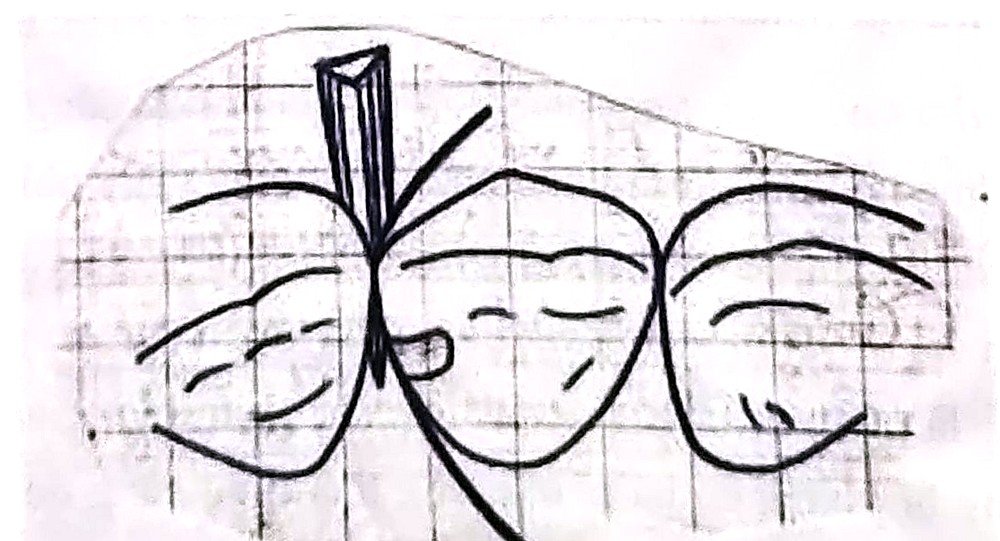

> [!IMPORTANT] Cách học bài này (4 bước, chia 2 ngày)
>
> 1. **Đọc "Bức tranh 1 phút"** để thấy cả bài trả lời **ba câu hỏi**: composite **dính vào răng bằng cách nào** (mục 1–2), composite **là gì, cứng lại ra sao, bền tới đâu** (mục 2–5), và **trám thế nào cho đúng** (mục 6). Chưa cần thuộc.
> 2. **Đọc từng mục** (đúng số mục trong sách). Bài dài 48 trang nên chia: **ngày 1** đọc mục **0 → 3** (chất dán, hệ thống dán, thành phần và phân loại composite, đèn quang trùng hợp); **ngày 2** đọc mục **4 → 6** (tính chất, cân nhắc lâm sàng, chỉ định và các bước trám). Mỗi mục: hộp 💡 *Hiểu nhanh* → **📖 SGK ghi** (ý của sách viết gọn, giữ đúng thuật ngữ và con số) → các hộp 🔍 *Vì sao…?* (cơ chế: đọc để hiểu, không cần thuộc; ý ngoài SGK đều ghi rõ, thi vẫn chọn theo SGK). Chữ ==tô vàng== là từ khoá/con số đề hay lấy rồi đổi đi một chữ.
> 3. **Bấm "Che từ khoá"** (thanh trên cùng) → đọc lại; gặp ô bị che thì tự nói ra trước rồi bấm vào ô để kiểm tra.
> 4. **Làm trắc nghiệm** cuối bài (ngày 1 làm Phần A–E, ngày 2 làm Phần F–I). Câu sai → bấm nhãn "mục …" của câu đó để về đúng đoạn cần đọc. Làm xong bấm **"Chỉ xem câu sai"**.
>
> Mục 1–5 dịch từ sách vật liệu nha khoa tiếng Anh (hình của S.C. Bayne, sách Sturdevant), nhiều câu dịch sát chữ nên khó đọc, vài chỗ **in nhầm** (đơn vị "pm" thay cho µm, một câu về độ nhớt bị dịch ngược): mỗi chỗ có hộp riêng. Mục 6 là phần **làm tay** của Bộ môn Chữa răng – Nội nha Cần Thơ, đề hay hỏi nhất. Bài nối với **Bài 6** (lớp mùn ngà, vát men, không thổi khô quá mức), **Bài 7** (GIC: không xoi mòn acid, sandwich, lót nền) và **Bài 9** (che tủy bằng Ca(OH)₂). Đáp án sách (tr. 198) của câu lượng giá **1** và **3** không khớp hẳn phần chữ: có hộp 📌 ở [mục 2.1](#m2-1) và [mục 6.3.3](#m6-3-3).
>
> **Mục tiêu SGK** – đề thường bám sát 3 mục tiêu này:

1. Trình bày được **nguyên tắc tạo xoang trám composite** → [mục 6.2](#m6-2) (bảo tồn tối đa mô răng, vẫn vát men; mức độ sửa soạn theo kích thước, hình dạng, vị trí sang thương); lý do nằm ở [mục 1](#m1)–[2](#m2) (composite dính bằng **vi lưu cơ học**, không cần hộp, không cần lưu) và [mục 5](#m5) (vát men).
2. Mô tả được **các bước tiến hành và hoàn chỉnh miếng trám composite** → [mục 6.3](#m6-3) (xử lý bề mặt, keo dán, chọn màu, cô lập, đưa vật liệu, khuôn và chêm, hoàn tất, bảo vệ tủy) và [mục 3](#m3) (chiếu đèn).
3. Thực hiện được **việc tạo xoang và các thao tác trám** composite → kỹ năng thực hành; phần lý thuyết ở [mục 6](#m6).

Từ khóa SGK: dán trong nha khoa, liên kết bám dính, vật dán, xói mòn, phục hồi, bề mặt, độ bền liên kết, liên kết cơ học, vi nối.

## Bức tranh 1 phút

> [!NOTE] Cả bài gói trong 7 câu
>
> 1. **Composite** = **khuôn nhựa** (khung nhựa: **BIS-GMA**, **UDMA**, pha loãng bằng **TEGDMA**) + **hạt độn vô cơ** (gốc **silica**) + **chất nối** (silane) gắn hai thứ lại. Hạt độn làm vật liệu **cứng hơn**, **ít giãn nở nhiệt hơn**, và **trong mờ giống men**.
> 2. Composite **không tự dính** vào răng. Nó được giữ bằng **liên kết cơ học vi thể**: acid **xoi mòn** men thành mặt lỗ chỗ, **chất dán** (nhựa lỏng, không hạt độn) chảy vào, cứng lại thành vô số **"đuôi"** cắm vào men (**đuôi lớn**, **vi nối**); ở ngà, chất dán thấm vào **khung collagen** thành **lớp lai**. Chất dán lại **đồng trùng hợp** (dính hóa học) với composite.
> 3. Muốn dán tốt: bề mặt phải **sạch**, chất dán phải **làm ướt** được bề mặt, men khô vừa phải, còn ngà phải **giữ ẩm** (ngà khô thì collagen xẹp, không có lớp lai). Vì vậy **cách ly tuyệt đối là bắt buộc**.
> 4. Composite được **phân loại theo kích thước hạt độn**: macrofill (lớn) → midifill → minifill → microfill (nhỏ) → nanofill; trộn nhiều cỡ là **lai (hybrid)**. Hạt **lớn, nhiều**: **bền** nhưng **nhám**; hạt **nhỏ**: **bóng, láng** nhưng ít độn hơn. **Lỏng** (ít độn) và **nén** (đặc như amalgam) là hai loại "thao tác đặc biệt".
> 5. Phần lớn composite hiện nay **quang trùng hợp**: ánh sáng xanh (camphoroquinone hấp thu ở **474 nm**) làm monomer nối thành polymer. Ánh sáng **yếu đi rất nhanh** theo **khoảng cách** và **độ dày** vật liệu → đầu đèn **sát** (≤ **2 mm**), mỗi lớp **≤ 1,5–2 mm**, chiếu **≥ 20 giây**.
> 6. Hai điểm yếu lớn: **co khi trùng hợp** (kéo bờ trám, gây ê buốt, hở bờ) và **giãn nở nhiệt gấp 3–4 lần răng**. Hở bờ thành **vi kẽ** → **nhuộm màu**, **ê buốt**, **sâu tái phát**. Ở răng sau, lo nhất là **mòn**.
> 7. Mục 6 là quy trình: **chỉ định** (thẩm mỹ, bảo tồn mô răng) → **xoi mòn** (men 5–50 giây, ngà 10–20 giây, acid phosphoric 35–37%, rửa 30–60 giây) → **primer + bonding** → **chọn màu trước khi làm khô** → **đê cao su, chỉ co nướu** → đưa vật liệu → **khuôn, chêm** → **hoàn tất, đánh bóng**; xoang sâu thì **lót GIC** (sát tủy: **Ca(OH)₂ rồi GIC**).

```flow
Xoi mòn acid: men lỗ chỗ, ngà còn khung collagen -> Primer (2 đầu: ưa nước, kỵ nước) -> Bonding (nhựa không độn) -> Composite từng lớp ≤ 1,5–2 mm -> +Chiếu đèn ≥ 20 giây: dính vi cơ học + đồng trùng hợp
!Nước bọt, máu, ngà khô quá, lớp dán dày -> !Dán yếu
!Co trùng hợp · giãn nở nhiệt gấp 3–4 lần răng -> !Áp lực ở bờ, vi kẽ -> !Ê buốt, nhuộm màu, sâu tái phát
```

**Bảng lớn – ba vật liệu trám, ba cách bám vào răng** (Bài 6, 7, 8; chữ tô vàng là chữ SGK):

| | Amalgam (G.V. Black, Bài 6) | GIC (Bài 7) | Composite (Bài 8) |
|---|---|---|---|
| Giữ trên răng nhờ | ==hình hộp==, ==hình thể lưu cơ học== | ==gắn kết hóa học== (liên kết ion) với mô cứng | ==liên kết cơ học== vi thể (==đuôi resin==, ==lớp lai==); chất dán ==đồng trùng hợp== với composite |
| Xử lý bề mặt răng | *(ngoài SGK)* không dán | chỉ ==dentin conditioner== (polyacrylic 10–20%); ==không axit etching, không bond – resine== | ==xoi mòn acid phosphoric 35–37%== → ==primer== → ==bonding== |
| Tạo xoang | hộp, lưu, ==mở rộng phòng ngừa== | tối thiểu, ==không tạo hình thể lưu==, ==để lại ngà nhiễm sắc== | ==bảo tồn tối đa mô răng==, nhưng ==vẫn vát men== |
| Với nước | *(ngoài SGK)* ít nhạy | ==cần nước để cân bằng==; không thổi khô quá | ==cách ly tuyệt đối là bắt buộc==; ngà phải ==giữ ẩm== cho lớp lai |
| Mạnh ở | ==chịu lực== | ==giải phóng fluor==, dính ngà, hợp ==xoang V== | ==thẩm mỹ cao==, ==bảo tồn mô răng==, ==làm mạnh cấu trúc răng còn lại== |
| Yếu ở | *(ngoài SGK)* không thẩm mỹ | chịu lực kém | ==co khi trùng hợp==, ==giãn nở nhiệt gấp 3–4 lần răng==, ==mòn== ở răng sau |

## 0. Đại cương · tr. 123

> [!NOTE]
> Composite giống **bê tông**: **xi măng** (khuôn nhựa) bọc lấy **đá, sỏi** (hạt độn). Riêng xi măng thì mềm, co ngót, nở ra khi nóng; trộn đá vào thì khối bê tông cứng hơn hẳn và ít co giãn. Kích thước viên đá đổi thì tính chất cũng đổi: đá to cho khối chắc nhưng mặt sần; cát mịn cho mặt láng.

**📖 SGK ghi:**

- Composite là ==vật liệu giống màu răng phổ biến nhất==.
- Về căn bản, composite có ==một khuôn nhựa đa phân tử== với ==rải rác các hạt độn vô cơ==.
- Phần vô cơ có ý nghĩa ==làm gia tăng độ cứng== của vật liệu và ==giảm hệ số dãn nở nhiệt== so với các vật liệu giống màu răng trước đó.
- ==Sự thay đổi kích thước các hạt== cũng ảnh hưởng đến đặc tính của vật liệu ([mục 2.3](#m2-3)).

> [!WHY] Vì sao thêm hạt độn vô cơ lại làm composite cứng hơn và ít giãn nở nhiệt hơn?
> - Hạt độn là **thủy tinh, silica**: cứng hơn nhựa rất nhiều. Mỗi phần thể tích nhựa được thay bằng hạt độn là một phần **mềm** được thay bằng phần **cứng** → khối vật liệu cứng hơn, chịu nén, chịu mòn tốt hơn.
> - *(ngoài SGK)* Nhựa nở ra rất mạnh khi nóng (PMMA: **72 ppm/°C**, SGK tr. 152), thủy tinh thì gần như không nở. Hạt độn chiếm càng nhiều thể tích, phần nhựa (phần nở) càng ít → hệ số giãn nở nhiệt của khối composite **giảm**, gần với răng hơn ([mục 4](#m4): răng **9–11**, composite **28–45 ppm/°C**).
> - *(ngoài SGK)* Cũng vì phần nhựa là phần **co khi trùng hợp**, nhiều hạt độn thì co ít hơn: composite co nhiều khi **pha hữu cơ (khung nhựa) càng nhiều**.

> [!WARNING]
> - Composite = **khuôn nhựa đa phân tử** + **hạt độn vô cơ** (bẫy: "hạt độn hữu cơ", "khuôn kim loại").
> - Hạt độn **tăng** độ cứng và **giảm** hệ số dãn nở nhiệt (bẫy: đảo chiều "giảm độ cứng", "tăng giãn nở").

## 1. Chất dán trong nha khoa · tr. 123–129

> [!NOTE]
> Mục này là "vật lý của keo dán", trước khi nói tới răng. Ba ý cần nắm: **dán là gì** (một lớp ở giữa hai bề mặt), **có mấy kiểu bám** (vật lý, hóa học, cơ học; nha khoa chủ yếu là **cơ học**), và **muốn dán tốt cần gì** (bề mặt **sạch**, chất dán **làm ướt** được bề mặt, lớp dán **mỏng**).

### 1.1. Thuật ngữ · tr. 123–125

> [!NOTE]
> Hãy nghĩ tới **dán gạch men lên tường**: viên gạch và bức tường là hai **vật được dán**; lớp keo ở giữa là **chất dán**; chỗ keo chạm gạch, chạm tường là **mặt tiếp xúc**; cả "gạch – keo – tường" là một **mối nối dán**.

**📖 SGK ghi:**

- ==Dán== là quá trình ==tương tác giữa chất rắn và (hoặc) lỏng== của một ==vật liệu dán== (==chất dán== hoặc vật dán) với ==vật (được) dán== khác trên cùng một bề mặt.
- Trong hầu hết các trường hợp, bám dính trong nha khoa ==còn được gọi là liên kết cơ học==.
- ==Độ bền của một hệ thống dán== được đo bằng ==các thử nghiệm làm bong dán==.
- ==Mối nối== là kết quả của sự tương tác của ==một lớp vật liệu trung gian== (chất dán) với ==hai bề mặt== (bám dính), tạo ra bề mặt kết dính với nhau (Hình 8.1).
- Một chất dùng để ==trám kín xoang sâu và vết nứt do men răng bị xoi mòn== là ví dụ của ==chất dán nha khoa==. Chất dùng gắn kết các men răng bị ăn mòn – ==composite== – là ==một chất trám kinh điển==.
- Trong hầu hết các trường hợp, ==diện tích tiếp xúc== giữa các vật liệu dán có thể ==lớn hơn nhiều== do ==trạng thái thô== trên giao diện cơ học.


> [!WHY] Vì sao mặt tiếp xúc "thô" lại cho diện tích lớn hơn nhiều?
> - Một mặt **gồ ghề** có rất nhiều chỗ lồi lõm; trải phẳng hết các chỗ đó ra thì dài hơn mặt phẳng nhiều lần. Chất dán **chảy vào** từng chỗ lõm → **diện tích bám** tăng, và mỗi chỗ lõm còn là một **cái móc** giữ chất dán lại (liên kết cơ học: [mục 1.2](#m1-2)).
> - Giống **băng keo dán lên tường sần** (bám chặt hơn tường nhẵn bóng, nếu keo đủ lỏng để lấp vào các chỗ sần). Vì vậy nha khoa cố ý **làm nhám** bề mặt răng bằng **xoi mòn** ([mục 1.2](#m1-2), [mục 6.3.1](#m6-3-1)).

> [!TIP]
> "**Vật được dán – chất dán – vật được dán**" = một **mối nối dán**; chỗ chạm nhau = **mặt tiếp xúc**. Độ bền đo bằng **thử nghiệm làm bong dán**.

> [!WARNING]
> - Bám dính trong nha khoa phần lớn là **liên kết cơ học** (bẫy: "chủ yếu là liên kết hóa học").
> - Độ bền hệ thống dán đo bằng **thử nghiệm làm bong dán** ([mục 1.4](#m1-4): tách keo dán hoặc mối nối để tạo ra vết nứt).

### 1.2. Phân loại · tr. 125–126

> [!NOTE]
> Hai vật bám vào nhau theo ba kiểu, giống ba cách giữ một tấm ảnh trên tường: **nam châm yếu** (liên kết vật lý: lực hút tĩnh điện), **hàn dính** (liên kết hóa học: chung nguyên tử, rất chắc nhưng hiếm khi làm được giữa hai vật khác nhau), và **đóng đinh, móc vào chỗ sần** (liên kết cơ học: chất dán chảy vào chỗ lồi lõm rồi cứng lại, khóa vào). Nha khoa gần như luôn dùng kiểu thứ ba.

**📖 SGK ghi:**

- Các tương tác cục bộ tại bề mặt được phân loại theo các loại ==tương tác nguyên tử== có liên quan. Độ bám dính được phân loại là ==liên kết vật lý, hóa học và/hoặc cơ học==.

| Loại liên kết | Bản chất (SGK) | Hình 8.3 ghi |
|---|---|---|
| ==Vật lý== | ==lực Vander Waals== hoặc các ==tương tác tĩnh điện tương đối yếu==; có thể là ==loại liên kết duy nhất== nếu các bề mặt ==mịn và không giống nhau về mặt hóa học== | ==yếu== |
| ==Hóa học== | liên kết giữa bề mặt của ==các nguyên tử nối liền nhau==; vì các vật liệu thường không giống nhau nên sự mở rộng liên kết ==có giới hạn==, sự phân bố chung của lực liên kết ==thường thấp== | ==bền nhưng ít gặp== |
| ==Cơ học== | kết quả của một bề mặt có ==mặt cắt và những liên kết không theo quy tắc==, tạo nên ==sự đan xen giữa các chất liệu==; ==mức độ vi thể quyết định mức độ gắn chặt== | ==bền== |

- ==Hầu hết mọi sự kết dính trong nha khoa đều chủ yếu dựa trên liên kết cơ học==. Liên kết hóa học cũng có khi xảy ra nhưng ==đóng góp hạn chế== trong lực liên kết chung.
- Cách thường dùng để tạo bề mặt thô cho liên kết cơ học tốt hơn là ==mài== hoặc ==xoi mòn== bề mặt:
  - ==Mài== tạo bề mặt thô nhưng ==để lại một lớp tinh thể hydroxyapatite và collagen biến tính dày khoảng 1–3 µm== (*lớp mùn*).
  - ==Xoi mòn acid== ==làm tan lớp này== và tạo ra ==những vi lưu cơ học== trên bề mặt, giúp hình thành liên kết.
- Khi độ nhám tạo ra kết dính vi thể với đường kính ==nhỏ hơn 10 µm== thì được gọi là ==vi liên kết cơ học==.


> [!WHY] Vì sao nha khoa dựa chủ yếu vào liên kết cơ học, mà không dựa vào liên kết hóa học vốn "bền"?
> - Liên kết hóa học cần **nguyên tử hai bên nối thẳng vào nhau**. Răng (hydroxyapatite, collagen) và nhựa (polymer acrylic) **khác nhau về hóa học** → chỉ một số ít chỗ nối được ("**sự mở rộng liên kết có giới hạn**", SGK) → tổng lực thấp.
> - Liên kết cơ học không đòi hai vật giống nhau: chỉ cần chất dán **chảy vào** chỗ lồi lõm rồi **cứng lại**. Xoi mòn làm mặt răng có **vô số** chỗ lõm vi thể → vô số "móc" → lực tổng rất lớn. Vì vậy SGK ghi hệ thống dán ngà có **90% hoặc hơn** độ bền là do liên kết cơ học ([mục 2.1](#m2-1)).
> - So sánh với **GIC** (Bài 7): GIC lại dính **hóa học** (liên kết ion với Ca của răng) vì acid polyacrylic có rất nhiều nhóm COO⁻ "bắt tay" được với Ca²⁺. Composite không có cơ chế đó, nên phải **xoi mòn**.

> [!WHY] Vì sao mài thôi thì chưa đủ, phải xoi mòn acid?
> - Mũi khoan **mài** làm mặt răng nhám, nhưng mảnh vụn mài ra (tinh thể hydroxyapatite vỡ, collagen biến tính) **dính lại** thành một lớp **1–3 µm** phủ lên bề mặt: đó là **lớp mùn** (Bài 6 mục 4; [mục 2.1](#m2-1), [6.3.1](#m6-3-1)). Chất dán bám lên lớp vụn này thì chỉ chắc bằng lớp vụn: dán trực tiếp lên lớp mùn ngà chỉ được **5–6 MPa** ([mục 6.3.1](#m6-3-1)).
> - **Xoi mòn acid** hòa tan lớp mùn và **hòa tan chọn lọc** men, tạo **vi lưu** (lỗ, rãnh vi thể) sạch, sâu, đều → chất dán chảy vào thành các **đuôi** khóa chặt ([mục 2.1](#m2-1)).
> - Giống **sơn tường**: chà nhám xong phải **lau sạch bụi** rồi mới sơn; sơn lên lớp bụi thì sơn bong cùng với bụi.

> [!TIP]
> - Ba kiểu liên kết: "**Vật lý yếu – Cơ học bền – Hóa học bền nhưng ít gặp**". Nha khoa: **chủ yếu cơ học**.
> - "**Mài để lại 1–3 µm vụn – Acid tan vụn, tạo vi lưu**". Vi liên kết cơ học: chỗ nhám **< 10 µm**.

> [!WARNING]
> - Liên kết vật lý = **Vander Waals**, tĩnh điện, **yếu**; là kiểu duy nhất khi bề mặt **mịn** và **khác nhau về hóa học** (bẫy: "bề mặt thô", "giống nhau về hóa học").
> - Liên kết hóa học **bền nhưng ít gặp**, **đóng góp hạn chế** (bẫy: "đóng góp chủ yếu").
> - Liên kết cơ học: **mức độ vi thể** quyết định mức độ gắn chặt.
> - Lớp mài để lại dày **1–3 µm**; vi liên kết cơ học **< 10 µm** (bẫy: tráo hai con số).

### 1.3. Yêu cầu để có sự kết dính · tr. 126–127

> [!NOTE]
> Hai điều kiện, giống **dán băng keo**: keo phải **ôm sát** vào bề mặt (giọt nước trên lá sen thì không ôm, giọt nước trên kính sạch thì loang ra), và bề mặt phải **sạch** (có bụi, có dầu thì keo bám vào bụi, dầu chứ không bám vào tường).

**📖 SGK ghi:**

- Để liên kết tốt, cần hình thành ==một bề mặt tiếp xúc vi thể==: chất kết dính phải có khả năng ==tiếp cận các phân tử của chất nền trong vài nanomet==. Sự hình thành bề mặt tiếp xúc được thấy trong quá trình ==làm ướt chất gắn==.
- Yêu cầu thứ nhất: bề mặt phải có ==độ ẩm tốt (làm ướt)==. Làm ẩm là ==thước đo năng lượng tương tác== của vật liệu; vật liệu tương tác tối đa khi ==làm ướt lẫn nhau==. Chất lỏng làm ướt chất rắn sẽ ==dễ lan truyền== trên bề mặt; nếu ướt hoàn toàn thì ==góc tiếp xúc sẽ gần bằng 0==.
- Yêu cầu thứ hai: bề mặt kết dính phải ==sạch==. Bề mặt sạch ở ==trạng thái nhạy cảm cao==, ==hấp thụ nhanh các chất gây ô nhiễm từ không khí== như ==hơi ẩm và bụi==; không loại bỏ thì ==kết dính sẽ yếu==. Quy trình nghiêm ngặt để làm sạch bề mặt là dùng ==dung môi hoặc acid== để hòa tan hoặc rửa trôi các chất gây nhiễm.

<figure>
<div class="sc"><svg class="dg" style="max-width:520px" viewBox="0 0 440 150" role="img" aria-label="Góc tiếp xúc: giọt không làm ướt có góc lớn, giọt làm ướt tốt loang ra với góc gần bằng 0">
<path class="k" d="M10,110 L200,110"/>
<path class="c1" d="M55,110 C55,62 155,62 155,110 Z"/>
<path class="rl" style="fill:none" d="M155,110 L155,70"/>
<text x="105" y="140" text-anchor="middle" class="s b">không làm ướt: góc lớn</text>
<text x="161" y="92" class="s r">góc</text>
<path class="k" d="M240,110 L430,110"/>
<path class="c1" d="M250,110 C285,98 385,98 420,110 Z"/>
<path class="rl" style="fill:none" d="M418,110 L436,106"/>
<text x="335" y="140" text-anchor="middle" class="s b">làm ướt tốt: góc gần 0</text>
<text x="335" y="34" text-anchor="middle" class="s">giọt chất dán loang ra, chạm</text>
<text x="335" y="52" text-anchor="middle" class="s">sát từng chỗ lồi lõm</text>
<text x="105" y="34" text-anchor="middle" class="s">giọt co tròn, chỉ chạm</text>
<text x="105" y="52" text-anchor="middle" class="s">bề mặt ở một vòng nhỏ</text>
</svg></div>
<figcaption>Vẽ theo chữ SGK (tr. 127), không theo tỉ lệ. Đường ngang = bề mặt chất rắn (răng); xanh = giọt chất dán; vạch đỏ = <b>góc tiếp xúc</b> giữa mặt giọt và bề mặt. Chất dán làm ướt càng tốt thì giọt càng loang, góc càng nhỏ; ướt hoàn toàn thì góc <b>gần bằng 0</b>.</figcaption>
</figure>

> [!WHY] Vì sao "làm ướt" quyết định độ bám?
> - Lực hút giữa các phân tử chỉ có tác dụng ở **khoảng cách vài nanomet** (SGK). Chất dán không chảy sát vào bề mặt thì giữa hai bên còn **khe không khí**, lực bám gần như bằng 0.
> - Chất dán **làm ướt** tốt thì tự **loang ra**, len vào từng **vi lưu** do xoi mòn tạo ra → vừa tăng diện tích tiếp xúc, vừa tạo các **đuôi** khóa cơ học ([mục 2.1](#m2-1)). Vì vậy chất dán phải là **nhựa lỏng, độ nhớt thấp** ([mục 6.3.2](#m6-3-2)).
> - *(ngoài SGK)* Men xoi mòn có **năng lượng bề mặt cao** → nhựa lỏng loang dễ. Bề mặt dính nước bọt (màng protein) có năng lượng bề mặt thấp → nhựa **co thành giọt**, không chảy vào lỗ: thêm một lý do phải **cách ly tuyệt đối** ([mục 6.3.4](#m6-3-4)).

> [!WHY] Vì sao bề mặt sạch lại "nhạy cảm" và chóng bẩn?
> - *(ngoài SGK)* Một bề mặt vừa được làm sạch (như men vừa xoi mòn) có **năng lượng bề mặt cao**: nó "đói" liên kết, nên **hút ngay** bất cứ thứ gì chạm vào (hơi ẩm, bụi, protein nước bọt). Lớp bẩn mới bám này che mất bề mặt thật, chất dán bám vào lớp bẩn → **kết dính yếu** (SGK).
> - Lâm sàng: men đã xoi mòn mà **dính nước bọt** thì phải **xoi mòn lại** (*ngoài SGK*). Dung môi hoặc acid là cách làm sạch "nghiêm ngặt" (SGK): acid phosphoric vừa làm sạch, vừa tạo vi lưu.

> [!TIP]
> Hai yêu cầu: "**Ướt – Sạch**". Ướt hoàn toàn → góc tiếp xúc **≈ 0**. Làm sạch bằng **dung môi hoặc acid**. Chất dán phải chạm chất nền **trong vài nanomet**.

> [!WARNING]
> - Ướt hoàn toàn thì góc tiếp xúc **gần bằng 0** (bẫy: "gần bằng 90°", "180°").
> - Bề mặt sạch **hấp thụ nhanh** chất gây ô nhiễm (**hơi ẩm, bụi**) (bẫy: "bề mặt sạch thì bền, không cần dán ngay").
> - Làm sạch nghiêm ngặt bằng **dung môi hoặc acid** (bẫy: "thổi khô thật lâu").

### 1.4. Độ bền liên kết · tr. 127–129

> [!NOTE]
> Muốn biết keo dán chắc tới đâu, người ta **kéo cho bong ra** và xem **vết nứt đi đường nào**. Dán tốt thì vết nứt **không đi qua chỗ dán** mà đi vào vật liệu yếu hơn ở hai bên (giống dán hai miếng gỗ bằng keo tốt: kéo mạnh thì gỗ gãy, keo còn nguyên). Lớp dán càng **mỏng** thì vết nứt càng khó chạy dọc trong lớp dán.

**📖 SGK ghi:**

- Độ bền liên kết thường đo bằng cách ==tách keo dán hoặc các mối nối liên kết để tạo ra vết nứt==; được xác định là ==một chu trình quá tải dẫn đến đứt gãy==. Độ bền đo được ==phụ thuộc vào đường đi của vết gãy==.
- Với mối nối như ==composite dán với ngà==, độ bền khối vật liệu lớn kiểm soát đường gãy: ==ngà cứng hơn composite==, ==mạnh hơn tác nhân liên kết ngà==. Bề mặt liên kết tốt thì vết nứt xảy ra ==trong liên kết ngà răng== hoặc được dẫn vào những chỗ bám; liên kết không tốt thì vết gãy xảy ra ==ở phần yếu==.
- Chất liên kết ngà ==phù hợp về mặt hóa học với composite== thì ==bị ngấm bởi composite==, ==xen kẽ hóa học== với nó và tạo ==liên kết hóa học==, cho ==một mặt phân cách rất mạnh==.
- Liên kết mạnh với ngà ==phụ thuộc vào mức độ làm ẩm==. ==Ngà răng mùn== gồm ==mảnh vụn vi thể, ẩm==, và không nhất thiết có thô ráp vi thể. ==Xoi mòn chọn lọc== loại bỏ một số hoặc tất cả mảnh vụn, ==kiểm soát độ ẩm tại chỗ==, tạo ==bề mặt thô ráp vi mô==.
- ==Ngà răng vẫn ưa nước== → liên kết ngà phải được cấu tạo ==phù hợp cho sự ưa nước==. Hầu hết hệ thống liên kết ngà hiện tại được thiết kế với ==xoi mòn, mồi nước và dán== để hoàn tất liên kết.
- Liên kết mạnh lên thì ==sức bền của chất dán== trở thành yếu tố quyết định. Hướng cải thiện là ==giảm độ dày dán== đến mức vết nứt ==không thể lan truyền qua nó==; khi đó mối nối hoạt động như ==sự bám dính đơn của hai vật liệu== ở hai bên. Thấm vào bề mặt ngà xoi mòn, độ dày tối thiểu của chất dán ngà đạt ==1 micromet==; chỗ nứt ==lệch hướng vào trong ngà==; lực dán trung bình ==25 tới 40 MPa==.
- Vấn đề là ==các tình huống lâm sàng khác nhau== có thể yêu cầu ==các đặc tính hóa học khác nhau== để chất kết dính đạt độ ẩm tốt.

**Bảng 8.1 (SGK) – độ bền cắt** (MPa) của vật liệu và các mối dán (chép lại từ ảnh; ô "–" là sách để trống):

| Vật liệu, hoặc mối dán "bề mặt / hệ thống dán / vật liệu" | Độ bền cắt (MPa) |
|---|---|
| Men răng · Ngà răng · Composite | ==90–200== · ==170== · ==30–120== |
| Amalgam nha khoa | [125] |
| Glass ionomer truyền thống · Glass ionomer biến đổi nhựa | – · – |
| Men / men có lớp mùn (SL) · Ngà / ngà có lớp mùn | 4–6 · 4–6 |
| Men / ==EBS== (hệ thống dán men) / Composite | ==18–22== |
| Men / ABS (hệ dán amalgam) / Composite · / Amalgam | 10–22 · 2–22 |
| Men / không SL / Glass ionomer truyền thống | 8–12 |
| Men / EBS / Mắc cài chỉnh nha | 18–20 |
| Men / Composite cement / Cầu Maryland | – |
| Ngà / ==DBS== (hệ thống dán ngà) / Composite | ==22–35== |
| Ngà / SL / Glass ionomer truyền thống · Ngà / không SL / Glass ionomer biến đổi nhựa | [6] · 10–12 |
| Composite / EBS / Composite phục hồi lại | 10–27 |

Chú thích SGK: ==ABS== = hệ dán amalgam, ==DBS== = hệ thống dán ngà răng, ==EBS== = hệ thống dán men, ==SL== = lớp mảnh vụn vi tinh thể (lớp mùn).

> [!WHY] Vì sao lớp dán càng mỏng thì mối dán càng bền?
> - Chất dán (nhựa không độn) là phần **yếu nhất** của mối nối. Lớp dán **dày** thì vết nứt có **đường chạy dài** ngay trong lớp yếu đó. Lớp dán **mỏng** (tới **1 µm**) thì vết nứt vừa bắt đầu đã đụng vào vật liệu hai bên → bị **lệch hướng vào ngà** (SGK) → mối nối bền như chính hai vật liệu được dán.
> - Giống **keo dán gỗ**: bôi một lớp mỏng, ép chặt thì chắc; bôi dày thì keo tự nứt ở giữa. Vì vậy **lớp keo dán mỏng** làm **tăng** lưu giữ miếng trám.
> - *(ngoài SGK)* Ngoại lệ có chủ ý ở [mục 4](#m4): một số hệ thống dán ngà được **làm dày hơn** để làm **lớp đệm** giảm áp lực co trùng hợp. Hai ý không mâu thuẫn: mỏng để **bền khi bị kéo**, dày vừa phải để **hấp thụ co rút**.

> [!WHY] Vì sao ngà khó dán hơn men?
> - So sánh thành phần (Bảng 8.2, [mục 2.1](#m2-1)): men **95%** hydroxyapatite trọng lượng, nước chỉ **3%**; ngà chỉ **70%** hydroxyapatite, **18%** collagen, nước **10%** (**21%** thể tích), lại có **ống ngà chứa dịch** nối thẳng vào tủy (Bài 6 mục 1.2).
> - Nhựa dán cổ điển **kỵ nước**, gặp mặt ngà **ướt** thì không loang được. Vì vậy hệ thống dán ngà phải có bước **mồi nước** (primer: monomer **ưa nước** như HEMA) để "bắc cầu" giữa ngà ướt và nhựa kỵ nước ([mục 2.1](#m2-1), [6.3.2](#m6-3-2)).
> - Bảng 8.1 cho thấy: chỉ dán lên **lớp mùn** (SL) thì được **4–6 MPa**; men xoi mòn + EBS: **18–22**; ngà + DBS hiện đại: **22–35** MPa.

> [!TIP]
> - Độ bền: "**Ngà > composite > chất dán ngà**" (về độ cứng, độ mạnh). Dán tốt → vết nứt **lệch vào ngà**.
> - Ba bước hệ thống dán ngà: "**Xoi mòn – Mồi nước – Dán**" (etch – prime – bond).
> - Con số: chất dán ngà mỏng **1 µm**, lực dán **25–40 MPa**; men + EBS **18–22**; ngà + DBS **22–35**; lớp mùn **4–6** MPa.

> [!WARNING]
> - **Ngà cứng hơn composite** và **mạnh hơn tác nhân liên kết ngà** (bẫy: "composite cứng hơn ngà").
> - Cải thiện lực dán bằng cách **giảm** độ dày dán (bẫy: "tăng độ dày lớp dán cho chắc").
> - Ngà răng **ưa nước** → hệ thống dán phải **phù hợp cho sự ưa nước** (bẫy: "ngà kỵ nước", "phải làm ngà thật khô").
> - Độ dày tối thiểu chất dán ngà **1 µm**; lực dán trung bình **25–40 MPa**.

## 2. Hệ thống dán · tr. 129–145

> [!NOTE]
> Mục 2 là mục dài nhất (17 trang), gồm bốn chuyện: **hệ thống dán** bám vào men, vào ngà ra sao ([2.1](#m2-1)); **composite** gồm gì và được cải tiến dần thế nào ([2.1](#m2-1), [2.2](#m2-2)); và composite được **chia loại** theo hạt độn, theo cách trùng hợp ([2.3](#m2-3)). Đọc chậm, mỗi đoạn có hộp giải thích ngay bên dưới.

### 2.1. Tổng quan · tr. 129–133

**📖 SGK ghi:** các chất sản xuất liên kết dính nha khoa được gọi là ==hệ thống dán==, được phân loại trên cơ sở của ==mặt dán gốc== (dán vào **men** hay vào **ngà**).

**a. Hệ thống dán men** · tr. 129

> [!NOTE]
> Men xoi mòn trông như **một bàn chải lông cứng bị cắt ngắn**: đầu các trụ men bị acid ăn lõm vào, khe quanh trụ men bị ăn rộng ra. Nhựa dán lỏng chảy vào mọi chỗ trống đó rồi cứng lại thành hàng triệu **"rễ cây"** bám vào men: **rễ cái** ở khe giữa các trụ (**đuôi lớn**) và **rễ con** li ti ở đầu từng trụ (**vi nối**).

**📖 SGK ghi:**

- Hệ thống dán men thường gồm ==hỗn hợp acrylic lỏng== (hoặc làm đầy nhẹ) được đặt lên ==men xoi mòn bằng axit==, ==chảy vào các kẽ và giữa các thanh men==.
- Dán men phụ thuộc vào ==cầu nối nhựa== gắn trên ==bề mặt lỗ rỗ== do xoi mòn tạo ra:
  - Cầu nối nhựa hình thành ==giữa đường quanh trụ men== gọi là ==đuôi lớn==.
  - ==Một mạng lưới nhỏ gồm hàng ngàn mối nối nhỏ== hình thành ==ở cuối mỗi trụ men==, nơi ==các tinh thể hydroxyapatit riêng lẻ bị hòa tan==, để lại các kẽ được phác thảo bởi vật liệu hữu cơ còn lại: gọi là ==vi nối==.
- ==Vi nối là cơ sở cho liên kết men vi cơ học==. Vi nối ==quan trọng hơn== vì ==số lượng lớn== và ==diện tích tiếp xúc lớn==.
- Những năm 1970–1980, nghiên cứu tập trung vào chiều dài vi nối và kiểu xoi mòn (==loại 1: xoi mòn trực tiếp==, ==loại 2: xoi mòn xung quanh==, ==loại 3: kết hợp==). Nhưng ==chiều dài vi nối là không quan trọng==, vì ==nứt gãy chỉ xảy ra ở rìa của xoang==; tất cả vi nối dài khoảng ==2 đến 5 micromet==. ==Khuôn xoi mòn cũng không quan trọng== đối với cường độ liên kết.
- ==Hệ thống liên kết đồng trùng hợp== với những mạng lưới pha của composite, mang lại ==liên kết hóa học mạnh==.
- Độ bền liên kết vi mô của vật dán vào men: ==18 đến 22 MPa==; bị ảnh hưởng bởi ==độ dày màng của hệ thống dán== và ==độ bền cắt của men==. Giới hạn trên lý thuyết khoảng ==50 MPa==; trên lâm sàng thường vào khoảng ==20 MPa==.

<figure>
<div class="sc"><svg class="dg" style="max-width:520px" viewBox="0 0 440 240" role="img" aria-label="Dán men: nhựa dán chảy vào men đã xoi mòn tạo đuôi lớn giữa các trụ men và vi nối ở đầu mỗi trụ; composite đồng trùng hợp với nhựa dán">
<rect class="c3" x="10" y="22" width="232" height="34"/>
<rect class="c1" x="10" y="56" width="232" height="40"/>
<rect class="en" x="10" y="96" width="232" height="130"/>
<path class="c1" d="M42,96 L42,140 Q46,150 50,140 L50,96 Z M82,96 L82,140 Q86,150 90,140 L90,96 Z M122,96 L122,140 Q126,150 130,140 L130,96 Z M162,96 L162,140 Q166,150 170,140 L170,96 Z M202,96 L202,140 Q206,150 210,140 L210,96 Z"/>
<path class="c1" style="stroke-width:1" d="M14,96 L16,108 L18,96 Z M20,96 L22,110 L24,96 Z M26,96 L28,107 L30,96 Z M32,96 L34,109 L36,96 Z M54,96 L56,108 L58,96 Z M60,96 L62,110 L64,96 Z M66,96 L68,107 L70,96 Z M72,96 L74,109 L76,96 Z M94,96 L96,108 L98,96 Z M100,96 L102,110 L104,96 Z M106,96 L108,107 L110,96 Z M112,96 L114,109 L116,96 Z M134,96 L136,108 L138,96 Z M140,96 L142,110 L144,96 Z M146,96 L148,107 L150,96 Z M152,96 L154,109 L156,96 Z M174,96 L176,108 L178,96 Z M180,96 L182,110 L184,96 Z M186,96 L188,107 L190,96 Z M192,96 L194,109 L196,96 Z M214,96 L216,108 L218,96 Z M220,96 L222,110 L224,96 Z M226,96 L228,107 L230,96 Z M232,96 L234,109 L236,96 Z"/>
<g class="ld"><path d="M46,150 L46,182"/><path d="M86,150 L86,182"/><path d="M126,150 L126,182"/><path d="M166,150 L166,182"/><path d="M206,150 L206,182"/></g>
<g class="ld"><path d="M236,40 L258,40"/><path d="M236,76 L258,76"/><path d="M229,104 L258,124"/><path d="M210,136 L258,166"/></g>
<text x="126" y="44" text-anchor="middle" class="s b">composite</text>
<text x="126" y="80" text-anchor="middle" class="s">nhựa dán</text>
<text x="126" y="200" text-anchor="middle" class="s">men đã xoi mòn</text>
<text x="126" y="216" text-anchor="middle" class="s m">(trụ men)</text>
<text x="262" y="36" class="s b">composite có hạt độn</text>
<text x="262" y="52" class="s">đồng trùng hợp với nhựa dán</text>
<text x="262" y="74" class="s b">hệ thống dán men</text>
<text x="262" y="90" class="s">nhựa lỏng, không hạt độn</text>
<text x="262" y="120" class="s b">vi nối: hàng ngàn nhánh</text>
<text x="262" y="136" class="s">nhỏ ở đầu mỗi trụ men</text>
<text x="262" y="162" class="s b">đuôi lớn: nhựa chảy vào</text>
<text x="262" y="178" class="s">khe quanh trụ men</text>
<text x="262" y="206" class="s">đuôi dài khoảng 2–5 µm;</text>
<text x="262" y="222" class="s">chiều dài không quan trọng</text>
</svg></div>
<figcaption>Vẽ theo chữ SGK (tr. 129, 133), không theo tỉ lệ; SGK không có hình cho đoạn này. Kem = men đã xoi mòn, các vạch dọc là ranh giới giữa các <b>trụ men</b>; xanh dương = <b>nhựa dán</b> (hệ thống dán men, không hạt độn); xanh lá = <b>composite</b>. Nhựa dán chảy vào khe quanh trụ thành các <b>đuôi lớn</b> (ngón xanh dài) và vào đầu mỗi trụ thành <b>vi nối</b> (gai xanh nhỏ): bám men bằng <b>khóa vi cơ học</b>. Phía trên, nhựa dán và composite <b>đồng trùng hợp</b> thành một khối: <b>liên kết hóa học</b>.</figcaption>
</figure>

> [!WHY] Vì sao vi nối quan trọng hơn đuôi lớn, và vì sao "chiều dài" của chúng không quan trọng?
> - Mỗi vi nối rất nhỏ, nhưng **mỗi đầu trụ men có hàng ngàn cái** (SGK). Tổng **diện tích tiếp xúc** của chúng lớn hơn hẳn mấy đuôi lớn → gánh phần lớn lực bám. Giống **khóa dán gai (velcro)**: từng cái móc nhỏ yếu, nhưng hàng ngàn cái móc cộng lại rất chắc.
> - Khi mối dán bị phá, vết nứt **bắt đầu ở rìa xoang** (SGK) rồi chạy dọc bề mặt; nó không "nhổ" từng đuôi ra theo chiều dài. Vì vậy đuôi dài 2 µm hay 5 µm không làm đổi độ bền; quan trọng là **có đủ nhiều** đuôi và **bề mặt sạch, xoi mòn đều**.
> - *(ngoài SGK)* Ba "kiểu xoi mòn" (loại 1 ăn **lõi trụ**, loại 2 ăn **quanh trụ**, loại 3 lẫn lộn) phụ thuộc hướng cắt của trụ men; SGK kết luận kiểu nào cũng dán được, nên không cần học kỹ.

> [!WHY] Vì sao lực dán men "lâm sàng chỉ khoảng 20 MPa" dù lý thuyết tới 50 MPa?
> - Lực đo được bị giới hạn bởi **phần yếu nhất** của mối dán: **lớp nhựa dán** (độ dày màng) và chính **men** (độ bền cắt của men) (SGK). *(ngoài SGK)* Trên lâm sàng còn thêm **độ ẩm**, **nước bọt**, **co trùng hợp** kéo bờ trám ([mục 4](#m4)), nên khó đạt mức lý thuyết.
> - *(ngoài SGK)* Lực co của composite khi trùng hợp vào khoảng vài MPa ([mục 4](#m4): **1–2 MPa**), nên ~20 MPa là **đủ** để giữ bờ trám kín.

**b. Hệ thống liên kết ngà răng** · tr. 130–131

> [!NOTE]
> Ngà khác men ở chỗ **ướt** (có dịch ngà) và **nhiều collagen**. Acid hòa tan khoáng ở lớp ngà ngoài cùng, để lại một **tấm lưới collagen** xốp như **bông gòn**. Nhựa phải thấm vào tấm lưới đó rồi cứng lại, tạo một lớp "nửa ngà nửa nhựa" gọi là **lớp lai**. Nhưng tấm bông gòn mà **bị thổi khô** thì **xẹp xuống** thành một lớp màng dẹt, nhựa không thấm vào được nữa: đó là lý do ngà phải được **giữ ẩm**.

**📖 SGK ghi:**

- Hệ thống liên kết ngà gồm ==hỗn hợp đơn chất acrylic lỏng (hoặc đặc)==, acrylic monomer trộn với lớp xoi mòn men răng, đặt lên bề mặt răng.
- Chất lót liên kết phụ thuộc vào ==các monome ái thủy==, như ==2-hydroxyethyl methacrylate (HEMA)==, ==dễ dàng làm ướt bề mặt răng trong môi trường ẩm==.
- Chất lót, chất liên kết ==có thể chảy vào ống ngà==, nhưng độ bền chủ yếu đạt được bằng ==liên kết lưu vi cơ với ngà răng (giữa các ống)== dọc theo bề mặt ngà. Các phản ứng hóa học với ngà ==có rất ít hoặc không có ý nghĩa== cho độ bền cuối cùng. Nói chung, ==90% hoặc nhiều hơn== độ bền là do ==liên kết cơ học==.
- Sửa soạn bằng mũi khoan trên men và ngà tạo thành ==những mảnh vụn nhỏ, dính trên bề mặt==, gọi là ==lớp mùn==. Trong quá trình dán, cần ==loại bỏ hoặc xuyên qua lớp mùn==; cách thường áp dụng là ==hòa tan một phần hoặc toàn bộ lớp mùn==.
- Các quá trình xoi mòn ngà ban đầu đã loại bỏ lớp mùn nhưng ==có xu hướng xâm thực ngà==. Độ bền liên kết:

| Giai đoạn | Độ bền |
|---|---|
| Xoi mòn ngà ban đầu (bỏ lớp mùn) | ==10 đến 12 MPa== |
| Hệ thống liên kết biến đổi thành chất có ==tính ái thủy== | ==18 đến 20 MPa== |
| Xoi mòn ngà vừa phải (==không khử khoáng quá mức==) + ==lớp chất lót ưa nước== | ==22–35 MPa== |
| Theo thực tế, độ bền của chất dán *(câu SGK dịch tối nghĩa)* | có thể ==80–100 MPa==, so với men, vì ngà ==có khả năng chống rạn nứt== |

- Do ngà ==chứa nhiều nước hơn== men, ==tuổi thọ== của liên kết ngà ==sẽ ngắn hơn==.

**Bảng 8.2 (SGK) – Thành phần của men răng và ngà răng:**

| Thành phần | Men: % trọng lượng | Men: % thể tích | Ngà: % trọng lượng | Ngà: % thể tích |
|---|---|---|---|---|
| Nước | ==3== | ==11== | ==10== | ==21== |
| Protein không collagen, lipid, ion | ==1== | ==2== | ==2== | ==5== |
| Collagen | – | – | ==18== | ==27== |
| Hydroxyapatite | ==95== | ==87== | ==70== | ==47== |

- Để hệ thống dán tạo được ==một lớp lai hiệu quả==, điều quan trọng là ==giữ cho ngà răng ngậm nước==. Thường gặp ở lâm sàng: ==súc miệng và làm khô ngà== sau khi chuẩn bị răng hoặc sau các bước xoi mòn → ==lớp ngà bị mất nước==. Ngà đã xoi mòn ==không còn tinh thể hydroxyapatite giữa các sợi collagen==.
- ==Mất nước==, dù vô tình hay cố ý, làm ==collagen còn lại bị tiêu hủy== (xẹp): các phân tử collagen tạo thành ==một lớp liên kết== và ==loại trừ các monome cần thiết cho sự hình thành lớp lai==.
- Do đó ngà phải ==được giữ ẩm hoặc được bù nước thường xuyên==. Bù nước bằng ==một bông ẩm== hoặc ==đầu bôi thuốc== tiếp xúc với bề mặt trong khoảng ==10 giây==. Độ ẩm ngà không đủ thì ==lớp lai sẽ không hình thành== và hệ thống liên kết ==không thể che phủ==.
- Hệ thống dán mới nhất là sự ==kết hợp cả ba giai đoạn thành một hợp chất duy nhất== (==hệ thống một thành phần==): quá trình ==đơn giản hơn== để liên kết men và ngà, nhưng ==không nhất thiết làm ướt và liên kết== với các chất nền khác như ==ceramic, composite hoặc amalgam==.
- Do đó các ==hệ thống ba thành phần== giúp chỉnh sửa cho phù hợp với sự khác biệt về tính chất của vật liệu (==hệ thống liên kết đa năng==). ==Rất khó tạo ra một hệ thống một thành phần hoạt động tốt trong mọi tình huống==.

```flow
Ngà sửa soạn: có lớp mùn -> Xoi mòn: tan khoáng, còn khung collagen -> Giữ ẩm: collagen còn xốp -> Primer HEMA (ái thủy) + bonding thấm vào -> +Lớp lai
Xoi mòn: tan khoáng, còn khung collagen -> !Thổi khô, súc rồi làm khô -> !Collagen xẹp thành lớp màng -> !Monome không thấm vào: không có lớp lai
```

> [!WHY] Vì sao ngà phải "giữ ẩm", trong khi Bài 7 cũng dặn GIC "không thổi khô quá"?
> - Hai vật liệu, hai lý do khác nhau, cùng một lời dặn:
>
> | | GIC (Bài 7 mục 1.3) | Composite (Bài 8) |
> |---|---|---|
> | Vì sao cần nước | **phản ứng GIC cần nước để cân bằng** | **khung collagen** của ngà đã xoi mòn phải **ướt mới xốp**, monome mới thấm vào tạo **lớp lai** |
> | Thổi khô quá thì | liên kết với răng yếu đi | collagen **xẹp**, **không có lớp lai** |
> | Cách giữ ẩm | làm khô bằng **viên gòn khô** | **bông ẩm** hoặc **đầu bôi thuốc** khoảng **10 giây** để bù nước |
>
> - Bài 6 (mục 4) thêm lý do sinh học: thổi khô quá mức làm **phản ứng lành thương bị trì hoãn**, và gây ê buốt theo **thuyết thủy động học**. Tóm lại: **thổi khô quá mức sau etching** **làm giảm** (không làm tăng) lưu giữ miếng trám composite.
> - *(ngoài SGK)* Giống **miếng bọt biển**: ướt thì phồng, đầy lỗ, đổ sơn vào thấm sâu; phơi khô thì quắt lại, sơn chỉ đọng trên mặt.

> [!WHY] Vì sao dán ngà cần monome "ái thủy" (HEMA), và lớp lai bám bằng cách nào?
> - Nhựa composite **kỵ nước**; mặt ngà **ẩm**. Đổ nhựa kỵ nước lên mặt ướt thì nó **co thành giọt**, không làm ướt bề mặt ([mục 1.3](#m1-3)). **HEMA** ưa nước nên **len vào lớp nước**, thấm vào khung collagen, mang theo phần nhựa đi cùng (SGK: "dễ dàng làm ướt bề mặt răng trong môi trường ẩm").
> - Nhựa cứng lại **quấn quanh các sợi collagen** và **giữa các ống ngà** → lưu **vi cơ học**: chiếm **≥ 90%** độ bền (SGK). Phần chảy vào **ống ngà** (nút nhựa) đóng góp ít hơn người ta tưởng (SGK: độ bền chủ yếu nhờ liên kết **giữa các ống**).
> - Hình 8.15 ([mục 6.3.2](#m6-3-2)) vẽ đúng ba bước: lớp mùn → xoi mòn còn khung collagen → chất lót, chất dán, composite thành **lớp lai**.

> [!WHY] Vì sao liên kết với ngà có "tuổi thọ ngắn hơn" men?
> - Ngà **nhiều nước** (Bảng 8.2: **10%** trọng lượng, **21%** thể tích; men chỉ **3%** và **11%**) và **nhiều collagen** (18%). *(ngoài SGK)* Theo năm tháng, nước len vào lớp lai, làm **thủy phân** dần phần nhựa và các sợi collagen không được nhựa bọc kín → lực dán **giảm dần**. Men gần như toàn khoáng nên liên kết bền lâu hơn.
> - Đây cũng là lý do bờ trám nằm trên **men** thì kín lâu hơn bờ nằm trên **ngà, xê măng** (cổ răng: [mục 5](#m5) – sâu thứ cấp hay gặp ở **vùng cổ răng**).

> [!CAUTION] Hai cách hiểu – thành phần men, ngà: Bài 2 ↔ Bài 6 ↔ Bài 8
> | | Bài 2 (Bảng 2.1) | Bài 6 (tr. 109–110) | Bài 8 (Bảng 8.2) |
> |---|---|---|---|
> | Men | khoáng **99%**, hữu cơ **1%** (**trọng lượng khô**); khe tinh thể: nước **11%**, hữu cơ **2%** **thể tích** | vô cơ **95–97%**, hữu cơ và nước **3–5%** | hydroxyapatite **95** wt% / **87** vol%; nước **3** / **11**; protein **1** / **2** |
> | Ngà | khoáng **80%**, hữu cơ **20%** (trọng lượng khô) | vô cơ **70%**, hữu cơ **18–22%**, nước **7–12%** | hydroxyapatite **70** wt% / **47** vol%; collagen **18** / **27**; nước **10** / **21**; protein **2** / **5** |
>
> Ba bảng **khớp nhau**: Bài 8 ghi đủ cả **% trọng lượng** (khớp Bài 6) và **% thể tích** (khớp con số 11%, 2% của Bài 2). Bỏ nước ra thì phần khoáng chiếm tỉ lệ lớn hơn (Bài 2 ghi trọng lượng khô).
>
> **Thi**: đọc kỹ chữ "**trọng lượng**" hay "**thể tích**". Hỏi hydroxyapatite của ngà theo **thể tích** → **47%** (chưa tới một nửa: vì vậy ngà khó dán).

> [!WHY] Vì sao hệ thống "một thành phần" tiện mà không thay được hệ thống ba thành phần?
> - Ba bước **xoi mòn – mồi nước – dán** cần **ba tính chất trái nhau**: acid (để xoi mòn), ưa nước (để thấm ngà ẩm), kỵ nước (để nối với composite). Gộp vào **một lọ** thì mỗi tính chất đều phải "nhường" một chút (SGK: không nhất thiết làm ướt, liên kết với ceramic, composite, amalgam).
> - Hệ thống **ba thành phần** cho phép đổi riêng từng bước theo bề mặt cần dán (men, ngà, sứ, kim loại) → "**đa năng**" (SGK). Ví dụ đời thường: **dầu gội 3 trong 1** tiện nhưng không bằng gội, xả, dưỡng riêng.
> - [Mục 6.3.2](#m6-3-2) nói tiếp: ngày nay **primer và bonding** thường **gộp chung một lọ**.

**c. Chất trám bít hố rãnh** · tr. 131–132

**📖 SGK ghi:**

- Chất trám bít hố rãnh được các bác sĩ nha khoa đề xuất vào ==cuối những năm 60==; giúp ==hạn chế các kỹ thuật sửa soạn loại bỏ các vị trí dễ bị sâu răng==.
- Hố và rãnh ==không thể tự làm sạch== → dễ sâu do ==thức ăn kẹt lại==, tích tụ ==mảnh vụn hữu cơ và vi khuẩn miệng==.
- Mục tiêu của chất trám bít hố rãnh đơn giản là ==loại bỏ mô chứa vi khuẩn== và ==ngăn chặn các chất dinh dưỡng tiếp cận với vi khuẩn== trong đáy xoang hoặc khe nứt; dùng để ==bít lại các rãnh và trũng== vì những chỗ này ==không thể tự làm sạch==.
- Muốn thành công cần có ==yếu tố lưu thích hợp==. Một số kẽ hở miếng trám có thể do ==sai sót==, ==đường vào không tương ứng==, hoặc ==chất trám không đi tới vị trí sâu nhất==.
- Vật liệu phải được ==điều chỉnh sau khi trám== để ==không ảnh hưởng vào các tiếp điểm khớp cắn== hoặc phá vỡ ==các đường hướng dẫn cắn khớp==.

> [!WHY] Vì sao trám bít hố rãnh được xếp vào "hệ thống dán"?
> - Chất trám bít là **nhựa gần như không hạt độn** (Bảng 8.3: **0%**; SGK tr. 134: sealant chứa **1–2%** hạt độn vẫn xếp loại **không hạt độn**), dán vào **men xoi mòn** bằng đúng cơ chế **đuôi nhựa** như hệ thống dán men. Hình 8.2 A: sealant là một **chất dán** nằm thẳng trong rãnh.
> - Nó chặn **thức ăn** của vi khuẩn (đường) đi vào rãnh: vi khuẩn kẹt dưới lớp bít **hết đường ăn** (Bài 4 mục 5.8 có số liệu hiệu quả: giảm sâu hơn **80% sau 1 năm**).

**d. Composite** · tr. 132–133

> [!NOTE]
> Composite là **hỗn hợp**, không phải một chất: **hạt độn** (thủy tinh, silica) nằm rải rác trong **khung nhựa** (monomer acrylic). Trước khi trám nó **dẻo** (khung nhựa còn là chất lỏng), trám xong chiếu đèn thì khung nhựa **trùng hợp** thành chất rắn ôm chặt các hạt độn. **Chất dán** là "phần khung nhựa không có hạt độn", quét lên trước, nối răng với composite.

**📖 SGK ghi:**

- Composite là ==một pha trộn vật lý của các vật liệu thành phần==; thành phần được chọn để lấy ==tính chất đặc trưng của từng loại==, vì ==một vật liệu riêng lẻ không đáp ứng== đủ đòi hỏi trong nha khoa.
- Composite gồm ==một pha đứt của các hạt độn== phân bố trong ==pha liền (pha bao bọc)==. Pha bao bọc là ==pha lỏng tại một số thời điểm== trong quá trình sản xuất hoặc chế tạo (Hình 8.4).
- Composite nha khoa thường là hỗn hợp của ==các hạt thủy tinh silicate== với ==monomer acrylic==, ==được trùng hợp khi dùng để trám kín các xoang==.
  - ==Hạt silicate (hạt độn)==: hỗ trợ ==gia cố tính chất cơ học== và tạo ra ==sự truyền, phân tán ánh sáng== nhằm ==tăng độ trong mờ giống như men răng==.
  - ==Monomer acrylic==: tạo ==hỗn dịch ban đầu==, ==đúc được== để đưa vào răng trám.
- ==Các hệ thống dán== chủ yếu là ==hỗn hợp monomer acrylic không có hạt độn==, ==tương tự pha bao bọc của composite==, được ==phủ trước trên các bề mặt răng đã xoi mòn== thành ==màng mỏng 1–5 µm==. Nó tạo ==những khóa vi cơ học với các bề mặt đã xoi mòn==, ==phủ kín các thành của xoang== và ==đồng trùng hợp với vật liệu composite== làm đầy xoang. Hệ thống dán được xem là ==một phần của sản phẩm composite==.
- Tên gọi khác được chấp nhận: ==composite phục hồi, resins có chất độn, composite resins, resin composites, composites gốc resins, composites có chất độn==.
- ==Glass ionomer cement== được thay đổi với ==hạt độn chứa polymer== và ==pha bao bọc chứa monomer== gọi là ==glass ionomer lai== hoặc ==resin biến đổi==, cũng có thể mô tả là ==composite biến đổi== (Bài 7 mục 2.2: Fuji II LC "có phối hợp resine").


> [!WHY] Vì sao hạt độn làm composite "trong mờ giống men"?
> - Men không trong suốt như kính, cũng không đục như sứ: ánh sáng **đi vào một đoạn rồi tản ra** giữa các trụ men. Nhựa trơn thì **quá trong** (nhìn như nhựa), thêm hạt độn có chiết suất gần với nhựa thì ánh sáng **vừa truyền qua, vừa phân tán** (SGK) → độ **trong mờ** giống men.
> - Vì vậy kích thước hạt độn quyết định cả **thẩm mỹ**: hạt cỡ **0,1–1 µm** tán xạ ánh sáng mạnh nhất ([mục 3](#m3)); hạt **nano** nhỏ hơn bước sóng ánh sáng nên **không tán xạ**, "vô hình" ([mục 2.3](#m2-3)).

> [!IMPORTANT] Câu lượng giá SGK số 1 – sự kết hợp giữa composite với keo dán
> Đáp án SGK (tr. 198): **D. Vừa cơ học vừa hóa học**. Chữ SGK tách hai mặt của keo dán:
> - keo dán ↔ **răng**: **khóa vi cơ học** với bề mặt đã xoi mòn (tr. 126, 130, 133);
> - keo dán ↔ **composite**: **đồng trùng hợp**, "**liên kết hóa học mạnh**" (tr. 127, 129, 133).
>
> Đáp án D gộp cả hai mặt của **mối dán** composite – keo dán – răng. **Thi**: gặp đúng câu này chọn **D**. Câu hỏi khác thì đọc kỹ: hỏi "**cơ chế dán dính** composite **vào răng**" → **vi lưu cơ học**; hỏi riêng chỗ nối **composite với chất dán** → **đồng trùng hợp (hóa học)**.

> [!TIP]
> - Composite = "**Pha đứt (hạt độn) trong pha liền (khung nhựa)**" + chất nối. Hạt độn: "**Cứng – Trong mờ**". Monomer: "**Dẻo – Đúc được**".
> - Hệ thống dán = "**khung nhựa không độn**", màng **1–5 µm**; "**Răng: cơ học – Composite: hóa học**".
> - Men: "**Đuôi lớn quanh trụ – Vi nối đầu trụ (quan trọng hơn)**", dài **2–5 µm** (không quan trọng), **18–22 MPa** (lý thuyết **50**, lâm sàng **~20**).
> - Ngà: "**HEMA ái thủy – ≥ 90% cơ học – giữa các ống**"; độ bền **10–12 → 18–20 → 22–35** MPa; **giữ ẩm**, bù nước **10 giây**.

> [!WARNING]
> - Hệ thống dán phân loại theo **mặt dán gốc** (men hay ngà) (bẫy: "theo màu", "theo hãng").
> - **Vi nối** (ở **đầu mỗi trụ men**, hàng ngàn) **quan trọng hơn** đuôi lớn (ở **quanh trụ men**) (bẫy: đảo vị trí, "đuôi lớn quan trọng hơn vì dài hơn").
> - Chiều dài vi nối và khuôn xoi mòn **không quan trọng** (bẫy: "vi nối càng dài càng bền").
> - Độ bền liên kết ngà **chủ yếu do liên kết cơ học** (**≥ 90%**), **giữa các ống ngà**; phản ứng hóa học với ngà **ít ý nghĩa** (bẫy: "chủ yếu do nút nhựa trong ống ngà", "chủ yếu hóa học").
> - Lớp mùn: **loại bỏ hoặc xuyên qua**, hòa tan **một phần hoặc toàn bộ**.
> - Ngà phải **giữ ẩm**; mất nước → collagen **xẹp** → **không có lớp lai** (bẫy: "thổi thật khô cho chất dán bám chắc").
> - Hệ thống **một thành phần** đơn giản hơn nhưng **không** hoạt động tốt mọi tình huống; hệ thống **ba thành phần** = **đa năng**.
> - Trám bít hố rãnh: **cuối những năm 60**; mục tiêu **ngăn chất dinh dưỡng tiếp cận vi khuẩn**; phải **điều chỉnh khớp cắn** sau trám.
> - Hạt độn tăng **độ trong mờ** (truyền, phân tán ánh sáng), không phải làm composite đục hơn.

### 2.2. Lịch sử phát triển · tr. 133–137

> [!NOTE]
> Lịch sử composite là chuỗi **sửa lỗi của đời trước**: xi măng silicate **giòn** → nhựa PMMA **co nhiều, không bền** → thêm **hạt độn silica** → đổi khung nhựa sang **BIS-GMA, UDMA** (bền hơn, co ít hơn) nhưng **quá quánh** → pha loãng bằng **TEGDMA** → hạt độn trượt khỏi nhựa → bọc hạt bằng **chất nối** (silane). Phần còn lại của mục nói chuyện **kích thước hạt độn** quyết định **độ lỏng** và **độ bóng** của miếng trám.

**📖 SGK ghi – các đời vật liệu:**

| Đời | Thành phần | Vấn đề |
|---|---|---|
| ==Silicate cement== (vật liệu trám thẩm mỹ đầu tiên) | ==phosphoric acid== + ==hạt silicat thủy tinh== tan trong acid → ==matrix silica gel== | ==giòn, dễ bị rạn nứt== → hạn chế phục hồi răng vỡ lớn |
| Nhựa ==PMMA== (methyl methacrylate) | monomer ==methyl methacrylate== | ==co lại nhiều khi trùng hợp== → ==kẽ hở ở bờ==; ==không đủ bền== chịu lực khớp cắn → thêm ==hạt độn ceramic, chủ yếu ceramic silica== |
| ==BIS-GMA== thay PMMA | ==monomer chức năng kép==, từ phản ứng ==bisphenol A + glycidyl methacrylate== | ==rất quánh== |
| ==UDMA== (urethan dimethyl methacrylate) | monomer chức năng kép; ==urethan thay thế bisphenol A== | ==rất quánh== |
| pha thêm ==TEGDMA== (triethylen glycol dimethacrylate) | monomer chức năng kép khác, trộn với BIS-GMA, UDMA | để ==tạo độ quánh thích hợp== |

- Sự xuất hiện của composite giúp phục hồi ==tổn thương tổ chức cứng==, ==khuyết tật răng== và ==răng đổi màu== đạt kết quả tốt.
- Nếu lượng hạt độn thêm vào nhựa ==nhỏ== thì nhựa vẫn được coi là ==không hạt độn==: ==sealant chứa 1–2% hạt độn vẫn được xếp là loại không hạt độn==.

**📖 SGK ghi – chất nối và hạt độn:**

- Đưa ==một chất nối giữa các pha== là ==rất quan trọng==. Trong composite hiện đại, các hạt silica được ==bao bọc sẵn bằng một lớp đơn phân tử chất nối==: ==phân tử lưỡng chức năng==, ==một đầu dán vào nhóm hydroxyl== (trên bề mặt hạt silica), ==đầu kia đồng trùng hợp== với các mối nối kép của monomer trong pha bao bọc. Chất nối ==kết hợp tốt nhất với các hạt silica== → ==tất cả các composite nha khoa đều chứa các hạt độn cơ bản là silica==. (Chất nối này là ==silane==: SGK tr. 155 gọi "liên kết silane giữa hỗn hợp nhựa và hạt độn".)
- Thành phần chất độn được sửa đổi bằng các ion khác:
  - ==Li, Al==: giúp phần tinh thể ==dễ dàng nghiền thành những hạt nhỏ==.
  - ==Ba, Zn, B, Zr, Y==: tạo ==sự cản quang== cho hạt độn.
  - Sửa đổi ==quá mức== (thay thế cấu trúc silicon) có thể ==làm giảm hiệu quả liên kết== giữa các chất.
- Silica tinh khiết có dạng ==tinh thể== (==crystobalite, tridymite, thạch anh==) và dạng ==không tinh thể (thủy tinh)==. Dạng tinh thể ==bền và cứng hơn== nhưng ==khó hoàn tất và đánh bóng== → phần lớn composite ngày nay làm từ ==silica không tinh thể==; dạng không tinh thể chứa ==Ba, Zn, Y== là chất độn ==phổ biến nhất== hiện nay.

> [!WHY] Vì sao phải bọc hạt độn bằng chất nối (silane)?
> - Hạt silica là **thủy tinh** (bề mặt có nhóm **–OH**), khung nhựa là **chất hữu cơ**: hai thứ không tự dính vào nhau. Không có chất nối thì khi chịu lực, nhựa **trượt khỏi** hạt độn, hạt **bong ra**, miếng trám mòn nhanh.
> - Silane là phân tử **hai đầu** (SGK: lưỡng chức năng): **một đầu** bám nhóm **hydroxyl** của silica, **đầu kia** có nối đôi để **đồng trùng hợp** vào khung nhựa khi chiếu đèn. Giống **sợi dây buộc** một đầu vào hòn đá, một đầu vào lưới.
> - Nó hợp **silica nhất**, nên mọi composite đều dùng hạt độn gốc silica (SGK). Tóm lại: thành phần giúp **liên kết hạt độn vô cơ với khung nhựa** là **silane**; thành phần chủ yếu của chất độn là **SiO₂**. [Mục 4](#m4) còn có **thuyết thủy phân**: nước cắt đứt liên kết silane theo thời gian → hạt độn bong khỏi bề mặt.

> [!WHY] Vì sao thêm Ba, Zn, Zr… thì composite "cản quang", và vì sao điều đó cần thiết?
> - *(ngoài SGK)* Tia X bị chặn nhiều hơn bởi **nguyên tử nặng** (Ba, Zr, Zn, Y có số nguyên tử lớn hơn Si nhiều). Thêm chúng vào thủy tinh hạt độn → miếng trám **trắng trên phim** (cản quang).
> - Lợi ích lâm sàng *(ngoài SGK)*: trên phim cánh cắn phân biệt được **miếng trám** (trắng) với **sâu thứ phát** ở bờ (đen, thấu quang); miếng trám không cản quang trông giống hệt một lỗ sâu (Bài 3: phim cánh cắn; Bài 4 mục 5.9: sâu thứ phát quanh miếng trám khó phát hiện).
> - Câu hỏi "thành phần làm composite **cản quang**" có thể chỉ đưa vài ion (ví dụ **Zn, B, Zr**): chọn nhóm nằm trong danh sách SGK **Ba, Zn, B, Zr, Y**. Còn **Li, Al** là để **dễ nghiền**.

**📖 SGK ghi – độ lỏng, độ nhám, hoàn tất:**

- Độ lỏng của hỗn hợp chất độn và nhựa khung bị ảnh hưởng bởi ==độ lỏng của monomer== và ==hàm lượng chất độn==. ==Sự ma sát bề mặt giữa các hạt độn và monomer== là ==yếu tố chủ yếu điều chỉnh độ lỏng==.
- Hạt độn ==lớn hơn== có ==diện tích tiếp xúc nhỏ hơn== trong cùng một khối lượng chất độn. Thay hạt lớn bằng hạt nhỏ, diện tích tiếp xúc ==tăng đáng kể==: hạt có đường kính ==nhỏ hơn 10 lần== thì diện tích tiếp xúc ==tăng lên theo hệ số của 10==. Hạt ==siêu nhỏ== còn có xu hướng ==kết dính lại thành chuỗi==.
- Đặt composite ==không thể quá chính xác==: miếng trám được tạo bằng cách ==cố tình lấp đầy xoang vượt hơn mức cần thiết một lượng nhỏ==; đường nét giải phẫu tạo ra sau khi trùng hợp bằng ==cắt thô (mài)==, ==cắt mịn (hoàn tất)== và ==làm láng (đánh bóng)==.
- Kích thước hạt ảnh hưởng ==độ nhám bề mặt==: hạt độn ==cứng hơn nhựa khung== nên khi hoàn tất, ==một vài hạt nhô lên== bề mặt, ==một vài hạt bị tróc ra tạo thành những hố==. Hạt độn ==rất nhỏ== thì độ nhám ==ít quan ngại== (Hình 8.5). Bề mặt nhám ==gây tán xạ ánh sáng== và ==lưu lại mảnh thức ăn hay mảng bám==.
- Hiệu quả hoàn tất, đánh bóng phụ thuộc vào việc dùng ==liên tiếp các vật liệu mài mòn mịn hơn==, loại bỏ vết trầy xước bằng những vết ==nhỏ hơn== (Hình 8.6). Bề mặt cuối cùng là kết quả của ==kích thước hạt độn== và ==các vết trầy hoàn tất==.
- Độ nhám trung bình đo bằng ==máy đo profin== (máy đo biến dạng) hoặc ==kính hiển vi lực nguyên tử (AFM)==; ký hiệu ==Ra==. Độ nhám trung bình ==nhỏ hơn 1 µm== được đánh giá lâm sàng là ==rất mịn==; có thể đạt ==0,2–0,6 µm== bằng ==bột đánh bóng siêu hiển vi== trên vật liệu có ==chất độn siêu hiển vi==.


> [!IMPORTANT] Một câu SGK tr. 135 bị dịch ngược chiều
> SGK tr. 135 in: "khi diện tích bề mặt tăng, **độ nhớt sẽ giảm**". Câu này **ngược** với chính đoạn đó (ma sát bề mặt hạt – monomer điều chỉnh độ lỏng; hạt nhỏ → diện tích tiếp xúc tăng) và với các trang sau:
> - tr. 137: "khi lượng chất độn tăng lên, **độ lỏng sẽ giảm**";
> - tr. 140: "hạt độn kích thước nhỏ tạo nên **độ nhớt cao**", phải **thêm chất làm loãng** và **bớt chất độn**.
>
> Hiểu đúng: diện tích bề mặt hạt độn **tăng** → ma sát với monomer **tăng** → **độ nhớt tăng** (độ lỏng giảm). **Thi chọn**: "hạt độn **nhỏ** → độ nhớt **cao**".

> [!WHY] Vì sao hạt độn nhỏ lại làm hỗn hợp quánh hơn hạt độn lớn (cùng khối lượng)?
> - Cùng một **cân** hạt độn, chia nhỏ ra thì **tổng diện tích mặt ngoài** của các hạt tăng vọt (SGK: hạt nhỏ hơn **10 lần** → diện tích tăng **10 lần**). Mỗi mét vuông mặt hạt phải được **nhựa thấm ướt**, và mỗi chỗ hạt chạm nhựa là một chỗ **ma sát** → hỗn hợp **đặc**.
> - Ví dụ: cùng một ca nước, đổ vào **một cục đá** thì nước vẫn lỏng; đổ cùng lượng đó dưới dạng **bột mì** thì thành **bột nhão**.
> - Hệ quả ([mục 2.3](#m2-3)): **microfill** không chứa được nhiều hạt độn (phải bớt độn, thêm chất pha loãng) → **kém bền** hơn; người ta phải nghĩ cách (tiền cứng, thiêu kết, lai, nano) để vừa nhiều độn vừa đánh bóng được.

> [!WHY] Vì sao hạt độn to thì đánh bóng xong vẫn nhám?
> - Hạt độn **cứng hơn** nhựa khung (SGK). Đá mài ăn **nhựa nhanh**, ăn **hạt chậm** → hạt **nhô lên** khỏi mặt nhựa; hạt nào lỏng thì **tróc ra**, để lại **hố** (Hình 8.5). Hạt to thì gờ, hố cũng to.
> - Hạt **rất nhỏ** (microfill, nano) thì gờ, hố nhỏ hơn bước sóng ánh sáng → mắt thấy **bóng láng**. Vì vậy răng cửa cần thẩm mỹ cao hợp với **microfill, nanofill**; ngược lại, composite hạt lớn ở răng cửa → **khó đánh bóng, thẩm mỹ kém**.
> - Bề mặt nhám **tán xạ ánh sáng** (miếng trám xỉn màu) và **giữ mảng bám** (đổi màu, viêm nướu, sâu ở bờ) (SGK).

> [!TIP]
> - Các đời: "**Silicate giòn → PMMA co → BIS-GMA quánh → TEGDMA loãng**"; BIS-GMA = **bisphenol A + glycidyl methacrylate**; UDMA: **urethan thay bisphenol A**.
> - Chất nối (silane): "**một đầu –OH silica, một đầu đồng trùng hợp nhựa**" → mọi composite đều có **silica**.
> - Ion: "**Li, Al dễ nghiền – Ba, Zn, B, Zr, Y cản quang**".
> - Silica: "**tinh thể cứng nhưng khó bóng → dùng không tinh thể (có Ba, Zn, Y)**".
> - Hoàn tất: "**Mài thô – Hoàn tất mịn – Đánh bóng**" = **20 → 2 → 0,2 µm**; Ra **< 1 µm** là rất mịn; đạt **0,2–0,6 µm**.

> [!WARNING]
> - PMMA **co nhiều** khi trùng hợp → **kẽ hở ở bờ** (bẫy: "PMMA không co", "co ít").
> - BIS-GMA: **bisphenol A + glycidyl methacrylate**; UDMA: **urethan thay bisphenol A**; **TEGDMA** để **giảm độ quánh** (bẫy: "TEGDMA làm tăng độ quánh", "TEGDMA là hạt độn").
> - Sealant **1–2%** hạt độn vẫn là loại **không hạt độn**.
> - Chất nối: **lưỡng chức năng**, bám **nhóm hydroxyl** của silica (bẫy: "bám nhóm carboxyl của răng").
> - **Li, Al**: dễ **nghiền**; **Ba, Zn, B, Zr, Y**: **cản quang** (bẫy: tráo hai nhóm).
> - Silica **tinh thể** bền, cứng hơn nhưng **khó hoàn tất, đánh bóng** → composite dùng **không tinh thể** (bẫy: "dùng tinh thể vì bền hơn").
> - Composite được **cố tình lấp đầy vượt mức một lượng nhỏ**, rồi mài, hoàn tất, đánh bóng (bẫy: "đặt vừa khít, không cần mài").
> - Độ nhám **< 1 µm** là rất mịn; đánh bóng siêu hiển vi đạt **0,2–0,6 µm**.

### 2.3. Phân loại · tr. 137–145

> [!NOTE]
> Có nhiều cách chia composite, nhưng cách **hữu ích nhất** là theo **hạt độn**: hạt **to hay nhỏ**, **nhiều hay ít**, **một cỡ hay trộn nhiều cỡ**. Ba ý xuyên suốt: (1) **nhiều hạt độn → bền hơn mọi mặt** nhưng **đặc hơn**; (2) **hạt to → bền nhưng nhám**, **hạt nhỏ → bóng nhưng khó nhồi nhiều**; (3) **trộn cỡ (lai, hybrid)** để lấy cả hai. Cách chia theo **kiểu trùng hợp** (tự trùng hợp, quang trùng hợp…) thì **ít nói lên** tính chất.

**📖 SGK ghi – cách phân loại và hàm lượng chất độn:**

- Phương pháp phân loại ==thường được dùng nhất== dựa trên ==thành phần chất độn (% khối lượng hoặc thể tích)==, ==kích thước hạt độn== và ==phương pháp thêm vào chất độn==.
- Cũng có thể phân loại theo ==thành phần nhựa khung (BIS-GMA hoặc UDMA)== hoặc ==phương pháp trùng hợp==: ==tự trùng hợp (hóa trùng hợp, self-curing)==, ==quang trùng hợp bằng tia cực tím (ultraviolet light-curing)==, ==quang trùng hợp bằng ánh sáng (visible light-curing)==, ==lưỡng trùng hợp (dual-curing)==, ==trùng hợp theo giai đoạn (staged-curing)==; nhưng cách này ==không truyền đạt nhiều thông tin về đặc tính== của composite.
- ==Gần như tất cả các đặc tính quan trọng== của composite được củng cố bằng ==việc gia tăng lượng chất độn==. Vấn đề thực tế duy nhất: lượng chất độn tăng thì ==độ lỏng sẽ giảm==.
- Chất độn cao thường chứa ==hạt kích thước lớn== → bề mặt hoàn thiện ==nhám hơn==. Hạt ==nhỏ== đảm bảo bề mặt ==láng mịn tương đối==, nhưng ảnh hưởng đến ==lượng chất độn==, do đó ảnh hưởng đặc tính vật liệu.
- Chất độn (silica) có ==tỷ trọng lớn hơn khoảng 3 lần== nhựa khung → ==75% trọng lượng tương đương khoảng 50% thể tích== chất độn. Các đặc tính của composite ==tỷ lệ với phần trăm thể tích== của các pha. ==% thể tích luôn nhỏ hơn % trọng lượng== trong cùng một lượng chất.

**Bảng 8.3 (SGK) – Mức độ chất độn của các loại composite thông thường** (chữ trong ngoặc vuông là vật liệu **không phải** composite nha khoa):

| % trọng lượng | % thể tích | Loại |
|---|---|---|
| ==0== | ==0== | [nhựa resin không độn, chất dán, chất trám bít hố rãnh] |
| | 10 | [chất dán độn chất tạo màu] |
| ==50== | ==30== | ==homogeneous microfills== (microfill đồng loại) |
| | ==40== | ==lỏng== (lượng chất độn nhỏ) |
| ==75== | ==50== | ==macrofills, midifills== |
| | ==60== | ==hybrid minifills==, ==heterogeneous microfills== (microfill dị loại), ==lỏng (lượng chất độn lớn)== |
| ==85== | ==70== | ==hybrid minifills==, ==composite nén (packable)== |
| | ==90== | [==men răng==] |
| 100 | 100 | |

> [!WHY] Vì sao "% thể tích luôn nhỏ hơn % trọng lượng", và vì sao đặc tính lại đi theo % thể tích?
> - Silica **nặng hơn** nhựa khoảng **3 lần** (SGK). Một hũ composite có **3/4 cân nặng** là hạt độn, nhưng vì hạt nặng nên chỉ chiếm khoảng **một nửa chỗ** trong hũ: **75% trọng lượng ≈ 50% thể tích**.
> - Độ cứng, độ co, độ giãn nở nhiệt phụ thuộc vào việc **bao nhiêu chỗ** trong khối vật liệu là hạt cứng, bao nhiêu là nhựa → **thể tích** mới phản ánh đúng (SGK: đặc tính **tỷ lệ với % thể tích**). Ví dụ: men răng có khoáng chiếm khoảng **90%** thể tích (Bảng 8.3), composite tốt nhất mới khoảng **70%**.
> - Nhớ cặp số: chất độn composite thường khoảng **75%** trọng lượng ↔ khoảng **50–60%** thể tích (Bảng 8.3: 75 wt% ↔ 50 vol%; lai 60–70 vol%).

**📖 SGK ghi – kích thước hạt độn:**

- Composite đầu tiên có hạt độn trung bình ==10–20 µm==, nhiều hạt lớn đạt ==50 µm==; gọi là ==macrofill== (thuật ngữ macrofill/macrofiller được ưa hơn "macrofilled" vì mô tả đúng ==kích thước hạt==, không nói phương pháp sản xuất).
- Các nhóm theo kích thước hạt độn (Hình 8.7, 8.9):

| Tên hạt độn | Kích thước | Ghi chú |
|---|---|---|
| ==Megafiller== (cực lớn) | ==> 100 µm== | dùng trong ==trường hợp đặc biệt== |
| ==Macrofiller== (lớn) | ==10–100 µm== | composite đời đầu |
| ==Midifiller== (trung bình) | ==1–10 µm== | thế hệ sau macrofill, trung bình ==8–10 µm== |
| ==Minifiller== (hơi nhỏ) | ==0,1–1 µm== | hạt độn chủ yếu của vật liệu mới (==minihybrids==) |
| ==Microfiller== (nhỏ) | ==0,01–0,1 µm== | microfill dùng hạt ==0,02–0,04 µm== |
| ==Nanofiller== (cực nhỏ) | ==0,005–0,01 µm== | ==đang được nghiên cứu== |

- Composite theo cách thêm hạt độn:
  - ==Composite lai (hybrid)==: ==pha trộn nhiều loại hạt có kích thước khác nhau==; loại hạt có ==kích thước lớn nhất== trong hỗn hợp dùng để ==định danh== (ví dụ ==minifill hybrid==).
  - ==Composite đồng loại (homogeneous)==: ==chỉ gồm chất độn và vật liệu khung chưa trùng hợp==.
  - ==Composite dị loại (heterogeneous)==: ==chứa composite tiền cứng== và các chất độn hiếm khác.
  - ==Composite biến đổi (modified)==: chứa ==chất độn được sửa đổi mới lạ== bên cạnh chất độn thông thường, như ==composite đồng loại hạt độn nhỏ biến đổi dạng sợi==.


*SGK còn có Hình 8.8 (ảnh hiển vi điện tử composite dị loại hạt nhỏ: thấy mảnh composite tiền cứng nằm trong composite thông thường) và Hình 8.10 (biểu đồ phân bố cỡ hạt: loại đồng loại có **một** đỉnh, loại lai có **hai** đỉnh). Bài này không đưa vào vì ảnh mờ, nhãn chồng chéo, và trùng ý Hình 8.7.*

**📖 SGK ghi – các bước cải tiến từ microfill:**

- Thế hệ sau macrofill: hạt trung bình ==8–10 µm (midifiller)==, ban đầu gọi là ==composite hạt mịn==; nhanh chóng phổ biến, dùng chủ yếu để ==trám răng trước== thay cho cement silicate và nhựa resin trám trực tiếp; sau gọi là ==composite truyền thống== hay ==composite thông thường==.
- Tiếp theo: hạt độn ==0,02–0,04 µm== tạo ra ==microfill composite==, còn gọi là ==composite hoàn tất mịn==. Hạt nhỏ tạo ==độ nhớt cao== cho hỗn hợp BIS-GMA – TEGDMA → phải ==thêm đáng kể chất làm loãng== và ==bớt chất độn== để giữ độ đặc làm việc.
- ==Hai chiến lược== giải quyết độ nhớt:
  1. Trộn ==composite hạt độn nhỏ tiền cứng== (==nghiền composite đã trùng hợp thành bột 1–20 µm==) vào vật liệu chưa trùng hợp → ==composite dị loại hạt độn nhỏ== hay ==composite hạt độn hữu cơ==; hoàn tất ==mịn hơn==. Loại không sửa đổi gọi là ==composite đồng loại hạt nhỏ==.
  2. ==Thiêu kết== hạt độn nhỏ thành ==hạt lớn nhưng xốp==, cho nhựa khung thấm vào rồi thêm vào microfill: vùng hạt thiêu kết có ==mức độn cao nhưng chưa đánh bóng được==.
- Sau đó: trộn ==microfiller với hạt 2–5 µm== → ==mức độn cao== mà vẫn ==đánh bóng hoàn tất tốt==: gọi chung là ==composite lai==. Hiện nay hạt độn chủ yếu ==0,1–1 µm==: ==minihybrids==.
- ==Nanofiller== ==0,005–0,01 µm==, ==thấp hơn cả bước sóng của ánh sáng khả kiến==: ==không tán xạ, không hấp thụ ánh sáng đáng kể==; dùng được ==thành phần không silicate== vì chúng ==thực sự vô hình==; chất độn không silicate ==không kết tụ thành chuỗi== như silicate → ==mức độn rất cao== mà vẫn giữ độ đặc làm việc. Nanofiller làm hệ thống phân loại ==phức tạp hơn==.

> [!IMPORTANT] Đơn vị "pm" trong SGK là µm (micromet)
> Từ tr. 138 đến tr. 142, SGK in kích thước hạt độn bằng "**pm**" (ví dụ "10-100 pm", "0,02-0,04 pm", "đường kính 510 pm"). Đây là **lỗi in**: đúng là **µm** (micromet), như chính Hình 8.9 ghi "Filler particle size (**µm**)" và Hình 8.5, 8.6 ghi "2 µm", "0,2 µm". "**510 pm**" là **5–10 µm** (đường kính sợi). Bài này viết lại bằng µm.
>
> **Thi**: đề chép nguyên sách có thể ghi "pm": hiểu là µm, **so con số** là đủ (ví dụ "hạt độn trung bình (midifiller): 1–10").


> [!WHY] Vì sao "lai" (hybrid) thắng: vừa nhiều độn vừa bóng?
> - Hạt **cùng một cỡ** xếp cạnh nhau luôn để lại **khe trống** (như bi ve đổ đầy hộp). Trộn hạt **to** với hạt **nhỏ** thì hạt nhỏ **lấp vào khe** giữa hạt to → nhồi được **nhiều độn** hơn trong cùng thể tích (SGK: **mức độn cao**), lại vẫn **đánh bóng tốt** vì hạt to cũng chỉ cỡ **2–5 µm** hoặc **0,1–1 µm** (minihybrid).
> - Ví dụ đời thường: **trộn bê tông** dùng cả **đá, sỏi và cát**: cát lấp chỗ trống giữa đá → khối đặc chắc.
> - Gọi tên theo hạt **lớn nhất** (SGK) vì hạt lớn nhất quyết định độ nhám khi đánh bóng. *(ngoài SGK)* Composite **phổ biến nhất hiện nay** là loại **lai** (minihybrid, **nanohybrid**), vì cân bằng được độ bền và độ bóng.

> [!WHY] Vì sao hạt nano "vô hình" và nhồi được rất nhiều?
> - Ánh sáng khả kiến có bước sóng khoảng **0,4–0,7 µm** *(ngoài SGK; SGK in "0,02–2 pm")*. Hạt nhỏ hơn bước sóng **nhiều lần** thì sóng ánh sáng "**đi vòng qua**" như sóng biển đi qua một cái cọc nhỏ → không tán xạ, không hấp thụ → hạt **vô hình**, miếng trám trong và bóng (SGK).
> - Vô hình nên dùng được cả chất độn **không silicate** (không cần lo chiết suất); chất này **không kết chuỗi** như silica → hỗn hợp không quánh lên → nhồi được **rất nhiều** (SGK).
> - Ngược lại, hạt **0,1–1 µm** cỡ gần bước sóng ánh sáng nên **tán xạ mạnh nhất** ([mục 3](#m3)): làm khó cho đèn trùng hợp chiếu xuống sâu.

**📖 SGK ghi – hạt độn đặc biệt, composite lỏng, composite nén:**

- Ưu thế lớn trong composite vẫn là ==hạt thô đẳng trục==, nhưng ==hệ thống gia cố sợi== ngày càng được quan tâm: sợi có ==độ bền tuyệt vời theo hướng của sợi chính==, nhưng ==khó nén và khó định hướng==. Sợi chỉ dùng được trong không gian ==trên 1 µm== vì quan ngại ==chất sinh ung thư== của sợi siêu hiển vi như ==amiăng (asbestos)==; hầu hết sợi hiện nay đường kính ==5–10 µm==, chiều dài hiệu quả ==20–40 µm==.
- ==Tinh thể đơn== (bản dài, như sợi) ==bền vững hơn nhiều== sợi không tinh thể hay đa tinh thể; composite tăng cường bằng ==đơn tinh thể SiC== là ==thành phần bền vững nhất== nhưng ==có màu==, không hợp sản phẩm thẩm mỹ.
- Kiểm soát kích thước, phân bố, hình thái hạt và công nghệ monomer tạo ra composite có ==đặc điểm thao tác đặc biệt==: ==composite lỏng== và ==composite nén==.

| | Composite lỏng (flowable) | Composite nén (packable, condensable) |
|---|---|---|
| Đặc điểm | ==độ nhớt thấp==; kích thước, phân bố hạt ==tương tự composite lai== nhưng ==hàm lượng chất độn thấp==, lượng resin ==tăng== | hướng tới ==đặc tính tương tự amalgam== ("==chất thay thế amalgam=="); ==độ dính thấp hơn==, ==độ nhớt (độ cứng) cao hơn== composite lai |
| Dùng cho | độn ==thấp hơn==: ==trám bít hố rãnh==, ==trám xoang nhỏ ở răng trước==; độn ==cao hơn==: đề xuất cho ==xoang I, II, III, IV và V==, nhưng ==phù hợp hơn cho xoang trám nhỏ== | chủ yếu ==xoang trám loại I, II== |
| So với composite lai | tính chất nhìn chung ==kém hơn== | ==ít hoặc không có sự cải tiến==; đặt vào xoang giống amalgam nhưng ==không thực sự trải qua quá trình nén lại== → "packable" là tên thích hợp hơn |

- Kích thước hạt trung bình (Hình 8.9) có thể ==không tương ứng với hạt thực tế nào== do phân bố ==polydisperse== (nhiều cỡ); composite mới có thể mô tả đơn giản là ==polydisperse==.
- Có thể thêm ==chất độn polymer tinh thể==: ==không bền bằng chất độn vô cơ== nhưng ==bền hơn polymer vô định hình==.
- Hạt SiO₂ có ==hai dạng cơ bản==: ==silica keo== (kết tủa hóa học ==từ dung dịch lỏng==) và ==silica khói (pyrogenic silica)== (kết tủa ==từ pha khí==); khác nhau về tính chất nhưng ==chưa được chứng minh== tạo ra tính chất lâm sàng khác nhau.
- Ở ==răng sau==, có thể đặt ==một hoặc hai hạt độn không tinh thể lớn (0,5–2 mm)== vào composite ở ==điểm tiếp xúc khớp cắn== hoặc ==điểm có độ mòn cao==: gọi là ==insert== hay ==megafiller==. ==Kháng mòn diện tiếp xúc tốt hơn==, nhưng kỹ thuật ==phức tạp hơn==, ==không loại bỏ hoàn toàn mòn vùng không tiếp xúc (CFA)==, và ==liên kết với phần lót không chắc chắn==.

**📖 SGK ghi – theo cách trùng hợp:**

| Cách trùng hợp | SGK ghi |
|---|---|
| ==Hóa trùng hợp, tự trùng hợp== (composite ban đầu) | dùng ==chất gia tốc amin== để tăng tốc độ trùng hợp, nhưng amin góp phần ==làm đổi màu composite sau 3–5 năm== |
| Trùng hợp bằng ==tia cực tím== | thiết bị có ==độ tin cậy hạn chế==, có ==vấn đề về an toàn== → đã được ==thay thế== bằng ánh sáng khả kiến |
| ==Quang trùng hợp== bằng ==ánh sáng khả kiến (VLC)== hoặc hệ thống quang trùng hợp (LC) | ==phổ biến nhất hiện nay==; thành công phụ thuộc ==khả năng tiếp cận của đèn cường độ cao== |
| ==Lưỡng trùng hợp== (hóa + quang) | ngày càng dùng nhiều; hóa trùng hợp ==tốc độ thấp==, chỉ trùng hợp ==những phần không được quang trùng hợp đầy đủ== |
| ==Trùng hợp theo giai đoạn== | ==lọc ánh sáng== lúc đầu → vật liệu ==mềm==, trùng hợp một phần, ==dễ hoàn thành== (tạo hình) → bỏ bộ lọc, ==hoàn tất trùng hợp== bằng ánh sáng khả kiến |

- Quang trùng hợp: nếu composite ==dày quá 1,5–2 mm== thì ánh sáng ==có thể không đủ== để trùng hợp hoàn toàn, ==đặc biệt composite màu tối==. ==Hạt độn và chất tạo màu== làm ==tán xạ hay hấp thụ== ánh sáng trong ==1–2 mm vật liệu đầu tiên==. ==Màu tối và hạt độn vi thể== thì ==khó trùng hợp hơn==. Tiếp cận ==vùng tiếp xúc mặt bên== thì hạn chế, cần kỹ thuật đặc biệt.

> [!WHY] Vì sao composite lỏng "kém hơn", composite nén "không hơn" composite lai?
> - **Lỏng** vì **ít hạt độn**, nhiều nhựa (SGK) → mọi thứ phụ thuộc nhựa đều **xấu đi**: co trùng hợp nhiều hơn, mềm hơn, mòn nhanh hơn ([mục 4](#m4): composite lỏng mòn **nhiều hơn cả sealant**). Bù lại nó **chảy** vào được chỗ hẹp: hố rãnh, xoang nhỏ, đáy xoang.
> - **Nén** chỉ khác ở cảm giác khi nhồi: **đặc, ít dính** dụng cụ như amalgam (SGK). Nhưng nó **không nén chặt** lại thật như amalgam, và hàm lượng độn không cao hơn hẳn → tính chất **ít hoặc không cải tiến** (SGK). Tên "packable" chỉ mô tả **cách thao tác**.

> [!WHY] Vì sao chất gia tốc amin làm composite tự trùng hợp đổi màu?
> - *(ngoài SGK)* Amin (dùng để kích hoạt phản ứng tự trùng hợp) bị **oxy hóa dần** trong miệng, tạo sản phẩm **màu vàng, nâu**. Sau **3–5 năm** (SGK) miếng trám ngả vàng rõ.
> - Composite **quang trùng hợp** dùng ít amin hơn và bền màu hơn; [mục 5](#m5) thêm: vật liệu mới (trùng hợp bằng ánh sáng khả kiến, nhiều chất độn, có chất chống oxy hóa) **chống đổi màu tốt hơn**.

> [!TIP]
> - Kích thước (µm): "**Mega > 100 · Macro 10–100 · Midi 1–10 · Mini 0,1–1 · Micro 0,01–0,1 · Nano 0,005–0,01**": mỗi bậc **nhỏ hơn 10 lần**.
> - Bốn tiêu chí Hình 8.7: "**Cỡ – Lai – Dị loại – Sợi**".
> - "**Lai = trộn cỡ, gọi theo cỡ lớn nhất · Đồng loại = chỉ độn + khung · Dị loại = có tiền cứng · Biến đổi = độn mới lạ (sợi)**".
> - Microfill: "**0,02–0,04 µm – hoàn tất mịn – nhớt cao, ít độn**"; hai cách chữa: "**Tiền cứng (1–20 µm) – Thiêu kết (xốp)**"; rồi "**micro + 2–5 µm = lai**", "**0,1–1 µm = minihybrid**".
> - "**Lỏng: ít độn, chảy, kém hơn · Nén: như amalgam, xoang I, II, không hơn**".
> - Trùng hợp: "**Hóa (amin → vàng sau 3–5 năm) · Tia cực tím (bỏ) · Ánh sáng khả kiến (phổ biến nhất) · Lưỡng (hóa bù chỗ thiếu sáng) · Giai đoạn (lọc sáng)**".

> [!WARNING]
> - Cách phân loại **thường dùng nhất**: theo **chất độn** (thành phần %, kích thước, cách thêm); theo **phương pháp trùng hợp** thì **không truyền đạt nhiều thông tin** (bẫy: "theo phương pháp trùng hợp là hữu ích nhất").
> - Tăng chất độn → **gần như tất cả** đặc tính tốt hơn, chỉ có **độ lỏng giảm** (bẫy: "độ lỏng tăng").
> - Silica nặng hơn nhựa **khoảng 3 lần**; **75% trọng lượng ≈ 50% thể tích**; đặc tính tỷ lệ với **% thể tích**.
> - Hybrid được **định danh theo hạt lớn nhất** (bẫy: "theo hạt nhỏ nhất", "theo hạt nhiều nhất").
> - **Dị loại** = có **composite tiền cứng**; **đồng loại** = chỉ chất độn + khung chưa trùng hợp (bẫy: tráo hai từ).
> - Microfill = hạt **0,02–0,04 µm**, **độ nhớt cao**, phải **bớt chất độn** (bẫy: "microfill chứa nhiều chất độn nhất").
> - Nanofiller **nhỏ hơn bước sóng** ánh sáng khả kiến → **không tán xạ** (bẫy: "tán xạ mạnh nhất": đó là hạt **0,1–1 µm**).
> - Sợi chỉ dùng **> 1 µm** vì sợi siêu hiển vi như **amiăng** có thể **sinh ung thư**; **SiC** bền nhất nhưng **có màu**.
> - Composite **nén**: xoang **I, II**; composite **lỏng** độn thấp: **trám bít hố rãnh, xoang nhỏ răng trước** (bẫy: tráo chỉ định).
> - Insert (megafiller) **0,5–2 mm** ở răng sau: **không loại bỏ hoàn toàn mòn CFA**, liên kết với phần lót **không chắc chắn**.
> - Quá **1,5–2 mm** thì ánh sáng có thể không đủ; **màu tối** và **hạt độn vi thể** khó trùng hợp hơn (bẫy: "màu sáng khó trùng hợp hơn").

## 3. Các biến số quang trùng hợp · tr. 145–150

> [!NOTE]
> Composite quang trùng hợp chứa một chất "**bắt sáng**" (camphoroquinone). Nhận đủ **ánh sáng xanh** thì chất này kích hoạt phản ứng nối monomer thành polymer; thiếu sáng thì phần đó **không cứng hẳn**: mềm, dễ mòn, dễ đổi màu, nhả monomer. Mục này trả lời: đèn nào, **mạnh bao nhiêu**, **cách bao xa**, **chiếu bao lâu**, **mỗi lớp dày bao nhiêu**, và cái giá phải trả (**nhiệt**, **co rút**). Ví dụ đời thường: **phơi đồ**: nắng yếu, phơi xa, đồ dày, phơi ít thì lớp trong vẫn ướt.

**📖 SGK ghi – đèn và chất khơi mào:**

- Quang trùng hợp thực hiện với: ==bóng thạch anh với dây tóc tungsten trong môi trường halogen (QHT)==, ==đèn hồ quang plasma (PAC)==, ==đèn laser==, ==đèn LED==. Mỗi loại khác nhau nhưng đều dùng ==năng lượng từ ánh sáng khả kiến==; mỗi loại cố gắng tối ưu ánh sáng phát ra ==trong phạm vi hấp thu của photoinitiator==.
- Hầu hết composite hiện nay dùng ==camphoroquinone== làm photoinitiator; nó hấp thu photon chủ yếu ở bước sóng ==474 nm==.
- Các biến số quang trùng hợp chia ==ba nhóm yếu tố==: ==(1) thiết bị trùng hợp==, ==(2) thủ thuật==, ==(3) phục hồi==.

**📖 SGK ghi – đèn QHT (đèn halogen):**

- Bên trong: bộ nguồn làm nóng ==dây tóc tungsten== trong ==bóng thạch anh chứa khí halogen==. Lượng ánh sáng phụ thuộc ==kiểm soát điện áp== và ==đặc điểm hoạt động của bóng đèn==; thiết bị cũ thường có ==sự thay đổi điện áp==.
- Bóng QHT điển hình dùng được ==80–100 giờ== (khoảng ==2,5 năm== sử dụng lâm sàng), có thể kéo dài ==gấp 2–3 lần== trong điều kiện lý tưởng.
- Ánh sáng được thu bằng ==gương mạ bạc== phía sau bóng, dạng ==parabol== (không phải bán cầu) để tập trung ánh sáng về ==một cổng sợi quang nhỏ==. ==Bề mặt gương phải được giữ sạch==: gương nóng lên rồi nguội đi nên hay ngưng tụ ==hơi thủy ngân, dung môi của chất dán, hơi ẩm== → ==mờ bề mặt==; làm sạch bằng ==alcohol== hoặc ==methyl ethyl ketone== thấm lên bông gạc.
- Chỉ ==dưới 0,5%== ánh sáng phát ra là ==phù hợp cho sự trùng hợp==; hầu hết ánh sáng ==bị chuyển thành nhiệt==. Vì vậy có ==2 bộ lọc== (thông giải ==tử ngoại== và ==hồng ngoại==) chèn trước hệ thống sợi quang, và ==quạt tản nhiệt== nhỏ. Bộ lọc có thể ==xuống cấp== sau nhiều ==chu kỳ đốt nóng và làm mát==.
- Ánh sáng truyền qua ==bó sợi quang==, ==cường độ bị mất đi== khi qua cáp quang; đầu ra ==không đồng đều==, cường độ cao ==tập trung ở trung tâm== của bó. ==Nhựa dính trên đầu đèn== gây ==tán xạ ánh sáng==, giảm hiệu quả khá nhiều → làm sạch hết nhựa, khi cần dùng ==bánh xe cao su trên tay khoan chậm==.

**📖 SGK ghi – đo cường độ đèn, nhiệt:**

- Lượng ánh sáng theo dõi bằng ==máy đo phóng xạ== (tích hợp hoặc cầm tay), đo ==số lượng photon trên một diện tích trong một đơn vị thời gian==; nhưng nó ==không phân biệt được== năng lượng nào phù hợp với quang hóa (==đo tất cả năng lượng ánh sáng==) → giá trị phép đo ==bị hạn chế==.
- Đèn QTH hoạt động bình thường có đầu ra ==400 đến 800 mW/cm²==; theo nguyên tắc, sản lượng tối thiểu ==không bao giờ giảm xuống dưới 300 mW/cm²==.
- Máy đo phóng xạ đo qua ==đường kính tiêu chuẩn 11 mm==. Chuyển đầu đèn từ ==11 mm sang 3 mm== có tác dụng ==tăng lượng ánh sáng gấp tám lần== → ==tăng nhiệt== trong quy trình trùng hợp, làm nóng miếng trám và ngà xung quanh, ==có thể đến mức nguy hiểm==. ==Tăng nhiệt độ trong răng trên 5° đến 8°C== dễ dàng gây ==chết tế bào==.

> [!WHY] Vì sao đèn halogen "đốt" nhiều mà trùng hợp ít?
> - Dây tóc tungsten phát sáng vì **bị nung nóng**: nó phát ra **mọi bước sóng**, phần lớn là **hồng ngoại** (nhiệt). Camphoroquinone chỉ "ăn" một dải **ánh sáng xanh quanh 474 nm** → chỉ **< 0,5%** năng lượng là có ích (SGK); còn lại thành nhiệt → cần **bộ lọc** và **quạt** (SGK).
> - *(ngoài SGK)* **Đèn LED** phát đúng **dải xanh hẹp** khớp với camphoroquinone → hiệu suất cao, ít nhiệt, bóng bền hàng nghìn giờ: đúng ý SGK "**đồng bộ giữa bước sóng và chu trình trùng hợp**". Vì vậy ngày nay LED gần như thay hẳn halogen.

> [!WHY] Vì sao đổi đầu đèn 11 mm sang 3 mm lại tăng ánh sáng gấp 8 lần, và vì sao nguy hiểm?
> - Cùng một lượng ánh sáng đi vào, dồn qua một **cửa nhỏ hơn** thì **mật độ** (mW/cm²) tăng: *(ngoài SGK)* diện tích tỉ lệ bình phương đường kính, (11 : 3)² ≈ **13**; SGK ghi tăng **gấp tám lần** (một phần bị mất khi dồn sáng). Giống **kính lúp hội tụ nắng** thành một chấm nhỏ đủ đốt giấy.
> - Ánh sáng dồn → **nhiệt dồn** → miếng trám và **ngà quanh đó nóng lên**. Tủy chịu nhiệt kém: tăng **5–8°C** đã làm **chết tế bào** (SGK). Bài 6 (mục 3.2) cũng dặn khoan phải có **nước làm mát** vì cùng lý do: tủy là mô sống, sợ nóng.

**📖 SGK ghi – khoảng cách, độ dày lớp, thời gian chiếu:**

- A. Cường độ ánh sáng khác nhau về ==chiều rộng và độ sâu== ảnh hưởng ==mức độ chuyển đổi của monome thành polymer==, ==hình dạng và độ thâm nhập== của sự trùng hợp (Hình 8.11).
- B. ==Khoảng cách== từ đầu đèn tới bề mặt ảnh hưởng ==độ sâu thâm nhập==: ánh sáng ==bị phân tán bởi không khí==. Lý tưởng nhất là đầu sợi quang ==liền kề với bề mặt đang trám== (nhưng dễ ==nhiễm bẩn== đầu đèn). Cường độ ánh sáng ==tỷ lệ nghịch với khoảng cách==. Tốt nhất đầu đèn nên ==trong vòng 2 mm== của composite; khoảng cách ==5 đến 6 mm== là ==thường gặp nhất==. Ở khoảng cách ==xa hơn 6 mm== với đèn QTH, đầu ra có thể ==nhỏ hơn 1/3==.
- Bản thân composite ảnh hưởng quá trình quang trùng hợp: ==hạt độn tán xạ== ánh sáng, ==chất màu hấp thụ== ánh sáng → thông thường mỗi lần ==không quá 1,5 đến 2 mm== được trùng hợp. Hạt ==0,1 đến 1 µm== ==can thiệp nhiều nhất== vào ánh sáng và ==tán xạ tối đa== (kích thước tương ứng phạm vi bước sóng của bộ quang hóa).
- Hầu hết quang trùng hợp cần ==tối thiểu 20 giây== trong điều kiện tối ưu; để đảm bảo trùng hợp đầy đủ, thường xử lý ==20 đến 60 giây==. ==Trùng hợp lại== (lần hai sau khi hoàn thành lần đầu) có thể cải thiện phần nào ==các thuộc tính lớp bề mặt như chống mài mòn==.
- Chu kỳ 20 giây tốn công → các đơn vị trùng hợp mạnh hơn: ==đèn PAC== và ==laser== với thời gian ==3 đến 10 giây==.

![Hình 8.11 (SGK) – Ánh sáng và vùng trùng hợp. A, bên trái: đèn chiếu từ trên xuống; càng xuống sâu, **tỷ lệ chuyển hóa monomer thành polymer** càng giảm (**65% → 49% → 15%**); giữa: thanh composite với thước **0–4 mm** cho thấy **chiều sâu của khối trùng hợp** có giới hạn; dưới: **hình dạng khối trùng hợp** là hình chén (trùng hợp sâu nhất ở giữa chùm sáng, nông ở rìa). B: **cách chiếu đèn sai** (đầu đèn ở xa, chùm sáng loe ra, xuống tới composite đã yếu) và **cách chiếu đèn đúng** (đầu đèn sát, cách **1–1,5 mm**), chiếu cho một lớp **1,5–2 mm**.](hinh/b8-h8-11.jpg)

> [!WHY] Vì sao mỗi lớp chỉ 1,5–2 mm, và đầu đèn phải thật sát?
> - Ánh sáng đi vào composite bị **hạt độn tán xạ**, bị **chất màu hấp thụ** (SGK), yếu đi rất nhanh theo độ sâu: Hình 8.11 cho thấy tỷ lệ chuyển hóa tụt từ **65%** xuống **15%**. Quá **1,5–2 mm**, đáy lớp không đủ sáng → **còn mềm** (monomer chưa trùng hợp) → yếu, dễ mòn, nhả monomer kích thích tủy, bờ đáy hở.
> - Ra khỏi đầu đèn, chùm sáng **loe ra** và **bị không khí phân tán** (SGK) → cường độ **tỷ lệ nghịch** với khoảng cách. Cách **≤ 2 mm** là tốt nhất; **5–6 mm** là thường gặp (vì vướng múi răng, khuôn); **> 6 mm** chỉ còn **< 1/3** (SGK). Vì vậy xoang **sâu**, xoang **II** (đáy hộp mặt bên xa đầu đèn) càng phải trám **từng lớp mỏng** và chiếu **lâu hơn**.
> - **Màu tối** (nhiều chất màu hấp thụ sáng) và **hạt độn vi thể** (tán xạ mạnh) khó trùng hợp hơn ([mục 2.3](#m2-3)) → lớp mỏng hơn, chiếu lâu hơn.

<figure>
<div class="sc"><svg class="dg" style="max-width:520px" viewBox="0 0 440 262" role="img" aria-label="Trám từng lớp mỏng và chiếu đèn nhiều hướng so với đặt một khối dày chiếu một lần">
<defs><marker id="b8a" viewBox="0 0 10 10" refX="9" refY="5" markerWidth="7" markerHeight="7" orient="auto-start-reverse"><path d="M0,0L10,5L0,10z" class="mk"/></marker></defs>
<text x="105" y="16" text-anchor="middle" class="s b">① Một khối dày, chiếu một lần</text>
<text x="330" y="16" text-anchor="middle" class="s b">② Từng lớp ≤ 1,5–2 mm</text>
<path class="de" d="M20,62 L20,206 L190,206 L190,62 Z"/>
<path class="en" d="M20,62 L20,50 Q20,40 32,40 L60,40 L60,62 Z M150,62 L150,40 L178,40 Q190,40 190,50 L190,62 Z"/>
<rect class="c3" x="60" y="40" width="90" height="120"/>
<rect x="60" y="120" width="90" height="40" style="fill:var(--card);opacity:.65"/>
<path class="d" d="M60,120 L150,120"/>
<path class="k" d="M105,24 L105,36" marker-end="url(#b8a)"/>
<path class="rl" style="fill:none" d="M72,52 L84,52 M138,52 L126,52" marker-end="url(#b8a)"/>
<text x="105" y="142" text-anchor="middle" class="s r">đáy thiếu sáng</text>
<text x="105" y="224" text-anchor="middle" class="s">co rút kéo cả khối,</text>
<text x="105" y="240" text-anchor="middle" class="s">bờ dễ hở, đáy còn mềm</text>
<path class="de" d="M245,62 L245,206 L415,206 L415,62 Z"/>
<path class="en" d="M245,62 L245,50 Q245,40 257,40 L285,40 L285,62 Z M375,62 L375,40 L403,40 Q415,40 415,50 L415,62 Z"/>
<rect class="c3" x="285" y="120" width="90" height="40"/>
<rect class="c3" x="285" y="80" width="90" height="40"/>
<rect class="c3" x="285" y="40" width="90" height="40"/>
<text x="330" y="145" text-anchor="middle" class="s b">1</text>
<text x="330" y="105" text-anchor="middle" class="s b">2</text>
<text x="330" y="65" text-anchor="middle" class="s b">3</text>
<path class="k" d="M330,22 L330,36" marker-end="url(#b8a)"/>
<path class="k" d="M228,140 L281,140" marker-end="url(#b8a)"/>
<path class="k" d="M432,140 L379,140" marker-end="url(#b8a)"/>
<text x="330" y="224" text-anchor="middle" class="s">mỗi lớp chiếu ≥ 20 giây, từ mặt nhai</text>
<text x="330" y="240" text-anchor="middle" class="s">và qua các thành bên (ngoài, trong)</text>
<text x="330" y="256" text-anchor="middle" class="s m">đầu đèn sát, cách ≤ 2 mm</text>
</svg></div>
<figcaption>Vẽ theo chữ SGK (tr. 145, 148–149) và câu lượng giá 4, không theo tỉ lệ. Cắt ngang một xoang (vàng = ngà, kem = men, xanh = composite). ① Đặt cả khối composite dày rồi chiếu một lần: phần đáy (vùng mờ dưới nét đứt) <b>không đủ sáng</b>, cả khối <b>co một lúc</b> kéo hai thành vào nhau (mũi tên đỏ). ② Đặt từng lớp <b>không quá 1,5–2 mm</b> (1 → 2 → 3), chiếu mỗi lớp từ <b>mặt nhai</b> và <b>qua các thành bên</b>: lớp nào cũng đủ sáng, và mỗi lần chỉ một lượng nhỏ co rút.</figcaption>
</figure>

**📖 SGK ghi – đèn cường độ cao, co rút, trùng hợp theo giai đoạn:**

- Xử lý ánh sáng cường độ cao (tăng số lượng ánh sáng, giảm bước sóng, dùng bộ lọc) ==chỉ hoạt động tốt nếu bộ quang hóa trùng với phạm vi bước sóng của nguồn sáng==; một số composite hơi khác nhau, bước sóng của chúng ==có thể bị bộ lọc loại trừ==; ==nhiệt độ== cũng là vấn đề → làm một loạt bước sóng bao gồm tất cả quang hóa là ==không thực tế==.
- Rủi ro đi kèm: đèn cường độ cao tạo ==nhiệt độ cao hơn nhiều với các mô==; ==không nhất thiết tạo ra cùng loại mạng polymer==; ==trùng hợp nhanh== có thể tạo hiệu suất trùng hợp quá mức và ==làm suy yếu lớp hệ thống liên kết== chống lại cấu trúc răng.
- Co rút: lúc đầu chỉ một số monome được tiêu thụ, vật liệu vẫn chủ yếu là ==chất lỏng nhớt==; liên kết monome – monome mới gây ==co rút==, chất lỏng ==biến dạng nhanh chóng== (tự bù). Khi mức chuyển đổi đạt ==10% đến 20%== thì mạng lưới tạo ==gel==. Sau đó co rút tạo ==áp lực trên toàn mạng lưới và khu vực lân cận==; khi áp lực giải tỏa thì gây ==bất lợi ở vùng rìa miếng trám==.
- Để giảm vấn đề này: ==các chu trình trùng hợp cải tiến (trùng hợp theo giai đoạn)==. Phương pháp ==“khởi động mềm”== có hiệu quả cho một số vật liệu, nhưng ==không phải phản ứng phổ biến cho tất cả các mạng lưới==.
- Hệ thống trùng hợp bước đầu tiên: ==Elipar Highlight (ESPE)== vào ==năm 1997==: ==100 mW/cm² trong 10 giây==, tiếp theo ==600 mW/cm² trong 30 giây==. Giả định: năng lượng lúc đầu ==thấp hơn== cho phép ==giảm áp lực== cho mạng polymer mới hình thành. Các chu trình còn phức tạp bởi ==kích thước đầu đèn==, ==hướng mũi==, ==độ dày vật liệu==, ==thành phần vật liệu==.
- ==Công nghệ LED== nhằm tạo ==sự đồng bộ giữa bước sóng và chu trình trùng hợp==, loại bỏ nhiều vấn đề của thiết bị hiện nay, nhưng ==không giải quyết các vấn đề về thao tác của người thực hiện== và sự trùng hợp của miếng trám.
- Quang trùng hợp trong thực tế ==tiết kiệm, dễ thao tác và hiệu quả hơn== → vẫn là ==phương pháp quan trọng nhất==.

> [!WHY] Vì sao co rút "trước điểm gel" thì vô hại, "sau điểm gel" mới gây hại?
> - Lúc mới chiếu đèn, composite còn là **chất lỏng nhớt** (SGK): co tới đâu thì vật liệu **chảy vào bù** tới đó, như **thạch còn lỏng** trong khuôn, không kéo gì cả.
> - Tới khoảng **10–20%** chuyển đổi, nó thành **gel** (SGK): đã **rắn**, không chảy được nữa. Từ đây mỗi lần co là **kéo** vào chỗ nó đang bám: **thành xoang** → áp lực ở **bờ trám** (SGK: vùng rìa) → bờ hở, men bờ nứt, răng bị "bóp" lại, ê buốt ([mục 4](#m4)).
> - **Khởi động mềm** (100 mW/cm² trước, 600 sau: SGK) cố **kéo dài giai đoạn lỏng**: trùng hợp chậm lúc đầu để vật liệu kịp chảy bù, rồi mới chiếu mạnh. **Trám từng lớp** làm điều tương tự theo cách khác: mỗi lần chỉ một lượng **nhỏ** co rút, và mỗi lớp chỉ bám ít thành xoang (lượng giá 4).

> [!IMPORTANT] Câu lượng giá SGK số 4 – giảm thiểu sự co khi trùng hợp
> Đáp án SGK (tr. 198): **D. B và C đúng** = **chiếu đèn từ mặt nhai và các mặt bên** + **trám từng lượng một**.
> - "**Trám từng lượng một**": SGK tr. 148 "mỗi lần **không quá 1,5–2 mm** được trùng hợp" (mỗi lần co ít, lớp nào cũng đủ sáng).
> - "**Chiếu từ mặt nhai và các mặt bên**": SGK tr. 145 "tiếp cận **vùng tiếp xúc mặt bên** thì hạn chế, cần **kỹ thuật đặc biệt** để đảm bảo năng lượng quang trùng hợp đầy đủ". *(ngoài SGK)* Chiếu thêm qua thành ngoài, thành trong giúp phần sát thành (phần xa đầu đèn ở mặt nhai) trùng hợp đủ.
> - "Chỉ chiếu từ mặt nhai" (A) thiếu ý.

> [!CAUTION] Hai cách hiểu – cường độ đèn, thời gian chiếu, độ dày lớp
> | SGK (tr. 145–149) | Hiện nay *(ngoài SGK)* |
> |---|---|
> | đèn QTH **400–800 mW/cm²**, tối thiểu **không dưới 300**; chiếu **tối thiểu 20 giây**, thường **20–60 giây**; mỗi lớp **≤ 1,5–2 mm** | đèn **LED** phổ biến, thường **≥ 1000 mW/cm²**; thời gian theo **hướng dẫn nhà sản xuất** (thường 10–20 giây mỗi lớp với đèn mạnh); vẫn đặt lớp **≤ 2 mm** với composite thường; riêng loại "**bulk-fill**" cho phép lớp **4–5 mm** |
>
> **Thi chọn SGK**: 400–800, ≥ 300 mW/cm²; ≥ 20 giây (20–60); lớp ≤ 1,5–2 mm; đầu đèn ≤ 2 mm.

> [!TIP]
> - Bốn loại đèn: "**QHT (halogen) – PAC (plasma) – Laser – LED**"; chất bắt sáng **camphoroquinone 474 nm**; ba nhóm biến số "**Thiết bị – Thủ thuật – Phục hồi**".
> - Bóng QHT: "**80–100 giờ ≈ 2,5 năm**"; gương **parabol** mạ bạc, lau **alcohol**; ánh sáng có ích **< 0,5%**; **2 bộ lọc** (tử ngoại, hồng ngoại) + quạt.
> - Cường độ: "**400–800, không dưới 300**" mW/cm²; đầu **11 → 3 mm: ×8**; nóng thêm **5–8°C**: chết tế bào.
> - "**2 – 5–6 – 6**": tốt nhất **≤ 2 mm**, thường gặp **5–6 mm**, **> 6 mm** còn **< 1/3**.
> - "**1,5–2 mm mỗi lớp · ≥ 20 giây (20–60) · PAC, laser 3–10 giây**".
> - Co rút: "**Lỏng thì tự bù – Gel ở 10–20% – sau gel kéo bờ**"; khởi động mềm: **Elipar Highlight 1997: 100 (10 giây) → 600 (30 giây)**.

> [!WARNING]
> - Camphoroquinone hấp thu ở **474 nm** (ánh sáng **xanh**, khả kiến) (bẫy: "tia cực tím", "đỏ").
> - Chỉ **< 0,5%** ánh sáng đèn QHT có ích, phần lớn thành **nhiệt** (bẫy: "phần lớn có ích").
> - Gương phản chiếu dạng **parabol**, phải **giữ sạch** (bẫy: "bán cầu").
> - Máy đo phóng xạ **không phân biệt** được ánh sáng có ích cho quang hóa (bẫy: "chỉ đo ánh sáng xanh").
> - Cường độ **tỷ lệ nghịch** với khoảng cách (bẫy: "không phụ thuộc khoảng cách").
> - Hạt **0,1–1 µm** tán xạ **tối đa** (bẫy: "hạt nano tán xạ tối đa").
> - Trùng hợp **lại** cải thiện **lớp bề mặt** (chống mài mòn), không phải "làm cứng lớp đáy".
> - Đèn cường độ cao, trùng hợp nhanh: **nhiệt cao hơn**, có thể **làm suy yếu lớp liên kết** (bẫy: "càng mạnh càng tốt, không rủi ro").
> - Khởi động mềm **không** hiệu quả cho **mọi** vật liệu.
> - LED **không** giải quyết vấn đề **thao tác của người thực hiện**; quang trùng hợp vẫn là phương pháp **quan trọng nhất**.

## 4. Thành phần, cấu trúc và tính chất · tr. 150–157

> [!NOTE]
> Mục này kể **tính tình** của miếng trám composite khi đã nằm trong miệng: nó **nở ra, co lại** theo nhiệt nhiều hơn răng, **co** khi trùng hợp, **ngậm nước**, **uốn** theo răng (hoặc không), và **mòn** dần. Mỗi tính tình là một nguy cơ cho **bờ trám**: chỗ composite gặp răng.

**📖 SGK ghi – phạm vi dùng:**

- Composite ban đầu được thiết kế để trám ==xoang loại III, IV và V==, nay dùng cho ==hầu hết các trường hợp nha khoa phục hồi khác==: ==tất cả các loại (I đến VI) của trám phục hồi==, ==xi măng==, ==lớp nền==, ==tủy==, ==veneers==, hoặc ==vật liệu sửa chữa== (loại I–VI: Bài 5 mục 1.2).
- Bảng 8.4 so sánh ==năm== *(bảng thật có sáu)* chế phẩm composite trên thị trường: ==khi hàm lượng chất độn tổng thể tăng lên==, tính chất vật lý, hóa học, cơ học nói chung ==được cải thiện==.

**Bảng 8.4 (SGK) – So sánh thuộc tính của composite tiêu biểu** (ô trống là sách để trống):

| | Macrofill | Midifill | Microfill | Hybrid | Flowable (lỏng) | Packable (nén) |
|---|---|---|---|---|---|---|
| Sản phẩm (hãng) | Adaptic (J&J) | Concise (3M) | A110 (3M-ESPE) | Prodigy (Kerr) | Eliteflo (Bisco) | Surefil (Dentsply) |
| Chất độn: % trọng lượng | 78 | 81 | | 79 | 56 | 77 |
| Chất độn: % thể tích | 64 | 68 | ==40== | 66 | ==37== | 58 |
| Độ sâu (trùng hợp) | | | 5 | 6,1 | 5,6 | 5,5 |
| Môđun đàn hồi | | | 4,4 | 9,5 | 5,4 | 10,3 |
| Độ bền uốn | 100 | 111 | ==52== | ==124== | | 91 |
| Độ bền uốn hai đầu | | | | 183 | 113 | |
| Độ bền nén | 236 | 262 | 219 | ==285== | 203 | 256 |
| Độ bền kéo | | | 24 | 42 | 34 | 34 |
| Độ cứng dẻo | Kém | Kém | | 2,05 | 1,36 | |
| Độ cứng | | | | 68 | | 96 |
| Sử dụng trong ống nghiệm | | | | 5 | 28 | 2 |

> [!WHY] Đọc Bảng 8.4 thế nào cho dễ nhớ?
> - Nhìn hàng **% thể tích**: **microfill (40)** và **flowable (37)** ít độn nhất → **độ bền uốn, nén thấp nhất** (microfill uốn chỉ **52**, nén **219**; flowable nén **203**). **Hybrid (66)** nhiều độn → **bền nhất** (uốn **124**, nén **285**). Đúng câu SGK: **độn càng nhiều, tính chất càng tốt**.
> - **Môđun đàn hồi** (độ cứng khi uốn): microfill **4,4** và flowable **5,4** thấp ("**mềm dẻo**") → hợp chỗ răng **uốn cong** như **cổ răng, xoang V** ([mục 4](#m4) Hình 8.12; [mục 5](#m5)). Packable **10,3**, hybrid **9,5** cứng → hợp miếng trám **lớn**, chịu lực.
> - Không cần thuộc từng ô; cần nắm **xu hướng** và **cực trị** (ít độn nhất, bền nhất).

**📖 SGK ghi – giãn nở nhiệt và vi kẽ:**

- Hệ số giãn nở nhiệt tuyến tính (==LCTE==): ==cấu trúc răng 9–11 ppm/°C==; nhựa acrylic không nung (như ==PMMA==) ==72 ppm/°C==; ==composite 28–45 ppm/°C==, có thể gần ==gấp đôi giá trị (25 ppm/°C)== và ==lớn hơn gấp ba đến bốn lần cấu trúc răng==. Do đó khi nhiệt độ thay đổi, ==áp lực đáng kể== có thể tạo ra tại ==bề mặt răng – miếng trám==.
- Nếu liên kết ở bề mặt giao nhau bị ==đứt gãy==, các ==vi kẽ== tạo thành gây:
  - ==màu sắc không như mong muốn==, mất thẩm mỹ;
  - ==sự nhạy cảm của tủy== (do lượng ==nước bọt== trong khoang miệng quyết định);
  - ==sự kích thích tủy== (do sự khuếch tán ==nội độc tố do vi khuẩn== sinh ra);
  - khuynh hướng gây ==sâu răng tái phát==.
- Thay đổi nhiệt độ thôi thì ==chưa đủ== làm tăng tác hại. ==Polyme và sứ== có tính ==cách điện cao== nhưng ==cách nhiệt kém hơn==, chỉ có tác dụng khi nhiệt độ đổi ==từ từ==. Nhiệt độ khoang miệng thay đổi ==20°C đến 30°C trong khoảng 20 đến 30 giây== là ==không đủ== để tạo thay đổi nhiệt đáng kể trong cấu trúc răng hay composite.

<figure>
<div class="sc"><svg class="dg" style="max-width:520px" viewBox="0 0 440 178" role="img" aria-label="Hệ số giãn nở nhiệt: răng 9 đến 11, amalgam 25, composite 28 đến 45, PMMA 72 ppm trên độ C">
<g class="ld"><path d="M110,20 L110,150"/><path d="M110,150 L410,150"/><path d="M185,150 L185,155"/><path d="M260,150 L260,155"/><path d="M335,150 L335,155"/><path d="M410,150 L410,155"/></g>
<rect class="c3" x="110" y="26" width="41" height="20"/>
<rect class="c1" x="110" y="58" width="94" height="20"/>
<rect class="c2" x="110" y="90" width="105" height="20"/>
<rect class="c2" x="215" y="90" width="64" height="20" style="fill-opacity:.06;stroke-dasharray:4 3"/>
<rect class="c2" x="110" y="122" width="270" height="20"/>
<text x="104" y="41" text-anchor="end" class="s b">răng</text>
<text x="104" y="73" text-anchor="end" class="s">amalgam*</text>
<text x="104" y="105" text-anchor="end" class="s b">composite</text>
<text x="104" y="137" text-anchor="end" class="s">PMMA</text>
<text x="157" y="41" class="s b">9–11</text>
<text x="210" y="73" class="s">25</text>
<text x="285" y="105" class="s b">28–45: gấp 3–4 lần răng</text>
<text x="386" y="137" class="s">72</text>
<text x="110" y="164" text-anchor="middle" class="s m">0</text>
<text x="185" y="164" text-anchor="middle" class="s m">20</text>
<text x="260" y="164" text-anchor="middle" class="s m">40</text>
<text x="335" y="164" text-anchor="middle" class="s m">60</text>
<text x="410" y="164" text-anchor="middle" class="s m">80</text>
<text x="104" y="164" text-anchor="end" class="s m">ppm/°C</text>
</svg></div>
<figcaption>Vẽ theo số liệu SGK tr. 152 (SGK không có hình). Thanh càng dài, vật liệu nở ra (khi nóng) và co lại (khi lạnh) càng nhiều. Composite (cam; phần nét đứt là khoảng 28–45 tùy loại) nở <b>gấp 3–4 lần răng</b> (xanh lá) nên mỗi lần ăn uống nóng lạnh, bờ trám bị kéo – đẩy. *Con số <b>25 ppm/°C</b> SGK ghi mà không nói của vật liệu nào; sách gốc ghi là của <b>amalgam</b> <i>(ngoài SGK)</i>.</figcaption>
</figure>

> [!WHY] Vì sao giãn nở nhiệt khác răng lại sinh vi kẽ, và vi kẽ gây hại thế nào?
> - Uống **nước đá** rồi **trà nóng**: răng nở, co **ít**; composite nở, co **gấp 3–4 lần** (SGK). Mỗi chu kỳ là một lần **kéo – đẩy** ở **bờ dán**. Lặp lại hàng ngàn lần, liên kết có thể **đứt** → **khe hở rất nhỏ** = **vi kẽ** (SGK).
> - Qua vi kẽ: **sắc tố** (trà, cà phê) lọt vào → **viền nâu** quanh miếng trám; **nước bọt** di chuyển trong khe → **ê buốt** (cơ chế thủy động học: Bài 6 mục 1.2); **vi khuẩn** và **nội độc tố** khuếch tán vào ngà → **kích thích tủy**; vi khuẩn sinh acid ngay ở bờ → **sâu tái phát** (SGK).
> - Tin tốt (SGK): thay đổi nhiệt trong miệng thường **ngắn** (20–30 giây) nên không kịp truyền sâu; polymer cách nhiệt tương đối, nên nhiệt **chưa đủ** gây hại nếu liên kết tốt. Mối nguy lớn hơn là **co trùng hợp** (dưới đây).

**📖 SGK ghi – co trùng hợp và ngậm nước:**

- Miếng trám composite hoàn thiện tốt có ==tính kháng các chất hóa học rất tốt==. Nhưng thực tế ==chỉ có 55–65% monomer== xảy ra phản ứng trùng hợp.
- Trong quá trình chuyển monomer thành polymer, miếng composite ==bị co rút lại==. Pha đầu: ít chuỗi polymer, liên kết ==rất lỏng lẻo==. Chuyển đổi khoảng ==20%== thì polymer có ==trạng thái keo (gel)==: từ khối chảy lỏng sang ==trạng thái rắn==. Trước đó, co rút được giải thích bằng sự ==thay đổi trạng thái== (còn chảy bù được); từ thời điểm gel, co rút tạo ==áp lực chèn ép cả phía trong lẫn bề mặt==. Bề mặt men, ngà bị giới hạn phải chịu ==áp lực khu trú==, có thể ==làm giảm tính bền vững của lớp liên kết mới hình thành==; phần ==không bị giới hạn== sẽ ==biến dạng để làm giảm áp lực==.
- Các hệ thống dán mới liên kết tốt hơn nhiều; một số hệ thống dán ngà được ==làm dày hơn để giảm áp lực== → áp lực lên thành xoang khi trám thực tế chỉ ==1 đến 2 MPa==, ==trong phạm vi chấp nhận được==. Tác động của áp lực này lên ==độ nhạy cảm sau thủ thuật== ==chưa được rõ==.
- Áp lực trong khối trám và dọc thành xoang ==giảm đi trong một vài giờ==; quá trình đó ==được tăng tốc bởi sự hấp thụ nước==.
- Hướng giảm co: ==phản ứng mở vòng spiro-ortho carbonates== (tạo ==dãn nở chống lại co ngót==, nhưng dễ kết hợp với monomer của polymer); gần đây ==oxitane và oxirane (ethylene oxide)== cho vật liệu ==co rút có kiểm soát==, ==co rất ít== so với vật liệu truyền thống.
- ==Hấp thu nước làm phồng== polymer, thúc đẩy ==khuếch tán và giải hấp của monomer tự do==. Nước và các phân tử nhỏ có thể ==làm nhựa hóa composite== và ==phân hủy hóa học monomer== và dẫn xuất; enzyme ==cholesterol esterase== *(SGK dịch: "thịt bò hoặc cholesterol esterase")* phân hủy polymer thành ==formaldehyde== hoặc monomer trọng lượng phân tử thấp. Hậu quả sinh học ==chưa được biết đến==.
- Giả thuyết monomer không phản ứng như ==bisphenol-A== hoạt động như ==tác nhân estrogen==: nghiên cứu ban đầu kết luận ==không có khả năng==, là ==mối quan tâm không đáng kể==.

> [!WHY] Vì sao chỉ 55–65% monomer trùng hợp, và phần còn lại đi đâu?
> - *(ngoài SGK)* Khi mạng polymer **dày đặc** dần, các monomer còn lại **bị kẹt**, không còn với tới nhau để nối tiếp → phản ứng **dừng** trước khi dùng hết monomer. Chiếu thiếu sáng (lớp dày, đèn xa: [mục 3](#m3)) thì tỷ lệ còn thấp hơn nữa.
> - Phần monomer **tự do** đó: theo nước **khuếch tán ra ngoài** (SGK: giải hấp), làm khối nhựa **mềm đi** (nhựa hóa), có thể **kích thích tủy** nếu lớp ngà còn lại mỏng → lý do có **lớp lót bảo vệ tủy** ([mục 6.3.7](#m6-3-7)). Lượng giải phóng **thấp**, không gây ảnh hưởng lâm sàng đáng kể ([mục 5](#m5): tương thích sinh học tốt).

> [!WHY] Vì sao "ngậm nước" lại vừa có lợi vừa có hại?
> - **Lợi** (SGK): nước làm polymer **phồng nhẹ**, bù lại một phần **co trùng hợp** → áp lực ở bờ **giảm trong vài giờ**.
> - **Hại** (SGK): nước **nhựa hóa** (làm mềm) composite, **phân hủy** monomer và dẫn xuất, theo thời gian **thủy phân liên kết silane** giữa nhựa và hạt độn (thuyết thủy phân, phần mòn bên dưới) → bề mặt bong hạt độn, mòn nhanh. [Mục 5](#m5) thêm: **giãn nở do hấp thu nước** cũng là một nguyên nhân **nhạy cảm sau phục hồi**.

**📖 SGK ghi – độ cứng, độ đàn hồi:**

- Không có mối quan hệ rõ ràng giữa hiệu suất lâm sàng với một thuộc tính cơ học nào. Nhưng hầu hết đồng ý ==composite cứng nên tránh các áp lực do cắn mạnh== → đồng thuận: ==chất phụ gia (chất độn) nên được thêm vào ở mức tối đa==.
- ==Độ đàn hồi== của vật liệu là mối quan tâm hàng đầu: ==răng bị biến dạng nhiều hơn== so với nghi ngờ trước đây. Composite có ==độ đàn hồi cao== (cứng) có thể ==không phù hợp với thay đổi hình dạng răng do lực uốn== → một số miếng trám ==phải gỡ bỏ==. Nghiêm trọng hơn ở ==vùng cổ răng==, nơi áp lực uốn cong tạo ==biến dạng lớn==.

![Hình 8.12 (SGK) – Răng **uốn** dưới lực nhai. A: **lực lệch tâm** đè lên một sườn múi → răng **uốn cong bên** (lateral flexure); miếng trám ở **vùng cổ răng** bị **kéo dãn** (vòng phóng to: mũi tên kéo vật liệu ra khỏi thành xoang). B: **lực hướng tâm** dọc trục → răng **phình trống** (barrelling): vùng cổ phình ra hai bên (độ lệch bên), vật liệu bị **ép chặt**. SGK kết luận: chỗ chịu nhiều **lực uốn** (cổ răng) nên dùng miếng trám **mềm dẻo** (độ đàn hồi thấp) để uốn theo răng; còn miếng trám **lớn** thì phải **rất cứng** để giảm độ cong của phần răng còn lại.](hinh/b8-h8-12.jpg)

> [!WHY] Vì sao cổ răng cần composite "mềm dẻo", còn miếng trám lớn cần composite "cứng"?
> - Khi nhai, răng **uốn** nhẹ quanh **cổ răng** (chỗ thắt, Hình 8.12). Miếng trám ở cổ (xoang V) mà **cứng** thì không uốn theo được → **lực dồn vào bờ dán** → bong, hở bờ (SGK: phải gỡ bỏ). Miếng trám **dẻo** (môđun đàn hồi **thấp**: microfill **4,4**, flowable **5,4** trong Bảng 8.4) **uốn theo** răng → bờ còn kín. Vì vậy [mục 5](#m5) ghi: composite **hạt độn nhỏ** là lựa chọn cho **xoang V**, khiếm khuyết **cổ răng**.
> - Miếng trám **lớn** thay cho nhiều mô răng (ví dụ xoang II lớn): phần răng còn lại **yếu**, dễ uốn; miếng trám **cứng** (hybrid, packable) làm **khung chống**, giảm độ cong của răng (SGK).
> - Ví dụ: dán **miếng vá cứng** lên **ống nước mềm** hay bị gập thì miếng vá bong ra; ống cứng mà vá bằng miếng mềm thì chỗ vá thành chỗ yếu.

**📖 SGK ghi – mài mòn:**

- Ít nhất ==5 kiểu hao mòn== theo ==vị trí trên bề mặt miếng trám== (Hình 8.13):

| Kiểu mòn | Do | Vùng |
|---|---|---|
| ==CFA== | ==thức ăn== | ==vùng không tiếp xúc== |
| ==OCA== | ==va chạm ở trung tâm với răng đối diện== | ==vùng tiếp xúc khớp cắn== |
| ==FCA== | tiếp xúc với răng trong ==hoạt động chức năng== | ==vùng tiếp xúc chức năng== |
| ==PCA== | ==chà xát== do tiếp xúc với ==mặt gần/xa của răng kế cận== | ==vùng tiếp xúc gần/xa== |
| Mòn do vệ sinh | ==bàn chải hoặc kem đánh răng== | |


- Cơ chế mòn ==CFA== (trên miếng trám mặt nhai răng sau) liên quan đến ==các khiếm khuyết trong hỗn hợp composite==; ==4 thuyết==:
  - ==Thuyết vi lọc== (vi nứt): hạt độn mật độ cao bị nén vào hỗn hợp tạo ==các vi lọc đơn lẻ==; theo thời gian các vi lọc ==kết nối với nhau==, lớp bề mặt bị ==tẩy đi các hạt độn==.
  - ==Thuyết thủy phân==: ==liên kết silane== giữa nhựa và hạt độn ==không ổn định về mặt thủy phân== → bị loại bỏ → hạt độn bề mặt ==bị mất đi==.
  - ==Thuyết phân hủy hóa học==: ==hóa chất trong thực phẩm hay nước bọt== hấp thu vào hỗn hợp, làm suy yếu và ==bong tróc lớp bề mặt==.
  - ==Thuyết bảo vệ==: hỗn hợp yếu đi do ==bị xói mòn ở khoảng giữa của các hạt==.
- Miếng trám răng sau hoàn hảo thì tiếp xúc khớp cắn giảm đáng kể; mòn gần như hoàn toàn do ==thức ăn trong quá trình nhai (mòn CFA)==.
- Khả năng chống mòn CFA ==không liên quan đến độ bền cơ học== mà là ==khoảng cách chất độn==: hạt độn cứng hơn nên chống mòn tốt; hạt ==gần nhau== thì ==che chở cho các lớp polymer xen kẽ==: gọi là ==sự bảo vệ vi mô==.
- ==Composite vi độn==: hạt rất nhỏ, khoảng cách giữa chúng cũng nhỏ → dù lượng ít vẫn ==rất hữu dụng chống CFA==; nhưng nếu ==độ cứng thấp== thì ==không chống được lực mài mòn do tiếp xúc trực tiếp các răng==.
- Xoang sửa soạn ==ở mức tối thiểu== hạn chế tối đa tiếp xúc với thức ăn. Miếng trám ==kích thước hẹp== thì ==ít phải quan tâm== mòn; ==kích thước lớn== và/hoặc ở ==răng sau== thì ==dễ bị mài mòn hơn==.
- Miếng trám lớn, diện tiếp xúc khớp cắn rộng dễ hỏng do ==mòn OCA== hay ==mòn FCA==. Nếu răng đối diện ==chỉ tiếp xúc với miếng trám== thì mòn xảy ra ==ngay tại vị trí tiếp xúc đó==; hạn chế được nếu ==tiếp xúc men răng ở nơi khác được tái lập==.
- Nghiên cứu lâm sàng tại ==đại học Bắc Carolina và đại học Alabama== suốt ==hơn 20 năm==: ==composite vi độn là loại chống mài mòn tốt nhất==. Đến ==năm 2000==, hầu hết composite trên thị trường (vi độn, lai, nén) có tỷ lệ hao mòn in vivo và in vitro ==cực thấp==.
- Thí nghiệm mô phỏng mài mòn in vitro suốt ==hơn 30 năm==; ==duy chỉ một thiết bị (Leinfelder)== chứng minh ==mối tương quan tuyệt vời với kết quả lâm sàng==; thiết bị khác: của ==Krejci==, của ==Ferracane==.
- ==Bàn chải (hay kem đánh răng) gây mài mòn composite là một sự hiểu lầm==; nhưng ==chải răng quá mạnh== có thể gây mòn đáng kể. ==Composite lỏng== bị mài mòn ==nhiều hơn== so với ==chất bịt (sealant)==.

> [!WHY] "Bảo vệ vi mô" là gì, và vì sao composite vi độn chống mòn CFA tốt nhất?
> - Thức ăn khi nhai giống **dòng cát** chà qua mặt miếng trám. Chỗ bị ăn mòn là **nhựa** (mềm) giữa các hạt độn (cứng). Nếu hạt độn **xếp sát nhau**, hạt thức ăn **không lọt vào** giữa chúng để cào phần nhựa: hạt độn **che chở** cho lớp nhựa (SGK: bảo vệ vi mô). Giống **sỏi lát sân**: sỏi càng sát nhau thì mưa càng khó xói đất giữa các viên.
> - Hạt **vi độn** rất nhỏ nên **khoảng cách giữa chúng** cũng rất nhỏ → bảo vệ tốt dù lượng độn **ít** (SGK). Nhưng chúng **mềm** (ít độn, môđun thấp) → gặp **răng đối diện cắn trực tiếp** (OCA) thì vẫn mòn (SGK).
> - Vì vậy: miếng trám **nhỏ**, chủ yếu tiếp xúc thức ăn → composite chống mòn tốt; miếng trám **lớn** ở răng sau, gánh **chạm khớp** → dễ mòn OCA, FCA; nên **giữ lại hoặc tái lập** điểm chạm trên **men** (SGK).

> [!TIP]
> - LCTE (ppm/°C): "**Răng 9–11 · Composite 28–45 (gấp 3–4 lần) · PMMA 72**".
> - Vi kẽ gây: "**Màu – Nhạy cảm (nước bọt) – Kích thích tủy (nội độc tố) – Sâu tái phát**".
> - Trùng hợp: "**55–65% monomer · gel ở ~20% · áp lực 1–2 MPa · giảm sau vài giờ nhờ hấp thụ nước**".
> - Chống co: "**Spiro-ortho carbonates (nở) · Oxitane, oxirane (co rất ít)**". Bisphenol-A estrogen: **không đáng kể**.
> - Đàn hồi: "**Cổ răng → mềm dẻo · Miếng trám lớn → rất cứng**".
> - Mòn: "**C-O-F-P + bàn chải**" = **C**FA thức ăn (không tiếp xúc) · **O**CA răng đối diện · **F**CA chức năng · **P**CA mặt gần/xa · bàn chải. Bốn thuyết mòn CFA: "**Vi lọc – Thủy phân (silane) – Hóa học – Bảo vệ**".
> - "**Vi độn chống mòn tốt nhất**" (Bắc Carolina, Alabama, > 20 năm); máy mô phỏng tương quan tốt duy nhất: **Leinfelder**; bàn chải gây mòn composite là **hiểu lầm**; composite **lỏng** mòn **hơn sealant**.

> [!WARNING]
> - Composite ban đầu dùng cho **xoang III, IV, V**; nay dùng **I đến VI** (bẫy: "chỉ dùng cho răng trước").
> - LCTE composite **lớn hơn** răng **3–4 lần** (bẫy: "bằng răng", "nhỏ hơn răng").
> - Nhạy cảm tủy do **nước bọt**; kích thích tủy do **nội độc tố vi khuẩn** (bẫy: tráo hai nguyên nhân).
> - Thay đổi nhiệt **20–30°C trong 20–30 giây** là **không đủ** gây thay đổi nhiệt đáng kể.
> - Chỉ **55–65%** monomer trùng hợp (bẫy: "100%", "90%").
> - Gel ở khoảng **20%** chuyển đổi (mục 3: **10–20%**); **sau** gel mới tạo áp lực (bẫy: "trước gel").
> - Áp lực lên thành xoang **1–2 MPa**, **chấp nhận được**; ảnh hưởng tới nhạy cảm sau thủ thuật **chưa rõ**.
> - Áp lực **giảm** trong vài giờ, **tăng tốc** nhờ **hấp thụ nước** (bẫy: "tăng dần theo thời gian").
> - Chống mòn CFA phụ thuộc **khoảng cách chất độn**, **không** phụ thuộc độ bền cơ học (bẫy: "phụ thuộc độ bền nén").
> - Vi độn chống mòn **CFA** tốt nhưng **không** chống được mòn do **răng chạm trực tiếp** nếu độ cứng thấp.
> - Miếng trám **lớn**, ở **răng sau** → **dễ mòn hơn**; miếng trám **hẹp** → ít lo mòn.

## 5. Cân nhắc lâm sàng · tr. 157–160

> [!NOTE]
> Sau khi trám, người ta "chấm điểm" miếng trám composite theo **5 tiêu chí** của Dịch vụ Y tế công cộng Hoa Kỳ (USPHS). Mục này đi qua từng tiêu chí: **màu** (khớp màu, đổi màu), **viền** (vát men, rò rỉ, mẻ bờ), **sâu thứ cấp**, **hình thể** (mòn), cộng thêm **nhạy cảm sau trám** và **tương thích sinh học**; cuối cùng là cách chia composite **ba nhóm** (cổ điển, hạt độn nhỏ, lai).

**📖 SGK ghi – tiêu chí theo dõi, màu sắc:**

- Composite được theo dõi trong nghiên cứu lâm sàng bằng danh mục của ==Dịch vụ Y tế công cộng Hoa Kỳ (USPHS)==: ==màu sắc phù hợp==, ==nhuộm màu==, ==sâu răng thứ cấp==, ==hình thái giải phẫu (sự mài mòn)== và ==sự nguyên vẹn ở vùng rìa==.
- ==Màu sắc phù hợp== không chỉ giống màu ban đầu mà còn phù hợp với ==sự đổi màu theo thời gian==; đánh giá khi răng ở ==môi trường ẩm ướt==. ==Làm khô tạm thời== làm răng có vẻ ==nhẹ và trắng hơn== do ==mất nước ở cấu trúc men==.
- Theo thời gian, thay đổi hóa học trong polymer làm nó ==vàng hơn==; nhanh hơn khi tiếp xúc ==tia UV==, ==quá trình oxy hóa== và ==độ ẩm==. Vật liệu cũ dễ ==vàng ố== hơn; vật liệu mới (==trùng hợp bằng ánh sáng khả kiến==, ==mật độ chất độn cao==, ==chất chống oxy hóa==, ==giảm hấp thu tia UV==) ==chống đổi màu tốt hơn==.
- Ngay cả khi composite ổn định màu, răng vẫn đổi diện mạo do ==lớp ngà bị tối màu do lão hóa==; răng người lớn tuổi có ==nhiều vùng đục và vàng đậm hơn==. Một sự không phù hợp màu sau vài năm là ==khó tránh==. Ngà đổi màu ==nhanh nhất ở tuổi trung niên (35 đến 60 tuổi)==.
- ==Tẩy trắng răng==: nếu chỉ là ==liệu trình ngắn hạn== thì thủ thuật phục hồi nên ==trì hoãn cho đến khi màu răng đã ổn định==; nếu tẩy trắng ==duy trì hoặc lặp lại thường xuyên== thì tương hợp màu hoàn hảo ==gần như không thể==. Tác động của vật liệu, phương pháp tẩy trắng kéo dài lên bề mặt phục hình ==chưa được hiểu rõ==.

**📖 SGK ghi – chuyển tiếp màu, vát men, rò rỉ viền:**

- Một yếu tố thẩm mỹ quan trọng là ==sự chuyển tiếp dần về màu sắc và độ trong mờ== giữa phục hình và răng thật. Cách thứ nhất: ==tạo vát men== giúp ==hòa trộn sự khác biệt màu sắc ở vùng đường hoàn tất== trong phạm vi khoảng ==0,5–1 mm== (tùy kích thước xoang và yêu cầu về chiều rộng vát), thay vì ==thay đổi đột ngột==.
- Vát men ==đặc biệt hữu ích cho phục hình vùng răng trước==, đồng thời cung cấp thêm ==diện tích bề mặt cho liên kết rìa==, ==giảm nguy cơ rò rỉ==.
- ==Rò rỉ viền== → ==tích tụ sắc tố dưới bề mặt==, rất khó hoặc không thể loại bỏ, gây ==ranh giới rõ rệt== giữa phục hình và răng thật. Xử lý bằng ==kỹ thuật khắc axit đúng cách== thì phục hình duy trì độ bền liên kết nhiều năm; nghiên cứu lâm sàng cho thấy ==chống nhiễm màu khá tốt đến 14 năm==.

> [!WHY] Vì sao vát men vừa đẹp hơn vừa kín hơn?
> - **Đẹp hơn**: bờ trám **vuông góc** thì chỗ composite gặp men là **một đường cắt rõ** (lệch màu thấy ngay). Bờ **vát** thì composite **mỏng dần** trên men: màu men xuyên qua lớp composite mỏng, hai màu **hòa vào nhau** trong **0,5–1 mm** (SGK), mắt không thấy ranh giới.
> - **Kín hơn**: vát làm **lộ thêm men** cho xoi mòn (SGK: thêm diện tích cho **liên kết rìa**). *(ngoài SGK)* Mặt vát cắt **chéo qua trụ men**, làm lộ **đầu trụ men**; acid xoi mòn đầu trụ tạo **vi nối** tốt hơn xoi mòn **mặt bên** trụ ([mục 2.1](#m2-1): vi nối ở **đầu mỗi trụ men**) → bờ dán chắc, ít rò rỉ.
> - Cái giá (SGK tr. 159): **rìa vát** cho thẩm mỹ cao nhưng **dễ bị mẻ ở vùng mỏng**. Vì vậy vát chủ yếu ở **răng trước**, mặt ngoài; *(ngoài SGK)* ở mặt nhai răng sau (chịu lực) thường **không vát**.

> [!CAUTION] Hai cách hiểu – bờ xoang: song song trụ men (Bài 6) ↔ vát men (Bài 8)
> | Bài 6 mục 4 (tr. 112) | Bài 8 (tr. 158, 161) |
> |---|---|
> | thành xoang **song song** hướng trụ men; men ở bờ **phải có ngà nâng đỡ** | **vẫn cần thực hiện vát men** thích hợp để đảm bảo **thẩm mỹ** và **độ bám dính**; vát **0,5–1 mm** |
>
> Hai quy tắc dành cho **hai loại vật liệu**: Bài 6 viết theo nguyên tắc **G.V. Black (amalgam)**: amalgam giòn ở chỗ mỏng nên bờ phải vuông, men phải có ngà đỡ. Composite **dán** vào men, mỏng dần trên men được, và cần thêm men xoi mòn ở bờ. *(ngoài SGK)* Kể cả khi vát, phần men vát vẫn **có ngà nâng đỡ** bên dưới; chỉ **mặt ngoài** của bờ men được cắt chéo.
>
> **Thi**: hỏi quy tắc tạo xoang theo **đặc điểm sinh học** (Bài 6) → "**song song trụ men**"; hỏi xoang **composite** → "**vát men**". Câu "vát men nhằm **giảm bớt diện tích men**, **hạn chế độ lưu**" là **sai** (vát **tăng** diện tích men xoi mòn, **tăng** lưu vi cơ học).

**📖 SGK ghi – sâu thứ cấp, mòn, nhạy cảm, tương thích sinh học:**

- Đường viền bờ liên kết tốt và không gãy vỡ cận biên thì khả năng ==chống sâu răng thứ cấp thường rất cao==. Hầu hết tổn thương thứ cấp xảy ra ở ==vùng cổ răng==: nơi ==men mỏng==, ==khó tiếp cận khi phục hồi== và ==chịu ứng suất uốn==; ==rất hiếm== dọc theo lề khớp cắn.
- Kỹ thuật kiểm soát tốt: tỷ lệ sâu thứ phát sau ==10 năm== thấp tới ==3%==; khi đó thất bại chủ yếu do ==thẩm mỹ== hoặc ==hao mòn==. Thực hành không tuân thủ nghiêm ngặt kỹ thuật: ==25–30% sau 10 năm== (phục hồi thực hiện vào ==thập niên 1970–1980==).
- Mối quan tâm ==lớn nhất== với ==composite sau== là ==mòn khớp==: kéo dài nhiều năm, làm ==lộ ngà==, gây ==sâu thứ cấp hoặc nhạy cảm==. Nhưng mức hao mòn trung bình ổn định khoảng ==250 µm sau 5 năm==, ==hầu như hiếm khi mòn tới mức lộ ngà==; phục hồi bị mòn ==dễ sửa bằng cách bổ sung lớp composite mới==.
- So với ==amalgam==, composite ==ít gặp gãy vỡ khối lượng lớn==; amalgam có ==sự giãn nở bù trừ==, làm thay đổi đặc tính mài mòn.
- Về cận biên, composite thường ==duy trì tính toàn vẹn tốt==. ==Rìa vát== cho ==thẩm mỹ cao== nhưng ==dễ bị mẻ ở vùng mỏng==. Tỷ lệ gãy khối lượng lớn ==rất thấp so với amalgam==.
- ==Nhạy cảm sau phục hồi==: thường do ==vi rò chất lỏng trong ngà== hoặc ==biến dạng phục hồi== liên quan ==co ngót trùng hợp== hoặc ==giãn nở do hấp thu nước==; thường chỉ xuất hiện trong ==6–12 tháng đầu==, rồi ==giảm dần==.
- ==Tương thích sinh học== nhìn chung ==tốt==: monomer chưa trùng hợp có độc tính tiềm ẩn nhưng lượng giải phóng ==thấp==, ==không ảnh hưởng lâm sàng đáng kể==; nhiều nghiên cứu dài hạn ==không thấy hoại tử tủy== hoặc biến đổi mô mềm.

> [!WHY] Vì sao sâu thứ cấp hay ở cổ răng, gần như không có ở mặt nhai?
> - Ba lý do SGK nêu, mỗi lý do là một điểm yếu của **mối dán**: **men mỏng** (cổ răng ít men, bờ trám thường nằm trên **ngà, xê măng**: liên kết ngà **kém bền theo thời gian** hơn liên kết men, [mục 2.1](#m2-1)); **khó tiếp cận** (sát nướu, khó cách ly, dễ dính nước bọt, máu: [mục 6.3.4](#m6-3-4)); **ứng suất uốn** (răng uốn quanh cổ: Hình 8.12).
> - Thêm *(ngoài SGK)*: cổ răng là chỗ **mảng bám đọng** nhiều nhất (viền nướu) → acid tấn công ngay bờ hở. Bài 3 (mục 4.5) và Bài 5 (mục 4.1) phân biệt **sâu thứ phát** và **sâu tái phát**; ở đây SGK gọi chung là "sâu thứ cấp, thứ phát".

> [!WHY] Vì sao ê buốt sau trám composite thường chỉ kéo dài 6–12 tháng?
> - Nguyên nhân (SGK): **vi rò chất lỏng trong ngà** (dịch ngà di chuyển qua chỗ dán chưa kín: thuyết **thủy động học**, Bài 6 mục 1.2), hoặc miếng trám **biến dạng** do **co trùng hợp** (kéo vách răng) hay **giãn nở do hút nước**.
> - *(ngoài SGK)* Theo thời gian, **khoáng lắng** trong ống ngà (xơ cứng ngà), tủy tạo **ngà phản ứng** (Bài 6 mục 1.2), và khối composite **ngậm nước** bù co rút ([mục 4](#m4)) → dịch ngà ít di chuyển → hết ê. Vì vậy SGK ghi nhạy cảm **giảm dần**.
> - Một nguyên nhân hay gặp *(ngoài SGK)*: **xoi mòn ngà quá lâu** (quá 15 giây): mất nút mùn, khử khoáng sâu hơn chỗ nhựa thấm tới (hộp ⚖️ ở [mục 6.3.1](#m6-3-1)).

**📖 SGK ghi – ba nhóm composite** (dựa trên ==kích cỡ, số lượng và thành phần của hạt vô cơ==):

| Nhóm | Hạt vô cơ (theo trọng lượng) | Đặc điểm |
|---|---|---|
| ==Loại cổ điển== | khoảng ==75–80%== | hạt ==tương đối lớn và cứng== → ==khuôn nhựa bị mài mòn nhanh hơn== → bề mặt ==gồ ghề== → miếng trám ==dễ đổi màu== do nhiễm vết bẩn bên ngoài |
| ==Composite hạt độn nhỏ== | khoảng ==35–60%==, gồm ==phần tử silica== | hạt nhỏ hơn và ít hơn → tính chất vật lý, cơ học ==kém hơn==; thay bề mặt gồ ghề bằng ==bề mặt bóng láng tương tự men==; ==kháng mài mòn== rõ trên lâm sàng; ==hệ số đàn hồi thấp== → ==uốn== khi răng uốn cong → lựa chọn cho ==xoang loại V== hoặc ==khiếm khuyết ở cổ răng== |
| ==Loại lai== | khoảng ==70–80%== | kết hợp ==tính chất vật lý và cơ học của loại cổ điển== với ==sự nhẵn láng bề mặt của loại hạt độn nhỏ== |

> [!IMPORTANT] Câu lượng giá SGK số 2 – ba nhóm composite
> Đáp án SGK (tr. 198): **A. Kích cỡ, số lượng và thành phần của hạt vô cơ**. Khớp nguyên văn tr. 159. Bẫy: "hạt **hữu cơ**" (B), "**thể tích khuôn nhựa**" (C).

> [!WHY] Vì sao loại cổ điển dễ đổi màu, loại hạt độn nhỏ hợp xoang V?
> - **Cổ điển**: hạt **to, cứng** → nhựa giữa các hạt mòn trước, hạt nhô lên hoặc bong ra (Hình 8.5) → mặt **gồ ghề** → **giữ vết bẩn, mảng bám** → ố màu (SGK).
> - **Hạt độn nhỏ**: mặt **bóng láng** như men (đẹp, ít bám bẩn) nhưng **ít độn** → yếu hơn; bù lại **đàn hồi thấp** → **uốn theo răng** ở cổ (Hình 8.12) → hợp **xoang V** (SGK).
> - **Lai**: lấy cái bền của cổ điển và cái láng của hạt độn nhỏ → dùng được rộng nhất. Ba nhóm này là cách gọi gộp của các loại ở [mục 2.3](#m2-3): cổ điển ≈ **macrofill**, hạt độn nhỏ ≈ **microfill**, lai ≈ **hybrid**.

![Hình 8.14 (SGK) – Gắn **inlay sứ CAD/CAM** (miếng sứ làm sẵn, xanh) vào răng (gạch xiên là **men**). Về phía răng: **men được xoi mòn** rồi **keo dán vào men**. Về phía sứ: mặt sứ được **xoi mòn bằng acid HF** rồi phủ **silane hoặc keo dán**. Khe giữa hai mặt được lấp bằng **xi măng composite** (phần phục hồi được gắn bằng xi măng composite). Trên cùng: đường hoàn tất (lớp xi măng lộ ra ở bờ) **mòn tiến triển** theo thời gian. Hình minh họa cùng nguyên lý dán: xoi mòn tạo vi lưu ở cả hai mặt, rồi dán bằng nhựa.](hinh/b8-h8-14.jpg)

> [!TIP]
> - USPHS 5 tiêu chí: "**Màu khớp – Nhuộm màu – Sâu thứ cấp – Hình thể (mòn) – Rìa nguyên vẹn**".
> - Màu: "**chọn khi răng ẩm** (khô → trắng hơn) · polymer **vàng** do **UV, oxy hóa, ẩm** · ngà tối theo tuổi, nhanh nhất **35–60** · tẩy trắng ngắn hạn → **chờ màu ổn định**".
> - Vát men: "**0,5–1 mm · răng trước · thêm diện tích liên kết rìa · bớt rò rỉ · rìa vát dễ mẻ**".
> - Con số: sâu thứ phát **3%** (kỹ thuật tốt) ↔ **25–30%** (1970–1980) sau **10 năm**; mòn **250 µm / 5 năm**; nhạy cảm **6–12 tháng**; chống nhiễm màu **14 năm**.
> - Ba nhóm: "**Cổ điển 75–80 · Hạt độn nhỏ 35–60 · Lai 70–80**" (% trọng lượng).

> [!WARNING]
> - Đánh giá màu khi răng **ẩm**; làm khô làm răng **trắng hơn** (bẫy: "tối hơn").
> - Ngà đổi màu nhanh nhất ở **35–60 tuổi** (bẫy: "dưới 20 tuổi", "trên 70 tuổi").
> - Tẩy trắng **ngắn hạn** → **trì hoãn** trám tới khi màu ổn định; tẩy trắng **lặp lại** → khớp màu hoàn hảo **gần như không thể**.
> - Vát men **0,5–1 mm**, **tăng** diện tích liên kết rìa, **giảm** rò rỉ (bẫy: "giảm diện tích men, hạn chế độ lưu").
> - Sâu thứ cấp hay ở **vùng cổ răng** (bẫy: "lề khớp cắn").
> - Mối quan tâm lớn nhất với composite **răng sau** là **mòn khớp** (bẫy: "đổi màu"); mòn **250 µm sau 5 năm**, **hiếm** khi lộ ngà.
> - Composite **ít** gãy khối lớn hơn amalgam (bẫy: "dễ gãy khối lớn hơn amalgam").
> - Nhạy cảm sau trám thường **6–12 tháng đầu** rồi **giảm dần**.
> - Ba nhóm chia theo **kích cỡ, số lượng, thành phần hạt vô cơ**; hạt độn nhỏ **35–60%**, hệ số đàn hồi **thấp**, hợp **xoang V** (bẫy: "hợp xoang II chịu lực").

## 6. Chỉ định và kỹ thuật trám răng bằng composite · tr. 161–169

> [!NOTE]
> Đây là phần **làm tay**, đề hỏi nhiều nhất. Toàn bộ quy trình là để **giữ được mối dán** đã học ở mục 1–3: bề mặt **xoi mòn đúng**, **sạch**, độ ẩm **vừa phải**; chất dán **đúng thứ tự**; composite **đúng màu**, đặt **từng lớp**, chiếu đèn **đủ**; bờ trám **kín, láng**; và tủy **được che** khi xoang sâu.

```flow
6.1 Có chỉ định: thẩm mỹ, bảo tồn mô răng -> 6.2 Sửa soạn tối thiểu, vẫn vát men -> 6.3.3 Chọn màu (trước khi làm khô) -> 6.3.4 Cô lập: đê cao su, chỉ co nướu
6.3.7 Xoang sâu: lót GIC (sát tủy: Ca(OH)₂ rồi GIC) -> 6.3.1 Xoi mòn, rửa, làm khô vừa phải -> 6.3.2 Primer, bonding -> 6.3.6 Khuôn, chêm -> 6.3.5 Đưa composite từng lớp, chiếu đèn -> 6.3.7 Hoàn tất, đánh bóng, kiểm tra khớp cắn
```

Sơ đồ xếp theo thứ tự làm trên ghế *(ngoài SGK)*; SGK kể các bước theo số 6.3.1 → 6.3.7. Chọn màu phải làm **trước** mọi thủ thuật làm khô (SGK 6.3.3); lót bảo vệ tủy đặt **trước** khi xoi mòn để GIC che ngà sâu khỏi acid (SGK 6.3.7: GIC "ngăn chặn axit etching").

### 6.1. Chỉ định cho miếng trám composite trực tiếp · tr. 161

**📖 SGK ghi** (4 ý):

1. Việc tạo ==liên kết chặt chẽ== giữa ==men đã được khắc axit==, ==hệ thống keo dán== và ==vật liệu composite== đã ==mở rộng đáng kể các chỉ định lâm sàng== cho miếng trám.
2. ==Nhu cầu cho một miếng trám cần thẩm mỹ cao==.
3. Sang thương sâu răng hay ==khiếm khuyết nhỏ== có thể được phục hồi bảo tồn ==với composite hơn là amalgam== vì giúp ==bảo tồn mô răng==.
4. Với ==các sang thương rộng lớn hơn==, sự ==dán chặt== giữa composite và men có khả năng ==làm mạnh cấu trúc răng còn lại==.

> [!WHY] Vì sao composite "bảo tồn mô răng" hơn amalgam, và làm mạnh được phần răng còn lại?
> - Amalgam **không dính** → phải khoan thêm mô lành để tạo **hộp, lưu**, **mở rộng phòng ngừa** (Bài 6 mục 2.2, 3.1). Composite **dán** vào men, ngà → chỉ cần **lấy mô sâu**, xoang nhỏ đúng bằng sang thương (SGK 6.1, 6.2).
> - Dán chặt vào **hai thành** xoang, composite như **thanh giằng** nối hai vách răng lại: lực nhai làm hai múi banh ra thì bị miếng trám giữ lại → phần răng còn lại **cứng hơn** (SGK). Amalgam nằm "lỏng" trong hộp thì ngược lại: nó còn **nêm** hai vách ra khi bị cắn.
> - Ví dụ: một cuốn sách bị nứt gáy, **dán keo** thì cứng lại; **chèn cái nêm** vào thì gáy càng toác.

> [!WARNING]
> - Khiếm khuyết **nhỏ** → composite **hơn** amalgam vì **bảo tồn mô răng** (bẫy: "vì composite rẻ hơn", "vì composite chịu lực tốt hơn").
> - Sang thương **rộng lớn hơn**: dán chặt composite – men **làm mạnh** cấu trúc răng còn lại (bẫy: "làm yếu").
> - Nền tảng mở rộng chỉ định: liên kết **men khắc axit + keo dán + composite**.

### 6.2. Những lưu ý khi thực hiện kỹ thuật với vật liệu composite · tr. 161

**📖 SGK ghi** (4 ý):

1. Nguyên tắc sửa soạn xoang cho composite là ==bảo tồn tối đa mô răng==, nhưng ==vẫn cần thực hiện vát men thích hợp== để đảm bảo ==tính thẩm mỹ== và ==độ bám dính==.
2. ==Mức độ và giới hạn== của sửa soạn xoang phụ thuộc vào ==kích thước, hình dạng và vị trí== của sang thương sâu răng.
3. Phục hồi ==răng sau== bằng composite: đặc biệt lưu ý ==khả năng mòn theo thời gian do tác động khớp cắn==.
4. Để thành công, cần chú ý tỉ mỉ mọi chi tiết: ==thiết kế xoang==, ==thao tác xử lý vật liệu== và ==kiểm soát độ ẩm== trong quá trình thực hiện.

> [!WHY] Vì sao xoang composite "không có hình dạng nhất định"?
> - Hình xoang amalgam do **vật liệu** quyết định: hộp, đáy phẳng, thành khép (Bài 6 mục 2.2, 3.1: "vật liệu trám sử dụng quyết định kiểu tạo xoang"). Composite dán được nên hình xoang do **sang thương** quyết định (SGK: **kích thước, hình dạng, vị trí** sang thương): lấy hết mô sâu, bỏ men không có ngà đỡ, vát men ở bờ, xong.
> - Vì vậy câu "xoang II trám composite có hình **thang**, **đáy lớn phía nướu**" hay "vách ngoài – trong **hội tụ mặt nhai**" là **sai**: đó là hình dạng tạo **lưu** cho amalgam. Đúng là "**hình dạng không nhất định, tùy độ lớn của sang thương**".
> - Giống GIC ở Bài 7 mục 4: "hình thể xoang chính là **kết quả**" của việc lấy mô sâu và bỏ men không được nâng đỡ.

> [!TIP]
> Bốn lưu ý: "**Tối thiểu nhưng vát – Theo sang thương – Răng sau lo mòn – Tỉ mỉ, khô ráo**".

> [!WARNING]
> - Bảo tồn tối đa **nhưng vẫn vát men** (bẫy: "không cần vát vì composite dán được").
> - Mức độ sửa soạn theo **kích thước, hình dạng, vị trí sang thương** (bẫy: "theo loại composite", "theo hình hộp chuẩn").
> - Răng **sau**: lo **mòn do khớp cắn** (bẫy: "lo đổi màu").
> - Ba chi tiết: **thiết kế xoang, thao tác vật liệu, kiểm soát độ ẩm**.

### 6.3. Các bước trám răng với vật liệu composite · tr. 161–169

#### 6.3.1. Xử lý bề mặt xoang · tr. 161–162

> [!NOTE]
> Acid làm hai việc khác nhau trên hai mô. Trên **men**: ăn lõm **chọn lọc** (trụ men hoặc chất gian trụ) thành mặt **lỗ chỗ như tổ ong**. Trên **ngà**: hòa tan **lớp mùn** và **khoáng** ở lớp ngà ngoài cùng, để lại **khung collagen** cho nhựa thấm vào; nhưng **nút mùn** trong lòng ống ngà được để lại, như **nút chai** chặn dịch ngà.

**📖 SGK ghi:**

- Xử lý men – ngà bằng axit nhằm mục đích ==tạo vi nhám bề mặt men== và ==loại bỏ lớp mùn ngà==: kỹ thuật hiện đại giúp ==loại bỏ lớp bùn men==, tạo nên ==vi lưu cơ học== cho composite bám dính.
- Axit tác động lên cấu trúc trụ men bằng cách ==hòa tan chọn lọc các trụ hoặc chất gian trụ==, tạo bề mặt với ==vô số vi lưu== và ==các mấu men nhô không đều==, thuận lợi cho liên kết cơ học.
- Trong quá trình tạo xoang, ==lớp mùn ngà== hình thành (gồm ==65–75% thành phần vô cơ==). Dán trực tiếp lên lớp mùn này, lực dính chỉ khoảng ==5–6 MPa==.
- Dùng axit với ==nồng độ và thời gian thích hợp== sẽ ==loại bỏ thành phần vô cơ==, để lại ==khung collagen== → lực bám dính có thể ==trên 12 MPa==.
- Quá trình này ==lấy đi mùn bề mặt ống ngà== nhưng ==để lại các nút mùn trong lòng ống==. Các nút mùn đóng vai trò ==hàng rào sinh học==, ==hạn chế lưu thông dịch trong ống ngà== → ==giảm triệu chứng ê buốt sau phục hồi==.

**Các bước xử lý bề mặt xoang bằng dung dịch acid:**

| Bước | SGK ghi |
|---|---|
| Xoi mòn men | ==5–50 giây== |
| Xử lý ngà | ==10–20 giây== bằng ==axit phosphoric 35–37%== |
| ==Xoi mòn toàn thể== (cả men và ngà ==cùng một lúc==) | ==10–20 giây== |
| Sau xoi mòn | ==rửa nước 30–60 giây==; ==làm khô vừa phải== (==chỉ lau không thổi== hoặc ==thổi tương đối khô==) |
| Lưu ý | ==đọc kỹ hướng dẫn của nhà sản xuất== |

> [!WHY] Vì sao phải rửa lâu (30–60 giây) và chỉ làm khô "vừa phải"?
> - **Rửa lâu**: lấy sạch **acid** và **muối calcium phosphate** vừa hòa tan ra; *(ngoài SGK)* acid gel đặc bám vào các vi lưu, rửa sơ sài thì cặn còn lấp lỗ, nhựa không chảy vào được. Thời gian rửa (30–60 giây) **gấp đôi trở lên** thời gian xoi mòn toàn thể (10–20 giây).
> - **Làm khô vừa phải** (SGK: **chỉ lau không thổi** hoặc **thổi tương đối khô**): men cần khô để nhựa bám; nhưng **ngà** đã xoi mòn mà thổi khô thì **khung collagen xẹp**, **không có lớp lai** ([mục 2.1](#m2-1)). Thổi khô quá mức sau etching là yếu tố **làm giảm** (không làm tăng) lưu giữ miếng trám.
> - *(ngoài SGK)* Men xoi mòn đạt yêu cầu khi khô có màu **trắng đục như phấn**; nếu dính nước bọt lúc này thì phải xoi mòn lại ([mục 1.3](#m1-3): bề mặt sạch hấp thụ chất bẩn rất nhanh).

> [!WHY] Vì sao nút mùn trong lòng ống ngà là "hàng rào sinh học"?
> - Ê buốt sau trám chủ yếu do **dịch ngà di chuyển** trong ống (thuyết thủy động học, Bài 6 mục 1.2). Acid bóc lớp mùn **bề mặt** (để nhựa bám), nhưng các **nút mùn** cắm trong miệng ống vẫn còn → ống ngà **vẫn bị bịt** → dịch ít di chuyển → **ít ê buốt** (SGK).
> - Chúng cũng chặn **vi khuẩn, hóa chất** (acid, monomer) đi theo ống ngà vào tủy. Đây là lý do SGK nhấn mạnh "**nồng độ và thời gian thích hợp**": xoi mòn ngà **quá lâu** sẽ hòa tan cả nút mùn, mở toang ống ngà.

> [!CAUTION] Hai cách hiểu – lớp mùn ngà: Bài 6 ↔ Bài 8
> | Bài 6 mục 4 (tr. 113) | Bài 8 (tr. 130, 161–162) |
> |---|---|
> | việc **loại bỏ lớp mùn ngà hay không** hiện **vẫn còn là vấn đề bàn cãi** | trong quá trình dán cần **loại bỏ hoặc xuyên qua** lớp mùn; acid nhằm **loại bỏ lớp mùn ngà**, nhưng **để lại nút mùn trong lòng ống** (hàng rào sinh học) |
>
> Hai bài **không mâu thuẫn**: Bài 8 bỏ **lớp mùn bề mặt** (để dán) nhưng **giữ nút mùn trong ống** (để chống ê buốt). *(ngoài SGK)* Hệ thống **xoi mòn toàn thể** (total-etch: Hình 8.15) hòa tan bỏ lớp mùn; hệ thống **tự xoi mòn** (self-etch) thấm **xuyên qua** và giữ nó lại làm một phần lớp lai: vì vậy vẫn "bàn cãi".
>
> **Thi**: câu hỏi về **sinh học tạo xoang** (Bài 6) → "**còn bàn cãi**"; câu hỏi về **mục đích xoi mòn** khi trám composite (Bài 8) → "**tạo vi nhám bề mặt men và loại bỏ lớp mùn ngà**".

> [!CAUTION] Hai cách hiểu – thời gian xoi mòn
> | SGK (tr. 162) | Hướng dẫn hiện nay *(ngoài SGK)* |
> |---|---|
> | men **5–50 giây**; ngà **10–20 giây** bằng acid phosphoric **35–37%**; xoi mòn toàn thể **10–20 giây**; rửa **30–60 giây** | men thường **15–30 giây**; ngà **không quá 15 giây** (xoi mòn ngà lâu → khử khoáng **sâu hơn** chỗ nhựa thấm tới, để lại một dải collagen trần dưới lớp lai → **ê buốt**, lớp lai yếu); total-etch thường **15 giây**; hệ thống **tự xoi mòn** không cần rửa |
>
> **Thi chọn SGK**: men **5–50**, ngà **10–20** giây, acid phosphoric **35–37%**, toàn thể **10–20** giây, rửa **30–60** giây. Đề hỏi **nguyên nhân ê buốt** sau trám composite mà có lựa chọn "**xoi mòn ngà quá lâu (> 15 giây)**" → chọn ý đó (đúng cơ chế: mất nút mùn, khử khoáng quá mức).

> [!TIP]
> - Mục đích acid: "**Men vi nhám – Ngà bỏ mùn**"; trên men: tan **trụ** hoặc **chất gian trụ**.
> - Lớp mùn ngà: "**65–75% vô cơ · dán lên chỉ 5–6 MPa · xoi mòn > 12 MPa**"; giữ **nút mùn trong ống** = hàng rào sinh học.
> - Thời gian: "**Men 5–50 · Ngà 10–20 (H₃PO₄ 35–37%) · Toàn thể 10–20 · Rửa 30–60**" (giây); khô **vừa phải**.

> [!WARNING]
> - Acid hòa tan **chọn lọc** trụ men **hoặc** chất gian trụ (bẫy: "hòa tan đều toàn bộ men").
> - Lớp mùn ngà **65–75% vô cơ** (bẫy: "hữu cơ"); dán lên lớp mùn **5–6 MPa**; sau xử lý **> 12 MPa**.
> - Acid lấy **mùn bề mặt** nhưng **để lại nút mùn trong lòng ống** (bẫy: "lấy sạch cả nút mùn trong ống để nhựa chảy vào").
> - Axit phosphoric **35–37%** (bẫy: "polyacrylic 10–20%": đó là conditioner của **GIC**, Bài 7).
> - Sau xoi mòn rửa **30–60 giây**, làm khô **vừa phải** (bẫy: "thổi khô tuyệt đối").

#### 6.3.2. Hệ thống keo dán men ngà · tr. 162–164

> [!NOTE]
> Trên **men** chỉ cần một lớp nhựa lỏng chảy vào vi lưu. Trên **ngà ẩm** thì cần một "**người phiên dịch**": **primer** có **hai đầu**, một đầu **ưa nước** nắm lấy ngà ẩm, một đầu **kỵ nước** nắm lấy **bonding**; bonding lại cùng loại với composite. Kết quả là chuỗi "ngà – primer – bonding – composite" nối liền, với **lớp lai** ở chỗ nhựa thấm vào collagen.

**📖 SGK ghi:**

- Những chất nhựa ==có độ nhớt thấp== dùng để tạo sự dán dính vào men và ngà gọi là ==chất dán dính==. Thoa lên bề mặt đã xử lý axit, nhựa ==thấm vào các vi lưu rồi trùng hợp==, hình thành cơ chế dán dính ==vi cơ học men – nhựa==. Sự xâm nhập của nhựa vào men gọi là ==đuôi resin==.
- Kỹ thuật xoi men bằng axit kết hợp composite là ==bước tiến lớn== trong điều trị phục hồi: cho phép ==bảo tồn mô răng tối đa== và ==giảm kích thích tủy==. Liên kết vi cơ học giúp ==cải thiện độ kín bờ==, ==giảm hiện tượng hở bờ== và ==tăng tính thẩm mỹ== (loại bỏ các đường viền dày, kém tự nhiên).
- Ngà được xử lý axit để tạo bề mặt bám dính; sau đó thoa ==một lớp primer có độ nhớt thấp==, tiếp đến là ==chất dán==. ==Phần lớn hệ thống dán hiện nay là quang trùng hợp==, dù loại tự trùng hợp vẫn tồn tại.
  - ==Primer (chất lót)==: ==monomer lưỡng tính==, cấu trúc ==nhị đầu==: ==một đầu ái nước== và ==một đầu kỵ nước==; thích nghi với ==môi trường ẩm ướt của ngà==, nơi có ==dịch từ các ống ngà do nguyên bào ngà tiết ra==.
  - ==Bonding (chất dán)==: ==lớp nhựa dán==, monomer ==tương tự như trong composite==. Monomer composite ==kỵ nước== nên ==liên kết với đầu kỵ nước của primer== → ==cầu nối vững chắc== giữa ngà đã xử lý và composite, hình thành ==lớp lai== bền vững.
- Ngày nay ==primer và bonding thường được kết hợp trong cùng một lọ== → đơn giản quy trình, rút ngắn thời gian. Với monomer nhị đầu hiện đại, lực dán vào ngà có thể đạt ==20–30 MPa==.
- Khung hữu cơ của lớp mùn ngà cho monomer của primer (và một phần nhỏ bonding) thấm nhập, tạo ==lớp lai có tính đàn hồi==; lớp đàn hồi này ==bù trừ sự co thể tích của composite khi trùng hợp==, duy trì tính toàn vẹn phục hồi.
- Cần ==tuân thủ nghiêm ngặt chỉ dẫn của nhà sản xuất== cho từng hệ thống dán; ==không nên sử dụng lẫn lộn các thành phần từ những hãng khác nhau==.

![Hình 8.15 (SGK) – Liên kết resin với ngà theo kỹ thuật **"total etch"** (xoi mòn toàn thể), đọc từ trái sang phải. Cột 1: mũi khoan để lại **lớp mùn ngà** phủ kín mặt ngà và nút vào miệng ống ngà. Mũi tên "**Acid – Etching + Rửa sạch**". Cột 2: **ngà đã xoi mòn còn lại khung hữu cơ là các sợi collagen** (vùng lưới tím), ống ngà (**tubule**) mở ra. Mũi tên "**Chất lót / Dán + Composite**". Cột 3: trên cùng là **composite**, dưới là **lớp ngà dán** (chất dán), tím đậm là **lớp lai (lớp thâm nhập)** nơi nhựa quấn vào collagen, kèm **nút nhựa** cắm xuống ống ngà. Hàng dưới: ảnh hiển vi điện tử tương ứng.](hinh/b8-h8-15.jpg)

> [!WHY] Vì sao lớp lai "đàn hồi" lại có ích?
> - Composite **co** khi trùng hợp ([mục 3](#m3), [mục 4](#m4)): nó kéo bờ dán. Nếu ngay dưới composite là một lớp **cứng giòn**, lực kéo dồn vào một đường → **bong**. Lớp lai **nửa nhựa nửa collagen**, có độ **đàn hồi** → **giãn ra một chút** hấp thụ lực kéo (SGK: **bù trừ sự co thể tích**).
> - Ví dụ: **lò xo giảm chấn** dưới gầm xe: đường xóc mấy thì xe vẫn không gãy. Cùng ý với [mục 4](#m4): một số hệ thống dán ngà được **làm dày hơn để giảm áp lực**.

> [!WHY] Vì sao không được dùng lẫn primer, bonding của hai hãng?
> - Mỗi hãng chỉnh **dung môi**, **độ acid**, **loại monomer** của primer cho **vừa khớp** với bonding của chính hãng đó (đầu kỵ nước của primer phải **đồng trùng hợp** được với bonding). *(ngoài SGK)* Trộn lẫn có thể làm dung môi không bay hết, monomer không nối được, hoặc acid của primer trung hòa chất khơi mào của bonding → lớp dán **không cứng**, dán yếu. Vì vậy SGK dặn **đọc kỹ hướng dẫn nhà sản xuất** ở cả 6.3.1 và 6.3.2.

> [!TIP]
> - Men: "**Acid → nhựa lỏng → đuôi resin**". Ngà: "**Acid → Primer (ưa nước + kỵ nước) → Bonding (như composite) → lớp lai**".
> - Con số: ngà dán hiện đại **20–30 MPa**; primer + bonding **cùng một lọ**; **không trộn hãng**.

> [!WARNING]
> - Chất dán dính có độ nhớt **thấp** (bẫy: "độ nhớt cao để không chảy").
> - Primer là monomer **lưỡng tính, nhị đầu** (một đầu **ái nước**, một đầu **kỵ nước**) (bẫy: "hoàn toàn kỵ nước").
> - Bonding có monomer **tương tự composite**, nối với đầu **kỵ nước** của primer (bẫy: "nối với đầu ái nước").
> - Lớp lai có tính **đàn hồi**, **bù trừ** co trùng hợp (bẫy: "lớp lai cứng giòn").
> - Phần lớn hệ thống dán hiện nay **quang trùng hợp**.
> - **Không** dùng lẫn thành phần của các hãng khác nhau.

#### 6.3.3. Chọn màu · tr. 164

**📖 SGK ghi:**

- Xác định màu răng cần làm ==trước bất kỳ thủ thuật làm khô nào==, vì ==mất nước làm răng trắng hơn và giảm độ trong suốt==.
- Màu răng là sự kết hợp ==nhiều sắc thái (xám, vàng, cam…)==, chịu ảnh hưởng của ==độ dày, độ trong, phân bố men – ngà, tuổi tác==, các yếu tố ==bệnh lý hoặc điều trị== (==fluorosis, nhiễm tetracycline, nội nha==).
- Cắt dọc răng trước: ==phần ba cạnh cắn (nhiều men)== thường ==trắng và thấu quang hơn== so với ==phần ba cổ (nhiều ngà)==; ==phần ba giữa== có ==màu trung gian==.
- Composite hiện có các tông màu ==men, ngà, trong và đục==; ==màu men thường trong hơn==, phù hợp ==vùng cạnh cắn==.
- Cần ==ánh sáng tốt (tự nhiên hoặc nhân tạo)==; ánh sáng nhân tạo nên được ==giảm cường độ== để tránh sai lệch.
- Chọn màu phải ==nhanh (< 30 giây)== để tránh ==mệt mỏi thị giác==. Có thể nhờ ==phụ tá== hỗ trợ, nhưng ==quyết định cuối cùng nên được xác nhận bởi bệnh nhân==.
- Hầu hết răng khớp với màu chuẩn của nhà sản xuất, nhưng có thể ==phối hợp 2–3 màu== để tự nhiên. Kiểm chứng: ==đặt một ít composite lên răng, chiếu đèn trùng hợp và so sánh==; đúng màu thì ==loại bỏ dễ dàng bằng thám trâm==.

> [!WHY] Vì sao phải chọn màu trước khi làm khô, và phải chọn nhanh dưới 30 giây?
> - Men ẩm thì nước lấp các lỗ nhỏ giữa tinh thể, ánh sáng đi qua dễ → răng **trong**, thấy màu ngà vàng bên dưới. Khô đi, các lỗ đầy **không khí** → ánh sáng **tán xạ** ở bề mặt → răng **trắng đục** hơn (SGK: trắng hơn, giảm độ trong suốt). Chọn màu lúc này sẽ chọn màu **quá sáng**; khi răng ngậm nước lại, miếng trám **trắng lệch** hẳn. [Mục 5](#m5): màu được đánh giá khi răng ở **môi trường ẩm ướt**.
> - Mắt nhìn một màu quá lâu thì **mỏi**, các tế bào cảm màu "nhờn" đi, màu nào cũng thấy na ná (SGK: mệt mỏi thị giác) → nhìn **dưới 30 giây**, nghỉ mắt rồi nhìn lại.
> - **Chiếu đèn mẫu thử** *(ngoài SGK)* vì composite **đổi màu nhẹ sau khi trùng hợp**; so màu ở trạng thái đã cứng mới đúng màu cuối cùng.

> [!IMPORTANT] Câu lượng giá SGK số 3 – nên xác định màu răng
> Bốn lựa chọn: A. "Khi răng" (sách in thiếu chữ) · B. Sau khi đánh bóng và làm sạch răng · C. Dưới ánh sáng đèn · D. Có thể bàn bạc với bệnh nhân khi chọn màu. Đáp án SGK (tr. 198): **B**.
> - Phần chữ 6.3.3 **không ghi** bước làm sạch, đánh bóng. *(ngoài SGK)* Mảng bám, vết dính trên răng làm **sai màu**, nên trước khi chọn màu người ta **làm sạch** răng (đánh bóng với bột) cho thấy màu thật.
> - **D** cũng gần chữ SGK ("quyết định cuối cùng nên được **xác nhận bởi bệnh nhân**"), **C** cũng có ý ("ánh sáng tốt, tự nhiên **hoặc nhân tạo**"), nên câu này dễ phân vân.
>
> **Thi**: gặp **đúng câu này** với bốn lựa chọn như sách → chọn **B** (đáp án sách). Câu khác hỏi theo chữ 6.3.3 thì chọn theo chữ: **trước khi làm khô**, **< 30 giây**, **bệnh nhân xác nhận**.

> [!TIP]
> - "**Ẩm – Nhanh (< 30 giây) – Sáng vừa – Bệnh nhân chốt**".
> - Răng trước theo chiều dọc: "**Cạnh cắn trắng, trong (men) – Giữa trung gian – Cổ vàng, đục (ngà)**".
> - Thử màu: "**Đặt – Chiếu – So – Gỡ bằng thám trâm**"; có thể phối **2–3 màu**.

> [!WARNING]
> - Chọn màu **trước** khi làm khô (bẫy: "sau khi cô lập, làm khô cho dễ nhìn").
> - Mất nước làm răng **trắng hơn**, **giảm** độ trong suốt.
> - Phần ba **cạnh cắn** (nhiều men) trắng, thấu quang hơn phần ba **cổ** (nhiều ngà) (bẫy: đảo hai vùng).
> - Màu **men** trong hơn, hợp vùng **cạnh cắn**.
> - Ánh sáng nhân tạo nên **giảm** cường độ; chọn màu **< 30 giây**; **bệnh nhân** xác nhận cuối cùng (bẫy: "phụ tá quyết định").

#### 6.3.4. Cô lập vùng làm việc · tr. 164–165

**📖 SGK ghi:**

- ==Cách ly tuyệt đối là điều kiện bắt buộc== trong trám răng thẩm mỹ: ngăn ==nước bọt hoặc dịch nướu== tiếp xúc với ==men đã thoa acid== hay ==ngà đã xử lý==, và tránh ==sự thấm nhiễm vào vật liệu trám==. Không kiểm soát tốt độ ẩm thì ==đặc tính cơ học== và ==khả năng dán dính== của composite ==suy giảm đáng kể== → ==giảm độ bền phục hồi== và ==nguy cơ hở bờ==.
- ==Đê cao su==: phương tiện tuyệt vời để có ==lối vào tối đa, tầm nhìn và kiểm soát độ ẩm ướt==.
- Dụng cụ kèm theo (7): ==kềm bấm lỗ== · ==khung nhựa hoặc kim loại== · ==móc cài (clamp)== · ==dụng cụ đặt móc cài== · ==chêm== · ==hút nước bọt== · ==gòn cuộn và chỉ co nướu==.
- ==Chỉ co nướu== dùng khi ==bờ xoang sau sửa soạn nằm dưới nướu hoặc sát viền nướu==. Mục đích: ==tạm thời đẩy mô nướu ra ngoài==, ==tạo khoảng thao tác== và ==hạn chế rò rỉ dịch khe nướu== vào vùng làm việc. Cần cầm máu thì thấm chỉ bằng ==dung dịch co mạch==, điển hình là ==Hemodent (aluminum chloride)==.
- Mẫu chỉ khoảng ==0,5–1 mm đường kính== và ==dài 8–10 mm==.
- Chỉ đặt vào ==rãnh nướu==, ==không phải ở đỉnh nướu==, bằng ==cây thám trâm số 2== hoặc ==cây nạo ngà đầu mảnh==. ==Đừng nhồi nhét quá==: có thể gây ==hoại tử nướu== hoặc làm mô hư hại và ==tụt nướu==.

> [!WHY] Vì sao composite đòi "cách ly tuyệt đối", còn GIC (Bài 7) chỉ "đặt đê nếu cần"?
> - Composite dán **cơ học** vào men **xoi mòn**: một giọt nước bọt phủ lên là **màng protein** lấp kín vi lưu, nhựa **không chảy vào được** ([mục 1.3](#m1-3): bề mặt sạch hấp thụ chất bẩn rất nhanh). Ẩm lọt vào **trong** vật liệu còn làm composite **yếu** đi (SGK: đặc tính cơ học suy giảm).
> - GIC dính **hóa học**, **cần nước để cân bằng** (Bài 7 mục 1.3) nên chịu ẩm tốt hơn; đó cũng là lý do Bài 7 cho GIC **hợp hơn composite ở xoang V** sát nướu, dễ ướt máu, nước bọt.

> [!WHY] Vì sao chỉ co nướu phải đặt vào rãnh nướu, và không được nhồi chặt?
> - Chỉ nằm **trong rãnh nướu** (khe giữa nướu và răng) mới **đẩy nướu ra ngang** và **chặn dịch khe nướu** rỉ lên bờ xoang (SGK). Đặt ở **đỉnh nướu** thì chỉ đè lên nướu, không mở được khe.
> - Nhồi quá chặt → **ép mạch máu** nướu → nướu thiếu máu nuôi → **hoại tử**, sau đó **tụt nướu** (SGK). Giống buộc dây thun quá chặt vào ngón tay.
> - **Hemodent (aluminum chloride)** làm mạch co lại, protein đông lại ở mặt nướu → **cầm máu** (SGK: dung dịch co mạch), giữ bờ xoang **khô, sạch**.

> [!TIP]
> - 7 dụng cụ đi kèm đê: "**Kềm bấm lỗ – Khung – Móc cài – Kềm đặt móc cài – Chêm – Hút nước bọt – Gòn cuộn, chỉ co nướu**".
> - Chỉ co nướu: "**Dưới/sát nướu → rãnh nướu (không đỉnh) → 0,5–1 × 8–10 mm → thám trâm số 2 → Hemodent (AlCl₃) cầm máu → không nhồi chặt**".

> [!WARNING]
> - Cách ly tuyệt đối là **bắt buộc** với trám thẩm mỹ composite (bẫy: "nếu cần").
> - Chỉ co nướu dùng khi bờ xoang **dưới nướu hoặc sát viền nướu**; đặt vào **rãnh nướu**, **không** ở đỉnh nướu.
> - Hemodent là **aluminum chloride**, **co mạch, cầm máu** (bẫy: "chất xoi mòn", "chất sát khuẩn").
> - Chỉ **0,5–1 mm** đường kính, **8–10 mm** dài; đặt bằng **thám trâm số 2** hoặc **nạo ngà đầu mảnh**.
> - Nhồi chỉ quá chặt → **hoại tử nướu, tụt nướu**.

#### 6.3.5. Dụng cụ đưa vật liệu vào xoang · tr. 165

**📖 SGK ghi:**

| Cách đưa | Ưu điểm | Nhược điểm |
|---|---|---|
| ==Dụng cụ cầm tay== | ==thông dụng==, ==dễ dàng và nhanh chóng==; lấy ==từng lượng nhỏ== cho vào xoang | có thể ==nhốt không khí== vào trong xoang |
| ==Súng gắn với con nhộng làm sẵn== (có ==nút đậy màu đen== giúp ==ánh sáng không xuyên qua==) | đưa vật liệu vào xoang và ==giảm khả năng nhốt không khí== | ==xoang quá nhỏ== thì không dùng được vì ==đầu nhộng hơi lớn== |

> [!WHY] Vì sao con nhộng phải có nút đậy màu đen?
> - Composite **quang trùng hợp** sẽ bắt đầu cứng khi gặp **ánh sáng** có dải xanh: kể cả ánh sáng **đèn ghế nha**, đèn phòng *(ngoài SGK)*. Nút đen **chặn ánh sáng** (SGK) để phần vật liệu trong nhộng không cứng dần trước khi bơm.
> - Bơm từ **đáy xoang lên** bằng súng thì vật liệu **đẩy không khí ra trước** → ít bọt khí (SGK: giảm khả năng nhốt không khí). Bọt khí trong khối trám là chỗ **yếu** và chỗ **hở bờ**.

> [!WARNING]
> - Dụng cụ cầm tay: dễ, nhanh nhưng **có thể nhốt không khí** (bẫy: "không bao giờ nhốt khí").
> - Súng – nhộng: **giảm** nhốt khí; **không** dùng cho **xoang quá nhỏ** (đầu nhộng lớn); nút **đen** để **chắn sáng**.

#### 6.3.6. Khuôn và chêm cho chất trám nhựa · tr. 165–167

**📖 SGK ghi:**

- ==Dải khuôn trong== cần được ==uốn cong và thử trước== khi đặt, để tái tạo ==đường viền giải phẫu== phù hợp với xoang.
- Khi đặt, dải khuôn phải ==đưa xuống dưới viền nướu ít nhất 1 mm== và ==vượt ra ngoài bờ cắn== để bảo đảm bao phủ đầy đủ.
- Xác định ==hướng rút dải khuôn theo đường vào của xoang==: nếu ==xoang mở từ mặt trong==, dải khuôn được ==cố định phía lỗ mở== và ==phần bên ngoài được kéo và ép lại==; ==ngược lại== nếu xoang mở từ mặt ngoài.
- Trước khi trám, ==kiểm tra== dải khuôn có tái tạo được ==đường viền góc răng== tốt và phù hợp với vật liệu phục hồi chưa.
- Sau đó ==thử chêm== (để có ==sự sít sao ở cổ răng== được trám); thường dùng ==chêm gỗ mềm== để các răng ==không bị tách một cách thô bạo==; chêm gỗ cũng ==giữ yên vị cho khuôn==.
- Dùng ==hai đầu ngón tay cái và trỏ== ép khuôn cho thuốc sát vào xoang với ==lực ép vừa phải==; ép ==quá mạnh== làm bề dày ngoài – trong của miếng trám ==quá mỏng==, ==dễ bể==.





> [!WHY] Vì sao dải khuôn phải xuống dưới viền nướu ít nhất 1 mm, và ôm sát ở cổ răng?
> - Bờ nướu (cổ răng) là chỗ **khó thấy, khó làm sạch, hay sâu thứ cấp nhất** ([mục 5](#m5)). Khuôn không xuống tới dưới bờ nướu thì composite **tràn ra kẽ**, đông lại thành **gờ thừa** (cộm) dưới nướu: không lấy ra được, giữ mảng bám, gây **viêm nướu** và **sâu ở bờ**.
> - Hình 8.16 nói đúng điều đó: chỗ hở (chỗ composite thừa) nên dồn lên **cạnh cắn** (dễ mài, dễ làm sạch) chứ đừng để ở **cổ răng**.
> - **Chêm** ép khuôn **sát cổ răng** (SGK: sít sao ở cổ răng) để chặn tràn, đồng thời tách nhẹ hai răng để sau khi tháo khuôn, miếng trám **chạm được** răng bên cạnh (tiếp điểm). Chêm **gỗ mềm** vì tách răng **từ từ**, không thô bạo, không làm đau dây chằng nha chu (SGK).

> [!WHY] Vì sao ép khuôn bằng hai ngón tay chỉ với "lực vừa phải"?
> - Ép để khuôn **ôm sát** bờ xoang, composite không tràn. Nhưng ép **quá mạnh** thì khuôn **lõm vào**, miếng trám ở vùng đó **mỏng** theo chiều **ngoài – trong** (SGK) → chỗ mỏng **dễ bể** (composite giòn ở lớp mỏng; [mục 5](#m5): rìa mỏng dễ mẻ).

> [!TIP]
> - Dải khuôn: "**Uốn – Thử – Dưới nướu ≥ 1 mm – Vượt bờ cắn – Rút theo đường vào**" (mở từ trong: giữ phía trong, kéo ép phía ngoài; ngược lại nếu mở từ ngoài).
> - Chêm: "**Gỗ mềm – sát cổ răng – tách nhẹ – giữ khuôn**". Ép khuôn: "**cái + trỏ, vừa phải**".
> - Hình 8.16: chỗ hở để ở "**cạnh cắn dễ sạch**", không ở "**cổ răng khó sạch**".

> [!WARNING]
> - Dải khuôn xuống dưới viền nướu **ít nhất 1 mm** và **vượt ra ngoài bờ cắn** (bẫy: "ngang viền nướu", "0,5 mm").
> - Xoang mở từ **mặt trong** → cố định khuôn **phía lỗ mở (mặt trong)**, kéo ép **phần bên ngoài** (bẫy: đảo hai phía).
> - Dùng chêm **gỗ mềm** để răng **không bị tách thô bạo** (bẫy: "chêm kim loại cứng để tách nhanh").
> - Ép khuôn **quá mạnh** → miếng trám **quá mỏng** chiều ngoài – trong, **dễ bể** (bẫy: "ép càng mạnh càng kín").

#### 6.3.7. Kỹ thuật hoàn tất miếng trám composite · tr. 167–169

**📖 SGK ghi – mục đích hoàn tất** (3):

1. Tạo bề mặt miếng trám ==nhẵn bóng, thẩm mỹ và hài hòa với mô răng thật==.
2. ==Giảm khả năng tích tụ mảng bám và vết dính==, giúp vệ sinh dễ dàng, ==hạn chế sự đổi màu== của miếng trám.
3. ==Loại bỏ phần composite dư thừa ở bờ phục hồi==, tạo ==đường viền chính xác== và thích hợp với ==mô nâng đỡ quanh răng==.

**📖 SGK ghi – trình tự lấy đi vật liệu thừa và đánh bóng:**

1. ==Mặt ngoài (lồi hoặc phẳng)==: dùng ==mũi kim cương trụ nhọn đầu==.
2. ==Mặt trong (lõm)==: dùng ==mũi kim cương búp lửa==.
3. Dùng ==thám trâm kiểm soát nơi bờ cổ răng== xem có vật liệu thừa không; nếu có thì lấy bằng ==dụng cụ cầm tay== và cuối cùng bằng ==băng nhám==.
4. ==Kiểm tra khớp cắn==: cho bệnh nhân ==cắn nhẹ trên giấy cắn== và ==lướt răng dưới== trên vùng được trám; nếu có composite dư, ==mỗi lần chỉ lấy một ít== và ==kiểm soát lại với giấy cắn==.
5. Hoàn tất ==đường cong bên ngoài và mặt bên== bằng ==băng nhám và đĩa nhám==; băng nhám thường có ==hai loại vừa và nhẵn ở hai đầu==, với ==một vùng ở giữa không có chất mài mòn== cho phép đi ==dễ dàng và an toàn vào vùng tiếp điểm==.
6. ==Mũi cao su đánh bóng== để hoàn tất và đánh bóng sau cùng với ==bột đánh bóng oxide nhôm==.
7. Trước khi cho bệnh nhân về: ==thổi khô toàn bộ==, cẩn thận ==xem lại hình dáng, chức năng, thẩm mỹ==.

> [!WHY] Vì sao mặt lồi dùng mũi trụ nhọn, mặt lõm dùng mũi búp lửa?
> - Hình dạng mũi phải **khớp hình mặt răng**: mặt **ngoài** răng cửa **lồi hoặc phẳng** → mũi **trụ** áp dọc theo mặt, đầu **nhọn** đi sát vào bờ nướu, kẽ răng. Mặt **trong** răng cửa **lõm** (hố lưỡi, gờ bên) → mũi **búp lửa** bụng tròn **ăn vào chỗ lõm** mà không cắt gờ.
> - *(ngoài SGK)* Mũi hoàn tất là mũi kim cương **hạt mịn** (thường có **vòng màu đỏ**; hạt rất mịn: vòng vàng), không dùng mũi hạt thô để tạo xoang. Cùng nguyên tắc với Hình 8.6: đi từ **thô** sang **mịn** sang **đánh bóng** (băng nhám, đĩa nhám → mũi cao su + oxide nhôm).

> [!WHY] Vì sao chỉnh khớp cắn phải "mỗi lần một ít"?
> - Mài composite thì **dễ**, đắp lại thì **khó** (phải xoi mòn, dán, trám lại). Mài một nhát quá tay là mất **điểm chạm**: răng đối diện sẽ trồi xuống, hoặc lực dồn sang chỗ khác. Vì vậy mài **ít**, cắn **giấy** lại, xem vết, mài tiếp (SGK).
> - Chỗ **cộm** sót lại thì ngược lại: một điểm chạm sớm dồn **cả lực cắn** vào miếng trám → **ê**, **mòn OCA** nhanh ([mục 4](#m4)), nứt bờ.

**📖 SGK ghi – sự bảo vệ tủy dưới miếng trám composite:**

- Nguyên tắc chung: (1) ==bất kỳ khi nào== đặt vật liệu phục hồi vào xoang, cần đặc biệt chú ý ==bảo vệ tủy răng==; (2) lớp bảo vệ tủy chỉ cần ==một bề dày tối thiểu==, đủ để ==cách ly và bảo vệ mô tủy khỏi tác động của vật liệu và môi trường miệng==.
- Yếu tố quyết định lựa chọn vật liệu bảo vệ tủy: (1) ==độ dày của lớp ngà còn lại==: xác định trên ==phim X quang và thăm khám lâm sàng==; (2) ==loại vật liệu phục hồi sử dụng==: quyết định chọn ==chất lót, chất trám trung gian, hay cement nền==.

| Độ sâu xoang | Cách bảo vệ tủy (SGK tr. 168) |
|---|---|
| ==Hạng A== (nông), ==hạng B== (sâu hơn một chút), ==hạng C== (==còn 0,5 mm bề dày ngà==) | ==cùng một cách==: sửa soạn, rửa sạch, ==chùi khô với gòn hoặc thổi khô nhẹ==; đặt ==một lớp mỏng xi măng glass ionomer== vào ==nơi ngà lộ== bằng ==cây đặt đầu tròn nhỏ==, hoặc ==mặt lõm cây nạo ngà hình muỗng nhỏ==, hoặc ==đầu nhọn thám trâm==. GIC ==cứng nhanh== nên phải hoàn tất ==trong vòng 90 giây== |
| ==Hạng D==: ngà còn lại ==ít hơn 0,5 mm== hoặc ==tủy bị lộ== | ==một lớp mỏng calcium hydroxide== đặt như ==chất thuốc kích thích sự tạo ngà thứ cấp==, ==sau đó là glass ionomer== (GIC ==dính tốt vào ngà==, tạo một chất dán ==ngăn chặn axit etching hoặc nhựa đơn phân tử kích thích tủy==) |


**📖 SGK ghi – loại vật liệu bảo vệ tủy:**

- Khi dùng ==composite resin==, các ==lớp lót và nền== là ==hàng rào bảo vệ==, ngăn ==tác động kích thích hóa học từ vật liệu trám== lên tủy → tủy duy trì phản ứng lành mạnh, ==hạn chế viêm tủy sau trám==, tăng độ bền lâu dài của phục hồi.
- ==Xi măng polycarboxylate== có thể dùng bảo vệ tủy dưới composite, đặc biệt ở ==xoang sâu vừa phải hoặc nông==: tạo ==liên kết hóa học với mô ngà==, ==tương tự GIC==, tăng độ kín sát, bảo vệ ngà – tủy. Nhưng polycarboxylate ==không hình thành liên kết với composite resin== → chỉ là ==lớp lót hoặc nền trung gian==, ==không phải vật liệu dán chính==.
- ==Vecni lót xoang== hoặc lớp trung gian ==kẽm oxit – eugenol== đều ==chống chỉ định dưới miếng trám composite resin==:
  - Nhựa tiếp xúc vecni tạo ==lớp màng không liên tục== → giảm hiệu quả bảo vệ và ==độ bám dính==.
  - ==Eugenol== trong xi măng kẽm oxit – eugenol ==ức chế phản ứng trùng hợp của composite==, khiến vật liệu ==không cứng hoàn toàn== → ảnh hưởng độ bền, tính chất cơ học.

> [!WHY] Vì sao dưới composite phải lót, và lót bằng GIC (sát tủy thì thêm Ca(OH)₂)?
> - Hai thứ có thể làm hại tủy qua lớp ngà mỏng: **acid xoi mòn** (35–37%, mạnh) và **monomer tự do** (chỉ 55–65% monomer trùng hợp: [mục 4](#m4)). Ngà còn lại càng mỏng, ống ngà càng **dày đặc, rộng** (Bài 6 mục 1.2) → hóa chất càng dễ vào tủy.
> - **GIC** dính **hóa học vào ngà**, bịt ống ngà, và là "**chất dán chặn acid etching, nhựa**" (SGK); lại nhả fluor (Bài 7). Lớp chỉ cần **mỏng** (SGK: bề dày tối thiểu) để chừa chỗ cho composite và để men, ngà quanh bờ vẫn được dán.
> - **Ca(OH)₂** có tác dụng **kích thích tạo ngà thứ cấp** (SGK) khi ngà còn **< 0,5 mm** hoặc **lộ tủy**; nhưng nó **mềm, tan được**, không dính → phải **phủ GIC** lên trên (Hình 8.19 B). Chi tiết che tủy học ở **Bài 9**.
> - **GIC cứng nhanh** (SGK: hoàn tất trong **90 giây**) vì là loại lót mỏng; khác với Bài 7 (lót nền GIC rồi **chờ 24 giờ** mới trám kết thúc: cặp dễ nhầm).
> - Xoang **II lớn** thì Bài 7 (mục 5.4.1) đi xa hơn: **sandwich**, GIC trám đầy **phía dưới** (tới **dưới tiếp điểm**), composite làm **phía trên** chịu lực và thẩm mỹ.

> [!WHY] Vì sao eugenol và vecni bị cấm dưới composite?
> - **Eugenol** là chất **bắt gốc tự do**. Phản ứng trùng hợp composite chạy nhờ **gốc tự do** (do camphoroquinone tạo ra khi chiếu đèn) → eugenol "bắt" mất → phản ứng **dừng** → lớp composite sát đó **mềm, không cứng hoàn toàn** (SGK). *(ngoài SGK)* Răng đã trám tạm bằng **Eugenate** (ZOE: Bài 3 trám kiểm soát) thì phải lấy sạch, làm sạch kỹ trước khi dán composite.
> - **Vecni** tạo một **màng nhựa mỏng, không liên tục** trên ngà: composite và chất dán không tới được ngà ở chỗ có vecni, còn chỗ hở thì không được bảo vệ (SGK). Bài 7 dùng vecni **phủ ngoài** miếng trám GIC (chống nước), khác hẳn việc lót **trong** xoang.

> [!CAUTION] Hai cách hiểu – hạng C lót GIC hay Ca(OH)₂? (chữ ↔ Hình 8.19)
> | Chữ SGK (tr. 168) | Chú thích Hình 8.19 (tr. 169) |
> |---|---|
> | hạng **A, B, C** (còn **0,5 mm** ngà) → **GIC** lớp mỏng; ngà **< 0,5 mm** hoặc **lộ tủy** (hạng **D**) → **Ca(OH)₂** rồi **GIC** | (A) lót **GIC** cho chiều sâu **A, B, C**; (B) lót **Ca(OH)₂ – GIC** cho chiều sâu **C, D** |
>
> Hạng C nằm ở **ranh giới 0,5 mm**: hình xếp C vào cả hai. *(ngoài SGK)* Trên lâm sàng, xoang sát ranh giới mà nghi lộ tủy li ti thì thêm Ca(OH)₂ cho an toàn. Hướng hiện nay: với composite và hệ thống dán tốt, ngà còn lại **> 0,5 mm** thường **dán thẳng**, không cần lót; xoang rất sát tủy dùng Ca(OH)₂ hoặc vật liệu silicate calcium (MTA…: Bài 9).
>
> **Thi chọn theo chữ**: **A, B, C** → **GIC lớp mỏng** (hoàn tất trong 90 giây); **D** (< 0,5 mm hoặc lộ tủy) → **Ca(OH)₂ rồi GIC**.

> [!TIP]
> - Hoàn tất – 3 mục đích: "**Bóng đẹp – Ít bám bẩn – Viền chính xác**".
> - Dụng cụ: "**Lồi: trụ nhọn · Lõm: búp lửa · Cổ: thám trâm, dụng cụ tay, băng nhám · Khớp cắn: giấy cắn, mài từng ít · Mặt bên: băng nhám, đĩa nhám (giữa trơn) · Cuối: cao su + oxide nhôm · Thổi khô, xem lại**".
> - Bảo vệ tủy: "**A, B, C → GIC mỏng (90 giây) · D (< 0,5 mm, lộ tủy) → Ca(OH)₂ + GIC**"; quyết định theo "**độ dày ngà còn lại (phim, khám) + loại vật liệu**".
> - Dưới composite: "**Polycarboxylate: dính ngà, không dính composite → chỉ lót · Vecni, ZOE: cấm**".

> [!WARNING]
> - Mặt ngoài **lồi/phẳng** → mũi **trụ nhọn đầu**; mặt trong **lõm** → mũi **búp lửa** (bẫy: đảo hai mũi).
> - Băng nhám có **vùng giữa không có chất mài mòn** để qua **tiếp điểm** an toàn.
> - Đánh bóng sau cùng: **mũi cao su** + **oxide nhôm** (bẫy: "đá mài", "mũi kim cương thô").
> - Lớp bảo vệ tủy chỉ cần **tối thiểu** (bẫy: "càng dày càng tốt").
> - Hai yếu tố chọn vật liệu: **độ dày ngà còn lại** và **loại vật liệu phục hồi** (bẫy: "tuổi bệnh nhân", "màu răng").
> - Hạng C = **còn 0,5 mm** ngà; GIC hoàn tất **trong 90 giây** (bẫy: "chờ 24 giờ": đó là Bài 7).
> - Ca(OH)₂ **kích thích tạo ngà thứ cấp**, dùng khi **< 0,5 mm** hoặc **lộ tủy**, **sau đó** phủ GIC (bẫy: "GIC trước rồi Ca(OH)₂").
> - Polycarboxylate **liên kết hóa học với ngà** nhưng **không liên kết với composite** (bẫy: "dán chính cho composite").
> - **Vecni** và **ZOE** **chống chỉ định** dưới composite; **eugenol ức chế trùng hợp** (bẫy: "eugenol làm composite cứng nhanh").

## Bảng con số phải thuộc

| Con số | Nghĩa | Mục |
|---|---|---|
| lớp dày ==1–3 µm== | lớp tinh thể hydroxyapatite và collagen biến tính do ==mài== để lại | 1.2 |
| ==< 10 µm== | độ nhám tạo ==vi liên kết cơ học== | 1.2 |
| góc tiếp xúc ==≈ 0== | chất lỏng ==ướt hoàn toàn== bề mặt | 1.3 |
| ==1 µm== · ==25–40 MPa== | độ dày tối thiểu chất dán ngà · lực dán trung bình | 1.4 |
| ==4–6== · ==18–22== · ==22–35== MPa | dán lên lớp mùn · men + EBS · ngà + DBS (Bảng 8.1) | 1.4 |
| ==2–5 µm== | chiều dài vi nối (==không quan trọng==) | 2.1 |
| ==18–22 MPa== · ==50 MPa== · ==~20 MPa== | dán men: đo được · giới hạn lý thuyết · lâm sàng | 2.1 |
| ==90%== hoặc hơn | độ bền dán ngà do ==liên kết cơ học== | 2.1 |
| ==10–12== → ==18–20== → ==22–35== (==80–100==) MPa | dán ngà: xoi mòn ban đầu → ái thủy → + chất lót ưa nước (theo thực tế) | 2.1 |
| men ==95 / 87== · ngà ==70 / 47== | hydroxyapatite % trọng lượng / % thể tích (Bảng 8.2) | 2.1 |
| nước men ==3 / 11== · ngà ==10 / 21== · collagen ngà ==18 / 27== | % trọng lượng / % thể tích (Bảng 8.2) | 2.1 |
| ==10 giây== | bù nước cho ngà bằng ==bông ẩm== hoặc ==đầu bôi thuốc== | 2.1 |
| ==cuối những năm 60== | chất trám bít hố rãnh ra đời | 2.1 |
| màng ==1–5 µm== | hệ thống dán phủ trên bề mặt xoi mòn | 2.1 |
| ==1–2%== hạt độn | sealant vẫn xếp loại ==không hạt độn== | 2.2 |
| nhỏ hơn ==10 lần== → diện tích ==×10== | thay hạt độn lớn bằng hạt nhỏ (cùng khối lượng) | 2.2 |
| Ra ==< 1 µm== · ==0,2–0,6 µm== | bề mặt rất mịn · đạt được với bột đánh bóng siêu hiển vi | 2.2 |
| ==20 → 2 → 0,2 µm== | hoàn tất thô → hoàn tất mịn → đánh bóng (Hình 8.6) | 2.2 |
| tỷ trọng ==× 3== · ==75% trọng lượng ≈ 50% thể tích== | silica so với nhựa khung | 2.3 |
| ==10–20 µm== (có hạt ==50 µm==) | hạt độn composite đầu tiên (macrofill) | 2.3 |
| ==> 100== · ==10–100== · ==1–10== · ==0,1–1== · ==0,01–0,1== · ==0,005–0,01== µm | mega · macro · midi · mini · micro · nano filler | 2.3 |
| ==8–10 µm== · ==0,02–0,04 µm== | midifiller ("composite hạt mịn") · microfill ("hoàn tất mịn") | 2.3 |
| ==1–20 µm== · ==2–5 µm== | bột composite tiền cứng · hạt trộn với microfiller (lai) | 2.3 |
| sợi ==> 1 µm==, đường kính ==5–10 µm==, dài ==20–40 µm== | gia cố sợi (tránh sợi siêu hiển vi như amiăng) | 2.3 |
| insert ==0,5–2 mm== | megafiller ở điểm tiếp xúc khớp cắn răng sau | 2.3 |
| ==3–5 năm== | composite tự trùng hợp (amin) đổi màu | 2.3 |
| ==1,5–2 mm== | độ dày tối đa mỗi lớp quang trùng hợp | 2.3, 3 |
| ==474 nm== | bước sóng hấp thu của ==camphoroquinone== | 3 |
| ==80–100 giờ== (≈ ==2,5 năm==), ×==2–3== | tuổi bóng đèn QHT (lý tưởng) | 3 |
| ==< 0,5%== | ánh sáng đèn QHT phù hợp cho trùng hợp | 3 |
| ==400–800 mW/cm²==, ==không dưới 300== | đầu ra đèn QTH bình thường | 3 |
| ==11 mm → 3 mm: × 8== | đổi đầu đèn tăng lượng ánh sáng (và nhiệt) | 3 |
| ==5–8°C== | tăng nhiệt trong răng gây ==chết tế bào== | 3 |
| ==≤ 2 mm== · ==5–6 mm== · ==> 6 mm → < 1/3== | khoảng cách đầu đèn: tốt nhất · thường gặp · quá xa | 3 |
| ==0,1–1 µm== | cỡ hạt ==tán xạ tối đa== | 3 |
| ==≥ 20 giây== · ==20–60 giây== · ==3–10 giây== | chiếu tối thiểu · đảm bảo đầy đủ · đèn PAC, laser | 3 |
| ==10–20%== (≈ ==20%==) | mức chuyển đổi tạo ==gel== | 3, 4 |
| ==1997==: ==100 mW/cm² 10 giây → 600 mW/cm² 30 giây== | Elipar Highlight (trùng hợp khởi động mềm) | 3 |
| ==9–11== · ==28–45== · ==72== ppm/°C | LCTE răng · composite (==gấp 3–4 lần răng==) · PMMA | 4 |
| ==20–30°C== trong ==20–30 giây== | thay đổi nhiệt trong miệng: ==không đủ== gây hại | 4 |
| ==55–65%== | monomer thực sự trùng hợp | 4 |
| ==1–2 MPa== | áp lực co trùng hợp lên thành xoang (chấp nhận được) | 4 |
| ==5== kiểu mòn · ==4== thuyết | CFA, OCA, FCA, PCA, bàn chải · vi lọc, thủy phân, hóa học, bảo vệ | 4 |
| ==> 20 năm== · ==> 30 năm== | nghiên cứu Bắc Carolina, Alabama (vi độn chống mòn tốt nhất) · mô phỏng in vitro | 4 |
| ==5== tiêu chí USPHS | màu, nhuộm màu, sâu thứ cấp, hình thể (mòn), rìa | 5 |
| ==35–60 tuổi== | ngà đổi màu nhanh nhất | 5 |
| vát men ==0,5–1 mm== · chống nhiễm màu ==14 năm== | chuyển tiếp màu · kết quả khắc axit đúng cách | 5 |
| ==3%== ↔ ==25–30%== sau ==10 năm== | sâu thứ phát: kỹ thuật tốt ↔ không nghiêm ngặt (1970–1980) | 5 |
| ==250 µm== sau ==5 năm== | mòn trung bình composite sau | 5 |
| ==6–12 tháng== | nhạy cảm sau phục hồi, rồi giảm dần | 5 |
| ==75–80%== · ==35–60%== · ==70–80%== | hạt vô cơ (trọng lượng): cổ điển · hạt độn nhỏ · lai | 5 |
| ==4== chỉ định · ==4== lưu ý | composite trực tiếp | 6.1, 6.2 |
| ==65–75%== vô cơ · ==5–6 MPa== · ==> 12 MPa== | lớp mùn ngà · dán lên lớp mùn · sau xử lý acid | 6.3.1 |
| men ==5–50== · ngà ==10–20== · toàn thể ==10–20== · rửa ==30–60== giây | xoi mòn, acid phosphoric ==35–37%== | 6.3.1 |
| ==20–30 MPa== | dán ngà với monomer nhị đầu hiện đại | 6.3.2 |
| ==< 30 giây== · ==2–3 màu== | thời gian chọn màu · phối màu | 6.3.3 |
| ==7== dụng cụ | kèm theo đê cao su | 6.3.4 |
| chỉ ==0,5–1 mm × 8–10 mm== · thám trâm ==số 2== | chỉ co nướu | 6.3.4 |
| ==≥ 1 mm== dưới viền nướu | dải khuôn | 6.3.6 |
| hạng C = còn ==0,5 mm== ngà · ==90 giây== | lót GIC (A, B, C) phải xong trong 90 giây | 6.3.7 |
| lượng giá ==1D · 2A · 3B · 4D== | đáp án sách tr. 198 (câu 1 và 3 có hộp 📌) | – |

## Cặp dễ nhầm

| Dễ nhầm | Nhớ thế này |
|---|---|
| Liên kết vật lý ↔ hóa học ↔ cơ học | **Vander Waals, tĩnh điện, yếu** ↔ **nguyên tử nối liền, bền nhưng ít gặp** ↔ **đan xen, bền**: nha khoa **chủ yếu cơ học** |
| Mài ↔ xoi mòn acid | để lại lớp vụn **1–3 µm** (lớp mùn) ↔ hòa tan lớp đó, tạo **vi lưu** |
| Đuôi lớn ↔ vi nối | **quanh trụ men** ↔ **đầu mỗi trụ**, hàng ngàn, **quan trọng hơn** |
| Keo dán ↔ răng / keo dán ↔ composite | **khóa vi cơ học** ↔ **đồng trùng hợp (hóa học)**; lượng giá 1 gộp: **vừa cơ học vừa hóa học** |
| Men ↔ ngà khi dán | khô vừa phải, đuôi resin ↔ **giữ ẩm**, primer **HEMA**, **lớp lai**; liên kết ngà **tuổi thọ ngắn hơn** |
| Primer ↔ bonding | **nhị đầu** (ái nước + kỵ nước) ↔ monomer **giống composite** (kỵ nước) |
| GIC (Bài 7) ↔ composite (Bài 8): xử lý bề mặt | **conditioner polyacrylic 10–20%**, **không** etching, **không** bond ↔ **acid phosphoric 35–37%** → primer → bonding |
| GIC ↔ composite: nước | **cần nước để cân bằng** ↔ **cách ly tuyệt đối bắt buộc**, ngà chỉ **ẩm vừa** |
| Bài 7: lót nền GIC ↔ Bài 8: lót GIC dưới composite | chiếu đèn, **chờ 24 giờ** mới trám kết thúc ↔ lớp **mỏng**, GIC **cứng nhanh**, xong trong **90 giây** |
| Lớp mùn: Bài 6 ↔ Bài 8 | bỏ hay giữ **còn bàn cãi** ↔ acid **bỏ lớp mùn bề mặt**, **để lại nút mùn trong ống** |
| Song song trụ men (Bài 6) ↔ vát men (Bài 8) | quy tắc **G.V. Black / sinh học** ↔ xoang **composite**: vát **0,5–1 mm** |
| % trọng lượng ↔ % thể tích | **75% ≈ 50%** (silica nặng **gấp 3**); đặc tính theo **% thể tích** |
| Hạt độn lớn ↔ nhỏ | **bền, nhám** ↔ **bóng, láng**, ít độn, **nhớt cao** |
| Hybrid ↔ đồng loại ↔ dị loại ↔ biến đổi | **trộn cỡ** (gọi theo cỡ **lớn nhất**) ↔ **chỉ độn + khung** ↔ có **composite tiền cứng** ↔ độn **mới lạ (sợi)** |
| Midifill ↔ microfill | **8–10 µm**, "**composite hạt mịn**", "truyền thống" ↔ **0,02–0,04 µm**, "**composite hoàn tất mịn**" |
| Composite lỏng ↔ composite nén | **ít độn, nhớt thấp**, trám bít, xoang nhỏ, **kém hơn** lai ↔ **giống amalgam**, **xoang I, II**, **không** cải tiến, **không** nén thật |
| Li, Al ↔ Ba, Zn, B, Zr, Y | **dễ nghiền** ↔ **cản quang** |
| Silica tinh thể ↔ không tinh thể | **bền, cứng** nhưng **khó đánh bóng** ↔ **dùng phổ biến** (có Ba, Zn, Y) |
| Silica keo ↔ silica khói | kết tủa **từ dung dịch lỏng** ↔ **từ pha khí** |
| Hạt 0,1–1 µm ↔ hạt nano | **tán xạ tối đa** ↔ **không tán xạ** (nhỏ hơn bước sóng), "vô hình" |
| Tự trùng hợp ↔ quang ↔ lưỡng ↔ giai đoạn | **amin**, vàng sau **3–5 năm** ↔ **phổ biến nhất**, cần đèn tới được ↔ **hóa bù chỗ thiếu sáng** ↔ **lọc sáng**, mềm để tạo hình |
| Khoảng cách đầu đèn | **≤ 2 mm** tốt nhất ↔ **5–6 mm** thường gặp ↔ **> 6 mm** còn **< 1/3** |
| Trước gel ↔ sau gel | **lỏng, tự bù co** ↔ co tạo **áp lực ở bờ** (gel ở **10–20%**) |
| Nhạy cảm tủy ↔ kích thích tủy (do vi kẽ) | do **nước bọt** ↔ do **nội độc tố vi khuẩn** |
| Cổ răng ↔ miếng trám lớn | composite **mềm dẻo** (đàn hồi thấp) ↔ composite **rất cứng** |
| CFA ↔ OCA ↔ FCA ↔ PCA | **thức ăn**, vùng không tiếp xúc ↔ **răng đối diện**, tiếp xúc khớp cắn ↔ **chức năng** ↔ **mặt gần/xa răng kế cận** |
| Thuyết vi lọc ↔ thủy phân ↔ hóa học ↔ bảo vệ | vi nứt **nối nhau** ↔ **silane** không bền với nước ↔ **hóa chất thức ăn, nước bọt** ↔ xói mòn **khoảng giữa hạt** |
| Cổ điển ↔ hạt độn nhỏ ↔ lai | **75–80%**, gồ ghề, dễ đổi màu ↔ **35–60%**, bóng, đàn hồi thấp, **xoang V** ↔ **70–80%**, bền + láng |
| Men ↔ ngà: thời gian xoi mòn | **5–50 giây** ↔ **10–20 giây**; toàn thể **10–20**; rửa **30–60** |
| Mặt lồi ↔ mặt lõm khi hoàn tất | **kim cương trụ nhọn đầu** ↔ **kim cương búp lửa** |
| Hạng A, B, C ↔ hạng D | **GIC lớp mỏng** ↔ **Ca(OH)₂ rồi GIC** (ngà < 0,5 mm hoặc lộ tủy) |
| Polycarboxylate ↔ vecni, ZOE | lót được (dính **ngà**, **không** dính composite) ↔ **chống chỉ định** (màng không liên tục; **eugenol ức chế trùng hợp**) |
| Lượng giá 3 | đáp án sách **B** (sau khi đánh bóng, làm sạch) ↔ chữ 6.3.3: **trước khi làm khô**, **< 30 giây**, **bệnh nhân xác nhận** |

## Trắc nghiệm tự kiểm tra

Bấm vào đáp án để biết đúng/sai ngay. Nhãn "Nhớ / Hiểu / Vận dụng" là mức độ câu hỏi; bấm vào nhãn để về đúng mục SGK. Câu ghi "Lượng giá SGK" là câu hỏi cuối bài trong sách (giữ nguyên thứ tự lựa chọn; đáp án SGK tr. 198). Câu lượng giá 1 và 3 có đáp án sách không khớp hẳn phần chữ: làm theo đáp án sách, rồi đọc hộp 📌 ở mục 2.1 và 6.3.3. Ngày 1 làm Phần A–E, ngày 2 làm Phần F–I.

### Phần A – Đại cương và chất dán (mục 0, 1)

#### Nhớ · 0

Về căn bản, composite gồm:

- [ ] Một khuôn kim loại với các hạt sứ rải rác
- [ ] Bột thủy tinh silicate phản ứng với axit polyalkenoic
- [x] Một khuôn nhựa đa phân tử với rải rác các hạt độn vô cơ
- [ ] Một khuôn nhựa với các hạt độn hữu cơ
  > Composite: **khuôn nhựa đa phân tử** + **hạt độn vô cơ**. Bột thủy tinh silicate + axit polyalkenoic là **GIC** (Bài 7).

#### Hiểu · 0

Phần vô cơ (hạt độn) trong composite có ý nghĩa:

- [x] Làm gia tăng độ cứng và giảm hệ số dãn nở nhiệt của vật liệu
- [ ] Làm giảm độ cứng để vật liệu dẻo hơn
- [ ] Làm tăng hệ số dãn nở nhiệt cho gần với răng
- [ ] Giúp composite dính hóa học trực tiếp vào răng
  > Hạt độn vô cơ **tăng độ cứng**, **giảm hệ số dãn nở nhiệt** so với vật liệu giống màu răng trước đó. Composite không tự dính vào răng; nó cần hệ thống dán.

#### Nhớ · 1.2

Hầu hết mọi sự kết dính trong nha khoa đều chủ yếu dựa trên:

- [ ] Liên kết vật lý (lực Vander Waals)
- [ ] Liên kết hóa học
- [ ] Liên kết ion với calcium của răng
- [x] Liên kết cơ học
  > Hầu hết kết dính trong nha khoa **chủ yếu dựa trên liên kết cơ học**; liên kết hóa học có xảy ra nhưng **đóng góp hạn chế**. Liên kết ion với Ca là cách dính của GIC.

#### Nhớ · 1.2

Liên kết vật lý giữa hai bề mặt là:

- [ ] Liên kết giữa các nguyên tử nối liền nhau ở bề mặt, bền nhưng ít gặp
- [x] Lực Vander Waals hoặc các tương tác tĩnh điện tương đối yếu
- [ ] Sự đan xen giữa các chất liệu tại bề mặt có mặt cắt không theo quy tắc
- [ ] Sự đồng trùng hợp giữa chất dán và composite
  > Liên kết **vật lý** = **Vander Waals**, **tĩnh điện**, **yếu**; có thể là kiểu duy nhất khi bề mặt **mịn** và **khác nhau về hóa học**. Nguyên tử nối liền = **hóa học**; đan xen = **cơ học**.

#### Hiểu · 1.2

Mài bề mặt răng bằng mũi khoan để tạo bề mặt thô cho liên kết:

- [ ] Tạo được vi lưu sạch nên không cần xoi mòn
- [ ] Để lại một lớp vụn dày khoảng 10–20 µm, không thể loại bỏ
- [ ] Tạo liên kết hóa học trực tiếp giữa nhựa và men
- [x] Để lại một lớp tinh thể hydroxyapatite và collagen biến tính dày khoảng 1–3 µm, cần xoi mòn acid để hòa tan
  > Mài tạo bề mặt thô nhưng để lại lớp **1–3 µm** (lớp mùn). **Xoi mòn acid** làm tan lớp này và tạo **vi lưu cơ học**.

#### Nhớ · 1.3

Hai yêu cầu để có sự kết dính tốt là:

- [ ] Bề mặt khô tuyệt đối và nhẵn bóng
- [ ] Góc tiếp xúc gần 90° và bề mặt mịn
- [ ] Chất dán có độ nhớt cao và bề mặt ẩm ướt
- [x] Bề mặt được chất dán làm ướt tốt (góc tiếp xúc gần 0) và bề mặt sạch
  > Yêu cầu 1: **làm ướt** (ướt hoàn toàn thì **góc tiếp xúc gần bằng 0**). Yêu cầu 2: bề mặt **sạch**; làm sạch nghiêm ngặt bằng **dung môi hoặc acid**.

#### Hiểu · 1.4

Về độ bền mối dán composite – ngà, câu đúng là:

- [ ] Composite cứng hơn ngà nên vết nứt luôn đi vào composite
- [x] Ngà cứng hơn composite và mạnh hơn tác nhân liên kết ngà; lớp dán càng mỏng (tới 1 µm) thì vết nứt càng lệch vào ngà
- [ ] Muốn tăng lực dán phải tăng độ dày lớp dán
- [ ] Ngà kỵ nước nên chất liên kết ngà phải kỵ nước
  > **Ngà cứng hơn composite, mạnh hơn tác nhân liên kết ngà**. Cải thiện lực dán bằng cách **giảm độ dày dán** (tối thiểu **1 µm**, lực **25–40 MPa**). Ngà **ưa nước**.

#### Vận dụng · 1.3

Men vừa xoi mòn, rửa và làm khô thì bị dính nước bọt trước khi bôi chất dán. Cách xử lý phù hợp:

- [ ] Thổi khô thật lâu rồi bôi chất dán ngay
- [ ] Bôi chất dán dày hơn để che lớp nước bọt
- [x] Loại bỏ chất bẩn bằng acid (xoi mòn lại), rửa, làm khô rồi mới dán
- [ ] Bỏ qua vì nước bọt không ảnh hưởng liên kết cơ học
  > Bề mặt sạch **hấp thụ nhanh** chất gây ô nhiễm; không loại bỏ thì **kết dính sẽ yếu**. Làm sạch nghiêm ngặt bằng **dung môi hoặc acid**.

### Phần B – Hệ thống dán men và ngà (mục 2.1)

#### Lượng giá SGK câu 1 · 2.1

Sự kết hợp giữa Composite với keo dán là:

- [ ] Kết hợp cơ học
- [ ] Kết hợp hóa học
- [ ] Tùy loại keo dán mà sự kết hợp khác nhau
- [x] Vừa cơ học vừa hóa học
  > Đáp án SGK tr. 198: **D**. Keo dán bám **răng** bằng **khóa vi cơ học**; keo dán **đồng trùng hợp** với composite (**liên kết hóa học**). Hộp 📌 ở mục 2.1.

#### Nhớ · 2.1

Khi dán men, cầu nối nhựa hình thành giữa đường quanh trụ men được gọi là:

- [ ] Vi nối
- [x] Đuôi lớn
- [ ] Lớp lai
- [ ] Nút mùn
  > Cầu nối nhựa **quanh trụ men** = **đuôi lớn**. Hàng ngàn mối nối nhỏ ở **đầu mỗi trụ** = **vi nối**. Lớp lai ở **ngà**.

#### Hiểu · 2.1

Trong dán men, vi nối quan trọng hơn đuôi lớn vì:

- [ ] Vi nối dài hơn đuôi lớn
- [ ] Vi nối tạo liên kết hóa học với hydroxyapatite
- [x] Vi nối có số lượng lớn và diện tích tiếp xúc lớn
- [ ] Vi nối nằm giữa các trụ men nên chịu lực tốt hơn
  > Vi nối là **cơ sở cho liên kết men vi cơ học**, quan trọng hơn vì **số lượng lớn** và **diện tích tiếp xúc lớn**. Vi nối nằm ở **đầu** trụ men.

#### Nhớ · 2.1

Về vi nối khi dán men, chọn câu SAI:

- [x] Chiều dài vi nối càng lớn thì liên kết càng bền
- [ ] Các vi nối dài khoảng 2 đến 5 micromet
- [ ] Khuôn xoi mòn không quan trọng đối với cường độ liên kết
- [ ] Nứt gãy chỉ xảy ra ở rìa của xoang
  > **Chiều dài vi nối là không quan trọng** vì nứt gãy chỉ xảy ra **ở rìa xoang**; vi nối dài **2–5 µm**; **khuôn xoi mòn** cũng không quan trọng.

#### Nhớ · 2.1

Độ bền liên kết vi mô của vật dán vào men đã xoi mòn đo được khoảng:

- [ ] 5–6 MPa
- [ ] 1–2 MPa
- [ ] 80–100 MPa
- [x] 18–22 MPa
  > Men: **18–22 MPa** (lý thuyết tối đa khoảng **50**, lâm sàng khoảng **20 MPa**). 5–6 MPa là dán lên **lớp mùn ngà**; 1–2 MPa là **áp lực co trùng hợp**.

#### Hiểu · 2.1

Chất lót trong hệ thống liên kết ngà dùng monomer ái thủy như HEMA nhằm:

- [ ] Xoi mòn ngà thay cho acid phosphoric
- [x] Dễ dàng làm ướt bề mặt răng trong môi trường ẩm
- [ ] Tạo liên kết hóa học là cơ chế bám chính với collagen
- [ ] Làm khô bề mặt ngà trước khi dán
  > Chất lót phụ thuộc **monome ái thủy** như **HEMA**, **dễ làm ướt bề mặt răng trong môi trường ẩm**. Phản ứng hóa học với ngà **ít ý nghĩa** với độ bền.

#### Nhớ · 2.1

Độ bền liên kết với ngà chủ yếu đạt được nhờ:

- [ ] Phản ứng hóa học giữa chất dán và collagen
- [ ] Các nút nhựa chảy vào lòng ống ngà
- [x] Liên kết lưu vi cơ học với ngà giữa các ống, chiếm 90% hoặc hơn độ bền
- [ ] Lực Vander Waals giữa nhựa và ngà
  > Chất dán có thể chảy vào ống ngà, nhưng độ bền chủ yếu do **lưu vi cơ** với ngà **giữa các ống**; **≥ 90%** độ bền là **liên kết cơ học**.

#### Vận dụng · 2.1

Sau xoi mòn toàn thể và rửa, sinh viên thổi hơi rất lâu đến khi mặt ngà trắng khô rồi mới bôi chất lót, chất dán. Hậu quả có thể xảy ra:

- [x] Collagen còn lại bị xẹp, loại trừ các monome, lớp lai không hình thành nên liên kết yếu
- [ ] Liên kết tốt hơn vì không còn nước cản chất dán
- [ ] Chỉ ảnh hưởng phần men, không ảnh hưởng ngà
- [ ] Composite sẽ đổi màu nhanh hơn nhưng vẫn dán chắc
  > Ngà phải **giữ ẩm**. **Mất nước** làm **collagen bị tiêu hủy (xẹp)**, **loại trừ monome**, **lớp lai không hình thành**. Bù nước bằng **bông ẩm** hoặc **đầu bôi thuốc** khoảng **10 giây**.

#### Nhớ · 2.1

Tính theo thể tích, hydroxyapatite chiếm khoảng bao nhiêu phần trăm của ngà răng?

- [ ] 87%
- [ ] 70%
- [x] 47%
- [ ] 95%
  > Bảng 8.2: ngà **70%** trọng lượng nhưng chỉ **47% thể tích** là hydroxyapatite (collagen **27%**, nước **21%** thể tích). Men: **95%** trọng lượng, **87%** thể tích.

### Phần C – Trám bít, thành phần và lịch sử composite (mục 2.1, 2.2)

#### Nhớ · 2.1

Mục tiêu của chất trám bít hố rãnh là:

- [ ] Phóng thích fluor là tác dụng chính
- [ ] Tăng chiều cao mặt nhai để chịu lực
- [x] Loại bỏ mô chứa vi khuẩn và ngăn chặn các chất dinh dưỡng tiếp cận với vi khuẩn trong hố rãnh
- [ ] Thay thế hoàn toàn việc chải răng ở mặt nhai
  > Chất trám bít hố rãnh (đề xuất **cuối những năm 60**): **loại bỏ mô chứa vi khuẩn**, **ngăn chất dinh dưỡng tiếp cận vi khuẩn**; bít những chỗ **không tự làm sạch được**.

#### Nhớ · 2.1

Cấu trúc tổng quát của một composite gồm:

- [x] Một pha đứt của các hạt độn phân bố trong pha liền (pha bao bọc)
- [ ] Một pha liền của các hạt độn phân bố trong pha đứt của nhựa
- [ ] Hai pha lỏng trộn lẫn, không có hạt độn
- [ ] Hạt độn hữu cơ trong khuôn kim loại
  > Composite: **pha đứt** (hạt độn) trong **pha liền** (**pha bao bọc**, khung nhựa); pha bao bọc là **pha lỏng** tại một số thời điểm khi sản xuất (Hình 8.4).

#### Hiểu · 2.1

Các hạt silicate (hạt độn) trong composite có tác dụng:

- [ ] Tạo hỗn dịch ban đầu để vật liệu đúc được
- [ ] Dán vi cơ học trực tiếp vào men đã xoi mòn
- [ ] Làm vật liệu đục để che màu răng
- [x] Gia cố tính chất cơ học, tạo sự truyền và phân tán ánh sáng làm vật liệu trong mờ giống men
  > Hạt silicate: **gia cố cơ học** + **truyền, phân tán ánh sáng** → **độ trong mờ giống men**. Hỗn dịch đúc được là vai trò của **monomer acrylic**.

#### Nhớ · 2.1

Hệ thống dán (chất dán) đi kèm composite là:

- [ ] Hỗn hợp chứa khoảng 75% hạt độn để tăng độ bền
- [x] Hỗn hợp monomer acrylic không có hạt độn, tạo màng mỏng 1–5 µm, khóa vi cơ học với bề mặt xoi mòn và đồng trùng hợp với composite
- [ ] Dung dịch acid polyacrylic 10–20%
- [ ] Màng dày 50–100 µm phủ lên ngà để cách nhiệt
  > Hệ thống dán: **monomer acrylic không hạt độn** (như pha bao bọc), màng **1–5 µm**, **khóa vi cơ học** với bề mặt xoi mòn, **đồng trùng hợp** với composite; là **một phần của sản phẩm composite**. Polyacrylic 10–20% là conditioner của GIC.

#### Nhớ · 2.2

BIS-GMA là monomer chức năng kép được tạo nên từ phản ứng giữa:

- [ ] Urethan và dimethyl methacrylate
- [ ] Triethylen glycol và dimethacrylate
- [x] Bisphenol A và glycidyl methacrylate
- [ ] Phosphoric acid và hạt silicat thủy tinh
  > **BIS-GMA** = **bisphenol A + glycidyl methacrylate**. **UDMA**: urethan thay bisphenol A. **TEGDMA** dùng pha loãng. Phosphoric acid + silicat là **xi măng silicate**.

#### Hiểu · 2.2

TEGDMA được trộn với BIS-GMA và UDMA nhằm:

- [x] Tạo độ quánh thích hợp, vì BIS-GMA và UDMA đều rất quánh
- [ ] Tạo sự cản quang cho composite
- [ ] Làm hạt độn gia cố cơ học
- [ ] Gắn hạt độn vào khung nhựa
  > BIS-GMA, UDMA **rất quánh** → trộn **TEGDMA** (monomer chức năng kép khác) để có **độ quánh thích hợp**.

#### Nhớ · 2.2

Thành phần giúp hạt độn silica liên kết với khung nhựa trong composite là:

- [ ] Primer
- [ ] Acid phosphoric
- [ ] Camphoroquinone
- [x] Chất nối silane: phân tử lưỡng chức năng, một đầu dán nhóm hydroxyl của silica, đầu kia đồng trùng hợp với monomer
  > Hạt silica được bọc **lớp đơn phân tử chất nối** (**silane**), **lưỡng chức năng**: bám **nhóm hydroxyl** của silica và **đồng trùng hợp** với monomer → mọi composite đều chứa hạt độn gốc **silica**.

#### Nhớ · 2.2

Các ion được thêm vào chất độn để tạo sự cản quang là:

- [ ] Li, Al
- [x] Ba, Zn, B, Zr, Y
- [ ] Na, K, Ca
- [ ] F, Cl
  > **Ba, Zn, B, Zr, Y**: **cản quang**. **Li, Al**: giúp tinh thể **dễ nghiền** thành hạt nhỏ. Sửa đổi quá mức làm **giảm liên kết**.

#### Hiểu · 2.2

Phần lớn composite ngày nay được sản xuất từ silica không tinh thể vì:

- [ ] Silica không tinh thể bền và cứng hơn silica tinh thể
- [x] Silica tinh thể bền, cứng hơn nhưng khó hoàn tất và đánh bóng
- [ ] Silica tinh thể có màu nên không thẩm mỹ
- [ ] Silica tinh thể không gắn được chất nối
  > Silica **tinh thể** (crystobalite, tridymite, thạch anh) **bền, cứng hơn** nhưng **khó hoàn tất, đánh bóng** → dùng **không tinh thể**; dạng chứa **Ba, Zn, Y** phổ biến nhất.

#### Nhớ · 2.2

Cách tạo đường nét giải phẫu cho miếng trám composite là:

- [x] Cố tình lấp đầy xoang vượt hơn mức cần thiết một lượng nhỏ, sau khi trùng hợp thì cắt thô (mài), cắt mịn (hoàn tất) và làm láng (đánh bóng)
- [ ] Đặt vật liệu vừa khít đường nét giải phẫu để không phải mài
- [ ] Mài tạo hình trước khi chiếu đèn trùng hợp
- [ ] Đánh bóng trước rồi mới cắt thô
  > Đặt composite **không thể quá chính xác** → **cố tình lấp đầy vượt mức một lượng nhỏ**; sau trùng hợp: **cắt thô (mài) → cắt mịn (hoàn tất) → làm láng (đánh bóng)**.

#### Hiểu · 2.2

Cùng một khối lượng chất độn, nếu thay hạt độn lớn bằng hạt độn có đường kính nhỏ hơn 10 lần thì:

- [ ] Diện tích tiếp xúc giảm, hỗn hợp loãng hơn
- [x] Diện tích tiếp xúc tăng theo hệ số 10, ma sát với monomer tăng nên hỗn hợp quánh hơn
- [ ] Diện tích tiếp xúc không đổi
- [ ] Diện tích tiếp xúc tăng 100 lần, hỗn hợp loãng hơn
  > Hạt nhỏ hơn **10 lần** → diện tích tiếp xúc **tăng theo hệ số 10**; **ma sát bề mặt hạt độn – monomer** điều chỉnh độ lỏng → **độ nhớt tăng** (tr. 140: hạt nhỏ tạo **độ nhớt cao**). Hộp 📌 ở mục 2.2 nói về câu in ngược ở tr. 135.

### Phần D – Phân loại composite (mục 2.3)

#### Nhớ · 2.3

Phương pháp phân loại composite thường được dùng nhất dựa trên:

- [x] Thành phần chất độn, kích thước hạt độn và phương pháp thêm vào chất độn
- [ ] Phương pháp trùng hợp
- [ ] Thành phần nhựa khung (BIS-GMA hoặc UDMA)
- [ ] Màu sắc và độ trong của vật liệu
  > Thường dùng nhất: theo **chất độn** (% khối lượng/thể tích, **kích thước**, **cách thêm**). Theo nhựa khung hay **phương pháp trùng hợp** thì **không truyền đạt nhiều thông tin** về đặc tính.

#### Hiểu · 2.3

Khi tăng lượng chất độn trong composite:

- [ ] Độ lỏng của vật liệu tăng
- [ ] Co trùng hợp tăng
- [x] Gần như tất cả đặc tính quan trọng được củng cố, nhưng độ lỏng giảm
- [ ] Hệ số giãn nở nhiệt tăng
  > **Gần như tất cả** đặc tính quan trọng được củng cố khi **tăng chất độn**; vấn đề thực tế duy nhất: **độ lỏng giảm**.

#### Nhớ · 2.3

Chất độn có tỷ trọng lớn hơn nhựa khung khoảng 3 lần, nên 75% trọng lượng chất độn tương đương khoảng:

- [ ] 75% thể tích
- [x] 50% thể tích
- [ ] 85% thể tích
- [ ] 30% thể tích
  > **75% trọng lượng ≈ 50% thể tích**; % thể tích **luôn nhỏ hơn** % trọng lượng; đặc tính composite **tỷ lệ với % thể tích**.

#### Nhớ · 2.3

Hạt độn có kích thước khoảng 1–10 µm được gọi là:

- [ ] Macrofiller (hạt độn lớn)
- [ ] Minifiller (hạt độn hơi nhỏ)
- [ ] Microfiller (hạt độn nhỏ)
- [x] Midifiller (hạt độn trung bình)
  > Macro **10–100** · **Midi 1–10** · Mini **0,1–1** · Micro **0,01–0,1** · Nano **0,005–0,01** µm; Mega **> 100** µm.

#### Nhớ · 2.3

Microfill composite (composite hoàn tất mịn) dùng hạt độn có kích thước:

- [x] 0,02–0,04 µm
- [ ] 8–10 µm
- [ ] 10–100 µm
- [ ] 0,1–1 µm
  > **Microfill**: hạt **0,02–0,04 µm**, còn gọi **composite hoàn tất mịn**; hạt nhỏ làm **độ nhớt cao**, phải **bớt chất độn**. 8–10 µm là midifiller ("composite hạt mịn"); 0,1–1 µm là minihybrid.

#### Hiểu · 2.3

Composite lai (hybrid) được định danh theo:

- [ ] Loại hạt có kích thước nhỏ nhất trong hỗn hợp
- [ ] Loại hạt chiếm số lượng nhiều nhất
- [x] Loại hạt có kích thước lớn nhất trong hỗn hợp
- [ ] Loại nhựa khung được sử dụng
  > Composite lai = **pha trộn nhiều cỡ hạt**; loại hạt **lớn nhất** dùng để định danh (ví dụ **minifill hybrid**).

#### Nhớ · 2.3

Composite dị loại (heterogeneous) là composite:

- [ ] Chỉ gồm chất độn và vật liệu khung chưa trùng hợp
- [x] Chứa composite tiền cứng và các chất độn hiếm khác
- [ ] Pha trộn nhiều loại hạt có kích thước khác nhau
- [ ] Có thêm chất độn sửa đổi mới lạ như dạng sợi
  > **Dị loại**: có **composite tiền cứng** (bột composite đã trùng hợp nghiền **1–20 µm**). Chỉ độn + khung = **đồng loại**; trộn cỡ = **lai**; độn mới lạ = **biến đổi**.

#### Hiểu · 2.3

Đặc điểm của hạt nanofiller (0,005–0,01 µm) là:

- [ ] Tán xạ ánh sáng mạnh nhất trong các loại hạt độn
- [ ] Kết dính thành chuỗi làm hỗn hợp rất quánh
- [ ] Đã được dùng phổ biến từ composite đời đầu
- [x] Nhỏ hơn bước sóng ánh sáng khả kiến nên không tán xạ, không hấp thụ ánh sáng đáng kể, cho phép mức độn rất cao
  > Nanofiller **thấp hơn bước sóng ánh sáng khả kiến** → **không tán xạ, không hấp thụ** đáng kể, "**vô hình**"; chất độn không silicate **không kết chuỗi** → **mức độn rất cao**. Hạt **0,1–1 µm** mới tán xạ tối đa.

#### Nhớ · 2.3

Composite nén (packable composite) có đặc điểm:

- [x] Hướng tới đặc tính tương tự amalgam, dùng chủ yếu cho xoang I, II; độ dính thấp hơn và độ nhớt cao hơn composite lai
- [ ] Độ nhớt thấp, chỉ định chính là trám bít hố rãnh
- [ ] Cải tiến vượt trội về tính chất so với composite lai
- [ ] Được nén chặt lại thật sự như amalgam
  > Composite nén ("**chất thay thế amalgam**"): chủ yếu **xoang I, II**; **độ dính thấp hơn**, **độ nhớt (độ cứng) cao hơn** composite lai; **ít hoặc không cải tiến**; **không thực sự nén lại** như amalgam. Trám bít hố rãnh là việc của composite **lỏng** độn thấp.

### Phần E – Các biến số quang trùng hợp (mục 3)

#### Nhớ · 3

Photoinitiator được dùng trong hầu hết composite hiện nay và bước sóng nó hấp thu chủ yếu là:

- [ ] Camphoroquinone, tia cực tím khoảng 365 nm
- [ ] Amin, ánh sáng xanh khoảng 474 nm
- [ ] Eugenol, ánh sáng đỏ khoảng 650 nm
- [x] Camphoroquinone, ánh sáng khoảng 474 nm
  > Photoinitiator: **camphoroquinone**, hấp thu photon chủ yếu ở **474 nm** (ánh sáng khả kiến). Amin là chất gia tốc của composite **tự trùng hợp**; eugenol **ức chế** trùng hợp.

#### Nhớ · 3

Đèn quang trùng hợp QTH hoạt động bình thường có đầu ra:

- [x] 400–800 mW/cm², tối thiểu không bao giờ giảm dưới 300 mW/cm²
- [ ] 100–200 mW/cm², tối thiểu 50 mW/cm²
- [ ] 1000–1500 mW/cm², tối thiểu 800 mW/cm²
- [ ] 300–400 mW/cm², tối thiểu 100 mW/cm²
  > Đèn QTH bình thường **400–800 mW/cm²**; sản lượng tối thiểu **không dưới 300 mW/cm²**. (Đèn LED hiện nay mạnh hơn: hộp ⚖️ ở mục 3.)

#### Hiểu · 3

Đổi đầu đèn quang trùng hợp từ đường kính tiêu chuẩn 11 mm sang đường kính 3 mm sẽ:

- [ ] Giảm lượng ánh sáng nên phải chiếu lâu hơn
- [ ] Không làm thay đổi lượng ánh sáng và nhiệt
- [x] Tăng lượng ánh sáng gấp tám lần, tăng nhiệt; nhiệt độ trong răng tăng trên 5–8°C dễ gây chết tế bào
- [ ] Tăng ánh sáng nhưng không sinh nhiệt vì đã có bộ lọc
  > **11 → 3 mm: ánh sáng × 8** → tăng nhiệt miếng trám và ngà, có thể **nguy hiểm**; tăng nhiệt **trên 5–8°C** dễ gây **chết tế bào**.

#### Nhớ · 3

Về khoảng cách từ đầu đèn đến bề mặt composite, câu đúng là:

- [ ] Tốt nhất là 5–6 mm để tránh nhiễm bẩn đầu đèn
- [x] Tốt nhất trong vòng 2 mm; 5–6 mm là thường gặp nhất; xa hơn 6 mm thì đầu ra có thể nhỏ hơn 1/3
- [ ] Khoảng cách không ảnh hưởng vì ánh sáng không bị không khí phân tán
- [ ] Đèn càng xa thì vùng trùng hợp càng sâu
  > Cường độ **tỷ lệ nghịch** với khoảng cách: tốt nhất **≤ 2 mm**; thường gặp **5–6 mm**; **> 6 mm** (QTH) còn **< 1/3**.

#### Nhớ · 3

Thời gian quang trùng hợp cần thiết là:

- [x] Tối thiểu 20 giây trong điều kiện tối ưu; thường 20–60 giây để bảo đảm trùng hợp đầy đủ
- [ ] 5 giây là đủ với mọi loại đèn
- [ ] Tối thiểu 60 giây, thường 2–3 phút
- [ ] 3–10 giây với đèn QTH
  > Quang trùng hợp cần **tối thiểu 20 giây**, thường **20–60 giây**. **3–10 giây** là với **đèn PAC, laser**.

#### Lượng giá SGK câu 4 · 3

Để giảm thiểu sự co khi trùng hợp của vật liệu Composite ta nên:

- [ ] Chiếu đèn từ mặt nhai
- [ ] Chiếu đèn từ mặt nhai và các mặt bên
- [ ] Trám từng lượng một
- [x] B và C đúng
  > Đáp án SGK tr. 198: **D**. Mỗi lần trùng hợp **không quá 1,5–2 mm** (trám từng lượng), và chiếu từ **mặt nhai + các mặt bên** để mọi phần đủ năng lượng (hộp 📌 ở mục 3).

#### Hiểu · 3

Co rút khi trùng hợp bắt đầu tạo áp lực lên bờ miếng trám chủ yếu từ thời điểm:

- [ ] Ngay giây đầu tiên khi vật liệu còn là chất lỏng nhớt
- [ ] Sau 24 giờ khi vật liệu đã ngậm nước
- [x] Mức chuyển đổi đạt khoảng 10–20% và vật liệu thành gel, không còn chảy để bù
- [ ] Chỉ khi chiếu đèn quá 60 giây
  > Lúc đầu vật liệu là **chất lỏng nhớt**, co tới đâu chảy bù tới đó; chuyển đổi **10–20%** → **gel**; từ đây co rút tạo **áp lực** ở **vùng rìa**.

#### Vận dụng · 3

Một xoang sâu được trám bằng composite màu tối, đặt một khối dày khoảng 4 mm rồi chiếu đèn 20 giây từ mặt nhai. Điều có thể xảy ra:

- [ ] Toàn khối trùng hợp đều vì chiếu đủ 20 giây
- [x] Phần đáy có thể không trùng hợp hoàn toàn, vì hạt độn và chất màu làm tán xạ, hấp thụ ánh sáng trong 1–2 mm đầu
- [ ] Màu tối giúp trùng hợp nhanh hơn màu sáng
- [ ] Chỉ cần để đầu đèn xa hơn để ánh sáng lan rộng xuống đáy
  > Dày **quá 1,5–2 mm** thì ánh sáng có thể **không đủ**, đặc biệt **màu tối**; hạt độn **tán xạ**, chất màu **hấp thụ** trong **1–2 mm đầu**. Phải trám **từng lớp**.

### Phần F – Thành phần, cấu trúc và tính chất (mục 4)

#### Nhớ · 4

Hệ số giãn nở nhiệt tuyến tính của composite so với cấu trúc răng:

- [ ] Bằng cấu trúc răng (9–11 ppm/°C)
- [ ] Nhỏ hơn cấu trúc răng
- [ ] Khoảng 72 ppm/°C, gấp 7 lần răng
- [x] Khoảng 28–45 ppm/°C, lớn hơn gấp ba đến bốn lần cấu trúc răng
  > Răng **9–11**; composite **28–45** ppm/°C (**gấp 3–4 lần** răng); PMMA **72**. Nhiệt thay đổi → **áp lực** ở bề mặt răng – miếng trám.

#### Hiểu · 4

Vi kẽ giữa miếng trám composite và răng có thể gây ra các hậu quả sau, NGOẠI TRỪ:

- [ ] Màu sắc không như mong muốn ở bờ miếng trám
- [ ] Sự nhạy cảm và kích thích tủy
- [ ] Khuynh hướng sâu răng tái phát
- [x] Tăng độ bền liên kết nhờ nước bọt bù sự co rút
  > Vi kẽ gây **màu sắc không mong muốn**, **nhạy cảm tủy** (do **nước bọt**), **kích thích tủy** (do **nội độc tố**), **sâu tái phát**.

#### Nhớ · 4

Trong một miếng trám composite đã hoàn tất, tỷ lệ monomer thực sự xảy ra phản ứng trùng hợp là khoảng:

- [ ] 100%
- [ ] 90–95%
- [x] 55–65%
- [ ] 20%
  > Chỉ **55–65%** monomer trùng hợp. **20%** là mức chuyển đổi khi vật liệu thành **gel**.

#### Hiểu · 4

Về áp lực do co trùng hợp lên thành xoang trám composite, câu đúng là:

- [x] Thực tế chỉ khoảng 1–2 MPa, giảm đi trong vài giờ và được tăng tốc bởi sự hấp thụ nước
- [ ] Tăng dần theo năm tháng sử dụng
- [ ] Khoảng 20 MPa và không thay đổi theo thời gian
- [ ] Biến mất hoàn toàn ngay khi tắt đèn
  > Hệ thống dán mới (một số được **làm dày hơn**) → áp lực chỉ **1–2 MPa**; áp lực **giảm trong vài giờ**, **tăng tốc nhờ hấp thụ nước**.

#### Vận dụng · 4

Trám một khuyết hổng ở vùng cổ răng, nơi răng chịu nhiều lực uốn khi nhai. Lựa chọn vật liệu hợp lý về độ đàn hồi là:

- [ ] Composite rất cứng (độ đàn hồi cao) để chống uốn
- [x] Composite mềm dẻo hơn (độ đàn hồi thấp) để uốn theo răng
- [ ] Composite nén, vì đặc như amalgam
- [ ] Composite có insert megafiller ở cổ răng
  > Hình 8.12: chỗ chịu nhiều **lực uốn** (cổ răng) dùng miếng trám **mềm dẻo** (độ đàn hồi **thấp**); miếng trám **lớn** mới cần **rất cứng**.

#### Nhớ · 4

Mòn CFA trên miếng trám composite là:

- [ ] Mòn do va chạm ở trung tâm với răng đối diện
- [ ] Mòn do chà xát với mặt gần, xa của răng kế cận
- [x] Mòn do thức ăn ở vùng không tiếp xúc
- [ ] Mòn do bàn chải và kem đánh răng
  > **CFA**: **thức ăn**, **vùng không tiếp xúc**. **OCA**: răng đối diện (vùng tiếp xúc khớp cắn). **FCA**: chức năng. **PCA**: mặt gần/xa răng kế cận.

#### Hiểu · 4

Khả năng chống mòn CFA của composite phụ thuộc chủ yếu vào:

- [x] Khoảng cách giữa các hạt độn (sự bảo vệ vi mô)
- [ ] Độ bền nén của composite
- [ ] Màu sắc của composite
- [ ] Phương pháp trùng hợp
  > Chống mòn CFA **không liên quan độ bền cơ học** mà là **khoảng cách chất độn**: hạt gần nhau **che chở** lớp polymer = **bảo vệ vi mô**; nhờ vậy **composite vi độn** chống mài mòn tốt nhất.

### Phần G – Cân nhắc lâm sàng (mục 5)

#### Lượng giá SGK câu 2 · 5

Composite được chia làm ba nhóm: cổ điển, hạt độn nhỏ và lai dựa vào:

- [x] Kích cỡ, số lượng và thành phần của hạt vô cơ
- [ ] Kích cỡ, số lượng và thành phần của hạt hữu cơ
- [ ] Thể tích của khuôn nhựa
- [ ] B và C đúng
  > Đáp án SGK tr. 198: **A**. Ba nhóm dựa trên **kích cỡ, số lượng và thành phần của hạt vô cơ**: cổ điển **75–80%**, hạt độn nhỏ **35–60%**, lai **70–80%** (trọng lượng).

#### Hiểu · 5

Khi tạo xoang trám composite, vát men ở bờ xoang nhằm các mục đích sau, chọn câu SAI:

- [ ] Tạo sự chuyển tiếp màu sắc giữa miếng trám và răng
- [ ] Tăng diện tích bề mặt cho liên kết rìa khi xoi mòn
- [x] Giảm bớt diện tích men răng nhằm hạn chế độ lưu
- [ ] Giảm nguy cơ rò rỉ viền miếng trám
  > Vát men **0,5–1 mm**: **hòa trộn màu** ở đường hoàn tất, **thêm diện tích liên kết rìa**, **giảm rò rỉ**. Vát men **tăng** (không giảm) men để xoi mòn.

#### Nhớ · 5

Sâu răng thứ cấp quanh miếng trám composite xảy ra chủ yếu ở:

- [ ] Dọc theo lề khớp cắn
- [x] Vùng cổ răng, nơi men mỏng, khó tiếp cận khi phục hồi và chịu ứng suất uốn
- [ ] Đỉnh múi răng
- [ ] Giữa mặt nhai của miếng trám
  > Hầu hết tổn thương thứ cấp ở **vùng cổ răng** (**men mỏng**, **khó tiếp cận**, **chịu ứng suất uốn**); **rất hiếm** dọc lề khớp cắn.

#### Nhớ · 5

Về nhạy cảm sau phục hồi bằng composite, câu đúng là:

- [ ] Thường kéo dài suốt đời miếng trám
- [ ] Do composite gây hoại tử tủy
- [ ] Chỉ do nhiệt độ thức ăn thay đổi
- [x] Thường do vi rò chất lỏng trong ngà hoặc biến dạng phục hồi do co ngót, giãn nở hấp thu nước; thường chỉ trong 6–12 tháng đầu rồi giảm dần
  > Nhạy cảm sau phục hồi: **vi rò chất lỏng trong ngà** hoặc **biến dạng** (co ngót trùng hợp, giãn nở do hấp thu nước); thường **6–12 tháng đầu**, rồi **giảm dần**. Nghiên cứu dài hạn **không** thấy hoại tử tủy.

#### Vận dụng · 5

Một khuyết hổng ở cổ răng (xoang V) nơi răng hay uốn cong. Trong cách chia ba nhóm composite, nhóm được nêu là một lựa chọn phù hợp là:

- [ ] Loại cổ điển, vì hạt độn lớn và cứng
- [x] Composite hạt độn nhỏ, vì hệ số đàn hồi thấp nên uốn theo răng
- [ ] Loại lai, vì hạt vô cơ 70–80%
- [ ] Composite nén, vì giống amalgam
  > Composite **hạt độn nhỏ** (35–60%): **hệ số đàn hồi thấp** → **uốn** khi răng uốn cong → lựa chọn cho **xoang V**, khiếm khuyết **cổ răng**.

### Phần H – Chỉ định, xử lý bề mặt, keo dán (mục 6.1–6.3.2)

#### Hiểu · 6.2

Nguyên tắc tạo xoang II trám bằng composite là:

- [ ] Hình thang, đáy lớn phía nướu
- [ ] Vách ngoài – trong hội tụ về phía mặt nhai để tạo lưu
- [ ] Hình hộp, đáy phẳng, mở rộng phòng ngừa đến các rãnh kế cận
- [x] Hình dạng không nhất định, tùy kích thước, hình dạng và vị trí của sang thương
  > Composite **dán** được: **bảo tồn tối đa mô răng** (vẫn vát men); mức độ sửa soạn phụ thuộc **kích thước, hình dạng, vị trí sang thương**. Hình thang, hội tụ, hộp là kiểu tạo **lưu** cho **amalgam**.

#### Nhớ · 6.3.1

Thời gian xử lý ngà bằng axit phosphoric 35–37% là:

- [x] 10–20 giây
- [ ] 5–50 giây
- [ ] 30–60 giây
- [ ] 60–90 giây
  > Ngà **10–20 giây** (acid phosphoric **35–37%**); men **5–50 giây**; xoi mòn toàn thể **10–20 giây**; rửa **30–60 giây**.

#### Hiểu · 6.3.1

Xử lý ngà bằng acid với nồng độ và thời gian thích hợp sẽ:

- [ ] Lấy sạch cả nút mùn trong lòng ống ngà để nhựa chảy vào
- [x] Loại bỏ thành phần vô cơ, để lại khung collagen; lấy mùn bề mặt nhưng để lại nút mùn trong lòng ống
- [ ] Hòa tan collagen, chỉ để lại hydroxyapatite
- [ ] Giữ nguyên lớp mùn để làm chất dán
  > Acid **loại bỏ thành phần vô cơ**, để lại **khung collagen** (lực bám **> 12 MPa**); lấy **mùn bề mặt** nhưng **để lại nút mùn trong ống**: **hàng rào sinh học**, giảm ê buốt.

#### Nhớ · 6.3.1

Nếu dán trực tiếp lên lớp mùn ngà (không xử lý acid), lực dính chỉ đạt khoảng:

- [ ] 20–30 MPa
- [ ] trên 12 MPa
- [x] 5–6 MPa
- [ ] 50 MPa
  > Lớp mùn ngà (**65–75% vô cơ**): dán trực tiếp chỉ **5–6 MPa**; xử lý acid đúng: **> 12 MPa**; dán ngà hiện đại **20–30 MPa**.

#### Nhớ · 6.3.2

Primer (chất lót) trong hệ thống keo dán ngà là:

- [ ] Nhựa kỵ nước có thành phần monomer tương tự composite
- [ ] Axit phosphoric 35–37%
- [ ] Hạt độn silica đã phủ silane
- [x] Monomer lưỡng tính có cấu trúc nhị đầu: một đầu ái nước, một đầu kỵ nước
  > **Primer**: monomer **lưỡng tính, nhị đầu** (**ái nước + kỵ nước**), thích nghi với ngà ẩm. Nhựa có monomer như composite là **bonding**.

### Phần I – Chọn màu, cô lập, đưa vật liệu, khuôn, hoàn tất, bảo vệ tủy (mục 6.3.3–6.3.7)

#### Lượng giá SGK câu 3 · 6.3.3

Nên xác định màu răng:

- [ ] Khi răng
- [x] Sau khi đánh bóng và làm sạch răng
- [ ] Dưới ánh sáng đèn
- [ ] Có thể bàn bạc với bệnh nhân khi chọn màu
  > Đáp án SGK tr. 198: **B** (lựa chọn A sách in thiếu chữ). Phần chữ 6.3.3 ghi: chọn màu **trước khi làm khô**, **nhanh < 30 giây**, **bệnh nhân xác nhận** (hộp 📌 ở mục 6.3.3).

#### Nhớ · 6.3.3

Khi chọn màu răng để trám composite, câu đúng là:

- [ ] Chọn sau khi đặt đê cao su và thổi khô răng cho dễ nhìn
- [ ] Nhìn so màu liên tục ít nhất 2 phút cho chính xác
- [x] Chọn trước bất kỳ thủ thuật làm khô nào, nhanh dưới 30 giây, và quyết định cuối cùng do bệnh nhân xác nhận
- [ ] Để phụ tá quyết định màu cuối cùng
  > Mất nước làm răng **trắng hơn, giảm độ trong** → chọn màu **trước khi làm khô**; **< 30 giây** để tránh mỏi mắt; **bệnh nhân xác nhận** cuối cùng.

#### Nhớ · 6.3.4

Về chỉ co nướu khi trám composite, câu đúng là:

- [x] Đặt vào rãnh nướu bằng thám trâm số 2 hoặc nạo ngà đầu mảnh; có thể thấm Hemodent (aluminum chloride) để cầm máu; không nhồi nhét quá
- [ ] Đặt lên đỉnh nướu để nướu không chạm vào xoang
- [ ] Thấm acid phosphoric để vừa cầm máu vừa xoi mòn
- [ ] Nhồi thật chặt để vùng làm việc khô tuyệt đối
  > Chỉ co nướu (bờ xoang **dưới/sát nướu**): đặt vào **rãnh nướu**, không ở đỉnh nướu; thấm **Hemodent (aluminum chloride)** để **cầm máu**; nhồi quá chặt → **hoại tử nướu, tụt nướu**.

#### Hiểu · 6.3.5

Về súng gắn với con nhộng làm sẵn để đưa composite vào xoang, câu đúng là:

- [ ] Dễ nhốt không khí hơn dụng cụ cầm tay
- [ ] Dùng tốt nhất cho các xoang rất nhỏ
- [ ] Nút đậy trong suốt để nhìn thấy vật liệu
- [x] Giảm khả năng nhốt không khí; nút đậy màu đen giúp ánh sáng không xuyên qua; không dùng được khi xoang quá nhỏ
  > Súng – nhộng: **giảm nhốt không khí**; **nút đen** chắn ánh sáng; **xoang quá nhỏ** không dùng được vì **đầu nhộng hơi lớn**. Dụng cụ cầm tay: thông dụng nhưng **có thể nhốt khí**.

#### Nhớ · 6.3.6

Khi đặt dải khuôn trong cho miếng trám composite:

- [ ] Đặt ngang viền nướu, không cần thử trước
- [x] Uốn cong, thử trước; đưa xuống dưới viền nướu ít nhất 1 mm và vượt ra ngoài bờ cắn
- [ ] Chỉ đặt tới 0,5 mm dưới viền nướu và không vượt quá bờ cắn
- [ ] Ép thật mạnh bằng ngón tay để khuôn kín
  > Dải khuôn: **uốn cong, thử trước**; xuống **dưới viền nướu ít nhất 1 mm**, **vượt ra ngoài bờ cắn**; ép bằng **ngón cái và trỏ** với **lực vừa phải** (quá mạnh → miếng trám mỏng, dễ bể).

#### Nhớ · 6.3.7

Lấy vật liệu thừa ở mặt trong (mặt lõm) của miếng trám răng cửa, dùng:

- [ ] Mũi kim cương trụ nhọn đầu
- [ ] Đĩa nhám thô
- [x] Mũi kim cương búp lửa
- [ ] Mũi tungsten tròn
  > Mặt **ngoài (lồi, phẳng)**: **kim cương trụ nhọn đầu**; mặt **trong (lõm)**: **kim cương búp lửa**; bờ cổ: dụng cụ cầm tay, băng nhám.

#### Vận dụng · 6.3.7

Xoang sâu ở răng 21, phim X quang và thăm khám cho thấy ngà còn lại dưới 0,5 mm, chưa lộ tủy. Trước khi trám composite nên:

- [x] Đặt một lớp mỏng calcium hydroxide, sau đó là glass ionomer
- [ ] Lót một lớp kẽm oxit – eugenol để làm dịu tủy
- [ ] Chỉ quét một lớp vecni lót xoang
- [ ] Không lót, xoi mòn toàn thể 50 giây cho chắc
  > Ngà **< 0,5 mm** hoặc **lộ tủy** (hạng **D**): **Ca(OH)₂** (kích thích tạo ngà thứ cấp) **rồi GIC** (ngăn acid etching, nhựa kích thích tủy). **ZOE, vecni** **chống chỉ định** dưới composite.

#### Hiểu · 6.3.7

Dưới miếng trám composite, vật liệu nào bị chống chỉ định?

- [ ] Glass ionomer lớp mỏng
- [ ] Calcium hydroxide khi tủy bị lộ
- [ ] Xi măng polycarboxylate làm lớp lót trung gian
- [x] Vecni lót xoang và kẽm oxit – eugenol
  > **Vecni** tạo **màng không liên tục**; **eugenol** **ức chế phản ứng trùng hợp** → composite **không cứng hoàn toàn**. Polycarboxylate dùng được làm **lớp lót** (dính ngà, không dính composite).

## Ôn 5 phút trước khi thi

Bật **"Che từ khoá"** rồi đọc lướt – nói được hết chữ bị che là ổn.

1. Composite = ==khuôn nhựa đa phân tử== + ==hạt độn vô cơ== (==tăng độ cứng, giảm dãn nở nhiệt==); thành phần: ==khung nhựa (BIS-GMA, UDMA, TEGDMA)==, ==hạt độn silica==, ==chất nối silane==.
2. Ba kiểu liên kết: ==vật lý (yếu)== · ==cơ học (bền)== · ==hóa học (bền nhưng ít gặp)==; nha khoa ==chủ yếu cơ học==. Mài để lại ==1–3 µm== vụn; ==xoi mòn acid== hòa tan, tạo ==vi lưu==; vi liên kết cơ học ==< 10 µm==.
3. Yêu cầu dán: ==làm ướt (góc ≈ 0)== + ==sạch== (==dung môi hoặc acid==). Ngà ==cứng hơn composite==; ==giảm độ dày dán== (==1 µm==) → lực ==25–40 MPa==.
4. Dán men: ==đuôi lớn (quanh trụ)== · ==vi nối (đầu trụ, quan trọng hơn)==; ==2–5 µm==, ==chiều dài không quan trọng==; ==18–22 MPa== (lý thuyết ==50==, lâm sàng ==~20==). Keo dán ↔ composite: ==đồng trùng hợp (hóa học)==; lượng giá 1: ==vừa cơ học vừa hóa học (D)==.
5. Dán ngà: ==HEMA ái thủy==; ==≥ 90% cơ học==, ==giữa các ống==; ==10–12 → 18–20 → 22–35 MPa==; ==giữ ẩm== (==bông ẩm, 10 giây==), khô → ==collagen xẹp, không có lớp lai==; ngà ==nhiều nước → tuổi thọ ngắn hơn==.
6. Bảng 8.2: men ==95 wt / 87 vol== hydroxyapatite; ngà ==70 / 47==, collagen ==18 / 27==, nước ==10 / 21==.
7. Trám bít hố rãnh: ==cuối những năm 60==; ==ngăn chất dinh dưỡng tiếp cận vi khuẩn==; ==điều chỉnh khớp cắn sau trám==. Hệ thống dán = ==monomer không độn==, màng ==1–5 µm==.
8. Lịch sử: ==silicate (giòn)== → ==PMMA (co nhiều, kẽ hở bờ)== → ==BIS-GMA (bisphenol A + glycidyl methacrylate)==, ==UDMA== → ==TEGDMA pha loãng==; sealant ==1–2%== độn vẫn là ==không hạt độn==.
9. Ion: ==Li, Al dễ nghiền== · ==Ba, Zn, B, Zr, Y cản quang==; silica ==tinh thể khó đánh bóng== → dùng ==không tinh thể==. Hạt độn ==cứng hơn nhựa== → hạt to ==nhô, tróc → nhám==; hoàn tất ==20 → 2 → 0,2 µm==; Ra ==< 1 µm rất mịn==.
10. Phân loại hữu ích nhất: theo ==chất độn==. ==75% trọng lượng ≈ 50% thể tích==; tăng độn → ==mọi tính chất tốt hơn, độ lỏng giảm==. Cỡ: ==mega > 100 · macro 10–100 · midi 1–10 · mini 0,1–1 · micro 0,01–0,1 · nano 0,005–0,01 µm==.
11. ==Lai: trộn cỡ, gọi theo cỡ lớn nhất== · ==đồng loại: độn + khung== · ==dị loại: tiền cứng== · ==biến đổi: độn mới lạ==. Microfill ==0,02–0,04 µm==, ==nhớt cao, ít độn==; nano ==không tán xạ==. ==Lỏng: ít độn, kém hơn== · ==nén: xoang I, II, không hơn lai==.
12. Trùng hợp: ==tự trùng hợp (amin → vàng sau 3–5 năm)== · ==quang trùng hợp phổ biến nhất== · ==lưỡng trùng hợp== · ==theo giai đoạn==. Mỗi lớp ==≤ 1,5–2 mm==; ==màu tối, hạt vi thể khó trùng hợp==.
13. Đèn: ==QHT, PAC, laser, LED==; ==camphoroquinone 474 nm==; QHT ==80–100 giờ==, có ích ==< 0,5%==, ==2 bộ lọc==; ==400–800, không dưới 300 mW/cm²==; ==11 → 3 mm × 8==; ==5–8°C chết tế bào==.
14. Khoảng cách ==≤ 2 mm (tốt) · 5–6 (thường gặp) · > 6 mm còn < 1/3==; chiếu ==≥ 20 giây (20–60)==; PAC, laser ==3–10 giây==; gel ở ==10–20%==; khởi động mềm ==Elipar Highlight 1997 (100 → 600 mW/cm²)==. Lượng giá 4: ==chiếu mặt nhai + mặt bên, trám từng lượng (D)==.
15. Tính chất: LCTE ==răng 9–11 · composite 28–45 (gấp 3–4) · PMMA 72==; vi kẽ → ==màu, nhạy cảm (nước bọt), kích thích tủy (nội độc tố), sâu tái phát==; ==55–65% monomer== trùng hợp; áp lực ==1–2 MPa==, ==giảm sau vài giờ nhờ hấp thụ nước==.
16. Cổ răng chịu uốn → composite ==mềm dẻo==; miếng trám lớn → ==rất cứng==. Mòn ==CFA (thức ăn) · OCA (răng đối diện) · FCA (chức năng) · PCA (gần/xa) · bàn chải==; CFA phụ thuộc ==khoảng cách chất độn (bảo vệ vi mô)==; ==vi độn chống mòn tốt nhất==.
17. Lâm sàng: USPHS ==5 tiêu chí==; màu đánh giá khi ==ẩm==; ngà đổi màu nhanh nhất ==35–60 tuổi==; ==vát men 0,5–1 mm== (==chuyển màu, thêm liên kết rìa, giảm rò rỉ==; rìa vát ==dễ mẻ==); sâu thứ cấp ở ==cổ răng==, ==3% / 10 năm== (tốt) ↔ ==25–30%==; mòn ==250 µm / 5 năm==; nhạy cảm ==6–12 tháng==.
18. Ba nhóm (==kích cỡ, số lượng, thành phần hạt vô cơ==: lượng giá 2 ==A==): ==cổ điển 75–80%== (gồ ghề, đổi màu) · ==hạt độn nhỏ 35–60%== (bóng, đàn hồi thấp, ==xoang V==) · ==lai 70–80%==.
19. Chỉ định: ==thẩm mỹ cao==, ==khiếm khuyết nhỏ (bảo tồn hơn amalgam)==, ==sang thương lớn (làm mạnh răng còn lại)==. Lưu ý: ==bảo tồn tối đa nhưng vẫn vát men==; ==hình xoang theo sang thương==; ==răng sau lo mòn==; ==kiểm soát độ ẩm==.
20. Xoi mòn: ==men 5–50 · ngà 10–20 (H₃PO₄ 35–37%) · toàn thể 10–20 · rửa 30–60 giây==, ==khô vừa phải==; lớp mùn ==65–75% vô cơ==, dán lên ==5–6 MPa==, sau acid ==> 12 MPa==; ==nút mùn trong ống = hàng rào sinh học==.
21. Keo dán: ==primer nhị đầu (ái nước + kỵ nước)== → ==bonding (như composite)== → ==lớp lai đàn hồi, bù co==; ==20–30 MPa==; ==không trộn hãng==. Chọn màu: ==trước làm khô · < 30 giây · bệnh nhân xác nhận · 2–3 màu==; lượng giá 3: ==B==.
22. Cô lập: ==cách ly tuyệt đối bắt buộc==; ==đê cao su + 7 dụng cụ==; chỉ co nướu ==rãnh nướu, 0,5–1 × 8–10 mm, thám trâm số 2, Hemodent (AlCl₃), không nhồi chặt==. Súng – nhộng: ==ít nhốt khí, nút đen==. Khuôn: ==dưới nướu ≥ 1 mm, vượt bờ cắn==; ==chêm gỗ mềm==; ép ==vừa phải==.
23. Hoàn tất: ==lồi: trụ nhọn · lõm: búp lửa · bờ cổ: thám trâm, băng nhám · giấy cắn, mài từng ít · cao su + oxide nhôm==. Bảo vệ tủy: ==A, B, C → GIC mỏng (90 giây)== · ==D (< 0,5 mm, lộ tủy) → Ca(OH)₂ rồi GIC== · ==vecni, ZOE chống chỉ định== (==eugenol ức chế trùng hợp==).
